# Master Golang REST/gRPC（P044–P048）：实时通知服务从零到并联调

> 本节覆盖 P044–P048。做完之后你会得到两个可独立运行的程序：
> ① `realtime-notification`：同时跑 gRPC（:1890）和 WebSocket（:8080）两个服务；
> ② 在 REST API 工程里新增一个 gRPC 客户端，业务代码里调用一行就能把通知推给在线用户。
> 课程后续才接入 Redis 与业务接口，本节到 P048 为止**没有** Redis、数据库与鉴权代码。

## 1 这一节做什么

P044–P048 这一段只解决一个问题：**把「某人做了某件事」这个事件，从业务 API 推送给正在看网页的目标用户**，而且不做双向实时聊天。

讲师在 P044 画的架构图是这样四块：

- **API**（我们已有的 REST 服务）：接收 user1 点赞/评论/关注 user2 的 HTTP 请求，写库；
- **Realtime Notification Server**：本节新写的 Go 程序，对外同时暴露 gRPC 端口和 WebSocket 端口；
- **user1**：事件发起者，只跟 API 打交道；
- **user2**：事件接收者，浏览器/客户端主动连 WebSocket，等着收消息。

关键设计判断有两条，后面所有代码都是围着这两条转的：

1. **通知是单向的**（讲师原话 one-way receiver）。它不需要 user1 和 user2 之间建立实时连接，只需要「服务器 → user2」这一条管道。所以选 WebSocket 而不是双向长连接会话；讲师在 P044 顺带提到历史上的 SSE（Server-Sent Events），说明这类需求本来就更接近「服务器单向推」。
2. **连接必须带上用户 ID**。因为 gRPC 收到通知后，要知道「这条消息该塞进哪一条 WebSocket 连接」，靠的就是 `mainUID`（接收方用户 ID）去查一张 `map[userID]*websocket.Conn` 的连接表。

于是数据流是：

```
user1 点赞
   └─> API（写库，拿到 Notification 记录）
         └─> gRPC 调用 Realtime Server :1890  SendGRPCNotification(req)
               └─> Realtime Server 用 req.MainUID 在连接表里找 conn
                     └─> conn.WriteJSON(notification)  →  user2 浏览器收到
```

P045 建工程和 proto，P046 写 gRPC 服务端并让它握住 WebSocket 连接表，P047 写 WebSocket 服务端并与 gRPC 共享同一张表和同一把锁，P048 在 API 侧写 gRPC 客户端。

复现时可以用一个很朴素的判断标准：如果你能用 Postman 先连上 `ws://localhost:8080/ws/某个userID`，再用另一个 gRPC 请求把 `mainUID` 填成同一个 userID，并让 WebSocket 窗口收到 JSON，那么本节最核心的「连接表 + 锁 + 定向推送」就已经跑通了。此时还没有 Redis、数据库和鉴权，也不需要它们；所有“在线用户”都只存在当前进程的 `map` 里，进程一重启，连接表就清空，这是本节的正常边界。

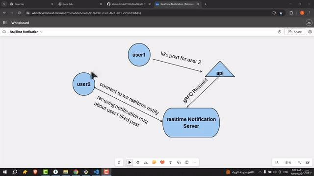

## 2 讲师原话

下面按「设计 → 工程 → 服务端 → 联调 → 客户端」的顺序引用，不按页码顺序。

**关于为什么不用双向实时连接：**

> "与实时聊天通知不同，它不需要像用户1和用户2之间建立实时连接那样工作……实时通知的作用相当于我们可以称为单向接收器的东西。"
> —— p044 [00:00] / [00:28]

> "过去，他们通常使用一种叫作 SSE 的机制，也就是服务器发送事件。"
> —— p044 [00:55]

**关于连接靠用户 ID 定位：**

> "这需要我们让用户用自己的 ID 连接到实时通知服务器，因为……我们需要提取出应该把通知发送给哪个已连接用户，而可以通过目标用户 ID 来提取。"
> —— p044 [02:20]

**关于两个服务怎么打通（本节最核心的一句）：**

> "每当我们调用 gRPC 时，都应该能够从 gRPC 系统内部控制 WebSocket 服务器，这意味着我们需要有一个连接点，把 gRPC 和套接字服务器连接起来。"
> —— p046 [00:00]

**关于锁的用途：**

> "我们可以先定义 WebSocket 和 WS，可以把它叫作互斥锁……因为我们只是想让 gRPC 服务器与 WebSocket 服务器保持同步。"
> —— p046 [01:55]

**关于 proto 里 `created_at` 从哪来：**

> "如果你还记得……在 API 中通知模型所在的位置，如果你注意到这一点，就会看到现在我们有了一个 created at 字段，也就是时间。"
> —— p045 [04:11]

**关于 WebSocket 路由：**

> "我们可以直接写成这样：`app.Get("/ws/:userID", websocket.New(func(c *websocket.Conn){...}))`。"
> —— p047 [04:08]

**关于为什么只推给一个人：**

> "我们是在把 WebSocket 连接指定到特定用户 ID，因此通过这种方式，我们关注的是用户 ID；这意味着如果用户1收到通知，就不会把任何内容传给用户2、用户3或任何其他用户，即使他们已经连接。"
> —— p047 [09:17]

**关于联调时踩的坑：**

> "为什么这个 WebSocket 不工作……抱歉，这是 gRPC。实时 WebSocket 运行在前端。我们还没有启动它。我们忘了监听它。"
> —— p047 [12:23]

> "这里的思路是我们可以使用一个新的……查找 mainUID……然后回到这里，如你所见，这就是我们得到的结果，因为这取决于带有请求主用户 ID 的 WebSocket。"
> —— p047 [16:42] / [17:12]

**关于 mainUID 和 targetID 的分工：**

> "查找目标 ID，这是正确的……如果你还记得，目标 ID 与用户点击的位置有关，比如用户开始关注某人的用户资料，或者开始点赞或评论某条帖子。"
> —— p047 [17:12]

**关于断线不炸：**

> "如果用户已断开连接，就把两者都断开；同时尝试调用也不会有任何问题……它只是尝试发送，如果对方已经连接，就会直接收到。"
> —— p047 [20:23]

这些原话连起来看，其实是同一条实现链条：先确定通知是单向推送，所以用 WebSocket 连接承载「服务器 → 用户」；因为要定向推送，所以连接 URL 必须带 `userID`；因为 gRPC 和 WebSocket 是两个服务端入口，却要操作同一批连接，所以要有共享 map 和 mutex；因为 POSTMAN 联调时容易把 `mainUID` 和 `targetID` 填反，所以讲师反复强调 `mainUID` 才是查连接表的 key；因为用户可能随时断线，所以删除连接和写入失败都不能让进程崩掉。复现时如果某一步卡住，优先回到这几句原话对应的代码位置检查。

## 3 从零复现

### 3.1 前置工具

课里没有演示这些工具的安装，但你需要它们：

- Go（`go version` 能看到版本即可）
- `protoc` 编译器（P045 直接敲 `protoc`，没有安装步骤）
- 两个 protoc 插件：
  ```bash
  go install google.golang.org/protobuf/cmd/protoc-gen-go@latest
  go install google.golang.org/grpc/cmd/protoc-gen-go-grpc@latest
  ```
- Postman（P047 用来做 WebSocket 和 gRPC 联调）

这里的 `go install ...@latest` 会把可执行文件装到 Go 的 bin 目录，通常是 `$GOPATH/bin` 或 `$HOME/go/bin`。如果终端里 `protoc` 能找到，但一执行生成命令就报 `protoc-gen-go: program not found or is not executable`，八成是这个目录没有加进 `PATH`。排查时先跑：

```bash
go env GOPATH
protoc --version
protoc-gen-go --version
protoc-gen-go-grpc --version
```

`protoc` 本身是 C++ 写的编译器，`protoc-gen-go` 和 `protoc-gen-go-grpc` 是它调用的 Go 插件，二者不是同一个东西。只装 `protoc` 不装插件，生成 Go 代码时就会失败；只装插件不装 `protoc`，则连 `.proto` 都解析不了。前端同学可以把它类比成“Babel 本体 + 两个 preset 插件”：编译器负责解析，插件负责产出目标语言代码。

### 3.2 建目录、初始化模块（p045 [00:00]–[01:18]）

在已有的 `backend` 目录下：

```bash
cd backend
mkdir realtime-notification
cd realtime-notification
go mod init realtime-notification
```

讲师给模块起的名字就是 `realtime-notification`，后面所有 import 路径都基于它。

创建 `protos` 目录用于放 `.proto` 文件：

```bash
mkdir protos
```

`go mod init` 的完整作用是初始化模块并写入 `go.mod`，其中第一行 `module realtime-notification` 会成为本工程内部包的 import 前缀。比如后面写 `import "realtime-notification/service"`，Go 就是靠这个 module 名找到 `service` 目录的。常见错误有两个：一是在错误的目录执行 `go mod init`，导致 `go.mod` 出现在上层或下层；二是 module 名和 import 路径不一致，代码里写 `realtime-notification/service`，但 `go.mod` 第一行不是这个值，编译时会报找不到包。验证方式是：

```bash
pwd
head -n 1 go.mod
```

输出应能确认当前在 `backend/realtime-notification`，且 `go.mod` 第一行是 `module realtime-notification`。

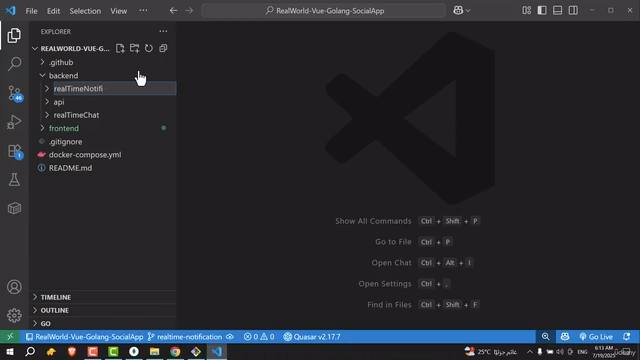

### 3.3 写 proto 文件（p045 [01:48]–[09:30]）

在 `protos/notification.proto` 里定义：一个 service、两个 message。

要点按讲师顺序：

1. `syntax = "proto3";`
2. `option go_package = "/proto";` —— 讲师的目的是「生成的 Go 包名和目录名一致」，这样后续 import 是 `realtime-notification/proto`。
3. 导入两个 Google 官方 proto：
   - `google/protobuf/empty.proto`（用来表示「这个 RPC 不返回任何东西」）
   - `google/protobuf/timestamp.proto`（因为 API 那边的 Notification 模型里有 `CreatedAt time.Time`）
4. service 叫 `Notification`，只放一个 RPC：`SendGRPCNotification`，入参 `NotificationGRPCRequest`，返回值 `google.protobuf.Empty`。
5. `NotificationGRPCRequest` 字段顺序：`id = 1`、`details = 2`、`mainUID = 3`、`targetID = 4`、`isReddit = 5`（布尔）、`created_at = 6`（Timestamp）、`user = 7`。
6. 额外定义 `UserGRPC`：`name = 1`、`avatar = 2`。这是为了在通知里带上「谁触发的」展示信息。

写 proto 时最容易忽略的是字段编号。`id = 1`、`details = 2` 这些编号是 wire 协议的一部分，不是注释；一旦生成代码后改动编号，旧客户端和新服务端可能对不上。复现阶段虽然只在本机联调，也应该按讲师给的编号写，避免以后接入 API 工程时出现“字段名一样但值串位”的隐蔽问题。另一个常见错误是 import 路径写错，`google/protobuf/empty.proto` 不是项目内文件，需要 `protoc` 能在 include 路径里找到它；如果报 `google/protobuf/empty.proto: File not found`，先确认 `protoc` 安装完整，再确认执行命令时当前目录是 `backend/realtime-notification`。

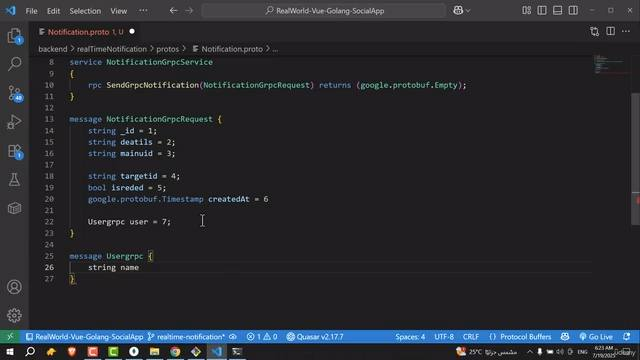

### 3.4 用 protoc 生成 Go 代码（p045 [09:34]–[11:21]）

讲师在 `realtime-notification` 目录下执行：

```bash
protoc --go_out=. --go-grpc_out=. protos/notification.proto
```

然后：

```bash
go mod tidy
```

这一步会把 `google.golang.org/grpc`、`google.golang.org/protobuf` 拉进 `go.mod`。生成结果在 `proto/` 目录下（`notification.pb.go` 和 `notification_grpc.pb.go`）。

命令里的 `--go_out=.` 表示把消息类型的 Go 代码输出到当前目录，`--go-grpc_out=.` 表示把 service/client 桩代码也输出到当前目录；最终落在哪个子目录由 `option go_package` 决定，所以讲师能生成到 `proto/`。如果只写了 `--go_out` 而漏了 `--go-grpc_out`，你会得到 message 类型但没有 `NotificationClient`、`NotificationServer` 和注册函数，gRPC 相关代码会编译失败。生成后建议马上执行：

```bash
ls proto
go build ./...
```

`ls proto` 用来确认两个文件都在；`go build ./...` 用来提前暴露 proto 字段名、包名、import 路径问题，而不是等到写 main.go 时才发现。前端对照可以这样理解：`.proto` 类似一份接口 schema，`protoc` 类似根据 schema 生成 TypeScript 类型和请求函数；schema 编译不过，后面业务代码再怎么写也跑不起来。

### 3.5 写 gRPC 服务端 + 连接表（p046）

新建目录和文件：

```bash
mkdir service realtime
```

`service/grpc.go` 干三件事：

1. 定义 `NotificationServer` 结构体，内嵌 `pb.UnimplementedNotificationServer`，**额外挂两个字段**：`WsMu *sync.Mutex` 和 `Ws map[string]*websocket.Conn`。这两个字段就是「gRPC 控制 WebSocket」的连接点。
2. 实现 `SendGRPCNotification`：加锁 → 用 `req.MainUID` 查连接 → 组一个 `Notification` 结构体 → `conn.WriteJSON` → 解锁 → 返回空。
3. `StartGRPCServer(ws, wsMu)`：`net.Listen("tcp", ":1890")`、`grpc.NewServer()`、注册服务、在 goroutine 里 `Serve`。

这里要特别理解“gRPC 控制 WebSocket”不是 gRPC 再去调一个 WebSocket HTTP 接口，而是两个服务在同一个进程里共享同一个 `map`。`StartGRPCServer` 收到的 `ws` 和 `wsMu` 来自 `main.go`，`StartWebSocketServer` 收到的也是同一份，所以 gRPC handler 里 `s.Ws[req.GetMainUID()]` 拿到的就是 WebSocket handler 放进去的那条连接。常见错误是：在 `StartGRPCServer` 里又 `make(map[string]*websocket.Conn)` 了一次，这样两张 map 互不相干，表现就是 WebSocket 明明连上了，gRPC Invoke 也成功，但消息永远发不出去。排查时在 gRPC handler 里打印 `len(s.Ws)`，在 WebSocket 连接成功后也打印 `len(ws)`，两边应该看到同一个数量。

注意讲师在这里踩过一个小坑：`req.IsRead` 那一行报错 "不能将类型为 1 的变量用作字符串构造。"（p046 [19:18]），原因是布尔字段被塞进了字符串位置。**这类错误不要猜，按编译器的行号改。**

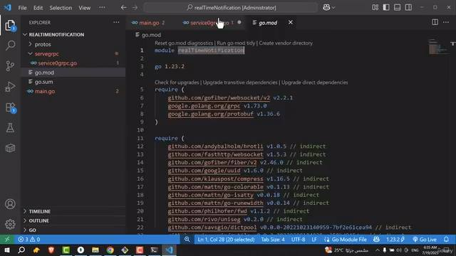

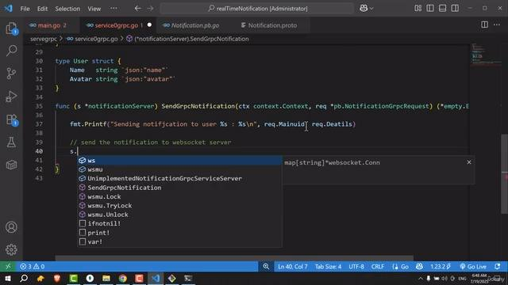

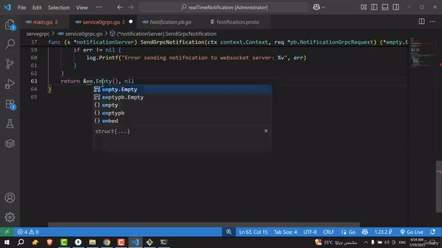

### 3.6 写 WebSocket 服务端（p047）

`realtime/notify_realtime_ws.go` 里干四件事：

1. `package realtime`，把 `Notification` / `User` 两个结构体复制一份（讲师明确说「我们也可以单独建 models 文件，但我先放这里」）。
2. `app := fiber.New()`，挂 CORS 中间件：允许凭证、允许所有来源。
3. 注册路由 `GET /ws/:userID`，handler 里：
   - `userID := c.Params("userID")`
   - 加锁 → `ws[userID] = c` → 解锁（**连接入表**）
   - `defer` 里加锁 → `delete(ws, userID)` → 解锁 → `c.Close()`（**连接出表**）
   - `for` 循环里 `c.ReadJSON` → 出错就 `break`；读到了就 `c.WriteJSON` 回给客户端
4. `log.Fatal(app.Listen(":8080"))`。

讲师在 p047 [12:23] 特别提醒过：**忘记 `app.Listen` 就会连不上**，会误以为是 WebSocket 写错了，其实只是服务没起来。

路由里的 `:userID` 是 Fiber 的路径参数，前端连接 `ws://localhost:8080/ws/abc` 时，`c.Params("userID")` 就是 `abc`。这个值会作为连接表的 key，所以前端必须保证“我连上时用的 ID”和“后端 gRPC 请求里的 `mainUID`”完全一致。常见错误包括：URL 拼成 `/ws/` 但没带 ID；前端用了大写或空格；Postman 里 URL 和 gRPC 字段一个填 `abc` 一个填 `testuser`。排查时服务端会打印 `user %s connected`，先看这条日志里的 ID 是不是你期望的值，再看 gRPC 请求里的 `mainUID` 是不是同一个字符串。

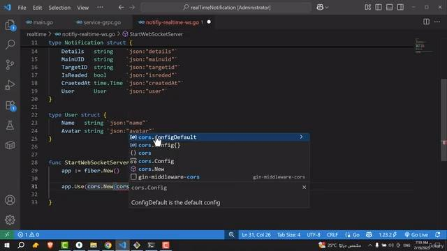

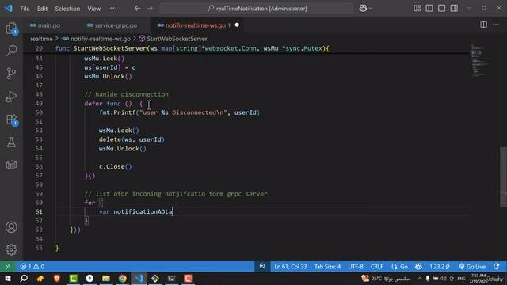

### 3.7 main.go 把两个服务接起来（p046 [27:05]、p047 [10:38]）

`main.go` 里：

- `var wsMutex sync.Mutex`
- `ws := make(map[string]*websocket.Conn)`
- `go realtime.StartWebSocketServer(ws, &wsMutex)`
- `err := services.StartGRPCServer(ws, &wsMutex)`，出错就 `log.Fatalf`
- 最后 `select {}` 阻塞主 goroutine，让进程别退出（讲师 p046 [01:26] 明确说这一步是为了 "阻塞主 goroutine，使程序保持运行。"）

**同一张 map、同一把 Mutex** 被两个服务共享，这就是 P046 开头说的那个 "连接点"。

这里的并发顺序要理解清楚：`StartWebSocketServer` 被 `go` 出去后会在自己的 goroutine 里执行 `app.Listen(":8080")`，而主 goroutine 继续调用 `StartGRPCServer` 启动 :1890。两个服务谁先监听成功并不重要，重要的是它们操作的是同一个 `ws`。如果只写 `realtime.StartWebSocketServer(...)` 而不加 `go`，由于 `app.Listen` 会阻塞，后面的 gRPC 服务根本不会启动；如果两个都用 `go` 启动，但最后没有 `select {}`，主 goroutine 结束，进程会立刻退出，表现就是“端口刚起来就没了”。验证方式是启动后另开终端执行 `lsof -i :8080` 和 `lsof -i :1890`，两个端口都应能看到当前 Go 进程。

### 3.8 联调（p047 [11:26]–[20:51]）

1. `go run main.go`，确认 8080 和 1890 都在监听。
2. Postman 开一个 WebSocket 连接：`ws://localhost:8080/ws/abc`（`abc` 随便填，这是接收方 userID）。
3. Postman 再开一个 gRPC 请求：导入 `notification.proto`，地址 `localhost:1890`，方法选 `SendGRPCNotification`。
4. **`mainUID` 必须填第 2 步的 `abc`**。讲师第一次联调失败就是因为填的是别的 ID（p047 [16:16]）。
5. 点 Invoke，WebSocket 那边应该收到一条 JSON。

联调时先把两个请求分开验证：第一步只验证 WebSocket 能连上，看服务端是否打印 `user abc connected`；第二步再 Invoke gRPC，看服务端是否打印 `sending notification to user abc`，以及 WebSocket 窗口是否收到 JSON。如果 WebSocket 连不上，先检查端口是不是 8080、路径是不是 `/ws/abc`、服务端有没有真的执行到 `app.Listen`；如果 gRPC 连不上，先检查 Postman 的地址是不是 `localhost:1890`、是否用了明文/非 TLS 模式、proto 是否导入正确。前端对照：浏览器里通常写 `new WebSocket("ws://localhost:8080/ws/" + currentUserID)`，然后在 `onmessage` 里 `JSON.parse(event.data)`；和后端连接表一样，`currentUserID` 必须与通知里的接收方 ID 对齐。

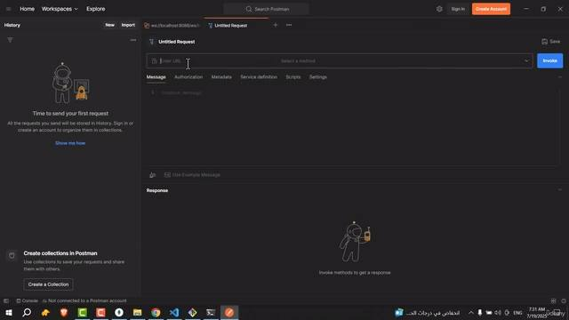

### 3.9 API 侧 gRPC 客户端（p048）

1. 把 `notification.proto` 原样复制到 API 工程的 `protos/` 目录（讲师原话：两边保持 "完全相同的文件结构"）。
2. 在 API 工程根目录生成：
   ```bash
   protoc --go_out=. --go-grpc_out=. protos/notification.proto
   ```
3. 写 `grpc/client_grpc.go`：`Client` 结构体、`NewClient()`、`Close()`、`SendGRPCNotification(...)` 方法、以及给业务层直接调用的 `SendNotification(notification models.Notification)`。
4. `go mod tidy` 收尾。

复制 proto 时要注意“消息定义和 service 定义一致”比“文件路径完全一样”更重要。两边工程可以有不同的 `go_package`，因为那只影响各自生成的 Go import 路径；但 `NotificationGRPCRequest` 的字段编号、字段类型、service 名和 RPC 名必须一致，否则客户端序列化出来的内容和服务器预期对不上。生成后先跑 `go build ./...`，如果报 `undefined: pb.NotificationClient`，通常是漏了 `--go-grpc_out` 或 proto 没生成到 import 路径；如果报 `cannot use ... as ...`，按第 5 章字段名对照逐项检查。

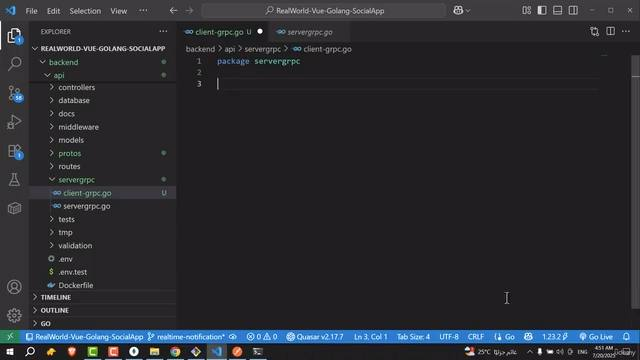

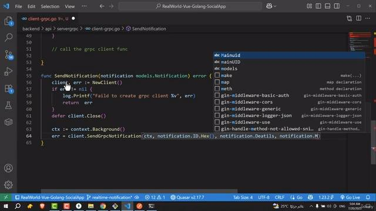

## 4 完整代码

> 下面的文件都是完整可保存的。标注「课里没讲/需按实际调整」的地方，请改成你自己的 module 名与字段名。

### 4.1 `backend/realtime-notification/protos/notification.proto`

```proto
syntax = "proto3";

// 课里讲师写的是 "/proto"。
// 如果你的 protoc 报 go_package 非法，或 API 侧 import 路径对不上，
// 改成下面这行（推荐，可复现性更好）：
// option go_package = "realtime-notification/proto;proto";
option go_package = "/proto";

import "google/protobuf/empty.proto";
import "google/protobuf/timestamp.proto";

service Notification {
  rpc SendGRPCNotification(NotificationGRPCRequest) returns (google.protobuf.Empty);
}

message NotificationGRPCRequest {
  string id = 1;
  string details = 2;
  string mainUID = 3;
  string targetID = 4;
  bool isReddit = 5;
  google.protobuf.Timestamp created_at = 6;
  UserGRPC user = 7;
}

message UserGRPC {
  string name = 1;
  string avatar = 2;
}
```

生成：

```bash
cd backend/realtime-notification
protoc --go_out=. --go-grpc_out=. protos/notification.proto
go mod tidy
```

### 4.2 `backend/realtime-notification/main.go`

```go
package main

import (
	"log"
	"sync"

	"github.com/gofiber/websocket/v2"

	"realtime-notification/realtime"
	services "realtime-notification/service"
)

func main() {
	var wsMutex sync.Mutex
	ws := make(map[string]*websocket.Conn)

	// WebSocket 服务（:8080）与 gRPC 服务（:1890）共享同一张连接表和同一把锁
	go realtime.StartWebSocketServer(ws, &wsMutex)

	err := services.StartGRPCServer(ws, &wsMutex)
	if err != nil {
		log.Fatalf("fail to start grpc server: %v", err)
	}

	// 阻塞主 goroutine，保持进程存活
	select {}
}
```

### 4.3 `backend/realtime-notification/service/grpc.go`

```go
package services

import (
	"context"
	"fmt"
	"log"
	"net"
	"sync"
	"time"

	"github.com/gofiber/websocket/v2"
	"google.golang.org/grpc"
	"google.golang.org/protobuf/types/known/emptypb"

	pb "realtime-notification/proto"
)

type Notification struct {
	ID         string    `json:"id"`
	Details    string    `json:"details"`
	MainUserID string    `json:"mainUserID"`
	TargetID   string    `json:"targetID"`
	IsRead     bool      `json:"isRead"`
	CreatedAt  time.Time `json:"createdAt"`
	User       User      `json:"user"`
}

type User struct {
	Name   string `json:"name"`
	Avatar string `json:"avatar"`
}

type NotificationServer struct {
	pb.UnimplementedNotificationServer
	WsMu *sync.Mutex
	Ws   map[string]*websocket.Conn
}

func (s *NotificationServer) SendGRPCNotification(
	ctx context.Context,
	req *pb.NotificationGRPCRequest,
) (*emptypb.Empty, error) {
	fmt.Printf("sending notification to user %s : %s\n", req.GetMainUID(), req.GetDetails())

	s.WsMu.Lock()
	defer s.WsMu.Unlock()

	conn, ok := s.Ws[req.GetMainUID()]
	if ok {
		notification := Notification{
			ID:         req.GetId(),
			Details:    req.GetDetails(),
			MainUserID: req.GetMainUID(),
			TargetID:   req.GetTargetID(),
			IsRead:     req.GetIsReddit(),
			CreatedAt:  time.Unix(req.GetCreatedAt().GetSeconds(), 0),
			User: User{
				Name:   req.GetUser().GetName(),
				Avatar: req.GetUser().GetAvatar(),
			},
		}

		if err := conn.WriteJSON(notification); err != nil {
			log.Printf("error sending notification to web socket server %v", err)
		}
	}

	return &emptypb.Empty{}, nil
}

func StartGRPCServer(ws map[string]*websocket.Conn, wsMu *sync.Mutex) error {
	lis, err := net.Listen("tcp", ":1890")
	if err != nil {
		return fmt.Errorf("failed to listen on port 1890: %v", err)
	}

	grpcServer := grpc.NewServer()
	notificationService := &NotificationServer{
		Ws:   ws,
		WsMu: wsMu,
	}

	pb.RegisterNotificationServer(grpcServer, notificationService)

	go func() {
		if err := grpcServer.Serve(lis); err != nil {
			log.Fatalf("failed to serve gRPC server: %v", err)
		}
	}()

	return nil
}
```

### 4.4 `backend/realtime-notification/realtime/notify_realtime_ws.go`

```go
package realtime

import (
	"fmt"
	"log"
	"sync"
	"time"

	"github.com/gofiber/fiber/v2"
	"github.com/gofiber/fiber/v2/middleware/cors"
	"github.com/gofiber/websocket/v2"
)

// 课里讲师直接把这几个类型复制到这个文件里，
// 说「你也可以单独建 models 文件，但我先放这里」。
type Notification struct {
	ID         string    `json:"id"`
	Details    string    `json:"details"`
	MainUserID string    `json:"mainUserID"`
	TargetID   string    `json:"targetID"`
	IsRead     bool      `json:"isRead"`
	CreatedAt  time.Time `json:"createdAt"`
	User       User      `json:"user"`
}

type User struct {
	Name   string `json:"name"`
	Avatar string `json:"avatar"`
}

func StartWebSocketServer(ws map[string]*websocket.Conn, wsMutex *sync.Mutex) {
	app := fiber.New()

	app.Use(cors.New(cors.Config{
		AllowCredentials: true,
		AllowOriginsFunc: func(origin string) bool {
			return true
		},
	}))

	app.Get("/ws/:userID", websocket.New(func(c *websocket.Conn) {
		userID := c.Params("userID")
		fmt.Printf("user %s connected\n", userID)

		// 把这条连接登记到共享的连接表里
		wsMutex.Lock()
		ws[userID] = c
		wsMutex.Unlock()

		// 连接断开时把它从表里删掉
		defer func() {
			wsMutex.Lock()
			delete(ws, userID)
			wsMutex.Unlock()
			c.Close()
		}()

		fmt.Printf("user %s is connected\n", userID)

		for {
			var notificationData Notification

			if err := c.ReadJSON(&notificationData); err != nil {
				log.Printf("error reading notification data from WS: %v", err)
				break
			}

			if err := c.WriteJSON(notificationData); err != nil {
				log.Printf("error writing notification data to WS: %v", err)
				break
			}
		}
	}))

	log.Fatal(app.Listen(":8080"))
}
```

### 4.5 `backend/realtime-notification/go.mod` 的依赖获取方式

课里没有指定版本号，讲师全程只用 `go mod tidy` 让 Go 自己选版本。照着敲：

```bash
cd backend/realtime-notification
go get github.com/gofiber/fiber/v2
go get github.com/gofiber/websocket/v2
go get google.golang.org/grpc
go get google.golang.org/protobuf
go mod tidy
```

> 说明：`option go_package` 若改成 `realtime-notification/proto;proto`，Go 包名就是 `proto`，import 写作 `pb "realtime-notification/proto"` 或 `pb "realtime-notification/proto"` 都行；若保持讲师写的 `/proto`，import 路径请以 `go list ./...` 输出为准。

保存代码后建议依次跑 `gofmt -w .`、`go build ./...`、`go run main.go`。`gofmt` 不会改变逻辑，只统一格式；`go build` 能在启动前发现 import 路径、字段名、类型不匹配；`go run` 才真正验证端口和联调。若 `go mod tidy` 后出现版本升级导致的 API 差异，优先看编译器提示，不要凭记忆改字段名。

### 4.6 API 侧：`api/grpc/client_grpc.go`

> 这个文件属于你已有的 API 工程。`your-api-module/proto`、`your-api-module/models` 两处 import 要换成你工程真实的 module 名（课里没讲 API 工程的 module 名）。

```go
package grpcclient

import (
	"context"
	"log"
	"time"

	"google.golang.org/grpc"
	"google.golang.org/grpc/credentials/insecure"
	"google.golang.org/protobuf/types/known/timestamppb"

	"your-api-module/models"
	pb "your-api-module/proto"
)

type Client struct {
	conn   *grpc.ClientConn
	client pb.NotificationClient
}

func NewClient() (*Client, error) {
	conn, err := grpc.NewClient(
		"localhost:1890",
		grpc.WithTransportCredentials(insecure.NewCredentials()),
	)
	if err != nil {
		return nil, err
	}

	return &Client{
		conn:   conn,
		client: pb.NewNotificationClient(conn),
	}, nil
}

func (c *Client) Close() error {
	return c.conn.Close()
}

func (c *Client) SendGRPCNotification(
	ctx context.Context,
	id string,
	details string,
	mainUserID string,
	targetID string,
	isRead bool,
	createdAt time.Time,
	userName string,
	userAvatar string,
) error {
	request := &pb.NotificationGRPCRequest{
		Id:        id,
		Details:   details,
		MainUID:   mainUserID,
		TargetID:  targetID,
		IsReddit:  isRead,
		CreatedAt: &timestamppb.Timestamp{Seconds: createdAt.Unix()},
		User: &pb.UserGRPC{
			Name:   userName,
			Avatar: userAvatar,
		},
	}

	_, err := c.client.SendGRPCNotification(ctx, request)
	if err != nil {
		log.Printf("failed to send notification %v", err)
		return err
	}

	return nil
}

// 业务层只调用这一个函数即可
func SendNotification(notification models.Notification) error {
	client, err := NewClient()
	if err != nil {
		log.Printf("failed to create gRPC client %v", err)
		return err
	}
	defer client.Close()

	ctx := context.Background()

	return client.SendGRPCNotification(
		ctx,
		notification.ID.Hex(),
		notification.Details,
		notification.MainUserID,
		notification.TargetID,
		notification.IsRead,
		notification.CreatedAt,
		notification.User.Name,
		notification.User.Avatar,
	)
}
```

生成 proto 的命令（在 API 工程根目录）：

```bash
protoc --go_out=. --go-grpc_out=. protos/notification.proto
go mod tidy
```

## 5 逐行解释

**`option go_package = "/proto";`**
决定生成代码的 import 路径和包名。讲师的目的只有一句话：「用 protoc 生成时，Go 包名和我的文件夹名一致」。课里没有解释它的完整语法（`path;name` 形式），也没演示跨模块 import 的坑，所以第 7 章会提醒你把这一行改成能用的写法。实际复现时如果 `protoc` 直接报 `unable to determine Go import path` 或类似错误，不要卡住，先按第 7 章推荐的 `realtime-notification/proto;proto` 改。

**`import "google/protobuf/empty.proto"` / `timestamp.proto`**
`empty` 用来表示「这个 RPC 什么都不返回」——P045 [05:28] 讲师的原话是「我们不需要返回任何东西，所以用 Empty」。`timestamp` 是因为 API 侧的 Notification 模型里 `CreatedAt` 是 `time.Time`，跨语言传输必须拆成秒 + 纳秒，proto 才认识。常见错误是忘了 import 就直接写 `google.protobuf.Timestamp`，`protoc` 会报类型找不到。

**`rpc SendGRPCNotification(NotificationGRPCRequest) returns (google.protobuf.Empty);`**
只有这一个 RPC。注意生成之后 Go 侧的客户端类型叫 `NotificationClient`、服务端叫 `NotificationServer`，不是讲师口述时含糊说的那个长名字；以 `notification_grpc.pb.go` 里实际生成的为准。如果代码里写 `pb.NotificationServiceClient` 之类猜出来的名字，编译会失败，直接打开生成文件看类型名最快。

**`string mainUID = 3;` 与 `string targetID = 4;` 的分工**
这是整节最容易填反的两个字段。讲师在 P047 [17:12] 讲得很清楚：`mainUID` 是**接收通知的人**，代码里拿它去查连接表；`targetID` 是**被点击的那个对象**（帖子 ID、用户资料 ID），只用来做前端跳转，不参与路由。联调时把 `mainUID` 填成 `targetID`，就会出现「Postman 显示 Invoke 成功，WebSocket 一条都没收到」。前端对照：`mainUID` 类似“这条通知该塞给哪个当前登录用户”，`targetID` 类似“点开通知后跳转到哪条帖子或哪个主页”。

**`bool isReddit = 5;`**
讲师口述这个词时转录成了 "是 Reddit / 作为 Reddit"，他在 P046 [09:59] 还说 "我知道这和这个完全不同"——意思是 proto 层和 Go 结构体层的命名不一致，他自己也承认。**以你实际生成的字段名为准**，改代码时按编译器提示走。常见错误是 Go 结构体里写 `IsRead`，proto 里写 `isReddit`，生成后的请求字段可能是 `IsReddit`，而业务层传参时还按 `IsRead` 找，结果编译不过；按生成文件逐个核对即可。

**`NotificationServer` 里内嵌 `pb.UnimplementedNotificationServer`**
gRPC-Go 新版要求服务实现必须内嵌这个类型，否则注册时报错。课里讲师直接写了，没有解释原因，你只要知道「不写会编译不过」。它类似一个默认实现，保证以后 proto 新增 RPC 时旧服务端不会立刻编译失败。

**`WsMu *sync.Mutex` 和 `Ws map[string]*websocket.Conn` 为什么是指针和共享的**
P046 开头说得很直白：gRPC 服务要能「控制」WebSocket 服务。做法不是 RPC 再调一次，而是两个服务**在同一个进程里共享同一个 map**。既然共享，就必须有锁。注意 map 本身是引用类型，传值也能改内容，但为了语义一致，讲师全用同一个变量传下去。
> 给前端同学的类比：Node 是单线程事件循环，你几乎不会遇到「两个回调同时改一个 Map」的问题；但在 Go 里 gRPC handler 和 WebSocket handler 跑在不同 goroutine，等于 Node 里开了多线程，所以必须显式加锁。这就是 `sync.Mutex` 在 Go 里对应 JS 里「没有对应物、只能靠单线程避免」的那部分。

**`s.WsMu.Lock()` 后面立刻 `defer s.WsMu.Unlock()`**
讲师的原话是 "加锁，defer 解锁，然后检查连接是否正常。"。用 `defer` 是为了 `WriteJSON` panic 时也能解锁，避免整个服务死锁。常见错误是在 `if ok { ... }` 分支里才 `Unlock`，一旦前面的 `Get` 或打印 panic，锁永远不释放。复现时保持 `Lock` 后紧接 `defer Unlock` 最稳。

**`time.Unix(req.GetCreatedAt().GetSeconds(), 0)`**
proto 的 Timestamp 传过来只有秒和纳秒，Go 的 `time.Time` 要重新构造。讲师只取了秒、纳秒写死 0（p046 [20:12] 的 "just press zero"），精度到秒，够用。如果 API 侧传了 `CreatedAt` 但服务端收到零值，先检查客户端有没有设置 `timestamppb.Timestamp{Seconds: createdAt.Unix()}`。

**`net.Listen("tcp", ":1890")`**
gRPC 端口。讲师中途口误说过 1888、8080、1890，最终代码是 **1890**（p046 [23:54] 的 "我刚用了 1890。"）。API 侧客户端必须连这个端口。排查端口占用可以用 `lsof -i :1890`；如果启动报 `bind: address already in use`，先杀掉旧进程或换端口，但换端口后客户端也要同步改。

**`go func(){ grpcServer.Serve(lis) }()` 外层再 `return nil`**
所以 `StartGRPCServer` 是「启动完立刻返回」，返回 `nil` 不代表服务在跑，只代表监听成功。真正的阻塞在 `main.go` 的 `select {}`。如果你在 `Serve` 外面没有 `go`，`StartGRPCServer` 会一直阻塞，后面的 `select {}` 虽然写了但根本执行不到。

**WebSocket handler 里的 `defer delete(ws, userID)`**
不加这句，用户断线后 map 里会留下一条失效连接，之后 `WriteJSON` 会报错。讲师在 P047 [06:30] 专门写了这段清理逻辑，并且说「断开也不影响应用，最多就是发不出去」。验证方式：连上后关闭 WebSocket，再 Invoke gRPC，服务端不应 panic；日志里可能出现写失败，但进程仍存活。

**`for { ReadJSON; WriteJSON }`**
P047 [07:28] 讲师说这是「监听来自 gRPC 的通知」。严格讲，这个循环读的是**客户端发来的消息**，写完再原样回给客户端，是联调用的回显；真正从 gRPC 推过来的消息是 `service/grpc.go` 里直接 `conn.WriteJSON` 写出去的。两条写入路径不冲突，但你要知道联调时看到的那条 JSON 是**服务端主动推的**，不是这个 echo 循环产生的。若你在 Postman 里手动发一条消息，服务端会 echo 回来；若你 Invoke gRPC，收到的是 `SendGRPCNotification` 组装的 `Notification`。

**`log.Fatal(app.Listen(":8080"))`**
漏写这行就是 P047 [12:23] 那个坑：Postman 连 1890 一直失败，因为 1890 是 gRPC，WebSocket 在 8080。`log.Fatal` 会在监听失败时直接退出并打印原因，比如端口占用；不要把它改成普通打印后继续跑，否则后面 WebSocket 连接会莫名其妙失败。

**API 侧 `grpc.NewClient("localhost:1890", ...)`**
讲师口述的是 "port 80 90"，结合服务端代码应为 **1890**。`insecure.NewCredentials()` 表示不走 TLS，本地开发用。生产要换 TLS 凭证，课里没讲。如果 API 侧报连接被拒绝，先确认 realtime 服务是否在跑、端口是否为 1890、是否被防火墙拦截。

**`notification.ID.Hex()`**
说明 API 的 Notification 模型里 `ID` 是 MongoDB 的 `primitive.ObjectID`（有 `.Hex()` 方法）。课里没有讲数据库连接代码，这一行是从讲师调用方式反推的；如果你的模型 `ID` 是 string，直接传 `notification.ID` 即可。这类占位符是复现时最常见的编译错误之一，按你自己模型的字段类型改。

**`&timestamppb.Timestamp{Seconds: createdAt.Unix()}`**
讲师在这里反复试了几次（p048 [09:48]–[10:10]），最后用的是结构体字面量 + `.Unix()`，不是 `timestamppb.New()`。两种都能用，按课里的写法即可。前端对照：这相当于 JS 里把 `Date` 转成 Unix 秒再传给后端，展示时再转回本地时间。

## 6 复现检查清单

按顺序勾，任何一项不过就别往下走。每条后面都给出可执行的验证方式；不要把“看起来像”当成通过。

- [ ] `backend/realtime-notification` 目录存在，`go.mod` 第一行是 `module realtime-notification`。验证：`cd backend/realtime-notification && pwd && head -n 1 go.mod`，输出路径和 module 行都要对。
- [ ] `protos/notification.proto` 里有 1 个 service、2 个 message，`created_at` 是 `google.protobuf.Timestamp` 类型。验证：打开文件核对 `service Notification`、`message NotificationGRPCRequest`、`message UserGRPC` 三个块，并确认 `created_at = 6` 的类型不是 string。
- [ ] `protoc --go_out=. --go-grpc_out=. protos/notification.proto` 无报错，`proto/` 下有 `notification.pb.go` 和 `notification_grpc.pb.go`。验证：执行生成命令后跑 `ls proto`，两个文件名都要出现；如果目录名不是 `proto`，以 `go_package` 生成的路径为准。
- [ ] `go build ./...` 通过（这一步能提前暴露 proto 字段名拼错的问题）。验证：在 `backend/realtime-notification` 下执行，退出码为 0；若报错，按第一条错误行修，不要一次改多处。
- [ ] `go run main.go` 后，终端没有立刻退出（说明 `select {}` 生效）。验证：观察终端是否持续挂起；如果回到 shell 提示符，说明主 goroutine 已退出，检查 `select {}` 是否漏写。
- [ ] `lsof -i :8080` 和 `lsof -i :1890` 都能看到进程。验证：另开终端分别执行两条命令，输出里应有 Go 进程；没有输出就是对应服务没监听。
- [ ] Postman WebSocket 连 `ws://localhost:8080/ws/testuser` 显示已连接，服务端打印 `user testuser connected`。验证：先看 Postman 连接状态，再看终端日志里的 ID 是否正好是 `testuser`。
- [ ] Postman gRPC 导入 proto，地址 `localhost:1890`，`mainUID` 填 `testuser`，Invoke 返回空对象。验证：Invoke 后看 Postman 响应是否为 `{}` 或空消息；同时终端应打印 `sending notification to user testuser`。
- [ ] 同一时刻 WebSocket 窗口收到一条 JSON，`mainUserID` 字段等于 `testuser`。验证：展开收到的 JSON，检查 `mainUserID`，不是 `targetID`。
- [ ] 把 `mainUID` 改成 `otheruser` 再 Invoke，**收不到**（证明是按 ID 定向投递，不是广播）。验证：保持 `testuser` 的 WebSocket 连接，把 gRPC 的 `mainUID` 改成 `otheruser`，WebSocket 不应新增消息。
- [ ] 关掉 WebSocket 再 Invoke，服务端不 panic、gRPC 仍返回成功（P047 [20:23] 的行为）。验证：关闭 Postman WebSocket 后点 Invoke，看终端是否存活、gRPC 是否仍返回空对象。
- [ ] API 工程里 `protos/notification.proto` 与 realtime 工程**完全一致**（可以直接 `diff` 两个文件）。验证：执行 `diff backend/realtime-notification/protos/notification.proto api/protos/notification.proto`，除了允许的 `go_package` 注释差异外，message 和 service 定义应一致。
- [ ] API 工程 `go mod tidy` 通过，`grpc/client_grpc.go` 里没有残留 `your-api-module` 占位符。验证：`grep -R "your-api-module" grpc/` 应无输出；再跑 `go build ./...`。
- [ ] API 侧调用 `SendNotification` 后，已连接的 WebSocket 收到消息。验证：在业务代码或临时测试里调用一次，保持 WebSocket 在线，确认收到 JSON 且 `mainUserID` 正确。

## 7 课里没讲但你会撞上的

下表按“现象 / 原因 / 怎么办”整理。第 1 行对应的推荐写法代码块保留在表格下方。

| 现象 | 原因 | 怎么办 |
| --- | --- | --- |
| `protoc` 报 `go_package` 非法或生成路径不对 | 讲师写的 `option go_package = "/proto";` 不是推荐的合法 import path 形式，跨模块时容易对不上 | 改成 `realtime-notification/proto;proto`；API 工程那份改成 `your-api-module/proto;proto`。两边 proto 内容不一致没关系，只要 message/service 定义一致即可，因为 `go_package` 只影响生成代码的 import 路径，不影响 wire 协议 |
| 编译时报 `MainUID`/`MainUid`、`TargetID`/`TargetId`、`IsReddit`、`CreatedAt` 不一致 | `protoc-gen-go` 的驼峰转换规则在不同版本下可能和手写结构体字段名不完全一样 | 不猜字段名，直接打开 `notification.pb.go` 看生成类型；按编译器报错行改。业务结构体里的 JSON tag 可以保留 `mainUserID` 等前端约定名，但 proto 请求字段以生成代码为准 |
| WebSocket 连不上，gRPC Invoke 却成功 | 忘记 `log.Fatal(app.Listen(":8080"))` 或只启动了 gRPC 服务 | 看终端有没有 `app.Listen` 相关日志；用 `lsof -i :8080` 确认 WebSocket 端口在监听。P047 [12:23] 的坑就是 WebSocket 服务没起来 |
| gRPC Invoke 成功，但 WebSocket 一条消息都没有 | `mainUID` 填成了别的 ID，或填成了 `targetID` | 把 `mainUID` 改成 WebSocket URL 里的 `userID`；在 gRPC handler 打印 `req.GetMainUID()`，在 WebSocket 连接处打印 `userID`，两个字符串必须完全相等 |
| 明明连上了，`len(ws)` 在 gRPC 里却是 0 | 两个服务没有共享同一张 map，或 `StartGRPCServer` 内部又新建了一张 map | 检查 `main.go` 只 `make` 一次 `ws`，然后同时传给 `StartWebSocketServer` 和 `StartGRPCServer`；不要在 `StartGRPCServer` 里重新 `make` |
| 用户断线后服务端报错或锁住 | 没有在 `defer` 里 `delete(ws, userID)`，或加锁后没有 `defer Unlock` | 保持连接入表/出表成对出现；`Lock` 后紧接 `defer Unlock`。断线时 `WriteJSON` 失败只记录日志，不要让进程 panic |
| API 侧编译报找不到 `pb.NotificationClient` | 只跑了 `--go_out`，漏了 `--go-grpc_out`，或 API 工程 proto 没生成 | 重新执行 `protoc --go_out=. --go-grpc_out=. protos/notification.proto`，再 `go mod tidy` 和 `go build ./...` |
| API 侧报连接被拒绝 | 地址端口写错，或 realtime-notification 没启动 | 确认客户端连 `localhost:1890`，并确认 realtime 服务已经 `go run main.go`；本地开发用 `insecure.NewCredentials()` |
| `notification.ID.Hex()` 编译不过 | 你的 API 模型里 `ID` 不是 MongoDB `primitive.ObjectID`，而是 string 等类型 | 按实际模型改：string 就直接传 `notification.ID`，ObjectID 才用 `.Hex()`；这是课里没展示数据库代码导致的占位差异 |
| 时间字段收到零值 | 客户端没有把 `createdAt` 转成 `timestamppb.Timestamp`，或服务端没有取 `GetSeconds()` | 客户端设置 `&timestamppb.Timestamp{Seconds: createdAt.Unix()}`；服务端用 `time.Unix(req.GetCreatedAt().GetSeconds(), 0)` 还原 |

第 1 行的推荐写法对应代码块如下，保留原写法便于对照：

```proto
option go_package = "realtime-notification/proto;proto";
```

API 工程那份对应改成：

```proto
option go_package = "your-api-module/proto;proto";
```