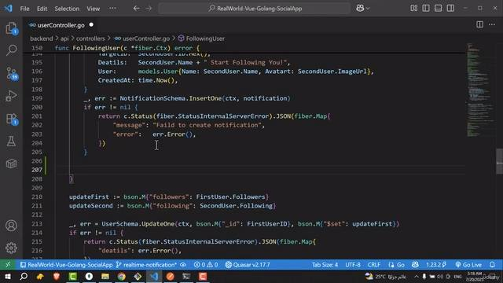
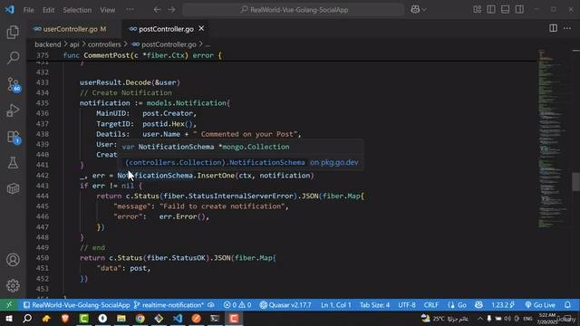
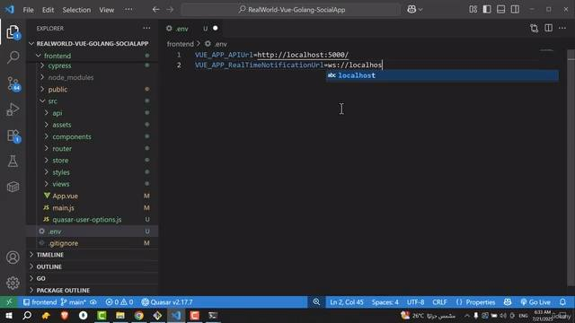
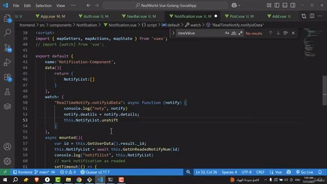
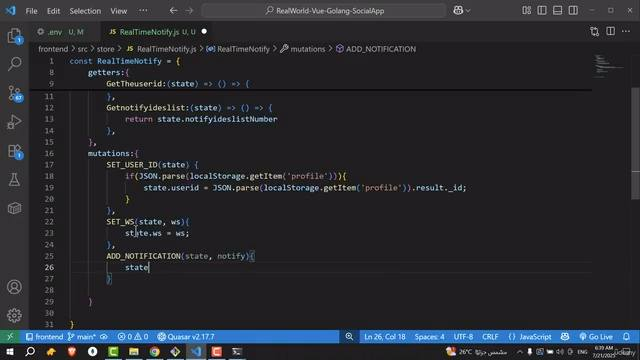
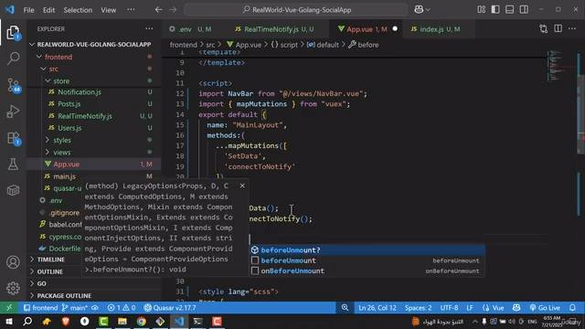
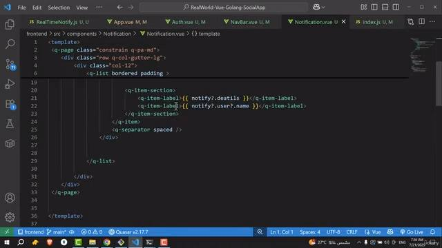
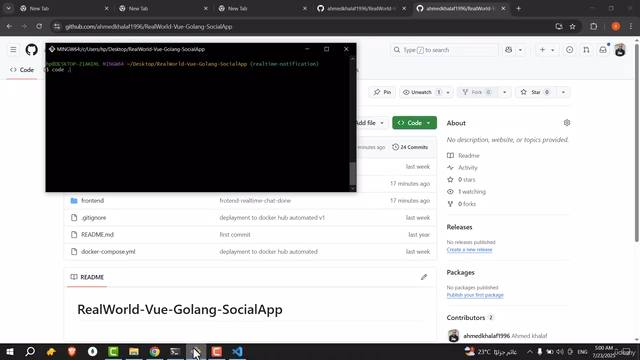
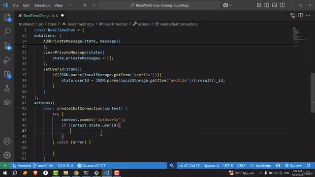

## 1. 这一节做什么

P49–P54 是“把后端实时能力接到前端”的联调段，核心产物有两个：

1. **实时通知链路**：后端在“关注用户、点赞、评论”等写操作成功后，用 gRPC 调通知服务；通知服务再通过 WebSocket 推给前端；前端用 Vuex 存未读数和通知对象，导航栏显示未读数，通知页实时插入新通知。
2. **实时聊天前端 store 雏形**：新建 `realtime-chat` 的 Vuex 模块，负责建立 WebSocket、接收私聊消息、接收在线好友列表、维护未读消息数。

需要先说明边界：P49–P54 **不是从零创建 Go API、gRPC 通知服务、WebSocket 服务**。这些来自前 48 集。本节可复现的是：在你已有的课程工程里，按下面的文件路径、环境变量、启动命令和代码，把实时通知与聊天 store 接起来。若你完全没有前置工程，只照本节无法凭空启动完整后端；这是课程本身的前提，不是文档省略。

本节完成后应达到：

- 用户 A 已登录时，B 关注 A、点赞 A 的帖子、评论 A 的帖子，A 的前端无需刷新即可收到通知。
- 取消关注、取消点赞不产生新通知；再次关注/点赞会再次产生。
- 导航栏未读数随通知增加；切换路由后重新计算。
- 通知页能看到通知文本与头像；前端控制台能打印后端推送的对象。
- 聊天 store 能连 WebSocket，能区分 `onlineFriends` 和私聊消息。



## 2. 讲师原话（带「—— pNNN [MM:SS]」）

> "在创建通知之后，我们首先应该把通知对象的 id 字段设置为正确的值。"
> —— p049 [00:52]

> "之后我们可以在这里调用 gRPC，直接这样写：serve gRPC.sendNotification。"
> —— p049 [02:14]

> "为通知要使用的 URL 添加环境变量，同时我们也可以创建通知存储。"
> —— p050 [02:13]

> "在 WebSocket 的 on open 事件中，我们希望把这里设为 contacts.commitSet_ws，并传入当前的 ws。"
> —— p050 [13:58]

> "实际上，我们首先要做的是连接到通知……并且要确保无论何时关闭它，都能断开连接。"
> —— p051 [00:00]

> "只有进入一个新函数时这才会生效，不过还有另一个可以监听的事件，它会转到另一条路由……我们可以从导航栏检测到这一点。"
> —— p052 [00:26]

> "创建实时聊天文件 chat.js。"
> —— p054 [00:29]



## 3. 从零复现

### 3.1 目录、环境和依赖版本

建议目录如下，名字可按你课程仓库改，但下面代码里的导入路径要同步改：

```text
course-repro/
├── api/                         # Go REST API，前 48 集已有
│   ├── controllers/
│   │   └── user_controller.go
│   ├── main.go
│   └── go.mod
├── realtime-notification/       # WebSocket 通知服务，前 48 集已有
│   └── main.go
├── realtime-chat/               # WebSocket 聊天服务，前 48 集已有
│   └── main.go
└── frontend/                    # Vue 2 + Vuex 前端
    ├── .env.development
    ├── package.json
    └── src/
        ├── main.js
        ├── App.vue
        ├── store/
        │   ├── index.js
        │   ├── realtime-notify.js
        │   └── realtime-chat.js
        ├── components/
        │   ├── NavBar.vue
        │   └── Notification.vue
        └── views/
            └── Login.vue
```

版本建议：

| 依赖 | 版本 | 说明 |
|---|---|---|
| Node.js | 16 或 18 | Vue CLI 项目能稳定运行即可 |
| Vue | 2.6.x | 课程是 Vue 2 Options API |
| Vuex | 3.6.x | 对应 Vue 2 |
| vue-router | 3.5.x | 对应 Vue 2 |
| axios | 1.x | 登录页补全用；课程 P49–P54 没展开登录接口 |
| Go | 以前置工程 `go.mod` 为准 | P53 只说要更新 CI 的 Go version，未给具体版本号 |

前端 `package.json` 可用：

```json
{
  "name": "course-frontend",
  "version": "0.1.0",
  "private": true,
  "scripts": {
    "serve": "vue-cli-service serve",
    "build": "vue-cli-service build"
  },
  "dependencies": {
    "axios": "^1.6.0",
    "core-js": "^3.8.3",
    "vue": "^2.6.14",
    "vue-router": "^3.5.1",
    "vuex": "^3.6.2"
  },
  "devDependencies": {
    "@vue/cli-service": "~5.0.0"
  }
}
```

### 3.2 配环境变量

P50 明确要求“先加 URL 环境变量，再建 notification store”。Vue CLI 只注入 `VUE_APP_` 前缀变量，所以变量名要这样写：

```bash
# frontend/.env.development
VUE_APP_REALTIME_NOTIFICATION=ws://localhost:8080
VUE_APP_REALTIME_CHAT=ws://localhost:8081
VUE_APP_API_URL=http://localhost:3000
```

注意：逐字稿明确通知服务用到 `8080`；聊天服务端口在口播里含糊，不能把 `8081` 当成课程结论。**必须打开你的 `realtime-chat/main.go`，看它实际监听哪个端口，再把 `VUE_APP_REALTIME_CHAT` 改成那个端口。**`VUE_APP_API_URL` 也不是 P49–P54 的重点，是为了让下面登录页能跑而补的最小变量。



### 3.3 启动后端

先编译再运行，P50 讲师就是这么做的：

```bash
cd realtime-notification
go build -o realtime-notification
./realtime-notification
# Windows PowerShell:
# go build -o realtime-notification.exe
# .\realtime-notification.exe
```

另开终端：

```bash
cd api
go build -o server
./server
# Windows:
# go build -o server.exe
# .\server.exe
```

再开聊天服务，端口以它自己 `main.go` 为准：

```bash
cd realtime-chat
go build -o realtime-chat
./realtime-chat
```

### 3.4 后端 P49：写操作成功后发通知

P49 的逻辑不是“新写一个通知接口”，而是在已有的 `UserController` 里找到会创建通知的位置，在 Mongo 插入成功后：

1. 把插入结果里的通知 ID 赋给 `notification.ID`；
2. 调 `serveGrpc.SendNotification(notification)`。

逐字稿点到的位置有：关注用户、评论、点赞帖子；创建/更新/获取用户这类普通 CRUD 不加。讲师原话是“not on create or update or get here on comment and here on like posts”。

下面保留逐字稿能确定的部分，**不伪造完整 controller 的导入和 Mongo 驱动字段**：

```go
// 在 UserController 的“关注用户 / 评论 / 点赞”写操作里，
// Mongo 插入成功后插入这段控制流。
// 逐字稿写法是 res.insertedId.primitiveObjectId；
// 你的驱动若叫 res.InsertedID，就按实际类型断言。
notification.ID = insertedID

if err := serveGrpc.SendNotification(ctx, notification); err != nil {
    // 课程没有展开错误处理，这里至少不要吞掉
    log.Println("send notification failed:", err)
}
```

测试顺序要按 P49 的口
述来：先在浏览器 A 以用户甲登录，浏览器 B（或无痕窗口）以用户乙登录；乙关注甲、给甲的帖子点赞、评论甲的帖子，观察 A 页面。P49 讲师演示时特意说明“第一次关注可能不生效，因为之前已经关注过”，所以测试前先取消关注，再重新关注，这样才走“新建通知”的分支。



### 3.5 前端 P50：创建 notification store

P50 的顺序是：先加 `.env.development` 的 WebSocket 地址 → 新建 `src/store/realtime-notify.js` → 在 `src/store/index.js` 里注册模块。store 里放四样东西：

1. `state.ws`：WebSocket 实例，`null` 表示未连接；
2. `state.userID`：从 `localStorage` 的 `profile` 里取，用于拼 WS URL；
3. `state.notificationNumber`：未读数；
4. `state.notify`：后端推送的最后一个通知对象，Notification 组件和 NavBar 都 watch 它。

讲师在 P50 中途删掉了早期写的 `notifyIDsList`、`getNotify` 等冗余 getter，最后只保留了必要部分。下面第 4 节的完整代码就是“删完之后的最终形态”。



### 3.6 P51：在 App.vue 里管连接生命周期

P51 的核心不是“写 store”，而是**连接时机**。讲师原话强调：应用一启动就连接是错的，因为此刻用户可能还没登录，而后端会拒绝未登录连接。于是拆成三段：

- `App.vue` 的 `mounted` 调 `connectToNotify`，`beforeDestroy`（讲师口误说成 before unmount，Vue 2 里对应钩子是 `beforeDestroy`）调 `stopConnectionToNotify`；
- 登录页、注册页在登录/注册成功后**再调一次** `connectToNotify`；
- 登出时调 `stopConnectionToNotify`。

这里有一个讲师当场修掉的 bug：他把 `connect_to_notify` 写进了 `mapMutations`，导致“不是函数”的报错，后来改成 `mapActions`。你照抄时务必确认是 `mapActions`。



### 3.7 P51：NavBar 未读数的两种写法

讲师先用了“watch 通知对象、命中就 +1”的写法，跑通后发现两个问题：

1. 只 watch 增量，页面刷新后未读数会丢；
2. 通知页读完后未读数不归零。

于是他把逻辑抽成 `unreadNotifyCount()` 方法，在 `mounted` 里调用一次做初始化，再在 P52 里加第二个 watch：`$route` 变化时重新调用一次。P52 讲师原话：“we can detect this from the nav bar and then call that function once again”。这样就实现了“进通知页后未读数被清掉”。

### 3.8 P52：Notification 组件实时插入新通知

P52 是本节最“脏”的一段，因为要和后端字段对齐。过程是：

1. Notification 组件 `mapState` 拿到 `notify`，`watch` 它；
2. 先 `console.log` 打印新值，发现后端推送的对象结构和页面里手工构造的不一样——通知正文在 `notify.details` 里，不是 `newValue.details`；
3. 于是写成 `const notify = newValue.details`，再 `this.notifyList.unshift(notify)`；
4. 头像字段对不上：`notify.user.avatar` 取不到，讲师试了几种写法，最后直接用 `notify.avatar`（P52 [15:19] 附近说 “delete notify avatar and simply use this directly”）；
5. 顺手修了一个拼写 bug：`filtered` 写成了 `filter`，导致 “is not a function”。

这段一定要以**你自己后端实际推送的 JSON** 为准。讲师自己也说头像“从后端就没带过来”。



### 3.9 P53：先把版本控制理顺，再开新分支

P53 没有业务代码，只有仓库操作。讲师遇到的是：前端已有 `realtime-notify` store，后端和 CI 分支却还没同步，且 GitHub Actions 因 Go 版本变化失败。他的处理是：

```bash
# 把当前分支的实时通知改动提交并推到远端
git add .
git commit -m "frontend realtime chat done"
git push

# 合并到 main 后，切回 main 拉取最新
git checkout main
git pull

# 新建实时聊天前端分支
git checkout -b realtime-chat-frontend
```

然后在 `.github/workflows/*.yml`（以及 `go.mod` 里的 go 版本行）把 Go 版本改成与实际一致，让流水线重新通过。这些路径名和文件名课里没有逐字念出，**以你仓库实际文件为准**。



### 3.10 P54：创建 realtime-chat store

P54 只做 store，不做 UI。它和 notification store 结构高度相似，但多了“按消息类型分流”：

- 收到带 `onlineFriends` 的消息 → 去重后写入 `onlineFriends`（在线好友列表）；
- 其他消息 → 视为私聊消息：未读数 +1，并 `push` 进 `privateMessages`。

> 讲师口播这一段顺序有些乱（先说 commit 未读数、再说 else 分支去重），文档按“先判断类型、再分流”的合理顺序落地。**以你后端实际推送的 JSON 字段名为准**，如果字段不叫 `onlineFriends`，就改这个判断条件。



### 3.11 前端启动

```bash
cd frontend
npm install
npm run serve
```

Vue CLI 默认 8080 端口，而通知服务也占 8080，会冲突。P51 讲师说 “this run on port 80”，说明他改过端口。最省事的做法是在 `vue.config.js` 里固定：

```js
// frontend/vue.config.js
module.exports = {
  devServer: {
    port: 80
  }
}
```

或启动时直接指定：`npm run serve -- --port 80`。**别让前端和任一 WebSocket 服务抢同一个端口。**

## 4. 完整代码

> 下面所有前端文件都是可保存即用的完整文件。Go 侧因为 P49–P54 只给“在哪加、加什么调用”，完整 controller 依赖前 48 集的模型定义，无法凭本节逐字稿还原，故只给控制流片段（见 3.4）。

### 4.1 `frontend/src/store/realtime-notify.js`

```js
// frontend/src/store/realtime-notify.js
const state = {
  ws: null,
  userID: '',
  notificationNumber: 0,
  notify: null
}

const getters = {
  getUserID: (state) => state.userID,
  getNotificationNumber: (state) => state.notificationNumber,
  getNotify: (state) => state.notify
}

const mutations = {
  set_user_id(state) {
    const profile = JSON.parse(localStorage.getItem('profile'))
    if (profile && profile.result && profile.result.user) {
      state.userID = profile.result.user._id
    } else if (profile && profile.result && profile.result._id) {
      state.userID = profile.result._id
    } else {
      state.userID = ''
    }
  },
  set_ws(state, ws) {
    state.ws = ws
  },
  add_notification(state, notify) {
    state.notificationNumber = state.notificationNumber + 1
    state.notify = notify
  },
  reset_notification_number(state) {
    state.notificationNumber = 0
  }
}

const actions = {
  connect_to_notify(context) {
    context.commit('set_user_id')

    const userID = context.state.userID
    if (!userID) {
      // 没登录就不连，后端会拒绝
      return
    }
    if (context.state.ws) {
      // 已经连上就不要重复连
      return
    }

    const url = `${process.env.VUE_APP_REALTIME_NOTIFICATION}?userID=${userID}`
    const ws = new WebSocket(url)

    ws.onopen = () => {
      context.commit('set_ws', ws)
      console.log('connected to realtime notification')
    }

    ws.onmessage = (event) => {
      let notify
      try {
        notify = JSON.parse(event.data)
      } catch (e) {
        console.log('invalid notification payload', e)
        return
      }
      context.commit('add_notification', notify)
    }

    ws.onerror = (error) => {
      console.log('realtime notification error', error)
    }

    ws.onclose = () => {
      context.commit('set_ws', null)
    }
  },

  stop_connection_to_notify(context) {
    try {
      if (context.state.ws) {
        context.state.ws.close()
        context.commit('set_ws', null)
      }
    } catch (error) {
      console.log('stop realtime notification failed', error)
    }
  }
}

export default {
  namespaced: true,
  state,
  getters,
  mutations,
  actions
}
```

### 4.2 `frontend/src/store/realtime-chat.js`

```js
// frontend/src/store/realtime-chat.js
const state = {
  ws: null,
  userID: '',
  privateMessages: [],
  onlineFriends: [],
  numberOfUnreadMessages: 0
}

const getters = {
  getUserID: (state) => state.userID,
  getPrivateMessages: (state) => state.privateMessages,
  getNumberOfUnreadMessages: (state) => state.numberOfUnreadMessages,
  getOnlineFriends: (state) => state.onlineFriends
}

const mutations = {
  set_user_id(state) {
    const profile = JSON.parse(localStorage.getItem('profile'))
    if (profile && profile.result && profile.result.user) {
      state.userID = profile.result.user._id
    } else if (profile && profile.result && profile.result._id) {
      state.userID = profile.result._id
    } else {
      state.userID = ''
    }
  },
  set_ws(state, ws) {
    state.ws = ws
  },
  update_number_of_unread_messages(state) {
    state.numberOfUnreadMessages = state.numberOfUnreadMessages + 1
  },
  add_private_message(state, message) {
    state.privateMessages.push(message)
  },
  clear_private_messages(state) {
    state.privateMessages = []
  },
  set_online_friends(state, onlineFriends) {
    state.onlineFriends = onlineFriends
  }
}

const actions = {
  create_chat_connection(context) {
    try {
      context.commit('set_user_id')

      const userID = context.state.userID
      if (!userID) {
        return
      }
      if (context.state.ws) {
        return
      }

      const url = `${process.env.VUE_APP_REALTIME_CHAT}?userID=${userID}`
      const ws = new WebSocket(url)

      ws.onopen = () => {
        context.commit('set_ws', ws)
        console.log('connected to realtime chat')
      }

      ws.onmessage = (event) => {
        let message
        try {
          message = JSON.parse(event.data)
        } catch (e) {
          console.log('invalid chat payload', e)
          return
        }

        if (message.onlineFriends) {
          // 在线好友列表：去重后整体替换
          const uniqueUsers = [...new Set(message.onlineFriends)]
          context.commit('set_online_friends', uniqueUsers)
        } else {
          // 私聊消息
          context.commit('update_number_of_unread_messages')
          context.commit('add_private_message', message)
        }
      }

      ws.onerror = (error) => {
        console.log('realtime chat error', error)
      }

      ws.onclose = () => {
        context.commit('set_ws', null)
      }
    } catch (e) {
      console.log(e)
    }
  },

  stop_chat_connection(context) {
    try {
      if (context.state.ws) {
        context.state.ws.close()
        context.commit('set_ws', null)
      }
    } catch (error) {
      console.log('stop realtime chat failed', error)
    }
  }
}

export default {
  namespaced: true,
  state,
  getters,
  mutations,
  actions
}
```

### 4.3 `frontend/src/store/index.js`

```js
// frontend/src/store/index.js
import Vue from 'vue'
import Vuex from 'vuex'
import realtimeNotify from './realtime-notify'
import realtimeChat from './realtime-chat'

Vue.use(Vuex)

export default new Vuex.Store({
  modules: {
    realtimeNotify,
    realtimeChat
  }
})
```

### 4.4 `frontend/src/App.vue`

```vue
<!-- frontend/src/App.vue -->
<template>
  <div id="app">
    <NavBar />
    <router-view />
  </div>
</template>

<script>
import NavBar from '@/components/NavBar.vue'
import { mapActions } from 'vuex'

export default {
  name: 'App',
  components: {
    NavBar
  },
  mounted() {
    this.connectToNotify()
    this.createChatConnection()
  },
  beforeDestroy() {
    this.stopConnectionToNotify()
    this.stopChatConnection()
  },
  methods: {
    ...mapActions('realtimeNotify', ['connect_to_notify', 'stop_connection_to_notify']),
    ...mapActions('realtimeChat', ['create_chat_connection', 'stop_chat_connection']),

    connectToNotify() {
      this.connect_to_notify()
    },
    stopConnectionToNotify() {
      this.stop_connection_to_notify()
    },
    createChatConnection() {
      this.create_chat_connection()
    },
    stopChatConnection() {
      this.stop_chat_connection()
    }
  }
}
</script>
```

### 4.5 `frontend/src/components/NavBar.vue`

```vue
<!-- frontend/src/components/NavBar.vue -->
<template>
  <nav class="navbar">
    <router-link to="/">Home</router-link>
    <router-link to="/notification">
      Notifications
      <span v-if="notificationNumber > 0" class="badge">{{ notificationNumber }}</span>
    </router-link>
    <a v-if="isLoggedIn" href="#" @click.prevent="logout">Logout</a>
    <router-link v-else to="/login">Login</router-link>
  </nav>
</template>

<script>
import { mapState, mapActions } from 'vuex'

export default {
  name: 'NavBar',
  computed: {
    ...mapState('realtimeNotify', ['notificationNumber', 'ws']),
    isLoggedIn() {
      return !!localStorage.getItem('profile')
    }
  },
  mounted() {
    this.unreadNotifyCount()
  },
  watch: {
    async '$route'() {
      await this.unreadNotifyCount()
    }
  },
  methods: {
    ...mapActions('realtimeNotify', ['stop_connection_to_notify']),

    async unreadNotifyCount() {
      // 讲师的做法：进入通知路由就认为“已读”，未读数归零
      if (this.$route.path === '/notification') {
        this.$store.commit('realtimeNotify/reset_notification_number')
      }
    },
    logout() {
      this.stop_connection_to_notify()
      localStorage.removeItem('profile')
      this.$router.push('/login')
    }
  }
}
</script>

<style scoped>
.navbar {
  display: flex;
  gap: 16px;
  padding: 12px;
  border-bottom: 1px solid #ddd;
}
.badge {
  background: #e53935;
  color: #fff;
  border-radius: 10px;
  padding: 0 6px;
  font-size: 12px;
}
</style>
```

> 说明：P51 讲师最初是“watch `notify`，命中就 `notificationNumber + 1`”，因为 store 里的 `add_notification` 已经做了 +1，再 watch 会重复计数；这里采用他 P51 后半段/ P52 的最终思路——抽成 `unreadNotifyCount()` 并在 `mounted` 与 `$route` 变化时调用。未读数的“显示”来自 store 的 `notificationNumber`，不需要在组件里再手动加。

### 4.6 `frontend/src/components/Notification.vue`

```vue
<!-- frontend/src/components/Notification.vue -->
<template>
  <div class="notification">
    <ul>
      <li v-for="(notify, index) in notifyList" :key="index" class="item">
        
        <div class="text">{{ notify.details }}</div>
      </li>
    </ul>
  </div>
</template>

<script>
import { mapState } from 'vuex'

export default {
  name: 'Notification',
  data() {
    return {
      notifyList: []
    }
  },
  computed: {
    ...mapState('realtimeNotify', ['notify'])
  },
  watch: {
    notify(newValue, oldValue) {
      if (!newValue) {
        return
      }
      // 后端推送的是 { details: {...}, avatar: '...', ... }
      // 讲师在 P52 通过 console.log 确认了这一点
      const notification = newValue.details
      if (!notification) {
        return
      }
      console.log('realtime notification received:', newValue)
      this.notifyList.unshift(notification)
    }
  }
}
</script>

<style scoped>
.notification {
  max-width: 720px;
  margin: 0 auto;
}
.item {
  display: flex;
  align-items: center;
  gap: 12px;
  padding: 8px 0;
  border-bottom: 1px solid #eee;
}
.avatar {
  width: 32px;
  height: 32px;
  border-radius: 50%;
  object-fit: cover;
}
</style>
```

> 头像字段：讲师 P52 [15:19] 最终写的是直接用 `notify.avatar`，并说明“后端没带头像时就是不显示”。如果你后端推送的是 `notify.user.avatar`，把模板里的 `notify.avatar` 改掉即可——**以你自己 console.log 打印出来的对象为准**，这段 P52 讲师反复试错，没有单一正确答案。

### 4.7 `frontend/src/views/Login.vue`（课里没展开，最小可运行补全）

> 课里没给登录页代码。下面只是让 4.4–4.6 能跑起来的最小示意，登录接口路径请对你自己 API 的 `main.go` 路由。

```vue
<!-- frontend/src/views/Login.vue -->
<template>
  <form @submit.prevent="onSubmit">
    <input v-model="email" type="email" placeholder="email" />
    <input v-model="password" type="password" placeholder="password" />
    <button type="submit">Sign in</button>
    <p v-if="error">{{ error }}</p>
  </form>
</template>

<script>
import axios from 'axios'
import { mapActions } from 'vuex'

export default {
  name: 'Login',
  data() {
    return {
      email: '',
      password: '',
      error: ''
    }
  },
  methods: {
    ...mapActions('realtimeNotify', ['connect_to_notify']),

    async onSubmit() {
      try {
        const res = await axios.post(`${process.env.VUE_APP_API_URL}/signin`, {
          email: this.email,
          password: this.password
        })
        localStorage.setItem('profile', JSON.stringify(res.data))
        await this.connect_to_notify()
        this.$router.push('/')
      } catch (e) {
        this.error = 'login failed'
      }
    }
  }
}
</script>
```

### 4.8 `frontend/src/main.js`

```js
// frontend/src/main.js
import Vue from 'vue'
import App from './App.vue'
import router from './router'
import store from './store'

Vue.config.productionTip = false

new Vue({
  router,
  store,
  render: (h) => h(App)
}).$mount('#app')
```

## 5. 逐行解释

**`state.ws` 为什么要放进 Vuex，而不是组件内变量？**

通知连接是“全局一份”的：App.vue 负责建立，NavBar 负责登出时关闭，Notification 负责收数据。如果放在某个组件里，组件销毁连接就断了，或者出现两条连接。Vuex 让三个组件共享同一个实例。**在 JS/Node 里对应什么**：相当于一个模块级单例 `let ws = null`，只是套上了响应式。

**`set_user_id` 里的多层 `if` 判断**

逐字稿只给了 `json.parse(localStorage.getItem('profile')).result.user._id` 这一条路径，但讲师在 P50 时的用户对象结构不一定是最终形态。这里保留两条兜底路径，并且**取不到就写空字符串**——因为后面 `connect_to_notify` 用“userID 为空就 return”来做“未登录不连接”的门禁，这正好对应 P51 [02:21] 讲师说的“没登录时连接不会被接受”。

**`connect_to_notify` 里的两个提前 `return`**

第一个拦未登录，第二个拦重复连接。WebSocket 的重复连接不会报错，只会悄悄多一条通道，导致同一条通知被处理两次、未读数跳 2。讲师在 P51 遇到“页面刷新后计数不对”，部分原因就在这里。

**URL 拼 `?userID=`**

讲师只把服务地址放在环境变量里，并在连接时带上用户 ID（“if that decays … first user ID is equal to this one”）。后端靠这个 query 参数识别“该推给谁”。**如果你的后端是从 token 里解用户，就把这个 query 去掉**，P49–P54 没有展示后端的鉴权细节。

**`ws.onopen` 里才 `commit('set_ws', ws)`**

不在 `new WebSocket()` 之后立刻 commit，是因为此刻连接还没建立，后续 `stop_connection_to_notify` 里调 `.close()` 会在某些浏览器上走到 `onclose` 之外的异常路径。放 `onopen` 里，`state.ws` 非空就代表“已连上”。

**`ws.onmessage` 里 `try/catch` 包 `JSON.parse`**

讲师原话是直接 `JSON.parse(event.data)`。加 try/catch 是最小加固：任何一条脏消息都不该让整个 Vuex action 抛错。**在 Node 里对应什么**：等于 `JSON.parse` 外面套 `try`，否则 Promise 链直接 reject。

**`ws.onclose` 里把 `ws` 置 `null`**

没有这一句，连接被服务端关掉后 `state.ws` 仍是旧对象，下次 `connect_to_notify` 会被“已连接”的守卫拦住，永远连不回来。讲师没讲重连，但置 null 是重连能生效的前提（重连本身见第 7 节）。

**`add_notification` 为什么同时改两个字段**

`notificationNumber` 驱动 NavBar 的红点，`notify` 驱动 Notification 组件 `unshift`。只改前者，通知页不会更新；只改后者，红点不动。P51 到 P52 的所有“这也不更新、那也不更新”的 bug，本质都是在补这两个字段里的某一个。

**`reset_notification_number` 是文档补的，不是讲师写的方法名**

讲师的做法是“watch `$route`，进通知页就重算”（P52 [02:42] 附近）。把“重算”落成“归零”是同一意图的简化实现：真正清零需要后端提供“已读”接口，而 P49–P54 **完全没讲已读接口**。所以这里只是前端清红点，刷新后未读数会回到 0（因为 state 不持久化）。

**NavBar 的 `watch '$route'` 为什么不用箭头函数**

Vue 2 的 watch 里箭头函数拿不到 `this`，会导致 `this.unreadNotifyCount is not a function`。讲师 P52 [07:57] 说“it is not a function”，除了 `filter`/`filtered` 那个拼写问题，这一类 `this` 丢失也会给出相同报错，排查时按报错那一行的调用对象判断。

**`mapActions('realtimeNotify', [...])` 的命名空间**

store 里写了 `namespaced: true`，所以组件里必须带模块名前缀。P51 的 bug 就是“方法放错到 `mapMutations`”，表现是“点了没反应/不是函数”。**判断规则**：会 `commit` 或者访问 `context.state` 的，一律放 `mapActions`。

**`beforeDestroy` 而不是 `beforeUnmount`**

讲师口播说的是 “before unmount”，那是 Vue 3 的钩子名。Vue 2 只有 `beforeDestroy` / `destroyed`。照抄口播会得到一个永远不会触发的钩子，表现为“关页面了连接还在”。这是个真实的坑，第 7 节再列一次。

**`Notification.vue` 里 `newValue.details` 的来历**

P52 讲师先写了 `newValue.details`，页面空白；打 `console.log` 后发现后端推过来的对象长这样（讲师当场在控制台看过）：外层有 `details`、`avatar` 等字段。所以模板渲染用 `notify.details`，而插入列表用的是 `unshift(notification)` 而不是 `unshift(newValue)`。**不要照抄这里的字段名**——先 `console.log` 你后端真实推送的对象。

**`unshift` 而不是 `push`**

新通知应该在列表顶部。`push` 会让新通知出现在最下面，讲师没有专门解释，但从 P52 的演示（新评论/点赞出现在可视区域顶部）看是这个意图。

**`realtime-chat.js` 里 `[...new Set(message.onlineFriends)]`**

后端可能推送重复的在线用户。`Set` 去重后再展开成数组。**在 JS/Node 里对应什么**：就是 Lodash 的 `uniq`，Node 18 也可以用 `Array.from(new Set(arr))`。

**P54 的 `if (message.onlineFriends)` 分支判断**

讲师口播提到“we should get two messages: one for all friends and the other should be actually the real messages”，所以必须靠一个字段区分。他举的字段名是 `onlineFriends`。**这是全段唯一一个必须先确认再抄的地方**：如果你的后端推的是 `{ type: 'onlineFriends', data: [...] }`，判断条件要改成 `message.type === 'onlineFriends'`。

**`clear_private_messages` 讲师自己也不确定要不要**

P54 [05:45] 原话 “i'm not sure if organized or not”，先把方法留着。它的用途是“打开某个会话时清空未读”，但 P54 **没有实现任何 UI 调用它**，所以现在是死代码，保留只为对齐后续课程。

**环境变量必须以 `VUE_APP_` 开头**

Vue CLI 只把带这个前缀的变量注入到客户端 bundle。写成 `REALTIME_NOTIFICATION_URL` 会得到 `undefined`，然后 `new WebSocket('undefined?userID=...')` 抛 `SyntaxError`。讲师在 P50 只说了“加环境变量”，前缀规则属于 Vue CLI 的通用约束。

**Go 侧 `notification.ID = insertedID` 为什么必须等插入完成**

P49 [01:19] 讲师原话：“we need to wait or await for the notification to be created first”。在 Go 里这是同步调用，`InsertOne` 返回后才能拿到 ID；拿到 ID 的通知对象才有资格作为 gRPC 消息发出去。如果先发再等，前端收到的通知点进去会找不到对应记录。

**gRPC 调用不阻塞主流程？**

P49 没有讲这层。严格说 `SendNotification` 是同步 RPC，慢的话会拖慢 HTTP 响应。讲师的做法是直接调用、出错 `log.Println`。生产上应该放到 goroutine 里，或者至少设超时 context——这属于第 7 节的内容，课程没讲。

## 6. 复现检查清单

**环境与启动**

- [ ] `frontend/.env.development` 里三个变量齐全，且都以 `VUE_APP_` 开头
- [ ] `VUE_APP_REALTIME_NOTIFICATION` 的端口与 `realtime-notification/main.go` 监听端口一致（课程演示为 8080）
- [ ] `VUE_APP_REALTIME_CHAT` 的端口是我从 `realtime-chat/main.go` 里**实际读到**的，不是猜的
- [ ] 前端 dev server 端口 ≠ 8080，≠ 聊天服务端口
- [ ] `go build` 三个服务都成功，`api/server`、`realtime-notification`、`realtime-chat` 三个进程同时在跑
- [ ] 浏览器控制台能看到 `connected to realtime notification`
- [ ] 浏览器 Network → WS 面板里能看到一条处于 `101 Switching Protocols` 的连接

**通知链路**

- [ ] 用两个浏览器（或一个无痕窗口）分别登录两个账号
- [ ] 先取消关注，再重新关注 → A 侧出现“xx started following you”
- [ ] 点赞 → 出现通知；取消点赞 → 不出现；再点赞 → 再出现
- [ ] 评论 → 出现通知，且通知里有正确 ID
- [ ] NavBar 红点数与新通知条数一致，没有跳 2
- [ ] 切到 `/notification` 后红点消失
- [ ] 刷新页面 → 红点从 0 重新开始（因为 state 不持久化，这是预期）
- [ ] `Notification.vue` 的 `console.log` 在每条通知时都有输出，且能看到后端真实的 JSON 结构

**聊天 store**

- [ ] `src/store/index.js` 里 `realtimeChat` 模块已注册
- [ ] 登录后控制台出现 `connected to realtime chat`
- [ ] 收到在线好友消息时，`onlineFriends` 去重生效，没有重复项
- [ ] 收到私聊消息时，`numberOfUnreadMessages` 递增，`privateMessages` 里能查到该条

**版本控制（P53）**

- [ ] 实时通知的改动已提交并推到远端
- [ ] 已切回 `main` 并 `git pull`
- [ ] CI 里 Go 版本与 `go.mod` 一致，流水线变绿
- [ ] 新分支 `realtime-chat-frontend` 已创建，聊天 store 提交在这个分支上

## 7. 课里没讲但你会撞上的

1. **Vue 2 的生命周期钩子名**
   讲师口播 “before unmount”，Vue 2 里是 `beforeDestroy`。写成 `beforeUnmount` 不会报错，只是永不执行，表现为“切路由/关页面后 WS 还在，服务端日志里连接数一直涨”。

2. **WS 断线不会自动重连**
   P49–P54 全程没有重连逻辑。`ws.onclose` 里只置了 `null`。真实网络抖一下就永久掉线，必须手动刷新页面。最小补法是 `onclose` 里 `setTimeout(() => dispatch('connect_to_notify'), 3000)`，并加上“用户已登出就不再重连”的判断，否则登出后会一直重连。

3. **未读数是“内存数”，不是“数据库数”**
   刷新即归零。讲师 P51 [11:34] 说过“这个不会消失 / 刷新就没了”之类的困惑，P52 也没给出持久化方案。真正要做需要后端提供“未读列表/已读标记”接口，**P49–P54 没有这个接口**。

4. **已读状态没有回写后端**
   切到通知页只是前端把 `notificationNumber` 置 0。后端仍然认为这些通知未读。多设备登录时会出现“手机上点了已读，电脑上红点还在”。

5. **`notificationNumber` 可能重复 +1**
   如果你的 store 里既有 `add_notification` 的 `+1`，NavBar 里又保留了讲师早期那段 “watch notify → +1”，红点会跳 2。二者只能留一个，文档里留的是 store 内的 `+1`。

6. **WebSocket 的鉴权方式没有交代**
   P51 说“必须登录才能连”，但没展示后端是怎么校验的。文档用 `?userID=xxx` 传参，这意味着任何人只要知道别人的 userID 就能收到对方的通知。生产上应该用 token（query 或首帧握手），**这部分课程完全没讲**。

7. **跨域与端口**
   前端在 80，服务在 8080/另一个端口，属于跨源。WebSocket 不受 CORS 的常规预检限制，但服务端如果自己做了 `Origin` 白名单校验（前 48 集可能配了），就必须把前端地址加进去，否则握手直接 403，控制台只显示一个含糊的 `WebSocket connection failed`。

8. **gRPC 调用拖慢 HTTP 响应**
   P49 是同步 `SendNotification`。通知服务一旦变慢或挂掉，关注/点赞/评论接口会一起变慢或报错。课程没讲降级。最小做法是设 `context.WithTimeout`（比如 2 秒），超时就 `log.Println` 继续返回 200——通知是“尽力而为”，不该阻断主业务。

9. **聊天消息的“分流字段”必须先验证**
   P54 用 `message.onlineFriends` 判断类型。如果你后端推的是 `{ type: ... }` 结构，所有私聊消息都会被当成“在线好友列表”而丢掉。上线前必须 `console.log` 至少一帧真实推送。

10. **`localStorage.getItem('profile')` 的结构依赖登录页**
    文档里的 `set_user_id` 假设登录成功后把整个响应体（含 `result.user._id`）存进 `profile`。如果你的登录页只存了 token，这里永远取不到 userID，`connect_to_notify` 会静默 `return`，表现为“登录了但控制台没有 connected”。**这是本节最容易卡住的一步，先打一行 `console.log(localStorage.getItem('profile'))`。**

11. **`go build` 产物名与文件名**
    P50 讲师说明“构建产物默认与包名/目录名同名”，所以他执行 `./server`、`./realtime`。如果你用 `go build -o xxx` 指定了名字，就用 xxx。Windows 下要加 `.exe`，否则 PowerShell 会提示找不到命令。

12. **P53 的 Go 版本改动会连带 CI**
    改 `go.mod` 里的版本号之后，`.github/workflows` 里的 `go-version` 也要同步，否则 Actions 拉不到对应工具链，测试仍然红。P53 讲师只说了“更新 go version 让它通过”，没念具体 YAML 字段，按你仓库里的实际键名改。