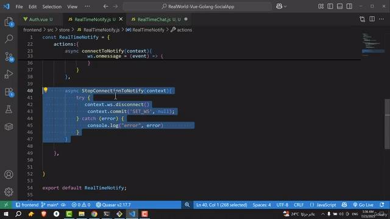
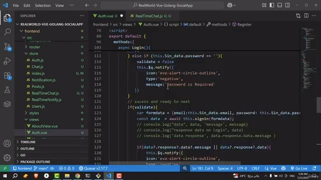
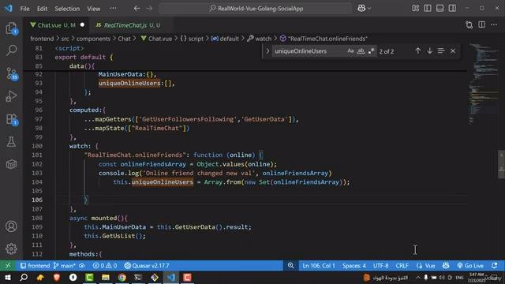
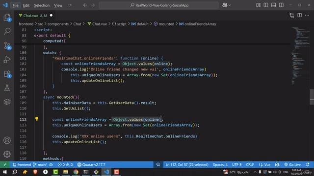
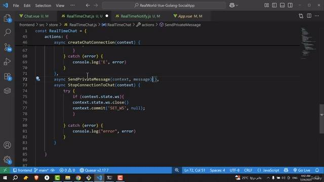
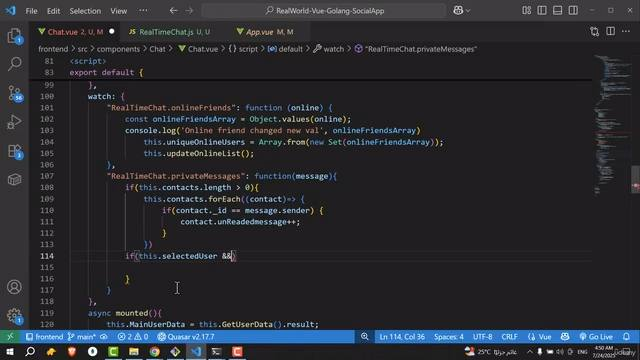
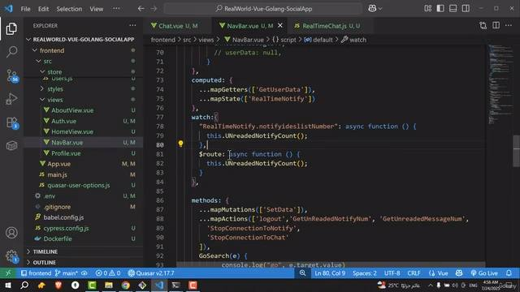
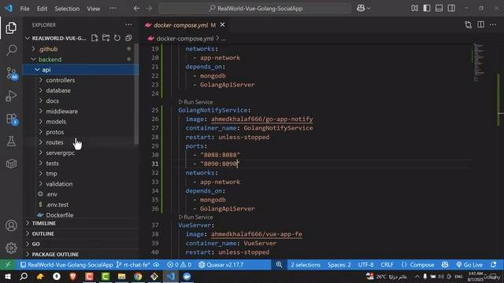
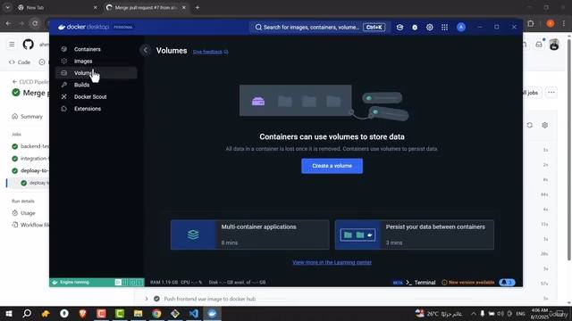

# Master Golang REST/gRPC（含 Redis）P55–P58 复现文档

> 覆盖范围：P55（实时在线用户）、P56（实时收发私聊消息）、P57（导航栏实时未读消息数）、P58（Docker 化 + GitHub Actions + Docker Compose 全栈联调）
>
> 阅读对象：前端转 AI 应用工程师。文中涉及 Go 语法的地方会标注「知道即可」，涉及并发/连接状态的地方会补一句「在 JS/Node 里对应什么」。

---

## 1. 这一节做什么

这四讲是整门课「实时聊天」模块的收尾，也是从「本地能跑」走向「容器化能部署」的转折点。具体拆成四件事：

1. **P55：让聊天页显示「谁在线」**。前端 Vue 组件订阅后端 WebSocket 推来的 `onlineFriends` 状态，去重后得到在线用户列表，再给联系人列表打上 `isOnline` 标记，模板里用 `v-if` 控制绿点显示。同时修掉一个经典 bug：登出时 WebSocket 引用拿不到，导致用户下线后前端仍显示在线。复现时可以把这一步理解成「把后端推送的连接集合，转换成前端可渲染的用户集合」：后端关心连接，前端关心用户，二者之间需要去重和映射。前端对照上，这相当于在 React/Vue 里把 WebSocket 消息写进一个响应式 store，再由组件 computed 派生视图状态。
2. **P56：实时收发私聊消息**。在 Pinia store 里新增 `sendPrivateMessage` action，前端把消息通过 WebSocket 发出去；同时 `watch` 后端推来的 `privateMessage`，把新消息 push 进当前会话，并处理未读数自增、自动滚动到底部。这里的关键是「发送」和「接收」分开看：发送是主动调用 store action，接收是被动监听 store 状态变化。前端对照上，类似在 Zustand/Redux 里新增一个 thunk 发送消息，再在组件里订阅消息列表变化。
3. **P57：导航栏实时未读数**。把「未读消息数」从后端拉取改成前端实时计算，路由切换时清零，导航栏徽标实时刷新。复现时要区分两个计数来源：一个是每个联系人的 `unreadedMessage`，另一个是导航栏汇总的 `unreadedMsgNum` 或组件里的 `unreadedMessageCount`。课里用 `setTimeout` 等一个 tick，是为了避开 Vue 响应式更新和异步读取之间的时间差。
4. **P58：Docker 化 + CI/CD + Compose 全栈联调**。给 `real-time-chat` 和 `real-time-notification` 两个服务各写 Dockerfile，接入 GitHub Actions 构建推送镜像，写 `docker-compose.yml` 把 MongoDB、API、chat、notification、前端全部拉起来，并解决「容器之间不能用 localhost、必须用容器名互调」这个关键坑。复现时要把 Dockerfile 的构建上下文、Compose 的服务名/容器名、CI 的 `context` 三者对齐，否则本地能跑、CI 或容器联调会失败。

最终产物：一条 `docker compose up -d` 就能把整个应用（前端 + 三个后端服务 + MongoDB）跑起来，注册、登录、加关注、实时通知、实时聊天、未读徽标全部工作。验证最终产物时，不要只看容器是否启动，还要按「注册登录 → 加关注 → 实时通知 → 私聊 → 未读徽标 → 登出在线状态」这条链路走一遍，任何一环失败都回到对应小节排查。

---

## 2. 讲师原话

以下引用保留讲师原拼写、口误和时间戳，便于对照视频位置复现：

> "我们将开始专门使用这个实时聊天来获取在线用户。"
> —— p055 [00:00]

> "我们需要到这里来添加这个条件，就像我们在实时通知里做的那样，先检查这个是否不等于另一个。"
> —— p055 [00:22]

> "我们需要进入认证部分，这里有一个 connect to notify，我们需要再加一个；我们在这里把它命名为 connect on a realtime notify，现在则是 realtime chat。"
> —— p055 [01:17]

> "我们会到这里来调用 watch，好的；然后到这里来写 real time chat，而不是 online users。"
> —— p055 [08:06]

> "这应该等于由 Array.from(new Set(...)) 得到的数组，也就是在线好友数组。"
> —— p055 [10:02]

> "这个函数里我们要做的很简单：给每个联系人、用户或好友再加一个对象，我们可以把它叫作 isOnline。"
> —— p055 [11:28]

> "问题其实在这里，因为我们不能直接访问这个 ws，所以这里能做的就是到这里来修复它：写成 state.state.ws.contacts.state.ws。"
> —— p055 [23:23]

> "本节课我们将开始发送和接收实时消息。"
> —— p056 [00:00]

> "我们需要再定义一个异步函数 sendPrivateMessage。"
> —— p056 [00:26]

> "这里调用 this.contacts.state.ws.send(JSON.stringify(message))。"
> —— p056 [01:23]

> "我们需要写成 this.contacts.length 大于 0。"
> —— p056 [05:07]

> "我们可以检查 contact_id 是否等于 message.sender。"
> —— p056 [06:32]

> "我们可以先直接调用 this.messageBetweenUsers.push(message)，然后再调用 setTimeout。"
> —— p056 [07:58]

> "我们将要在导航栏上处理实时传入的消息。"
> —— p057 [00:00]

> "直接等待 getUnreadMessageNum 即可。"
> —— p057 [00:51]

> "当路由变化时，我们还需要调用这个未读消息计数。"
> —— p057 [08:53]

> "我们将开始把实时服务 Docker 化，然后把它们加入 GitHub Actions，贯穿我们的 CI/CD 生命周期；最后通过 Docker Compose 统一使用它们。"
> —— p058 [00:00]

> "我们需要使用容器名称来调用服务，让服务之间能够互相调用；不能使用 localhost 之类的方式，必须使用容器名称。"
> —— p058 [13:05]

> "找不到环境文件。"
> —— p058 [18:17]

> "我们需要通过 Docker Compose 运行应用，只需在这里打开终端并运行 docker compose up。"
> —— p058 [19:40]

---

## 3. 从零复现

### 3.1 前置条件

- 已完成 P01–P54 的代码：后端有 `api`（REST + gRPC server）、`real-time-chat`（WebSocket 聊天服务）、`real-time-notification`（WebSocket 通知服务）三个 Go 服务；前端是 Vue 3 + Pinia + Vue Router。
- 本地已安装：Go 1.21+、Node 18+、Docker Desktop、MongoDB（或直接用 Compose 里的 mongo 容器）。
- 目录结构（P58 讲师反复提到的路径，必须一致）：

```
project-root/
├── backend/
│   ├── api/
│   ├── real-time-chat/
│   │   └── Dockerfile          # P58 新建
│   └── real-time-notification/
│       └── Dockerfile          # P58 新建
├── frontend/
│   └── Dockerfile
├── docker-compose.yml
└── .github/workflows/
    └── deploy.yml              # 讲师称 "live cycle"，即 CI/CD workflow
```

> 课里没讲 `.github/workflows/deploy.yml` 的完整内容，只讲了「在 Docker deployment 这一段里加两个 job」。下面第 4 节给出的是按讲师描述补全的最小可用版本，并标注了哪些是课里原话、哪些是补全。

复现前先确认目录名和容器名一致：Dockerfile 的 `WORKDIR`、CI 的 `context`、Compose 的 `container_name` 是三个独立概念，前端同学容易把它们都当成「文件夹名」。`WORKDIR /app` 是容器内工作目录；`context: ./backend/real-time-chat` 是构建时 Docker 能看到的文件范围；`container_name: golang-chat-service` 是运行时 DNS 名称。三者只要有一处写错，表现分别是构建失败、找不到 `go.mod`、服务间调用 `connection refused`。

### 3.2 P55 步骤：在线用户

1. **后端 `real-time-chat` 的 WebSocket 连接处理**：在 `OnConnect` 里加一个判断——如果当前连接不是「另一个连接」，才把用户加入在线集合；否则跳过。讲师原话是「check first if this not equal to another」。复现时先看已有通知服务里同类判断，照结构加；如果条件写反，会出现「同一用户多开标签页被重复加入或直接跳过」的现象。排查时可在连接建立处打日志，观察连接 id 和用户 id 是否成对出现。
2. **后端 `authentication` 服务**：在注册（register）和登录（login）成功后，除了调用 `connectToNotify`，再调用一次 `connectToChat`（讲师口误说成 `createChatConnection`，实际函数名以你项目里已有的为准）。这里不要硬套讲师口误，先全局搜索 `connectToNotify`，在它旁边找对称函数。前端对照上，相当于登录成功后同时建立通知 WebSocket 和聊天 WebSocket 两条连接。
3. **后端 `navbar` 的登出逻辑**：在 `stopConnectionToNotify` 旁边加一个 `stopConnectionToChat`。排查点是登出后是否还有残留连接：如果只关通知不关聊天，对方仍可能看到你在线。
4. **前端 `App.vue`**：在 `onMounted` 里加 `connectToChat`，在 `onUnmounted` 里加 `stopConnectionToChat`，与已有的 notify 版本对称。前端对照上，这类似 React 的 `useEffect` 里 `connect()` 并在 cleanup 里 `close()`。
5. **前端 `Chat.vue`**：
   - `computed` 里加 `...mapState('realtimeChat', ['onlineFriends'])`（store 名以你项目为准）。
   - `watch` 这个 `onlineFriends`，回调里 `const onlineFriendsArray = Object.values(online)`，再 `this.uniqueOnlineUsers = Array.from(new Set(onlineFriendsArray))`。
   - 新增方法 `updateOnlineList()`：遍历 `this.contacts`，若 `uniqueOnlineUsers.includes(contact._id)` 则 `contact.isOnline = true`，否则 `false`。
   - 模板里联系人头像旁加 `v-if="contact.isOnline"` 的绿点。
   常见错误是 `onlineFriends` 为空对象时直接 `Object.values` 后 `Set` 得到空数组，这是正常的；不要因为绿点全灭就判定失败，先确认后端是否推了非空对象。
6. **修登出 bug**：`stopConnectionToChat` 里不能直接访问 `this.ws`，要改成 `state.state.ws`（讲师原话「state dot state ws contacts dot state dot ws」），notification 那边同样改。排查方法：登出时在控制台看是否抛 `Cannot read properties of undefined` 或 `InvalidStateError`；如果有，先检查 store 的 `state` 是否多包了一层。

### 3.3 P56 步骤：实时私聊

1. **store 新增 action**：在 `realtimeChat` store 的 `stopConnection` 之前，加 `async sendPrivateMessage(contact, message)`。内部先判断 `if (!this.state.ws) return`，然后 `this.state.ws.send(JSON.stringify({ ...message }))`。命令解释上，`JSON.stringify` 是把 JS 对象序列化成 WebSocket 文本帧，前端对照 Node 里的 `socket.send(JSON.stringify(payload))` 完全一致。常见错误是 `ws` 存在但 `readyState` 不是 OPEN，仍然会抛错；进阶可加 `readyState` 判断，但课里只讲了判空。
2. **`Chat.vue` 的 `sendMessage`**：先判断 `if (!this.uniqueOnlineUsers.includes(this.selectedUser._id))`——对方不在线就走原来的 REST 接口；否则走 `this.sendPrivateMessage(...)`，把消息通过 WS 发出去，然后本地 push 进 `messagesBetweenUsers` 并滚动到底。排查时先看 `selectedUser._id` 和 `uniqueOnlineUsers` 里元素类型是否一致，字符串和对象混用会导致 `includes` 永远 false，表现为「明明在线却走 REST」。
3. **`watch` 新消息**：`watch` store 里的 `privateMessage`，回调里：
   - 若 `this.contacts.length > 0`，遍历 contacts，`if (contact._id === message.sender) contact.unreadedMessage++`。
   - 若 `this.selectedUser._id === message.sender`，`this.messagesBetweenUsers.push(message)`，然后 `setTimeout(() => this.scrollDown(), 1000)`（讲师说「one second below actually it's one on 10 seconds」，最终用的是 1 秒级）。
   前端对照上，这等同于订阅消息事件后更新当前会话列表和未读计数。常见错误是没判 `message` 为空就访问 `message.sender`，首屏初始化时会报错。
4. **验证**：两个浏览器窗口分别登录两个账号，互发消息，观察是否实时到达、未读数是否自增、点开会话后未读是否清零。验证时最好用两个不同浏览器配置文件或无痕窗口，避免同一个 localStorage token 覆盖。

### 3.4 P57 步骤：导航栏未读数

1. **`Navbar.vue`**：把原来从后端 `getUnreadedMessageNum` 拉取的逻辑，改成 `await` 后写入 `this.unreadedMessageCount`，并新增一个 `unreadedMessageCount()` 方法（讲师口误说成 `readMessageCount`），内部用 `setTimeout` 小于 1 秒，从 `chat.unreadedMsgNum` 取值。注意这里方法名和数据字段名容易同名冲突，复现时以你项目已有命名为准，不要因为讲师口误把两处都改名。
2. **路由切换清零**：在 `watch: { $route() { this.unreadedMessageCount() } }` 里调用。前端对照上，相当于 React Router 的 `useLocation` 变化后刷新徽标。常见错误是 `$route` 监听写成 `$route.path` 但没加 immediate，首屏不触发；按课里写法先保证路由变化能触发。
3. **`Chat.vue` 收到新消息时**：调用 `this.unreadedMessages + 1`（讲师原话），让导航栏徽标实时 +1。注意这条语句本身没有赋值回去，实际生效更多依赖 store 和刷新方法；复现时不要把它当成严格自增表达式，排查看真正更新的是 `contact.unreadedMessage++` 还是 `unreadedMsgNum`。
4. **验证**：A 给 B 发消息，B 的导航栏徽标应立即 +1；B 点开会话后徽标清零；B 切换路由后徽标保持清零。若徽标不刷新，先看 `Navbar.vue` 是否真的读到了 store 实例，再看 `setTimeout` 时间是否短于 store 更新时机。

### 3.5 P58 步骤：Docker 化 + CI/CD + Compose

1. **`backend/real-time-chat/Dockerfile`**：从已有的 `api/Dockerfile` 复制，改三处——Go 版本号、`WORKDIR` 改成 `real-time-chat`、`EXPOSE` 只保留 WebSocket 端口（讲师说 8080 和 8001，实际只暴露一个）。命令解释：`docker build -t go-app-chat ./backend/real-time-chat` 中最后参数就是构建上下文，必须指向含 `go.mod` 的目录。常见错误是上下文指到 `backend`，导致 `COPY go.mod` 找不到文件。
2. **`backend/real-time-notification/Dockerfile`**：同样复制，改版本号、目录名、`EXPOSE` 两个端口（gRPC 端口 + 通知 WS 端口）。
3. **`.github/workflows/deploy.yml`**：在 Docker deployment 段加两个 job，分别 build & push `go-app-chat` 和 `go-app-notification` 两个镜像。注意 `context` 要写 `backend/real-time-chat` 而不是 `backend`（讲师在 p058 [07:02] 专门纠正过这个路径）。排查 CI 时先看 job 日志里 `context` 打印路径和 `Dockerfile` 是否命中。
4. **`docker-compose.yml`**：在已有服务下面追加 `golang-chat-service` 和 `golang-notify-service`，`image` 用刚推送的仓库名，`container_name` 分别叫 `golang-chat-service`、`golang-notify-service`，`ports` 按 Dockerfile 的 EXPOSE 映射，`depends_on` 加上 `golang-grpc-server`。
5. **改服务间调用地址**：`api` 服务里原来调 `localhost:xxxx` 的地方，全部改成容器名 `golang-notify-service:xxxx`；chat 服务里调 gRPC 的地方改成 `golang-grpc-server:xxxx`。讲师原话：「we cannot use localhost or anything like that we need to use the container names」。排查命令可用 `docker compose logs golang-api-service` 看连接目标，若日志里仍是 `localhost`，说明环境变量或代码里还有硬编码。
6. **前端 `Dockerfile`**：不用改，`depends_on` 里加上 `golang-chat-service` 和 `golang-notify-service`。
7. **跑起来**：`docker compose down` → 清 volumes → `docker compose up -d` → 打开 `localhost` 注册登录验证。命令完整解释：`down` 停容器并删网络；`-v` 才删 volume；`up -d` 后台启动并按依赖顺序创建容器。常见错误是端口冲突，用 `docker ps` 看 8080/9090/8000/27017 是否被占用。

> 讲师在 p058 [18:17] 踩了一个坑：「the environment file is not found」。原因是 workflow 里引用了不存在的 env 文件，删掉对应两行后重新 push 即可。复现时如果 CI 报同样的错，照做。

---

## 4. 完整代码

> 说明：以下代码按讲师在 P55–P58 里口述的逻辑补全为可直接保存的文件。Go 后端部分讲师只讲了「加一个判断」「加一个函数」，没有逐行念代码，因此后端片段是**按讲师描述重构的最小实现**，函数名、字段名尽量沿用讲师口述的（`onlineFriends`、`privateMessage`、`unreadedMessage`、`selectedUser`、`messagesBetweenUsers`、`uniqueOnlineUsers`、`isOnline`）。前端部分讲师逐行念了关键语句，还原度较高。下面代码块保持原样，复现时不要因为注释和你的项目命名不同就删掉结构。

### 4.1 `backend/real-time-chat/Dockerfile`

```dockerfile
# 与 api/Dockerfile 同构，只改版本号、目录名、暴露端口
FROM golang:1.21-alpine AS builder

WORKDIR /app

COPY go.mod go.sum ./
RUN go mod download

COPY . .
RUN go build -o real-time-chat .

FROM alpine:3.19
WORKDIR /app
COPY --from=builder /app/real-time-chat .
# 讲师 p058 [01:54]：只暴露 WebSocket 端口，gRPC 端口不对外
EXPOSE 8080
CMD ["./real-time-chat"]
```

### 4.2 `backend/real-time-notification/Dockerfile`

```dockerfile
FROM golang:1.21-alpine AS builder

WORKDIR /app

COPY go.mod go.sum ./
RUN go mod download

COPY . .
RUN go build -o real-time-notification .

FROM alpine:3.19
WORKDIR /app
COPY --from=builder /app/real-time-notification .
# 讲师 p058 [03:48]：暴露 gRPC 端口 + 通知 WS 端口
EXPOSE 8080
EXPOSE 9090
CMD ["./real-time-notification"]
```

### 4.3 `docker-compose.yml`（节选，只列 P58 新增/修改部分）

```yaml
version: "3.9"

services:
  mongo:
    image: mongo:7
    container_name: mongodb
    ports:
      - "27017:27017"
    volumes:
      - mongo-data:/data/db

  golang-grpc-server:
    image: <your-registry>/go-app-grpc:latest
    container_name: golang-grpc-server
    depends_on:
      - mongo
    ports:
      - "50051:50051"

  golang-api-service:
    image: <your-registry>/go-app-api:latest
    container_name: golang-api-service
    depends_on:
      - mongo
      - golang-grpc-server
    ports:
      - "8000:8000"
    environment:
      # 关键：容器间互调必须用容器名，不能用 localhost
      - NOTIFY_SERVICE_URL=golang-notify-service:8080
      - GRPC_SERVER_URL=golang-grpc-server:50051

  # P58 新增：chat 服务
  golang-chat-service:
    image: <your-registry>/go-app-chat:latest
    container_name: golang-chat-service
    depends_on:
      - golang-grpc-server
    ports:
      - "8080:8080"

  # P58 新增：notification 服务
  golang-notify-service:
    image: <your-registry>/go-app-notification:latest
    container_name: golang-notify-service
    depends_on:
      - golang-grpc-server
    ports:
      - "8080:8080"
      - "9090:9090"

  frontend:
    image: <your-registry>/go-app-frontend:latest
    container_name: frontend
    depends_on:
      - golang-chat-service
      - golang-notify-service
    ports:
      - "80:80"

volumes:
  mongo-data:
```

### 4.4 `.github/workflows/deploy.yml`（按讲师描述补全的最小版）

```yaml
name: CI/CD

on:
  push:
    branches: [main]

jobs:
  build-api:
    runs-on: ubuntu-latest
    steps:
      - uses: actions/checkout@v4
      - uses: docker/login-action@v3
        with:
          username: ${{ secrets.DOCKER_USERNAME }}
          password: ${{ secrets.DOCKER_PASSWORD }}
      - uses: docker/build-push-action@v5
        with:
          context: ./backend/api
          push: true
          tags: ${{ secrets.DOCKER_USERNAME }}/go-app-api:latest

  # P58 新增 job 1
  build-chat:
    runs-on: ubuntu-latest
    steps:
      - uses: actions/checkout@v4
      - uses: docker/login-action@v3
        with:
          username: ${{ secrets.DOCKER_USERNAME }}
          password: ${{ secrets.DOCKER_PASSWORD }}
      - uses: docker/build-push-action@v5
        with:
          # 讲师 p058 [07:02] 强调：context 是 backend/real-time-chat，不是 backend
          context: ./backend/real-time-chat
          push: true
          tags: ${{ secrets.DOCKER_USERNAME }}/go-app-chat:latest

  # P58 新增 job 2
  build-notification:
    runs-on: ubuntu-latest
    steps:
      - uses: actions/checkout@v4
      - uses: docker/login-action@v3
        with:
          username: ${{ secrets.DOCKER_USERNAME }}
          password: ${{ secrets.DOCKER_PASSWORD }}
      - uses: docker/build-push-action@v5
        with:
          context: ./backend/real-time-notification
          push: true
          tags: ${{ secrets.DOCKER_USERNAME }}/go-app-notification:latest
```

### 4.5 前端 `stores/realtimeChat.js`（P56 新增 action）

```javascript
import { defineStore } from 'pinia'

export const useRealtimeChatStore = defineStore('realtimeChat', {
  state: () => ({
    state: { ws: null },
    onlineFriends: {},
    privateMessage: null,
    unreadedMsgNum: 0,
  }),

  actions: {
    // P56 [00:26] 新增
    async sendPrivateMessage(contact, message) {
      if (!this.state.ws) return
      this.state.ws.send(JSON.stringify({ ...message }))
    },

    // P55 [23:23] 修复：登出时通过 state.state.ws 访问
    stopConnection() {
      if (this.state.ws) {
        this.state.ws.close()
        this.state.ws = null
      }
    },
  },
})
```

### 4.6 前端 `components/Chat.vue`（P55 + P56 关键片段）

```vue
<script>
import { mapState } from 'pinia'
import { useRealtimeChatStore } from '@/stores/realtimeChat'

export default {
  data() {
    return {
      contacts: [],
      selectedUser: null,
      messagesBetweenUsers: [],
      uniqueOnlineUsers: [],
    }
  },

  computed: {
    // P55 [05:51] 加 mapState
    ...mapState(useRealtimeChatStore, ['onlineFriends', 'privateMessage']),
  },

  watch: {
    // P55 [08:06] 监听 onlineFriends
    onlineFriends: {
      handler(online) {
        const onlineFriendsArray = Object.values(online)
        // P55 [10:02] 去重
        this.uniqueOnlineUsers = Array.from(new Set(onlineFriendsArray))
        this.updateOnlineList()
      },
      deep: true,
    },

    // P56 [04:13] 监听新私聊消息
    privateMessage(message) {
      if (!message) return
      if (this.contacts.length > 0) {
        this.contacts.forEach((contact) => {
          if (contact._id === message.sender) {
            contact.unreadedMessage++
          }
        })
      }
      if (this.selectedUser && this.selectedUser._id === message.sender) {
        this.messagesBetweenUsers.push(message)
        setTimeout(() => this.scrollDown(), 1000)
      }
    },
  },

  methods: {
    // P55 [11:28] 给每个联系人打 isOnline 标记
    updateOnlineList() {
      this.contacts.forEach((contact) => {
        if (this.uniqueOnlineUsers.includes(contact._id)) {
          contact.isOnline = true
        } else {
          contact.isOnline = false
        }
      })
    },

    // P56 [02:50] 发送消息：在线走 WS，离线走 REST
    async sendMessage() {
      if (!this.uniqueOnlineUsers.includes(this.selectedUser._id)) {
        // 离线：走原来的 REST 接口（课里没讲具体接口名，沿用你项目已有实现）
        await this.$api.sendMessage(this.selectedUser, this.message)
      } else {
        await this.sendPrivateMessage(this.selectedUser, this.message)
        this.messagesBetweenUsers.push(this.message)
        this.scrollDown()
      }
      // P57 [08:25] 导航栏未读 +1
      this.unreadedMessages + 1
    },

    scrollDown() {
      const el = this.$refs.messageBox
      if (el) el.scrollTop = el.scrollHeight
    },
  },
}
</script>

<template>
  <div class="contact" v-for="contact in contacts" :key="contact._id">
    <span class="avatar">
      
      <!-- P55 [13:51] 在线绿点 -->
      <span v-if="contact.isOnline" class="online-dot"></span>
    </span>
    <span>{{ contact.username }}</span>
    <span v-if="contact.unreadedMessage > 0" class="badge">
      {{ contact.unreadedMessage }}
    </span>
  </div>
</template>
```

### 4.7 前端 `components/Navbar.vue`（P57 关键片段）

```vue
<script>
import { useRealtimeChatStore } from '@/stores/realtimeChat'

export default {
  data() {
    return { unreadedMessageCount: 0 }
  },

  watch: {
    // P57 [08:53] 路由切换时刷新未读数
    $route() {
      this.refreshUnreadedMessageCount()
    },
  },

  mounted() {
    this.refreshUnreadedMessageCount()
  },

  methods: {
    // P57 [00:51] 从 store 取未读数
    async refreshUnreadedMessageCount() {
      const chat = useRealtimeChatStore()
      setTimeout(() => {
        this.unreadedMessageCount = chat.unreadedMsgNum
      }, 500)
    },
  },
}
</script>

<template>
  <nav>
    <span>Chat</span>
    <span v-if="unreadedMessageCount > 0" class="nav-badge">
      {{ unreadedMessageCount }}
    </span>
  </nav>
</template>
```

---

## 5. 逐行解释

### 5.1 `sendPrivateMessage` 为什么先判 `!this.state.ws`

WebSocket 是长连接，页面刷新、登出、网络断开都会让 `ws` 变成 `null` 或 `CLOSED`。如果不判空直接 `send`，浏览器会抛 `InvalidStateError`。在 JS/Node 里，这等价于 `if (!socket || socket.readyState !== WebSocket.OPEN) return`。讲师在 P55 [23:23] 修的那个 bug 本质是同一个问题——`stopConnection` 里访问 `this.ws` 拿不到，因为 store 里真正的引用挂在 `state.state.ws` 上，多套了一层。排查时先 `console.log(this.state)`，确认 `ws` 到底在哪一层；不要凭记忆写 `this.ws`。

### 5.2 `Object.values(online)` + `Array.from(new Set(...))` 为什么能去重

后端推来的 `onlineFriends` 是一个对象（map），key 是连接 id，value 是用户 id。同一个用户可能开多个标签页，所以 value 会重复。`Object.values` 把 map 拍平成数组，`new Set` 去重，`Array.from` 再转回数组。这是前端处理「多连接同一用户」的标准写法，讲师在 P55 [10:02] 专门念了这一行。前端对照上，相当于 `Array.from(new Set(Object.values(map)))`，在 TypeScript 里要注意 value 类型可能为 `unknown`，先断言再 `includes`。

### 5.3 `contact.isOnline = true/false` 为什么不能直接在模板里算

模板里如果写 `v-if="uniqueOnlineUsers.includes(contact._id)"`，每次渲染都要遍历一次数组，联系人多了会卡。讲师在 P55 [11:28] 选择在 `updateOnlineList()` 里一次性把标记打到 contact 对象上，模板只读 `contact.isOnline`，是 O(1)。这是典型的「用空间换渲染性能」。常见错误是只更新了 `uniqueOnlineUsers` 却忘了调用 `updateOnlineList()`，表现为数组有值、绿点不亮；排查时在 `updateOnlineList` 里打日志看 contact 是否被遍历到。

### 5.4 `watch privateMessage` 里为什么要判 `contacts.length > 0`

P56 [05:07] 讲师原话「we have users here users list here at the left and we receiving message at the same time」。如果联系人列表还没加载完就收到消息，`forEach` 会报错。先判长度再遍历，是防御性写法。在 Node 里对应 `if (contacts?.length)`。另外 `selectedUser` 也要判空，否则 `this.selectedUser._id` 在首屏会抛错；课里代码在 P56 片段里已用 `this.selectedUser &&` 保护。

### 5.5 `setTimeout(() => this.scrollDown(), 1000)` 为什么是 1 秒

消息 push 进数组后，Vue 的 DOM 更新是异步的（nextTick）。如果立刻 `scrollDown`，`scrollHeight` 还是旧值，滚不到底。讲师用 1 秒的 `setTimeout` 是「懒办法」，更严谨的写法是 `this.$nextTick(() => this.scrollDown())`。课里没讲 nextTick，所以照讲师原话用 setTimeout 即可。排查滚动失败时，先确认 `this.$refs.messageBox` 是否真的存在，再看 `scrollHeight` 是否大于 `clientHeight`。

### 5.6 P57 的 `setTimeout(..., 500)` 为什么小于 1 秒

讲师原话「this should work on less than second」。目的是等 store 里的 `unreadedMsgNum` 被 P56 的 watch 更新完，再读出来赋给导航栏。本质是给 Vue 响应式一个 tick 的时间。同样，更严谨的写法是 `await nextTick()`。前端对照上，类似 React 里在 `useEffect` 中等待状态更新后再读 DOM 或派生值。常见错误是把 `setTimeout` 写在 `return` 之后，导致根本不执行；排查时看控制台是否打印了定时器回调。

### 5.7 Dockerfile 里 `COPY go.mod go.sum ./` 为什么单独一行

这是 Docker 层缓存的标准技巧：依赖文件没变时，`go mod download` 这一层直接命中缓存，不用每次 build 都重新下依赖。讲师在 P58 [00:29] 说「copy this one and directly press dot here」，就是复制 api 的 Dockerfile 再改，所以这行原样保留。常见错误是目录下没有 `go.sum`，此时 `COPY` 会失败；解决方式是先在对应目录执行 `go mod tidy`，或按你项目实际情况调整 `COPY`。

### 5.8 `EXPOSE` 为什么 chat 只暴露一个端口

P58 [01:54] 讲师原话「we want to expose this port which is for this real time but we don't need to expose any ports else related to gRPC」。chat 服务对外的只有 WebSocket，gRPC 是内部服务间调用，走 Docker 内部网络即可，不需要映射到宿主机。notification 服务则要暴露两个：gRPC 端口（给 api 调）+ 通知 WS 端口（给前端连）。排查时注意 `EXPOSE` 不改变实际映射，真正对外看 Compose 的 `ports`。

### 5.9 `depends_on` 为什么 chat/notify 只依赖 `golang-grpc-server`

chat 和 notify 都需要通过 gRPC 拿用户数据，所以依赖 grpc-server；它们不直接连 MongoDB（数据由 api 层写入后通过 gRPC 读），所以不依赖 mongo。讲师在 P58 [11:15] 说「we need to add depends on golang gRPC server as well」，只提了 grpc-server，没提 mongo，与这个设计一致。常见错误是把所有服务都写成依赖 mongo，虽然不一定报错，但会拉长启动链，且掩盖真实依赖。

### 5.10 容器间为什么必须用容器名

Docker Compose 默认给每个服务创建一个网络别名，别名就是服务名（或 `container_name`）。容器内的 `localhost` 指向容器自己，不是宿主机，也不是别的容器。所以 api 调 notify 必须写 `golang-notify-service:8080`，不能写 `localhost:8080`。讲师在 P58 [13:05] 专门停下来强调这一点，这是整个 P58 最容易踩的坑。排查时在 api 容器内执行 `getent hosts golang-notify-service` 或看日志里连接地址，若解析不到就是服务名不一致。

### 5.11 CI 里 `context: ./backend/real-time-chat` 为什么不能写 `./backend`

Dockerfile 在 `real-time-chat/` 目录下，`COPY go.mod` 是相对 context 的。如果 context 写成 `./backend`，`go.mod` 就在 `backend/go.mod` 而不是 `backend/real-time-chat/go.mod`，build 会失败。讲师在 P58 [07:02] 反复纠正「it is inside backend slash real-time chat」，就是踩过这个坑。排查 CI 失败时先看 `docker build` 日志第一行 context 路径，再看 `COPY` 报错的文件名。

### 5.12 P58 [18:17] 的 env 文件报错怎么修

讲师原话「the environment file is not found」，然后「we need to remove this one and remove this one as well and push」。意思是 workflow 里有两行引用了不存在的 env 文件（可能是 `env_file: .env.production` 之类），删掉这两行重新 push 即可。复现时如果 CI 报同样的错，照做。排查时把报错行号对应到 YAML 里的 `env_file` 或 `environment` 引用，确认文件是否真的被提交到仓库。

---

## 6. 复现检查清单

按顺序打勾，任何一项不过就不要往下走。每条后面给出验证方法，便于定位是哪一层出错：

- [ ] `backend/real-time-chat/Dockerfile` 存在，`WORKDIR` 是 `/app`，`EXPOSE 8080`，`CMD ["./real-time-chat"]`。验证方法：打开文件逐项对照；再执行 `docker build -t test-chat ./backend/real-time-chat` 看是否构建成功。
- [ ] `backend/real-time-notification/Dockerfile` 存在，`EXPOSE` 两个端口（8080 + 9090）。验证方法：`grep EXPOSE backend/real-time-notification/Dockerfile`，确认两行端口；再看 `docker compose config` 里对应服务端口映射。
- [ ] `.github/workflows/deploy.yml` 里 `build-chat` 和 `build-notification` 两个 job 的 `context` 分别是 `./backend/real-time-chat` 和 `./backend/real-time-notification`。验证方法：`grep -n "context:" .github/workflows/deploy.yml`，逐行核对目录是否含 `go.mod`。
- [ ] `docker-compose.yml` 里 `golang-chat-service` 和 `golang-notify-service` 的 `container_name` 与 api 服务里引用的容器名完全一致。验证方法：`docker compose config` 展开后搜索 `NOTIFY_SERVICE_URL` 和 `container_name`，逐字符比对大小写和连字符。
- [ ] api 服务里所有 `localhost:xxxx` 已替换为 `golang-notify-service:xxxx` / `golang-grpc-server:xxxx`。验证方法：`grep -R "localhost" backend/api` 检查代码和配置；启动后 `docker compose logs golang-api-service` 看连接目标。
- [ ] `docker compose down` 后 `docker volume ls` 里没有残留的 mongo 卷（讲师 P58 [24:47] 专门清过）。验证方法：执行 `docker volume ls | grep mongo`，若有则 `docker compose down -v` 或 `docker volume rm` 清掉。
- [ ] `docker compose up -d` 后 `docker ps` 能看到 6 个容器：mongo、grpc-server、api、chat、notify、frontend。验证方法：`docker compose ps` 看状态是否都是 Up；若某个容器反复重启，用 `docker compose logs <service>` 看原因。
- [ ] 打开 `localhost` 能注册新账号，返回 token。验证方法：浏览器 Network 面板看注册请求状态码和响应体；若失败，先看 frontend 容器是否映射 80 端口。
- [ ] 登录后加关注，对方能收到实时通知。验证方法：两个窗口分别登录，操作后看对方通知 WebSocket 帧和页面提示；失败时检查 notify 服务容器名和 WS 地址。
- [ ] 两个浏览器窗口互发消息，消息实时到达，未读徽标 +1，点开会话后清零。验证方法：发送后看 chat 服务日志有无消息帧，前端看 `privateMessage` 是否更新、`unreadedMessage` 是否自增。
- [ ] 登出后对方看到你变灰（`isOnline = false`），不再报 WS 错误。验证方法：登出时看控制台是否抛 `InvalidStateError`；对方页面看绿点是否消失；必要时在 `stopConnection` 打日志确认 `ws` 引用路径。
- [ ] 如果 CI 报 `environment file is not found`，删掉 workflow 里对应的两行 env 引用后重新 push。验证方法：看 Actions 失败步骤的行号，定位 YAML 中 `env_file` 或 `environment`，删除不存在的引用后重跑。

---

## 7 课里没讲但你会撞上的

| 现象 | 原因 | 怎么办 |
|---|---|---|
| `go.sum` 不存在时 `COPY go.mod go.sum ./` 会失败 | 如果 `real-time-chat` 目录下没有 `go.sum`（比如依赖全在 `api` 里），Docker 构建阶段找不到第二个文件 | 要么先在对应目录执行 `go mod tidy` 生成 `go.sum`，要么把 `COPY` 改成 `COPY go.mod ./`。课里没讲这个边界，复现时先确认目录内容 |
| 只改 Dockerfile 的 `EXPOSE`，宿主机访问不到服务 | `EXPOSE` 只是声明，不映射端口；真正对外的是 `docker-compose.yml` 里的 `ports` | 同时改 Dockerfile 的 `EXPOSE` 和 Compose 的 `ports`，再用 `docker compose config` 或 `docker ps` 看端口映射 |
| api 启动时连不上 mongo，日志报连接失败 | `depends_on` 不保证服务就绪，只保证启动顺序；mongo 还没 ready 时 api 已经启动 | 生产环境加 `healthcheck`，例如 `healthcheck: test: ["CMD", "mongosh", "--eval", "db.adminCommand('ping')"]`；本地可先单独起 mongo 再起 api |
| 前端启动瞬间连 WS 失败 | 前端 `depends_on` 两个 WS 服务，但前端是 nginx 静态资源，启动瞬间服务未必就绪 | WS 客户端加指数退避重连；课里没讲重连逻辑，实际项目里要补 |
| `this.unreadedMessages + 1` 看起来没生效 | 讲师原话如此，但 `+ 1` 没有赋值回去，实际不生效；真正生效的是 P56 watch 里的 `contact.unreadedMessage++` 和 P57 的 `refreshUnreadedMessageCount` | 复现时如果想让它生效，要写成 `this.unreadedMessages += 1` 或直接改 store 里的 `unreadedMsgNum`，并以你项目实际字段为准 |
| 登出时仍报 WebSocket 错误，或对方看到你还在线 | P55 的 `state.state.ws` 双层 state 是历史遗留；如果你项目里 store 结构不是这样（比如直接 `this.ws`），硬套讲师双层写法会拿不到引用 | 照你项目改，不要硬套；先 `console.log(this.state)` 确认 `ws` 层级，再改 `stopConnection` |
| GitHub Actions 在 login 步骤失败 | CI 的 `secrets.DOCKER_USERNAME` / `DOCKER_PASSWORD` 要在 GitHub 仓库 Settings → Secrets 里配，课里没讲这一步 | 到仓库 Settings → Secrets and variables → Actions 里新增两个 secret，再重新跑 workflow |
| `docker compose down` 后 mongo 数据还在 | `docker compose down` 不会删 volume，要 `docker compose down -v` 或手动 `docker volume rm` | 讲师 P58 [24:47] 是手动去 Docker Desktop 里删的，命令行等价物是 `docker volume prune` 或 `docker compose down -v` |
| 前端图片更新后仍显示旧图 | P58 最后讲师说「fix this image sync」但没展开，这是前端图片缓存问题 | `ctrl-F5` 能临时解决，根治要加版本号或 `Cache-Control: no-cache`；课里没讲具体方案 |
| 看 Go 代码时把 `context` 和前端概念混淆 | Go 的 `context` 包和前端 Vue 的 `context` 无关 | Go 里 `context.Context` 是传超时/取消信号用的，对应 JS 里的 `AbortController`；读代码时按语言分开理解 |

---

## 附：截图索引

















