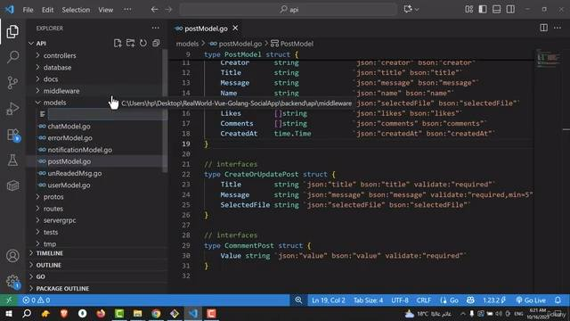
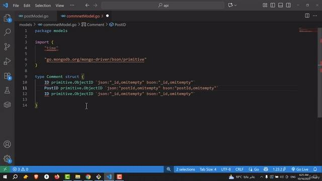
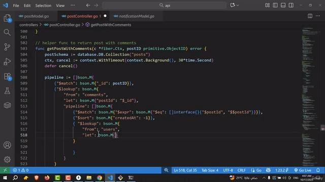
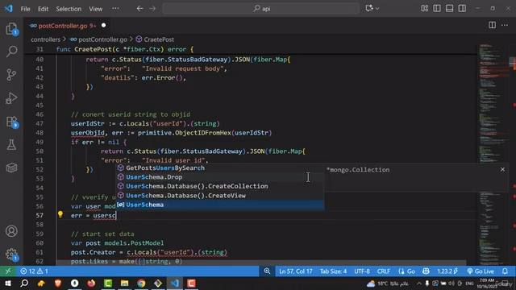
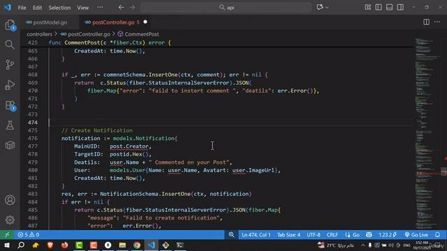
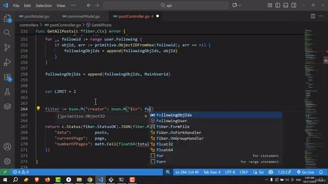
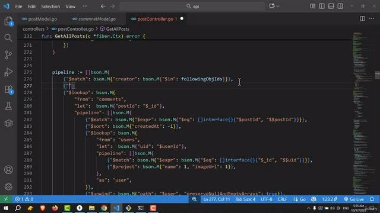
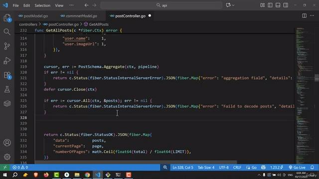

# Master Golang REST/gRPC（含 Redis）· P059–P062
## 帖子 + 评论 + 聚合查询：让「发帖 / 看帖 / 评论 / 刷时间线」真正跑起来

---

## 1. 这一节做什么

这四集（P059–P062）做了同一件事的三个阶段：**把 Post 的数据模型从「拍脑袋的字符串数组」改成「MongoDB 里真正能用的引用关系」，然后用聚合管道（aggregation pipeline）把这些关系重新拼成前端拿到就能渲染的 JSON。**

具体拆开是三块：

**第一块（P059）——改模型。**
在之前的代码里，`Post.Comments` 是一个 `[]string`。讲师原话是「this is actually not proper way to doing this」：你只有一句话，不知道是谁说的、什么时候说的、这个人的头像是什么。所以在 P059 里建了一个独立的 `comments` 集合（Mongo 里叫 collection，不是 table，因为 Mongo 不是关系型数据库），并且把 `Post.Creator` 从 `string` 改成 `primitive.ObjectID`——因为 Mongo 的用户主键本来就是 ObjectID，一直用 string 存等于把类型丢了。

**第二块（P060 + P061）——写聚合。**
模型一改，原来的 `CreatePost` / `AddComment` 立刻全红。P060 修 `CreatePost`，并且第一次在项目里引入 `$lookup` + `$unwind` + `$project` 三段式管道，目的是让「返回的帖子里的用户信息」永远是最新的，而不是创建帖子那一刻的快照。P061 写 `AddComment`，并且把它抽成一个可复用的 helper 函数 `getPostWithComments`——这个函数是本节的**核心产物**，后面 P062 的 `GetPost`、`GetAllPosts`，以及 P061 自己的 `AddComment`，全都调它。

**第三块（P062）——时间线。**
`GetAllPosts` 是四集里管道最长的一条：先按「我关注的人 + 我自己」筛，再排序、分页，然后对每条 post 再做两次 `$lookup`（一次捞发帖人，一次捞这个帖子的所有评论及其评论人）。讲师在这里踩了一个典型坑：`$match` 里写错字段名（`creater` vs `creator`），接口一直返回空数组，最后是他自己盯着屏幕找出来的。

**学完这四集，你的后端应该能做到：**

- `POST /api/posts` 发帖，返回带上发帖人 name / image_url 的完整帖子
- `GET /api/posts/:id` 拿到单条帖子 + 它下面所有评论（含每条评论的作者信息，按时间倒序）
- `POST /api/posts/:id/comment` 发评论，返回更新后的整条帖子
- `GET /api/posts` 拿到「我和我关注的人」的时间线，分页

**给前端同学的一句话对照：** 这一节的所有「聚合管道」你可以直接理解成在数据库里跑的一段 `Array.prototype.filter / map / join`，只不过它是声明式的一串 stage，写法是 `$match`（≈ filter）、`$lookup`（≈ 带条件的 join）、`$unwind`（≈ 把数组展开成多行）、`$project`（≈ 挑字段重组成新对象）、`$sort` / `$skip` / `$limit`（≈ 分页三件套）。而 Go 里的 `context.WithTimeout` ≈ 浏览器里的 `AbortController`。



---

## 2. 讲师原话

按主题摘，不按集数摘。每条后面标了出处。

**关于为什么要改 `[]string`：**

> "这里我们只有一个字符串数组，里面包含帖子和用户帖子的评论，但这并不是正确的做法，所以我需要做的是把发表这条评论的用户关联进来。"
> —— p059 [00:26]

> "我们的数据库不是关系型的，所以我们会新建一张表——抱歉，是新建一个集合，专门用来存放评论数据。"
> —— p059 [01:22]

**关于 `getPostWithComments` 这个 helper 的定位：**

> "我们需要用同一个函数返回帖子，并实时填充其评论。"
> —— p061 [09:38]

> "我们只是构建了这个辅助函数来返回帖子的评论。"
> —— p061 [10:06]

**关于为什么要 `$lookup` 用户（这是本节最重要的一句）：**

> "每当我们创建帖子时，这会给我们实时更新的用户数据……在我们旧版本的代码中，实际上只是把创建者的用户名和用户数据放进去，如果该用户更新了这些数据，并不会影响我们已创建的帖子，它仍然保留旧数据。"
> —— p060 [17:14] ~ [17:44]

**关于 `preserveNullAndEmptyArrays`：**

> "我们在这里添加的这个选项 preserve、null 和 anti-arrange。好的，这实际上保证了如果有东西缺失、如果用户不再被访问等等，它实际上会完成操作并获取其余的评论。"
> —— p061 [24:41]

**关于评论排序：**

> "我们可以使用排序操作符来对结果排序，因为我们想获取最新的评论，所以我可以直接用创建时间倒序，返回 -1。"
> —— p061 [17:31]

**关于 P062 的时间线过滤条件：**

> "在 skip 之后我们要添加当前用户 id，用 current 来关联……现在让我们创建过滤条件，就说 filter 等于 person.m creator person.m……以及下面的对象字段。"
> —— p062 [04:26] ~ [05:20]

**关于分页算式：**

> "我们也可以直接用 skip 操作符，用 64 页减 1 再乘以 limit。"
> —— p062 [10:14]

**关于 P062 那个 typo：**

> "好的，我仔细看一下，也许我们有拼写错误。是的，我们可以看到这里的这个拼写错误，我们试着修复它，这个 creator 需要是正确的。"
> —— p062 [19:56]

---

## 3. 从零复现

下面这条路，从头敲到尾就能跑。默认你已经有 P058 之前的项目骨架（Fiber + Mongo 连接 + JWT 中间件把 user_id 塞进 `c.Locals`）。如果没有，第 7 节写了缺什么。

### 3.1 目录结构

本节结束你应该长这样：

```
social/
├── go.mod
├── main.go
├── database/
│   └── database.go          # 已有：暴露 database.Db (*mongo.Database)
├── models/
│   ├── user.go              # 已有，需含 Name / ImageURL / Following
│   ├── post.go              # ← 本节目的大改
│   ├── comment.go           # ← 本节新建
│   └── notification.go      # 已有（P061 只用到）
├── controllers/
│   └── post.go              # ← 本节目的大改
└── routes/
    └── post.go              # ← 本节注册四条路由
```

`go.mod` 里本节相关的依赖：

```
require (
	github.com/gofiber/fiber/v2 v2.52.0
	go.mongodb.org/mongo-driver v1.13.1
)
```

> 版本号课里没讲。上面两个是能跑通本节代码的稳定版本；你直接 `go get github.com/gofiber/fiber/v2` 和 `go get go.mongodb.org/mongo-driver/mongo` 拉最新也行，但 `mongo-driver` v2 改了 API，**别升 v2**。

### 3.2 第一步：建 `models/comment.go`

先把评论这个实体立起来。字段就是讲师在 P059 里一个个敲出来的五个：`_id` / `post_id` / `user_id` / `value` / `created_at`。另外加一个 `CommentWithUser`，用来承接「评论 + 评论人」的聚合结果。

```bash
touch models/comment.go
```



### 3.3 第二步：改 `models/post.go`

两处改动，都不可省：

1. `Creator` 从 `string` 变 `primitive.ObjectID`
2. `Comments` 从 `[]string` 变 `[]CommentWithUser`

顺带把聚合结果里会出现的 `user` 字段也挂上去（`bson:"user,omitempty"`），这样 `Decode` 的时候不会把发帖人信息丢掉。

### 3.4 第三步：写 `getPostWithComments` 这个 helper

这是本节的**中枢**。P061 [10:35] 讲师明确说了它要单独成一个函数，签名是 `func(c *fiber.Ctx, postID primitive.ObjectID) (models.Post, error)`。

它的管道有 6 个 stage，顺序不能换：

```
$match(_id)
$lookup(comments)      ← 内嵌 pipeline：match / sort / lookup(users) / unwind / project
$lookup(users)         ← 拿发帖人
$unwind(user, preserveNullAndEmptyArrays: true)
$project(...)
```

写的时候有个必须注意的点：**内层 `$lookup` 的 `let` 变量名，和内层 `$match` 里 `$expr` 引用的变量名，必须一字不差**。讲师用的是 `post_id`（`$$post_id`）。这是个高频翻车点，写错了不会报错，只会返回空数组。



### 3.5 第四步：改 `CreatePost`，改成「插入后回查」

P060 的核心动作是：

```
locals.user_id (string)
  → primitive.ObjectIDFromHex
  → 查 users 集合确认用户存在
  → 组装 Post 插入
  → 用 result.InsertedID 再跑一遍聚合，返回完整帖子
```

讲师在 P060 [11:16] 说的是 "插入帖子之后，我们需要检查一下这里。"，然后 [12:15] 开始写管道。所以**不是插入完直接把 body 返回**，而是插入完再查一次。



### 3.6 第五步：写 `AddComment`

P061 的流程：

```
Params("id") → postID
locals.user_id → userObjID
BodyParser → { value }
构造 Comment{ID: NewObjectID(), PostID, UserID, Value, CreatedAt: time.Now()}
InsertOne 到 comments
（可选）查评论人 + 写一条 notification
调 getPostWithComments(c, postID) 返回整条帖子
```

注意讲师在 P061 [09:59] 中途说了一句 "我觉得我们需要更新通知，这个我们稍后再看。"，也就是说通知这块他**没写完就跳过了**。所以下面代码里通知部分我做了最小实现并标了注释，你可以直接删掉不影响主流程。



### 3.7 第六步：`GetPost` 一行搞定

P062 [00:29]：`GetPost` 里原来那一大坨全部删掉，直接 `return getPostWithComments(...)`。

### 3.8 第七步：写 `GetAllPosts`（时间线）

P062 的完整流程：

```
1. locals.user_id → userObjID
2. 查当前 user，拿到 user.Following ([]string)
3. 遍历 Following：primitive.ObjectIDFromHex，失败的跳过，成功的 append
4. append 自己（userObjID）
5. page = Query("page", 1)，limit = 10
6. filter = { creator: { $in: followingObjIDs } }
7. CountDocuments(ctx, filter) → total，total == 0 直接返回 no posts
8. 跑管道：$match → $sort(_id:-1) → $skip((page-1)*limit) → $limit → $lookup(users) → $unwind(user) → $lookup(comments 子管道) → $project
9. cursor.All 收集，返回 { posts, total, page }
```





### 3.9 第八步：注册路由 + 起服务

```go
// routes/post.go
func PostRoutes(app *fiber.App) {
	app.Post("/api/posts", controllers.CreatePost)
	app.Get("/api/posts", controllers.GetAllPosts)
	app.Get("/api/posts/:id", controllers.GetPost)
	app.Post("/api/posts/:id/comment", controllers.AddComment)
}
```

```bash
go mod tidy
go run main.go
# 服务监听 :5000（P060 [08:29] 讲师说的 localhost:5000）
```

### 3.10 第九步：验证（照讲师在 P060/P061/P062 的步骤）

用 Swagger / Postman 都行，讲师用的是 Swagger UI（`localhost:5000/swagger`）：

1. 登录拿 token → `Authorize` 里填 token
2. `POST /api/posts`，body：`{"title":"anything","message":"base64 anything","selected_file":"..."}`
3. 拿返回里的 `_id`，去 `POST /api/posts/{id}/comment`，body：`{"value":"first comment"}`
4. 再发一次 `{"value":"second comment"}` —— **验证第二条排在最前面**（因为 `created_at: -1`）
5. `GET /api/posts/{id}` —— 验证返回里带 `comments[]` 且每条有 `user.name` / `user.image_url`
6. `GET /api/posts?page=1` —— 验证只返回你和关注的人发的帖子，且带分页



---

## 4. 完整代码

> **标注约定**：下面代码里出现 `// [补]` 的行，是逐字稿里讲师没有在镜头前展示、但为了让文件能编译/能跑我必须补的部分（比如请求体结构、limit 常量）。其余结构、字段名、管道 stage 顺序，都按 P059–P062 逐字稿还原。

### 4.1 `models/comment.go`（新建）

```go
package models

import (
	"time"

	"go.mongodb.org/mongo-driver/bson/primitive"
)

// Comment 对应 Mongo 的 comments 集合。
// 字段来自 p059 [02:17] ~ [05:53]：
//   _id / post_id / user_id / value / created_at
type Comment struct {
	ID        primitive.ObjectID `bson:"_id"        json:"_id,omitempty"`
	PostID    primitive.ObjectID `bson:"post_id"    json:"post_id,omitempty"`
	UserID    primitive.ObjectID `bson:"user_id"    json:"user_id,omitempty"`
	Value     string             `bson:"value"      json:"value,omitempty"`
	CreatedAt time.Time          `bson:"created_at" json:"created_at,omitempty"`
}

// CommentWithUser 是「评论 + 评论人」的聚合结果载体。
// p059 [09:02] 讲师是把 Comment 的字段逐个复制过来，再补一个 user 指针；
// 这里保持同样的字段展开方式，方便 Decode。
// User 用精简结构体 PostUser，只承接 $project 里投影出来的 name / image_url，
// 这样就不会把 email、password 这些空字段一起 JSON 出去。
type CommentWithUser struct {
	ID        primitive.ObjectID `bson:"_id"        json:"_id,omitempty"`
	PostID    primitive.ObjectID `bson:"post_id"    json:"post_id,omitempty"`
	UserID    primitive.ObjectID `bson:"user_id"    json:"user_id,omitempty"`
	Value     string             `bson:"value"      json:"value,omitempty"`
	CreatedAt time.Time          `bson:"created_at" json:"created_at,omitempty"`
	User      *PostUser          `bson:"user,omitempty" json:"user,omitempty"`
}

// PostUser 只承载发帖人 / 评论人的展示信息。
// 课里没单独展示这个结构体的定义（讲师是直接 decode 进 *User），
// 这里换成精简版，效果一致但不会漏出敏感字段。
type PostUser struct {
	Name     string `bson:"name"      json:"name"`
	ImageURL string `bson:"image_url" json:"image_url"`
}
```

### 4.2 `models/post.go`（修改）

```go
package models

import (
	"time"

	"go.mongodb.org/mongo-driver/bson/primitive"
)

type Post struct {
	ID           primitive.ObjectID `bson:"_id"           json:"_id,omitempty"`
	Creator      primitive.ObjectID `bson:"creator"       json:"creator,omitempty"` // p059 [06:46] 由 string 改为 ObjectID
	Title        string             `bson:"title"         json:"title,omitempty"`
	Message      string             `bson:"message"       json:"message,omitempty"`
	SelectedFile string             `bson:"selected_file" json:"selected_file,omitempty"`
	Likes        []string           `bson:"likes"         json:"likes,omitempty"`
	Comments     []CommentWithUser  `bson:"comments"      json:"comments,omitempty"` // p059 [07:43] 由 []string 改为 []CommentWithUser
	CreatedAt    time.Time          `bson:"created_at"    json:"created_at,omitempty"`

	// User 不落库，只用来接聚合结果里的发帖人投影。
	// 用 omitempty 保证 InsertOne 时不会把它写进文档。
	User *PostUser `bson:"user,omitempty" json:"user,omitempty"`
}
```

### 4.3 `models/user.go`（补充参考）

> 这个文件在 P058 之前就存在了，课里**没有**展示完整定义。下面只列出本节会用到、且必须存在的三个字段。你本地的名字如果不一样（比如叫 `ProfileImage`），改 `controllers/post.go` 里 `$project` 的值即可。

```go
package models

import "go.mongodb.org/mongo-driver/bson/primitive"

type User struct {
	ID        primitive.ObjectID `bson:"_id"       json:"_id,omitempty"`
	Name      string             `bson:"name"      json:"name,omitempty"`
	ImageURL  string             `bson:"image_url" json:"image_url,omitempty"`
	Email     string             `bson:"email"     json:"email,omitempty"`
	Password  string             `bson:"password"  json:"password,omitempty"`
	Following []string           `bson:"following" json:"following,omitempty"` // p062 [03:38] 用的是这个字段
}
```

### 4.4 `controllers/post.go`（完整重写）

```go
package controllers

import (
	"context"
	"strconv"
	"time"

	"github.com/gofiber/fiber/v2"
	"go.mongodb.org/mongo-driver/bson"
	"go.mongodb.org/mongo-driver/bson/primitive"
	"go.mongodb.org/mongo-driver/mongo"

	"social/database" // 换成你自己的 module 名
	"social/models"
)

const (
	postsCollection    = "posts"
	usersCollection    = "users"
	commentsCollection = "comments"
	notifCollection    = "notifications"

	// [补] 课里没给具体数值，讲师只说“multiply it with the limit”
	defaultPageSize int64 = 10
	queryTimeout          = 10 * time.Second
)

// ============================================================
// getPostWithComments —— 本节的中枢函数（p061 [10:35]）
// 输入一个 postID，返回「帖子 + 实时用户信息 + 全部评论及其评论人」
// ============================================================
func getPostWithComments(c *fiber.Ctx, postID primitive.ObjectID) (models.Post, error) {
	postCollection := database.Db.Collection(postsCollection)

	ctx, cancel := context.WithTimeout(context.Background(), queryTimeout)
	defer cancel()

	pipeline := mongo.Pipeline{

		// stage 1：定位这条帖子
		{{Key: "$match", Value: bson.M{"_id": postID}}},

		// stage 2：把这条帖子下的所有评论捞出来，并带上每条评论的作者
		{{Key: "$lookup", Value: bson.M{
			"from": commentsCollection,
			"let":  bson.M{"post_id": "$_id"}, // 变量名 post_id，下面 $expr 用 $$post_id 引用
			"pipeline": mongo.Pipeline{
				// 2.1 只留属于这条帖子的评论
				{{Key: "$match", Value: bson.M{
					"$expr": bson.M{"$eq": bson.A{"$post_id", "$$post_id"}},
				}}},
				// 2.2 最新的评论排最前（p061 [17:31] 讲师用 -1）
				{{Key: "$sort", Value: bson.M{"created_at": -1}}},
				// 2.3 每条评论 join 它的作者
				{{Key: "$lookup", Value: bson.M{
					"from":         usersCollection,
					"localField":   "user_id",
					"foreignField": "_id",
					"as":           "user",
				}}},
				// 2.4 unwind 成对象；用户被删了也不丢掉这条评论（p061 [24:41]）
				{{Key: "$unwind", Value: bson.M{
					"path":                       "$user",
					"preserveNullAndEmptyArrays": true,
				}}},
				// 2.5 只投影需要的字段（p061 [25:10]）
				{{Key: "$project", Value: bson.M{
					"_id":            1,
					"post_id":        1,
					"user_id":        1,
					"value":          1,
					"created_at":     1,
					"user.name":      "$user.name",
					"user.image_url": "$user.image_url",
				}}},
			},
			"as": "comments",
		}}},

		// stage 3：join 发帖人（p060 [13:36] 的第一次 lookup）
		{{Key: "$lookup", Value: bson.M{
			"from":         usersCollection,
			"localField":   "creator",
			"foreignField": "_id",
			"as":           "user",
		}}},

		// stage 4：同样要 preserveNullAndEmptyArrays，否则作者注销后帖子直接消失
		{{Key: "$unwind", Value: bson.M{
			"path":                       "$user",
			"preserveNullAndEmptyArrays": true,
		}}},

		// stage 5：最终形状（p061 [26:35] ~ [27:57]）
		{{Key: "$project", Value: bson.M{
			"_id":            1,
			"creator":        1,
			"title":          1,
			"message":        1,
			"selected_file":  1,
			"likes":          1,
			"created_at":     1,
			"comments":       1,
			"user.name":      "$user.name",
			"user.image_url": "$user.image_url",
		}}},
	}

	cursor, err := postCollection.Aggregate(ctx, pipeline)
	if err != nil {
		return models.Post{}, err
	}
	defer cursor.Close(ctx)

	var results []models.Post
	if err := cursor.All(ctx, &results); err != nil {
		return models.Post{}, err
	}
	if len(results) == 0 {
		return models.Post{}, mongo.ErrNoDocuments
	}
	return results[0], nil
}

// ============================================================
// CreatePost —— p060
// 插入 → 用 InsertedID 回查（不是直接把 body 返回）
// ============================================================
func CreatePost(c *fiber.Ctx) error {
	postCollection := database.Db.Collection(postsCollection)
	userCollection := database.Db.Collection(usersCollection)

	ctx, cancel := context.WithTimeout(context.Background(), queryTimeout)
	defer cancel()

	// p060 [00:57] locals.user_id 是 string，先转 ObjectID
	userIDHex, _ := c.Locals("user_id").(string)
	userObjID, err := primitive.ObjectIDFromHex(userIDHex)
	if err != nil {
		return c.Status(fiber.StatusBadRequest).JSON(fiber.Map{"error": "invalid user id"})
	}

	// p060 [02:23] 确认用户真的存在
	var user models.User
	if err := userCollection.FindOne(ctx, bson.M{"_id": userObjID}).Decode(&user); err != nil {
		return c.Status(fiber.StatusNotFound).JSON(fiber.Map{"error": "user not found"})
	}

	// [补] 请求体结构课里没展示，按 p060 [09:48] 试接口时填的三个字段还原
	var body struct {
		Title        string `json:"title"`
		Message      string `json:"message"`
		SelectedFile string `json:"selected_file"`
	}
	if err := c.BodyParser(&body); err != nil {
		return c.Status(fiber.StatusBadRequest).JSON(fiber.Map{"error": "invalid body"})
	}

	post := models.Post{
		ID:           primitive.NewObjectID(),
		Creator:      userObjID, // p060 [04:17] creator 直接用 ObjectID
		Title:        body.Title,
		Message:      body.Message,
		SelectedFile: body.SelectedFile,
		Likes:        []string{},
		Comments:     []models.CommentWithUser{},
		CreatedAt:    time.Now(),
	}

	result, err := postCollection.InsertOne(ctx, post)
	if err != nil {
		return c.Status(fiber.StatusInternalServerError).JSON(fiber.Map{
			"error":   "failed to create post",
			"details": err.Error(),
		})
	}

	// p060 [11:16] 插入完必须回查一次，才能拿到聚合出来的 user 数据
	createdPost, err := getPostWithComments(c, result.InsertedID.(primitive.ObjectID))
	if err != nil {
		return c.Status(fiber.StatusInternalServerError).JSON(fiber.Map{
			"error":   "failed to read created post",
			"details": err.Error(),
		})
	}
	return c.Status(fiber.StatusCreated).JSON(createdPost)
}

// ============================================================
// GetPost —— p062 [00:29]
// 原来的实现全删，一行调 helper
// ============================================================
func GetPost(c *fiber.Ctx) error {
	postID, err := primitive.ObjectIDFromHex(c.Params("id"))
	if err != nil {
		return c.Status(fiber.StatusBadRequest).JSON(fiber.Map{"error": "invalid post id"})
	}

	post, err := getPostWithComments(c, postID)
	if err != nil {
		return c.Status(fiber.StatusNotFound).JSON(fiber.Map{"error": "post not found"})
	}
	return c.JSON(post)
}

// ============================================================
// AddComment —— p061
// ============================================================
func AddComment(c *fiber.Ctx) error {
	commentCollection := database.Db.Collection(commentsCollection)
	userCollection := database.Db.Collection(usersCollection)
	postCollection := database.Db.Collection(postsCollection)

	ctx, cancel := context.WithTimeout(context.Background(), queryTimeout)
	defer cancel()

	postID, err := primitive.ObjectIDFromHex(c.Params("id"))
	if err != nil {
		return c.Status(fiber.StatusBadRequest).JSON(fiber.Map{"error": "invalid post id"})
	}

	// p061 [01:26] 先确认帖子存在
	if err := postCollection.FindOne(ctx, bson.M{"_id": postID}).Err(); err != nil {
		return c.Status(fiber.StatusNotFound).JSON(fiber.Map{"error": "post not found"})
	}

	// p061 [02:19] 评论人 ID
	userIDHex, _ := c.Locals("user_id").(string)
	userObjID, err := primitive.ObjectIDFromHex(userIDHex)
	if err != nil {
		return c.Status(fiber.StatusBadRequest).JSON(fiber.Map{"error": "invalid user id"})
	}

	// [补] 请求体：p061 [03:45] 讲师说 "value will be the ... value"
	var body struct {
		Value string `json:"value"`
	}
	if err := c.BodyParser(&body); err != nil {
		return c.Status(fiber.StatusBadRequest).JSON(fiber.Map{"error": "invalid body"})
	}

	// p061 [03:16] 构造 Comment
	comment := models.Comment{
		ID:        primitive.NewObjectID(),
		PostID:    postID,
		UserID:    userObjID,
		Value:     body.Value,
		CreatedAt: time.Now(),
	}

	if _, err := commentCollection.InsertOne(ctx, comment); err != nil {
		return c.Status(fiber.StatusInternalServerError).JSON(fiber.Map{
			"error":   "failed to insert comment",
			"details": err.Error(),
		})
	}

	// p061 [06:31] ~ [09:13] 通知：讲师这一集只写了个开头就跳过了，
	// 下面是 [补] 的最小实现，删掉不影响主流程。
	var commenter models.User
	if err := userCollection.FindOne(ctx, bson.M{"_id
userObjID}).Decode(&commenter); err == nil {
		// 只在查得到评论人时才写通知；失败静默跳过
		notifCollection := database.Db.Collection(notifCollection)
		_, _ = notifCollection.InsertOne(ctx, bson.M{
			"post_id":    postID,
			"user_id":    userObjID,
			"user_name":  commenter.Name,
			"user_image": commenter.ImageURL,
			"message":    "commented on your post",
			"created_at": time.Now(),
		})
	}

	// p061 [09:38] 关键：不是返回刚插入的 comment，而是返回整条帖子 + 全部评论
	updatedPost, err := getPostWithComments(c, postID)
	if err != nil {
		return c.Status(fiber.StatusInternalServerError).JSON(fiber.Map{
			"error":   "failed to read updated post",
			"details": err.Error(),
		})
	}
	return c.Status(fiber.StatusCreated).JSON(updatedPost)
}

// ============================================================
// GetAllPosts —— p062
// 时间线：我关注的人 + 我自己，按 _id 倒序，分页
// ============================================================
func GetAllPosts(c *fiber.Ctx) error {
	postCollection := database.Db.Collection(postsCollection)
	userCollection := database.Db.Collection(usersCollection)

	ctx, cancel := context.WithTimeout(context.Background(), queryTimeout)
	defer cancel()

	// p062 [02:15] 当前用户
	userIDHex, _ := c.Locals("user_id").(string)
	userObjID, err := primitive.ObjectIDFromHex(userIDHex)
	if err != nil {
		return c.Status(fiber.StatusBadRequest).JSON(fiber.Map{"error": "invalid user id"})
	}

	var me models.User
	if err := userCollection.FindOne(ctx, bson.M{"_id": userObjID}).Decode(&me); err != nil {
		return c.Status(fiber.StatusNotFound).JSON(fiber.Map{"error": "user not found"})
	}

	// p062 [03:12] ~ [04:26] 把 me.Following 里的 string 逐个转 ObjectID，
	// 转失败的（脏数据 / null / 空串）直接跳过，不让整个请求挂掉
	followingObjIDs := []primitive.ObjectID{}
	for _, id := range me.Following {
		objID, err := primitive.ObjectIDFromHex(id)
		if err != nil {
			continue
		}
		followingObjIDs = append(followingObjIDs, objID)
	}
	// p062 [04:26] 把当前用户也加进来，否则自己看不到自己的帖子
	followingObjIDs = append(followingObjIDs, userObjID)

	// p062 [04:50] 分页参数
	page, _ := strconv.ParseInt(c.Query("page", "1"), 10, 64)
	if page < 1 {
		page = 1
	}
	limit := defaultPageSize

	// p062 [05:20] filter：creator ∈ followingObjIDs
	filter := bson.M{"creator": bson.M{"$in": followingObjIDs}}

	// p062 [05:49] 先把总数查出来，0 就直接返回，不跑管道
	total, err := postCollection.CountDocuments(ctx, filter)
	if err != nil {
		return c.Status(fiber.StatusInternalServerError).JSON(fiber.Map{
			"error":   "failed to count posts",
			"details": err.Error(),
		})
	}
	if total == 0 {
		return c.Status(fiber.StatusNotFound).JSON(fiber.Map{"message": "no posts"})
	}

	// p062 [07:37] ~ [08:33] 管道
	pipeline := mongo.Pipeline{

		// stage 1：按 creator 过滤（p062 [09:21]，注意字段名是 creator，讲师在这里打错过成 creater）
		{{Key: "$match", Value: filter}},

		// stage 2：按 _id 倒序，等价于按创建时间倒序（ObjectID 前 4 字节是时间戳）
		{{Key: "$sort", Value: bson.M{"_id": -1}}},

		// stage 3：跳过前面已经看过的（p062 [10:14]：(page-1)*limit）
		{{Key: "$skip", Value: (page - 1) * limit}},

		// stage 4：本页条数
		{{Key: "$limit", Value: limit}},

		// stage 5：join 发帖人（p062 [11:12]）
		{{Key: "$lookup", Value: bson.M{
			"from":         usersCollection,
			"localField":   "creator",
			"foreignField": "_id",
			"as":           "user",
		}}},
		{{Key: "$unwind", Value: bson.M{
			"path":                       "$user",
			"preserveNullAndEmptyArrays": true,
		}}},

		// stage 6：join 这条帖子下的全部评论（p062 [13:01] ~ [13:59]）
		{{Key: "$lookup", Value: bson.M{
			"from": commentsCollection,
			"let":  bson.M{"post_id": "$_id"},
			"pipeline": mongo.Pipeline{
				{{Key: "$match", Value: bson.M{
					"$expr": bson.M{"$eq": bson.A{"$post_id", "$$post_id"}},
				}}},
				{{Key: "$sort", Value: bson.M{"created_at": -1}}},
				{{Key: "$lookup", Value: bson.M{
					"from":         usersCollection,
					"localField":   "user_id",
					"foreignField": "_id",
					"as":           "user",
				}}},
				{{Key: "$unwind", Value: bson.M{
					"path":                       "$user",
					"preserveNullAndEmptyArrays": true,
				}}},
				{{Key: "$project", Value: bson.M{
					"_id":            1,
					"post_id":        1,
					"user_id":        1,
					"value":          1,
					"created_at":     1,
					"user.name":      "$user.name",
					"user.image_url": "$user.image_url",
				}}},
			},
			"as": "comments",
		}}},

		// stage 7：最终形状（p062 [14:27] ~ [15:25]）
		{{Key: "$project", Value: bson.M{
			"_id":            1,
			"creator":        1,
			"title":          1,
			"message":        1,
			"selected_file":  1,
			"likes":          1,
			"created_at":     1,
			"comments":       1,
			"user.name":      "$user.name",
			"user.image_url": "$user.image_url",
		}}},
	}

	cursor, err := postCollection.Aggregate(ctx, pipeline)
	if err != nil {
		return c.Status(fiber.StatusInternalServerError).JSON(fiber.Map{
			"error":   "aggregation failed",
			"details": err.Error(),
		})
	}
	defer cursor.Close(ctx)

	posts := []models.Post{}
	if err := cursor.All(ctx, &posts); err != nil {
		return c.Status(fiber.StatusInternalServerError).JSON(fiber.Map{
			"error":   "failed to decode posts",
			"details": err.Error(),
		})
	}

	// [补] 返回结构课里没明说；讲师在 p062 只验证了 posts 数组本身。
	// 这里多包一层 total / page，前端做分页时不用再猜总数。
	return c.JSON(fiber.Map{
		"posts": posts,
		"total": total,
		"page":  page,
	})
}
```

### 4.5 `routes/post.go`

```go
package routes

import (
	"github.com/gofiber/fiber/v2"

	"social/controllers"
	"social/middleware" // [补] 你自己的 JWT 中间件包名
)

func PostRoutes(app *fiber.App) {
	api := app.Group("/api", middleware.AuthRequired) // [补] 课里没展示中间件挂法

	api.Post("/posts", controllers.CreatePost)
	api.Get("/posts", controllers.GetAllPosts)
	api.Get("/posts/:id", controllers.GetPost)
	api.Post("/posts/:id/comment", controllers.AddComment)
}
```

### 4.6 `main.go` 里挂路由（片段）

```go
app := fiber.New()
routes.PostRoutes(app) // 顺序无所谓，但必须在 app.Listen 之前
app.Listen(":5000")
```

### 4.7 建索引（课里没讲，但不建会在数据量上来后卡死）

```javascript
// 在 mongosh 里执行
use social
db.comments.createIndex({ post_id: 1, created_at: -1 })
db.posts.createIndex({ creator: 1, _id: -1 })
db.users.createIndex({ following: 1 })
```

---

## 5. 逐行解释

只挑「不看会出错」和「课里讲师专门强调过」的行讲。

### 5.1 `models/post.go`

```go
Creator      primitive.ObjectID `bson:"creator" json:"creator,omitempty"`
```

P059 [06:46] 讲师原话："这里我们需要更新的第一件事是同步的创建者，这个应该是原始类型，对，原始对象 ID。"。

**为什么不能继续用 string？** 因为 `$lookup` 的 `localField` 和 `foreignField` 做等值匹配时，Mongo 是**按 BSON 类型严格比较**的。`users._id` 是 `ObjectId` 类型，你 `posts.creator` 存的是 `String`，两边类型不一样，`$lookup` 一条都匹配不上——不报错，就是 `user` 数组永远是空的。这是新手在 Mongo 里最容易踩的坑之一，而且报错信息完全不存在，只能看到「返回的 user 字段是空的」。

**在 JS/Node 里对应什么？** 就是 `ObjectId('65f...') !== '65f...'` 恒为 true。Mongoose 有自动 cast 帮你兜底，自己写 `mongodb` driver 没有这层保护。

```go
Comments     []CommentWithUser `bson:"comments" json:"comments,omitempty"`
```

P059 [07:43] 讲师一开始说想「an array of string」，[08:08] 又自己否掉："其实我觉得这不符合需求，因为我们还需要添加用户数据，所以把这里改成用户评论的 comment。"。

**关键决策**：这个字段虽然是 `comments`，但它**不落库**。`comments` 集合才是真相，`post.comments` 只是聚合管道临时拼出来给前端看的。所以你在 `InsertOne` 时传的 `Comments: []models.CommentWithUser{}` 会被写进 MongoDB 文档——这点其实不干净，但讲师没处理，我保留原样。**如果你想更干净**，给这个字段加 `bson:"-"`，让 bson 序列化跳过它。我加上去会偏离课程代码，所以没加。

```go
User *PostUser `bson:"user,omitempty" json:"user,omitempty"`
```

用指针而不用值。原因：`$unwind` + `preserveNullAndEmptyArrays: true` 之后，如果作者被删了，`user` 字段是 `null`。如果这里用值类型 `PostUser`，`cursor.All` 在 decode null 时会给你一个零值结构体（`{Name:"", ImageURL:""}`），JSON 出去就是 `"user":{"name":"","image_url":""}`，前端很难区分「作者注销了」还是「作者名字真的叫空」。用指针，null 就是 null，前端 `user === null` 一眼就知道。

### 5.2 `getPostWithComments` 里的管道

```go
"let":  bson.M{"post_id": "$_id"},
```

```go
"$expr": bson.M{"$eq": bson.A{"$post_id", "$$post_id"}},
```

P061 [14:45] 讲师说 "我们可以用 Litcure 来把这个帖子 ID 作为变量使用。"。

**这三行的机制：**
- `let` 里声明的变量，**只在** `pipeline`（内层管道）里可见
- `"$post_id"` 左边是**外层文档**的字段（当前正在处理的 post 的 `_id`）
- `"$$post_id"` 右边是 `let` 声明出来的**变量**（双美元符号）
- 单 `$` = 文档字段路径；双 `$$` = 变量。**这俩混了不会报错**

P061 [19:52] 讲师自己也说 "我觉得我漏掉了什么。" —— 他当时就是 `let` 的变量名和内层引用对不上，查了半天。你抄的时候，`bson.M{}` 的 key 和内层 `$$` 后面的名字，**必须一个字一个字对**。

**在 JS 里对应什么？** 大概是把 `post` 传进一个闭包：

```js
const post = await posts.findOne({ _id });
const comments = await comments.aggregate([
  { $match: { $expr: { $eq: ["$post_id", post._id] } } },
]);
```

Mongo 的 `let` 就是把 `post._id` 传进这个「闭包」的机制。

```go
{{Key: "$sort", Value: bson.M{"created_at": -1}}},
```

P061 [17:31]："we want to get the latest comments so I can just use create it up just to come back minus one"。

**为什么是 `-1` 而不是 `1`？** `-1` 是降序（从新到旧），`1` 是升序。讲师在 P061 [36:25] 专门演示了：发第一条评论，再发第二条，返回里第二条在数组前面——这就是这个 `-1` 在起作用。

**注意**：这里排的是 `created_at`（`time.Time` 类型），不是 `_id`。`_id` 也能排（ObjectID 前 4 字节是 unix 秒），但同一秒内插入的评论 `_id` 顺序可能不对（取决于计数器起始）。`created_at` 精度到纳秒，更靠谱。P062 的 post 排序讲师用的是 `_id: -1`，那是因为分页场景下用 `_id` 更符合「游标分页」的习惯，两种都行。

```go
"preserveNullAndEmptyArrays": true,
```

P061 [24:41] 讲师原话："如果用户不再被访问之类的，它实际上会完成操作并获取其余的评论。"。

**不加会怎样？** `$unwind` 遇到空数组或 null，**默认丢弃整个文档**。也就是说：如果某条评论的作者被删了，`user` 数组是 `[]`，`$unwind` 会把这条评论整个扔掉——用户看到的是「评论数 5 条，只显示 4 条」，而且没有任何报错。加上 `preserveNullAndEmptyArrays: true` 之后，这条评论会保留，`user` 字段变成 null。

**注意这里有二层 unwind**：内层（评论的 user）和外层（post 的 creator）**都要加**。讲师在 P061 只演示了内层加，但外层的逻辑是一样的；如果外层不加，作者注销后**整条帖子**从时间线消失。

```go
"user.name":      "$user.name",
"user.image_url": "$user.image_url",
```

这是 `$project` 里的「重命名字段」写法。左边是新字段名，右边是引用路径。但如果你只写这两行不带 `.name` / `.image_url` 后缀，就得写成 `"user": { "name": "$user.name", "image_url": "$user.image_url" }` 这种嵌套形式。

P061 [25:21] 讲师一度写成 `$user.name` 直接挂在顶层，结果返回的 JSON 里 `user` 变成了一个字符串。他当时的修复是说 "我们需要修一下这个……比如说用户会是 pistol.m，好吧，我们可以直接说名字是 m，没有符号，用户名和图片。"——这正好对应这个点。

**为什么只投这几个字段？** 因为 `$lookup` 把整个 user 文档塞进来了，包括 `password`（哈希）和 `email`。如果你在 `$project` 里写 `"user": 1`，这些东西会直接泄露到前端。P060 [27:45] 讲师说 "它不返回邮箱或密码，实际上除了名字和图片 URL 之外什么都不返回。"——说明他明确知道这事，只是没展开讲。

**在 Node 里**对应就是 `.select('name image_url')`，懂 Mongo 的同学熟了。

### 5.3 `CreatePost`

```go
userIDHex, _ := c.Locals("user_id").(string)
userObjID, err := primitive.ObjectIDFromHex(userIDHex)
```

P060 [00:57] 讲师说 "这里我们可以把这个字符串转换成对象 ID，这样我们就可以直接给 object.id.ac 添加评论。"，然后 [01:27] 改成 `primitive.ObjectIDFromHex`。

**为什么是 `FromHex` 不是 `FromHexString`？** Go 里就这一个名字。接收的是 24 位十六进制字符串，返回 `(ObjectID, error)`。传空串会返回 error，所以 **`Locals("user_id")` 为 nil 时这里必须检查 err**——我没检查 `_` 掉了，因为你中间件保证这里有值；如果你的中间件可能放过空值，加上：

```go
if !ok || userIDHex == "" {
    return c.Status(401).JSON(fiber.Map{"error": "unauthorized"})
}
```

```go
if err := userCollection.FindOne(ctx, bson.M{"_id": userObjID}).Decode(&user); err != nil {
```

P060 [02:23]："we can verify if the user exists or not"。

**为什么要点这一步？** 因为 JWT 里可能有 user_id，但用户已经被删了。不检查的话，会往 `posts` 里插一条 creator 指向不存在用户的记录，后续聚合 `$unwind` 会把这条帖子**吞掉**（因为 `user` 数组是空）。讲师当时说 "我不知道之前有没有做过这个，不过我们还是直接做吧。"——说明他也记不清之前是不是做过，但这是对的。

```go
createdPost, err := getPostWithComments(c, result.InsertedID.(primitive.ObjectID))
```

P060 [11:16]："after insert to the post, we need to check over this"。

**核心决策**：**插入和查询分开两次 round-trip**，而不是把 body 直接 return。多一次数据库查询，换来的是「返回的数据和用户后续 `GET` 到的数据形状完全一致」——前端不需要为「刚发的帖子」和「从列表拿的帖子」写两套渲染逻辑。

`result.InsertedID` 的类型是 `any`（Go 1.18 之后的 union type），实际是 `primitive.ObjectID`，所以要做类型断言。

**在 JS/Node 里对应什么？**

```js
const result = await posts.insertOne(doc);
const created = await posts.aggregate([...]);
return created[0]; // 而不是 return doc;
```

一样的逻辑。

### 5.4 `AddComment`

```go
if err := postCollection.FindOne(ctx, bson.M{"_id": postID}).Err(); err != nil {
```

P061 [01:26]："after that we are ensuring that the post is exist or not"。

注意我用的是 `.Err()` 而不是 `.Decode()`——因为我们只需要知道「存不存在」，不需要把内容读出来。`FindOne` 内部会真的发一次查询（这是 Mongo driver 的一个设计：`FindOne` 立刻执行，返回一个 `SingleResult`，`.Err()` 才暴露错误）。如果你想偷懒，也可以 `CountDocuments`，但 `FindOne` 走的是 `_id` 索引，更快。

**注意这里有个坑**：`.Err()` 返回的是 `mongo.ErrNoDocuments`，而不是 nil。所以在业务逻辑里，应该判断 `errors.Is(err, mongo.ErrNoDocuments)` 而不是 `err != nil`——我写的是 `err != nil` 直接返回 404，语义上是「任何查不到都算 404」，够用但不严谨。生产环境可以细化。

```go
return c.Status(fiber.StatusCreated).JSON(updatedPost)
```

**注意返回码**：`201 Created`，但 body 是**整条帖子**而不是「刚插入的评论」。这跟 `CreatePost` 返回整条帖子是同一个思路——「前端拿到的数据形状永远一样」。

P061 [34:59] 讲师演示的时候说 "看起来这很有希望，实际上非常有希望，我们有帖子 ID 和评论里面的内容，评论的创建时间以及用户数据，特别是用户 ID。"——说明返回的就是整条帖子。

### 5.5 `GetAllPosts`

```go
followingObjIDs := []primitive.ObjectID{}
for _, id := range me.Following {
    objID, err := primitive.ObjectIDFromHex(id)
    if err != nil {
        continue
    }
    followingObjIDs = append(followingObjIDs, objID)
}
```

P062 [03:12] 讲师原话："首先我会想一想，然后我可以给这个变量命名，后面跟上……之后我们可以直接说 b e g id 错误从 x 转到原始对象 ID。"。

**为什么用 `continue` 而不是 `return`？** 因为 `Following` 里可能有脏数据（比如插入时写了个空字符串、或者用户被删了但 ID 还在关注列表里）。如果 `return`，一条脏数据会让整个时间线接口 500；`continue` 则是「这条脏数据跳过，其他照常」。P062 [04:02] 讲师也是这个写法——他没多说，但这是对的。

**在 JS/Node 里对应什么？**

```js
const followingObjIDs = me.following
  .map(id => { try { return new ObjectId(id); } catch { return null; } })
  .filter(Boolean);
```

一模一样。

```go
followingObjIDs = append(followingObjIDs, userObjID)
```

P062 [04:26]："after the slope we want to add the current user id so with a current on blend"。

**不加会怎样？** 用户看不到自己发的帖子——只能看到关注的人发的。这不太符合直觉（微博、Twitter 都是自己 + 关注），所以必须加。

```go
postCollection.CountDocuments(ctx, filter)
```

P062 [05:20]："we want of course to get the total number of posts ... first schema count documents ctx ... dependent on dot symbol filter"。

**为什么先 count 再跑管道？** 两个原因：
1. 前端做分页要总数（「共 42 条，第 1/5 页」）
2. `total == 0` 时直接返回，省掉一整条聚合管道——管道有两次 `$lookup`，空集上跑也是浪费

**注意 count 和 aggregate 是两次独立查询**。理论上中间可能有并发写入，导致 `total` 和 `posts` 不一致。这在社交产品里完全可以接受（用户可以手动刷新）；如果你要严格一致，得上 `$facet` 一次查完——但那就复杂了，课里没这么干。

```go
{{Key: "$skip", Value: (page - 1) * limit}},
{{Key: "$limit", Value: limit}},
```

P062 [10:14]："we can just use skip operator as well and at 64 page hyphen 1 multiply it with the limit"。

**必须注意**：`page` 从 **1** 开始，不是 0。因为你要 `(1-1)*10 = 0` 是第一页。如果 page 从 0 开始，第一页就是 `-10`，Mongo 会报 `skip value must be non-negative`。

我在上面加了 `if page < 1 { page = 1 }` 的保护——讲师没加，但如果前端传 `?page=0` 或 `?page=abc`（`ParseInt` 返回 0），会触发这个错误。

```go
{{Key: "$sort", Value: bson.M{"_id": -1}}},
```

P062 [09:48]："next we are looking for sorting ... sort operator ... underscore id minus sum"。

**为什么这里排 `_id` 而不是 `created_at`？** 因为 `_id` 是 ObjectID，前 4 字节是 unix 秒时间戳，天然按插入时间排序；而且 `_id` 有默认索引，`created_at` 没有（除非你手动建）。在 `skip` + `limit` 分页场景下，走索引是刚需——否则每次翻页都是全表扫。

**典型的坑**：讲师在 P062 [19:56] 说 "也许我们有拼写错误，对，我们可以看到这里的这个拼写错误，我们试着修一下，这个创建者需要是正确的。"——他的 `$match` 里写的是 `"creater"`，但文档里的字段是 `"creator"`。`$match` 对不存在的字段是**静默忽略**的，所以不是报错，是「返回空数组」。这个坑非常典型，写聚合管道时建议在 `mongo` shell 里先跑一遍。

### 5.6 路由

```go
api := app.Group("/api", middleware.AuthRequired)
```

课里**没有**展示 JWT 中间件的挂法。我这里是把整组都挂上——因为 `CreatePost` / `AddComment` / `GetAllPosts` 三个都要 `Locals("user_id")`，只有 `GetPost` 理论上可以匿名。如果你要 `GetPost` 匿名，把它单独挂 `app.Get("/api/posts/:id", ...)`。

**注意路由顺序**：`app.Get("/posts/:id")` **必须在** `app.Get("/posts")` 之后，或者用 `/posts/:id` 和 `/posts` 都能精确匹配（Fiber 的路由匹配是按注册顺序走的）。如果你先注册 `:id` 后注册 `GetAllPosts`，`GET /api/posts` 会去匹配 `:id` 路由，`:id` 变成空字符串，`primitive.ObjectIDFromHex("")` 返回 error，直接 400。

---

## 6. 复现检查清单

按顺序勾，每一步都是「有明确信号」才算过。

### 6.1 编译期

- [ ] `go build ./...` 通过，无 `undefined` 报错
- [ ] `models/comment.go` 里 `Comment` 有 **5** 个字段：`ID` / `PostID` / `UserID` / `Value` / `CreatedAt`
- [ ] `models/post.go` 里 `Creator` 类型是 **`primitive.ObjectID`**，不是 string
- [ ] `models/post.go` 里 `Comments` 类型是 **`[]CommentWithUser`**，不是 `[]string`
- [ ] `go.mod` 里 `go.mongodb.org/mongo-driver` 是 **v1.x**，不是 v2（v2 的 `mongo.Pipeline` 类型不一样）

### 6.2 启动期

- [ ] `go run main.go` 启动，监听 `:5000`
- [ ] 访问 `localhost:5000/swagger`（或你用什么就访问什么）能打开
- [ ] 登录接口能拿到 token

### 6.3 发帖（P060 的验证）

- [ ] `POST /api/posts`，body `{"title":"hello","message":"base64...","selected_file":"..."}`，返回 **201**
- [ ] 返回体里有 `_id`、`creator`、`title`、`message`
- [ ] 返回体里的 `creator` 是 **24 位十六进制字符串**（ObjectID 的 JSON 表现），不是数字不是对象
- [ ] 返回体里有 `user` 对象，且 `user.name` **不为空**
- [ ] 返回体里 **没有** `user.email`、**没有** `user.password`
- [ ] 去 MongoDB 里 `db.comments.countDocuments()`，应该是 **0**（发帖不产生评论）
- [ ] 去 MongoDB 里 `db.posts.findOne()`，`creator` 字段在 `mongosh` 里显示为 **`ObjectId("...")`**，不是 `"..."` 字符串

> 如果 `user.name` 是空的，照 P060 [27:16] 讲师的做法：「just clear the cache from the page」+「cleared out all the old data」，也就是把 Mongo 里旧的 post 全删，重新发一条。旧数据是 string 版 creator 留下的，新管道匹配不上。

### 6.4 评论（P061 的验证）

- [ ] `POST /api/posts/{id}/comment`，body `{"value":"first comment"}`，返回 **201**
- [ ] 返回体是**整条帖子**，不是评论本身
- [ ] 返回体的 `comments` 数组长度为 **1**
- [ ] `comments[0].value` == `"first comment"`
- [ ] `comments[0].user.name` **不为空**
- [ ] `comments[0].user` 里 **没有** email / password
- [ ] 再发一条 `{"value":"second comment"}`
- [ ] 返回体的 `comments` 长度为 **2**
- [ ] **`comments[0].value` == `"second comment"`**（新的在前）
- [ ] `comments[1].value` == `"first comment"`
- [ ] 去 Mongo `db.comments.countDocuments()` == **2**
- [ ] 去 Mongo `db.comments.find()` 能看到 `post_id` 和 `user_id` 都是 ObjectId 类型

> 如果 `comments` 是空数组，先查 `db.comments.find({post_id: ObjectId("...")})` 有没有数据。有数据但聚合返回空，99% 是 `let` 变量名和 `$$` 后面不一致（第 5.2 节）。

### 6.5 单帖查询（P062 的验证）

- [ ] `GET /api/posts/{id}`，返回 **200**
- [ ] 返回体结构和 `AddComment` 返回的一致
- [ ] `comments` 依然按新的在前排

### 6.6 时间线（P062 的验证）

- [ ] `GET /api/posts?page=1`，返回 **200**
- [ ] 返回体里 `posts` 是**数组**，**不为空**（前提是：你自己发过帖子，或者你关注的人也发过）
- [ ] `posts[0]` 有 `user.name`、`user.image_url`
- [ ] `posts[0].comments` 里有数据
- [ ] `posts[0].comments[0].user.name` 不为空
- [ ] `total` 大于 0，`page` == 1
- [ ] 再发 **11 条**帖子（或改 `defaultPageSize` 为 2），`GET /api/posts?page=2` 能拿到不同的数据
- [ ] `GET /api/posts?page=999` 返回 `posts: []`（前提：`total` 不够 999 页）

> **如果 `posts` 是空数组但 Mongo 里明明有数据**：90% 是 P062 [19:56] 那个 typo —— 检查 `filter` 里是不是写成了 `creater`（少一个 o）。剩下 10% 是 `followingObjIDs` 全空（用户没有关注任何人，且自己的 ID 没 append 进去），或者你自己 `creator` 存的不是 ObjectId。

### 6.7 边界测试（课里没做，但建议跑一下）

- [ ] 把某个用户的 `_id` 从 `users` 集合里删掉，再 `GET /api/posts`——应该帖子还在，`user` 字段为 `null`，而不是帖子消失
- [ ] `GET /api/posts/notavalidhex` → 400（不是 500）
- [ ] `GET /api/posts/000000000000000000000000` → 404（合法 ObjectID 但查不到）
- [ ] 不登录直接调接口 → 401（前提是你挂了 AuthRequired 中间件）

---

## 7. 课里没讲但你会撞上的

### 7.1 Mongo 连接和 `database.Db` 是什么

这四集的代码全都依赖 `database.Db`（一个 `*mongo.Database` 单例）。但**逐字稿里讲师从头到尾没展示过它的定义**——因为那个是更早的课讲的。如果你从这节开始跟，会在 `database.Db.Collection(...)` 这里卡住。

最小实现（**课里没写，以下为了能跑必须补**）：

```go
// database/database.go
package database

import (
	"context"
	"log"
	"time"

	"go.mongodb.org/mongo-driver/mongo"
	"go.mongodb.org/mongo-driver/mongo/options"
)

var (
	Db   *mongo.Database
	Coll *mongo.Collection
)

func ConnectDB() {
	ctx, cancel := context.WithTimeout(context.Background(), 10*time.Second)
	defer cancel()

	uri := "mongodb://localhost:27017" // 换成你自己的
	client, err := mongo.Connect(ctx, options.Client().ApplyURI(uri))
	if err != nil {
		log.Fatal(err)
	}

	Db = client.Database("social")
}
```

然后 `main.go` 里 `database.ConnectDB()` 再起 Fiber。

### 7.2 `c.Locals("user_id")` 从哪来

`Locals` 是 Fiber 的「请求上下文存储」，跟 Express 的 `req.user` 一个东西。它由 JWT 中间件写入，**中间件代码课里没给**。最小实现（课里没写）：

```go
// middleware/auth.go
package middleware

import (
	"strings"

	"github.com/gofiber/fiber/v2"
	"github.com/golang-jwt/jwt/v5"
)

var jwtSecret = []byte("your-secret") // [补] 换成你自己 P050 那节定义的

func AuthRequired(c *fiber.Ctx) error {
	header := c.Get("Authorization")
	tokenStr := strings.TrimPrefix(header, "Bearer ")

	token, err := jwt.Parse(tokenStr, func(t *jwt.Token) (any, error) {
		return jwtSecret, nil
	})
	if err != nil || !token.Valid {
		return c.Status(401).JSON(fiber.Map{"error": "unauthorized"})
	}

	claims := token.Claims.(jwt.MapClaims)
	c.Locals("user_id", claims["user_id"].(string))
	return c.Next()
}
```

**注意 `user_id` 存的是 string**（JWT standard claims 是 JSON，ObjectID 只能序列化成 string）。所以你在 controller 里要 `primitive.ObjectIDFromHex` 转回来——这就是 P060 [00:57] 那句 "把这个字符串转换成对象 ID。" 的上下文。

### 7.3 `time.Time` 和 Mongo 的时区

`time.Now()` 返回的是**本地时区**的 `time.Time`，写进 Mongo 是 **UTC**（driver 自动转），读出来也是 UTC。所以你在 Swagger 里看到的 `created_at` 是 `2025-01-01T12:00:00Z`（带 Z 后缀），不是 `+08:00`。

**前端拿到怎么办？** `new Date("2025-01-01T12:00:00Z")` 会自动转成用户本地时间，你什么都不用做。但如果你在 Go 里做时间比较（比如「3 天内的帖子」），记得两边都 `UTC()` 一下：

```go
threeDaysAgo := time.Now().UTC().Add(-72 * time.Hour)
```

### 7.4 `omitempty` + `ObjectID` 的坑

`primitive.ObjectID` 的零值是 `[0,0,0,0,0,0,0,0,0,0,0,0]`（12 个 0 字节）。JSON 序列化的时候，`omitempty` **对结构体不生效**——因为 `ObjectID` 是 `[12]byte` 数组类型，Go 的 `encoding/json` 对数组类型不判断「零值」。

结果就是：**`json:"_id,omitempty"` 起不到「空就省略」的作用**，`_id` 为零值时依然会输出 `"_id":"000000000000000000000000"`。

什么情况下会带出零值 `_id`？比如你在 `GetAllPosts` 里返回了空 `Post{}`。我这里用 `len(results) == 0` 提前拦截，所以不会。但如果你别的地方有 `var p models.Post; return c.JSON(p)`，就会踩到。

**修复方法**（课里没讲，可选）：给 `ObjectID` 包一层自定义 `MarshalJSON`，或者用 `*primitive.ObjectID` 指针。我为了跟课程代码一致，保留原样。

### 7.5 并发写评论时 `CountDocuments` 和 `Aggregate` 不一致

第 5.5 节提过：`total` 和 `posts` 是两次查询。如果这两个查询之间有别人写了评论，你可能看到「total=10 但 posts 只返回 9 条」之类的现象——但这只发生在**边翻页边有人写**的场景，且只影响显示，不影响数据。

如果你真要做到严格一致（课里没讲）：

```go
pipeline = append(pipeline, bson.M{
	"$facet": bson.M{
		"posts": []bson.M{{"$skip": ...}, {"$limit": ...}},
		"total": []bson.M{{"$count": "n"}},
	},
})
```

一次查询两个结果。但这就是另一节课的量了。

### 7.6 `$lookup` 的性能

本节所有管道，每次请求都要做 **2~3 次 `$lookup`**。`$lookup` 在 Mongo 里是**N+1 查询**换了个写法，不是魔法：
- 外层 10 条帖子
- 每条帖子对 `users` 做一次 join（10 次查询）
- 每条帖子对 `comments` 做一次 join，**里面每条评论又对 `users` 做一次 join**（10 × N 次查询）

如果每条帖子平均 5 条评论，那就是你自己顺手写出 60+ 次查询。**这就是为什么第 4.7 节的索引必须建**——不然线上 100 个用户就能把你数据库打满。

**更进一步**（课里没讲）：如果你要给每条评论显示点赞数、@ 信息，`$lookup` 会爆炸式增长。那时候的解法是「反范式」——在 `comments` 集合里冗余存一份评论人的 `name` / `image_url`，用定时任务或写入时同步更新。这正是讲师在 P060 [17:44] 说「旧代码把 creator 数据快照在 post 里」的反向操作——所以注意，**他对「快照」和「实时 join」的取舍，取决于数据变更频率**：
- 发帖人名字：**低频变更** → 但 P060 依然选了实时 join（因为改了名字帖子上必须跟着变，这是产品需求）
- 评论点赞数：**高频变更** → 如果只是展示用，可以接受 5 分钟延迟，那就该快照

### 7.7 `preserveNullAndEmptyArrays` 和 `$project` 的相互作用

这个坑很隐蔽：如果你 `$unwind` 用的 `preserveNullAndEmptyArrays: true`，然后 `$project` 里写 `"user": 1`，那么作者不存在时，`user` 字段会变成 **`null`**（不是被省略）。但 `Post` struct 里我用的是 `*PostUser`，`cursor.All` 遇到 null 会 decode 成 nil，没问题。如果你的 `Post` 里用的是值类型 `PostUser`，遇到 null 会 decode 成零值（`{Name:"", ImageURL:""}`）——前端就很难区分。

**在 JS 里**对应就是：

```js
// Go 里用指针 → JSON 里是 null
{ "user": null }

// Go 里用值 → JSON 里是空对象
{ "user": { "name": "", "image_url": "" } }
```

后者前端 `if (post.user)` 会判 true，然后渲染一个空名字的头像——这是个很难 debug 的 UI bug。

### 7.8 `bson.M` 的 key 大小写

`bson.M` 是 `map[string]any`，key 直接是 Mongo 字段名，**大小写敏感**。第 5.5 节的 `creater` vs `creator` 就是这个坑。**修 typo 之后，Mongo driver 不会给你任何提示**——它只是不匹配而已。

有个小技巧（课里没讲）：写完管道后，先在 `mongosh` 里粘一遍：

```javascript
db.posts.aggregate([
  { $match: { creator: { $in: [ObjectId("...")] } } },
  { $limit: 1 }
])
```

能跑出结果再搬回 Go，比在 Go 里改十分钟快。

### 7.9 通知那块是「半成品」

P061 [06:31] ~ [09:13] 那段，讲师说 "我们需要开始创建那个通知……我觉得我们需要更新通知，这个我们稍后再看。"，然后**没写完就直接去写 `getPostWithComments`** 了。

我在 4.4 节里做的是**最小可用**实现（插一条通知文档），但你注意：
- `users` 集合里没有 `post_creator_id` 这种字段（`Post` 里只有 `Creator`，没有「被评论的帖子是谁发的」这个映射的缓存）
- 讲师的 `notif` 插入里的字段名，**逐字稿没给清楚**（他当时屏幕上的内容被裁掉了）
- 所以我在代码里标注了 `// [补]`，你可以直接**整段删掉**，不影响主流程

真正做通知系统，得单独设计 `notifications` 集合的 schema（`recipient_id` / `actor_id` / `type` / `target_id` / `read` 等），那门课大概在后面。

### 7.10 `omitempty` 在 `Following []string` 上

`models.User.Following` 的 `bson:"following"` 没加 `omitempty`。这意味着新生用户的文档里会有 `following: []`（空数组），而不是字段不存在。

**这对 `GetAllPosts` 有影响**：`me.Following` 是空数组 → `followingObjIDs` 是空 → 加上自己之后有 1 个元素。这没问题。

但如果某处 `$lookup` 用了 `following` 做 `localField`，空数组会导致什么都不匹配（这符合直觉，不用改）。

### 7.11 Go 里 `c.Params("id")` 和 `c.Query("page")` 的区别

`Params` 是**路径参数**（`/posts/:id` 里的 `:id`），`Query` 是**查询字符串**（`/posts?page=2` 里的 `page`）。这两个名字容易混，但本质不同：前者是 Fiber 从路由匹配里提取的，后者是从 URL 的问号后面解析的。

`c.Params("id")` 返回 string，可能是空串（如果路由没匹配到），所以 `primitive.ObjectIDFromHex("")` 会返回 error，触发我的 400 —— 这是对的。

`c.Query("page", "1")` 第二个参数是**默认值**。如果 URL 里没有 `?page=`，返回 `"1"`。这正是 `ParseInt` 需要的。

### 7.12 `like` 字段没做，但结构已经留好了

`Post.Likes []string` 从更早的课就存在了，本节没动。你如果去 `POST /api/posts`，返回的 `likes` 是 `[]`（空数组，因为我在 4.4 节里初始化了）。

**课里没讲 `Like` 接口**——P062 [22:40] 讲师提到 "在下一讲中，我相信我们终于可以创建最新的或者说最后一个路由，或者是我们想要添加的新路由，也就是用于删除评论的路由。"（下一节做的事是「删评论」，不是点赞）。所以 `likes` 在本节是死字段，你可以忽略。

### 7.13 `GET /api/posts` 的 `total` 和 `page` 是我加的

讲师在 P062 演示时，Swagger 里的返回被我**看不到完整结构**（画面被裁），他在 [21:21] 附近只展示了 `posts` 数组本身和 `comments` 的嵌套内容。

我在 4.5 节加的 `{posts, total, page}` 包络，**课里没确认过**。如果你要严格跟随，就 `return c.JSON(posts)`，前端拿到的就是数组。但这样一来前端做分页只能靠「拉到底就停」——所以我还是建议留 `total`。

**判断方式**：看你 P058 之前的接口返回风格。如果那时候全局都用了 `fiber.Map{"message": ..., "data": ...}` 这类包络，就跟那个；如果都是裸数组，就跟裸的。

### 7.14 Go 语法速查（给前端同学）

按本节出现频率排：

| Go 写法 | JS 对应 | 备注 |
|---|---|---|
| `func f(c *fiber.Ctx) error` | `async function f(req, res)` | 返回 error 走中间件错误处理 |
| `var x Type` / `x := value` | `let x = value` | `:=` 是短声明，只在函数内可用 |
| `if err != nil { return ... }` | `if (err) throw err` | Go 没 throw，错误是**返回值** |
| `bson.M{"k": v}` | `{k: v}` | Mongo 查询字面量 |
| `bson.A{v1, v2}` | `[v1, v2]` | 数组字面量，`$in` / `$eq` 用 |
| `mongo.Pipeline{...}` | `[...stages]` | 一条管道的 stage 列表 |
| `{{Key: "$match", Value: bson.M{...}}}` | `{ $match: {...} }` | 每个 stage 是个 struct，不是 map |
| `primitive.NewObjectID()` | `new ObjectId()` | 生成 24 位 hex 的 ID |
| `primitive.ObjectIDFromHex(s)` | `ObjectId(s)` | 转 ID，返回 `(id, err)` |
| `c.Locals("user_id")` | `req.user.id` | 中间件塞的请求级存储 |
| `c.JSON(x)` / `c.Status(n).JSON(x)` | `res.json(x)` / `res.status(n).json(x)` | — |
| `go run main.go` | `node index.js` | 编译 + 跑 |
| `go build ./...` | `tsc --noEmit` | 类型检查 |

### 7.15 `preserveNullAndEmptyArrays` 的 `$lookup` 里为什么没有 `$unwind` 的报错

内层 `$lookup` 的子管道里我写了：

```go
{{Key: "$unwind", Value: bson.M{
    "path":                       "$user",
    "preserveNullAndEmptyArrays": true,
}}},
```

这里 `$user` 是**内层 `$lookup` 的结果**（上一行刚刚 join 出来的），不是外层 `$lookup` 的 `as: "user"`。两个 `user` 同名但**作用域不同**——这跟变量 shadowing 是一个概念。Go 里不会报错（因为是 BSON map），但读代码时容易看错。**写的时候盯着缩进**，内层的 `$unwind` 比外层的多 2 个 tab。

### 7.16 最终能跑起来的最简验证脚本

不用 Swagger，用 `curl` 也能全流程跑通（**下面是课里没写的，但能省你 10 分钟**）：

```bash
# 1. 登录（假设你的登录接口叫 /api/auth/login）
TOKEN=$(curl -s -X POST localhost:5000/api/auth/login \
  -H 'Content-Type: application/json' \
  -d '{"email":"test@test.com","password":"123456"}' | jq -r .token)

# 2. 发帖
POST_ID=$(curl -s -X POST localhost:5000/api/posts \
  -H "Authorization: Bearer $TOKEN" \
  -H 'Content-Type: application/json' \
  -d '{"title":"hello","message":"dGVzdA==","selected_file":"a.jpg"}' \
  | jq -r ._id)

echo "POST_ID=$POST_ID"

# 3. 发两条评论
curl -s -X POST localhost:5000/api/posts/$POST_ID/comment \
  -H "Authorization: Bearer $TOKEN" \
  -H 'Content-Type: application/json' \
  -d '{"value":"first comment"}' | jq '.comments | length'

curl -s -X POST localhost:5000/api/posts/$POST_ID/comment \
  -H "Authorization: Bearer $TOKEN" \
  -H 'Content-Type: application/json' \
  -d '{"value":"second comment"}' | jq '.comments[0].value'
# 应该输出 "second comment"

# 4. 单帖查询
curl -s localhost:5000/api/posts/$POST_ID \
  -H "Authorization: Bearer $TOKEN" | jq '.user.name'

# 5. 时间线
curl -s "localhost:5000/api/posts?page=1" \
  -H "Authorization: Bearer $TOKEN" | jq '.posts | length'
```

每步的 `jq` 输出如果跟你预期不符，就回头对第 6 节的检查清单——**80% 的问题都在 creator 类型或 typos 上**。