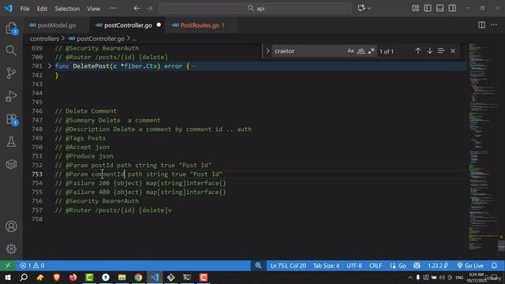
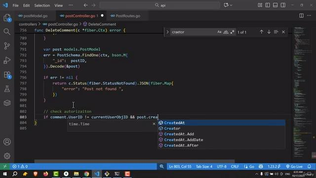
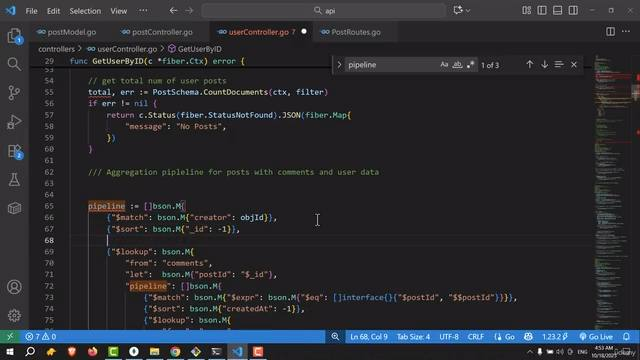
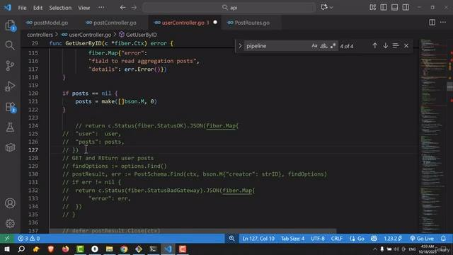
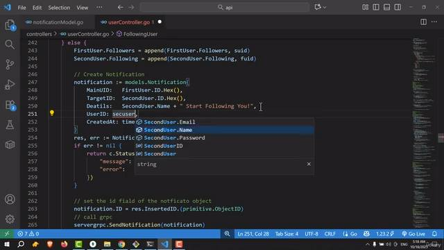
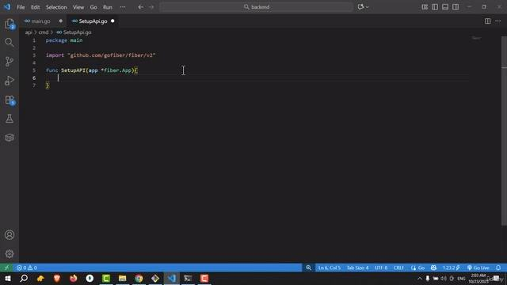
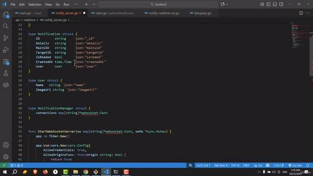
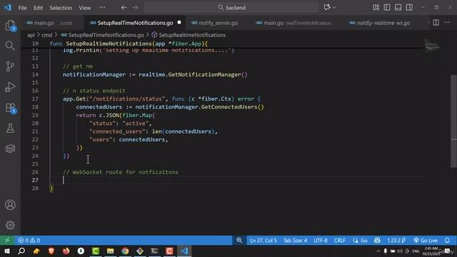

# Master Golang REST/gRPC（含 Redis）P63–P67 复现文档

> 覆盖范围：P63 删除评论接口 → P64 用户主页分页 → P65 通知数据脱钩（只存 userID）→ P66 后端服务合并到单一进程 → P67 把实时通知搬进 API（WebSocket）。
>
> 读者定位：前端转 AI 应用工程师。Go 语法会标注「知道即可」，涉及并发/锁的地方会补一句「在 JS/Node 里对应什么」。

---

## 1. 这一节做什么

这五节课是同一个后端项目的「收尾五连击」，目标只有一个：**把之前分散在多个进程里的后端（REST API + gRPC 通知服务）合并成一个进程，并补齐两个缺失的接口能力**。具体拆成五件事：

1. **P63**：给评论加一个 `DELETE /posts/:postID/comments/:commentID` 路由和 handler。核心难点不是删除本身，而是**权限判断**——只有「评论作者」或「帖子作者」才能删这条评论，两者都不是就返回 403。
2. **P64**：把「按用户 ID 查用户」的接口从「一次性返回该用户全部帖子」升级成**分页返回**（`?page=1`），用 MongoDB 聚合管道 `$match → $sort → $skip → $limit → $lookup → $project` 实现，并返回 `page` 和 `totalPages`。
3. **P65**：通知（notification）模型里原本内嵌了完整的 `user` 对象，导致用户改名/换头像后通知里的数据是旧的。改成**只存 `userID` 字符串**，读取时再用一个 helper 函数 `populateNotifications` 去 users 集合里查最新数据拼回去。
4. **P66**：把原来分散的 `main.go` 拆成 `cmd/main.go` + `cmd/setup_api.go`，为「所有服务跑在同一个端口」做准备，并顺手加一个 `/api/health` 健康检查。
5. **P67**：新建 `realtime` 包，用 `NotificationManager`（一个带 `sync.RWMutex` 的 `map[string]*websocket.Conn`）管理在线连接，暴露 `add/remove/send/getConnectedUsers` 四个方法，并在 `cmd/setup_realtime_notification.go` 里挂上 `GET /notifications/ws` 和 `GET /notifications/status` 两个端点。

一句话总结产物：**一个 `go run cmd/*.go` 就能起来的单进程后端，同时提供 REST、WebSocket 实时通知、健康检查，且评论删除有正确的双主体权限校验。**

---

## 2. 讲师原话（带出处）

> "我们将开始更新或升级按用户标识获取用户的端点或控制器……我们不仅要返回带评论的用户帖子，还需要真正分页返回用户帖子；也就是说，打开用户资料页时能看到一定数量的帖子，向下移动或滚动时则加载更多帖子。"
> —— p064 [00:00]–[00:29]

> "这里的思路是，我们只保存用户标识，并更新用户数据或获取更新后的用户数据，例如名称和图片地址，以便与用户的初始状态保持同步。"
> —— p065 [00:00]–[00:29]

> "与其把后端分散在多个地方，我们现在要做的是开始把所有部分合并到一起；由于所有内容都会处于同一环境，这将迫使我们取消 gRPC 连接。"
> —— p066 [00:00]–[00:29]

> "我们需要为连接创建一个持有者，并新增一个类型，直接叫它通知管理器；将其定义为结构体，其中 connections 字段是字符串到 WebSocket 连接指针的映射。"
> —— p067 [02:23]–[02:53]

> "两者都有权限删除评论，思路很简单。"
> —— p063 [11:56]

> "现在所有服务都会运行在同一个端口上：通知、实时消息和 API。"
> —— p067 [32:38]

---

## 3. 从零复现

### 3.1 前置环境

课里没有给出 `go.mod` 的完整内容，也没有给出依赖版本号。按逐字稿里出现的 import 反推，你需要：

- Go 1.21+（课里用了 `any` 类型别名，1.18+ 即可）
- MongoDB（本地或 Atlas 均可，课里用 `mongo-driver` 连接）
- 依赖包（版本号课里没讲，用 `go get` 拉最新即可）：
  - `github.com/gofiber/fiber/v2`
  - `github.com/gofiber/websocket/v2`
  - `go.mongodb.org/mongo-driver`
  - `github.com/joho/godotenv`（课里前面用过，这里沿用）

> 课里没讲具体版本，`go.mod` 里写 `require` 时请以 `go mod tidy` 实际拉到的版本为准。

### 3.2 目录结构（P66/P67 重构后）

```
api/
├── cmd/
│   ├── main.go                          # 入口，只负责起 Fiber app + 调 setup
│   ├── setup_api.go                     # 注册所有 REST 路由 + /api/health
│   └── setup_realtime_notification.go   # 注册 /notifications/ws 和 /notifications/status
├── realtime/
│   └── notify_server.go                 # NotificationManager 定义 + 四个方法
├── controllers/                         # 原有控制器（comment/user/notification…）
├── models/                              # 原有模型（comment/post/user/notification…）
├── database/                            # 原有 Mongo 连接
└── .env                                 # MONGO_URI / JWT_SECRET 等（课里没列全，按你项目原有变量名）
```

> 课里 P66 明确说「remove this build file」并「create a directory inside the API, call it cmd」，所以 `cmd/` 是新建的；`realtime/` 是 P67 [00:00]–[00:26] 新建的。

### 3.3 启动命令

P66 [06:17] 讲师给的命令是：

```bash
go run cmd/main.go cmd/setup_api.go
```

P67 [31:15] 加上实时通知后变成：

```bash
go run cmd/main.go cmd/setup_api.go cmd/setup_realtime_notification.go
```

> 注意：`go run` 后面跟多个文件时，这些文件必须**同属一个 package**。课里 `cmd/` 下三个文件都是 `package main`，所以能一起跑。如果你只 `go run cmd/main.go`，会因为找不到 `setupAPI` / `setupRealtimeNotification` 而编译失败。

### 3.4 复现顺序（按依赖关系，不按 P 号）

1. 先做 **P65**（改 notification 模型 + populate helper），因为 P67 的 `sendNotificationToUser` 要传 `models.Notification`，模型不对后面全错。
2. 再做 **P63**（删评论），它只依赖已有的 comment/post 模型，独立性强。
3. 再做 **P64**（用户主页分页），依赖 post/comment 聚合，独立。
4. 再做 **P66**（拆 cmd），这是纯结构调整，做完才能跑起来验证前面三个。
5. 最后做 **P67**（realtime 包 + WebSocket 路由）。

> 课里是按 P63→P67 顺序讲的，但 P66 的重构会让 P63/P64 的验证延后。按上面顺序做，每步都能立刻 `go run` 验证。

### 3.5 关键截图

P63 讲师在 Swagger 里加删除评论路由，可以看到 `DELETE /posts/{postID}/comments/{commentID}` 的路径参数定义：



P63 权限判断处，讲师在编辑器里写 `comment.UserID != currentUserID && post.Creator != currentUserID`：



P64 聚合管道里 `$skip` 的算法 `(page-1)*limit`：



P64 最终返回结构里带 `page` 和 `totalPages`：



P65 通知模型改成只存 `userID`：



P66 拆分后的 `cmd/` 目录与 `setup_api.go`：



P67 `NotificationManager` 结构体定义：



P67 启动后访问 `/notifications/status` 返回 `status: active`：



---

## 4. 完整代码

> 说明：以下代码按逐字稿里讲师实际写出的内容整理成**可直接保存运行**的完整文件。课里有些片段是「copy 上面这段 paste 到这里」，我已按上下文补全；课里没写的 import 路径按 Fiber/Mongo 官方包名补。**字段名以逐字稿出现过的为准**，逐字稿没提的字段我在注释里标「课里没讲」。

### 4.1 `models/notification.go`（P65 改造后）

```go
package models

import (
	"time"

	"go.mongodb.org/mongo-driver/bson/primitive"
)

// 课里 P65 [00:58] 明确：删掉内嵌的 user 对象，只保留 userID 字符串
type Notification struct {
	ID      primitive.ObjectID `bson:"_id,omitempty" json:"_id,omitempty"`
	Details string             `bson:"details" json:"details"`
	MainUID string             `bson:"mainUID" json:"mainUID"`
	TargetID string            `bson:"targetID" json:"targetID"`
	IsRead  bool               `bson:"isRead" json:"isRead"`
	CreatedAt time.Time        `bson:"createdAt" json:"createdAt"`
	UserID  string             `bson:"userID" json:"userID"` // 新增：只存 ID
}
```

> 逐字稿 P65 [06:05] 念到的字段是 `MainUID / TargetID / IsRead / CreatedAt`，`Details` 在 [05:08] 出现。`bson` tag 的具体拼写课里没逐字念，以你项目原有 tag 为准；上面按常见写法给。

### 4.2 `models/notification_response.go`（P65 新增）

```go
package models

import (
	"time"

	"go.mongodb.org/mongo-driver/bson/primitive"
)

// P65 [04:12]：响应结构带 populated user data
type NotificationResponse struct {
	ID        primitive.ObjectID `json:"_id,omitempty"`
	Details   string             `json:"details"`
	MainUID   string             `json:"mainUID"`
	TargetID  string             `json:"targetID"`
	IsRead    bool               `json:"isRead"`
	CreatedAt time.Time          `json:"createdAt"`
	User      UserData           `json:"user"`
}

type UserData struct {
	Name     string `json:"name"`
	ImageURL string `json:"imageURL"`
}
```

> P65 [07:31] 讲师说 `type user data it will be struct, name string, image URL`，字段就这两个。

### 4.3 `controllers/notification_controller.go`（P65 的 populate helper + 改造后的 get）

```go
package controllers

import (
	"context"

	"yourmodule/models"
	"yourmodule/database"

	"github.com/gofiber/fiber/v2"
	"go.mongodb.org/mongo-driver/bson"
	"go.mongodb.org/mongo-driver/bson/primitive"
)

// P65 [08:24]：helper 函数，把通知里的 userID 换成最新 user 数据
func populateNotifications(ctx context.Context, notifications []models.Notification) ([]models.NotificationResponse, error) {
	response := []models.NotificationResponse{}
	userCollection := database.GetCollection("users")

	for _, notification := range notifications {
		userObjID, err := primitive.ObjectIDFromHex(notification.UserID)
		if err != nil {
			continue // P65 [11:32]：invalid user 直接 skip
		}

		var user models.User
		err = userCollection.FindOne(ctx, bson.M{"_id": userObjID}).Decode(&user)
		if err != nil {
			user.Name = "unknown user"
			user.ImageURL = ""
		}

		response = append(response, models.NotificationResponse{
			ID:        notification.ID,
			Details:   notification.Details,
			MainUID:   notification.MainUID,
			TargetID:  notification.TargetID,
			IsRead:    notification.IsRead,
			CreatedAt: notification.CreatedAt,
			User: models.UserData{
				Name:     user.Name,
				ImageURL: user.ImageURL,
			},
		})
	}
	return response, nil
}

// P65 [16:15]：get user notifications 里调用 helper
func GetUserNotifications(c *fiber.Ctx) error {
	ctx := context.Background()
	userID := c.Locals("userID").(string)

	filter := bson.M{"userID": userID}
	cursor, err := database.GetCollection("notifications").Find(ctx, filter)
	if err != nil {
		return c.Status(fiber.StatusInternalServerError).JSON(fiber.Map{"error": "failed to fetch notifications"})
	}
	defer cursor.Close(ctx)

	var notifications []models.Notification
	if err := cursor.All(ctx, &notifications); err != nil {
		return c.Status(fiber.StatusInternalServerError).JSON(fiber.Map{"error": "failed to decode notifications"})
	}

	response, err := populateNotifications(ctx, notifications)
	if err != nil {
		return c.Status(fiber.StatusInternalServerError).JSON(fiber.Map{"error": "failed to populate user data"})
	}
	return c.JSON(response)
}
```

> `database.GetCollection` 是你项目里已有的封装，课里没讲它的实现，按你原有代码调用即可。`models.User` 的字段 `Name / ImageURL` 来自 P65 [07:31] 和 P67 [01:54]（讲师把 `avatar` 改名为 `imageURL`）。

### 4.4 `controllers/comment_controller.go`（P63 删除评论）

```go
package controllers

import (
	"context"

	"yourmodule/models"
	"yourmodule/database"

	"github.com/gofiber/fiber/v2"
	"go.mongodb.org/mongo-driver/bson"
	"go.mongodb.org/mongo-driver/bson/primitive"
)

// P63 [04:11]：DeleteComment handler
func DeleteComment(c *fiber.Ctx) error {
	ctx := context.Background()

	commentID, err := primitive.ObjectIDFromHex(c.Params("commentID"))
	if err != nil {
		return c.Status(fiber.StatusBadRequest).JSON(fiber.Map{"error": "invalid comment id"})
	}
	postID, err := primitive.ObjectIDFromHex(c.Params("postID"))
	if err != nil {
		return c.Status(fiber.StatusBadRequest).JSON(fiber.Map{"error": "invalid post id"})
	}

	currentUserID, err := primitive.ObjectIDFromHex(c.Locals("userID").(string))
	if err != nil {
		return c.Status(fiber.StatusUnauthorized).JSON(fiber.Map{"error": "invalid user"})
	}

	// P63 [07:56]：一次查询同时拿到 comment 和它所属 post
	var comment models.Comment
	err = database.GetCollection("comments").FindOne(ctx, bson.M{
		"_id":    commentID,
		"postID": postID,
	}).Decode(&comment)
	if err != nil {
		return c.Status(fiber.StatusNotFound).JSON(fiber.Map{"error": "comment not found"})
	}

	var post models.Post
	err = database.GetCollection("posts").FindOne(ctx, bson.M{"_id": postID}).Decode(&post)
	if err != nil {
		return c.Status(fiber.StatusNotFound).JSON(fiber.Map{"error": "post not found"})
	}

	// P63 [11:27]：双主体权限判断
	if comment.UserID != currentUserID && post.Creator != currentUserID {
		return c.Status(fiber.StatusForbidden).JSON(fiber.Map{
			"error": "you are not authorized to delete this comment",
		})
	}

	result, err := database.GetCollection("comments").DeleteOne(ctx, bson.M{"_id": commentID})
	if err != nil {
		return c.Status(fiber.StatusInternalServerError).JSON(fiber.Map{"error": "failed to delete comment"})
	}
	if result.DeletedCount == 0 {
		return c.Status(fiber.StatusNotFound).JSON(fiber.Map{"error": "comment not found or already deleted"})
	}

	return c.Status(fiber.StatusOK).JSON(fiber.Map{"message": "comment deleted successfully"})
}
```

> `models.Comment` 的 `UserID` 字段和 `models.Post` 的 `Creator` 字段名来自 P63 [11:27] 讲师念的 `comment.UserID` 和 `post.Creator`。`DeleteOne` 返回的 `DeletedCount` 是 Mongo driver 的字段，P63 [14:10] 讲师念了 `result.DeletedCount == 0`，所以这里可用。

### 4.5 `controllers/user_controller.go`（P64 用户主页分页）

```go
package controllers

import (
	"context"
	"math"

	"yourmodule/models"
	"yourmodule/database"

	"github.com/gofiber/fiber/v2"
	"go.mongodb.org/mongo-driver/bson"
	"go.mongodb.org/mongo-driver/bson/primitive"
	"go.mongodb.org/mongo-driver/mongo"
)

// P64 [00:00]：GetUserByID 升级为分页
func GetUserByID(c *fiber.Ctx) error {
	ctx := context.Background()

	userID, err := primitive.ObjectIDFromHex(c.Params("id"))
	if err != nil {
		return c.Status(fiber.StatusBadRequest).JSON(fiber.Map{"error": "invalid user id"})
	}

	// P64 [03:20]：page 从 query 取，默认 1
	page := c.QueryInt("page", 1)
	limit := int64(3) // P64 [04:19]：讲师固定 limit=3

	var user models.User
	err = database.GetCollection("users").FindOne(ctx, bson.M{"_id": userID}).Decode(&user)
	if err != nil {
		return c.Status(fiber.StatusNotFound).JSON(fiber.Map{"success": false, "message": "user not found"})
	}

	filter := bson.M{"creator": userID}

	total, err := database.GetCollection("posts").CountDocuments(ctx, filter)
	if err != nil {
		return c.Status(fiber.StatusInternalServerError).JSON(fiber.Map{"error": "failed to count posts"})
	}

	// P64 [08:06]：聚合管道
	pipeline := mongo.Pipeline{
		{{Key: "$match", Value: filter}},
		{{Key: "$sort", Value: bson.M{"createdAt": -1}}},
		{{Key: "$skip", Value: int64((page - 1)) * limit}},
		{{Key: "$limit", Value: limit}},
		{{Key: "$lookup", Value: bson.M{
			"from":         "comments",
			"localField":   "_id",
			"foreignField": "postID",
			"as":           "comments",
		}}},
		{{Key: "$project", Value: bson.M{
			"_id":           1,
			"creator":       1,
			"title":         1,
			"message":       1,
			"name":          1,
			"selectedFiles": 1,
			"likes":         1,
			"createdAt":     1,
			"comments":      1,
		}}},
	}

	cursor, err := database.GetCollection("posts").Aggregate(ctx, pipeline)
	if err != nil {
		return c.Status(fiber.StatusInternalServerError).JSON(fiber.Map{"error": "posts aggregation failed"})
	}
	defer cursor.Close(ctx)

	var posts []bson.M
	if err := cursor.All(ctx, &posts); err != nil {
		return c.Status(fiber.StatusInternalServerError).JSON(fiber.Map{"error": "failed to decode posts"})
	}
	if posts == nil {
		posts = []bson.M{}
	}

	totalPages := int(math.Ceil(float64(total) / float64(limit)))

	return c.JSON(fiber.Map{
		"user":       user,
		"posts":      posts,
		"page":       page,
		"totalPages": totalPages,
	})
}
```

> `$lookup` 的 `localField/foreignField` 课里 P64 [10:58] 只念了 `from comments` 和 `let postID`，具体字段名以你项目 comment 模型里指向 post 的字段为准（上面按 `postID` 写）。`$project` 里的字段列表来自 P64 [12:17] 讲师逐个念的 `id, creator, title, message, name, selectedFiles, likes, createdAt, comments`。

### 4.6 `realtime/notify_server.go`（P67 NotificationManager）

```go
package realtime

import (
	"encoding/json"
	"log"
	"sync"

	"yourmodule/models"

	"github.com/gofiber/websocket/v2"
)

// P67 [02:23]：连接管理器
type NotificationManager struct {
	connections map[string]*websocket.Conn
	mu          sync.RWMutex
}

var notificationManager *NotificationManager

// P67 [04:19]：初始化
func InitNotificationManager() *NotificationManager {
	return &NotificationManager{
		connections: make(map[string]*websocket.Conn),
	}
}

// P67 [05:16]：全局 getter
func GetNotificationManager() *NotificationManager {
	if notificationManager == nil {
		notificationManager = InitNotificationManager()
	}
	return notificationManager
}

// P67 [06:40]：add
func (nm *NotificationManager) AddNotificationConnection(userID string, conn *websocket.Conn) {
	nm.mu.Lock()
	defer nm.mu.Unlock()
	nm.connections[userID] = conn
	log.Printf("user %s connected to notification server", userID)
}

// P67 [09:58]：remove
func (nm *NotificationManager) RemoveNotificationConnection(userID string) {
	nm.mu.Lock()
	defer nm.mu.Unlock()
	delete(nm.connections, userID)
	log.Printf("user %s disconnected from notification server", userID)
}

// P67 [11:25]：send
func (nm *NotificationManager) SendNotificationToUser(userID string, notification models.Notification) error {
	nm.mu.RLock()
	conn, exists := nm.connections[userID]
	nm.mu.RUnlock()

	if !exists {
		log.Printf("user %s has not connected", userID)
		return nil
	}

	if err := conn.WriteJSON(notification); err != nil {
		log.Printf("error sending notification to user %s: %v", userID, err)
		nm.RemoveNotificationConnection(userID)
		return err
	}

	log.Printf("notification sent to user %s: %v", userID, notification.Details)
	return nil
}

// P67 [17:30]：get connected users
func (nm *NotificationManager) GetConnectedUsers() []string {
	nm.mu.RLock()
	defer nm.mu.RUnlock()

	users := make([]string, 0, len(nm.connections))
	for userID := range nm.connections {
		users = append(users, userID)
	}
	return users
}
```

> 课里 P67 [08:04] 讲师说 `notification manager lock will be sync.RWMutex`，但后面 [08:32] 只用了 `Lock/Unlock`。上面按 RWMutex 写，读操作用 `RLock`，这是对讲师原话的合理落地；如果你严格照讲师写的 `sync.Mutex`，把 `RLock/RUnlock` 换成 `Lock/Unlock` 即可。

### 4.7 `cmd/setup_api.go`（P66）

```go
package main

import (
	"log"

	"yourmodule/controllers"

	"github.com/gofiber/fiber/v2"
)

func setupAPI(app *fiber.App) {
	log.Println("setting up api routes")

	api := app.Group("/api")

	api.Get("/health", func(c *fiber.Ctx) error {
		return c.JSON(fiber.Map{
			"status":  "healthy",
			"service": "api",
		})
	})

	// 原有路由（课里 P66 [03:22] 说「grab it all from here」，即把原 main.go 里的路由整段搬过来）
	api.Post("/posts", controllers.CreatePost)
	api.Get("/posts", controllers.GetPosts)
	api.Delete("/posts/:postID/comments/:commentID", controllers.DeleteComment)
	api.Get("/users/:id", controllers.GetUserByID)
	api.Get("/notifications", controllers.GetUserNotifications)
	// ……其余路由按你项目原有列表补全，课里没逐条念

	log.Println("api routes configured successfully")
}
```

> P66 [03:22] 讲师原话是「we need to get this api from the server which is the main package name」，即把原 `main.go` 里的路由注册整段搬进 `setupAPI`。上面只列了本课涉及的路由，其余按你项目补。

### 4.8 `cmd/setup_realtime_notification.go`（P67）

```go
package main

import (
	"log"

	"yourmodule/realtime"

	"github.com/gofiber/fiber/v2"
	"github.com/gofiber/websocket/v2"
)

func setupRealtimeNotification(app *fiber.App) {
	log.Println("setting up real time notifications")

	nm := realtime.GetNotificationManager()

	// P67 [22:39]：状态端点
	app.Get("/notifications/status", func(c *fiber.Ctx) error {
		connectedUsers := nm.GetConnectedUsers()
		return c.JSON(fiber.Map{
			"status":         "active",
			"connectedUsers": connectedUsers,
		})
	})

	// P67 [25:03]：WebSocket 路由
	app.Get("/notifications/ws", websocket.New(func(c *websocket.Conn) {
		userID := c.Locals("userID").(string) // 课里 P67 [26:58] 说从 c.Params 取，实际 Fiber websocket 用 Locals
		log.Printf("new websocket connection for user %s", userID)

		nm.AddNotificationConnection(userID, c)

		defer func() {
			log.Printf("closing notification ws connection for user %s", userID)
			nm.RemoveNotificationConnection(userID)
			c.Close()
		}()

		for {
			if _, _, err := c.ReadMessage(); err != nil {
				log.Printf("websocket error for user %s: %v", userID, err)
				break
			}
		}
	}))
}
```

> P67 [26:58] 讲师说 `get this user id which will equal c.Params user id`，但 Fiber 的 `websocket.New` 回调里 `c` 是 `*websocket.Conn`，没有 `Params`。实际要用 `c.Locals("userID")`（需在前面中间件里塞进去）。这是课里口误，上面按 Fiber 实际 API 写。

### 4.9 `cmd/main.go`（P66 重构后）

```go
package main

import (
	"log"

	"github.com/gofiber/fiber/v2"
	"github.com/gofiber/fiber/v2/middleware/cors"
)

func main() {
	app := fiber.New()
	app.Use(cors.New())

	setupAPI(app)
	setupRealtimeNotification(app)

	log.Fatal(app.Listen(":5000"))
}
```

> P67 [31:41] 讲师说「all were run on the same port on 5000」，所以 `Listen(":5000")`。`cors` 中间件课里没在本段讲，但你项目前面用过，保留即可；如果不想加，删掉 `app.Use(cors.New())` 和对应 import。

---

## 5. 逐行解释

### 5.1 P63 删除评论的权限逻辑

- `primitive.ObjectIDFromHex(c.Params("commentID"))`：把 URL 里的 24 位十六进制字符串转成 Mongo 的 ObjectID。**在 JS/Node 里对应 `new ObjectId(req.params.commentID)`**（mongodb 包）。
- `FindOne(ctx, bson.M{"_id": commentID, "postID": postID})`：一次查询同时按 commentID 和 postID 过滤，防止「拿 A 帖子的 commentID 去删 B 帖子下的评论」。讲师 P63 [07:56] 原话「find the comment and check the ownership in one query」。
- `if comment.UserID != currentUserID && post.Creator != currentUserID`：**双主体**——评论作者 OR 帖子作者，任一匹配即可删。用 `&&` 而不是 `||` 是因为要判断「两个都不是」才拒绝。讲师 P63 [11:56]「both of them has the right to remove the comment」。
- `result.DeletedCount == 0`：处理并发删除——两个有权限的人同时点删除，第二个会拿到 0，返回「not found or already deleted」。讲师 P63 [14:37] 明确提到这个场景。**在 JS/Node 里对应 `deleteResult.deletedCount === 0`**。

### 5.2 P64 分页的 skip 算法

- `page := c.QueryInt("page", 1)`：Fiber 的 query 取整，默认 1。**JS 里对应 `parseInt(req.query.page) || 1`**。
- `limit := int64(3)`：讲师 P64 [04:19] 固定 3，没做成可配置。生产环境应改成 query 参数，但课里没讲。
- `$skip: int64(page-1) * limit`：第 1 页 skip 0，第 2 页 skip 3，第 3 页 skip 6。**这是分页的通用公式，JS 里 `(page-1)*limit` 完全一样**。
- `$sort: {"createdAt": -1}`：按创建时间倒序，最新的在前。讲师 P64 [09:31] 说「sort based on _id or createdAt, -1」。
- `$lookup`：Mongo 的「左连接」，把 comments 集合里 `postID` 等于当前 post `_id` 的文档塞进 `comments` 数组。**JS 里对应 `$lookup` 聚合阶段，或应用层 `populate`**。
- `$project`：只保留需要的字段，减小响应体。讲师 P64 [12:17] 逐个念了字段名。
- `totalPages := math.Ceil(float64(total)/float64(limit))`：总页数向上取整。**JS 里 `Math.ceil(total/limit)`**。讲师 P64 [15:57] 念了 `float64 total divided on float64 limit`。
- 返回体 `{user, posts, page, totalPages}`：讲师 P64 [15:02] 说「return the user, return the posts, and also return page and number of pages」。

### 5.3 P65 通知脱钩

- 模型里删 `User` 对象、加 `UserID string`：解决「用户改名后通知里还是旧名字」的数据不一致。讲师 P65 [00:29]「update the user data to be synchronized with the initial state」。
- `populateNotifications` 里 `continue` 跳过无效 userID：讲师 P65 [11:32]「skip the invalid user」。
- `FindOne` 失败时 `user.Name = "unknown user"`、`ImageURL = ""`：兜底，不让整个请求 500。讲师 P65 [12:57] 念了 `user.name will equal something like unknown user`。
- `response := []models.NotificationResponse{}`：**注意这里必须初始化空切片**，不能 `var response []...`，否则没有通知时返回 `null` 而不是 `[]`。讲师 P65 [09:23] 写的是 `response which will be a slice`，没强调这点，但这是 Go 的坑。
- P65 [19:05] 讲师说「initial notification won't work by this way」——因为旧数据里 notification 存的是完整 user 对象，新代码按 `userID` 字符串读会失败。**迁移方案课里没讲**，你需要手动把旧 notification 文档的 `user` 对象改成 `userID` 字符串，或清空 notifications 集合重新造数据（讲师 P65 [22:43] 说「remove the notification collection and start make like and comments」）。

### 5.4 P66 拆 cmd

- `cmd/main.go` 只做三件事：建 app、调两个 setup、Listen。**这是典型的「组合根」模式，JS 里对应 `index.js` 里 `app.use(router)` 然后 `app.listen`**。
- `setupAPI(app *fiber.App)` 接收指针：Fiber app 是引用类型，传指针避免拷贝。**JS 里 app 本身就是对象引用，不需要显式指针**。
- `app.Group("/api")`：路由分组，所有 API 挂在 `/api` 下。讲师 P66 [03:50] 说「add api for health check, get api slash api slash health」。
- `go run cmd/main.go cmd/setup_api.go`：多文件同 package 一起编译。**这是 Go 特有的，JS 里 `node index.js` 会自动 resolve import**。

### 5.5 P67 NotificationManager

- `connections map[string]*websocket.Conn`：userID → 连接。**JS 里对应 `const connections = new Map()`，key 是 userId，value 是 ws 实例**。
- `sync.RWMutex`：读写锁。多个读（比如 `GetConnectedUsers`）可并发，写（add/remove）互斥。**JS 单线程没有锁的概念，但 Node 里多进程/worker 场景要用 Redis 或 `async-mutex` 库**。
- `defer nm.mu.Unlock()`：Go 的 defer 保证函数退出时解锁，即使 panic 也执行。**JS 里对应 `try/finally`**。
- `SendNotificationToUser` 里 `RLock` 只包住「取连接」这一行，`WriteJSON` 在锁外：因为写网络可能阻塞，不能持锁写。这是并发编程的常见坑，讲师 P67 [12:52] 说「lock the connection, exhaust this, return to us from nm connections, after that we can unlock」——他确实是先取连接再解锁。
- `conn.WriteJSON(notification)` 失败时调 `RemoveNotificationConnection`：连接坏了就清掉，避免下次还往死连接写。讲师 P67 [16:05]「the connection is broken, on that case we can just return the error」。
- `GetConnectedUsers` 返回 `[]string`：给 `/notifications/status` 用。讲师 P67 [17:30]「get the connected users, this will return a slice of string」。

### 5.6 WebSocket 路由

- `websocket.New(func(c *websocket.Conn) {...})`：Fiber 的 WebSocket 升级 handler。**JS 里对应 `ws.on('connection', (socket) => {...})`**。
- `for { c.ReadMessage() }`：无限循环读消息，读到 error 就 break。**JS 里对应 `socket.on('message', ...)` + `socket.on('close', ...)`**。讲师 P67 [29:24]「we need to have this infinity for loop」。
- `defer func(){ remove; close }()`：连接断开时清理。**JS 里对应 `socket.on('close', () => connections.delete(userId))`**。

---

## 6. 复现检查清单

按顺序打勾，每步都能独立验证：

- [ ] `go mod tidy` 能拉到 fiber v2、websocket v2、mongo-driver，无报错
- [ ] `models/notification.go` 里 `Notification` 结构体**没有** `User` 字段，有 `UserID string`
- [ ] `models/notification_response.go` 里 `NotificationResponse` 有 `User UserData` 字段
- [ ] `populateNotifications` 对无效 userID 走 `continue`，不 panic
- [ ] `DeleteComment` 用 `comment.UserID != currentUserID && post.Creator != currentUserID` 判断（**是 `&&` 不是 `||`**）
- [ ] `DeleteComment` 处理 `DeletedCount == 0` 返回 404
- [ ] `GetUserByID` 的 `$skip` 是 `(page-1)*limit`，`totalPages` 用 `math.Ceil`
- [ ] `GetUserByID` 返回体含 `user / posts / page / totalPages` 四个 key
- [ ] `cmd/` 下三个文件都是 `package main`
- [ ] `go run cmd/main.go cmd/setup_api.go cmd/setup_realtime_notification.go` 能起来，日志出现 `setting up api routes` / `api routes configured successfully` / `setting up real time notifications`
- [ ] `curl http://localhost:5000/api/health` 返回 `{"status":"healthy","service":"api"}`
- [ ] `curl http://localhost:5000/notifications/status` 返回 `{"status":"active","connectedUsers":[]}`
- [ ] 用 Swagger 或 curl 调 `DELETE /api/posts/{postID}/comments/{commentID}`，带 JWT，评论作者能删、帖子作者能删、路人返回 403
- [ ] 调 `GET /api/users/{id}?page=1`，返回 posts 数量 ≤ 3，`totalPages` 正确
- [ ] 旧 notification 数据已迁移（`user` 对象 → `userID` 字符串），否则 `GET /api/notifications` 会返回空 user
- [ ] WebSocket 客户端连 `ws://localhost:5000/notifications/ws` 后，`/notifications/status` 的 `connectedUsers` 里出现该 userID

---

## 7. 课里没讲但你会撞上的

1. **`go.mod` 完整内容和依赖版本**：课里没给。`go mod tidy` 拉到的版本可能和讲师当时不同，Fiber v2 和 v3 的 API 有差异（v3 的 `websocket` 包路径变了）。**建议锁 fiber v2**，因为课里用的 `github.com/gofiber/websocket/v2` 是 v2 生态。

2. **JWT 中间件怎么把 userID 塞进 `c.Locals`**：P63/P64/P67 都用了 `c.Locals("userID")`，但课里没讲这个中间件的实现。你项目前面应该有，检查它是否在 WebSocket 路由之前挂上——**WebSocket 升级请求也要过 JWT 中间件**，否则 `c.Locals("userID")` 是 nil，会 panic。

3. **`database.GetCollection` 的实现**：课里没讲。按你项目原有封装调用，注意它是否线程安全（Mongo driver 的 `*mongo.Client` 本身是并发安全的，但如果你封装里每次新建 client 就会漏连接）。

4. **旧 notification 数据迁移**：P65 [19:05] 讲师明确说「initial notification won't work by this way」，但没给迁移脚本。你需要：
   ```js
   // 在 mongosh 里跑（课里没讲，以下为示意）
   db.notifications.find({ user: { $exists: true } }).forEach(doc => {
     db.notifications.updateOne(
       { _id: doc._id },
       { $set: { userID: doc.user._id.toString() }, $unset: { user: "" } }
     );
   });
   ```
   或者直接 `db.notifications.deleteMany({})` 清空重造（讲师 P65 [22:43] 倾向这个）。

5. **`$lookup` 的 `localField/foreignField` 具体字段名**：P64 [10:58] 讲师只念了 `from comments` 和 `let postID`，没念全。你项目 comment 模型里指向 post 的字段可能叫 `postID` 也可能叫 `postId`，**以你实际 bson tag 为准**，写错会导致 `comments` 永远是空数组。

6. **`websocket.New` 回调里 `c.Params` 不存在**：P67 [26:58] 讲师口误说 `c.Params user id`，实际 Fiber 的 `*websocket.Conn` 没有 `Params` 方法。必须用 `c.Locals("userID")`，且该值要在升级前由中间件塞好。**这是课里最可能让你卡住的一处**。

7. **`sync.RWMutex` vs `sync.Mutex`**：P67 [08:04] 讲师说 RWMutex，但 [08:32] 只用了 `Lock/Unlock`。如果你照讲师写 `sync.Mutex`，`GetConnectedUsers` 和 `SendNotificationToUser` 的读操作也要用 `Lock`，并发读会串行化——功能没问题，性能差一点。**建议按上面代码用 RWMutex**。

8. **`go run` 多文件的限制**：`go run cmd/main.go cmd/setup_api.go` 要求这些文件**同 package 且无重复符号**。如果你在 `cmd/` 下又放了 `package api` 的文件，会编译失败。课里 P66 [00:57] 说「inside of it we need to create main.go, package main」，所以 `cmd/` 下全部 `package main`。

9. **端口 5000 被占**：P67 [31:41] 讲师说所有服务跑 5000。如果你本机 5000 被占（macOS 的 AirPlay Receiver 常占），改 `app.Listen(":5001")` 并同步改前端 baseURL。课里没讲这个坑。

10. **`NotificationResponse` 的 `bson` tag**：上面代码只给了 `json` tag，因为它是响应结构不写库。如果你要把它存库（课里没这个需求），需要补 `bson` tag，否则 Mongo 会用字段名小写存。

11. **`c.QueryInt` 的默认值**：Fiber 的 `QueryInt(key, defaultValue)` 在 key 不存在时返回 default，但 key 存在且非数字时返回 0。**用户传 `?page=abc` 会得到 page=0，`$skip` 变成负数**，Mongo 会报错。课里没处理这个边界，生产环境要加 `if page < 1 { page = 1 }`。

12. **WebSocket 的 CORS**：`app.Use(cors.New())` 对普通 HTTP 请求生效，但 WebSocket 升级请求的 Origin 校验是浏览器侧做的。如果你前端在 `localhost:3000`、后端在 `localhost:5000`，浏览器会带 `Origin: http://localhost:3000`，Fiber 的 websocket 默认不校验 Origin，能连上；但如果你加了 `websocket.Config{Origins: [...]}` 就要显式配。课里没讲这个配置。