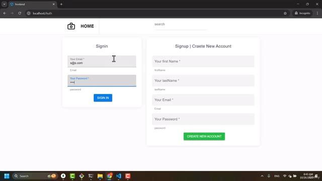
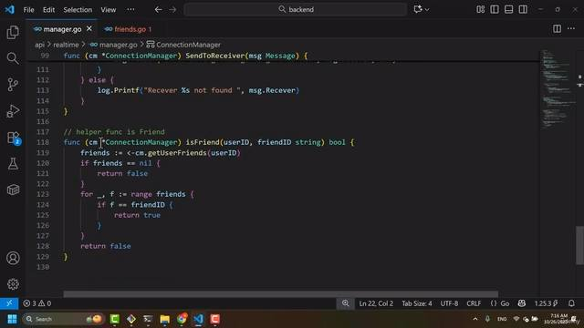
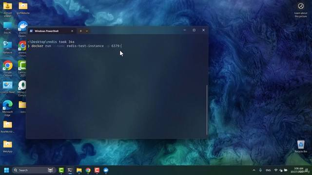
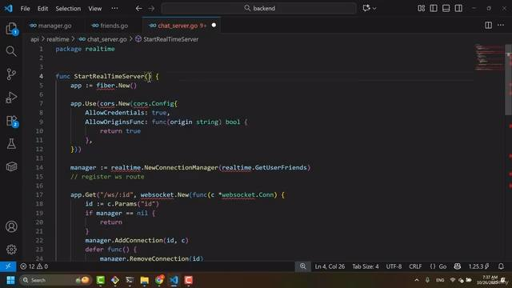
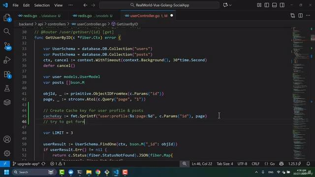
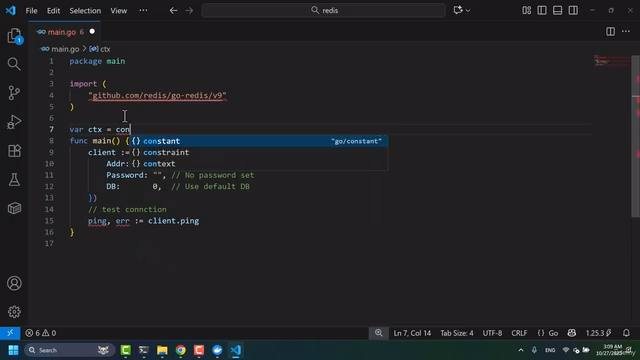
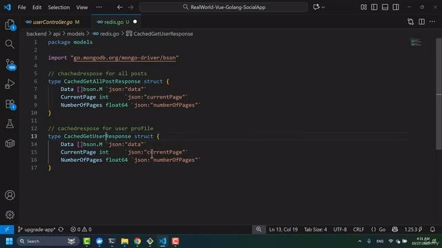
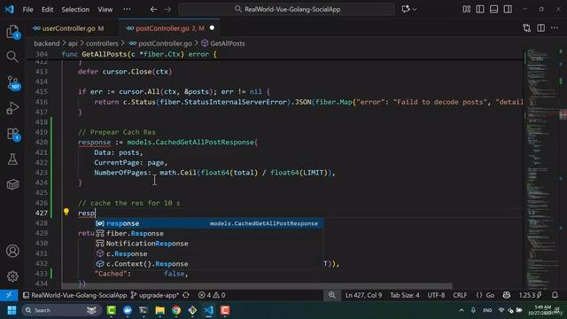

## 1. 这一节做什么

这 5 节（P68–P72）有两条主线。

第一条主线是 P68–P69：把之前已经做过的 real-time chat 合并进 API 进程，让后端“一个命令启动”，并把原来的 gRPC 连接相关文件移掉。讲师先在 API 里补 `manager`、`friends`，再让 connection manager 在发送消息时把消息写入数据库，最后加一个 `setup real time chat` 的注册入口和 `/ws/:id` 路径。P69 只做前端验证：前端基本只改后端端口，然后开两个浏览器标签页登录不同用户，互相发消息确认实时聊天正常。

但注意一个关键转折：到 P71 开头，讲师又说 real-time chat 和 real-time notification 已经不需要了，要把它们从后端移除，开始接 Redis 缓存。因此**这一节的最终可运行形态不是聊天服务，而是：API + Redis 缓存两个端点**。P68 的聊天整合更像过渡步骤；P70 是 Redis 原理和 TTL 小实验；P71 给 `getUserProfile` 加缓存；P72 给 `getAllPosts` 加缓存。

第二条主线是 Redis 缓存。讲师要解决的是：当很多用户同时请求同一份用户主页或帖子列表时，不要让 MongoDB 每次都处理重复查询。做法是把响应 JSON 存到 Redis，设置 10 秒 TTL；10 秒内命中缓存就直接返回，超过 10 秒缓存自动消失，下次请求重新查库并写回缓存。P71 做用户主页，P72 做帖子列表。两个端点的响应里都加了一个 `cached` 字段，方便前端和调试时确认这次到底是不是缓存命中。



本节复现完成后的目标产物：

1. 本机有一个 Redis 容器，端口 `6379`。
2. 一个最小 Go 服务跑在 `:5000`，提供两个可验证缓存的接口：
   - `GET /api/users/:id?page=1`
   - `GET /api/posts/:userID?page=1`
3. 第一次请求返回 `cached:false`，10 秒内再请求返回 `cached:true`，超过 10 秒又回到 `cached:false`。
4. 你会知道 P68 的聊天整合改了哪些函数，以及为什么最终 P71 又把它删掉。

## 2. 讲师原话（带「—— pNNN [MM:SS]」）

P68 开头，讲师说明这一节要把实时聊天合进 API：

> “our mission now will be is to combine the real-time chat and added to the API functionality to allow all to work in just one command and allow all to replace the jrbc connection with the internal connection.”
>
> —— p068 [00:00]

这里逐字稿把 gRPC 转写成了 `jrbc`，结合上下文他指的是把原来的 gRPC 连接替换成内部连接，并在最后移除 gRPC server 和 proto。

P68 做到 connection manager 时，讲师明确要加“保存消息到数据库”的函数：

> “the first thing we need to work on is this one here related to server grbc send message to client… directly save it to the database so we need to create a specific function for that.”
>
> —— p068 [03:33]



P69 验证前端时，讲师说前端改动很小：

> “the only change that we need to make on our front end port is just to change the port. That's all.”
>
> —— p069 [00:00]

P70 对比 Redis 和 MongoDB 时，讲师强调 Redis 是内存存储：

> “Redis is actually a memory storage with desk persistence. But MongoDB, it is actually on the desk by default.”
>
> —— p070 [00:56]

P70 讲到缓存为什么要过期：

> “we want this to be updated so we want to have kind of that called TTL or time to remove or forget.”
>
> —— p070 [04:40]

P71 明确只给两个端点加缓存：

> “you will add Redis for caching on just two endpoints for getUser profile and getAllPosts.”
>
> —— p071 [00:00]

同时 P71 开头也说要把聊天和通知移除：

> “I don't think that we still need this real-time chat and real-time notification anymore, so we can get rid of them.”
>
> —— p071 [00:26]

P72 开始给帖子列表加缓存：

> “we will start at caching for get all posts endpoint.”
>
> —— p072 [00:00]

## 3. 从零复现

### 3.1 环境与目录

你需要：

- Go 1.21 或更高。课里没有给 Go 版本，这里用 1.21。
- Docker Desktop。课里明确说“prefer to run it via Docker desktop”。
- 可选：Node 前端。课里前端只改端口，没有给前端具体源码；没有前端也能用 `curl` 验证缓存。

最小复现目录如下。下面第 4 节会给每个文件的完整内容：

```text
redis-cache-demo/
├── go.mod
├── main.go
├── database/
│   └── redis.go
├── models/
│   └── redis.go
├── routes/
│   └── routes.go
├── controllers/
│   ├── user_controller.go
│   └── post_controller.go
└── cmd/
    └── redis-demo/
        └── main.go
```

环境变量：

```bash
export RedisURL=localhost:6379
export RedisPassword=
```

逐字稿里讲师念的是 `Redis URL` 和 `Redis password`，但没有展示精确的变量大小写。下面代码采用 `RedisURL`、`RedisPassword`；如果你接原课程项目，要保证 `os.Getenv` 里的名字一致。课里 MongoDB 的连接串和认证细节没有在本节讲，最小工程不包含 Mongo，只用内存样本模拟数据库查询结果。

### 3.2 启动 Redis

课里用 Docker 拉取并运行 Redis。逐字稿里端口先念成 6378，马上纠正为 6379，所以以 6379 为准。是否加 `-d` 课里没讲清；为了不占住终端，下面用 `-d`，如果你想把日志留在前台，可以去掉 `-d`。

```bash
docker pull redis
docker run --name redis-test-instance -p 6379:6379 -d redis
docker ps
```

确认容器里有 `redis-test-instance`，并且端口映射是 `6379->6379`。如果你本机已经有 Redis 占用 6379，可以先把本地 Redis 停掉，或者把容器映射改成别的端口，同时改 `RedisURL`。



### 3.3 P68 的聊天整合改动清单

这部分依赖前序章节已有的 `manager`、`friends`、real-time notification 文件。逐字稿是边操作边念，没有把旧的 manager/friends 文件完整贴出来，所以**不能只靠 P68 这一节从零编译出聊天模块**。如果你有前序项目，按下面顺序改：

1. 在 API 包中复制 real-time 里的 `friends` 和 `manager` 文件。讲师的原话是 “copy it and paste it here”，并把 manager 也复制过去。
2. 在 connection manager 里新增类似 `saveMessageToDB` 的函数，参数是 `message`，返回 `error`。内部用 `context.WithTimeout`，课里给 5 秒超时。
3. 原来发送消息给客户端的分支，要在发送时把消息写库。讲师说 “directly save it to the database”。
4. 发送路径里也调用保存逻辑；如果 receiver 不存在，按课程原来的错误分支处理。逐字稿这一段口述很碎，具体错误文案以你前序项目为准。
5. 在 manager/friends 中补 `getUserFriends(ctx, userID)`，返回 `[]string` 和 `error`。课里说要从 map 里取出 following/followers，再转成 slice。
6. 创建 chat server 文件，把原来的 real-time chat 复制过来，改成 `StartRealTimeServer(port string)`，端口动态传入。
7. 新增 `setup real time chat` 注册函数：设置 status active、service 为 real time chat，并注册 `/ws/:id`。
8. 在 `main.go` 里调用 `setupRealTimeChat`，Makefile 的启动目标改成 `cmd/main.go`。
9. 最后移除原来的 gRPC server 和 proto 文件，因为讲师说 “we can remove this server grbc… remove this proto proto as well”。



到 P71，讲师又说 real-time chat 和 notification 不需要了，所以最终 Redis 版本里没有聊天服务。下面第 4 节的最小工程就按最终形态实现。

### 3.4 P70 的 Redis TTL 小实验

在项目根目录执行：

```bash
go mod tidy
go run ./cmd/redis-demo
```

这个 demo 做四件事：

1. 连接 `localhost:6379`。
2. `PING` 确认 Redis 可用。
3. `SET username:123 = Ahmed`，TTL 5 秒。
4. 立刻 `GET` 一次，打印 `Ahmed`；睡 6 秒再 `GET`，此时 key 已过期，打印过期错误。

课里讲师用的 key 口述是 `user name 123`，这里写成 `username:123`，只是把空格换成冒号。读写两端一致即可。

### 3.5 启动缓存 API

在项目根目录：

```bash
go mod tidy
go run .
```

你应该看到 Gin 启动日志，以及代码里打印的：

```text
connected to redis successfully
server listening on :5000
```

然后开两个终端分别请求：

```bash
curl "http://localhost:5000/api/users/123?page=1"
curl "http://localhost:5000/api/users/123?page=1"
```

第一次响应里的 `cached` 是 `false`，因为缓存未命中，代码用样本数据组装响应并写入 Redis；10 秒内第二次请求，`cached` 是 `true`。等待 10 秒后再请求，TTL 过期，又回到 `cached:false`。

帖子端点同理：

```bash
curl "http://localhost:5000/api/posts/123?page=1"
curl "http://localhost:5000/api/posts/123?page=1"
```

P71 的缓存 key 是用户 ID + 页码；P72 的帖子缓存 key 是用户 ID + 页码。课里没有给出标点符号的精确写法，只念了 `user profile %s`、`page %d`、`post user %s`、`page %d`。下面代码用冒号拼接，例如 `user_profile:123:page:1`、`post_user:123:page:1`。只要读和写使用同一格式，行为就一致。



### 3.6 前端验证方式

如果你有课程前端，P69 说前端只需要把 API 端口改成后端新端口。你可以在前端 API 配置文件里把 base URL 指向 `http://localhost:5000`。然后在个人主页和帖子列表的请求回调里临时打印：

```javascript
console.log("user profile cached:", data.cached);
console.log("posts cached:", data.cached);
```

验证逻辑：

1. 打开个人主页，第一次 `cached` 为 `false`。
2. 10 秒内刷新，`cached` 为 `true`。
3. 等超过 10 秒再刷新，`cached` 回到 `false`。
4. 帖子列表同理。P72 还演示了点赞/取消点赞后 10 秒内页面仍显示旧状态，因为帖子列表被缓存了；超过 TTL 后再刷新才拿到新状态。

课里没有给前端具体文件路径和组件代码，所以这一段只能按“改端口 + 打印 `cached`”复现。

## 4. 完整代码

下面代码是一个可保存运行的最小工程。它保留课程里的关键命名和缓存行为：`RedisClient`、`InitRedis`、`CloseRedis`、`CachedGetAllPostsResponse`、`CachedGetUserResponse`、10 秒 TTL、`cached` 字段。数据库查询部分用内存样本代替
MongoDB 查询结果；缓存的读取顺序、key 组成方式、`cached` 字段和 10 秒 TTL 都按课里讲的来做。

### go.mod

```go
module github.com/example/redis-cache-demo

go 1.21

require (
	github.com/gin-gonic/gin v1.9.1
	github.com/redis/go-redis/v9 v9.5.1
)
```

保存后必须执行 `go mod tidy`，否则会生成 `go.sum` 并补齐间接依赖。课里 P71 也是先 `go mod tidy` 再继续写代码的。

### database/redis.go

这个文件对应课里“inside the database we just create this file”，也就是把 Redis 客户端做成全局变量 + `InitRedis` + `CloseRedis` 三件套：

```go
package database

import (
	"context"
	"log"
	"os"
	"time"

	"github.com/redis/go-redis/v9"
)

// RedisClient 是全局的 Redis 客户端，控制器里直接用 database.RedisClient。
var RedisClient *redis.Client

func InitRedis() {
	addr := os.Getenv("RedisURL")
	if addr == "" {
		addr = "localhost:6379"
	}

	RedisClient = redis.NewClient(&redis.Options{
		Addr:         addr,
		Password:     os.Getenv("RedisPassword"),
		DB:           0,
		PoolSize:     10,
		MinIdleConns: 5,
		Protocol:     2,
	})

	ctx, cancel := context.WithTimeout(context.Background(), 5*time.Second)
	defer cancel()

	if err := RedisClient.Ping(ctx).Err(); err != nil {
		log.Fatalf("failed to connect to redis: %v", err)
	}
	log.Println("connected to redis successfully")
}

func CloseRedis() {
	if RedisClient == nil {
		return
	}
	if err := RedisClient.Close(); err != nil {
		log.Printf("failed to close redis connection: %v", err)
	}
}
```



### models/redis.go

课里 P71 先建了两个缓存响应结构体，再进控制器，这样控制器里不用临时拼 map。为了让最小工程能跑，这里把演示用的 `User`、`Post` 也一起放在同一文件里；接入原课程项目时，这两个结构体通常在别的 models 文件里，已经存在，不要重复定义。

```go
package models

type User struct {
	ID       string `json:"id"`
	Username string `json:"username"`
	Email    string `json:"email"`
}

type Post struct {
	ID     string `json:"id"`
	Body   string `json:"body"`
	UserID string `json:"userId"`
	Likes  int    `json:"likes"`
}

// CachedGetAllPostsResponse 对应课里的 getAllPosts 缓存响应。
type CachedGetAllPostsResponse struct {
	Data          []Post  `json:"data"`
	CurrentPage   int     `json:"currentPage"`
	NumberOfPages float64 `json:"numberOfPages"`
	Cached        bool    `json:"cached"`
}

// CachedGetUserResponse 对应课里的 getUserProfile 缓存响应。
type CachedGetUserResponse struct {
	User          *User   `json:"user"`
	Posts         []Post  `json:"posts"`
	CurrentPage   int     `json:"currentPage"`
	NumberOfPages float64 `json:"numberOfPages"`
	Cached        bool    `json:"cached"`
}
```



### controllers/user_controller.go

```go
package controllers

import (
	"encoding/json"
	"fmt"
	"log"
	"math"
	"net/http"
	"strconv"
	"time"

	"github.com/gin-gonic/gin"
	"github.com/redis/go-redis/v9"

	"github.com/example/redis-cache-demo/database"
	"github.com/example/redis-cache-demo/models"
)

const (
	cacheTTL = 10 * time.Second
	pageSize = 2
)

func GetUserProfile(c *gin.Context) {
	userID := c.Param("id")
	page, err := parsePage(c.Query("page"))
	if err != nil {
		c.JSON(http.StatusBadRequest, gin.H{"message": "invalid page parameter"})
		return
	}

	ctx := c.Request.Context()

	// 1. 创建缓存 key：user_profile:<用户ID>:page:<页码>
	cacheKey := fmt.Sprintf("user_profile:%s:page:%d", userID, page)

	// 2. 先查 Redis
	val, err := database.RedisClient.Get(ctx, cacheKey).Result()
	if err == nil {
		var cachedResponse models.CachedGetUserResponse
		if err := json.Unmarshal([]byte(val), &cachedResponse); err == nil {
			cachedResponse.Cached = true
			c.JSON(http.StatusOK, cachedResponse)
			return
		}
		log.Printf("failed to unmarshal cached data for key %s: %v", cacheKey, err)
	} else if err == redis.Nil {
		log.Printf("cache miss for user profile :%s", cacheKey)
	} else {
		log.Printf("redis get error for key %s: %v", cacheKey, err)
	}

	// 3. 未命中，去“数据库”取
	user := findUserInDB(userID)
	if user == nil {
		c.JSON(http.StatusNotFound, gin.H{"message": "user not found"})
		return
	}

	posts, totalPosts := findAllPostsByUserInDB(userID, page)
	numberOfPages := math.Ceil(float64(totalPosts) / float64(pageSize))

	// 4. 组装并写回缓存
	response := models.CachedGetUserResponse{
		User:          user,
		Posts:         posts,
		CurrentPage:   page,
		NumberOfPages: numberOfPages,
		Cached:        false,
	}

	responseJSON, err := json.Marshal(response)
	if err != nil {
		log.Printf("failed to marshal a response for caching: %v", err)
		c.JSON(http.StatusOK, response)
		return
	}

	if err := database.RedisClient.Set(ctx, cacheKey, responseJSON, cacheTTL).Err(); err != nil {
		log.Printf("failed to cache user profile response: %v", err)
	}

	c.JSON(http.StatusOK, response)
}

func parsePage(raw string) (int, error) {
	if raw == "" {
		return 1, nil
	}
	page, err := strconv.Atoi(raw)
	if err != nil || page < 1 {
		return 0, fmt.Errorf("invalid page: %s", raw)
	}
	return page, nil
}

// ---- 下面是“数据库”替身，只用于本地复现，课里这一层是 MongoDB ----

func findUserInDB(userID string) *models.User {
	if userID == "123" {
		return &models.User{ID: "123", Username: "Ahmed", Email: "ahmed@example.com"}
	}
	return nil
}

func findAllPostsByUserInDB(userID string, page int) ([]models.Post, int) {
	all := []models.Post{
		{ID: "p1", Body: "first post", UserID: userID, Likes: 3},
		{ID: "p2", Body: "second post", UserID: userID, Likes: 5},
		{ID: "p3", Body: "third post", UserID: userID, Likes: 1},
	}

	start := (page - 1) * pageSize
	if start >= len(all) {
		return []models.Post{}, len(all)
	}
	end := start + pageSize
	if end > len(all) {
		end = len(all)
	}
	return all[start:end], len(all)
}
```

### controllers/post_controller.go

```go
package controllers

import (
	"encoding/json"
	"fmt"
	"log"
	"math"
	"net/http"

	"github.com/gin-gonic/gin"
	"github.com/redis/go-redis/v9"

	"github.com/example/redis-cache-demo/database"
	"github.com/example/redis-cache-demo/models"
)

func GetAllPosts(c *gin.Context) {
	userID := c.Param("userID")
	page, err := parsePage(c.Query("page"))
	if err != nil {
		c.JSON(http.StatusBadRequest, gin.H{"message": "invalid page parameter"})
		return
	}

	ctx := c.Request.Context()

	// 1. post_user:<用户ID>:page:<页码>
	cacheKey := fmt.Sprintf("post_user:%s:page:%d", userID, page)

	// 2. 先查缓存
	val, err := database.RedisClient.Get(ctx, cacheKey).Result()
	if err == nil {
		var cachedResponse models.CachedGetAllPostsResponse
		if err := json.Unmarshal([]byte(val), &cachedResponse); err == nil {
			cachedResponse.Cached = true
			c.JSON(http.StatusOK, cachedResponse)
			return
		}
		log.Printf("failed to unmarshal cached data for key %s: %v", cacheKey, err)
	} else if err == redis.Nil {
		log.Printf("error cached data :%v", err)
	} else {
		log.Printf("redis get error for key %s: %v", cacheKey, err)
	}

	// 3. 未命中，查“数据库”
	posts, totalPosts := findPostsByUserInDB(userID, page)
	numberOfPages := math.Ceil(float64(totalPosts) / float64(pageSize))

	// 4. 组装并写回缓存
	response := models.CachedGetAllPostsResponse{
		Data:          posts,
		CurrentPage:   page,
		NumberOfPages: numberOfPages,
		Cached:        false,
	}

	responseJSON, err := json.Marshal(response)
	if err != nil {
		log.Printf("failed to marshal a response for caching: %v", err)
		c.JSON(http.StatusOK, response)
		return
	}

	if err := database.RedisClient.Set(ctx, cacheKey, responseJSON, cacheTTL).Err(); err != nil {
		log.Printf("failed to cache posts response: %v", err)
	}

	c.JSON(http.StatusOK, response)
}

func findPostsByUserInDB(userID string, page int) ([]models.Post, int) {
	all := []models.Post{
		{ID: "p1", Body: "first post", UserID: userID, Likes: 3},
		{ID: "p2", Body: "second post", UserID: userID, Likes: 5},
		{ID: "p3", Body: "third post", UserID: userID, Likes: 1},
	}

	start := (page - 1) * pageSize
	if start >= len(all) {
		return []models.Post{}, len(all)
	}
	end := start + pageSize
	if end > len(all) {
		end = len(all)
	}
	return all[start:end], len(all)
}
```



### routes/routes.go

课里 P68 一直在改 `setup api`，把聊天注册函数和 API 路由放在一起；最终形态只需要 API 路由：

```go
package routes

import (
	"github.com/gin-gonic/gin"

	"github.com/example/redis-cache-demo/controllers"
)

func SetupAPIRoutes(r *gin.Engine) {
	api := r.Group("/api")
	{
		api.GET("/users/:id", controllers.GetUserProfile)
		api.GET("/posts/:userID", controllers.GetAllPosts)
	}
}
```

### main.go

```go
package main

import (
	"log"

	"github.com/gin-gonic/gin"

	"github.com/example/redis-cache-demo/database"
	"github.com/example/redis-cache-demo/routes"
)

func main() {
	database.InitRedis()
	defer database.CloseRedis() // clean up on exit

	r := gin.Default()
	routes.SetupAPIRoutes(r)

	log.Println("server listening on :5000")
	if err := r.Run(":5000"); err != nil {
		log.Fatalf("failed to run server: %v", err)
	}
}
```

注意 `defer database.CloseRedis()` 放在 `InitRedis()` 之后，对应讲师 P71 说的“defer database close redis, clean up on exit”。

### cmd/redis-demo/main.go

这就是 P70 的 TTL 小实验，单独一个目录，`go run ./cmd/redis-demo` 即可，不影响主服务：

```go
package main

import (
	"context"
	"fmt"
	"time"

	"github.com/redis/go-redis/v9"
)

func main() {
	ctx := context.Background()

	client := redis.NewClient(&redis.Options{
		Addr:     "localhost:6379",
		Password: "",
		DB:       0,
		Protocol: 2,
	})
	defer client.Close()

	pingResult, err := client.Ping(ctx).Result()
	if err != nil {
		panic(err)
	}
	fmt.Println("connected:", pingResult)

	// 写入并设置 5 秒 TTL
	err = client.Set(ctx, "username:123", "Ahmed", 5*time.Second).Err()
	if err != nil {
		panic(err)
	}
	fmt.Println("cached username 123 which is Ahmed, expires in 5 seconds")

	// 立刻读一次
	val, err := client.Get(ctx, "username:123").Result()
	if err != nil {
		fmt.Println("key not found", err)
	} else {
		fmt.Println("fetched cached value:", val)
	}

	// 等到 TTL 过期后再读
	time.Sleep(6 * time.Second)

	val, err = client.Get(ctx, "username:123").Result()
	if err != nil {
		fmt.Println("after 6 seconds key expired:", err)
	} else {
		fmt.Println("fetched cached value:", val)
	}
}
```

预期输出（第二段的具体错误文本以实际输出为准）：

```text
connected: PONG
cached username 123 which is Ahmed, expires in 5 seconds
fetched cached value: Ahmed
after 6 seconds key expired: redis: nil
```

## 5. 逐行解释

**`var RedisClient *redis.Client`**：课里说“defining a variable that includes that redis client so we can use it globally”。写成包级变量，控制器里就能直接 `database.RedisClient.Get(...)`，不用每个 controller 都拿一遍连接对象。在 Node 里对应的是一个 `module.exports` 出来的单例 client，比如 `const redis = new Redis(...)`，然后在别的文件 `require('./redis')`。不要把 client 塞进 `gin.Context`，也不用每次请求新建连接。

**`os.Getenv("RedisURL")` + 兜底 `localhost:6379`**：课里用 `os.Getenv` 取地址和密码，是为了让本地和部署环境用同一份代码。P71 后面讲师在 `.env` 里写 `RedisURL=localhost:6379`、密码留空。兜底这一行是我加的，因为如果环境变量没设，`Addr` 为空会连不上，报错信息会很难懂。

**`PoolSize: 10`、`MinIdleConns: 5`**：课里念了 pooling size 10 和 idle conns 5。它们是连接池参数，意思是“最多开 10 条连接、至少保持 5 条空闲”。这不是并发安全的关键，因为 go-redis 内部已经做了连接复用；它的作用只是限制并发连接数。Node 里的 `ioredis` 也有类似的 `maxRetriesPerRequest`、连接池行为，但默认模型不同。

**`Protocol: 2`**：P70 跑 ping 时出现过一个“协议”问题，讲师的原话是“we need to say protocol specify protocol”，P71 也给了 `protocol 2`。这个字段名是 go-redis v9 的 `Protocol`，值写 `2`。如果你用的是别的版本，字段可能不存在，**字段名请以实际输出和你安装的版本为准**。

**`Ping` 失败就 `log.Fatalf`**：课里说“if error not equal to nil… log fatal f failed to connect to redis”。启动就失败比运行时静默失败好排查。这里和课里唯一的差别是我把连接失败当成致命错误直接退出；课里口述里有一句“we don’t need even to add this fatalF”，说明他也在两种写法之间摇摆过，两种都能跑。

**`CloseRedis` 先判空**：防止 `InitRedis` 没跑（比如单元测试只调用控制器）时 `defer CloseRedis()` 直接 panic。

**`CachedGetUserResponse` 里 `NumberOfPages float64`**：课里明确说“number of pages which will be float 64”，因为页码是 `math.Ceil` 算出来的，可能是 1.5 再向上取整。用 `int` 也能跑，但和课程结构体不一致，前端读 `numberOfPages` 时字段类型变了要留意。

**`Cached bool json:"cached"`**：讲师 P71 说这个字段“won’t make any difference for us, just allow us to check if everything is all fine or not”，纯粹是调试用。它在缓存里也被序列化进去了，所以命中缓存时你读到的是写缓存时的旧值；代码里再手动 `cachedResponse.Cached = true` 覆盖掉，避免出现“命中了但字段还是 false”的假象。这一行覆盖是我加的，课里口述只说了加字段，没讲命中后要不要改写。

**`cacheKey := fmt.Sprintf("user_profile:%s:page:%d", userID, page)`**：课里的原话是“user profile %s and then the page %d”。注意 P71 里讲师有一段在纠结“我们有没有 page”，最后确认要把 `page` 放进 key，否则第 1 页和第 2 页会互相覆盖。分隔符课里没给精确字符，这里用 `:`。**关键不是用哪个字符，而是读和写必须用同一份拼接逻辑**；如果 GET 用 `user_profile:123:page:1`、SET 用 `user profile 123 page 1`，你会永远 cache miss，而且日志看起来一切正常。

**先 `Get` 再判断 `err == redis.Nil`**：这是整段缓存逻辑的分叉点。`redis.Nil` 表示“key 不存在”，这是正常的 cache miss，不算错误；其它 error 才是连接问题。课里口述比较粗，只说“if error equal equal to nil… cache hit”，实际代码里必须区分这两种情况，否则 Redis 挂了你会当成 miss 继续查库，日志里看不到任何提示。

**命中后先 `json.Unmarshal` 再返回**：课里说“use JSON unmarshall for this array of bytes of this cache data and pointer of this cache response”。如果反序列化失败（比如你改过结构体字段、旧缓存还在），要降级成 miss 继续查库，而不是返回 500。这里 `if err := json.Unmarshal(...); err == nil { ... return }` 之后没有 return，就自动落到 miss 分支，这个结构就是为了降级。

**`math.Ceil(float64(totalPosts) / float64(pageSize))`**：课里转写成“number of pages, only equal to my seal”，说的就是 `math.Ceil`。如果不向上取整，3 条帖子、每页 2 条会算出 1.5 页，前端分页器会少一个按钮。

**写缓存的 `Set(ctx, cacheKey, responseJSON, cacheTTL)`**：P71 是 10 秒，P72 也是“10 times time.second”。TTL 短是故意的：讲师 P70 解释过，“if the post has been changed… we cannot use this for big amounts of time, maximum 10 or 20 seconds”。写失败只打日志、不影响响应，因为缓存只是加速层，不该让主流程失败。

**`defer database.CloseRedis()`**：对应“clean up on exit”。在 Node 里就是 `process.on('SIGTERM')` 里 `await redis.quit()`，只是 Go 的 defer 在 `main` 返回时执行。

**P72 里 `cached:false` 也要显式写进结构体**：讲师说“we can also add it down here and just say cached false”。因为缓存命中和未命中走的是两个不同的返回点，如果只在命中时设置 `true`，未命中时字段会是 Go 的零值 `false`——看起来一样，但显式写能防止以后有人把结构体改成指针或 `omitempty` 后字段直接消失。

## 6. 复现检查清单

按顺序打勾，任何一项不过就不要往下走：

1. `docker ps` 能看到 `redis-test-instance`，端口映射包含 `6379->6379`。
2. `redis-cli -h localhost -p 6379 ping` 返回 `PONG`（没装 `redis-cli` 就跳过，用第 3 项代替）。
3. `go run ./cmd/redis-demo` 输出里有 `connected: PONG`、`fetched cached value: Ahmed`，6 秒后出现过期错误。
4. `go mod tidy` 成功，`go.sum` 文件已生成。
5. `go run .` 启动日志里同时出现 `connected to redis successfully` 和 `server listening on :5000`。
6. `curl "http://localhost:5000/api/users/123?page=1"` 返回 200，`cached` 为 `false`。
7. 10 秒内立刻再发同一条 `curl`，`cached` 为 `true`。
8. 等 11 秒后再发，`cached` 回到 `false`；同时终端里能看到 `cache miss for user profile`。
9. `curl "http://localhost:5000/api/users/123?page=2"` 与第 1 页的响应内容不同，说明页码进了 key。
10. `curl "http://localhost:5000/api/users/999?page=1"` 返回 404，且不会写入任何缓存。
11. `curl "http://localhost:5000/api/users/123?page=abc"` 返回 400，而不是 panic。
12. `curl "http://localhost:5000/api/posts/123?page=1"` 连发两次，`cached` 依次为 `false`、`true`。
13. 在 Redis 里直接查 key：`docker exec -it redis-test-instance redis-cli keys "*"`，应能看到 `user_profile:...` 和 `post_user:...` 两类前缀。
14. `docker exec -it redis-test-instance redis-cli ttl user_profile:123:page:1` 返回一个 ≤10 的秒数；返回 `-2` 说明 key 已过期，等缓存重建后再查。
15. 前端（如果有）改为指向 `:5000`，个人页与帖子列表的 `console.log` 里能看到 `cached` 在 10 秒内外变化。

如果你只做到第 1–12 项，缓存功能已经算复现成功；13–14 项是把 Redis 当成黑盒打开看一眼，能极大减少“到底写进去没有”的怀疑时间。

## 7. 课里没讲但你会撞上的

**1）`go.sum` 缺失导致第一次构建失败。** 课里只有一句 `go mod tidy`，没有解释它会生成 `go.sum`。如果你手写 `go.mod` 之后直接 `go run .`，会报 missing go.sum entry。先跑 `go mod tidy`。

**2）`redis.Nil` 这个哨兵错误课里没点名。** 讲师口述只说“if error equal equal to nil”，听上去像是普通错误判断。实际 go-redis 用 `redis.Nil` 表示 key 不存在，和网络错误是两回事。不区分会导致 Redis 宕机时你把它当成 cache miss，然后每次请求都打数据库、日志里一片安静。

**3）环境变量的精确名字课里没展示。** 逐字稿只有“Redis URL”“Redis password”这种口述，`os.Getenv` 里的字符串大小写、下划线都没出现在画面上。我的写法是 `RedisURL` / `RedisPassword`；接原项目时以你 `.env` 里已有的为准，改错一个字母的表现是“地址为空、连不上”。

**4）缓存 key 的分隔符课里没给。** 讲师只念了格式字符串，没有精确标点。自己定一套，并且**只在一处函数里拼**。散落在多个 controller 里手写字符串，是这类项目最常见的“缓存永不命中”原因。

**5）TTL 不会因为被读取而延长。** 课里 P72 演示“点赞后 10 秒内页面还是旧状态”，实际上就是 TTL 到点才失效；但讲师没有明说“读不续期”。如果你期望“频繁访问就保持缓存”，那是另一种策略（读时刷新 TTL），课里没讲。

**6）写入操作不会主动清缓存。** P72 里点赞/取消点赞后，帖子列表 10 秒内仍是旧数据。讲师把这个当成“缓存的价值与代价”来演示，但**没有讲“写后删缓存”**。真实项目里发帖、点赞、改资料之后通常要 `Del` 相关 key，这一节完全没有涉及；你如果照抄，就会出现“自己发的帖子 10 秒内刷不出来”。在 Node 里对应的做法也一样：写库成功后 `await redis.del(key)`，或在业务层用统一的 `invalidate(keyPrefix)`。

**7）高并发同时 miss 时没有防击穿。** 课里只做了“查缓存→查库→写缓存”，没有锁、没有 singleflight。1000 个请求同时到达且缓存刚过期，就会有 1000 次数据库查询。逐字稿里没有任何关于锁/并发的讨论，所以这里明确：**课里没讲**。在 Go 里常见做法是 `golang.org/x/sync/singleflight`；在 Node 里更直观——用一个 `Map<key, Promise>` 做 in-flight 请求合并，相同 key 的并发请求复用同一个 Promise，等它 resolve 后再各自返回。这属于你后续要自己补的一层，不是本节内容。

**8）Redis 里的数据在容器/机器重启后会丢。** 讲师 P70 强调过“if we restart our machine, our server on a cloud, we’re going to lose most or all of this data”，所以这是**课里讲过**的；但一条实操提醒课里没给：`docker restart redis-test-instance` 之后，你之前手动 `SET` 的 key 会消失（默认没有开持久化配置）。做实验时别以为是代码坏了。在 JS 里对应的是“进程重启后内存 `Map` 缓存清空”，语义上是一回事。

**9）Docker 端口冲突。** 课里没讲。如果你本机已经装了本地 Redis 占用 6379，`docker run -p 6379:6379` 会直接报端口被占用。要么停本地 Redis，要么改成 `-p 6380:6379` 并同步改 `RedisURL=localhost:6380`。

**10）`cached` 字段只是调试用，不该给前端做业务判断。** 讲师原话说它“just allow us to check if everything is all fine or not”。如果你在前端拿 `if (data.cached)` 去决定要不要刷新 UI，那么在 TTL 内你会一直看到旧数据还以为“这是缓存命中导致的正常现象”——课里没有讨论这个字段的生命周期。

**11）P68 的聊天代码不可独立复现。** 这一节的聊天整合是在前序章节已有 `manager`、`friends`、real-time chat 文件的前提下做“复制 + 改函数名 + 加注册函数”，逐字稿没有贴出这些旧文件的完整内容。所以想从零跑聊天，必须回到前面的章节取文件；本节能独立复现的只有 Redis 缓存部分，以及“最后把 chat/notification 移除”的结论。P68 里 `/ws/:id` 用的是哪套 WebSocket 实现、`read json` 的具体库，本节逐字稿没有展开，**课里没讲清，别硬猜**。

**12）P71 之后前端要跟着改。** 讲师说把 real-time chat 和 notification “get rid of them”，但没给出前端需要删掉哪些连接代码。前端如果还保留着连旧端口的逻辑，控制台会持续报连接失败——这不影响缓存验证，但会让你误判“后端挂了”。最省事的做法是临时注释掉前端的实时连接初始化，只保留两个列表请求。