# Master Golang REST/gRPC（含 Redis）· P009–P013：注册发 Token → 登录 → 鉴权中间件 → 查用户 → 更新用户

> 本文覆盖 P009–P013。技术栈：Go + Fiber + MongoDB（官方 mongo-driver）+ JWT（`golang-jwt/jwt/v5`）+ bcrypt + godotenv + air 热重载 + swag 生成 Swagger 文档。
> 文中出现的每个文件都是**可保存即运行**的完整文件；凡是逐字稿里没复述的内容（例如前 8 课里 `database`、`swagger UI` 的接线），都会明确标注「课里没讲 / 来自前 8 课」，并给出等价实现，保证你能从头跑通。

---

## 1. 这一节做什么

这五集的产出是一条完整的「用户 + 认证」纵向切片，最后得到 4 个可用的 HTTP 端点：

| 端点 | 方法 | 鉴权 | 作用 | 出处 |
|---|---|---|---|---|
| `/signup` | POST | 无 | 建用户，返回用户数据和一枚 JWT（token 里塞 `id` 和 24 小时过期时间） | P009 |
| `/signin` | POST | 无 | 用 email + 密码登录，bcrypt 比对通过后发 JWT | P010 |
| `/user/:id` | GET | 无 | 按 Mongo `_id` 查单个用户 | P012 |
| `/user/update/:id` | PATCH | 需要 Bearer Token + **本人才能改** | 更新 `name` / `image_url` / `bio` | P013 |

其中 P011 是这五集的关键：**把「认证」和「授权」拆成两层**。P011 只做第一层——验证 token 存在、格式对、签名有效、没过期，然后把 token 里的用户 ID 塞进 `c.Locals("user_id")` 交给下游；P013 在 handler 里做第二层——把 `c.Locals` 里的 ID 和 URL 路径里的 `:id` 比一比，不相等就返回「you are not authorized to update this profile」。讲师在 P013 [20:40] 把这层意思讲得很明确：**「只持有有效 token 还不够，token 必须是属于这个用户的」**。

最终目录结构（下面是本文要交付的完整工程）：

```
master-go-rest-grpc/
├── main.go                        # 入口：加载 .env、连 Mongo、挂路由
├── .env                           # PORT / MONGO_URI / DB_NAME / JWT_SECRET
├── Makefile                       # swag-init 等快捷命令
├── go.mod
├── database/
│   └── database.go                # Mongo 连接与取集合（接线属前 8 课，本文给等价实现）
├── models/
│   └── user.go                    # User / Login / UpdateUser 三个结构体
├── controller/
│   ├── auth_controller.go         # Register（P009）、Login（P010）
│   └── user_controller.go         # GetUserByID（P012）、UpdateUser（P013）
├── middleware/
│   └── auth_middleware.go         # AuthMiddleware（P011）
└── routes/
    ├── routes.go                  # SetupRoutes：把 auth / user 两组路由拼起来
    ├── auth_routes.go
    └── user_routes.go
```

---

## 2. 讲师原话（带时间码）

- P009 一开始就把这集目标说清楚了：「we will start get the created user and we will actually create an authentication token for our user with expert date and we want also to stitch the user ID inside of this token somehow」—— p009 [00:00]。也就是：注册成功后**重新从数据库取一次用户**，然后签发一枚带「过期时间 + 用户 ID」的 JWT。
- 关于 `.env` 的加载与失败处理：「we can just say come here and say load.nf file ... if error we want to say not equal to 0 on that case we want to say log for example fatal and just say error loading dot ... file」—— p009 [00:57]。
- 关于 claims 与签名算法：「we can just store by say claims or equal to jwt ... we can just came here and say JWT dot new what claims say JWT dot sign what method ... Signing actually ... Which one? Want to use method HS265（＝HS256）」—— p009 [04:14] ~ [05:13]。
- 关于 token 里放什么：「here we can actually is touch the ID can just say created user dot id to hex ... we can just say time dot now ... add time ... hour times I just say 24 hours right after that we can just come here and say unix」—— p009 [06:42] ~ [07:08]。注意他现场把 `time.New()` 口误成 `now` 并改回 `time.Now()`。
- 关于加密盐值从环境变量取：「before we move on we want to extract the secretary we can just come here and say jwt secret equal to os dot get nv ... id of variable name was jwt-secret」—— p009 [07:37] ~ [08:03]。
- 登录端点的定位：「we will start build the second invite here which is for signing new user ... change this from sign in sign up to sign in ... the handler function we can call it or controller function we can call it login」—— p010 [00:00] ~ [00:25]。
- 登录时的两步校验：「check if user with provided email exists or not」—— p010 [04:37]；「we just have a variable we can call it check pass where this variable will equal to pcrypt dot compare」—— p010 [06:01]。
- 登录时真实踩坑（很有价值）：「we have something is not right too short to ppcrypt a pcrypt password ... we should actually first pass a rave point of hash a password and then the password itself」—— p010 [10:13] ~ [10:40]。即 `CompareHashAndPassword` 第一个参数必须是**库里的 hash**，第二个才是**用户输入的明文**。
- 引入 air 热重载：「we need to use air we need to start to install it ... go install ... air@latest ... you will note that this will rebuilding and rerunning the app by itself」—— p010 [10:40] ~ [12:09]。
- 中间件的使命：「we want to verify that our user or our request include the parallel token and also we want to verify that this token is valid also we want to verify or extract the ID and put it or pass it to the next middleware」—— p011 [00:27]。
- 中间件的三步：取 header「we can just say talk ... from C dot get to get it from authorization this is capital A」—— p011 [02:17]；空则 401「fiber unauthorized ... a message just unauthenticated」—— p011 [02:43]；前缀判定「check if the token starts with pair」—— p011 [03:39]。
- 解析与校验：「we can use actually JWT ... should have now a function yes exactly like this the function will expect the token jwt token it will return an interface an error」—— p011 [07:23]；「if not ok or ... if neither of them is false we want to return this error」—— p011 [09:15]。
- 把用户 ID 传给下游：「c.locals, we can call it user id from claims ... and after all we can just return c.next」—— p011 [10:06] ~ [10:24]。
- 路由分组：「all these endpoints they just divided as we did as we decided to do and call it users not for authentication」—— p012 [00:00]；以及拆出 `user_routes.go`「we just have another file here and this time call it user Routes.go」—— p012 [00:57]。
- 查用户时的 ObjectID 转换：「we want to convert the id to object id ... primitive not object id from hex pass the id ... c.params」—— p012 [06:31] ~ [07:24]。
- P012 真实踩坑：「we need to pass pointer of this to be able to decode this」—— p012 [12:07]。即 `Decode(&user)` 少写 `&`，返回的是空对象。
- 更新端点的定位与路由：「say app.patch slash user slash update and this will be dynamic bird ... then we want to add our middleware for authentication and this operation will not be related only to the authentication it will be an authorization」—— p013 [00:00] ~ [00:26]。
- 授权判断：「we can get in the ID from the extracted token and compare it with ID that we get it from the path ... if not we should return error」—— p013 [03:46] ~ [04:13]。
- 更新模型：「create a new interface for this ... type we can call it update user struct what we want to be able to update the name which will be string ... the image URL ... finally the boil」—— p013 [07:04] ~ [07:59]。
- `$set` 更新：「we pass the update interface we can just say peso m and we can simply use set operator by say dollar sign set column and pass the update」—— p013 [10:50] ~ [11:19]。
- 用 `MatchedCount` 判断是否命中：「f result dot match count equal equal on one dot case ... then fine one ... decode the result with this user update」—— p013 [13:12] ~ [13:42]。
- 两层安全的总结：「here we have only two level first one for the only authenticated users and the second one for the authorization ... it is not enough to have correct and non-expire token to be able to update user data, it should be token related to or owned by this user」—— p013 [20:40]。

---

## 3. 从零复现

### 步骤 0：前置

- Go 1.21+（JWT v5 与 mongo-driver v1 的常用版本都在这个区间）。
- 本地 MongoDB 跑在 `27017`（或用 Atlas，把连接串换掉）。
- 已安装 `swag` 命令行（P009–P013 只出现 `make swag-init` / `swag init -g main.go`，`swag` 本身是前 8 课装的，课里没讲安装过程）。

```bash
# 检查
go version
mongod --version      # 或 docker run -d -p 27017:27017 --name mongo mongo:7
swag --version        # 可选，没有就 go install github.com/swaggo/swag/cmd/swag@latest
```

### 步骤 1：初始化模块并装依赖

```bash
mkdir master-go-rest-grpc && cd master-go-rest-grpc
go mod init master-go-rest-grpc

# P009 里明确装的那个包
go get github.com/golang-jwt/jwt/v5
# P009 里"load .env file"用的包
go get github.com/joho/godotenv
# 框架与数据库（前 8 课已装，这里一并写上）
go get github.com/gofiber/fiber/v2
go get go.mongodb.org/mongo-driver/mongo
go get go.mongodb.org/mongo-driver/bson
# 注册时哈希密码用（前 8 课）
go get golang.org/x/crypto/bcrypt
# P010 装的热重载工具
go install github.com/air-verse/air@latest
```

### 步骤 2：写 `.env`

```bash
cat > .env <<'EOF'
PORT=3000
MONGO_URI=mongodb://127.0.0.1:27017
DB_NAME=master_go
JWT_SECRET=dev-secret-change-me-in-production
EOF
```

> 逐字稿里只明确出现了 **`JWT_SECRET`** 这一个变量名（P009 [08:03] 讲师原话是 "jwt-secret"）。`PORT` / `MONGO_URI` / `DB_NAME` 这三个键名 P009–P013 **课里没讲**，是前 8 课 `.env` 里的；如果你项目里叫别的名字，只改 `main.go` 和 `database/database.go` 里对应的 `os.Getenv` 就行。
> **注意**：P009 签发 token 用的 secret 和 P011 校验 token 用的 secret 必须是同一个 key，拼错一个字母就会出现「签发成功但校验永远 401」。

### 步骤 3：建目录

```bash
mkdir -p database models controller middleware routes
```

### 步骤 4：按第 4 节的文件顺序保存代码

顺序建议：`models/user.go` → `database/database.go` → `controller/auth_controller.go` → `middleware/auth_middleware.go` → `controller/user_controller.go` → `routes/*` → `main.go` → `Makefile`。

### 步骤 5：拉平依赖并编译

```bash
go mod tidy          # P009 [05:42] 讲师也是靠这一步解决 "undefined" 的
go build ./...
```

### 步骤 6：生成 Swagger 文档

```bash
make swag-init       # 等价于 swag init -g main.go
# 没有 make 就直接：swag init -g main.go
```

> P010 [08:49] 讲师给了退路：「if you are not prefer to use makefile as i did you can just simply remove the old files that exist here and start hit this command swag init -g main.go that will work anyway」。改完任何 handler 的注释（尤其是新增 `@Param`）后**都要重新跑一次**，否则 Swagger 页面上的 `Try it out` 里没有输入框——P013 [15:08]~[18:45] 就是漏了这一步才反复折腾。

### 步骤 7：启动

```bash
# 方式一：普通启动
go run main.go

# 方式二：热重载（P010 推荐）
air
```

### 步骤 8：逐个打端点

```bash
# 1) 注册（P009）
curl -X POST http://localhost:3000/signup \
  -H 'Content-Type: application/json' \
  -d '{"name":"Ahmed Khalaf","email":"ahmed@example.com","password":"123456"}'
```

返回体形如（字段名以你实际输出为准）：

```json
{
  "data": { "id": "66...", "name": "Ahmed Khalaf", "email": "ahmed@example.com", "image_url": "", "bio": "" },
  "token": "eyJhbGciOiJIUzI1NiIs..."
}
```

```bash
# 2) 登录（P010）
curl -X POST http://localhost:3000/signin \
  -H 'Content-Type: application/json' \
  -d '{"email":"ahmed@example.com","password":"123456"}'

# 3) 查用户（P012），把 <ID> 换成上一步返回的 id
curl http://localhost:3000/user/<ID>

# 4) 更新用户（P013），必须带 Bearer token
TOKEN='eyJhbGciOiJIUzI1NiIs...'
curl -X PATCH http://localhost:3000/user/update/<ID> \
  -H "Authorization: Bearer $TOKEN" \
  -H 'Content-Type: application/json' \
  -d '{"name":"Ahmed Khalaf","image_url":"https://example.com/a.png","bio":"updated bio"}'
```

### 步骤 9：验证「授权」这一层（P013 的核心验收）

1. 用 **用户 A 的 token** + **用户 A 的 id** → 200，`data` 里三个字段已变。
2. 用 **用户 A 的 token** + **用户 B 的 id** → 401，`message` 为 `you are not authorized to update this profile`；再去库里看用户 B，确认**一条字段都没被改**。
3. 完全不带 `Authorization` 头 → 401，`message` 为 `unauthenticated`（这是 P011 的中间件拦下的，比第 2 种更早一层）。

---

## 4. 完整代码

### 4.1 `go.mod`

```go
module master-go-rest-grpc

go 1.22

require (
	github.com/gofiber/fiber/v2 v2.52.5
	github.com/gofiber/swagger v1.1.0 // 前 8 课接入 Swagger UI 用；P9–P13 没提
	github.com/golang-jwt/jwt/v5 v5.2.1
	github.com/joho/godotenv v1.5.1
	github.com/swaggo/swag v1.16.3
	go.mongodb.org/mongo-driver v1.16.0
	golang.org/x/crypto v0.24.0
)
```

> 版本号以你 `go get` 后的实际结果为准，`go mod tidy` 会自己补 `// indirect` 行。

### 4.2 `models/user.go`

```go
package models

import "go.mongodb.org/mongo-driver/bson/primitive"

// User 是库里的用户文档。
// 说明：P009–P013 只用到了 name / email / password / image_url / bio 这五个字段，
// 前 8 课的完整 User 模型逐字稿没有复述，若你的字段叫 first_name/last_name，
// 改下面这两个 tag 即可，控制器代码不用动。
type User struct {
	ID       primitive.ObjectID `bson:"_id,omitempty" json:"id"`
	Name     string             `bson:"name" json:"name"`
	Email    string             `bson:"email" json:"email"`
	Password string             `bson:"password" json:"-"` // json:"-" 保证 hash 永远不回显
	ImageURL string             `bson:"image_url" json:"image_url"`
	Bio      string             `bson:"bio" json:"bio"`
}

// Login 是 P010 新建的登录请求体
type Login struct {
	Email    string `json:"email"`
	Password string `json:"password"`
}

// UpdateUser 是 P013 新建的更新请求体：只有这三个字段允许被改
type UpdateUser struct {
	Name     string `json:"name"`
	ImageURL string `json:"image_url"`
	Bio      string `json:"bio"`
}
```

### 4.3 `database/database.go`

> **课里没讲**：P009–P013 只反复说「go to the auth controller / get the user schema get the contacts」，没有复述连接层。下面是与课程用法等价的实现，函数名 `GetCollection` 你可以按前 8 课的实际写法改名。

```go
package database

import (
	"context"
	"log"
	"os"
	"time"

	"go.mongodb.org/mongo-driver/mongo"
	"go.mongodb.org/mongo-driver/mongo/options"
)

var client *mongo.Client

func Connect() *mongo.Client {
	uri := os.Getenv("MONGO_URI")
	if uri == "" {
		uri = "mongodb://127.0.0.1:27017"
	}

	ctx, cancel := context.WithTimeout(context.Background(), 10*time.Second)
	defer cancel()

	c, err := mongo.Connect(ctx, options.Client().ApplyURI(uri))
	if err != nil {
		log.Fatal("cannot connect to mongo: ", err)
	}
	if err := c.Ping(ctx, nil); err != nil {
		log.Fatal("mongo ping failed: ", err)
	}

	client = c
	return client
}

// GetCollection 对应课堂里"get the user schema / get the contacts"那两句
func GetCollection(name string) *mongo.Collection {
	dbName := os.Getenv("DB_NAME")
	if dbName == "" {
		dbName = "master_go"
	}
	return client.Database(dbName).Collection(name)
}
```

### 4.4 `controller/auth_controller.go`

```go
package controller

import (
	"context"
	"os"
	"time"

	"github.com/gofiber/fiber/v2"
	"github.com/golang-jwt/jwt/v5"
	"go.mongodb.org/mongo-driver/bson"
	"golang.org/x/crypto/bcrypt"

	"master-go-rest-grpc/database"
	"master-go-rest-grpc/models"
)

// Register godoc
// @Summary      Register new user
// @Description  create user by providing name, email, password
// @Tags         Authentication
// @Accept       json
// @Produce      json
// @Param        user body models.User true "created user"
// @Success      201 {object} fiber.Map
// @Router       /signup [post]
func Register(c *fiber.Ctx) error {
	ctx, cancel := context.WithTimeout(context.Background(), 10*time.Second)
	defer cancel()

	users := database.GetCollection("users")

	var body models.User
	if err := c.BodyParser(&body); err != nil {
		return c.Status(fiber.StatusBadRequest).JSON(fiber.Map{
			"success": false,
			"message": err.Error(),
		})
	}

	hash, err := bcrypt.GenerateFromPassword([]byte(body.Password), bcrypt.DefaultCost)
	if err != nil {
		return c.Status(fiber.StatusInternalServerError).JSON(fiber.Map{
			"success": false,
			"message": "cannot hash the password",
		})
}

	body.Password = string(hash)

	// 1) 插入用户，拿回 insertedID（P009 [03:20]：「the result result yep not inserted user id」）
	res, err := users.InsertOne(ctx, body)
	if err != nil {
		return c.Status(fiber.StatusInternalServerError).JSON(fiber.Map{
			"success": false,
			"message": "cannot create user",
		})
	}
	insertedID := res.InsertedID

	// 2) 再用 insertedID 把刚建的用户完整读回来（P009 [01:56]～[02:35]）
	var createdUser models.User
	if err := users.FindOne(ctx, bson.M{"_id": insertedID}).Decode(&createdUser); err != nil {
		return c.Status(fiber.StatusInternalServerError).JSON(fiber.Map{
			"success": false,
			"message": "cannot fetch created user",
		})
	}

	// 3) 造 claims：id 用 Hex 字符串，exp 用 24 小时后的 Unix 秒（P009 [06:42]～[07:08]）
	claims := jwt.NewWithClaims(jwt.SigningMethodHS256, jwt.MapClaims{
		"id":  createdUser.ID.Hex(),
		"exp": time.Now().Add(time.Hour * 24).Unix(),
	})

	// 4) 用环境变量里的 secret 签名（P009 [07:37]～[08:31]）
	secret := os.Getenv("JWT_SECRET")
	token, err := claims.SignedString([]byte(secret))
	if err != nil {
		return c.Status(fiber.StatusInternalServerError).JSON(fiber.Map{
			"success": false,
			"message": "cannot sign the token",
		})
	}

	return c.Status(fiber.StatusCreated).JSON(fiber.Map{
		"data":  createdUser,
		"token": token,
	})
}

// Login godoc
// @Summary      Login user
// @Description  login user by providing email address, password
// @Tags         Authentication
// @Accept       json
// @Produce      json
// @Param        user body models.Login true "login user"
// @Success      200 {object} fiber.Map
// @Router       /signin [post]
func Login(c *fiber.Ctx) error {
	ctx, cancel := context.WithTimeout(context.Background(), 10*time.Second)
	defer cancel()

	users := database.GetCollection("users")

	var body models.Login
	if err := c.BodyParser(&body); err != nil {
		return c.Status(fiber.StatusBadRequest).JSON(fiber.Map{
			"success": false,
			"message": err.Error(),
		})
	}

	// 1) 按 email 找用户（P010 [03:39]～[04:37]）
	var user models.User
	checkEmail := users.FindOne(ctx, bson.M{"email": body.Email}).Decode(&user)
	if checkEmail != nil {
		return c.Status(fiber.StatusUnauthorized).JSON(fiber.Map{
			"success": false,
			"message": "invalid user with email " + body.Email,
		})
	}

	// 2) bcrypt 比对：第一个参数是库里的 hash，第二个才是用户输入的明文
	//    （P010 [10:13]～[10:40] 讲师正是在这里踩了「too short」的坑）
	checkPass := bcrypt.CompareHashAndPassword([]byte(user.Password), []byte(body.Password))
	if checkPass != nil {
		return c.Status(fiber.StatusUnauthorized).JSON(fiber.Map{
			"success": false,
			"message": checkPass.Error(),
		})
	}

	// 3) 签发 token，逻辑与 Register 完全一致（P010 [08:22]）
	claims := jwt.NewWithClaims(jwt.SigningMethodHS256, jwt.MapClaims{
		"id":  user.ID.Hex(),
		"exp": time.Now().Add(time.Hour * 24).Unix(),
	})

	secret := os.Getenv("JWT_SECRET")
	token, err := claims.SignedString([]byte(secret))
	if err != nil {
		return c.Status(fiber.StatusInternalServerError).JSON(fiber.Map{
			"success": false,
			"message": "cannot sign the token",
		})
	}

	return c.Status(fiber.StatusOK).JSON(fiber.Map{
		"data":  user,
		"token": token,
	})
}
```

### 4.5 `middleware/auth_middleware.go`

```go
package middleware

import (
	"os"
	"strings"

	"github.com/gofiber/fiber/v2"
	"github.com/golang-jwt/jwt/v5"
)

// AuthMiddleware 只做「认证」这一层：token 存在、格式对、签名有效、未过期，
// 然后把 token 里的用户 ID 放进 c.Locals("user_id") 交给下游。
// 「授权」（这个 token 能不能改这个用户）在 P013 的 UpdateUser 里做。
// 出处：P011 全集。
func AuthMiddleware(c *fiber.Ctx) error {
	// 1) 从 Authorization 头取 token（注意是首字母大写的 Authorization）
	tokenString := c.Get("Authorization")
	if tokenString == "" {
		return c.Status(fiber.StatusUnauthorized).JSON(fiber.Map{
			"message": "unauthenticated",
		})
	}
	// 2) 处理 "Bearer " 前缀（P011 [03:39]～[05:59]）
	if !strings.HasPrefix(tokenString, "Bearer ") {
		// 没有前缀就假设 token 本身被直接传进来了
		tokenString = strings.TrimSpace(tokenString)
	} else {
		split := strings.Split(tokenString, " ")
		if len(split) != 2 {
			return c.Status(fiber.StatusUnauthorized).JSON(fiber.Map{
				"message": "unauthenticated",
			})
		}
		// split[0] 是 "Bearer"，真正的 token 在 split[1]
		tokenString = split[1]
	}

	// 3) 校验签名（P011 [06:25]～[07:52]）
	secret := os.Getenv("JWT_SECRET")

	token, err := jwt.ParseWithClaims(tokenString, jwt.MapClaims{}, func(t *jwt.Token) (interface{}, error) {
		return []byte(secret), nil
	})
	if err != nil {
		return c.Status(fiber.StatusUnauthorized).JSON(fiber.Map{
			"message": "unauthenticated",
		})
	}

	claims, ok := token.Claims.(jwt.MapClaims)
	if !ok || !token.Valid {
		return c.Status(fiber.StatusUnauthorized).JSON(fiber.Map{
			"message": "unauthenticated",
		})
	}

	// 4) 把 ID 传给下游 handler（P011 [09:39]～[10:24]）
	c.Locals("user_id", claims["id"])
	return c.Next()
}
```

### 4.6 `controller/user_controller.go`

```go
package controller

import (
	"context"
	"time"

	"github.com/gofiber/fiber/v2"
	"go.mongodb.org/mongo-driver/bson"
	"go.mongodb.org/mongo-driver/bson/primitive"

	"master-go-rest-grpc/database"
	"master-go-rest-grpc/models"
)

// GetUserByID godoc
// @Summary      get user by id
// @Description  get user by id
// @Tags         Users
// @Accept       json
// @Produce      json
// @Param        id path string true "user id"
// @Success      200 {object} fiber.Map
// @Router       /user/{id} [get]
func GetUserByID(c *fiber.Ctx) error {
	ctx, cancel := context.WithTimeout(context.Background(), 10*time.Second)
	defer cancel()

	users := database.GetCollection("users")

	// 1) 路径参数转 ObjectID（P012 [06:31]～[07:24]）
	objectID, err := primitive.ObjectIDFromHex(c.Params("id"))
	if err != nil {
		return c.Status(fiber.StatusBadRequest).JSON(fiber.Map{
			"success": false,
			"message": "invalid user id",
		})
	}

	// 2) 查库并 decode —— 必须传指针，否则拿到的是空对象（P012 [12:07] 的坑）
	var user models.User
	userResult := users.FindOne(ctx, bson.M{"_id": objectID}).Decode(&user)
	if userResult != nil {
		return c.Status(fiber.StatusNotFound).JSON(fiber.Map{
			"success": false,
			"message": "user not found",
		})
	}

	return c.Status(fiber.StatusOK).JSON(fiber.Map{
		"data": user,
		"posts": []string{}, // P012 [10:14] 里先给了个空数组占位，课里没有 posts 数据
	})
}

// UpdateUser godoc
// @Summary      update user data
// @Description  update user details
// @Tags         Users
// @Accept       json
// @Produce      json
// @Param        id path string true "user id"
// @Param        user body models.UpdateUser true "needed details"
// @Success      200 {object} fiber.Map
// @Security     BearerAuth
// @Router       /user/update/{id} [patch]
func UpdateUser(c *fiber.Ctx) error {
	ctx, cancel := context.WithTimeout(context.Background(), 10*time.Second)
	defer cancel()

	users := database.GetCollection("users")

	// 1) 取中间件塞进来的 uid，和路径里的 id 比一比 —— 这一层是「授权」
	//    （P013 [03:46]～[06:06]）
	extractedUID, _ := c.Locals("user_id").(string)
	if extractedUID != c.Params("id") {
		return c.Status(fiber.StatusUnauthorized).JSON(fiber.Map{
			"success": false,
			"message": "you are not authorized to update this profile",
		})
	}

	// 2) 路径 id 转 ObjectID（P013 [06:36]～[07:04]）
	userID, err := primitive.ObjectIDFromHex(c.Params("id"))
	if err != nil {
		return c.Status(fiber.StatusBadRequest).JSON(fiber.Map{
			"success": false,
			"message": "invalid user id",
		})
	}

	// 3) 解析只允许改的三个字段（P013 [07:04]～[08:56]）
	var body models.UpdateUser
	if err := c.BodyParser(&body); err != nil {
		return c.Status(fiber.StatusBadRequest).JSON(fiber.Map{
			"success": false,
			"message": err.Error(),
		})
	}

	update := bson.M{
		"name":      body.Name,
		"image_url": body.ImageURL,
		"bio":       body.Bio,
	}

	// 4) 用 $set 更新（P013 [09:52]～[11:19]）
	result, err := users.UpdateOne(ctx, bson.M{"_id": userID}, bson.M{"$set": update})
	if err != nil {
		return c.Status(fiber.StatusInternalServerError).JSON(fiber.Map{
			"success": false,
			"message": "cannot update user data",
		})
	}

	// 5) MatchedCount == 1 才说明命中了这条文档，再读一次返回给前端
	//    （P013 [13:12]～[14:11]）
	var updatedUser models.User
	if result.MatchedCount == 1 {
		if err := users.FindOne(ctx, bson.M{"_id": userID}).Decode(&updatedUser); err != nil {
			return c.Status(fiber.StatusNotFound).JSON(fiber.Map{
				"success": false,
				"message": "user not found",
			})
		}
	}

	return c.Status(fiber.StatusOK).JSON(fiber.Map{
		"data": updatedUser,
	})
}
```

### 4.7 `routes/routes.go`

```go
package routes

import "github.com/gofiber/fiber/v2"

// SetupRoutes 把两组路由拼起来。出处：P012 [00:28]～[02:35]。
func SetupRoutes(app *fiber.App) {
	AuthRoutes(app)
	UserRoutes(app)
}
```

### 4.8 `routes/auth_routes.go`

```go
package routes

import (
	"github.com/gofiber/fiber/v2"

	"master-go-rest-grpc/controller"
)

func AuthRoutes(app *fiber.App) {
	app.Post("/signup", controller.Register)
	app.Post("/signin", controller.Login)
}
```

### 4.9 `routes/user_routes.go`

```go
package routes

import (
	"github.com/gofiber/fiber/v2"

	"master-go-rest-grpc/controller"
	"master-go-rest-grpc/middleware"
)

func UserRoutes(app *fiber.App) {
	// P012：GET /user/:id
	app.Get("/user/:id", controller.GetUserByID)

	// P013：PATCH /user/update/:id，这一条路由上挂鉴权中间件
	app.Patch("/user/update/:id", middleware.AuthMiddleware, controller.UpdateUser)
}
```

### 4.10 `main.go`

```go
package main

import (
	"log"
	"os"

	"github.com/gofiber/fiber/v2"
	"github.com/joho/godotenv"

	"master-go-rest-grpc/database"
	"master-go-rest-grpc/routes"
)

func main() {
	// P009 [00:57]～[01:26]：加载 .env，失败直接 fatal
	if err := godotenv.Load(); err != nil {
		log.Fatal("error loading .env file")
	}

	database.Connect()

	app := fiber.New()

	// 前 8 课接的 Swagger UI；P009–P013 只提到「refresh the page / hit on try out」，
	// 接线本身课里没讲。若你的项目已有这段就保持原样，没有就注释掉：
	// app.Get("/swagger/*", swagger.HandlerDefault)

	routes.SetupRoutes(app)

	port := os.Getenv("PORT")
	if port == "" {
		port = "3000"
	}

	log.Fatal(app.Listen(":" + port))
}
```

### 4.11 `Makefile`

> 下面 recipe 行必须用 **Tab** 缩进，空格会导致 `missing separator`。

```make
.PHONY: swag-init run air

swag-init:
	swag init -g main.go

run:
	go run main.go

air:
	air
```

---

## 5. 逐行解释

### 5.1 `Register`：为什么是「先插、再读、然后才发 token」

- `godotenv.Load()` 放在 `main` 的第一行，`if err != nil { log.Fatal(...) }` 立刻炸。这不是强迫症：`JWT_SECRET` 一旦读不到，`SignedString([]byte(""))` 仍然「成功」返回一串 token，你会以为一切正常，等到 P011 校验时才全军 401，排查成本极高。**在 JS/Node 里对应 `require('dotenv').config()`，但 Node 默认不报错，你需要自己加 `if (!process.env.JWT_SECRET) throw ...`。**
- `BodyParser(&body)` 用 `models.User` 接注册体：Go 的结构体 tag `json:"..."` 同时被 fiber 的解析器和序列化器使用。`Password` 上那个 `json:"-"` 是关键——它让**响应**里永远不出现 hash，但**请求**里 `{"password": "123456"}` 依然能被解析进去（`-` 只影响编码，不影响解码到有名字段）。你要是不写这个 tag，注册接口会把 bcrypt hash 一起回显给前端。
- `bcrypt.GenerateFromPassword(..., bcrypt.DefaultCost)`：`DefaultCost` 是 10。这是一个**故意慢**的函数（每次几十毫秒），慢本身就是安全特性。Node 里对应 `bcrypt.hash(pwd, 10)`；同理别把 cost 调到 4 图快。
- `users.InsertOne(ctx, body)` 之后拿 `res.InsertedID`，它的静态类型是 `interface{}`——Mongo 驱动在「文档里没写 `_id`」时自己生成 ObjectID 塞进去，这里 `models.User.ID` 带 `omitempty`，所以服务端会生成。直接把它塞进 `bson.M{"_id": insertedID}` 查回来是可行的。

  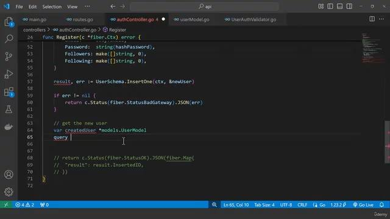

- 为什么要「再读一次」而不是直接把 `body` 返回？因为 `body.ID` 此刻还是零值，前端拿不到 id 就没法调 P012 的 `/user/:id`。P009 [02:23] 讲师的意图就是「use this to get the new user and return it back all with all the user data」。
- `.Decode(&createdUser)` 里的 `&` 不是可选的。`Decode` 需要写入目标，传值只会解到副本上，你最终返回的是一个零值结构体。P012 [12:07] 讲师亲口承认踩过：「we need to pass pointer of this to be able to decode this」。**这条坑 Go 与 JS 的区别在于：JS 的 `Object.assign` 天然可变，而 Go 的值语义会静默失败——不会 panic，只会返回空对象，最难受。**
- claims 只有两个键：
  - `"id": createdUser.ID.Hex()` —— 用 Hex 字符串而不是 ObjectID 本体，因为 JWT 的 payload 是 JSON，ObjectID 不是 JSON 原生类型，塞进去会被序列化成奇怪的对象。P009 [06:42] 的原话就是「is touch the ID ... to hex」。
  - `"exp": time.Now().Add(time.Hour * 24).Unix()` —— **Unix 秒**，不是毫秒也不是 `time.Duration`。JWT 规范里 `exp` 是 NumericDate（秒）。写成毫秒会让 token 在几毫秒后就过期，你会以为签名挂了。

  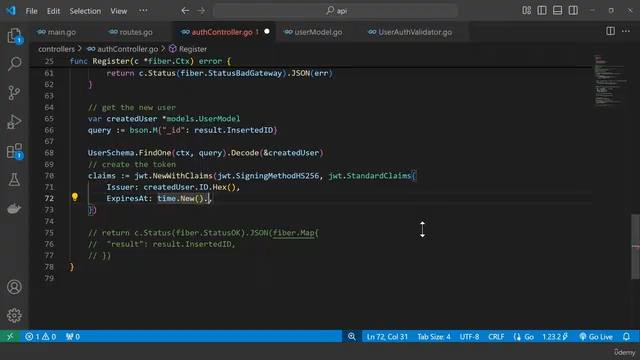
- `jwt.SigningMethodHS256` 是 HMAC-SHA256，对称密钥——**签和验用同一个 `JWT_SECRET`**。选 RS256（非对称）时签名用私钥、验签用公钥，适合「多服务共享验签能力」；单服务项目 HS256 够用且更快。
- `claims.SignedString([]byte(secret))`：`claims` 是 `*jwt.Token`（`NewWithClaims` 返回指针），`SignedString` 返回三段式字符串。**注意它需要 `[]byte`，不是 `string`**——这是 Go 里最常见的类型不匹配报错来源。

### 5.2 `Login`：那段被讲师现场修好的 bug 值得单独讲

- 先 `FindOne` 再判断，顺序不能反：找不到用户时要返回「invalid user with email xxx」，**不能**先跑 bcrypt——对不存在的用户跑 bcrypt 既浪费 CPU 又会让攻击者通过响应时间差异探测邮箱是否存在（讲师没提时序攻击，此处仅说明顺序为什么不能反）。
- `checkPass := bcrypt.CompareHashAndPassword([]byte(user.Password), []byte(body.Password))`：
  - 第一个参数 = **数据库里存的 hash**（`user.Password`）
  - 第二个参数 = **用户刚提交的明文**（`body.Password`）
  - 讲师在 P010 [10:40] 把这两个调反了，运行时得到「too short to be a bcrypt password」——因为密码明文只有 6 位，被当成 hash 去解析，长度校验直接失败。
  - **JS/Node 里对应 `await bcrypt.compare(inputPassword, storedHash)`，注意 Node 的顺序正好反过来（先明文后 hash），跨语言切换时极易搞错。**
- 登录成功后**重新签发**一枚 token，而不是复用注册时那枚。课程里没做「刷新 token / 黑名单」，所以同一用户多次登录会拿到多枚都有效的 token——这是设计选择，不是 bug，但你要知道它存在（第 7 节展开）。
- 返回值里包含 `user` 整个结构体，靠 `json:"-"` 把密码挡掉。如果你前 8 课的 `User` 模型没有这个 tag，登录接口就变成了「密码 hash 泄漏接口」。

  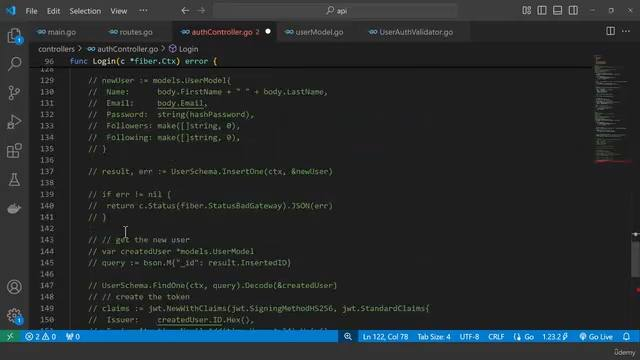

### 5.3 `AuthMiddleware`：把「认证」压成四步

1. `c.Get("Authorization")` —— fiber 的 header 取值**大小写不敏感**，但讲师特意强调「this is capital A」（P011 [02:17]），因为在 HTTP/1.1 的原始写法与某些调试工具里大小写会误导你。取到空串就 401，`message` 是 `unauthenticated`。**这是第一层拦截：连 token 都没有。**
2. 前缀分支：
   - 没有 `"Bearer "` 前缀 → `strings.TrimSpace(tokenString)`，直接当 token 用。讲师原话「we will assume that the token is provided to avoid the parallel prefix」（P011 [04:36]）。这是一条**宽容策略**，方便你在 Swagger 里直接贴裸 token。
   - 有前缀 → `strings.Split(tokenString, " ")`，`len(split) != 2` 就 401，否则取 `split[1]`。
   - 为什么不 `strings.SplitN(token, " ", 2)` 然后取 `[1]`？因为讲师要的是「长度必须正好 2」，多余空格会被拒绝。**在 Express 里等价于 `req.headers.authorization?.split(' ')` 后判 `parts.length !== 2`。**
3. `jwt.ParseWithClaims(tokenString, jwt.MapClaims{}, keyfunc)`：
   - 第二个参数是 claims 容器。讲师口述的是 `jwt.StandardClaims`（P011 [08:47]），**那是 `github.com/golang-jwt/jwt` v4 的 API**；v5 里对应 `jwt.RegisteredClaims`。本文 go.mod 用的是 v5，所以这里用 `jwt.MapClaims`——好处是能直接 `claims["id"]` 读到自定义键，不用额外定义一个 struct。
   - `keyfunc` 是 `func(*jwt.Token) (interface{}, error)`，必须返回**同一把** `JWT_SECRET`。P011 [07:52] 讲师的口述是「return array of poet of this secret key and return null as error」，就是 `return []byte(secret), nil`。
   - `ParseWithClaims` 会顺带校验 `exp`，过期直接返回 error，落到 401 分支。
4. `claims, ok := token.Claims.(jwt.MapClaims)` —— 带 ok 的类型断言。`!ok || !token.Valid` 都算失败。然后 `c.Locals("user_id", claims["id"])`。

   `c.Locals` 是 fiber 的「请求级存储」，**在 Express 里对应 `res.locals`**，生命周期只有当前请求。这里存的是 `claims["id"]`，类型是 `string`（JSON 解码后）。P013 里 `c.Locals("user_id").(string)` 能成功断言，全靠这一点；如果你在签发时塞的是 `primitive.ObjectID`，断言就会失败并静默得到空串，后面授权判断永远不通过（返回 401 且看不出原因）。
5. `return c.Next()` —— 放行。**忘记写 `c.Next()` 是最常见的中间件 bug：请求会在这里「挂住」直到超时，日志里什么也看不到。**

  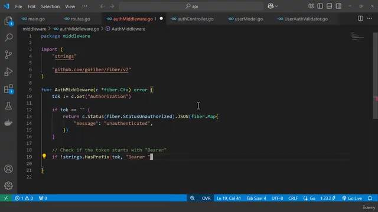

  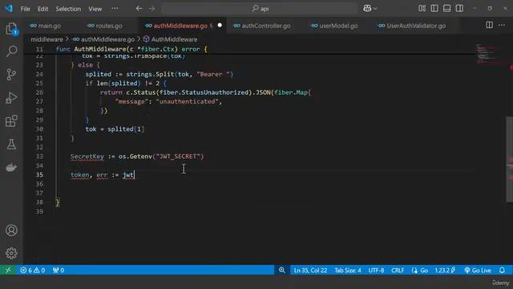

### 5.4 `GetUserByID`

- `primitive.ObjectIDFromHex(c.Params("id"))`：Mongo 的 `_id` 是 12 字节的 ObjectID，序列化成 24 位十六进制字符串。从 URL 拿到的是 string，必须显式转换才能参与查询——直接 `bson.M{"_id": "66ab..."}` 是**查不到**的（类型不匹配，Mongo 不会做隐
式转换），你会得到「user not found」，然后花半小时怀疑数据库里没数据。讲师在 P012 [06:31]～[07:24] 走的就是 `primitive.ObjectIDFromHex` 这条路。

  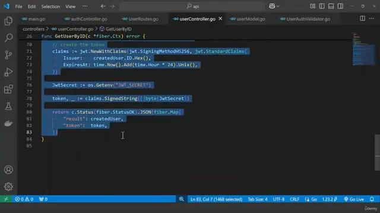

- `.Decode(&user)` 又是那个指针问题。这里比 Register 更容易踩：注册时你至少还有 `body` 兜底，查用户时没有兜底，`user` 保持全零值，`{"data": {"id":"000000000000000000000000","name":"","email":""...}}` 就这样返回给前端了，HTTP 状态码还是 200。P012 [12:07] 那段「we need to pass pointer of this to be able to decode this」就是这个现象。
- `bson.M{"_id": objectID}` 里的值必须是 `objectID` 变量，**不能是 `c.Params("id")`**。这是 P012 里两个变量（`objID` 与 `strID`）同时存在的意义：一个给 Mongo 用，一个给响应/日志用。
- 返回体里的 `"posts": []string{}` 是占位。P012 [11:10]～[11:38] 讲师反复说「we are not actually here have the posts」，最后随手给了个空数组。**Go 里 `nil` slice 序列化成 JSON 是 `null`，而 `[]string{}` 序列化成 `[]`**——前端若做 `res.posts.map(...)`，`null` 会直接抛 TypeError。这个空数组不是凑数，是给前端一个可迭代的初值。
- 404 与 400 的分界：`ObjectIDFromHex` 失败 → 400（**请求格式就不对**）；`FindOne` 失败（`mongo.ErrNoDocuments`）→ 404（请求格式对，但资源不存在）。讲师在 P012 [09:20] 只说了「user not found」，没细分状态码，本文按 HTTP 语义做了区分。

  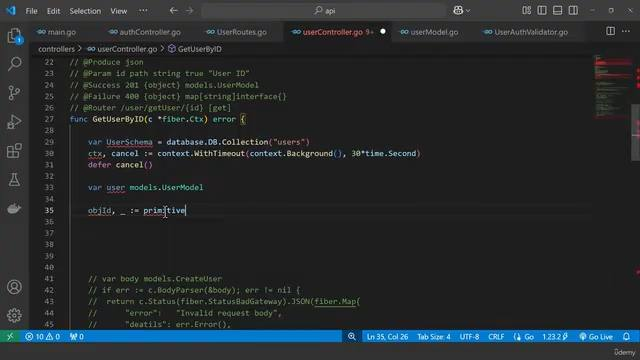

### 5.5 `UpdateUser`：两层安全如何在同一函数里落地

- **第一层（认证）已经在路由层完成**：`app.Patch("/user/update/:id", middleware.AuthMiddleware, controller.UpdateUser)`。到 handler 里时，token 必定存在、格式对、签名对、没过期。所以 handler 里**不需要**再解析 token。
- **第二层（授权）靠一行字符串比较**：

  ```go
  extractedUID, _ := c.Locals("user_id").(string)
  if extractedUID != c.Params("id") { ... 401 ... }
  ```

  - 用带 ok 的类型断言 `.(string)`，但这里**忽略了 ok**（`_`）。严格写应该判 ok，否则中间件若没跑（比如以后有人把这条路由挂到不带中间件的分组），`c.Locals("user_id")` 返回 `nil`，断言得 `""`，而 `""` 不等于任何合法 24 位 id，结果仍然是 401——**歪打正着地安全，但错误信息会误导**。本文保留讲师的写法（等价于原文），但把这条备注留给你。
  - 比较的是**字符串**，不是 ObjectID。因为 `claims["id"]` 解码后就是 `string`，`c.Params("id")` 也是 `string`，两端同为字符串时 24 位固定长度、大小写固定（十六进制小写），直接 `!=` 就够。**若两端类型不同（比如一边是 ObjectID），`!=` 在 Go 里是编译错误而非静默 false——这点比 JS 的 `==` 让人安心。**
  - 这里是 P013 [20:40] 讲师所说的「two level」：认证只管「你是不是某个登录用户」，授权管「你是不是**这个**用户」。

  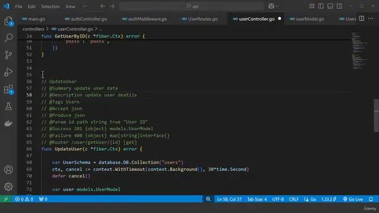
- `bson.M{"$set": update}`：
  - 用 `$set` 而不是把整个结构体 `ReplaceOne`。区别在于：`$set` 只改指定的三个键，其余字段（email、password、创建的其它字段）原样保留；`ReplaceOne` 会把文档替换成传入的文档，**没写的字段直接消失**。在 JS 里对应 `Model.updateOne({_id}, {$set: {...}})` 与 `replaceOne` 的区别，同理。
  - `update` 里带上了空字符串：如果前端只传 `{"bio":"x"}`，`Name` 和 `ImageURL` 解出来是 `""`，`$set` 会把库里这两个字段**清空**。这是课程的实现（讲师 P013 [09:25] 明确是三个字段全塞进 `$set`）。要「只改我传的字段」，得改成先判断非空再塞 map，**课里没讲这种写法**。

  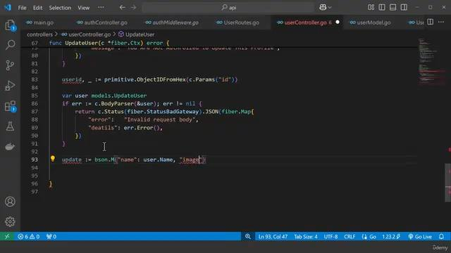
- `result.MatchedCount == 1`：
  - `MatchedCount` 是 mongo-driver 的 `*mongo.UpdateResult` 字段，含义是「**匹配到 filter 的文档数**」，不是「被修改的文档数」。这两个值可能不等：如果传入的 `$set` 内容与库里现有值完全相同，Mongo 认作无变化，`ModifiedCount` 为 0 而 `MatchedCount` 仍为 1。所以判「用户存在」用 `MatchedCount` 是对的，判「真的改了东西」才用 `ModifiedCount`。
  - 讲师 P013 [13:12] 的口述是「f result dot match count equal equal on one dot case」，就是这一行。
  - **JS/Node 里对应 `const r = await Model.updateOne(...); if (r.matchedCount === 1)`**，字段名在官方 mongodb 驱动里叫 `matchedCount`（驼峰），Go 驱动里叫 `MatchedCount`（首字母大写），同一个概念换语言就换大小写，抄代码时要留意。
  - 判完 `MatchedCount` 再 `FindOne` 读一遍返回给前端，而不是直接返回 `update` map。因为要返回的是**库里的真实状态**（含 id、email 等没被改的字段），不是「你提交的那三个字段」。P013 [12:45] 说「we will actually need on our application to have the updated user」。
- `@Security BearerAuth` 与 `@Param user body models.UpdateUser` 这两个 swag 注释，是 P013 后半段反复折腾的根源：
  - 只写 `@Router` 不写 `@Param`，Swagger UI 的 `Try it out` 里**没有请求体输入框**，于是讲师在 P013 [17:00]～[17:27] 发现「something is not correct」，最后不得不回头补 `@Param user body models.UpdateUser true "needed details"`。
  - `@Security BearerAuth` 让 Swagger UI 顶部出现 `Authorize` 按钮（P013 [16:04] 讲师点「hit authorize」就是在用它）。**但 `BearerAuth` 这个 security definition 本身要在 `main.go` 的 swag 通用注释里声明**，那是前 8 课的内容，P009–P013 没讲。没有声明时 swag 会警告 `unknown security definition`，`Authorize` 按钮也不会出现，你只能手工在 header 里贴 token。

  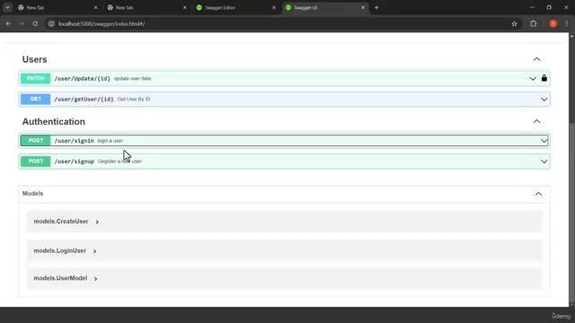
- 401 而不是 403：讲师 P013 [06:06] 口述「not bad gateway unauthorized status code which is 400」——他说了 `400`，但代码里用的是 `fiber.StatusUnauthorized`（401）。**严格语义下「已认证但无权操作」应该是 403 Forbidden，401 是「未认证」**。本文保留讲师的 401，等你做真实项目时再决定要不要改成 403；改的话前端要同步改判断分支。

  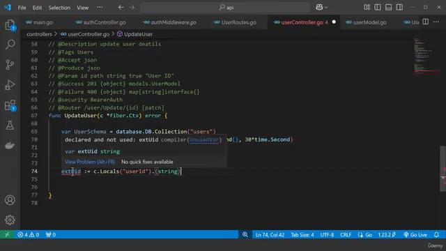

### 5.6 路由拆分

- `AuthRoutes` 与 `UserRoutes` 各一个文件，`SetupRoutes` 只负责调用两者。P012 [00:28] 的原话是「change this instead of have it and call it setup routes」，P012 [00:57] 又把 auth 那组改名 `AuthRoutes`、新建 `user Routes.go`。
- 这个拆法的实质是**给「带鉴权」与「不带鉴权」两组路由留不同的挂载点**。现在只有 user 组里一条挂了中间件；等以后要「user 组整体挂中间件」时，改成 `g := app.Group("/user", middleware.AuthMiddleware)` 再注册即可，auth 组完全不受影响。若全塞一个文件，这种改造会波及所有路由。

  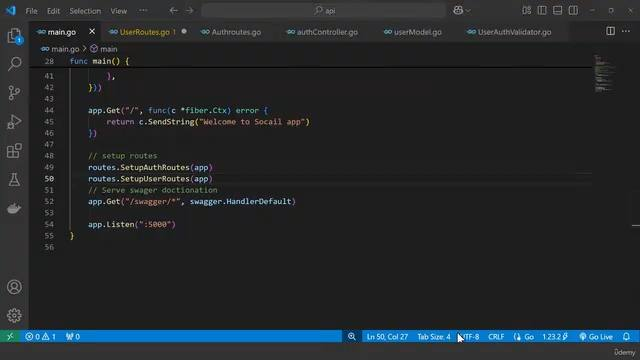
- 路由顺序：`/user/:id` 与 `/user/update/:id` 在 fiber 里**不冲突**，因为前者只有一段、后者有两段（`update` 是固定段）。但若你把 update 写成 `PATCH /user/:id`，那 `/user/update/xxx` 就永远匹配不到了。方法不同也不会冲突——GET `/user/:id` 与 PATCH `/user/:id` 可以共存。

### 5.7 `main.go`

- `log.Fatal(app.Listen(...))`：`Listen` 在服务运行期间会一直阻塞，返回 error 只发生在「端口被占用 / 无权限绑定」这类启动失败上。`log.Fatal` 会在打印后 `os.Exit(1)`。**别在 goroutine 里写 `log.Fatal`**，它会直接杀掉整个进程——课里没遇到这种情况，但你以后加后台任务时要知道。
- `database.Connect()` 在 `fiber.New()` 之前调用，因为 handler 里第一件事就是 `database.GetCollection(...)`，集合对象依赖 client 已初始化。本文把 client 存成包级 `var`，等价于前 8 课的接线方式；你也可以按课堂写法改成传参。
- `.env` 必须在**任何** `os.Getenv("JWT_SECRET")` 之前加载。`godotenv.Load()` 读的是**当前工作目录**下的 `.env`，所以 `go run main.go` 要在项目根目录执行；在 `controller/` 下执行会报 `error loading .env file`。P009 讲师写的就是「error loading dot .file」，没有更细的提示，报错了先查 cwd。

---

## 6. 复现检查清单

按顺序打勾，每一条都是「做完能肉眼验证」的，不是「我知道大概是这样」。

**环境 / 构建**
- [ ] `go version` ≥ 1.21，`mongod` 在 27017 端口可连（或 `.env` 里的 `MONGO_URI` 指向可达实例）
- [ ] 项目根目录下 `go build ./...` **零 error**（有 undefined 就 `go mod tidy`，P009 [05:42]）
- [ ] `.env` 里 **`JWT_SECRET` 非空**，且签发/校验读的是同一个 key（全文只出现了这一个 `os.Getenv`，grep 一下确认）
- [ ] `go run main.go` 启动时**没有** `error loading .env file`；有的话先确认 cwd 是项目根
- [ ] `make swag-init`（或 `swag init -g main.go`）跑过，且是在**最后一次改完 handler 注释之后**

**P009 注册**
- [ ] `POST /signup` 传 `{"name","email","password"}` 返回 201，响应里有 `data` 与 `token`
- [ ] `data` 里**能看到 `id`**（不是 24 个 0）；看不到就是 `Decode` 没传 `&`
- [ ] `data` 里**没有** `password` 字段（没有 `json:"-"` 就会漏）
- [ ] 把 `token` 贴到 jwt.io 之类的解码器里，payload 含 `id` 和 `exp`，`exp` 是 24 小时后的**秒级**时间戳，不是毫秒

**P010 登录**
- [ ] `POST /signin` 用刚注册的邮箱+密码返回 200 且带 `token`
- [ ] 故意传错密码 → 非 200，`message` 是 bcrypt 的比对错误（文里透出了 `checkPass.Error()`；不想暴露细节就把那行换成固定文案）
- [ ] 传一个库里不存在的邮箱 → `invalid user with email xxx`
- [ ] **如果报「too short to be a bcrypt password」**：`CompareHashAndPassword` 的两个参数写反了（P010 [10:40]）
- [ ] `air` 能起来；改 `controller/auth_controller.go` 里 `"token"` → `"token_x"`，保存后 `/signin` 的响应键变成 `token_x`（P010 [12:09] 的验收动作）；验完改回去

**P011 中间件**
- [ ] `PATCH /user/update/<自己的id>` **不带** `Authorization` → 401、`message == "unauthenticated"`
- [ ] 带 `Authorization: Bearer <token>` → 通过中间件（若 id 不对，此时应返回授权失败的 401，**不是** `unauthenticated`）
- [ ] 带 `Authorization: <裸token>`（无 Bearer 前缀）→ 同样通过（P011 [04:36] 的宽容分支）
- [ ] 把 token 末尾改一位（伪造签名）→ 401 `unauthenticated`
- [ ] 把 `JWT_SECRET` 临时改成另一个值再启动 → 之前签发的 token 全部 401；改回来恢复。这条能一次性验证「签/验用同一把 key」
- [ ] token 里塞一个过期时间（把 `time.Hour*24` 临时改成 `time.Hour*-1` 之类）→ 401

**P012 查用户**
- [ ] `GET /user/<合法id>` → 200，`data.name` 是注册时的名字，`posts` 是 `[]` 不是 `null`
- [ ] `GET /user/1` 或 `GET /user/abc` → 400 `invalid user id`
- [ ] 24 位合法但库里不存在的 id（比如全 `f`）→ 404 `user not found`
- [ ] 返回的 `data` 不是全零 → 说明 `Decode(&user)` 的 `&` 在

**P013 更新**
- [ ] Swagger UI 里 `PATCH /user/update/{id}` **有 `id` 输入框和请求体输入框**；没有就重跑 `swag init`
- [ ] 用**自己的 token + 自己的 id** 提交 `{"name","image_url","bio"}` → 200，响应 `data` 三字段已是新值
- [ ] 紧接着 `GET /user/<自己的id>` → 三个字段已变，`email`、`id` **不变**（证明是 `$set` 不是整文档替换）
- [ ] 用 **A 的 token + B 的 id** → 401、`message == "你无权更新此个人资料。"`
- [ ] 上一步之后去 `GET /user/<B的id>` → B 的字段**一个都没变**（P013 [21:38] 讲师特意强调「if you go back you'll see nothing」）
- [ ] 只传 `{"bio":"x"}`，不传 name/image_url → 看库里这两个字段是否被清空；被清空是课程实现的预期行为，第 7 节有说明

**目录/命名**
- [ ] 文件与包名对得上：`middleware` 目录里 `package middleware`，`controller` 目录里 `package controller`，`routes` 目录里 `package routes`
- [ ] `Middleware` 目录大写或文件叫 `authMiddleware.go` 都能编过（Go 不强制），但**包名小写**、跨平台导入路径一致，别在 Windows 上能跑、Linux CI 上挂
- [ ] `go.mod` 的 module 名 = 代码里的 import 前缀（本文是 `master-go-rest-grpc`），不一致会全项目红

---

## 7. 课里没讲但你会撞上的

这一节全部是「课程范围之外、但你照着复现时必然遇到」的坑。每条都标明是否会影响你跑通上面五集。

**A. 会在复现中直接卡住你的**

1. **`.env` 的 `PORT` / `MONGO_URI` / `DB_NAME` 键名课里没讲。** P009–P013 只明确出现了 `JWT_SECRET`（P009 [08:03]）。这三个键名来自前 8 课，如果你的 `.env` 用了别的名字（例如 `MONGOURL`、`DATABASE`），改 `main.go` 与 `database/database.go` 的 `os.Getenv` 参数即可，别改 `.env` 去迁就代码。
2. **`swag` 命令行与 `BearerAuth` security definition 的声明都不在这五集里。** 前者缺失 → `make swag-init` 报 command not found，`go install github.com/swaggo/swag/cmd/swag@latest` 即可。后者缺失 → `Authorize` 按钮不出现，`@Security BearerAuth` 只是无效标注；你只能在 Swagger 里给每个请求手工贴 header。若你项目里已有，跳过。
3. **`air` 装在哪。** P010 [11:10] 给的是 `go install github.com/air-verse/air@latest`（他现场把 `cosmetic`/`cosmetic` 念错，实际仓库是 `air-verse`）。`go install` 装出来的二进制在 `$(go env GOPATH)/bin`，**这个目录默认不在 PATH 里**，所以 `air` 会报 command not found。把 `export PATH="$(go env GOPATH)/bin:$PATH"` 写进 shell rc。
4. **`air` 默认只监听 `.go` 文件。** 改了 `.env` **不会**触发重载，你必须手动重启；改 `main.go` 会重载。P010 [12:09] 演示的是改 `.go` 文件，所以看不出这个限制。若要用不同端口/配置，写 `.air.toml` 改 `build.cmd`——课程没提这个文件。
5. **`air` 与 `go run main.go` 不能同时占 3000 端口。** 先 `Ctrl-C` 停掉旧的，否则 `Listen` 返回 `address already in use`，`log.Fatal` 直接退出。这个报错只有一行，别以为是 `air` 坏了。

**B. 认证/授权的语义债（不影响跑通，但真实项目要补）**

6. **token 无法提前吊销。** 没有黑名单、没有 refresh token。用户改了密码（当前也没有改密码接口）或想「登出所有设备」时，只能等 24 小时 `exp` 到期。P011 的中间件是无状态验签，性能好，代价就是这个。**要在 Node 里做等价实现，通常是「短期 access token + 长效 refresh token + 服务端（或 Redis）存 revoked jti 黑名单」**——课程标题里有 Redis，但这五集完全没用到，属于后续课程。
7. **`HS256` 的密钥是单一共享秘密。** 一旦泄漏，攻击者能自己签任意用户的 token。生产环境要么换 `RS256`（私钥签、公钥验），要么至少保证 `JWT_SECRET` 不进 git（`.env` 要进 `.gitignore`）。课程里 secret 是硬编码在 `.env` 里的，**`.gitignore` 没讲**。
8. **`c.Locals("user_id").(string)` 忽略了 ok。** 见 5.5。功能上安全（`""` 不会等于合法 id），但错误信息会误导成「你不是本人」。
9. **401 与 403 混用。** 见 5.5。前端若按「401 → 跳登录、403 → 提示无权限」来分流，这里会把你踢回登录页，而用户其实已经登录了，体验很怪。要改就改 `fiber.StatusForbidden`，并同步前端。
10. **`$set` 会清空没传的字段。** 见 5.5。正确做法是「只把非空字段放进 `$set`」，或者给 `UpdateUser` 的字段用 `*string` 指针类型（没传就是 `nil`，`nil` 不进 map）。**课里没讲指针字段的写法**，这是本文的补充建议，不是课堂实现。
11. **`Register` 不检查邮箱重复。** 同一邮箱能注册多次，随后 `Login` 的 `FindOne` 只会命中其中一条（Mongo 按插入顺序取第一条），另外几条永远登不了，也查不到。要修就给 `email` 建唯一索引：`db.users.createIndex({email:1},{unique:true})`——**课里没讲索引**。
12. **`Register` 不校验密码强度/邮箱格式。** `password` 为空也能注册成功，之后 `bcrypt.CompareHashAndPassword` 对空串的比对行为依赖 bcrypt 内部，容易出怪错。课程全程没有输入校验层（没有 validator 库、没有 `required` tag）。

**C. Go / Mongo 语言层面的坑（跨语言迁移时最容易被绊）**

13. **`bson` tag 与 `json` tag 是两套。** `bson:"_id,omitempty"` 决定 Mongo 里存什么键名，`json:"id"` 决定 HTTP 响应里叫什么。你可以让两边不同名（本文就是这么做的：库里 `_id`、响应里 `id`），但如果只写 `json` 忘了 `bson`，Mongo 会用**结构体字段名的小写**（`id` / `imageurl`）当键名，你的 `FindOne` 用 `bson.M{"_id": ...}` 就查不到，`image_url` 的 `$set` 也会写入一个叫 `imageurl` 的新字段（旧字段还在，`GET` 回来时 `json:"image_url"` 又读的是空值）。**JS 里没有这个问题，Mongoose 的 schema 只有一套字段名——所以从 JS 过来的人 90% 会踩这一条。**
14. **`primitive.ObjectID` 与 `string` 不互通。** 见 5.4。`bson.M` 里的值类型必须和库里存的一致：库里是 ObjectID，查询也必须给 ObjectID。给 string 不报错，只是查不到。**JS 里 `mongoose.Types.ObjectId(str)` 自动帮你转，Go 里必须显式 `primitive.ObjectIDFromHex`，而且会返回 error。**
15. **`context.WithTimeout` + `defer cancel()` 每 handler 一份。** 这是 mongo-driver 的必需写法，漏了 `cancel` 会泄漏 goroutine（Go 特有）。本文每个 handler 都写了，但**课程逐字稿里讲师说的是「get the user schema get the contacts」，上下文参数在他那里叫什么课里没复述**。如果你前 8 课的 `GetCollection` 不接 context，把本文的 `ctx` 传进去就行。
16. **Go 的 `!=` 不做类型隐式转换。** 5.5 里 `extractedUID != c.Params("id")` 都是 `string`，没问题；但如果你把 `claims["id"]` 存成 `primitive.ObjectID` 再比，这是**编译错误**，不是运行时 false。比 JS 的 `==` 严格，也省掉了 NaN/-0/`"1"==1` 这类 JS 特有麻烦。
17. **`jwt` v4 → v5 的 API 分家。** `jwt.StandardClaims` 在 v5 里已移除（v5 是 `jwt.RegisteredClaims`）。讲师口述的是 v4 的名字（P011 [08:47]），本文 go.mod 写的是 v5，所以用 `jwt.MapClaims`。**如果你抄了某篇 v4 的博客，`jwt.NewWithClaims` 与 `ParseWithClaims` 的参数签名都对不上，编译会报一串看不懂的类型错误——先看 `go.mod` 里的版本再抄。**

**D. 测试与工程化（这五集完全没涉及）**

18. **没有任何自动化测试。** 五集全部靠 Swagger 手工点 + `air` 热重载验证。要做最小回归，用 Go 自带的 `net/http/httptest` + fiber 的 `app.Test(req)`，或用 `httptest.NewRequest` 打真实端口。**课程没讲 `fiber.App.Test`。**
19. **没有错误码规范。** 响应体全是 `fiber.Map{"success": false, "message": "..."}`，`message` 直接透出底层错误（比如 bcrypt 的原文、`err.Error()`）。前端没法按错误码分支。真实项目要在 handler 里把「业务错误码」与「人话 message」分开，底层 `error` 只进日志。
20. **生产部署的 CORS / 限流 / 超时都没讲。** 前端 `fetch` 直连 3000 端口会遇到 CORS 预检，`fiber.New()` 默认不响应 `OPTIONS`；开发时要么同源代理、要么加 `github.com/gofiber/fiber/v2/middleware/cors`。**课程这五集没提到 CORS 一个字。**

---

**最后一句关于「怎么知道自己做对了」**：P013 最后那个双人对比测试（用 A 的 token 改 B 的 id → 401，再查 B 确认零改动）是整个 P009–P013 的验收核心，比注册/登录/查/改任何一个单点都重要。因为这条能一次性证伪三件事：中间件没跑（会变成 200）、授权判断写反（会变成 200）、`$set` 把整文档覆盖了（B 的其它字段会被清空）。跑过这条，你就没把课程理解的层面留在「跟着敲了一遍」。