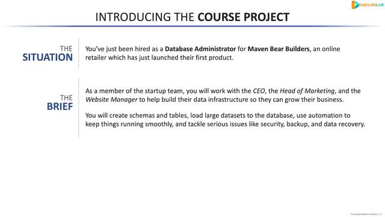
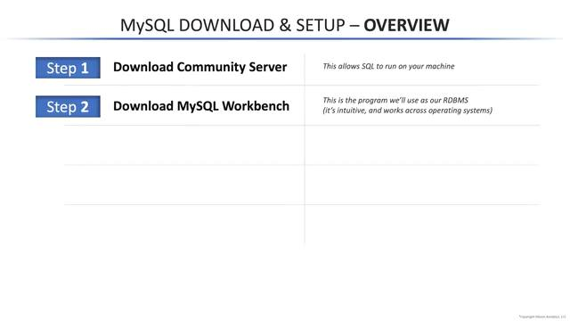
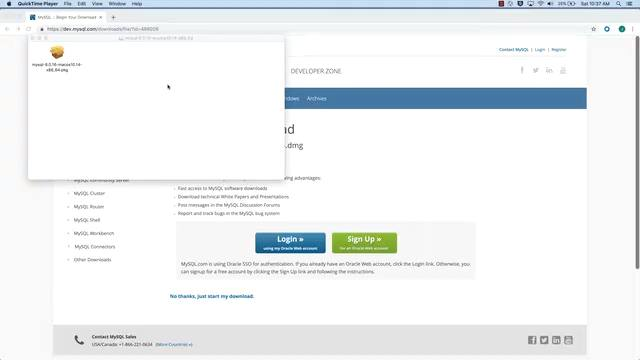
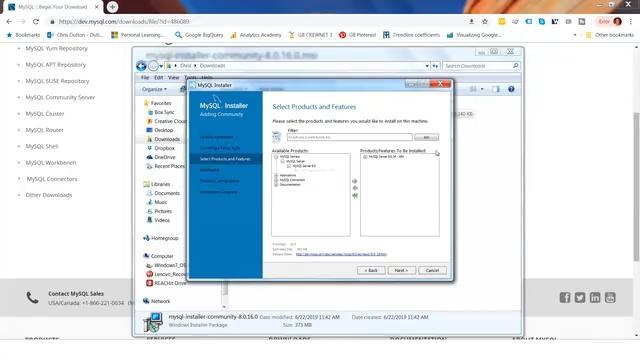
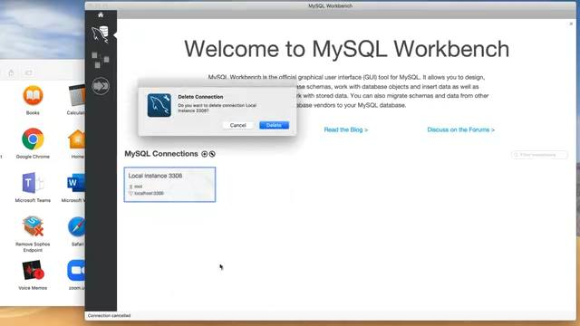
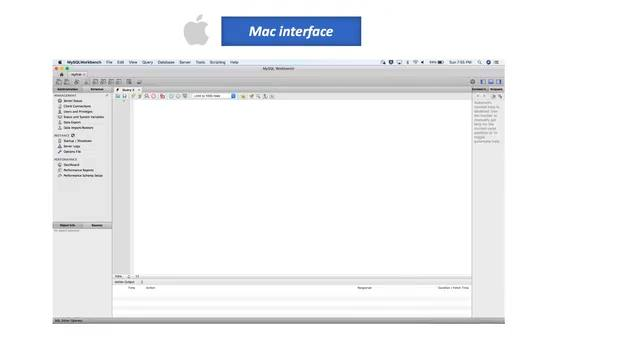

# Advanced MySQL Database Administration（P001–P010）环境搭建与 Workbench 上手

> 课程原文：**Advanced SQL Database Administration with MySQL Workbench**（BV1MAMc6zEcX）
> 覆盖 P001–P010。本节文档的唯一目标是：读完能**在自己机器上跑起 MySQL 8.0 + Workbench**，并**看懂 Workbench 主界面**。P001–P010 是课程的「开工阶段」，并未涉及业务 SQL；创建课程专用 schema/表的脚本被讲师明确推到「下一个视频」，不在本文范围内（详见 §7 第 1 条）。本文会对每一条命令/配置给出来源，避免读者把后续章节的东西误当成前置条件。

---

## 1. 这一节做什么

P001–P010 是一条**连续的环境搭建主线**，而不是十个互相独立的知识点。把它拆成五件事：

1. **认识项目**：你扮演的是电商创业公司 **Maven Bear Builders** 的 DBA，工作对象是一个从零搭起来的电商数据库（订单/租赁类数据）。课程会围绕这个库做备份、恢复、复制、安全等 DBA 任务（P001、P002）。
2. **明确课程定位**：这是一门 **DBA 方向的进阶课**，不做数据分析、不做 BI、不深入写 PHP/Python/Ruby 后端工程（P003）。
3. **对齐先修技能**：你要会 DDL/DML（建表、改表、增删改）、触发器、存储过程、EER 图、范式/基数/主外键、MySQL 数据类型、SELECT 六件套（SELECT、FROM、WHERE、GROUP BY、HAVING、ORDER BY）、JOIN（P004）。
4. **装两台东西**：**MySQL Community Server**（真正跑 SQL 的数据库引擎，免费）和 **MySQL Workbench**（连服务器的图形客户端），Mac 走 DMG 安装包，PC 走 Windows Installer（P005–P008）。
5. **建立连接 + 熟悉界面**：在 Workbench 里新建一个连接指向本地 MySQL Server，然后用 **Schemas 面板 / Query Editor / Action Output / Administration 面板** 把环境摸一遍（P009、P010）。

**本节结束时应达到的状态**：`系统偏好设置 / Windows 服务` 里 MySQL 处于 running；Workbench 出现一个可用连接；Schemas 面板里至少能看到 `sys`；查询编辑器右上角的「闪电」按钮能执行 SQL，下方 Action Output 能显示执行结果。**此时你还不会拥有课程用的业务数据库**——这是正常状态，别慌。

---

## 2. 讲师原话

以下引文按「项目 → 定位 → 先修 → 安装 → 连接 → 界面」的项目逻辑重排，帧号按原文标注，便于你回看。

> "你将扮演 Maven Bear Builders 新入职的数据库管理员。Maven Bear Builders 是一家在线零售商，刚刚推出了他们的第一款产品。"
> —— p002 [00:00]

> "你将创建模式和表，把大型数据集加载到数据库中，并通过自动化让一切平稳运行。你还要处理安全、备份和数据恢复等严肃问题。"
> —— p002 [00:28]

> "本课程的重点是 DBA 相关的工作……我们会把重点放在 DBA 这一侧，而不是分析那一侧。这是一门高级课程。"
> —— p003 [00:29]

> "我们希望你能熟悉数据定义和数据操作中用到的基本语句，也就是创建表和模式、修改表、向表中插入行、更新记录以及删除记录。"
> —— p004 [00:17]

> "学生如果已经掌握了 SQL Select 语句的基础知识，也会很有帮助。我们把这些称为六大要素……select 和 from、如何加入 where 条件、如何 group by，以及如何使用 having 和对结果排序。"
> —— p004 [01:37]

> "首先，你要下载 Community Server。这是一个免费程序，正是它让 SQL 能在你的机器上运行。然后我们要下载 MySQL Workbench。这个程序将作为我们的关系型数据库管理系统来使用。"
> —— p005 [00:00]

> "如果你上过我的其他课程，已经安装了 Community Server 和 Workbench，那就直接跳到第四步或第五步，你觉得哪里更合适就从哪里开始。不需要重新安装，也不需要升级到最新版本。"
> —— p005 [01:19]

> "系统会要求你为所谓的 root 用户输入一个密码。这个密码你需要记住，或者写到某个地方。稍后我们把 MySQL Workbench 连接到 Community Server 时，会要求输入这个密码。"
> —— p006 [03:01]

> "如果到时候你手边没有这个密码，你就得一路回到这一步，卸载 Community Server 再重新安装。"
> —— p006 [03:01]

> "这里你需要的是 Windows 安装程序。所以点击前往下载页面……这里有两个版本……我们要选名字里不带 web 的那个版本。这个版本的下载通常问题少得多。"
> —— p008 [01:51]

> "我点进去之后，你会看到系统提示我输入 root 用户的密码。这就是我在 Community Server 安装部分让你记住或写下来的那个密码。"
> —— p009 [01:26]

> "上方是查询编辑器。下方是操作输出，顶部则有各种工具，用来新建 SQL 文件、创建新数据库、创建新表等。"
> —— p010 [00:00]

> "这里简要显示了你尝试执行的操作以及服务器返回的响应。这对排查你遇到的任何错误都非常有帮助。"
> —— p010 [02:48]

> "这里的第一个闪电图标会执行窗口中的所有内容。第二个闪电图标上有一个光标，它只会执行光标所在位置的那条 SQL 语句。"
> —— p010 [09:13]



---

## 3. 从零复现

这一章按**你实际操作的顺序**展开：先决策要不要装，再选安装包，再装服务器，再装 Workbench，再建连接，最后验证。Mac 和 PC 两条路径分别写明，**不用的那条整段跳过即可**（讲师在 p006、p007、p008 反复强调过，两条路径的课是并列的、不是顺序执行的）。

### 3.1 安装前决策：你到底要不要重装

先做判断，不然后面白折腾：

| 你的现状 | 怎么做 |
|---|---|
| 已装 Community Server + Workbench，且 Workbench 里有可用的 live connection | **跳到 3.5 建连接 / 3.6 验证**，不重装（讲师原话 p005 [01:19]） |
| 已装两个软件，但忘了 root 密码 | 必须**卸载 Community Server 再重装**（p006 [03:01]），Workbench 不用动 |
| 一个都没装 | 从 3.2 开始，按操作系统走对应路径 |
| 装的是 MariaDB / 其他 fork | 本课不适用，请先卸掉再装 MySQL Community Server |

> 前端/Node 类比：这一步等价于你在 `node -v` 之前先确认本机有没有 Node 历史版本、`nvm` 是否已经装了同一大版本。别急着 `npm i`。

### 3.2 下载 Community Server

**Mac 路径**（对应 P006）：
1. 浏览器打开 `https://dev.mysql.com/downloads/`。
2. 点 **MySQL Community Server**。
3. 页面往下滚到 **Generally Available Releases**。
4. 操作系统选 **macOS**，下载格式选 **DMG Archive**。
5. 讲师录课时用的是 **8.0.16**；如果你看到更新的版本（8.0.x 或 8.4.x），**直接下最新 GA**，版本号不影响本课（p006 [01:20]）。
6. 下载页会弹登录/注册框，点 **"不用了，直接开始下载"**，不需要账号。

**PC 路径**（对应 P008）：
1. 同样从 `https://dev.mysql.com/downloads/` 进 **MySQL Community Server**。
2. 操作系统选 **Microsoft Windows**。
3. **不要**点页面上的大按钮，而是点 **"前往下载页面"** 进入安装包下载页（p008 [01:22]）。
4. 页面往下到 Generally Available，你能看到两个文件：
   - `mysql-installer-community-8.x.x.x.msi`（**要这个，没有 web 字样**）
   - `mysql-installer-web-community-8.x.x.x.msi`（不要这个）
5. 点**没有 web** 的那个下载。原因讲师说得很直接：完整包把所有依赖一次性拉下来，**安装过程更少出 bug**；web 版是边装边下，网络波动就卡（p008 [02:10]）。



### 3.3 安装 Community Server（Mac）

1. 双击下载到的 `.dmg`，双击里面的 `.pkg`。
2. **Continue → Continue**，滚完 License，**Continue → Agree**。
3. 安装位置**用默认**即可（p006 [02:09]）。
4. **Install**。如果系统弹「输入管理员密码」，输你**登录 Mac 的密码**，不是 MySQL 的密码。
5. **这一步最关键**：出现「Root Account Password」界面时，输入你想设的 MySQL root 密码，**记下来**。这里同时会让你选加密方式，默认 **Use Strong Password Encryption**，不要改（p006 [02:36]）。
6. 装完可能再弹一次管理员密码，输同一个 Mac 登录密码。
7. 到 Summary，点 **Close**，把 `.dmg` 拖进废纸篓。
8. 打开 **System Preferences（系统设置）**，底部应出现一个 **MySQL** 图标。点进去看到「MySQL Community Server is running」说明装好了（p006 [04:26]）。



### 3.3' 安装 Community Server + Workbench（PC，一次装完）

PC 的 Windows Installer 是**服务器 + Workbench 一起装**的，所以 PC 用户不用再单独走 3.4。

1. 双击 `mysql-installer-community-...msi`。Windows SmartScreen / 杀毒软件可能弹拦截，**选"仍要运行 / 允许"**——安装过程「看起来卡住」多半是某个弹窗在等你点（p008 [02:58]）。
2. **License** → 勾选接受 → **Next**。
3. **Choosing a Setup Type** 界面：**不要**选 Server only 或 Client only，选 **Custom**。
4. 在左侧树里展开 **MySQL Servers → MySQL Server**，把当前版本**箭头挪到右侧** Products/Features to be installed。
5. 再展开 **Applications → MySQL Workbench**，也挪到右侧。
6. 只需要这两个，其他都不要（p008 [04:18]）。**Next → Execute**。
7. 两个组件都出现**绿色对勾**后 **Next**。出现红色叉号请点 "Show Details"，把错误抄去搜索——讲师说这是最常见排错方式（p008 [05:12]）。
8. **Type and Networking** 保持 **Standalone MySQL Server**，**Next**。
9. Config Type 保持 **Development Computer**，**Next**。
10. **Authentication Method** 保持 **Use Strong Password Encryption**，**Next**。
11. **Root Account Password**：输入密码两次。课里提到"密码强度弱"会提示，讲师的做法是**在末尾多加几个字符**让强度过关（p008 [06:34]）。**这里输的密码就是你 Workbench 连服务器时要用的 root 密码。**
12. 下面的 "MySQL 用户账户" 不要加，**Next**。
13. **Windows Service** 保持默认（Standard System Account 之类），**Next**。
14. **Execute** 跑配置步骤。进度条可能长时间不动，讲师特意说过"for me it is"（真的很慢）（p008 [07:02]），**别强杀**。
15. 全部绿勾 → **Finish**。如果出现 "欢迎使用 MySQL Workbench"，说明服务器+客户端都装好了。



### 3.4 安装 Workbench（Mac）

PC 用户已经装过，**跳过本节**。

1. 打开 `https://dev.mysql.com/downloads/workbench/`。
2. 滚到 **Generally Available Releases**，操作系统选 **macOS**，下载 **DMG Archive**。
3. 同样点 "不用了，直接开始下载"。讲师录课时是 **8.0.16**，你下最新 GA 即可；版本过新导致界面略不同不影响操作（p007 [00:59]）。
4. 打开 `.dmg`，把 **MySQL Workbench** 图标**拖进 Applications** 文件夹。
5. 去 Applications 里双击打开。**第一次打开可能是空的（没有连接）**，也可能是预配置好的 live connection，两种情况都正常（p007 [02:20]）——下一步统一处理。

### 3.5 在 Workbench 里创建到本地 MySQL Server 的连接

不论 Mac 还是 PC，这一步都一样（p009）。

1. 打开 Workbench。如果左侧 MySQL Connections 区域**已有连接**，可直接用；想演示"从零建"，先右键删除再往下。
2. 点 MySQL Connections 旁边那个 **`+`** 号。
3. 弹出的 Setup New Connection 里，**大部分字段已预填**：
   - **Hostname**：`127.0.0.1`（预填）
   - **Port**：`3306`（预填）
   - **Username**：确保是 **`root`**
   - **Connection Name**：随便起，讲师起的是 `Maven Movies`（p009 [00:57]）——建议你也叫 `MavenMovies`，方便和课程对齐
   - **Password**：这里**先空着**，不要现在填
4. 点 **OK**。新的连接出现在 MySQL Connections 里。
5. **双击该连接**，会弹密码框，**输入 3.3 / 3.3' 里设的 root 密码**，OK。
6. 成功后会进入 **MySQL Workbench Editor**（查询编辑器），这就是本课后续 90% 时间待着的地方。



### 3.6 验证界面：三个面板 + 两种执行按钮

进入编辑器后，请把界面拆成三块（讲师原话 p010 [00:00]）：

- **左侧**：`Administration` + `Schemas` 两个页签
- **上方**：Query Editor（写 SQL 的地方）
- **下方**：Action Output（服务器回执）
- **顶部**：新建 SQL 文件、建库、建表等快捷按钮

然后做一次**最小可用验证**：

1. 在 Query Editor 里写一行 `use MavenMovies;`——**注意，这时会报错**，因为你还没建这个库（P010 [10:36] 明确说"下一个视频"才建）。**报错是预期行为**，你可以用这条报错反向确认"“操作输出”能够正确显示错误"。
2. 把 `use MavenMovies;` 换成 `select 1;`（这条**课里没讲**，是本文给的最小验证语句）——执行，如果 Action Output 里出现一行 `1`，说明客户端到服务器的链路通了。
3. **两个闪电按钮的区别**：
   - **最左边那个闪电**：执行**整个窗口**的所有语句
   - **光标上带小箭头的闪电**（第二个）：只执行**光标当前所在**的那一条（p010 [09:13]）
   - 也就是说，如果你写了 `use MavenMovies;` 和 `select * from rental;` 两行，然后点第二个闪电、光标停在第一行，**只会执行 `use`**——这是讲师特意演示给新手看的坑。



### 3.7 Administration 面板：检查服务器是否 running

Schemas 面板告诉你"有哪些库"，Administration 面板告诉你"服务器活没活着"。操作路径（讲师在 p010 [06:28] 演示过）：

1. 左侧点 **Administration**。
2. 点 **Management → Server Status**，顶部会显示 **Connection: <连接名>**、**Server: running / stopped**。**这一行是你排障的第一个看的地方**。
3. 如果显示 **stopped**，去 **Management → Startup / Shutdown**，点 **Start Server**，输入 root 密码，然后回 Server Status 确认变成 running。
4. 反过来，想演示"服务器挂了"长什么样，可以点 **Stop Server**（讲师在 p010 [06:57] 就是这么做的），再 `Start Server` 恢复。
5. 讲师提示：Start 之后**可能仍弹一条报错**，但再去 Server Status 看已经是 running，属正常（p010 [07:23]）。

---

## 4. 完整代码

本章节包含**两个文件 + 一份环境变量**。按逐字稿规定，**P001–P010 讲师没有给出完整的业务 SQL 脚本**——建库脚本被推到了下一视频。下面的 `demo.sql` 是讲师在界面上**手敲过的两条语句**，仅用于验证链路；`test-connection.mjs` **不是讲师原话**，是给前端背景读者的等价 Node 验证脚本，已显式标注。

### 4.1 `demo.sql` —— 验证用最小 SQL（含讲师演示过的两条语句）

```sql
-- demo.sql
-- 来源：讲师在 P010 查询编辑器里实际手敲并执行过的两条语句
-- 注意：本仓库未包含 P001–P010 的业务建库脚本；
--       在跑前两条之前，请先执行"下一视频"的 create 文件。
--       只想验证链路时，可只跑最后一条 select 1;（这条课里没讲）。

use MavenMovies;

select * from rental;

-- 以下为本文补充的最小可用验证语句（课里没讲），用于确认客户端到服务器链路通
select 1;
```

### 4.2 `.env` —— 本地连接用的环境变量

```dotenv
# .env
# 课里没有 .env 这个文件；这是给 Node 读者的等价物，避免把 root 密码硬编码进代码
MYSQL_HOST=127.0.0.1
MYSQL_PORT=3306
MYSQL_USER=root
MYSQL_ROOT_PASSWORD=替换成你在安装时写下的root密码
```

### 4.3 `test-connection.mjs` —— 用 Node 验证本机 MySQL Server 存活

> **课里没有 Node 代码，以下为示意。** 它做的正是讲师在 P009 里用 Workbench 做的同一件事：用一个客户端 + root 密码去连 `127.0.0.1:3306`，然后执行一条最小查询确认服务器回话。

```javascript
// test-connection.mjs
// 课里没有 Node 代码，以下为示意。
// 前置：已安装 Node 18+；在项目目录执行 npm i mysql2
import mysql from 'mysql2/promise';
import process from 'node:process';
import 'dotenv/config'; // 若不想装 dotenv，可改成直接读 process.env.MYSQL_ROOT_PASSWORD

const connection = await mysql.createConnection({
  host: process.env.MYSQL_HOST || '127.0.0.1',
  port: Number(process.env.MYSQL_PORT || 3306),
  user: process.env.MYSQL_USER || 'root',
  password: process.env.MYSQL_ROOT_PASSWORD,
});

try {
  const [rows] = await connection.query('select 1 as ok');
  console.log('connection ok:', rows);
} finally {
  await connection.end();
}
```

**版本说明**：讲师录课时的 MySQL Community Server / Workbench 是 **8.0.16**；npm 包 `mysql2` 的版本**课里没讲**，下载最新稳定版即可。`mysql2/promise` 的 API 在 2.x 与 3.x 上基本一致；如果你装的是 3.x 报 `ER_NOT_SUPPORTED_AUTH_MODE`，说明服务器用了旧认证方式，按 §7 第 4 条处理。

---

## 5. 逐行解释

### 5.1 `demo.sql` 里那三行

- `use MavenMovies;` —— 切换「当前 schema」。MySQL 里 schema 和 database 是同一个东西；`use` 之后，不带库名的 `select` 就默认在这个库里查。**讲师原话 p010 [09:13] 演示的正是这条**。在 P001–P010 阶段这条会报错，因为业务库还没建（P010 [10:36] 说下一节课才建），**报错是预期行为，不是环境坏了**。
- `select * from rental;` —— 从 `rental` 表里全表扫一份。这条也是讲师在 p010 [09:40] 演示用的样板语句。`rental` 是电商租赁业务里概念上很常见的一张表，但**本课范围内你不会真跑出结果**——因为 `MavenMovies` 数据库还没建。
- `select 1;` —— **课里没讲**，是给读者的最小验证。它不依赖任何 schema，只要服务器活着就会返回 `1`。**第一次搭环境时优先跑这条**，能跑通说明 Workbench→Server 链路 OK，接下来再把问题缩小到"是不是没建库"。

### 5.2 `.env` 与 Node 脚本

- `MYSQL_HOST=127.0.0.1` —— 本机回环地址。**不要写 `localhost`**：Node 里 `localhost` 有时会走 IPv6，撞上 MySQL 只监听 IPv4 的情况，报 `ECONNREFUSED`。写成 `127.0.0.1` 能规避一类新手坑。
- `MYSQL_PORT=3306` —— MySQL 默认端口。这一项和讲师在 Workbench Setup New Connection 里看到的预填值一致（p009 [00:57]）。
- `MYSQL_USER=root` —— 讲师在 p009 [00:57] 明确让你把用户名改成 **root**，这条与之对齐。
- `MYSQL_ROOT_PASSWORD=...` —— 与 P006 / P008 里**安装时设的那个 root 密码**完全一致。**不要**写成 Mac 登录密码或 Windows 登录密码，那是两回事。
- `await mysql.createConnection({...})` —— Node 里对应 Workbench 的「双击连接」动作；`mysql2` 就是 Node 侧的「Workbench 等价物」，只是没有图形界面。
- `await connection.query('select 1 as ok')` —— 对应 `demo.sql` 里的 `select 1;`。返回形式是 `[rows, fields]`，这里只解构了 rows。
- `await connection.end()` —— 放在 `finally` 里，避免异常路径上连接泄漏。**在 Workbench 里不存在这一步，因为 GUI 帮你管了连接池**，但 Node 里写脚本必须显式关。

### 5.3 安装顺序为什么是「先 Server 后 Workbench」

这不是随意排的，**顺序反了会直接失败**：

1. **Workbench 只是客户端**。它启动时会尝试建立 TCP 连接到 `Hostname:Port`，服务器没起来就只能看到 `Can't connect to MySQL server`。讲师在 PC 的整合安装器里把 Workbench 和 Server 一起装，本质也是**先装 Server 再配 Workbench 的连接**。
2. **root 密码在 Server 安装阶段生成**，Workbench 连接阶段只是「输入密码验证」（P006 [03:01] 讲师原话）。所以密码丢了之后**只能重装 Server**，Workbench 层面**没有任何找回密码的入口**——这是很多人第一次装 MySQL 最常踩的坑。
3. **Server 的 Windows Service / Mac LaunchDaemon** 是系统级服务，安装时注册；Workbench 是普通桌面应用。两者生命周期独立，**Workbench 关掉不影响 Server 跑**，反之 Server 停了 Workbench 也连不上——这就是为什么 P010 里讲师演示 Stop Server 之后要专门跑一趟 Administration 面板去检查状态。

### 5.4 为什么讲师特意强调「下 Windows Installer 不要 web 版」

`mysql-installer-community-...msi`（完整版）和 `mysql-installer-web-community-...msi`（web 版）的区别：

- 完整版：一次下载包含全量组件，安装过程基本不联网。**讲师推荐（p008 [02:10]）**。
- web 版：安装器很小，但**每装一个组件都要重新联网拉**，遇到网络/公司代理/杀毒软件拦截，很容易装到一半失败。

对前端读者的类比：完整版像 `npm ci` + 本地 lockfile 缓存；web 版像 `npm i --prefer-online`——网络稍抖就失败。

### 5.5 Schemas 面板 vs Administration 面板——职责别搞混

- **Schemas 面板**：看「有哪些库、每个库有哪些表、表有哪些列、主键是什么、有哪些索引」。讲师在 P010 [05:29] 说"这非常非常强大。要习惯这样做。"。
- **Administration 面板**：看「服务器活着没有、端口、启动/停止、用户与权限、日志、性能」。P010 [03:15] 原话"你会在“管理”选项卡里花很多时间。"。
- **两个面板是并列的，不是替代的**。P010 [04:31] 讲师特意强调"these co-exist"。你在 Schemas 里看不到任何"服务器是否在跑"的信息；你在 Administration 的 Server Status 里也看不到任何库。

---

## 6. 复现检查清单

对照下表**逐项打勾**，全部为 ✅ 才进入下一课（建库脚本）。

**6.1 软件安装（与操作系统对应）**
- [ ] `dev.mysql.com/downloads/` 下载到的是 **DMG（Mac）** 或 **非 web 的 Windows Installer（PC）**
- [ ] Community Server 安装时**设置了 root 密码，并写下来了**
- [ ] Mac：系统偏好设置里能看到 **MySQL** 图标；PC：Windows 服务里能看到 **MySQL80** 之类的服务
- [ ] Mac：Applications 里有 **MySQL Workbench**；PC：Windows 开始菜单能搜到 **MySQL Workbench**

**6.2 连接与界面**
- [ ] Workbench 左侧 MySQL Connections 区域有至少一个连接
- [ ] 该连接 **Username = root**，**Host = 127.0.0.1**，**Port = 3306**
- [ ] 双击该连接、输入 root 密码后，能进入 **Query Editor**
- [ ] 在 Query Editor 里执行 `select 1;`，**Action Output 有回执，结果显示 `1`**
- [ ] 能区分 **两个闪电按钮**：左边全窗口执行、右边只执行光标所在语句
- [ ] 在 **Administration → Server Status** 里能看到 `Server: running`
- [ ] 在 **Schemas 面板**里能看到至少 `sys`

**6.3 排障路径（先跑完上面 6.2 再对照）**
- [ ] `select 1;` 报 `Access denied for user 'root'@'localhost'` → 密码填错了，回 §3.5 步骤 5 重新输
- [ ] `select 1;` 报 `Can't connect to MySQL server on 127.0.0.1` → Server 没跑，去 **Startup / Shutdown** 点 Start
- [ ] `use MavenMovies;` 报 `Unknown database 'MavenMovies'` → **这是预期的**，建库脚本还没跑（P010 [10:36]），**不是错误**
- [ ] PC 安装器卡在某个步骤 → 多半是 Windows SmartScreen / 杀毒软件弹窗在等你点"允许"，点击后继续（p008 [02:58]）

---

## 7. 课里没讲但你会撞上的

**1. 课程用的业务库在 P001–P010 里还没建。**
P010 [10:36] 讲师原话："接下来我们要做的是打开并运行 MySQL 创建文件，我们会用它来创建整个课程中会用到的所有数据库模式。"。也就是说 P001–P010 **只有环境**、**没有业务数据**。你跑 `use MavenMovies;` 报 `Unknown database` 是正确现象。**本文档到此为止的目标就是「环境就绪 + 连接可用」，不是「业务库可用」。**

**2. root 密码丢了 → 真的只能重装 Server。**
讲师在 p006 [03:01] 和 p009 [01:26] 两次强调这件事，但课里**没有演示**具体卸载步骤。Mac 卸载要用官方卸载脚本（GNOME 版本没有；这里指 Mac 的 `mysqld` 卸载方式），PC 走"应用与功能 → MySQL Installer → Remove"，都**不在本课范围**。前端读者的实际教训：**装完后第一件事是把 root 密码存进 1Password / Bitwarden**，别等 Workbench 弹密码框才想起来。

**3. 端口 3306 被占用的可能性。**
讲师在整门课里**从未**提到这个。但你本机如果同时跑过 Docker 里的 MySQL、MAMP、或者其他 MySQL 实例，`3306` 会冲突。**课里没讲怎么改端口**，但 Workbench 的 Setup New Connection → Advanced → Port 字段是可改的（讲师说过"大部分都已预先配置好。"，并未展开说明）。判断是否被占：Mac 用 `lsof -i :3306`，PC 用 `netstat -ano | findstr :3306`——**这两条命令讲师都没讲过，这里作为背景知识给出，使用前请自己确认**。

**4. 认证方式不匹配（Node 读者大概率会遇到）。**
P006 / P008 里讲师两次都让保持 **Use Strong Password Encryption**，但**P001–P010 没解释它对应什么**。对 Node 的 `mysql2` 包来说，这对应 `caching_sha2_password`。老版本 `mysql`（非 `mysql2`）或老版本 `mysql2` 可能不兼容，报 `ER_NOT_SUPPORTED_AUTH_MODE`。处理方式（**课里没讲**）：优先升级 `mysql2`；实在不行再改 `ALTER USER 'root'@'localhost' IDENTIFIED WITH mysql_native_password BY '...'`——但这就降低了安全等级，**只在自己本机开发环境用**。

**5. `localhost` 与 `127.0.0.1` 的行为差异。**
Workbench 的 Hostname 默认是 `127.0.0.1`（讲师 p009 [00:57] 没改它，是对的）。Node 里如果你写 `host: 'localhost'`，可能因 IPv6 解析失败而连不上，报 `ECONNREFUSED ::1:3306`。**课里没讲**，本文 `.env` 里**故意写 `127.0.0.1`** 来回避。

**6. Workbench 版本跨度很大的兼容性问题。**
讲师用的 8.0.16 跟现在最新 GA 之间，界面布局（尤其是 **Administration 面板** 里的入口）有调整。讲师在 P010 [00:00] 说"你在 MySQL Workbench 里需要的所有内容，基本上都能在同一个地方找到。"——**对 8.0 内部的小版本基本成立**，但 8.4 / 9.x 的 Administration 面板路径可能已经变化。**课里没讲**，遇到找不到入口的情况，按 `Server → Server Status` 这种路径去搜官方文档，别死磕截图。

**7. 命令行启动/停止 Server 的方式课里没讲。**
讲师**只在 P010 [06:57] 演示 Workbench 的 Startup / Shutdown 按钮**，从没讲过 `mysql.server start`、`brew services start mysql`、`systemctl start mysql` 这类命令。**P001–P010 范围内请严格使用 Workbench 的 GUI 控制**，免得和 Mac LaunchDaemon / Windows Service 的启停状态打架。

**8. 防火墙：P001–P010 不涉及远程连接。**
讲师全程都是 `127.0.0.1` 本地连接。等到后面章节要配远程/复制时，你才需要开 3306 端口或改 `bind-address`——**这部分课里没讲**，本文也不展开。

---

**阶段总结**：读完这份文档，你应该有一台能跑的本地 MySQL Server（带一个你记得住的 root 密码）、一个能连上它的 Workbench 连接、能看懂工作区三大块、能在 Action Output 里看到 SQL 回执。业务库、表、数据、备份、复制、安全策略——那是下一节开始的事。