# Advanced MySQL Database Administration（P11–P16）复现文档

> 适用读者：前端转 AI 应用工程师。本文档覆盖 P11–P16，主题是「Workbench 环境设置 → 建库建表 → 插入数据 → 删除数据与事务」。所有 SQL 均可直接粘贴到 MySQL Workbench 执行。文中出现的字段名、错误码、命令输出，均来自逐字稿或本文代码块；逐字稿未提及的内容会明确标注「课里没讲」。

---

## 1. 这一节做什么

这六集是整门课的「地基 + 复习」段落，目标是把你的 MySQL Workbench 调成一个「不会在后续课程里给你添乱」的状态，然后带你从零走一遍 DBA 最基础的四件套：**建 schema（库）→ 建 table（表）→ insert（插数据）→ delete（删数据）**，并在删除环节顺带引入 `autocommit / commit / rollback` 这套事务概念。

对前端转 AI 应用工程师来说，这一段的价值不只是「会写几条 SQL」，而是先把本地实验环境调到可预测状态。前端开发里我们习惯「报错要显式、配置要可复现、操作要能撤销」，P11 的 `sql_mode` 和 P16 的事务演示，本质上就是把这几个工程习惯搬到数据库侧：前者让 MySQL 别把错误悄悄降级成 warning，后者让你理解「删除不是立刻永久生效，提交才是」。你后面写 Node 服务、调用大模型、把结构化数据写入数据库时，会遇到同一类问题：配置不对会导致行为诡异，事务边界不清会导致数据状态不可控。

具体拆成四块：

1. **P11 环境设置**：改 `sql_mode`（traditional + allow_invalid_dates + only_full_group_by）、改 `max_allowed_packet`，然后**重启 Workbench** 让设置生效。讲师反复强调这一步能挡掉后续 90% 的技术问题。这里的「重启 Workbench」不是普通刷新，而是关闭应用再打开；`max_allowed_packet` 是全局变量，Workbench 当前连接不会立刻重新读取，所以必须在应用层重启后重新连接再查。
2. **P12 过渡说明**：纯讲解，告诉你接下来是 create/insert/delete 的复习，熟手可以跳到「从文件导入数据」那一集。这一段没有需要执行的 SQL，作用是给你建立路线图：先复习基础 CRUD，再进入导入数据，避免直接跳进复杂操作时不知道前置命令在做什么。
3. **P13 建 schema**：用 Workbench 图形界面点几下建库，并展示 UI 操作最终翻译成的 SQL。重点是理解「点按钮」和「执行 SQL」是等价的，UI 只是帮你生成并执行脚本；以后在 CI、部署脚本或 Docker 初始化里，你仍然要会写 `CREATE SCHEMA`。
4. **P14 建表**：用 SQL 代码写 `CREATE TABLE`，讲列名、数据类型、主键、逗号陷阱。这里是前端最容易对照的部分：建表类似定义 TypeScript interface 或数据库 schema，但 SQL 的列顺序、约束、默认值和逗号位置都会直接影响报错。
5. **P15 插入**：`INSERT INTO ... VALUES`，单行、多行、省略列三种写法，以及列数不匹配的报错。单行插入帮助你确认列顺序；多行插入是批量写入的雏形；省略列插入让你理解「没写的列会走默认值」，而默认值不一定是 0，也可能是 NULL。
6. **P16 删除 + 事务**：`DELETE FROM ... WHERE`，配合 `autocommit`、`commit`、`rollback` 演示「删除可撤销 / 删除已永久」。这一段可以类比前端表单的「编辑草稿 → 保存 → 取消」：关掉 autocommit 后，你的删除先停留在未提交状态，`ROLLBACK` 丢弃草稿，`COMMIT` 才真正保存。

产出物：一个名为 `my_first_code_schema` 的库、一张 `my_first_code_table` 表；以及一个可反复练习的 `thrift_shop` 示例库（含 inventory / customers / customer_purchases 三张表）。复现时建议按本文顺序做：先环境、再建库、再建表、再插数、最后删除和事务。每一步执行后都看 Action Output 和 Schemas 面板，不要一口气把所有脚本跑完再排查；一旦中间某步失败，后面的 `USE`、`INSERT`、`DELETE` 都会跟着报错，定位成本会变高。

另外要提前说明一个容易混淆的点：P13 用 UI 建的库叫 `my_first_schema`，P14 代码里 `USE` 的是 `my_first_code_schema`。这两个名字不是同一个库。课里没有专门解释这个切换，但你在复现时如果直接跑 P14 的 `USE`，很可能遇到「Unknown database」。本文在第 3 节和第 7 节都会提醒，先建 `my_first_code_schema` 再继续。这个点看似小，实际是新手复现时最常见的卡点之一。

---

## 2. 讲师原话（带出处）

> "现在就把这些处理好，会大大减少你日后遇到的技术问题。"
> —— p011 [00:21]

> "TRADITIONAL 模式基本上就是让 MySQL 表现得像传统数据库。这里最重要的一点是，把错误当作错误来处理，而不是当作警告。"
> —— p011 [01:48]

> "ONLY_FULL_GROUP_BY 过去一直是 MySQL 的默认设置，后来有几个版本已经不再把它作为默认设置了。"
> —— p011 [02:17]

> "这个设置实际上要等我们退出 Workbench 并重新启动应用之后才会真正改变。"
> —— p011 [03:42]（讲 `max_allowed_packet` 为什么 `SELECT` 出来还是旧值）

> "在 MySQL 和本课程中，“模式”和“数据库”这两个术语会交替使用。"
> —— p013 [00:47]

> "无论我们是用界面工具还是用 SQL 代码来创建模式，都只是个人偏好问题。它们创建的会是相同的模式。"
> —— p013 [01:17]

> "很多人会在这里出错；如果你遇到报错，很多时候都是因为逗号放错了位置。"
> —— p014 [06:54]

> "如果我们省略某些列，MySQL 会把该列的默认值填入对应字段中。"
> —— p015 [02:49]

> "错误代码 1136，意思是列数与第一行的值数量不匹配。"
> —— p015 [08:23]

> "如果你尝试根据非主键的其他列来选择记录，很可能会报错，提示你正在安全模式下执行 DELETE 语句，而目标记录并未使用主键。"
> —— p016 [04:10]

> "要把对表的更新、删除或修改视为临时的，直到提交之后才会正式生效。"
> —— p016 [05:36]

> "rollback 基本上会撤销你刚刚完成的操作。"
> —— p016 [06:33]

这些原话可以按三条线来读。第一条是「环境先行」：P11 的两条设置和重启动作，是为了让后续错误更早暴露，而不是等数据写乱了才回头排查。第二条是「UI 与 SQL 等价」：P13 的原话说明建库方式只是偏好问题，UI 最终也会生成 SQL；所以你复现时不要只记按钮位置，要能看懂预览窗里的 `CREATE SCHEMA`。第三条是「事务心智」：P16 反复强调删除在 commit 之前是临时的，`rollback` 会撤销刚做的操作；这和前端「草稿未保存」非常接近。读原话时建议把出处一起看：p011 [03:42] 解释的是为什么查不到新值，p015 [08:23] 解释的是 1136 的准确含义，p016 [04:10] 解释的是 safe mode 报错的条件。这样你在遇到同类错误时，能快速定位到对应段落，而不是凭感觉改 SQL。

---

## 3. 从零复现

下面按「先环境、再建库、再建表、再插数、再删数」的顺序走。每一步都给出可直接执行的 SQL 和预期现象。复现时建议每执行一步就看一次 Action Output：成功时通常显示绿色/成功提示，失败时会给出 Error Code。不要只看左侧 Schemas 面板，因为面板有时需要 Refresh，没刷新不代表命令没成功。

### 步骤 0：准备环境

- 安装 MySQL Server + MySQL Workbench（版本课里没讲，用你本机已装的即可）。
- 打开 Workbench，连接到本地实例，进入一个 Query 编辑器窗口。

这一步的常见问题是连接的不是本地实例，或者连到了另一个端口。排查方式：看 Workbench 首页连接卡片的主机名和端口，确认你后续执行 SQL 的窗口标题对应同一个连接。前端对照：这类似你启动本地 Node 服务前先确认 `.env` 指向的是 localhost 还是测试环境；环境指错，后面所有操作都会落在错误对象上。课里没讲版本要求，所以不要因为版本号不同就反复重装，先按现有环境执行，遇到语法或默认值差异再记录。

### 步骤 1：改 sql_mode（P11）

在 Query 编辑器里执行：

```sql
SET SQL_MODE = 'TRADITIONAL,ALLOW_INVALID_DATES,ONLY_FULL_GROUP_BY';
```

讲师原话是 `set sql mode ... = 'traditional, allow invalid dates, only full group by'`，注意单词之间是**下划线**，整体用**单引号**包住，逗号分隔。执行后无报错即成功。

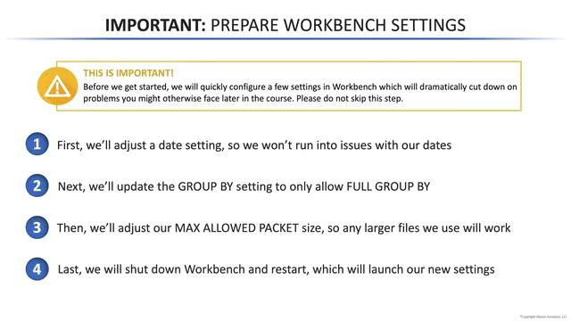

完整解释：`SET SQL_MODE` 修改当前会话的 SQL 模式；`TRADITIONAL` 让 MySQL 更严格地对待错误，`ALLOW_INVALID_DATES` 放宽某些日期校验，`ONLY_FULL_GROUP_BY` 要求 `GROUP BY` 查询里的非聚合列出现在分组中。常见错误是写成 `TRADITIONAL, ALLOW INVALID DATES` 这种带空格的形式，或者用错引号；MySQL 会报语法错误。排查时先确认三个值之间只有逗号，没有多余空格和中文标点。前端对照：这类似 ESLint 的严格模式配置，规则开着时错误会立刻暴露，规则关掉时问题可能被静默放过。

### 步骤 2：改 max_allowed_packet（P11）

```sql
SET GLOBAL max_allowed_packet = 1073741824;
```

讲师说明这个数字本身不重要（是他一个早期学生给的数），**只要是个大数就行**。

执行完立刻查一次：

```sql
SELECT @@max_allowed_packet;
```

**你会看到它还是旧值**——这不是你写错了。讲师原话：这个设置「won't be changed until we close out of Workbench and then restart the application」。

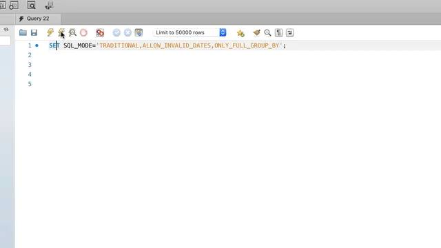

完整解释：`GLOBAL` 表示改全局变量，`max_allowed_packet` 控制单次通信包的最大大小。当前连接可能仍持有旧值，所以立刻 `SELECT` 看不到变化。常见错误是看到旧值后反复执行 `SET GLOBAL`，或者误以为要重启 MySQL Server；课里明确说的是关闭并重启 Workbench 应用。排查顺序：先确认语句没有报错，再退出 Workbench、重新打开、重新连接，最后再查。前端对照：类似改了构建工具的全局配置后，当前 dev server 没重新读取，需要重启进程才生效。

### 步骤 3：重启 Workbench 并验证（P11）

- 菜单退出 Workbench（讲师用 Quit）。
- 重新打开 Workbench，重新连接。
- 再执行一次 `SELECT @@max_allowed_packet;`，这次应显示 `1073741824`。

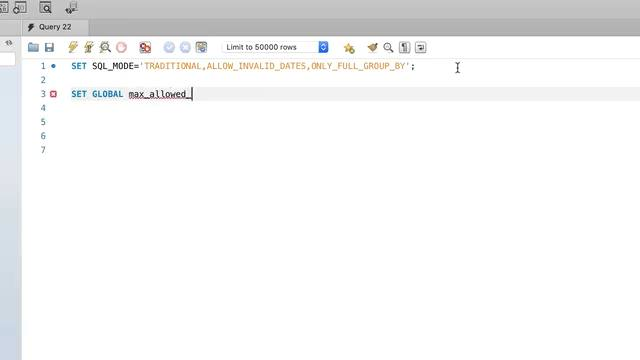

> 注意：`SET GLOBAL` 只影响当前运行的 server 进程，**重启 MySQL Server 本身会丢失**。课里没讲如何持久化（那要改 `my.cnf`/`my.ini`），这里不展开。

验证时不要只看查询结果，还要确认你重连的是同一个实例。如果你有多个连接卡片，可能重开后又连到另一个端口。常见错误是重启后忘了重新执行查询，直接进入下一步；这不会影响建库，但会让你误以为设置没生效。前端对照：重启 dev server 后要确认端口没变、代理没丢；数据库侧同样要确认连接目标一致。

### 步骤 4：用 UI 建 schema（P13）

1. 在左侧 Schemas 面板上方点「Create New Schema」图标（讲师说「go up to this stack up here」）。
2. 名字填 `my_first_schema`。
3. Character set 选 `utf8`（讲师说「UTF-8, it's a very common character set」）。
4. 点 Apply → 弹出「Apply SQL Script to Database」预览窗 → 再点 Apply。

预览窗里你会看到 Workbench 帮你生成的等价 SQL（大意）：

```sql
CREATE SCHEMA `my_first_schema` DEFAULT CHARACTER SET utf8;
```

点 Apply 后出现「The SQL script was successfully applied to the database」，Close 即可。左侧 Schemas 面板出现 `my_first_schema`，里面没有表。

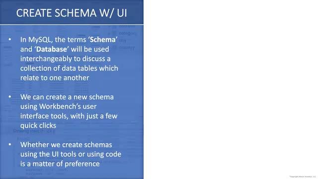

常见错误：库名拼错、字符集没选、预览窗里直接 Cancel 导致没执行。排查方式：看 Action Output 是否有成功提示，再右键 Schemas 面板 Refresh。前端对照：UI 建库类似在可视化后台点「新建项目」，预览 SQL 就像提交前看到的 diff；理解 diff 才能在没有 UI 的环境里复现。

### 步骤 5：用 SQL 建表（P14）

新建一个 Query 编辑器窗口，依次执行：

```sql
USE my_first_code_schema;
```

> 注意：讲师在 P14 里用的库名是 `my_first_code_schema`（和 P13 UI 建的 `my_first_schema` 不是同一个）。如果你没建过 `my_first_code_schema`，先执行 `CREATE SCHEMA my_first_code_schema;`，否则 `USE` 会报错。课里没讲这一步，但你会撞上。

然后执行建表：

```sql
CREATE TABLE my_first_code_table (
  my_first_code_table_id BIGINT NOT NULL,
  my_char_field VARCHAR(50),
  my_text_field TEXT,
  my_created_at TIMESTAMP,
  PRIMARY KEY (my_first_code_table_id)
);
```

执行后看下方 Action Output，应显示成功。左侧 Schemas 面板可能需要**右键 Refresh** 才能看到新表（讲师原话「we may need to refresh. And sure enough, we did need to refresh」）。

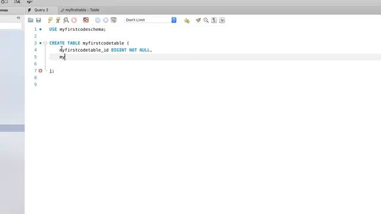

常见错误与排查：如果报「Unknown database」，先补建 `my_first_code_schema`；如果报语法错误，重点看最后一行 `PRIMARY KEY (...)` 前后逗号，讲师专门提醒很多人栽在逗号位置。前端对照：建表类似写 TypeScript interface，但 SQL 的列顺序和约束是执行层事实，不是编译期提示；少一个逗号就会直接失败。

### 步骤 6：验证表结构（P14）

```sql
SELECT * FROM my_first_code_table;
```

返回 4 列、0 行（还没插数据）。再试只选两列：

```sql
SELECT my_text_field, my_created_at
FROM my_first_code_table;
```

只返回这两列。

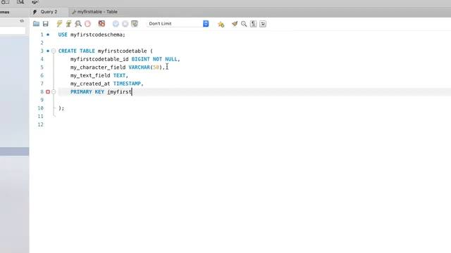

验证要点：结果集列数应为 4，行数为 0；第二条语句结果集列数应为 2。若列名报错，说明建表没成功或 `USE` 的库不对。前端对照：类似接口返回空数组但字段结构正确；先确认 schema 形状，再插数据，比插完再猜字段更稳。

### 步骤 7：准备 thrift_shop 示例库（P15）

讲师用课程资源里的 `create_thrift_shop.sql` 脚本一次性建库建表插数。脚本结构（讲师口述的顺序）：

1. 一段 setting change（设置变更）
2. `CREATE SCHEMA`（建库）
3. `CREATE TABLE inventory` + 插值
4. `CREATE TABLE customers` + 插值
5. `CREATE TABLE customer_purchases` + 插值

在 Workbench 里 File → Open SQL Script 打开该文件，然后点**不带光标的闪电图标**（Run entire script）整体执行。执行完刷新 Schemas 面板，能看到 `thrift_shop` 库和三张表。

> 课里没给这个脚本的完整内容，只给了结构描述。你需要从课程资源下载 `create_thrift_shop.sql`。若拿不到，可按下文第 4 节的等价脚本自建（字段名以讲师口述为准：inventory 表有 `inventory_id`、`item_name`、`number_in_stock` 三列）。

常见错误：点成了带光标的闪电（只执行光标所在语句），导致只建了库没建表；或者脚本执行到一半报错，后续表没创建。排查方式：看 Action Output 的报错行号，刷新 Schemas 面板逐库逐表确认。前端对照：类似跑 migration 脚本，必须整体执行成功；如果中途失败，要确认哪些 migration 已落库，不能假设全部成功。

### 步骤 8：单行插入（P15）

```sql
USE thrift_shop;

INSERT INTO inventory
VALUES (10, 'Wolfskin hat', 1);
```

执行后 `SELECT * FROM inventory;`，能看到 inventory_id=10 的 Wolfskin hat，库存 1。

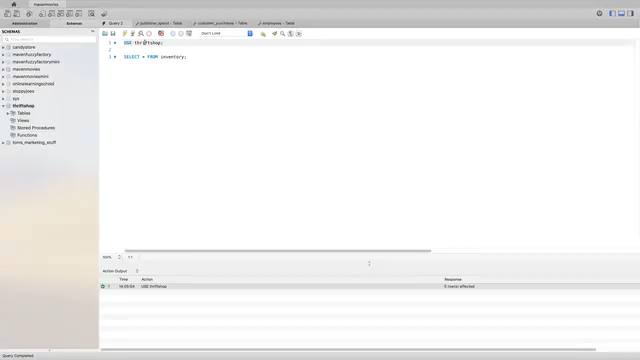

常见错误：值顺序与列顺序不一致，或者字符串没加单引号。排查时先 `SELECT *` 看新行是否出现，再对照三列顺序。前端对照：类似调用接口时按参数顺序传值；不写列名时，顺序就是隐式契约，错位不会报错但会写错数据。

### 步骤 9：多行插入（P15）

```sql
INSERT INTO inventory
VALUES
  (11, 'Fur fox skin', 1),
  (12, 'Plaid button up shirt', 8),
  (13, 'Flannel zebra jammies', 6);
```

每条记录**各自一对括号**，记录之间逗号分隔，最后一条后面不加逗号。

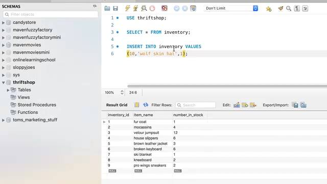

常见错误：把多条记录写进同一对括号，或最后一条后多写逗号。排查方式：看报错位置，重点检查括号配对和逗号。前端对照：类似批量提交数组，数组元素之间用逗号，最后一个元素后不能多逗号；SQL 这边同样严格。

### 步骤 10：省略列的插入（P15）

```sql
INSERT INTO inventory (inventory_id, item_name)
VALUES (14, 'Wolfskin sneakers');
```

因为没给 `number_in_stock`，MySQL 会填默认值（讲师原话「MySQL will place the default value for that column into that field」）。查询后该行 `number_in_stock` 显示为 NULL（因为建表时该列没设默认值）。

常见错误：以为没写的列会自动是 0。排查方式：查该行 `number_in_stock` 是否为 NULL；若是，说明建表时没有 `DEFAULT 0`。前端对照：类似对象解构时缺省字段是 `undefined`，不是 0；需要默认值就要显式声明。

### 步骤 11：故意触发列数不匹配（P15）

```sql
INSERT INTO inventory
VALUES (15, 'Item that will not exist');
```

会报错：

```
Error Code: 1136. Column count doesn't match value count at row 1
```

原因：表有 3 列，你只给了 2 个值，且没写列名（不写列名 = 默认全部列）。补上第三个值即可成功：

```sql
INSERT INTO inventory
VALUES (15, 'Item that will not exist', 2);
```

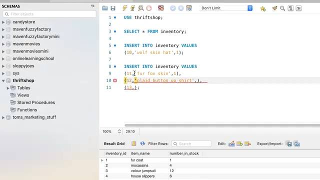

排查顺序：先数表列数，再数值个数，最后看有没有写列名列表。如果写了列名列表，列数应与值数一致，而不是与表总列数一致。前端对照：类似函数参数个数不匹配；不写列名就像按位置传参，少传一个就报错。

### 步骤 12：删除 + 事务演示（P16）

先看当前数据：

```sql
SELECT * FROM inventory;
```

应有 13 条（含 inventory_id=7 的 ski blanket）。

查 autocommit 状态：

```sql
SELECT @@autocommit;
```

返回 `1` 表示开启（讲师说这「tends to be the default in most versions of MySQL Workbench」）。

关掉 autocommit：

```sql
SET autocommit = OFF;
```

再查 `SELECT @@autocommit;` 应返回 `0`。

执行删除：

```sql
DELETE FROM inventory WHERE inventory_id = 7;
```

再 `SELECT * FROM inventory;`，第 7 条不见了。此时执行：

```sql
ROLLBACK;
```

再查，**第 7 条回来了**——因为没 commit。

再删一次：

```sql
DELETE FROM inventory WHERE inventory_id = 7;
COMMIT;
```

再 `ROLLBACK;` 再查，**第 7 条不会回来**——已永久提交。

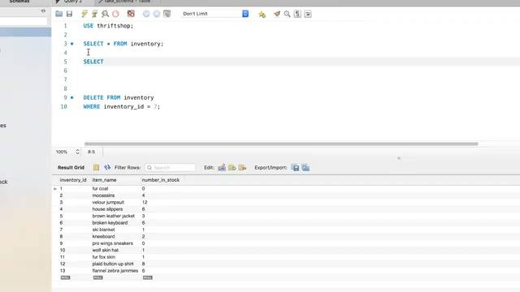

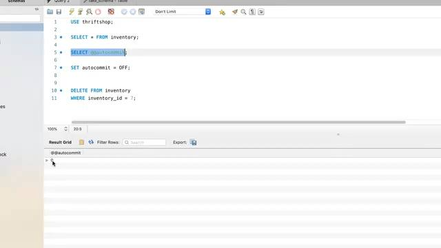

最后把 autocommit 打开：

```sql
SET autocommit = ON;
```

`ON/OFF` 和 `1/0` 等价，讲师两种都演示了。

常见错误与排查：如果 `DELETE` 报 safe mode 错误，说明你用的条件列不是主键；改回主键条件，或按第 7 节的标准解法处理。如果 `ROLLBACK` 后数据没回来，先确认删除后是否执行过 `COMMIT`，以及 autocommit 是否真的为 0。前端对照：`autocommit=OFF` 像进入编辑草稿，`ROLLBACK` 是取消，`COMMIT` 是保存；保存后再取消不会撤销已保存内容。

---

## 4. 完整代码

### 4.1 环境设置脚本 `00_setup.sql`

```sql
-- P11: 环境设置（执行后必须重启 Workbench）
SET SQL_MODE = 'TRADITIONAL,ALLOW_INVALID_DATES,ONLY_FULL_GROUP_BY';
SET GLOBAL max_allowed_packet = 1073741824;

-- 验证（重启 Workbench 后再跑一次才会看到新值）
SELECT @@sql_mode;
SELECT @@max_allowed_packet;
```

这段脚本建议单独保存、单独执行。执行后先看 `SELECT @@sql_mode;` 是否包含三个目标值，再关闭并重启 Workbench。`SELECT @@max_allowed_packet;` 在重启前可能仍是旧值，这是预期现象，不要因此重复改配置。前端对照：类似先改 `.env` 再重启开发服务，当前进程不会自动读取新配置。

### 4.2 建库建表脚本 `01_create_table.sql`

```sql
-- P13/P14: 建库 + 建表
CREATE SCHEMA IF NOT EXISTS my_first_code_schema
  DEFAULT CHARACTER SET utf8;

USE my_first_code_schema;

CREATE TABLE my_first_code_table (
  my_first_code_table_id BIGINT NOT NULL,
  my_char_field VARCHAR(50),
  my_text_field TEXT,
  my_created_at TIMESTAMP,
  PRIMARY KEY (my_first_code_table_id)
);

-- 验证
SELECT * FROM my_first_code_table;
SELECT my_text_field, my_created_at FROM my_first_code_table;
```

执行时注意：`CREATE SCHEMA` 和 `USE` 是两条语句，必须让它们都成功；如果 `USE` 报 Unknown database，说明建库语句没执行或库名拼错。建表后 `SELECT *` 返回 4 列 0 行才算结构正确。前端对照：类似先创建项目目录，再在目录里生成配置文件；目录不对，后面文件会写到错误位置。

### 4.3 thrift_shop 等价建库脚本 `02_thrift_shop.sql`

> 说明：课里只给了 `create_thrift_shop.sql` 的结构描述和 inventory 表的三列名，未逐字给出 customers / customer_purchases 的字段。下面 inventory 部分严格按讲师口述；customers 与 customer_purchases 为**最小可用示意**，字段名请以你下载到的课程资源脚本为准。

```sql
-- P15/P16: thrift_shop 示例库（inventory 部分按讲师口述还原）
DROP SCHEMA IF EXISTS thrift_shop;
CREATE SCHEMA thrift_shop DEFAULT CHARACTER SET utf8;
USE thrift_shop;

CREATE TABLE inventory (
  inventory_id INT NOT NULL,
  item_name VARCHAR(100),
  number_in_stock INT,
  PRIMARY KEY (inventory_id)
);

INSERT INTO inventory VALUES
  (1, 'Ski blanket', 1),
  (2, 'Sample item 2', 3),
  (3, 'Sample item 3', 5),
  (4, 'Sample item 4', 2),
  (5, 'Sample item 5', 4),
  (6, 'Sample item 6', 6),
  (7, 'Ski blanket', 1),
  (8, 'Sample item 8', 0),
  (9, 'Sample item 9', 7);

-- 以下两张表课里未给字段，示意结构，请以课程资源为准
CREATE TABLE customers (
  customer_id INT NOT NULL,
  customer_name VARCHAR(100),
  PRIMARY KEY (customer_id)
);

CREATE TABLE customer_purchases (
  purchase_id INT NOT NULL,
  customer_id INT,
  inventory_id INT,
  PRIMARY KEY (purchase_id)
);
```

这段脚本包含 `DROP SCHEMA IF EXISTS`，适合反复练习，但会删除已有 `thrift_shop` 库。如果你已经手动插过数据，重跑前要清楚数据会重置。前端对照：类似本地测试库的 seed 脚本，重置后回到基线数据，便于重复验证。

### 4.4 插入练习脚本 `03_insert.sql`

```sql
USE thrift_shop;

-- 单行
INSERT INTO inventory VALUES (10, 'Wolfskin hat', 1);

-- 多行
INSERT INTO inventory VALUES
  (11, 'Fur fox skin', 1),
  (12, 'Plaid button up shirt', 8),
  (13, 'Flannel zebra jammies', 6);

-- 省略列
INSERT INTO inventory (inventory_id, item_name)
VALUES (14, 'Wolfskin sneakers');

-- 故意报错（1136）
-- INSERT INTO inventory VALUES (15, 'Item that will not exist');

-- 修正后
INSERT INTO inventory VALUES (15, 'Item that will not exist', 2);
```

执行顺序建议不要打乱：先单行确认列顺序，再多行确认括号，再省略列确认 NULL，最后故意报错再修正。前端对照：类似先跑单条请求，再跑批量请求，最后跑异常用例；按顺序验证更容易定位问题。

### 4.5 删除 + 事务脚本 `04_delete_tx.sql`

```sql
USE thrift_shop;

SELECT @@autocommit;          -- 预期 1
SET autocommit = OFF;
SELECT @@autocommit;          -- 预期 0

DELETE FROM inventory WHERE inventory_id = 7;
SELECT * FROM inventory;      -- 7 消失
ROLLBACK;
SELECT * FROM inventory;      -- 7 回来

DELETE FROM inventory WHERE inventory_id = 7;
COMMIT;
ROLLBACK;                     -- 无效
SELECT * FROM inventory;      -- 7 不再回来

SET autocommit = ON;
```

执行时建议逐段运行，不要整段一次性跑完，否则你很难观察「7 消失 / 回来 / 不再回来」三个状态。前端对照：类似调试状态管理时逐步打印 draft、save、cancel 的结果；一次性跑完只能看到最终状态。

---

## 5. 逐行解释

**`SET SQL_MODE = 'TRADITIONAL,ALLOW_INVALID_DATES,ONLY_FULL_GROUP_BY';`**
- `TRADITIONAL`：让 MySQL 把错误当错误处理，而不是降级成 warning。讲师强调这对初学者尤其重要——写错了要立刻报错，而不是悄悄给你一个奇怪结果。
- `ALLOW_INVALID_DATES`：解决不同时区学生拿到「不合理的日期」的问题。
- `ONLY_FULL_GROUP_BY`：历史上是默认值，后来某些版本取消了。这门课后面会深讲 `GROUP BY`，所以必须打开。
- 三个值用逗号分隔，整体单引号包裹，单词间下划线。
- 常见错误：值之间多空格、用了中文逗号、漏引号。排查时先把语句单独执行，看是否语法错误；成功后用 `SELECT @@sql_mode;` 验证返回值。
- 前端对照：类似 ESLint 严格规则，开启后错误早暴露；规则名写错会配置失败。

**`SET GLOBAL max_allowed_packet = 1073741824;`**
- `GLOBAL` 表示对全局生效（不是当前 session）。`1073741824` = 1 GiB。
- 讲师明说数字不重要，大就行。这个数是他纪念一位早期学生。
- **必须重启 Workbench 才生效**，这是本集最容易踩的坑。
- 常见错误：执行后立刻查仍是旧值就以为失败；正确做法是关闭 Workbench、重新打开、重连后再查。还要注意 `SET GLOBAL` 不持久，重启 MySQL Server 会回退（课里没讲持久化）。
- 前端对照：类似改了全局构建配置，当前 dev server 不重新加载；需要重启进程。

**`CREATE SCHEMA IF NOT EXISTS my_first_code_schema DEFAULT CHARACTER SET utf8;`**
- MySQL 里 schema 和 database 是同义词（讲师 p013 [00:47] 明确说过）。
- `DEFAULT CHARACTER SET utf8` 对应 UI 里选 UTF-8 那一步。
- `IF NOT EXISTS` 是本文档加的防重跑保护，课里 UI 操作生成的语句没有它。
- 常见错误：库名与后续 `USE` 不一致；本文 P13 是 `my_first_schema`，P14 是 `my_first_code_schema`，要分清。
- 前端对照：类似创建项目目录，名字必须和后续路径一致，否则写文件会找不到目录。

**`CREATE TABLE my_first_code_table (...)`**
- 每列格式：`列名 数据类型 [约束]`，列之间逗号。
- `BIGINT NOT NULL`：大整数，不允许空。
- `VARCHAR(50)`：变长字符串，最多 50 字符，可存文本和数字。
- `TEXT`：只存文本。
- `TIMESTAMP`：时间戳。
- `PRIMARY KEY (my_first_code_table_id)`：主键声明放在最后，**这一行后面不加逗号**。讲师 p014 [06:54] 专门提醒：报错十有八九是逗号位置错了。
- 常见错误：最后一列后多逗号、主键行后多逗号、列名拼错。排查时从报错行往上数括号和逗号。
- 前端对照：类似写类型定义，字段顺序和必填约束要明确；语法错会直接阻止执行。

**`INSERT INTO inventory VALUES (10, 'Wolfskin hat', 1);`**
- 不写列名 = 按表定义顺序给全部列赋值。
- 值顺序必须与列顺序一一对应。
- 常见错误：字符串没引号、值个数不对、顺序错位。顺序错位不一定报错，但会写错数据，所以插入后要 `SELECT` 验证。
- 前端对照：类似按位置传参，位置错了类型可能还对，但语义错了。

**多行 `INSERT ... VALUES (...), (...), (...);`**
- 每条记录独立括号，记录间逗号，最后一条无逗号。
- 常见错误：最后多逗号、括号不配对。排查时先看报错位置附近。
- 前端对照：类似批量数组提交，元素之间逗号分隔，末尾不能多逗号。

**`INSERT INTO inventory (inventory_id, item_name) VALUES (14, 'Wolfskin sneakers');`**
- 显式列名列表，未列出的列填默认值（本例为 NULL）。
- 常见错误：以为默认值是 0；实际要看建表时有没有 `DEFAULT 0`。排查时查该行对应列。
- 前端对照：类似对象字段缺省为 `undefined`，需要默认值要显式声明。

**`Error Code: 1136`**
- 列数与值数不匹配。表 3 列、只给 2 值、又没写列名 → 报错。
- 常见错误：写了列名列表却仍按表总列数数值；这时应数列名列表个数，而不是表列数。
- 前端对照：类似函数参数个数不匹配，按位置传参少一个就报错。

**`SELECT @@autocommit;`**
- 返回 1（开）或 0（关）。Workbench 默认 1。
- 常见错误：不查状态直接删除，导致以为 `ROLLBACK` 无效。排查时先查再删。
- 前端对照：类似确认当前是否处于编辑模式，再决定保存还是取消。

**`SET autocommit = OFF;` / `SET autocommit = ON;`**
- `OFF/ON` 与 `0/1` 等价，讲师两种都演示。
- 常见错误：演示完忘记恢复 `ON`，后续操作一直处于手动提交状态。排查时最后再查一次 `SELECT @@autocommit;`。
- 前端对照：类似切换草稿模式和自动保存模式，模式不同，操作结果不同。

**`DELETE FROM inventory WHERE inventory_id = 7;`**
- 不带 `WHERE` 会删全表（讲师 p016 [01:25] 明确警告）。
- 用主键做条件，避免 Workbench safe mode 报「targeting records that are not using a primary key」。
- 常见错误：条件列不是主键触发 safe mode；或者漏写 `WHERE` 删全表。排查时先 `SELECT` 同样条件确认目标行。
- 前端对照：类似删除数组元素前先按 id 查找，确认只删目标项。

**`ROLLBACK;` / `COMMIT;`**
- `ROLLBACK` 撤销「自上次 commit 以来」的所有改动。
- `COMMIT` 让改动永久化，之后 `ROLLBACK` 无效。
- **前端类比**：这就像 JS 里先改一个 draft 对象，`commit` 才写回 store；`rollback` 就是丢弃 draft。Node 里用数据库事务时，`BEGIN / COMMIT / ROLLBACK` 是同一套心智模型（`mysql2`、`pg`、Prisma 的 `$transaction` 都是这个语义）。
- 常见错误：删除后先 `COMMIT` 再 `ROLLBACK`，发现数据回不来；这是事务语义正常表现。排查时看执行顺序。
- 前端对照：保存后再点取消不会撤销已保存内容；要撤销必须在保存前取消。

---

## 6. 复现检查清单

- [ ] `SET SQL_MODE` 执行无报错。验证：单独执行该语句，看 Action Output 是否成功；再执行 `SELECT @@sql_mode;` 看返回值。
- [ ] `SELECT @@sql_mode;` 包含 `TRADITIONAL`、`ALLOW_INVALID_DATES`、`ONLY_FULL_GROUP_BY`。验证：在结果字符串里逐项搜索三个关键词。
- [ ] `SET GLOBAL max_allowed_packet` 执行后**重启 Workbench**。验证：执行语句无报错后，完全退出 Workbench 再打开并重连。
- [ ] 重启后 `SELECT @@max_allowed_packet;` 显示 `1073741824`。验证：确认查询结果等于该数字，而不是旧值。
- [ ] `my_first_schema` 出现在左侧 Schemas 面板。验证：右键 Schemas 面板 Refresh 后再看；也可用 UI 建库预览窗确认执行成功。
- [ ] `my_first_code_schema` 存在（否则 `USE` 报错）。验证：执行 `USE my_first_code_schema;` 看是否报 Unknown database；若报错先 `CREATE SCHEMA`。
- [ ] `my_first_code_table` 建表成功，4 列。验证：执行 `SELECT * FROM my_first_code_table;`，看结果集列数为 4。
- [ ] `SELECT * FROM my_first_code_table;` 返回 4 列 0 行。验证：看结果网格列头和行数；0 行说明还没插数据，符合预期。
- [ ] `thrift_shop` 库存在，含 inventory / customers / customer_purchases。验证：刷新 Schemas 面板，展开 `thrift_shop` 逐表确认；或执行 `USE thrift_shop;`。
- [ ] 单行插入 inventory_id=10 成功。验证：执行后 `SELECT * FROM inventory WHERE inventory_id = 10;` 能看到 Wolfskin hat。
- [ ] 多行插入 11/12/13 成功。验证：按 id 查询 11、12、13 三行是否存在，并核对 item_name 与数量。
- [ ] 省略列插入 14 成功，`number_in_stock` 为 NULL。验证：查 id=14 行，重点看 `number_in_stock` 是否显示 NULL。
- [ ] 故意 2 值插 3 列表 → 报 `Error Code: 1136`。验证：先注释掉修正语句，只执行故意报错那条，确认错误码为 1136。
- [ ] 补第三值后 15 插入成功。验证：查 id=15 行，确认 item_name 和 number_in_stock=2。
- [ ] `SELECT @@autocommit;` 初始为 1。验证：在删除演示前先查一次，记录返回值。
- [ ] `SET autocommit = OFF;` 后为 0。验证：设置后立刻再查一次，确认返回 0。
- [ ] 删 7 → 查不到 → `ROLLBACK` → 7 回来。验证：按顺序执行，每一步都 `SELECT * FROM inventory WHERE inventory_id = 7;` 观察有/无。
- [ ] 再删 7 → `COMMIT` → `ROLLBACK` → 7 不回来。验证：提交后再回滚，再查 id=7，确认仍不存在。
- [ ] 最后 `SET autocommit = ON;` 恢复。验证：执行后查 `SELECT @@autocommit;`，确认回到 1。

---

## 7. 课里没讲但你会撞上的

| 现象 | 原因 | 怎么办 |
|---|---|---|
| 执行 P14 的 `USE my_first_code_schema;` 报 Unknown database | P13 UI 建的是 `my_first_schema`，P14 代码用的是 `my_first_code_schema`，两者不是同一个库；讲师没解释这个切换 | 先执行 `CREATE SCHEMA my_first_code_schema;`，再 `USE my_first_code_schema;`；复现时把两个库名分开记录，避免混用 |
| 重启 MySQL Server 后 `max_allowed_packet` 回退 | `SET GLOBAL` 只影响当前运行的 server 进程，不持久化；课里没讲持久化方式 | 若只是跟课练习，重启 Workbench 验证即可；要持久化需改 `my.cnf` / `my.ini` 的 `[mysqld]` 段（课里没讲，本文不展开） |
| 拿不到 `create_thrift_shop.sql` 的完整内容 | 课里只给了脚本结构描述和 inventory 三列名，未逐字给出 customers / customer_purchases 字段 | 从课程资源下载原脚本；若拿不到，用第 4.3 节等价脚本练习，其中 customers / customer_purchases 是示意结构，字段名以课程资源为准 |
| `DELETE ... WHERE item_name = 'xxx'` 报 safe mode 错误 | P16 提到：用非主键列做删除条件时，Workbench safe mode 会报「targeting records that are not using a primary key」 | 改用主键条件；或临时 `SET SQL_SAFE_UPDATES = 0;`（课里没讲这个开关，但这是标准解法），操作完再恢复 |
| 省略列插入后 `number_in_stock` 是 NULL，不是 0 | 讲师说会填默认值，但建表时该列没写 `DEFAULT 0`，所以默认值是 NULL | 想要 0 就在建表时显式写 `number_in_stock INT DEFAULT 0`；否则查询时按 NULL 处理 |
| 字符集选了 `utf8`，后续遇到 emoji 或生僻字有问题 | 讲师选的是 `utf8`；现代 MySQL 建议 `utf8mb4`，支持 emoji 和部分生僻字 | 跟课练习可保留 `utf8`；真实项目建议建库建表用 `utf8mb4`（课里没讨论这个区别） |
| 不知道事务隔离级别怎么影响并发 | P16 只讲了 autocommit / commit / rollback，没讲隔离级别（READ COMMITTED / REPEATABLE READ 等） | 本节先掌握提交与回滚语义；讲师说「We'll get into this stuff way later in the course」，隔离级别后续再展开 |
| 事务概念和前端状态管理对不上 | 课里用数据库术语讲 commit / rollback，前端更熟悉草稿、保存、取消 | 可类比：`autocommit=OFF` 像进入编辑模式，所有改动先攒着；`COMMIT` 是点「保存」；`ROLLBACK` 是点「取消」。Node 里 `mysql2` 的 `connection.beginTransaction()` / `commit()` / `rollback()` 是同一套语义，只是 API 名字不同 |