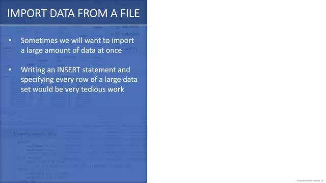
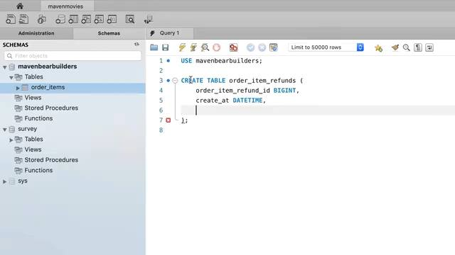
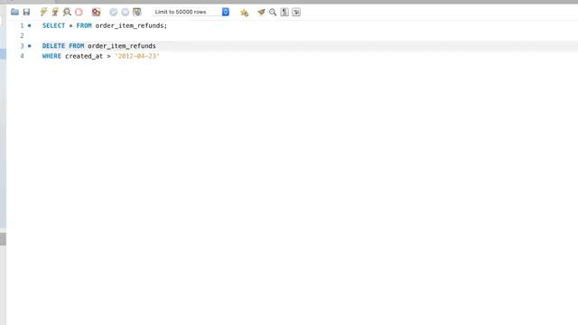
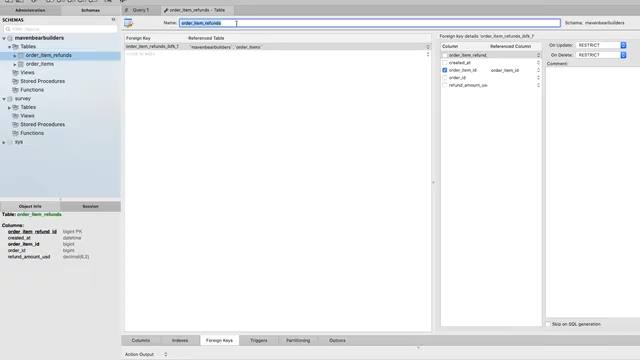
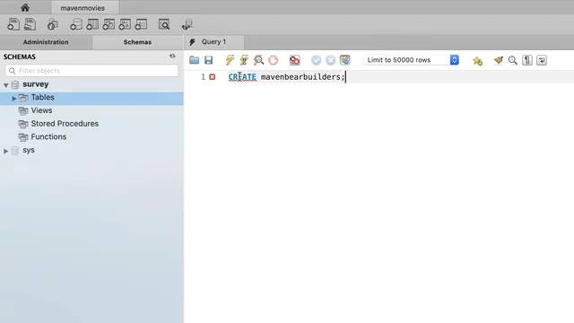
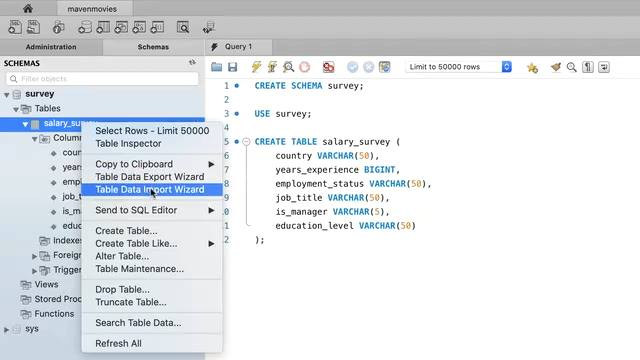
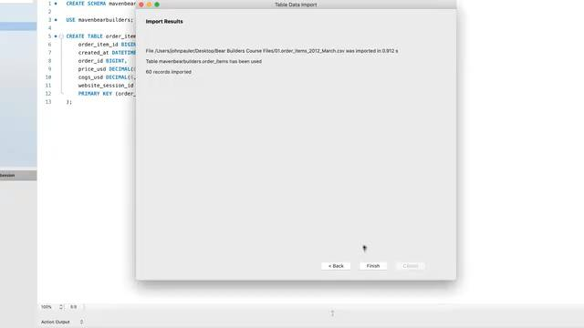
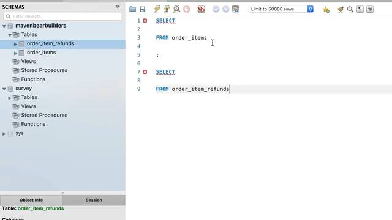

# Advanced MySQL Database Administration（P17–P25）复现文档：从 CSV 批量导入到 Maven Bear Builders 数据底座

本文覆盖 P17–P25。你要复现出来的最终状态是：

- 两个 schema：`Survey` 和 `Maven Bear Builders`
- 三张核心表：`salary_survey`、`order_items`、`order_item_refunds`
- 用 MySQL Workbench 的 **Table Data Import Wizard** 把课程 CSV 导入表中
- 删除 5 条被误标为退款的记录
- 继续导入 2012 年 5–12 月数据
- 用 `COUNT(*)`、`MIN(created_at)`、`MAX(created_at)` 做 QA

> 说明：这门课的操作主体是 **MySQL Workbench GUI + SQL**，不是 Node/后端项目。课里没有讲 MySQL 安装、连接创建、`LOAD DATA`、事务、锁、环境变量。本文会把课里讲到的内容写成可复现步骤；课里没讲的部分会明确标注「课里没讲」。

---

## 1. 这一节做什么

这一节不是讲抽象概念，而是给一家虚构公司 **Maven Bear Builders** 搭最小可用的数据底座。P17 先演示如何用 Workbench 的 Table Data Import Wizard 批量导入 CSV；P18–P21 通过两个 assignment 让你创建 `Maven Bear Builders` schema、`order_items` 表、`order_item_refunds` 表，并把 2012 年 3 月、4 月的订单和退款数据导进去；P22–P23 处理真实工作中常见的问题：有人把客户咨询误标成退款，需要按主键删除错误记录；P24–P25 再把 2012 年 5–12 月的数据补齐，并做导入顺序和 QA 检查。

最终你要得到的记录数：

| 表 | 阶段 | 预期记录数 |
|---|---|---:|
| `Survey.salary_survey` | P17 导入 salary survey CSV 后 | 4018 |
| `Maven Bear Builders.order_items` | 导入 3 月文件后 | 60 |
| `Maven Bear Builders.order_items` | 再导入 4 月文件后 | 159 |
| `Maven Bear Builders.order_item_refunds` | 导入 4 月退款文件后 | 10 |
| `Maven Bear Builders.order_item_refunds` | 删除 5 条误标退款后 | 5 |
| `Maven Bear Builders.order_items` | 再导入 5–12 月文件后 | 159 + 2427 = 2586（课里导入文件 4 时显示 2427 records，总数可用 `COUNT(*)` 验证） |
| `Maven Bear Builders.order_item_refunds` | 再导入 5–12 月退款文件后 | 5 + 164 = 169 |

这里最重要的是三件事：

1. **建表时列名、类型、主键要能接住 CSV 数据**；
2. **导入时一定 QA 源列和目标列的映射**；
3. **有外键时先导入父表 `order_items`，再导入子表 `order_item_refunds`**。

复现时建议把整个过程拆成“建库建表 → 单文件导入 → 立即计数 QA → 删错数据 → 再批量导入 → 再做最终 QA”几个小阶段。每完成一个阶段就执行一次 `COUNT(*)` 和 `MIN/MAX`，不要等全部导完才检查。因为一旦列映射错了，或者日期被 Excel 改坏，后面再补数据会把错误叠加；越早发现，越容易重新建表或重新导入。对做前端或 Node 项目的人来说，可以把这些表理解成页面背后的数据底座：前端页面展示订单、退款、金额和日期，最终都要落到这些字段上；但课里没有讲前端调用、接口设计或 ORM 映射，本文只做必要的类比，不把它们包装成讲师内容。

课里没讲的内容包括：MySQL 版本选择、如何新建 Workbench 连接、如何用命令行 `LOAD DATA` 导入、事务和锁、Node/后端代码如何调用这些表。本文会在对应位置标注。

---

## 2. 讲师原话（带「—— pNNN [MM:SS]」）

P17 开头说明为什么需要批量导入：

> "到这里，你应该已经能够熟练创建表，并使用 INSERT 语句向这些表中插入单行数据。但有时我们需要一次性导入大量数据。"
> —— p017 [00:00]

讲师明确本节主要使用 Table Data Import Wizard：

> "这里我们会使用表数据导入向导。这也是本课程中处理这类任务的主要方式。"
> —— p017 [00:27]



P17 演示时创建 `Survey` schema：

> "我将创建一个模式。名称可以随意取，不过我会把它命名为 Survey。然后运行这条语句。"
> —— p017 [02:43]

P18 assignment 要求创建课程后续一直使用的 schema：

> "你需要创建一个新模式，可以命名为 Maven Bear Builders。然后确保将它设为默认模式。整个课程中你都会使用这个模式。"
> —— p018 [00:26]

P19 解释 `order_items` 的六列：

> "我们有 order item ID，它看起来是一个自增整数……我们还有该订单的创建时间，以及 order ID、price USD、COGS USD……然后还有一个 ID，与购买者的网站会话相关联。"
> —— p019 [00:29]

P21 创建退款表并加外键：

> "我们还会有一个 order item ID，同样是 BIGINT 类型；还会有一个 refund amount USD……最后，我们把 order item refund ID 设为主键。我们也可以添加一个外键。"
> —— p021 [01:24]



P23 删除记录时触发 safe update mode 错误：

> "于是我们遇到了错误代码 1175。你正在使用安全更新模式，并尝试在没有使用键列的 WHERE 子句的情况下更新表。"
> —— p023 [02:02]



P25 强调导入顺序：

> "因此，我们会先导入 order items 数据，然后导入 order item refunds 数据。"
> —— p025 [03:16]



> 说明：上面的引用用于定位讲师在视频中的原话和操作节点，不是完整逐字稿。复现时以第 3 段步骤和 Workbench 实际界面为准；如果界面文案与课程录制版本略有差异，优先检查 schema、表、文件、列映射和计数是否一致。

---

## 3. 从零复现

### 3.1 准备环境与目录

课里没有指定 MySQL 和 Workbench 的具体版本。复现时你至少需要：

- 一个能连上的 MySQL Server；
- MySQL Workbench；
- 课程资源 zip 解压后的 CSV 文件。

课里提到的连接名是 **Maven movies connection**，这是前面课程已经建立好的连接。课里没讲如何新建连接；如果你本地还没有连接，就在 Workbench 首页新建一个连接，能连上你的 MySQL 即可，连接名不影响本课 SQL。连接建立后先确认能看到 Schemas 面板，能执行 `SELECT 1;` 这类简单查询；如果连接不上，先排查服务是否启动、端口和用户名密码是否正确，不要急着进入导入向导。

建议目录结构如下。课程逐字稿明确提到的文件名包括 `salary survey CSV`、`01 order items 2012march.csv`、`03 order item refunds April 2012`，以及文件 4、文件 5。没有逐字念全的文件名，以你下载的课程资源 zip 内编号为准。

```text
~/Desktop/Bear Builders Course Files/
├── salary_survey.csv
├── 01_order_items_2012march.csv
├── 02_order_items_2012april.csv
├── 03_order_item_refunds_2012april.csv
├── 04_order_items_2012may_dec.csv
└── 05_order_item_refunds_2012may_dec.csv
```

> 注意：上面 02、04、05 的完整文件名课里没有逐字念全。你导入时按课程资源里的编号顺序选文件即可。关键是不要选错文件，也不要因为 Workbench 缓存了上一次路径就直接点 Next。


常见错误是“文件选错但列名相同”：例如把 4 月订单导进 3 月阶段，计数会不符合预期；或者把退款文件导进订单表，外键和金额字段都会对不上。排查方法是每次导入前在文件管理器里确认文件名和编号，导入后立刻执行本节后面的 `COUNT(*)`。如果你以后用 Node 写导入脚本，也要保留这种“导入前确认源文件、导入后校验计数”的习惯；课里没有讲 Node，这里只是提醒。

### 3.2 创建两个 schema

P17 用的是 `Survey`，P18 之后课程主要用 `Maven Bear Builders`。`Maven Bear Builders` 中间有空格，所以 SQL 里必须用反引号包起来：

```sql
CREATE DATABASE IF NOT EXISTS `Survey`;
CREATE DATABASE IF NOT EXISTS `Maven Bear Builders`;
```

在 Workbench 里也可以右键 Schemas 面板 → Create Schema，但直接执行 SQL 更稳。执行后刷新 Schemas 面板，应该能看到两个 schema。如果执行报错，先看是否把反引号写成了普通引号，或者 schema 名中间的空格没有包住。`IF NOT EXISTS` 是复现时常用的保护写法，避免重复执行时报“database exists”；它不会删除已有库，也不会清空已有表。

然后设置默认 schema。P19 里讲师说：

> "我们会执行 USE Maven Bear Builders。我将把它设为新的默认模式。"
> —— p019 [03:14]

对应 SQL：

```sql
USE `Maven Bear Builders`;
```

在 Workbench 里，执行 `USE` 后左侧 schema 会加粗；也可以右键 schema → Set as Default Schema。课里说这两种方式效果一样。验证方式很简单：执行 `SELECT DATABASE();`，返回的应当是 `Maven Bear Builders`。如果你发现后续建表跑到别的库里，先检查默认 schema 或 SQL 里是否写全了库名。



与前端或后端对照：连接配置里通常也有一个 database/schema 选项，等价于这里的默认 schema；但课里没有讲连接池、环境变量或 ORM，复现时只需要把 Workbench 的默认 schema 设置正确即可。

### 3.3 建 `salary_survey` 并导入 P17 的 salary survey CSV

P17 的 salary survey 数据列包括：country、years experience、employment status、job title、isManager、education level。讲师给的类型是：

- country：`VARCHAR(50)`
- years experience：`BIGINT`（讲师说 integer 也可以，他用了 big int）
- employment status：`VARCHAR(50)`
- job title：`VARCHAR(50)`
- isManager：更小的 `VARCHAR`，因为只有 yes/no
- education level：`VARCHAR(50)`

复现 SQL 如下。列名采用下划线形式；如果你的 CSV 表头是带空格的，导入向导里手动确认映射即可。

```sql
USE `Survey`;

DROP TABLE IF EXISTS `salary_survey`;

CREATE TABLE `salary_survey` (
  `country` VARCHAR(50) NULL,
  `years_experience` BIGINT NULL,
  `employment_status` VARCHAR(50) NULL,
  `job_title` VARCHAR(50) NULL,
  `is_manager` VARCHAR(10) NULL,
  `education_level` VARCHAR(50) NULL
);
```

执行后，在 Workbench 里右键 `salary_survey` 表 → **Table Data Import Wizard** → Browse 选择 `salary_survey.csv` → 选择 Use existing table → 编码选 UTF-8 → 检查 Source Column 和 Destination Column 是否对齐 → Next → Next → Finish。最后执行：

```sql
SELECT COUNT(*) AS records FROM `Survey`.`salary_survey`;
```

预期是 4018 条。P17 里讲师说：

> "你会看到该表中导入的总记录数，共 4,018 条。"
> —— p017 [09:38]



这里的完整解释是：Table Data Import Wizard 会读取 CSV 表头并尝试自动映射到已有表列。自动映射不一定可靠，尤其是 CSV 表头带空格、大小写不同、列名被改成下划线时。常见错误包括：选成“Create new table”导致多出一张新表；编码不是 UTF-8 导致国家名或职位出现乱码；列映射错位导致 `years_experience` 里出现文本；导入中途取消导致只导入一部分。排查时先看 `COUNT(*)` 是否 4018，再抽样 `SELECT * ... LIMIT 10;` 检查列内容是否符合预期。与前端对照：页面表格列名可以随意展示，但数据库列名和类型是数据底座，最好保持稳定；课里没有讲前端展示，这里只是帮助理解。

### 3.4 建 `order_items` 并导入 3 月、4 月订单

`order_items` 的六列来自 P19：

- order item ID：看起来像自增整数，讲师用 `BIGINT`
- created at：`DATETIME`
- order ID：`BIGINT`
- price USD：`DECIMAL(6,2)`
- COGS USD：`DECIMAL(6,2)`
- website session ID：`BIGINT`

主键是 `order_item_id`。讲师没有明确说 DDL 里是否加 `AUTO_INCREMENT`，只说“看起来像 auto incrementing integer”。因为我们导入的是 CSV 里已经存在的 ID，所以下面不写 `AUTO_INCREMENT` 也能复现。

```sql
USE `Maven Bear Builders`;

DROP TABLE IF EXISTS `order_items`;

CREATE TABLE `order_items` (
  `order_item_id` BIGINT NOT NULL,
  `created_at` DATETIME NULL,
  `order_id` BIGINT NULL,
  `price_usd` DECIMAL(6,2) NULL,
  `cogs_usd` DECIMAL(6,2) NULL,
  `website_session_id` BIGINT NULL,
  PRIMARY KEY (`order_item_id`)
) ENGINE=InnoDB DEFAULT CHARSET=utf8mb4;
```

然后导入两个文件：

1. `01_order_items_2012march.csv` → 预期 60 条；
2. `02_order_items_2012april.csv` → 预期 99 条。

P19 里讲师导入 March 文件后说：

> "可以看到，已导入 60 条记录。"
> —— p019 [07:30]

导入 April 文件后说：

> "这一次导入了 99 条记录……总共有 159 行。"
> —— p019 [08:26]

QA 查询：

```sql
SELECT COUNT(*) AS records FROM `Maven Bear Builders`.`order_items`;

SELECT
  MIN(`created_at`) AS first_created_at,
  MAX(`created_at`) AS last_created_at
FROM `Maven Bear Builders`.`order_items`;
```

P19 里讲师用 min/max 做 QA，看到最早是 March 19th，最晚是 April 30th。你实际输出以 Workbench 为准。



这一步的常见错误是日期格式。P19 讲师特别提醒：Excel 可能把日期显示成 month/date/year，但 CSV 文本里应是 `YYYY-MM-DD HH:MM:SS`。如果你用 Excel 打开并保存过 CSV，`DATETIME` 导入可能失败或被错误解析。排查方法是先用文本编辑器看原始 CSV 的日期列，再在导入向导里确认目标列是 `DATETIME`，导入后用 `MIN/MAX` 检查时间范围是否落在 3 月到 4 月。与前端对照：前端日期控件通常提交 ISO 字符串或时间戳，后端再转成数据库日期；课里没有讲这一层转换，这里只提醒日期格式要一致。

### 3.5 建 `order_item_refunds` 并导入 4 月退款

P21 创建 `order_item_refunds`。列包括：

- order item refund ID：`BIGINT`，主键
- created at：`DATETIME`
- order item ID：`BIGINT`，外键引用 `order_items.order_item_id`
- order ID：`BIGINT`
- refund amount USD：`DECIMAL(6,2)`

SQL：

```sql
USE `Maven Bear Builders`;

DROP TABLE IF EXISTS `order_item_refunds`;

CREATE TABLE `order_item_refunds` (
  `order_item_refund_id` BIGINT NOT NULL,
  `created_at` DATETIME NULL,
  `order_item_id` BIGINT NULL,
  `order_id` BIGINT NULL,
  `refund_amount_usd` DECIMAL(6,2) NULL,
  PRIMARY KEY (`order_item_refund_id`),
  CONSTRAINT `fk_order_item_refunds_order_items`
    FOREIGN KEY (`order_item_id`)
    REFERENCES `order_items` (`order_item_id`)
) ENGINE=InnoDB DEFAULT CHARSET=utf8mb4;
```

导入 `03_order_item_refunds_2012april.csv`，预期 10 条。P21 里讲师说：

> "已导入 10 条记录，现在可以点击完成。"
> —— p021 [03:46]

QA：

```sql
SELECT COUNT(*) AS records
FROM `Maven Bear Builders`.`order_item_refunds`;

SELECT *
FROM `Maven Bear Builders`.`order_item_refunds`;
```

这里要注意：因为 `order_item_refunds.order_item_id` 是外键，它引用的订单项必须已经在 `order_items` 里存在。课里没讲事务和锁，但从外键约束就能推出导入顺序：先 `order_items`，后 `order_item_refunds`。常见错误是退款文件里有某个 `order_item_id` 在订单表里找不到，导入会报外键错误；排查时先查退款 CSV 中的 `order_item_id` 是否都存在于 `order_items`，或者确认是不是先导了退款、后导订单。与前端对照：如果页面允许提交退款，后端写入退款前也应确认对应订单项存在；课里没有讲后端实现，这里只是从外键约束做出的提醒。

### 3.6 删除 5 条误标退款

P22 的 assignment 场景是：新员工把 5 条客户咨询误标成退款。P23 的解决方式是：**用主键删除**。讲师先演示了一个会报错的写法：

```sql
-- 这是课里演示的错误示例，建议不要直接执行
DELETE FROM `Maven Bear Builders`.`order_item_refunds`
WHERE `created_at` > '2012-04-23';
```

这个写法会触发 Workbench 的 safe update mode，报 error code 1175。讲师原话：

> "你正在使用安全更新模式，并尝试在没有使用键列的 WHERE 子句的情况下更新表。要禁用安全模式，请在首选项中切换该选项。"
> —— p023 [02:02]

讲师建议保持 safe update mode 开启，强迫自己只用主键做删除/更新。正确写法是用 `order_item_refund_id` 主键：

```sql
USE `Maven Bear Builders`;

SELECT *
FROM `order_item_refunds`;

DELETE FROM `order_item_refunds`
WHERE `order_item_refund_id` BETWEEN 6 AND 10;

SELECT *
FROM `order_item_refunds`;
```

`BETWEEN` 是包含边界的，所以会删除 6、7、8、9、10 五条。P23 里执行后显示：

> "有五行受到影响……order item refund ID 值为 6 到 10 的记录也已被删除。"
> —— p023 [03:38]

删除后 `order_item_refunds` 应该剩 5 条。对应被删掉的业务 ID 是 131、132、145、151、153，讲师在 P23 里逐个念过。


这里的排查重点是：先 `SELECT` 看要删的行，确认主键范围确实是 6–10，再执行 `DELETE`。如果 `DELETE` 显示 0 rows affected，可能是主键范围写错，或者之前已经删过。如果显示多于 5 行，说明范围或条件不对，应立即停止并检查。课里没讲事务，所以在 Workbench 默认设置下删除可能直接生效；复现时不要拿生产库练习，建议在本地课程库操作。与前端对照：前端删除按钮通常也要传主键或唯一 ID，不能只传一个模糊条件；课里没有讲接口参数，这里只做安全习惯的类比。

### 3.7 导入 2012 年 5–12 月剩余数据

P24–P25 要把 5–12 月数据补齐。这里最容易错的是导入顺序：

1. 先导入 `order_items` 的 5–12 月文件（文件 4）；
2. 再导入 `order_item_refunds` 的 5–12 月文件（文件 5）。

P25 讲师解释原因：

> "因为存在从主键到外键的关系，其中 order item refunds 表引用 order items 表，所以除非对应的订单项已经存在于 order items 表中，否则我们无法向 order item refunds 表插入任何记录。"
> —— p025 [02:20]

导入文件 4 时，Workbench 显示 2427 records。导入后 `order_items` 总数应为 159 + 2427 = 2586。课里没有逐字念出这个总数，你可以用 `COUNT(*)` 验证。

导入文件 5 时，Workbench 显示 164 refunds。P25 里说：

> "我们有 164 条退款记录……现在这里总共有 169 条记录，而之前只有 5 条。"
> —— p025 [04:41]

QA 查询：

```sql
SELECT
  COUNT(*) AS records,
  MAX(`created_at`) AS max_created_at
FROM `Maven Bear Builders`.`order_items`;

SELECT
  COUNT(*) AS records,
  MAX(`created_at`) AS max_created_at
FROM `Maven Bear Builders`.`order_item_refunds`;
```



这一步常见错误包括：先导退款导致外键失败；重复导入同一个文件导致主键冲突；导入了文件 5 却以为导的是文件 4；导入后忘记检查总数。排查顺序是：先看 `order_items` 是否为 2586，再看 `order_item_refunds` 是否为 169，然后看 `MAX(created_at)` 是否推进到 2012 年 5–12 月范围。与前端对照：如果有订单列表页，新增数据后页面计数和最大日期也应变化；课里没有讲页面联调，这里只把它当作数据校验的直觉。

### 3.8 最终检查

最终你应确认：

- `Survey.salary_survey`：4018 条；
- `Maven Bear Builders.order_items`：2586 条；
- `Maven Bear Builders.order_item_refunds`：169 条；
- `order_item_refunds.order_item_id` 外键存在；
- 误标的 5 条退款已删除；
- 导入 5–12 月退款之前，先导入了 5–12 月订单。

最终检查不要只看 Workbench 导入完成提示，还要执行 `sql/05_qa_queries.sql` 中的查询。导入向导的“成功”只代表文件读完了，不代表列映射、日期、外键和业务含义都正确。把最终计数与本文开头的预期表逐项对齐，才算复现完成。

---

## 4. 完整代码

目录结构：

```text
mysql-maven-bear-builders/
├── README.md
├── sql/
│   ├── 00_create_databases.sql
│   ├── 01_salary_survey.sql
│   ├── 02_order_items.sql
│   ├── 03_order_item_refunds.sql
│   ├── 04_delete_bad_refunds.sql
│   └── 05_qa_queries.sql
└── data/
    └── README.md
```

### `README.md`

```markdown
# Maven Bear Builders MySQL 复现

## 环境
- MySQL Server（课程未指定版本；用你能连上的 MySQL 即可）
- MySQL Workbench
- 课程资源 CSV

## 执行顺序
1. 在 Workbench 连接 MySQL。
2. 执行 `sql/00_create_databases.sql`。
3. 执行 `sql/01_salary_survey.sql`，用 Table Data Import Wizard 导入 salary survey CSV，预期 4018 条。
4. 执行 `sql/02_order_items.sql`。
5. 导入 `01_order_items_2012march.csv`，预期 60 条。
6. 导入 `02_order_items_2012april.csv`，预期 99 条；总 159 条。
7. 执行 `sql/03_order_item_refunds.sql`。
8. 导入 `03_order_item_refunds_2012april.csv`，预期 10 条。
9. 执行 `sql/04_delete_bad_refunds.sql`，删除主键 6–10，预期 5 rows affected。
10. 先导入 `04_order_items_2012may_dec.csv`，预期导入 2427 条。
11. 再导入 `05_order_item_refunds_2012may_dec.csv`，预期导入 164 条；退款表总数 169 条。
12. 执行 `sql/05_qa_queries.sql` 做最终 QA。

## 注意
- `Maven Bear Builders` 有空格，SQL 里必须用反引号。
- 导入时编码选 UTF-8。
- 每次导入都检查 Source Column 和 Destination Column 映射。
- 有外键时先导入 `order_items`，再导入 `order_item_refunds`。
- 课里没有讲 `LOAD DATA`、事务、锁、Node 调用；本文不把它们包装成讲师内容。
```

### `sql/00_create_databases.sql`

```sql
-- P17/P19：创建两个 schema
CREATE DATABASE IF NOT EXISTS `Survey`;
CREATE DATABASE IF NOT EXISTS `Maven Bear Builders`;
```

### `sql/01_salary_survey.sql`

```sql
USE `Survey`;

DROP TABLE IF EXISTS `salary_survey`;

CREATE TABLE `salary_survey` (
  `country` VARCHAR(50) NULL,
  `years_experience` BIGINT NULL,
  `employment_status` VARCHAR(50) NULL,
  `job_title` VARCHAR(50) NULL,
  `is_manager` VARCHAR(10) NULL,
  `education_level` VARCHAR(50) NULL
);
```

### `sql/02_order_items.sql`

```sql
USE `Maven Bear Builders`;

DROP TABLE IF EXISTS `order_items`;

CREATE TABLE `order_items` (
  `order_item_id` BIGINT NOT NULL,
  `created_at` DATETIME NULL,
  `order_id` BIGINT NULL,
  `price_usd` DECIMAL(6,2) NULL,
  `cogs_usd` DECIMAL(6,2) NULL,
  `website_session_id` BIGINT NULL,
  PRIMARY KEY (`order_item_id`)
) ENGINE=InnoDB DEFAULT CHARSET=utf8mb4;
```

### `sql/03_order_item_refunds.sql`

```sql
USE `Maven Bear Builders`;

DROP TABLE IF EXISTS `order_item_refunds`;

CREATE TABLE `order_item_refunds` (
  `order_item_refund_id` BIGINT NOT NULL,
  `created_at` DATETIME NULL,
  `order_item_id` BIGINT NULL,
  `order_id` BIGINT NULL,
  `refund_amount_usd` DECIMAL(6,2) NULL,
  PRIMARY KEY (`order_item_refund_id`),
  CONSTRAINT `fk_order_item_refunds_order_items`
    FOREIGN KEY (`order_item_id`)
    REFERENCES `order_items` (`order_item_id`)
) ENGINE=InnoDB DEFAULT CHARSET=utf8mb4;
```

### `sql/04_delete_bad_refunds.sql`

```sql
USE `Maven Bear Builders`;

-- 先看要删哪些数据。课里讲师建议删除前先 SELECT。
SELECT *
FROM `order_item_refunds`;

-- 课里演示过下面这种用非主键列删除的写法，会触发 Workbench safe update mode 的 1175 错误。
-- 建议保持 safe update mode 开启，不要为了省事关掉它。
-- DELETE FROM `order_item_refunds`
-- WHERE `created_at` > '2012-04-23';

-- 正确做法：用主键删除。BETWEEN 包含边界，6 和 10 都会被删除。
DELETE FROM `order_item_refunds`
WHERE `order_item_refund_id` BETWEEN 6 AND 10;

-- 删除后检查，预期剩 5 条
SELECT *
FROM `order_item_refunds`;
```

### `sql/05_qa_queries.sql`

```sql
-- salary survey QA
SELECT COUNT(*) AS records
FROM `Survey`.`salary_survey`;

-- order_items QA：3 月 + 4 月后应为 159；5–12 月导入后应为 2586
SELECT COUNT(*) AS records
FROM `Maven Bear Builders`.`order_items`;

SELECT
  MIN(`created_at`) AS first_created_at,
  MAX(`created_at`) AS last_created_at
FROM `Maven Bear Builders`.`order_items`;

-- order_item_refunds QA：4 月导入后 10；删除 5 条后 5；5–12 月导入后 169
SELECT COUNT(*) AS records
FROM `Maven Bear Builders`.`order_item_refunds`;

SELECT
  MIN(`created_at`) AS first_created_at,
  MAX(`created_at`) AS last_created_at
FROM `Maven Bear Builders`.`order_item_refunds`;

-- 确认退款表的外键存在
SELECT
  CONSTRAINT_NAME,
  TABLE_NAME,
  COLUMN_NAME,
  REFERENCED_TABLE_NAME,
  REFERENCED_COLUMN_NAME
FROM information_schema.KEY_COLUMN_USAGE
WHERE TABLE_SCHEMA = 'Maven Bear Builders'
  AND TABLE_NAME = 'order_item_refunds'
  AND REFERENCED_TABLE_NAME IS NOT NULL;
```

### `data/README.md`

```markdown
把课程资源 zip 解压后，把 CSV 放到本目录或任意固定目录。

逐字稿明确提到的文件：
- salary survey CSV（P17）
- 01_order_items_2012march.csv（P19）
- 03_order_item_refunds_2012april.csv（P21）
- 文件 4：5–12 月 order_items（P25）
- 文件 5：5–12 月 order_item_refunds（P25）

其余文件名以课程资源 zip 内编号为准。
导入时按编号顺序选，不要直接沿用 Workbench 缓存的上一次路径。
```

---

## 5. 逐行解释

### `CREATE DATABASE IF NOT EXISTS \`Maven Bear Builders\`;`

`Maven Bear Builders` 中间有空格。如果不加反引号，MySQL 会把 `Maven`、`Bear`、`Builders` 当成不同 token，直接报语法错误。加反引号后它才是一个完整标识符。`IF NOT EXISTS` 是复现时加的保护，避免重复执行时报“database exists”。课里是 GUI 创建 schema，没有逐字展示这句，但 schema 名本身是讲师明确说的。验证方式是刷新 Schemas 面板，或者执行 `SHOW DATABASES;`，确认两个库都在。

### `USE \`Maven Bear Builders\`;`

设置默认 schema。Workbench 里执行后左侧 schema 会加粗；右键 → Set as Default Schema 效果一样。后面建表、导入、查询都默认在这个 schema 下进行。对应到 Node/后端连接，就是连接配置里的 `database: 'Maven Bear Builders'`；但课里没讲 Node，这里只是类比。验证方式是执行 `SELECT DATABASE();`。如果返回 `NULL` 或别的库名，说明默认 schema 没设置成功，后续建表可能落到错误位置。

### `VARCHAR(50)`

用于国家、雇佣状态、职位、教育水平这类文本。讲师在 P17 说“I'll make this varkar50. I think that should be enough to handle it.” 50 是讲师现场选的。`is_manager` 只有 yes/no，所以讲师说可以用更小的 varchar；本文取 `VARCHAR(10)`，足够放 yes/no。常见错误是长度太短导致导入截断或报错；如果实际值超过 50，需要调整列宽后重新建表或改表，但不要为了省事无限放大，复现时先按课程类型来。

### `BIGINT`

`years_experience` 讲师说 integer 也可以，但他用了 big int。`order_id`、`website_session_id`、`order_item_id` 也都是 `BIGINT`。`BIGINT` 比 `INT` 范围大，适合 ID 类字段。验证方式是导入后抽样看 ID 是否完整、是否有前导零丢失或科学计数法问题；CSV 里的 ID 应当作为整数或文本导入，不能变成浮点数。

### `DATETIME`

`created_at` 用 `DATETIME`。P19 讲师特别提醒：Excel 会把日期显示成 month/date/year，但 CSV 文本里是 `YYYY-MM-DD HH:MM:SS`。数据库要的是后者。如果你用 Excel 打开 CSV 又保存，格式可能被改掉，导入就会出问题。验证方式是执行 `MIN(created_at)` 和 `MAX(created_at)`，看时间范围是否符合对应月份；如果出现 `0000-00-00` 或异常日期，先检查源文件和导入映射。

### `DECIMAL(6,2)`

`price_usd`、`cogs_usd`、`refund_amount_usd` 都是金额。`DECIMAL(6,2)` 表示总共 6 位数字，其中 2 位小数，最大 9999.99。讲师在 P19/P21 明确用了这个类型。注意：如果金额超过 9999.99，会插入失败或截断，具体以实际 MySQL 设置为准。课里没有讨论金额上限，这是你复现时要知道的边界。验证方式是抽样 `SELECT price_usd, cogs_usd, refund_amount_usd ... LIMIT 10;`，确认小数位和值没有明显异常。

### `PRIMARY KEY (\`order_item_id\`)`

主键唯一且非空。P19 讲师说 order item ID 是 `order_items` 的主键；P21 说 order item refund ID 是退款表主键。P22–P23 删除时讲师反复强调：**删除和更新尽量用主键**，因为用非主键条件可能误删多条。P23 用 `created_at` 删除就触发了 1175。验证方式是查 `SHOW CREATE TABLE order_items;` 或 `information_schema`，确认主键列存在；导入重复文件时如果主键冲突，也说明主键在生效。

### `FOREIGN KEY ... REFERENCES order_items(order_item_id)`

退款表的 `order_item_id` 引用订单表的 `order_item_id`。这意味着：你不能先插入一条退款记录，而它对应的订单项在 `order_items` 里不存在。P25 因此要求先导入 order items，再导入 refunds。对应到 Node/后端写入，如果你用 ORM 同时写订单和退款，要保证先写父表、再写子表；否则会撞外键错误。课里没讲 ORM 和事务，这是延伸提醒。验证方式是执行 `sql/05_qa_queries.sql` 里查询 `information_schema.KEY_COLUMN_USAGE` 的语句，确认 `REFERENCED_TABLE_NAME` 是 `order_items`。

### `DELETE ... WHERE order_item_refund_id BETWEEN 6 AND 10`

`BETWEEN` 包含边界，所以删除 6、7、8、9、10。P23 执行后显示 5 rows affected。这里用的是主键，所以能绕过 safe update mode 的限制。课里讲师说也可以用外键列绕过 safe mode，但他推荐主键，因为更安全。验证方式是删除前 `SELECT` 看行数，删除后 `SELECT` 再看剩余行数是否为 5；如果 `rows affected` 不是 5，不要继续后面的批量导入，先排查主键范围。

### 为什么 `WHERE created_at > '2012-04-23'` 会报 1175

Workbench 默认开启 safe update mode。它要求 UPDATE/DELETE 的 WHERE 条件必须用到 key column。`created_at` 不是 key，所以报 error 1175。讲师建议不要关 safe update mode，而是强迫自己用主键。这个习惯在真实工作中很重要：你少一次“手滑删全表”的机会。排查时不要急着去 Preferences 关闭 safe mode；先看能否把条件改成主键或带主键的复合条件。如果确实需要按非主键条件操作，也应先用 `SELECT` 验证范围，并明确知道影响行数。

### `COUNT(*)`、`MIN(created_at)`、`MAX(created_at)`

P19 和 P25 都用这些做 QA。`COUNT(*)` 验证数量；`MIN/MAX` 验证导入的时间范围。比如导入 3 月、4 月后，`order_items` 最早是 2012-03-19，最晚是 2012-04-30（以实际输出为准）。P25 导入 5–12 月后，再跑一次，最大值应该往后推。验证时建议把查询结果记下来，与本文开头的预期表逐项比对；如果数量对但日期范围不对，可能是文件选错或日期列映射错。

### 导入向导里的 UTF-8 和列映射

P17 讲师说编码选 UTF-8。列映射页面左边是 Source Column（CSV 表头），右边是 Destination Column（数据库列）。讲师提醒“just do a quick look and make sure that the source column and the destination column have lined up”。如果映射错了，比如把 country 导进 years_experience，数据虽然能进去，但业务含义全错。本文的列名用下划线，CSV 表头可能是空格形式，所以导入时一定要手动核对。常见排查是导入前截一张映射页，导入后抽样看每列内容；如果出现整列错位，建议清空表重新导入，不要在原表上继续叠加。

### 课里没讲事务，DELETE 可能直接生效

课里没有讲 `START TRANSACTION` / `COMMIT` / `ROLLBACK`。在 Workbench 默认设置下，DELETE 执行后可能直接生效。真实项目里如果你要删数据，建议先 `SELECT` 确认，再在事务里删，确认后再提交。对应到 Node/`mysql2`，就是 `beginTransaction()` → `DELETE` → `commit()`；出错则 `rollback()`。这是课里没讲、但工作中会用的补充。复现课程时，至少在删除前做 `SELECT`，并保留删除后的计数检查。

---

## 6. 复现检查清单

- [ ] 已解压课程资源，CSV 放在固定目录。验证方式：用文件管理器确认文件存在，文件名编号与课程资源一致，不要直接用 Workbench 缓存路径。
- [ ] Workbench 能连上 MySQL。验证方式：执行 `SELECT 1;` 或任意简单查询能返回结果；Schemas 面板能看到库。
- [ ] 已创建 `Survey` schema。验证方式：执行 `SHOW DATABASES;` 或在 Schemas 面板看到 `Survey`。
- [ ] 已创建 `Maven Bear Builders` schema。验证方式：执行 `SHOW DATABASES;`，确认带空格的库名存在；SQL 中始终使用反引号。
- [ ] `Survey.salary_survey` 表存在，列为 country、years_experience、employment_status、job_title、is_manager、education_level。验证方式：执行 `DESCRIBE Survey.salary_survey;` 或查看 Columns 面板。
- [ ] salary survey CSV 导入成功，`COUNT(*)` 为 4018。验证方式：执行 `SELECT COUNT(*) FROM Survey.salary_survey;`，结果应为 4018；再抽样 `LIMIT 5` 看列内容。
- [ ] `Maven Bear Builders.order_items` 表存在，主键为 `order_item_id`。验证方式：执行 `SHOW CREATE TABLE ...`，确认 `PRIMARY KEY` 列。
- [ ] 导入 3 月订单文件后为 60 条。验证方式：每次导入后立刻执行 `SELECT COUNT(*) FROM order_items;`，第一次应为 60。
- [ ] 再导入 4 月订单文件后为 159 条。验证方式：第二次 `COUNT(*)` 应为 159；若为 60 或 99，说明文件选错或重复导入。
- [ ] `MIN(created_at)` / `MAX(created_at)` 能覆盖 3 月到 4 月。验证方式：执行 `MIN/MAX` 查询，时间范围应落在 2012 年 3–4 月。
- [ ] `Maven Bear Builders.order_item_refunds` 表存在，主键为 `order_item_refund_id`，外键 `order_item_id` 指向 `order_items.order_item_id`。验证方式：执行 `SHOW CREATE TABLE` 和 `information_schema.KEY_COLUMN_USAGE` 查询。
- [ ] 导入 4 月退款文件后为 10 条。验证方式：执行 `SELECT COUNT(*) FROM order_item_refunds;`，结果应为 10。
- [ ] 用 `created_at` 删除会触发 1175（可选验证，建议不要真删）。验证方式：在安全副本或本地库中执行注释掉的错误示例，确认报 error 1175；不要在生产库尝试。
- [ ] 用 `WHERE order_item_refund_id BETWEEN 6 AND 10` 删除后显示 5 rows affected。验证方式：删除前 `SELECT` 确认 6–10 存在，执行 `DELETE` 后看 Workbench 输出是否为 5 rows affected。
- [ ] 删除后退款表剩 5 条。验证方式：执行 `SELECT COUNT(*) FROM order_item_refunds;`，结果应为 5。
- [ ] 先导入 5–12 月 `order_items` 文件，Workbench 显示 2427 records。验证方式：导入向导完成页显示 2427；导入后 `order_items` 总数应为 2586。
- [ ] 再导入 5–12 月 `order_item_refunds` 文件，Workbench 显示 164 records。验证方式：导入向导完成页显示 164；退款表总数应从 5 变为 169。
- [ ] 最终退款表 `COUNT(*)` 为 169。验证方式：执行 `SELECT COUNT(*) FROM order_item_refunds;`，结果应为 169。
- [ ] 最终订单表 `COUNT(*)` 为 2586（159 + 2427）。验证方式：执行 `SELECT COUNT(*) FROM order_items;`，结果应为 2586。
- [ ] 没有用 Excel 保存 CSV 导致日期格式变化。验证方式：用文本编辑器打开 CSV 看原始日期列；导入后执行 `MIN/MAX(created_at)` 检查日期是否合理。
- [ ] 每次导入都检查了 Source Column 和 Destination Column 映射。验证方式：导入向导映射页逐列核对；导入后抽样 `SELECT` 看每列是否落在正确字段。

---

## 7. 课里没讲但你会撞上的

下表把课里没讲、复现时常见的问题集中列出。表内是补充排查建议，不是讲师原话；遇到问题时先回到第 3 段的计数检查和第 5 段的逐行解释。

| 现象 | 原因 | 怎么办 |
|---|---|---|
| Workbench 无法连接 MySQL，Schemas 面板空白 | 课里没讲连接创建、服务启动、端口和账号配置；本地 MySQL 服务未启动或连接参数不对 | 先确认 MySQL 服务运行，再用 Workbench 新建/测试连接；能执行 `SELECT 1;` 后再继续。连接名不影响本课 SQL。 |
| 执行建库语句报语法错误 | `Maven Bear Builders` 中间有空格，没有用反引号包住完整标识符 | 改成 ``CREATE DATABASE IF NOT EXISTS `Maven Bear Builders`;``，所有引用该库的地方都用反引号。 |
| 建表跑到别的 schema 里 | 没有设置默认 schema，或 SQL 中没有写全库名 | 执行 `USE \`Maven Bear Builders\`;`，再用 `SELECT DATABASE();` 验证；关键 SQL 可写全 `` `Maven Bear Builders`.`table` ``。 |
| salary_survey 导入后不是 4018 条 | 文件选错、导入中断、导入到新建表而不是已有表、列映射或编码问题 | 先看 `COUNT(*)` 和导入向导完成页；确认选择 Use existing table、编码 UTF-8、目标表为 `salary_survey`；必要时清空表重新导入。 |
| 中文或特殊字符出现乱码 | CSV 编码与导入向导编码不一致，课里只明确说选 UTF-8 | 用文本编辑器确认 CSV 编码；导入向导选 UTF-8；若已经导入乱码，清空表后重新导入。 |
| 日期显示或导入异常 | Excel 打开并保存 CSV 改变了日期格式；目标列不是 `DATETIME`；源列映射错 | 不要用 Excel 保存原 CSV；用文本编辑器检查 `YYYY-MM-DD HH:MM:SS`；导入后用 `MIN/MAX(created_at)` 验证。 |
| `price_usd`、`cogs_usd`、`refund_amount_usd` 数值异常 | 金额列映射错、CSV 中有货币符号或千分位、`DECIMAL(6,2)` 上限或小数位不匹配 | 抽样查看源 CSV 和目标列；确认目标列是 `DECIMAL(6,2)`；如果金额超过 9999.99，需要调整列定义后重新导入。 |
| 导入 order_items 时主键冲突 | 重复导入同一个文件，或 3 月/4 月文件选错导致 ID 重复 | 先 `SELECT COUNT(*)` 和抽样检查；复现时可用 `DROP TABLE` 重建后按顺序重导；不要盲目忽略主键错误。 |
| 导入 order_item_refunds 报外键错误 | 先导了退款后导订单，或退款 CSV 中的 `order_item_id` 在订单表不存在 | 严格先导 `order_items`，再导 `order_item_refunds`；检查退款文件对应订单项是否存在；必要时回退重导。 |
| DELETE 报 error 1175 | Workbench safe update mode 要求 WHERE 使用 key column，`created_at` 不是主键 | 保持 safe update mode 开启；先用 `SELECT` 确认，再用主键条件删除，例如 `WHERE order_item_refund_id BETWEEN 6 AND 10`。不要为了省事关掉安全模式。 |
| DELETE 影响行数不是 5 | 主键范围写错、之前已删过、表里数据与预期不一致 | 删除前 `SELECT` 看 6–10 是否存在；删除后 `COUNT(*)` 应为 5；若不一致，停止后续导入并检查是否重复执行。 |
| 5–12 月订单导入后总数不是 2586 | 文件 4 选错、重复导入、前面 3–4 月计数不对 | 先确认 3–4 月总数为 159，再导入文件 4；导入向导应显示 2427；最终 `COUNT(*)` 应为 2586。 |
| 5–12 月退款导入后总数不是 169 | 文件 5 选错、删除 5 条误标退款未完成、外键导致部分失败 | 先确认删除后退款表为 5，再导入文件 5；导入向导应显示 164；最终 `COUNT(*)` 应为 169。 |
| Workbench 刷新后看不到新表或新数据 | GUI 缓存或未刷新 schema；也可能执行到了别的默认库 | 右键 Schemas 面板刷新；执行 `SHOW TABLES;` 和 `SELECT COUNT(*)` 确认；再检查 `SELECT DATABASE();`。 |
| 想用命令行 `LOAD DATA` 但课里没讲 | 本课主体是 Table Data Import Wizard；命令行导入涉及路径权限、分隔符、编码等额外配置 | 复现课程时优先用 Workbench 导入向导；若自己改用 `LOAD DATA`，要单独验证文件路径、`FIELDS TERMINATED BY`、编码和列顺序，不要把它当成讲师步骤。 |
| 想用事务回滚 DELETE 但课里没讲 | 课程没有讲 `START TRANSACTION` / `COMMIT` / `ROLLBACK`，Workbench 默认设置下删除可能直接生效 | 复现时先 `SELECT` 再删；真实项目再学习事务。不要在没有备份的库上练习删除。 |
| Node/后端读取这些表时字段对不上 | 课里没讲 Node、ORM、接口和连接池；数据库列名、类型与代码模型可能不一致 | 以数据库实际列名为准写查询；金额用合适精度，日期统一格式；接口层再做转换。课里没有这部分，需另行学习。 |
| CSV 文件被 Workbench 记住上次路径，误点 Next | 导入向导缓存上一次路径，界面看起来相似但文件可能不是目标文件 | 每次重新 Browse 选择文件，核对文件名编号；导入后立刻 `COUNT(*)`，数量不对就停下排查。 |
| 表名、列名大小写或空格导致查询失败 | MySQL 标识符规则、操作系统大小写敏感、CSV 表头与建表列名不完全一致 | 统一使用本文 SQL 中的反引号列名；导入向导里逐列核对 Source/Destination；查询时不要凭记忆拼列名。 |