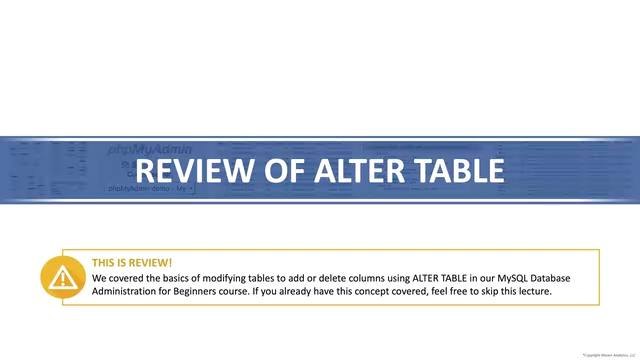
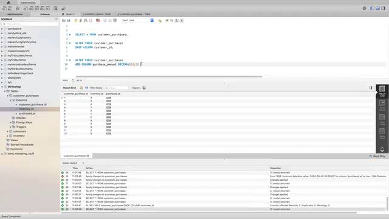
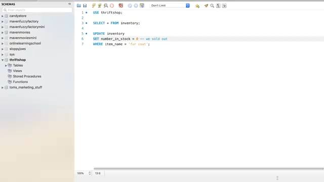
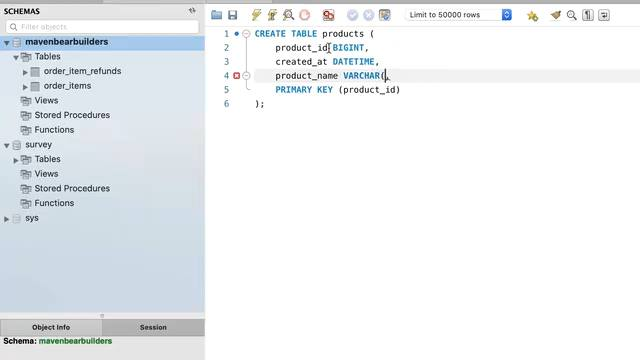
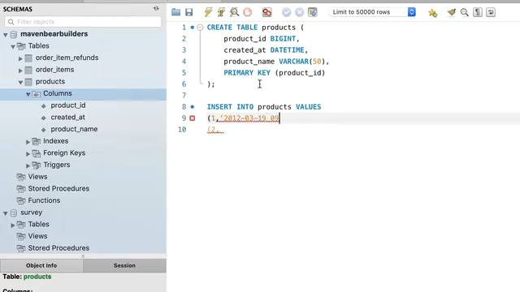
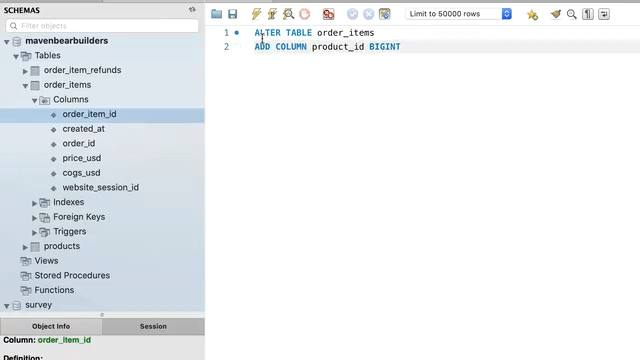
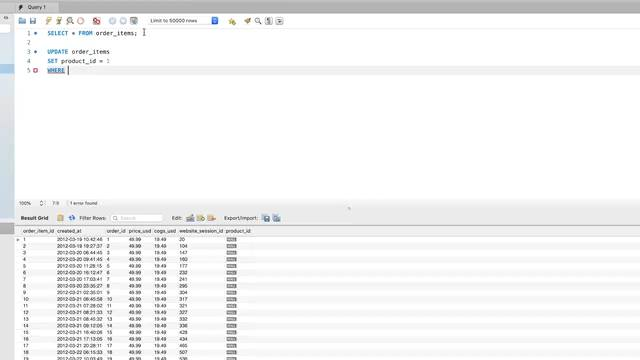
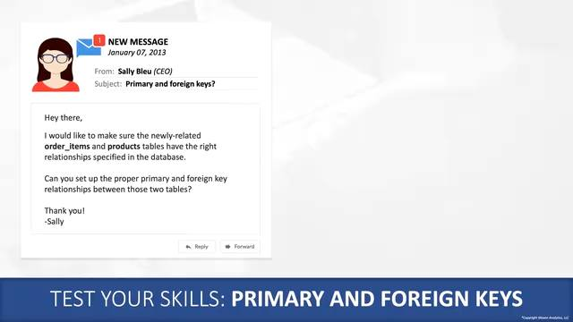

# Advanced MySQL Database Administration · P026–P037 复现文档

> 课程：BV1MAMc6zEcX ｜ 覆盖 P026–P037
> 涉及两个 schema：`thrift_shop`（P028/P029 的复习演示）和 `Maven Bear Builders`（P031–P037 的作业主线）
> 本文所有脚本放在 `mysql-dba-p026-037/sql/`，从第 3 节开始按顺序跑即可得到课程结束时的数据库状态。

---

## 1. 这一节做什么

这一段课（P026–P037）不是零散的知识点，而是**一条完整的「业务变更 → 改数据库」的施工链**，中间夹着两段基础复习和一段被明确标为「自学」的内容。

拆开看是四件事：

**第一件（P026）：LOAD DATA 只讲「它存在」，不讲怎么用。**
讲师把 `LOAD DATA ... INFILE` 定位成 self-study concept：不是本课正式内容、没有作业、不在 Q&A 里答疑。原因是 MySQL 的实现里它默认不开启，要开启得去改配置文件。所以这一段的目标不是「学会」，而是「知道有这条路」——将来真要做大批量、周期性的数据导入，去找工程师，或者去 dev.mysql.com 查参考文档。

**第二件（P027–P030）：三个基本功的复习。**
`ALTER TABLE`（加列 / 删列 / 指定列的物理位置）、`UPDATE`（SET + WHERE，以及 safe update mode 这条红线）、基数与主外键（一对多关系、主键唯一、外键可重复）。讲师自己说这三块在 beginner 课里讲过，这里属于「你熟就跳过，你不熟就看完」。

**第三件（P031–P036）：一条真实的作业链，共 4 个作业 + 4 个解答。**
业务方 Sally 上线第二个产品，数据库要跟着改。四步：
1. 新建 `products` 表，塞两条记录（P031 出题 / P032 解答）
2. 给 `order_items` 加一列 `product_id`，先不管历史数据（P033 出题 / P034 解答）
3. 把 `order_items.product_id` 全部回填成 1（P035 出题 / P036 解答）
4. 给这两张表建立主键→外键关系（P037 只出了题，**解答视频不在本文覆盖范围内**）

**第四件（P037）：外键的意义。**
如果将来有 4 个产品，有人往 `order_items` 里写一个不存在的 `product_id = 5`，主外键关系会直接拦住——这就是数据完整性。

**这一节跑完，你的库里应该有：**

| 对象 | 状态 |
|---|---|
| `thrift_shop.customer_purchases` | 无 `customer_id` 列，多一列 `purchase_amount DECIMAL(10,2)`，位置在 `customer_purchase_id` 之后 |
| `thrift_shop.inventory` | `inventory_id` 1 和 9 的 `number_in_stock` 为 0 |
| `maven_bear_builders.products` | 2 行：`Mr. Fuzzy`、`Forever Love Bear` |
| `maven_bear_builders.order_items` | 多一列 `product_id`，全部为 1 |
| `order_items` → `products` | 外键（P037 的答案，课里没给，本文给的是示意写法） |

**要先说明的一点：** 讲师在 P028 说「still using the same schema that we used in the previous lecture」，也就是说 `thrift_shop` 的建表语句在 P026 之前就已经建好了，**本文覆盖的逐字稿里没有这些表的 `CREATE TABLE`**。为了让读者能真的跑起来，第 4 节的 `00_setup_thrift_shop.sql` 和 `03_setup_maven_bear_builders.sql` 是**我为复现补的最小环境脚本，不是讲师原话**。凡是我补的，后文都会标出来。

---

## 2. 讲师原话

> "LOAD DATA 会作为自学概念，不属于本课程的正式内容。我们不会安排相关作业，也不会在问答论坛中专门解答关于 LOAD DATA 的问题；但我希望大家了解它的存在，因为在实际工作中它可能非常重要。"
> —— p026 [00:00]

> "它并不适合所有人。在 MySQL 实现中，LOAD DATA 默认未启用，启用它还需要使用命令行编辑配置文件。这对我们受众中的许多学生来说技术性太强了。"
> —— p026 [01:49]

> "最好查阅 dev.mysql.com，这是 MySQL 的参考文档。"
> —— p026 [03:40]

> "添加列时，还必须指定其数据类型，并且可以选择在添加列时指定它的位置。位置可以是 FIRST，也可以是 AFTER；使用 AFTER 时，需要写出希望新列排在其后的另一列。如果不指定列的位置，新列会直接出现在列列表末尾。"
> —— p028 [00:53]

> "关于删除列，要记住的一点是：这很危险。我的建议是少用，只有在非常确信自己清楚在做什么，并且非常确信实际环境中所有可能使用该列的流程时，才删除列。"
> —— p028 [05:00]

> "如果不使用 WHERE 子句，更新会作用于表中的每条记录。所以，WHERE 同样是可选的，但实际上几乎每次都会用到。"
> —— p029 [00:56]

> "错误信息说，我们正在使用安全更新模式，并试图在 WHERE 子句未使用键列的情况下更新表。也就是说，之前我们在 WHERE 条件中使用库存 ID 时是可以的，因为那是键列。"
> —— p029 [05:01]

> "主键始终唯一，绝不能重复。……外键不唯一，因此可以重复。"
> —— p030 [02:48]

> "她希望你在数据库中创建一个 products 表。她希望跟踪该产品的上线时间……她还希望你包含产品名称，并为其分配一个 ID，以便之后将其关联到其他表。"
> —— p031 [00:29]

> "在这种情况下，我们可以把 order item ID 用作主键，并直接规定：对每个大于零的值执行更新。"
> —— p036 [01:19]

> "假设将来你有四个产品，产品 ID 为 1 到 4。如果有人试图向订单项表中输入 5 或 6 这样的值，而这是无效 ID，那么由于外键与主键之间的关系，系统会阻止这种情况发生，从而保持数据完整性。"
> —— p037 [00:24]

---

## 3. 从零复现

### 3.0 环境准备

**课里没讲版本号。** 讲师在 P026 只提到两个组件名：`MySQL Workbench` 和 `MySQL Community Server`（p026 [04:06]）。所以你需要装的就是这两个，Community 版即可。

```bash
# 确认客户端可用（macOS/Linux；Windows 上 mysql.exe 在安装目录 bin 下）
mysql --version

# 建工作目录
mkdir -p mysql-dba-p026-037/sql
cd mysql-dba-p026-037
```

两种执行方式任选：
- **命令行**：`mysql -u root -p < sql/00_setup_thrift_shop.sql`
- **Workbench**：`File → Open SQL Script` 打开脚本 → 执行整个脚本（`Ctrl+Shift+Enter`，不同版本快捷键可能不同）

后面每一步我都写命令行版本，Workbench 里操作等价。

> **前端同学注意**：这里所有操作都是「连到数据库、发一条 SQL、看结果」。在 Node 里对应的是 `pool.query('...')`，没有中间层魔法。差异只在**客户端行为**上——第 7 节会讲 safe update mode 为什么只在 Workbench 里拦你。

---

### 3.1 第 0 步：把两张练手表搭起来（P028/P029 的前提）

```bash
mysql -u root -p < sql/00_setup_thrift_shop.sql
```

这一步创建 `thrift_shop` 库、`customer_purchases` 表和 `inventory` 表，并灌入演示数据。`inventory` 表里必须保证 **`inventory_id = 1` 是 `Fur Coat` 且库存 1、`inventory_id = 9` 是 `Pro Wing Sneakers` 且库存 2**——因为 P029 整个演示就是围绕这两行展开的（讲师原话：「we ended up selling out of inventory ID number nine, pro-wing sneakers. We had two, but somebody bought both pairs」）。

验证：

```bash
mysql -u root -p -e "USE thrift_shop; SELECT * FROM inventory;" 
```

你应该看到 `inventory_id` 1 的 `number_in_stock` 是 1，`inventory_id` 9 的 `number_in_stock` 是 2。

---

### 3.2 第 1 步：ALTER TABLE——删列、加列、指定位置（P028）

```bash
mysql -u root -p < sql/01_alter_customer_purchases.sql
```

这一步做四件事，顺序不能反：

1. `SELECT *` 先看现状（Workbench 里讲师也是先 `select star from customer purchases` 让所有人看到 `customer_id` 还在）
2. **删列**：`ALTER TABLE customer_purchases DROP COLUMN customer_id;` —— 业务背景是法务觉得「记录哪个客户买了哪件商品」太敏感
3. **加列并定位**：`ADD COLUMN purchase_amount DECIMAL(10,2) AFTER customer_purchase_id;` —— `10` 是总位数，`2` 是小数位（讲师原话：「10 represents the total number of digits that we can support here. And then 2 represents the number of digits to the right of the decimal place」）
4. **反面演示**：再加一列 `purchase_amount_2` 但**不写位置**，验证它跑到表末尾；然后用 `DROP COLUMN` 收掉





**这一步的关键认知**：`ADD COLUMN` 必须带数据类型，讲师在 Workbench 里把鼠标悬停在语句上时，提示是「statement is incomplete because it wants a data type」（p028 [05:00]）。

---

### 3.3 第 2 步：UPDATE 与 safe update mode（P029）

```bash
mysql -u root -p < sql/02_update_inventory.sql
```

三步：

1. `UPDATE inventory SET number_in_stock = 0 WHERE inventory_id = 9;` —— 用主键，能跑通
2. `UPDATE inventory SET number_in_stock = 0 WHERE inventory_id IN (1, 9);` —— 一次更新两条。讲师对 `IN` 的解释是：「the in here is basically saying where inventory ID equals one or where inventory ID equals nine」（p029 [03:44]）
3. **注释掉的那条**：`UPDATE inventory SET number_in_stock = 0 WHERE item_name = 'Fur Coat';` —— 这条在 Workbench 里会报错。我在文件里用 `--` 注释掉了，你手动取消注释跑一次，亲手撞一次这个错。



Workbench 的 **Action Output / Response** 面板里会出现这段（逐字稿转述为）：

```
You are using safe update mode and tried to update a table
without a where that uses a key column
```

讲师对它的解释非常清楚：`inventory_id` 是主键，值不会重复，所以安全；`item_name` 不是主键，同一个名字可能在多行出现，所以 Workbench 直接拦住。他的建议是「stick to updating using your keys」，而不是去关 safe mode。

> 顺带一个语法点：`--` 后面**必须跟一个空格**才是注释，讲师专门提了：「two dashes followed by a space creates a comment」（p029 [01:50]）。

---

### 3.4 第 3 步：搭作业环境（P031 的前提）

```bash
mysql -u root -p < sql/03_setup_maven_bear_builders.sql
```

创建 `maven_bear_builders` 库和 `order_items` 表（**故意不含 `product_id`**），并灌 5 条订单明细。这样第 4、5 步的 `ALTER`/`UPDATE` 才有意义。

> 课里没有给 `order_items` 的建表语句。逐字稿能确认的只有两点：主键叫 `order_item_id`（P036 提到「use order item ID the primary key」），以及这个表在加列之前**没有** `product_id`（P034 原话：「we don't have a concept of a product ID in this order items table」）。其余列是我补的。

---

### 3.5 第 4 步：建 products 表（P031 出题 → P032 解答）

**建议先自己写一遍再对答案**，讲师的原话是「Give this one a shot on your own, struggle through it if you need to, then come back and watch the solution video」。

```bash
mysql -u root -p < sql/04_create_products.sql
```

三列：`product_id`（BIGINT，主键）、`created_at`（DATETIME）、`product_name`（VARCHAR(50)）。讲师说 50 足够：「we'll use a var car, which could be 50 should be plenty」（p032 [01:27]，`var car` 是 VARCHAR 的口语读法）。



然后是两条 INSERT：产品 1 是原有的 `Mr. Fuzzy`，产品 2 是新上的 `Forever Love Bear`；上架时间用 Sally 给的两个时间点。



验证：

```bash
mysql -u root -p -e "USE maven_bear_builders; SELECT * FROM products;"
```

两行，`product_id` 1 和 2。

> **年份存疑点**：逐字稿里第一个时间是「The 19th of March at nine」，第二个是「The following year, 2013, in January on the 6th at 1300 hours」。既然第二个是 2013，第一个推出来是 2012。但讲师没有逐字念出 2012，所以脚本里写的是 `2012-03-19 09:00:00`；**如果你的截图/作业说明上给的是别的年份，以作业说明为准**，本文只保证列结构和写法正确。

---

### 3.6 第 5 步：给 order_items 加 product_id（P033 出题 → P034 解答）

```bash
mysql -u root -p < sql/05_alter_order_items_add_product_id.sql
```

一条语句：

```sql
ALTER TABLE order_items
ADD COLUMN product_id BIGINT NULL;
```

讲师在 P034 里只演示了 `alter table` + `add column` + 列名，**没有说数据类型**。为了让下一步的外键能建起来，这里用 `BIGINT`，跟 `products.product_id` 一致——**这是复现必需的补充，不是讲师原话**（原因见第 7 节第 1 条）。

他说位置不重要：「We could specify that it's going to come after before a certain column. If we don't specify, it's just going to go on to the end. And that's fine for what we want.」（p034 [00:56]）



作业要求很明确：**不要回填**。「don't worry about backpopulating the data. Just add the column here.」所以这一步跑完，5 行全是 `NULL`。

验证：

```bash
mysql -u root -p -e "USE maven_bear_builders; SELECT * FROM order_items;"
```

`product_id` 列存在，5 行全 `NULL`。

---

### 3.7 第 6 步：回填 product_id（P035 出题 → P036 解答）

```bash
mysql -u root -p < sql/06_update_order_items_backfill.sql
```

业务事实是：**第二个产品还没卖出去过**（讲师：「we haven't actually started selling the second product yet. So every single item in the table will just be product one」）。所以这是一次「更新整张表」的 UPDATE。

难点在于讲师反复强调的规矩——**UPDATE 的 WHERE 里要用主键**，但这次偏偏要更新所有行。他的解法是在 WHERE 里写一个主键上的恒真条件：

```sql
UPDATE order_items
SET product_id = 1
WHERE order_item_id > 0;
```

原文：「we could use order item ID the primary key and we could just say for every value that's greater than zero update it. So this still uses the primary key as I recommend but we're explicitly saying we want every record.」（p036 [01:19]）



验证：

```bash
mysql -u root -p -e "USE maven_bear_builders; SELECT * FROM order_items;"
```

5 行 `product_id` 全为 1。

---

### 3.8 第 7 步：建主外键（P037，课里只出了题）

```bash
mysql -u root -p < sql/07_add_foreign_key.sql
```

**先说明：P037 是一个作业布置视频，解答视频在 P038 之后，不在本文覆盖的逐字稿里。** 讲师只给了题目和方向：

- 目标：让 `order_items.product_id` 和 `products.product_id` 之间建立外键→主键关系
- 目的：数据完整性。将来有 4 个产品，有人写 `product_id = 5` 会被拦住
- 实现方式二选一：代码或 Workbench 的 UI。「you can do this using code or you can do it using the UI」（p037 [00:51]）——**UI 的具体菜单路径课里没讲**

我给的脚本是标准写法，**标注为示意，不是讲师原话**：

```sql
ALTER TABLE order_items
  ADD CONSTRAINT fk_order_items_products
  FOREIGN KEY (product_id) REFERENCES products (product_id);
```

跑完验证：

```bash
mysql -u root -p -e "USE maven_bear_builders; SHOW CREATE TABLE order_items\G"
```

输出里应该能看到 `CONSTRAINT \`fk_order_items_products\` FOREIGN KEY (\`product_id\`) REFERENCES \`products\` (\`product_id\`)`。

（题外话：这里就是 P030 讲的一对多——一个 `products` 行，对应多个 `order_items` 行。）

---

## 4. 完整代码

目录结构：

```
mysql-dba-p026-037/
├── README.md
└── sql/
    ├── 00_setup_thrift_shop.sql
    ├── 01_alter_customer_purchases.sql
    ├── 02_update_inventory.sql
    ├── 03_setup_maven_bear_builders.sql
    ├── 04_create_products.sql
    ├── 05_alter_order_items_add_product_id.sql
    ├── 06_update_order_items_backfill.sql
    └── 07_add_foreign_key.sql
```

### `sql/00_setup_thrift_shop.sql`

> 课里没给建表语句，以下是复现补全。由逐字稿可确认的列：`customer_purchases.customer_purchase_id`、`customer_purchases.customer_id`、`inventory.inventory_id`、`inventory.item_name`、`inventory.number_in_stock`、`inventory.film_id`、`inventory.address_id`。

```sql
-- 文件: sql/00_setup_thrift_shop.sql
-- 用途: 复现 P028 / P029 演示所需的最小环境（讲师未提供建表语句，此处为补全）
-- 跑法: mysql -u root -p < sql/00_setup_thrift_shop.sql

DROP DATABASE IF EXISTS thrift_shop;
CREATE DATABASE thrift_shop DEFAULT CHARACTER SET utf8mb4;
USE thrift_shop;

-- ---------- P028 用的表 ----------
CREATE TABLE customer_purchases (
  customer_purchase_id BIGINT       NOT NULL AUTO_INCREMENT,
  customer_id          BIGINT       NOT NULL,
  item_name            VARCHAR(80)  NOT NULL,
  quantity             INT          NOT NULL DEFAULT 1,
  PRIMARY KEY (customer_purchase_id)
) ENGINE=InnoDB;

INSERT INTO customer_purchases (customer_id, item_name, quantity) VALUES
  (101, 'Pro Wing Sneakers', 1),
  (102, 'Fur Coat',          1),
  (101, 'Wool Scarf',        2),
  (103, 'Leather Belt',      1);

-- ---------- P029 / P030 用的表 ----------
-- inventory_id = 1  必须是 Fur Coat，number_in_stock = 1
-- inventory_id = 9  必须是 Pro Wing Sneakers，number_in_stock = 2
CREATE TABLE inventory (
  inventory_id    BIGINT      NOT NULL AUTO_INCREMENT,
  film_id         BIGINT      NOT NULL,
  address_id      BIGINT      NOT NULL,
  item_name       VARCHAR(80) NOT NULL,
  number_in_stock INT         NOT NULL DEFAULT 0,
  PRIMARY KEY (inventory_id)
) ENGINE=InnoDB;

INSERT INTO inventory (inventory_id, film_id, address_id, item_name, number_in_stock) VALUES
  (1, 1, 1, 'Fur Coat',          1),
  (2, 1, 2, 'Wool Scarf',        3),
  (3, 1, 1, 'Leather Gloves',    4),
  (4, 1, 2, 'Rain Boots',        6),
  (5, 1, 1, 'Knit Hat',          5),
  (6, 1, 2, 'Denim Jacket',      2),
  (7, 1, 1, 'Silk Tie',          7),
  (8, 1, 2, 'Canvas Tote',       3),
  (9, 9, 1, 'Pro Wing Sneakers', 2);
```

### `sql/01_alter_customer_purchases.sql`

```sql
-- 文件: sql/01_alter_customer_purchases.sql
-- 对应: P028（ALTER TABLE 加列 / 删列 / 指定位置）
-- 跑法: mysql -u root -p < sql/01_alter_customer_purchases.sql

USE thrift_shop;

-- 1) 先看现状：此时 customer_id 还在
SELECT * FROM customer_purchases;

-- 2) 法务要求：删掉 customer_id
ALTER TABLE customer_purchases
DROP COLUMN customer_id;

SELECT * FROM customer_purchases;

-- 3) 加一列金额，DECIMAL(10,2)，放在 customer_purchase_id 之后
ALTER TABLE customer_purchases
ADD COLUMN purchase_amount DECIMAL(10,2) AFTER customer_purchase_id;

SELECT * FROM customer_purchases;

-- 4) 反面演示：不写位置，列默认追加到末尾
ALTER TABLE customer_purchases
ADD COLUMN purchase_amount_2 DECIMAL(10,2);

SELECT * FROM customer_purchases;

-- 5) 收拾干净
ALTER TABLE customer_purchases
DROP COLUMN purchase_amount_2;

SELECT * FROM customer_purchases;
```

### `sql/02_update_inventory.sql`

```sql
-- 文件: sql/02_update_inventory.sql
-- 对应: P029（UPDATE / WHERE / IN / safe update mode）
-- 跑法: mysql -u root -p < sql/02_update_inventory.sql

USE thrift_shop;

SELECT * FROM inventory;

-- 1) 卖出最后一双 Pro Wing Sneakers（inventory_id = 9），库存归零
UPDATE inventory
SET number_in_stock = 0   -- 卖断货了
WHERE inventory_id = 9;

SELECT * FROM inventory;

-- 2) 同一位客户把 Fur Coat（inventory_id = 1）也买走了，用 IN 一次更新两条
UPDATE inventory
SET number_in_stock = 0
WHERE inventory_id IN (1, 9);

SELECT * FROM inventory;

-- 3) 反面教材：下面这条在 Workbench 里会触发 safe update mode 报错
--    手动取消注释，在 Workbench 里单独跑一次，看 Action Output 面板
-- UPDATE inventory SET number_in_stock = 0 WHERE item_name = 'Fur Coat';
```

### `sql/03_setup_maven_bear_builders.sql`

> 课里没给 `order_items` 建表语句，以下是复现补全。可确认的只有：主键 `order_item_id`、加列前没有 `product_id`。

```sql
-- 文件: sql/03_setup_maven_bear_builders.sql
-- 用途: 复现 P031–P037 作业链所需的最小环境（讲师未提供建表语句，此处为补全）
-- 跑法: mysql -u root -p < sql/03_setup_maven_bear_builders.sql

CREATE DATABASE IF NOT EXISTS maven_bear_builders DEFAULT CHARACTER SET utf8mb4;
USE maven_bear_builders;

DROP TABLE IF EXISTS order_items;

-- 注意：这里故意不含 product_id，留给 05 号脚本去加
CREATE TABLE order_items (
  order_item_id BIGINT NOT NULL AUTO_INCREMENT,
  order_id      BIGINT NOT NULL,
  item_name     VARCHAR(80) NOT NULL,
  quantity      INT NOT NULL DEFAULT 1,
  PRIMARY KEY (order_item_id)
) ENGINE=InnoDB;

INSERT INTO order_items (order_id, item_name, quantity) VALUES
  (1001, 'Mr. Fuzzy', 1),
  (1001, 'Mr. Fuzzy', 2),
  (1002, 'Mr. Fuzzy', 1),
  (1003, 'Mr. Fuzzy', 1),
  (1003, 'Mr. Fuzzy', 1);
```

### `sql/04_create_products.sql`

```sql
-- 文件: sql/04_create_products.sql
-- 对应: P031（作业）/ P032（解答）—— 建 products 表 + 两条记录
-- 跑法: mysql -u root -p < sql/04_create_products.sql

USE maven_bear_builders;

-- 重跑保护：如果已经建过外键，先看 07 号脚本末尾的“回滚提示”
DROP TABLE IF EXISTS products;

CREATE TABLE products (
  product_id   BIGINT      NOT NULL,
  created_at   DATETIME    NOT NULL,
  product_name VARCHAR(50) NOT NULL,
  PRIMARY KEY (product_id)
) ENGINE=InnoDB;

INSERT INTO products (product_id, created_at, product_name) VALUES
  (1, '2012-03-19 09:00:00', 'Mr. Fuzzy'),
  (2, '2013-01-06 13:00:00', 'Forever Love Bear');

SELECT * FROM products;
```

### `sql/05_alter_order_items_add_product_id.sql`

```sql
-- 文件: sql/05_alter_order_items_add_product_id.sql
-- 对应: P033（作业）/ P034（解答）—— 加列，不回填
-- 跑法: mysql -u root -p < sql/05_alter_order_items_add_product_id.sql

USE maven_bear_builders;

-- 注意：讲师在 P034 未说明数据类型；此处用 BIGINT 是为了与 products.product_id 保持一致，
-- 以便 07 号脚本能加外键（这是复现必需的补充，不是讲师原话）
ALTER TABLE order_items
ADD COLUMN product_id BIGINT NULL;

SELECT * FROM order_items;   -- 新增列的值全为 NULL
```

### `sql/06_update_order_items_backfill.sql`

```sql
-- 文件: sql/06_update_order_items_backfill.sql
-- 对应: P035（作业）/ P036（解答）—— 回填 product_id = 1
-- 跑法: mysql -u root -p < sql/06_update_order_items_backfill.sql

USE maven_bear_builders;

SELECT * FROM order_items;   -- 回填前：product_id 全 NULL

-- 回填整表：WHERE 仍然使用主键，但条件是恒真的
UPDATE order_items
SET product_id = 1
WHERE order_item_id > 0;

SELECT * FROM order_items;   -- 回填后：product_id 全为 1
```

### `sql/07_add_foreign_key.sql`

```sql
-- 文件: sql/07_add_foreign_key.sql
-- 对应: P037（只有题目，解答视频不在 P026–P037 范围内）
-- ⚠️ 以下外键写法是我的示意实现，不是讲师原话。
-- 跑法: mysql -u root -p < sql/07_add_foreign_key.sql

USE maven_bear_builders;

-- MySQL 会为外键列自动建立索引（如果还没有的话）
ALTER TABLE order_items
  ADD CONSTRAINT fk_order_items_products
  FOREIGN KEY (product_id) REFERENCES products (product_id);

-- 验证（两种都行）
SHOW CREATE TABLE order_items\G
-- 或：SELECT * FROM information_schema.KEY_COLUMN_USAGE
--     WHERE TABLE_SCHEMA='maven_bear_builders' AND TABLE_NAME='order_items';

-- ---------- 重跑 04 号脚本前，先解除外键 ----------
-- ALTER TABLE order_items DROP FOREIGN KEY fk_order_items_products;
```

### `README.md`

```markdown
# MySQL DBA P026–P037 复现

## 环境
- MySQL Community Server（课里未指定版本）
- MySQL Workbench

## 一次跑通
```bash
mysql -u root -p < sql/00_setup_thrift_shop.sql
mysql -u root -p < sql/01_alter_customer_purchases.sql
mysql -u root -p < sql/02_update_inventory.sql
mysql -u root -p < sql/03_setup_maven_bear_builders.sql
mysql -u root -p < sql/04_create_products.sql
mysql -u root -p < sql/05_alter_order_items_add_product_id.sql
mysql -u root -p < sql/06_update_order_items_backfill.sql
mysql -u root -p < sql/07_add_foreign_key.sql
```

## 重跑顺序
07 跑过之后再跑 04 会因外键失败，先执行：
`ALTER TABLE order_items DROP FOREIGN KEY fk_order_items_products;`
```

---

## 5. 逐行解释

### `00_setup_thrift_shop.sql`

- `DEFAULT CHARACTER SET utf8mb4`：**课里没讲字符集**。我加是因为商品名里有中文/emoji 的可能，纯英文场景下用默认也行。
- `customer_purchases` 只保留 `customer_purchase_id / customer_id / item_name / quantity` 四列。为什么只有这四列：P028 的演示只用到「`customer_id` 要被删」和「`customer_purchase_id` 作为加列的锚点」，其他列在逐字稿里没出现过，补多了反而误导。
- `inventory` 里 `film_id` 和 `address_id` 是 P030 讲一对多时明确提到的两列（「we have a foreign key of film ID」「we have another foreign key here in the inventory table, which is the address ID」），所以必须带上——不然你没法验证「一条 film 记录对应多条 inventory 记录」这个结论。
- 前 8 行的 `film_id` 全填 1、`address_id` 在 1 和 2 之间交替，这是照着 P030 的描述还原的：「film ID of one is shown here eight times as inventory items one through eight」「some of those are at address ID one and some are at address ID two」。
- `(9, 9, 1, 'Pro Wing Sneakers', 2)`：这一行是 P029 的主角，`number_in_stock = 2` 必须是 2，否则「卖了 2 双变 0」的演示不成立。

### `01_alter_customer_purchases.sql`

- `DROP COLUMN customer_id`：这就是 P028 里法务提需求的落地。**注意风险**——讲师专门用一整段警告：「dropping columns is it's dangerous. I would say use it sparingly」。在真实项目里，删列之前你要确认没有代码、没有报表、没有定时任务还在读这一列。
- `ADD COLUMN purchase_amount DECIMAL(10,2)`：
  - `DECIMAL` 而不是 `FLOAT`，因为这是钱。讲师原话：「This is a pretty common data type used for monetary values」。浮点数存钱会出现 `0.1 + 0.2 ≠ 0.3` 这类精度问题——这条讲师没展开，但这是他选 DECIMAL 的潜台词。
  - `10` 是总位数，`2` 是小数位，所以整数部分最多 8 位。讲师强调「obviously this number can never be larger than this number」。
- `AFTER customer_purchase_id`：控制物理列序。这纯粹是给人看的（`SELECT *` 时的列顺序），不影响性能。
- 第 4 步不写位置，验证「默认追加到末尾」。讲师的原话是「the default position is at the end of the list」。
- 最后 `DROP COLUMN purchase_amount_2`：把演示痕迹清掉，让表回到「目标状态」。

### `02_update_inventory.sql`

- `SET number_in_stock = 0 -- 卖断货了`：注释位置很关键——`--` 后面必须有一个空格。讲师在 P029 专门讲了这一点，因为 SQL 里注释写错会直接把后半行当成语法错误。
- `WHERE inventory_id = 9`：用主键。这不是风格问题，是 safe update mode 的硬性要求。
- `WHERE inventory_id IN (1, 9)`：等价于 `= 1 OR = 9`。讲师明确解释过这个等价关系。
- 第 3 条注释掉的语句：`WHERE item_name = 'Fur Coat'`。留着的目的是让你**亲手撞一次错**——报错信息才是这段课最有价值的东西。注意：这条语句 `SET` 的是 `0`，而 `Fur Coat` 当前的库存已经是 `0`，所以就算你关掉 safe mode 跑通了，数据也不会有可见变化。讲师用的是 `WHERE item_name = 'for coat'` 这个例子来说明「会被拦」，不是来说明「数据会变」。

### `03_setup_maven_bear_builders.sql`

- `DROP TABLE IF EXISTS order_items`
（接上）——**为什么要 drop**：如果你反复跑这份脚本（比如某条语句失败想重来），`CREATE TABLE` 会因为表已存在而报错，`DROP TABLE IF EXISTS` 就是用来兜底的。注意它只删 `order_items`，不动 `products`，因为这两张表在第 3 步这个时间点上还没有任何关系。

- **`product_id` 故意不建**：这是整条作业链的锚。P034 讲师说得很直白——「up until this point for the business there's only been one product so it's been very easy to track. So we don't have a concept of a product ID in this order items table」。所以如果你的 `order_items` 在建表时就带了 `product_id`，第 5 步（P033 的作业）就不成立了。
- **`order_id` 出现重复值 1001 / 1001 / 1002 / 1003 / 1003**：这是刻意造的「一个订单含多条明细」的结构，用来对应 P030 讲的一对多——一个订单对应多条 `order_items`。这也是为什么第 6 步回填时「更新整张表」在业务上说得通：所有历史销售记录都属于产品 1。
- **`ENGINE=InnoDB`**：讲师**没有**讲过存储引擎（逐字稿里完全没出现 engine 相关词）。我显式写 `InnoDB` 是因为第 7 步要加外键，而外键依赖支持它的引擎；如果你的 MySQL 版本默认引擎不是 InnoDB，不写这一句可能到第 7 步才炸。这条属于「复现必需但不是讲师原话」。
- **`item_name VARCHAR(80)`**：和 `00` 号脚本保持一致的宽度，避免两处设成不同宽度造成困惑。课里没有对 `order_items` 任何列宽做过说明。

### `04_create_products.sql`

- **`DROP TABLE IF EXISTS products` 放在最前面**：重跑保护。但要注意副作用——如果你已经跑过 `07_add_foreign_key.sql`，`order_items` 有外键指向 `products`，这一句会失败。正确顺序是先 `DROP FOREIGN KEY` 再跑，`README.md` 和 `07` 号脚本末尾都写了这条回滚命令。
- **`product_id BIGINT NOT NULL`（不写 AUTO_INCREMENT）**：因为 P032 的 `INSERT` 里是**显式给出** `product_id` 1 和 2 的。讲师原话：「One will have a product ID of one. Second will have a product ID of two.」如果这里加 `AUTO_INCREMENT`，显式插入也照样能跑，但两张表的语义就对不上了——`products` 的 ID 是「业务分配的」，不是「数据库自增的」。这一点讲师没有正面讨论，是我根据他的 `INSERT` 写法反推的。
- **`NOT NULL` 不写在 `product_name` 之外的列上？** 实际上我给三列都写了 `NOT NULL`。理由：主键天然 `NOT NULL`；上架时间不知道就没有意义；产品名不可能为空。课里没有讨论过 `NULL` 约束。
- **`created_at DATETIME`**：讲师在 P032 明确说「Date time for the created at timestamps」——他念的是 `Date time`，也就是 `DATETIME` 而不是 `TIMESTAMP`。这两个类型的行为差别（时区、范围）讲师没讲。
- **`VARCHAR(50)`**：讲师的判断是「which could be 50 should be plenty」。注意这是**字符数**上限不是字节数。
- **年份 `2012`**：见第 3.5 节的存疑说明。逐字稿只念了「The following year, 2013」，第一个时间点的年份是靠「前一年」推出来的，而讲师没有把这个推算结果念出来。如果你的作业说明上写的是别的年份，改这两行字面量即可，不影响任何结构。
- **`SELECT * FROM products` 收尾**：复现 P032 视频里最后一步动作——他要亲眼看到两行记录才宣布作业完成。

### `05_alter_order_items_add_product_id.sql`

- **`BIGINT`**：这是复现链条上最需要说清楚的一处**补全**。讲师在 P034 的演示里只说了「add column」和列名，**没有提数据类型**。我选 `BIGINT` 的唯一理由是要和 `04` 里的 `products.product_id BIGINT` 严格一致——因为第 7 步的外键要求两边的类型、符号属性完全匹配，不一致会在建外键时报错。如果你的 `products.product_id` 用了 `INT`，这里也必须跟着用 `INT`。
- **`NULL` 必须显式允许**：这张表已经有 5 行数据了。如果写成 `ADD COLUMN product_id BIGINT NOT NULL`，MySQL 会因为「无法为已有行填入合法默认值」而拒绝（在没有 `DEFAULT` 的情况下）。讲师在 P033 说得很明确：「all of the values are just going to be null. Like I said, don't worry about backpopulating it.」所以 `NULL` 不是随手写的，是这个作业的前提。
- **不写 `AFTER`**：讲师在 P034 专门解释了为什么这次不写——「If we don't specify, it's just going to go on to the end. And that's fine for what we want.」这和 P028 那个「加在 `customer_purchase_id` 之后」的例子正好形成对照：位置由需求决定，没有需求就别多写。
- **最后那条 `SELECT *`**：用来确认「列在、值是 `NULL`」。讲师在 P034 就是用这个动作收尾的。

### `06_update_order_items_backfill.sql`

- **`SET product_id = 1`**：`1` 不是魔法数字，它对应 `products` 表里的 `Mr. Fuzzy`。讲师说明了业务前提：第二个产品「Forever Love Bear」**还没开始卖**，所以历史数据 100% 属于产品 1。
- **`WHERE order_item_id > 0`**：这条是整个 P036 的精华。它满足两个看似矛盾的要求——既「更新所有行」，又「WHERE 里用了主键」。因为 `order_item_id` 是自增主键，实际值从 1 开始，所以 `> 0` 恒为真。讲师的原话：「This is an interesting case where we actually are trying to update every single record... what we could do is use order item ID the primary key and we could just say for every value that's greater than zero update it.」
- **为什么不用 `WHERE product_id IS NULL`**：它确实也能精确命中这 5 行，而且语义更好。但讲师选的是主键方案，所以脚本照他的写。这个替代写法**课里没讲**，不要在作业里当标准答案用。
- **两条 `SELECT *` 夹着 `UPDATE`**：复现视频里的「改前看一眼、改后看一眼」。这是全文最值得养成的习惯——UPDATE/DELETE 前后各跑一次 SELECT，比事后猜发生了什么强得多。
- **注意：这条语句在 Workbench 里能通过 safe update mode**，因为它命中了主键列。这正是讲师想让你看到的：同一个客户端，`WHERE item_name = ...` 被拦，`WHERE order_item_id > 0` 放行。

### `07_add_foreign_key.sql`

**先重复一遍：这一整段是示意实现。** P037 是作业布置视频，解答视频不在 P026–P037 范围内，所以下面每一句的责任在我，不在讲师。

- **`ADD CONSTRAINT fk_order_items_products`**：给约束起名字。不起名字 MySQL 会自动生成一个，但自动生成的名字你事后想 `DROP FOREIGN KEY` 时得先去查，很麻烦。`fk_子表_父表` 是常见命名习惯——**课里没讲命名规范**。
- **`FOREIGN KEY (product_id) REFERENCES products (product_id)`**：左边是本表的列，右边是父表的列。语义是「`order_items.product_id` 里出现的任何非 NULL 值，都必须在 `products.product_id` 里存在」。这正是 P037 描述的那个护栏：将来只有 1–4 号产品时，写 `5` 或 `6` 会被拒绝。
- **`SHOW CREATE TABLE order_items\G`**：`\G` 是 MySQL 客户端的结束符变体，作用是「把结果按行竖排」。不加的话，建表语句那一长行会横向滚到屏幕外，很难核对。**课里没讲 `\G`**。如果 `\G` 在你的客户端里不认，去掉它改用分号，输出里同样能看到 `CONSTRAINT` 那一段，只是排版难读一些。
- **末尾注释掉的 `DROP FOREIGN KEY`**：重跑 `04` 之前必须先执行它。这不是纪律，是硬约束——只要外键还在，`DROP TABLE products` 就会被拒绝。
- **我没有加 `ON DELETE` / `ON UPDATE` 子句**：默认行为是 `RESTRICT`（父表被引用的行不允许删改）。讲师**没有**讨论过级联行为，所以我不替他做决定。真要选，先想清楚「删掉一个产品，历史订单明细该不该跟着消失」——通常答案是「不该」。

---

## 6. 复现检查清单

按顺序跑完 8 个脚本后，逐条对照。全部 ✅ 才算真的复现成功。

### 环境层

| # | 检查项 | 怎么查 | 期望 |
|---|---|---|---|
| 1 | 客户端能连上 | `mysql -u root -p -e "SELECT VERSION();"` | 返回版本号，无报错 |
| 2 | 两个库都在 | `SHOW DATABASES;` | 列表里有 `thrift_shop` 和 `maven_bear_builders` |
| 3 | 脚本文件齐全 | `ls sql/` | 8 个 `.sql` 文件 |

### thrift_shop（P028 / P029 / P030）

| # | 检查项 | 验证语句 | 期望 |
|---|---|---|---|
| 4 | `customer_id` 已删 | `DESC thrift_shop.customer_purchases;` | 列清单里**没有** `customer_id` |
| 5 | `purchase_amount` 在主键之后 | 同上，或 `SELECT *` 看列序 | `purchase_amount` 紧跟在 `customer_purchase_id` 后面，类型 `decimal(10,2)` |
| 6 | 临时列已清理 | `DESC thrift_shop.customer_purchases;` | **没有** `purchase_amount_2` |
| 7 | 第 9 行库存归零 | `SELECT number_in_stock FROM thrift_shop.inventory WHERE inventory_id = 9;` | `0` |
| 8 | 第 1 行库存归零 | `SELECT number_in_stock FROM thrift_shop.inventory WHERE inventory_id = 1;` | `0` |
| 9 | safe mode 报错撞过 | 取消注释 `02` 号脚本第 3 条语句，在 Workbench 里跑 | Action Output / Response 出现 safe update mode 错误（文案以实际输出为准） |
| 10 | 一对多结构可观察 | `SELECT film_id, COUNT(*) FROM thrift_shop.inventory GROUP BY film_id;` | `film_id = 1` 有 8 行，`film_id = 9` 有 1 行 |

第 10 条对应 P030 讲的一对多。如果你想更直观地看「一个 `address_id` 对应多条 inventory 记录」：

```sql
SELECT address_id, COUNT(*) AS item_count
FROM thrift_shop.inventory
GROUP BY address_id;
```

两个 `address_id` 各有若干行——这正是讲师说的「address ID could occur many times in the inventory table」。

### maven_bear_builders（P031–P037）

| # | 检查项 | 验证语句 | 期望 |
|---|---|---|---|
| 11 | `products` 存在且 2 行 | `SELECT * FROM maven_bear_builders.products;` | 2 行，`product_id` 为 1 和 2 |
| 12 | 产品名正确 | 同上 | `Mr. Fuzzy`、`Forever Love Bear` |
| 13 | 上架时间是 DATETIME | `DESC maven_bear_builders.products;` | `created_at` 的 Type 是 `datetime` |
| 14 | 产品名列宽 50 | 同上 | `product_name` 的 Type 是 `varchar(50)` |
| 15 | `product_id` 列已加到 order_items | `DESC maven_bear_builders.order_items;` | 有 `product_id` 列 |
| 16 | 回填完成 | `SELECT DISTINCT product_id FROM maven_bear_builders.order_items;` | 只有一行结果：`1` |
| 17 | 没有漏掉的行 | `SELECT COUNT(*) FROM maven_bear_builders.order_items WHERE product_id IS NULL;` | `0` |
| 18 | 外键已建立 | `SHOW CREATE TABLE maven_bear_builders.order_items\G` | 输出里含 `FOREIGN KEY (\`product_id\`) REFERENCES \`products\` (\`product_id\`)` |

第 18 条如果看不到 `CONSTRAINT` 段，说明 `07` 号脚本没跑成功——往下看第 7 节。

### 护栏是否真的生效（P037 的核心目的）

跑完外键后，**故意违规一次**，看数据库拦不拦：

```sql
INSERT INTO maven_bear_builders.order_items (order_id, item_name, quantity, product_id)
VALUES (9999, 'Ghost Product', 1, 5);
```

期望：报外键约束错误，插入失败。报错里的字段名与文案**以你本地实际输出为准**，本文不替你写死。

然后确认库里干净：

```sql
SELECT * FROM maven_bear_builders.order_items WHERE product_id = 5;
```

期望：0 行。这就是讲师说的「you'll preserve the integrity of your data」。

### 清理与重跑

| # | 检查项 | 命令 |
|---|---|---|
| 19 | 能回滚外键 | `ALTER TABLE maven_bear_builders.order_items DROP FOREIGN KEY fk_order_items_products;` |
| 20 | 能整体重来 | 从 `00` 号脚本重新按序跑一遍，第 4–18 条应全部再次通过 |

第 20 条是真检验：如果重跑时某一步报错，说明你的脚本顺序有隐式依赖没处理干净。



---

## 7. 课里没讲但你会撞上的

这一节全部是**我补充的实战提醒**，不是讲师原话。逐条标注了「为什么课程没覆盖」。

### 7.1 `product_id` 的类型和父表不一致，外键建不上

**症状**：第 7 步报类似「Foreign key constraint is incorrectly formed」的错误。

**原因**：MySQL 要求外键列和被引用列的类型完全一致——`BIGINT` 对 `BIGINT`、`INT` 对 `INT`、`UNSIGNED` 也必须两边都有或都没有。而 P034 讲师**没有说明** `product_id` 用什么类型，P032 也没细说 `products.product_id` 的类型（只听得出用 `big int` 存整数）。两边靠自己拍板，很容易一个 `INT` 一个 `BIGINT`。

**怎么排**：

```sql
SHOW CREATE TABLE maven_bear_builders.products;
SHOW CREATE TABLE maven_bear_builders.order_items;
```

把两张表里对应列的类型逐字符对比。

### 7.2 safe update mode 只在 Workbench 里拦你

**症状**：你在 Workbench 里跑 `WHERE item_name = ...` 被拒，但用命令行 `mysql < file.sql` 一切正常。

**原因**：讲师在 P029 描述的是「we're using safe update mode」，说的是他当前用的客户端。这个开关是 MySQL Workbench 的选项。**课里没有讨论过命令行是否受此限制**，也没说怎么关（讲师的态度反而是「别关，就用主键」）。

**建议**：本文脚本走命令行时不会有这个拦截，所以请**至少用 Workbench 手动跑一次**第 3.3 节那条注释掉的语句，把这个错误亲眼看到。只跑命令行会漏掉这段课最重要的体感。

> **在 JS/Node 里对应什么**：`mysql2` / `knex` 这类驱动没有 safe update mode，你写什么它发什么。所以「WHERE 必须带主键」在 Node 侧只能靠代码规范、code review 或 ORM 的校验来保证——数据库不会替你兜底。

### 7.3 `DROP COLUMN` 会连带炸掉外键、视图和代码

**症状**：`ALTER TABLE ... DROP COLUMN` 报「Cannot drop column needed in a foreign key constraint」。

**原因**：讲师在 P028 说删列「it's dangerous」时，讲的是**业务风险**（有没有别的流程在读这列）。但还有一层**结构风险**他没展开：如果这一列被外键引用、被视图引用、被索引覆盖，MySQL 会直接拒绝。

**操作顺序**：
1. 先查有没有外键引用它（`information_schema.KEY_COLUMN_USAGE`）
2. 先摘掉依赖（外键、视图）
3. 再删列
4. 删前先备份：`CREATE TABLE xxx_backup AS SELECT * FROM xxx;`

### 7.4 大表上 `ALTER TABLE` 会锁表

**症状**：在几十万行的表上跑 `ADD COLUMN`，语句卡住，同时线上写入全部阻塞。

**原因**：讲师演示的都是几行数据的玩具表，所以 DDL 瞬间完成。真实表上 `ALTER TABLE` 的代价他**完全没讲**——这不是他的疏漏，是课程定位（DBA 入门）不涉及。

**规避**：优先找线上低峰期执行；确认你的 MySQL 版本是否支持在线 DDL；大表加列避免写 `AFTER`（某些情况下重排物理列序代价更高）。

### 7.5 全表 UPDATE 在真实数据量下要分批

**症状**：`UPDATE order_items SET product_id = 1 WHERE order_item_id > 0;` 在生产表上跑了几十分钟，从库延迟暴涨。

**原因**：P036 的解法在 5 行数据上完美，但语义是「更新整表」。真实场景动辄百万行，一条 UPDATE 会长时间持锁、写巨大的 binlog。

**分批写法**（课里没讲）：

```sql
UPDATE order_items
SET product_id = 1
WHERE order_item_id > 0
  AND order_item_id <= 10000;
-- 下一批：10000 < order_item_id <= 20000，依此类推
```

每批之间睡一会儿，别把数据库打满。

### 7.6 `products` 建表时没加 `UNIQUE`，将来会有人插重复 ID

**症状**：`INSERT INTO products` 两次 `product_id = 1`，第二次被拒。

**原因**：这其实是好事——`product_id` 是主键，主键天然唯一。但如果你将来在别的表上忘了加主键，就会发现重复数据。讲师在 P030 反复强调「your primary keys are always going to be unique. They can never repeat」，这句话的落地就是「建表时把主键写上」，没有别的机制保证。

### 7.7 显式插 `product_id = 1, 2` 之后，自增计数器不会自动对齐

**说明**：本文的 `products.product_id` **不是** `AUTO_INCREMENT`，所以这条不适用于当前脚本。但如果你的作业版本给它加了 `AUTO_INCREMENT` 又手动插入了 `1` 和 `2`，下一条自增记录会是 `3`（MySQL 会自动调整），但如果你手动插的是 `100`，计数器会跳到 `101` 之后的区间——容易和预期不符。**课里没讲自增与显式插入的交互**，这里只是提醒你去查一下 `SHOW CREATE TABLE` 里 `AUTO_INCREMENT=` 的实际值。

### 7.8 Workbench 里忘记选默认 schema

**症状**：在 Workbench 里跑 `SELECT * FROM products;` 报「No database selected」。

**原因**：讲师在 P032 顺口提过一句：「I've already got Maven Bear Builders as the default schema. So I'm going to skip over the use statement. If you haven't selected this as the default schema, you'll probably want to do that.」这句话音量不大，但如果你没做，**每一条语句都会失败**。做法：左侧 Schemas 面板里双击 `maven_bear_builders`，让它变成粗体。

本文所有脚本都显式写了 `USE xxx;`，所以走命令行不会踩这个坑——这也说明了为什么脚本里那句 `USE` 不该省。

### 7.9 事务与 autocommit

**说明**：讲师**全程没有讨论**事务。MySQL 默认 `autocommit = 1`，所以本文每条 `UPDATE` / `ALTER` 执行完就落盘，没有「先试试再回滚」的余地。

如果你想要「试一下、不满意就撤回」的安全感：

```sql
START TRANSACTION;
UPDATE order_items SET product_id = 1 WHERE order_item_id > 0;
SELECT * FROM order_items;   -- 确认没问题
-- ROLLBACK;   -- 不满意就撤回
COMMIT;        -- 满意就提交
```

**注意**：`ALTER TABLE` 这类 DDL 在 MySQL 里会隐式提交，包在事务里也回滚不了。所以 7.3 说的「先备份」比「开事务」更可靠。

> **在 JS/Node 里对应什么**：`pool.query()` 默认一条一条自动提交，和命令行一样。要事务得显式 `const conn = await pool.getConnection(); await conn.beginTransaction(); ...`，也就是「借一条连接、手动开、手动提交」。这点和本文的 SQL 脚本行为不同——脚本里你写的就是最终结果。

### 7.10 本章没有讲到的三件事

为避免误解，明确列出**逐字稿 P026–P037 完全没涉及**的内容：

1. **索引**：除了主键和外键隐式创建的索引，讲师没有讲过任何 `CREATE INDEX`、索引选择、执行计划。
2. **备份与恢复**：删列、改表、全表更新都有风险，但课程没有教 `mysqldump` 或任何备份手段。
3. **P037 的解答**：主外键关系的具体做法（含 Workbench UI 的操作路径）在本文覆盖范围之外，本文第 3.8 / 4 / 5 节给的写法是**我的示意实现**，请以你那份作业的解答视频为准。

对着第 6 节的清单跑完 20 条，你应该拥有一个和课程结束状态一致、并且能随时重来的数据库环境。