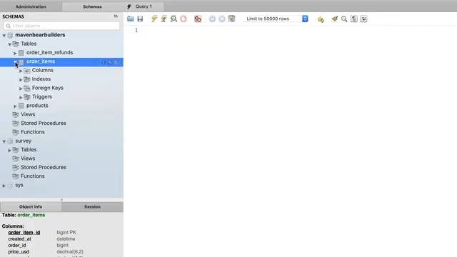
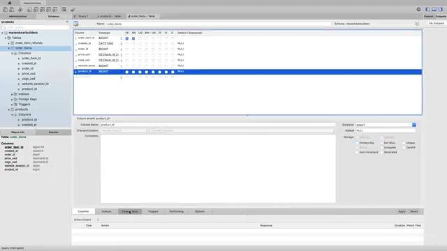
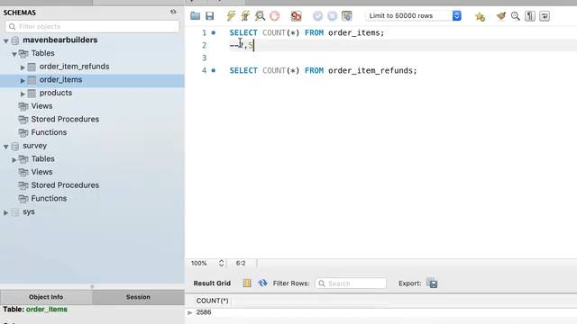
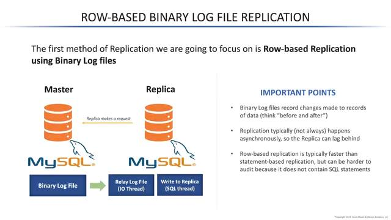
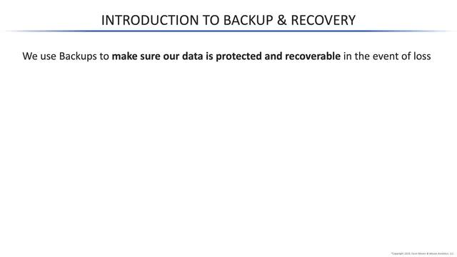
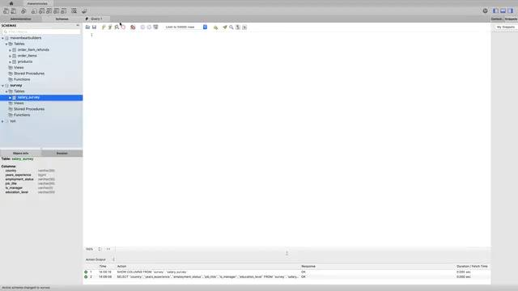
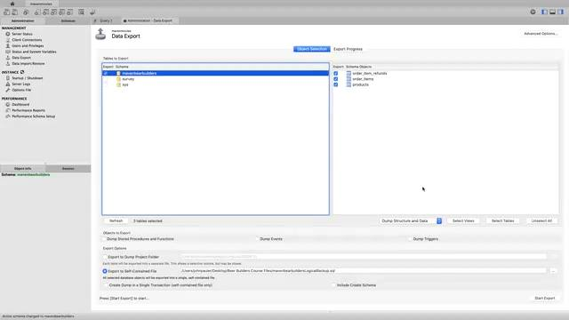

# Advanced MySQL Database Administration（P38–P44）复现文档

> 覆盖内容：外键约束落地 → 2013 Q1 数据导入 → 复制（Replication）方案选型 → 备份与恢复 → Maven Bear Builders 全库逻辑备份。
> 读者定位：前端转 AI 应用工程师。凡是涉及约束/事务/并发的地方，我会补一句在 JS/Node 侧对应什么。

---

## 1. 这一节做什么

这七集不是七个孤立知识点，而是一条**从「表结构补齐」到「数据能救回来」的运维闭环**。你在这一节结束时，手上应该有以下四样可交付物：

| # | 交付物 | 对应集数 | 验收方式 |
|---|---|---|---|
| 1 | `order_items` 表上的外键 `product_id → products.product_id` | P038 | Workbench 的 Foreign Keys 标签页不再为空 |
| 2 | 2013 年 1–3 月的 `order_items` 与 `order_item_refunds` 数据入库 | P039 / P040 | `SELECT COUNT(*)` 得到指定数字 |
| 3 | 一份关于复制/备份/恢复的书面提案（含风险清单） | P041 / P043 | 文档存在，且覆盖「风险 → 缓解措施」 |
| 4 | `maven_bear_builders` 的 `.sql` 逻辑备份文件 | P042 / P044 | 文件里有 3 个 `CREATE TABLE` + 对应 `INSERT INTO` |

顺序很重要，而且**这个顺序本身就是考点**：

```
先补外键（P038）
   ↓  否则 2013 Q1 的 CSV 里那个新出现的 product_id 列无处安放
导入 order_items（P040 前半）
   ↓  必须先导父表数据的引用方，再导子表数据
导入 order_item_refunds（P040 后半）
   ↓
选复制方案（P041：结论是 row-based）
   ↓
做一次全库 mysqldump 逻辑备份（P042 / P044）
```

讲师在 P040 里把第三条讲得很直白：如果你先导 refunds 数据，「your primary key to foreign key relationship will prevent the insert from happening」——外键会直接把插入挡下来。

## 2. 讲师原话

关于外键该放在哪张表，讲师的推导是「一对多，外键放在多的一端」：

> "你可能有一个产品会出现在许多订单中……如果在产品表里保留任何对订单项表的引用，比如放一个订单项编号，那并不合理，因为你不知道该给某个产品填什么值"
> —— p038 [00:55]

关于 P038 的操作路径，讲师给的是 UI 和 SQL 两条等价路线：

> "我们有两种方式可以做这件事。可以用代码来做，也可以在这个界面里做……结果完全一样。"
> —— p038 [02:23]

关于 P040 的记录数验收标准：

> "我们看到导入了 1273 条记录……现在这里有 3859 条记录。所以如果你执行同样的操作，应该会得到相同的记录数。如果记录数不同，说明哪里出错了，你需要逐步回溯检查。"
> —— p040 [01:53]

关于导入顺序的因果：

> "如果你先尝试运行这份退款数据，很可能会遇到问题：主键与外键之间的关系会阻止插入操作发生。"
> —— p040 [02:45]

关于复制的本质：

> "复制是一种机制，它通过创建称为副本的拷贝，让我们可以把相同的数据存储在两台或多台服务器上。"
> —— p041 [00:00]

关于两种复制方式的记录差别：

> "你可以把二进制日志文件理解为记录对数据记录所做更改的文件……记录的是更改前和更改后的快照。"
> —— p041 [02:18]

> "二进制日志文件不像我们使用基于行的复制时那样记录更改前后的快照，而是会实际记录对数据库做出这些更改的 SQL 语句。"
> —— p041 [05:05]

关于最终结论：

> "我们通常建议采用基于行的复制。这里最重要的原因是数据完整性至关重要。"
> —— p041 [10:05]

关于物理备份与逻辑备份的分野：

> "物理备份实际上会导出并存储数据库中的原始数据。另一方面，使用逻辑备份时，你会得到创建和插入语句，这些语句将用于重建数据库。"
> —— p042 [00:29]

关于备份策略要叠加使用：

> "也许你有一个持续更新的生产数据库副本，然后你以 MySQL 转储的形式每晚对它做一次快照。"
> —— p042 [08:54]

## 3. 从零复现

### 3.1 环境准备

课里没讲具体版本号，以下按你本机实际安装走：

- MySQL Server 8.x（Workbench 安装包自带）
- MySQL Workbench（图形客户端，这一节所有操作都在它里面完成）
- 一个已经建好的 `maven_bear_builders` schema，含三张表：`order_items`、`order_item_refunds`、`products`
- 两个 CSV 数据文件（讲师在 P040 里称为「file 6」和「file 7」）：`order_items` 的 2013 年 1–3 月数据、`order_item_refunds` 的 2013 年 1–3 月数据

建议在项目目录下建这个结构，后文所有路径都对得上：

```
maven_bear_builders/
├── data/
│   ├── file6_order_items_2013_q1.csv
│   └── file7_order_item_refunds_2013_q1.csv
├── sql/
│   ├── 01_fk_order_items_product.sql
│   ├── 02_verify.sql
│   └── 03_rollback.sql
└── backup/
    └── maven_bear_builders_logical_backup.sql
```

在 Workbench 里先把 `maven_bear_builders` 设为默认 schema：左侧 SCHEMAS 面板右键该 schema → **Set as Default Schema**。讲师在 P042 里做备份演示前也是这个动作：「let's work with the survey data. So I'll set this as the default schema.」

### 3.2 步骤一：给 `order_items.product_id` 建外键（P038）

**先看清关系，再动手。** 打开 `order_items` 表，确认两件事：主键是 `order_item_id`，另有一个 `product_id` 列。再打开 `products` 表，主键是 `product_id`，而且**没有任何指向 `order_items` 的列**——这是对的，因为一个产品会出现在无数条订单明细里，`products` 表里放一个 `order_item_id` 根本不知道该填哪个值。



确认完关系后，在 `order_items` 表上点开 **Foreign Keys** 标签页。此刻它是空的：



UI 操作路径（讲师选的就是这条路）：

1. 在 Foreign Keys 标签页点 **Click to edit** 那一行的输入框，填外键名。讲师起的名字是 `order_items_product_id`，理由是「table name, column name」这种直觉命名法。你起别的名字也能跑通。
2. **Referenced Table** 选 `products`。
3. 左列（本表列）选 `product_id`。
4. 右列（被引用列）会自动填成 `product_id`。讲师说「It correctly guessed the right column」——如果它没自动填，你手动选 `products.product_id`。
5. 点 **Apply**。这时 Workbench 会弹出它准备执行的 DDL 预览，讲师念出了里面的两段：「it's gonna add an index. And then alter table, add a constraint of a foreign key」。
6. 再点一次 **Apply** 执行，然后 **Close**。

如果你更想用 SQL（讲师明确说两条路等价），直接跑第 4 节的 `01_fk_order_items_product.sql`。跑完回到 Foreign Keys 标签页刷新，就能看到这条外键了。

### 3.3 步骤二：导入 2013 Q1 数据（P039 / P040）

**导入前先记两个数。** 讲师的做法是先跑一遍 `COUNT(*)`，把基线数字记下来：

```sql
USE maven_bear_builders;
SELECT COUNT(*) FROM order_items;
SELECT COUNT(*) FROM order_item_refunds;
```

基线：`order_items` 为 **2586** 条，`order_item_refunds` 为 **169** 条（p040 [00:57] 与 [01:26]）。

**先导 `order_items`，再导 `order_item_refunds`。** 这不是风格问题，是外键约束的硬要求。`order_item_refunds` 引用 `order_items`，父记录不存在时插入会被拒绝。讲师原话：「If you tried to run this refunds data first, you're likely to run into an issue where your primary key to foreign key relationship will prevent the insert from happening.」

> **JS/Node 对照**：这等价于 ORM migration 的顺序问题。你在 Prisma/Knex 里写 `migrate`，父表 migration 必须先于子表；在运行时插入数据也一样，先 `INSERT order_items`，再 `INSERT order_item_refunds`，否则数据库会抛外键约束错误（具体错误码与文案以你实际输出为准）。

导入 `order_items` 的操作路径：

1. 左侧 SCHEMAS 面板右键 `order_items` 表 → **Table Data Import Wizard**。
2. 选文件 → 指向 `data/file6_order_items_2013_q1.csv` → Next。
3. 这一步会显示字段映射。讲师在这里提醒了一个关键点：这批数据**多了 `product_id` 列**。如果你在 3.2 没把 `product_id` 加进表里，这里就会对不上，导入要么失败、要么丢字段。



4. Next → 看到「1273 records imported」→ Finish。
5. 再跑一次 `SELECT COUNT(*)`，应该是 **3859**（2586 + 1273）。

导入 `order_item_refunds` 走同样的路径，文件换成 `data/file7_order_item_refunds_2013_q1.csv`，表换成 `order_item_refunds`。导完再 count，应该是 **234**（p040 [03:14]）。

> 顺带算一下：234 − 169 = 65 条新增退款记录。讲义里没直接报这个差值，是我从两次 count 相减得的，你可以用它做二次校验。

### 3.4 步骤三：把复制方案定下来（P041）

这一步不写代码，写的是**决策**，而决策要能落进第 4 节的那份提案里。

先把复制的工作回路记住：副本（replica）向主库（master）发请求 → 主库的 binary log 把变更发给副本的 relay log → relay log 应用到副本的数据文件上。讲师在讲两种方式时重复画了这条链路，区别只在于 **binary log 里装的是什么**。



| 维度 | row-based replication | statement-based replication |
|---|---|---|
| binary log 记录内容 | 行的**前后快照**（before/after） | 引起变更的 **SQL 语句原文** |
| 少量行变更性能 | 快（快照小） | 相对慢 |
| 海量行变更性能 | 慢（一百万行就要拍一百万份快照） | 快（只记一条 UPDATE 语句） |
| 数据一致性 | 强 | 非确定性语句会出事 |
| 审计能力 | 差（看不到 SQL，只能看到结果） | 好（语句一目了然） |
| 触发器/存储过程 | 没问题 | 容易出问题 |
| 自增主键插入顺序错乱 | 不受影响 | 是典型风险 |

讲师举的「非确定性语句」例子值得复述：如果一条语句是「把某列的值乘以 2」，而这条语句依赖的前一步变更因为某种原因没同步到副本，那么副本上执行「乘 2」时，基数就和对面的主库不一样了，两边会越错越远。自增主键同理——插入顺序一旦不同，两边的 `id` 就对不上。

结论（讲师明确表态）：**用 row-based**。理由是「Integrity of the data is paramount」，一致性压过性能和审计便利性。

还有一个必须知道的特性：复制**默认是异步的**，副本会落后主库一段时间（lag）。讲师说这对分析场景无所谓：「this is okay if it's a tiny bit behind. We don't really need millisecond accurate data.」而且顺带解释了为什么要专门给分析师配只读副本——分析师跑一个长查询就可能把生产库拖垮，影响真实用户。

> **JS/Node 对照**：如果你在 Node 里做了读写分离（写走主库、读走副本），那你在写完立刻读的场景会读到旧数据。这不是 bug，是异步复制的固有延迟。课里没讲应用层怎么处理这个，你至少要知道有这回事。

### 3.5 步骤四：给 Maven Bear Builders 做全库逻辑备份（P044）

P042 讲师在一个较小的 `survey` schema 上把两种备份都演示了一遍，P044 则是在真正要交付的 `maven_bear_builders` 上做逻辑备份。直接照 P044 做。

**先理解两种备份的产物长什么样**，这决定了你在 P044 里该选哪个：

- **物理备份**：导出的是原始数据本身。P042 里讲师用 Table Data Export Wizard 导出了 CSV，4018 条记录，打开后只有列头（`country`、`years_experience`、`employment_status`、`job_title`、`is_manager`、`education_level`）加一堆用分号分隔的值，**没有 CREATE、没有 INSERT**。
- **逻辑备份**：产物是 `.sql` 文件，里面是重建整个 schema 所需的 `CREATE TABLE` 加 `INSERT INTO`。



P044 要的是后者。操作路径：

1. Workbench 顶部切到 **Administration** 标签页 → 左侧点 **Data Export**。
2. 在 schema 列表里勾选 `maven_bear_builders`，展开后确认**三张表都被选中**（`order_items`、`order_item_refunds`、`products`）。
3. 导出内容选 **Dump Structure and Data**——只要结构或只要数据都不满足「重建整个库」的要求。
4. 如果这个库里还有存储过程、函数、事件、触发器，可以勾上对应选项。P042 里讲师说过：「Checking it without any existing won't do anything, but it won't hurt.」Maven Bear Builders 这套库里没有这些对象。
5. 输出方式选 **Export to Self-Contained SQL File**（而不是导出到 project folder），路径指到 `backup/maven_bear_builders_logical_backup.sql`。
6. **点 Start Export。** 讲师专门强调这一步很多人会忘：「a lot of people will forget this. hit start export.」
7. 看到三张表都导出完成的状态提示。



**验证备份文件。** 回到 Workbench，**File → Open SQL Script**，打开刚生成的 `.sql`。你应该看到三组结构，讲师在 P044 里点名的顺序是：先是 `order_item_refunds` 的建表语句加数据插入，然后是 `order_items` 的，最后是 `products` 的。



文件头部还会有一堆版本信息、操作系统信息、会话变量设置。P042 里讲师说过这些「yours will look different」，不用管，只要 `CREATE` 和 `INSERT` 那两部分在，这个文件就能用来恢复。

> 讲师在 P044 里也留了口子：你要是给三张表各做一份物理备份，也能接受。但他自己更偏好 mysqldump，因为「you get all of the create and insert statements」。

### 3.6 步骤五：把书面提案写出来（P043 / P044）

P043 是作业布置，P044 前半段给了验收标准。Sally 要的是一份**正式提案**，不是一句「我备份了」。提案至少要覆盖三层：

**第一层：风险识别。** 讲师在 P044 里点了这几类：外部恶意攻击、内部员工恶意操作、员工误删数据、硬件故障。他还强调了一句职业素养相关的话——有时候你得自己主动向 stakeholder  advocacy，不能等别人来问。

**第二层：缓解措施。** 每个风险对应什么手段。讲师给的骨干答案是两条：给 master 配一个 replica（镜像），加上**周期性**备份。

**第三层：具体产物。** 附上你刚生成的 `.sql` 文件路径，说明它含全部三张表的 CREATE 与 INSERT。

第 4 节给了一份可以直接填空的提案模板。

## 4. 完整代码

> ⚠️ 说明：P038 里讲师是在 Workbench UI 里点出来的，逐字稿记录了他看到的 DDL 预览包含「add an index」和「add a constraint of a foreign key」这两步，但**没有逐字念出完整 SQL 文本**。下面 `01_fk_order_items_product.sql` 是按这个两步结构重写的等价语句，索引名和约束名你可以换成 Workbench 实际生成的名字。

### 4.1 `sql/01_fk_order_items_product.sql`

```sql
-- 文件: sql/01_fk_order_items_product.sql
-- 作用: 给 order_items.product_id 建外键，指向 products.product_id
-- 对应: P038 的 UI 操作（先加索引，再加外键约束，顺序与 Workbench 生成的一致）

USE maven_bear_builders;

-- 第 1 步：先给外键列建索引（InnoDB 要求外键列上有索引）
ALTER TABLE order_items
  ADD INDEX idx_order_items_product_id (product_id);

-- 第 2 步：再加外键约束
ALTER TABLE order_items
  ADD CONSTRAINT order_items_product_id
  FOREIGN KEY (product_id) REFERENCES products (product_id);
```

### 4.2 `sql/02_verify.sql`

```sql
-- 文件: sql/02_verify.sql
-- 作用: 验收 —— 外键是否生效、数据条数是否对得上
-- 对应: P038（外键） + P040（记录数）

USE maven_bear_builders;

-- A. 外键是否挂上了
-- 说明：这条 information_schema 查询课里没讲，是用来替代「用鼠标点 Foreign Keys 标签页」的脚本化验证
SELECT
    CONSTRAINT_NAME,
    TABLE_NAME,
    COLUMN_NAME,
    REFERENCED_TABLE_NAME,
    REFERENCED_COLUMN_NAME
FROM information_schema.KEY_COLUMN_USAGE
WHERE TABLE_SCHEMA = 'maven_bear_builders'
  AND TABLE_NAME = 'order_items'
  AND REFERENCED_TABLE_NAME IS NOT NULL;

-- B. 记录数验收（期望值来自 P040 讲师口述）
SELECT COUNT(*) AS order_items_count FROM order_items;              -- 期望 3859
SELECT COUNT(*) AS order_item_refunds_count FROM order_item_refunds; -- 期望 234

-- C. 有没有孤儿记录（外键生效后这里必须是 0）
SELECT COUNT(*) AS orphan_count
FROM order_items oi
LEFT JOIN products p ON oi.product_id = p.product_id
WHERE p.product_id IS NULL;
```

### 4.3 `sql/03_rollback.sql`

```sql
-- 文件: sql/03_rollback.sql
-- 作用: 撤销 P038 加的外键，方便反复重练
-- 注意: 顺序必须先删约束、再删索引，反过来会报错

USE maven_bear_builders;

ALTER TABLE order_items DROP FOREIGN KEY order_items_product_id;
ALTER TABLE order_items DROP INDEX idx_order_items_product_id;
```

### 4.4 命令行版逻辑备份（课里没给命令，以下为示意）

P042 里讲师说过 mysqldump「You can initiate this from the command line, or you can do it in Workbench using the wizard」，但他只演示了向导，**没给命令行参数**。下面是和向导里那几个勾选项（Dump Structure and Data、dump stored procedures and functions、events、triggers）等效的写法：

```bash
# 课里没有给出具体命令行写法，以下为等效示意，参数请按你本机情况调整
mysqldump \
  -u root -p \
  --databases maven_bear_builders \
  --routines \
  --triggers \
  --events \
  > backup/maven_bear_builders_logical_backup.sql
```

恢复时：

```bash
mysql -u root -p < backup/maven_bear_builders_logical_backup.sql
```

### 4.5 `backup/backup_recovery_plan.md`（提案模板，直接填空）

```markdown
# Maven Bear Builders 备份与恢复提案

## 1. 背景
董事会成员对服务器上聚合数据的保护措施提出疑问。本提案说明现有风险、
拟采取的复制与备份手段，以及恢复流程。

## 2. 数据丢失风险清单与缓解措施

| # | 风险 | 可能的后果 | 缓解措施 | 责任人 |
|---|------|-----------|---------|--------|
| 1 | 外部恶意攻击 | 数据被窃取或加密勒索 | 网络隔离、最小权限账号、（课里未展开具体安全方案） | |
| 2 | 内部员工恶意操作 | 数据被删除或篡改 | 权限分级、操作留痕 | |
| 3 | 员工误删数据 | 单表或全库数据丢失 | 周期性逻辑备份 + 恢复演练 | |
| 4 | 硬件故障 | 主库不可用 | 配置 replica 作为镜像 | |

## 3. 复制方案
- 主库（master）→ 副本（replica），采用 **row-based replication**。
- 选型理由：binary log 记录行的前后快照，数据一致性强；能正确处理
  非确定性查询、触发器与存储过程；海量行变更时性能不如 statement-based，
  但一致性优先。
- 已知限制：复制是异步的，replica 会存在延迟（lag）。用于报表/分析场景可接受。

## 4. 备份方案
- 方式：逻辑备份（mysqldump / Workbench Data Export，Dump Structure and Data）
- 产物：`backup/maven_bear_builders_logical_backup.sql`
  含三张表（order_items / order_item_refunds / products）的
  CREATE TABLE 与 INSERT INTO 语句
- 频率：建议周期性执行（课里给的原则是「regular cadence」，具体频率需按业务定）
- 存放：建议异地/远程存放（课里区分了 local 与 remote 备份）

## 5. 恢复流程
1. 确认故障范围与可用的最近备份文件
2. 新建空 schema 或清空目标 schema
3. 执行 `mysql -u root -p < maven_bear_builders_logical_backup.sql`
4. 用 `SELECT COUNT(*)` 核对三张表记录数
5. 记录本次恢复耗时，更新本文档

## 6. 待办
- [ ] 落实 replica 服务器
- [ ] 把备份加入定时任务
- [ ] 做一次恢复演练
```

## 5. 逐行解释

**`ALTER TABLE order_items ADD INDEX idx_order_items_product_id (product_id);`**
必须先建索引而不是先建外键，原因是 InnoDB 要求外键列上存在索引，否则建约束时会报错。这也解释了 Workbench 弹出的预览里为什么是两步——讲师念的顺序就是「add an index」在前、「add a constraint」在后。索引名 `idx_order_items_product_id` 是我起的，Workbench 默认可能直接用列名当索引名，两者效果一样。不建索引会怎样？Workbench 自动帮你补一个，但如果手写 SQL 又漏了索引，就会在建外键时直接失败。

**`ADD CONSTRAINT order_items_product_id FOREIGN KEY (product_id) REFERENCES products (product_id);`**
这里三个位置不能搞反：`CONSTRAINT` 后面是约束名（随便起，但建议可读），`FOREIGN KEY (...)` 里是**本表**的列，`REFERENCES ... (...)` 里是**对方表**和对方的列。方向一旦反了（变成 `products` 引用 `order_items`），语义就错了——讲师在 P038 花了整整半分钟解释为什么不能反：一个产品对应多条订单明细，`products` 表里根本填不出一个确定的 `order_item_id`。这也直接违反了第一范式的基本要求。

**为什么外键默认会阻止删除父表记录**
建了外键之后，`products` 里被引用的行就不能随便删了，除非你先处理引用它的 `order_items`。这正是 P040 里「先导 order_items、后导 refunds」的同一个机制在起作用。课里没讲 `ON DELETE CASCADE` / `ON DELETE SET NULL` 这些选项，讲师加的是最严格的那种（什么都不级联）。

**`SELECT COUNT(*) FROM order_items;` 期望 3859**
这个数字不是随便定的，它是 2586 + 1273 的结果。讲师把它当成 fail-fast 的验收断言：「If you have a different record count, something's gone wrong and you'll want to retrace your steps.」这也是最便宜的数据校验手段——比逐行 diff 快得多。

**`LEFT JOIN ... WHERE p.product_id IS NULL` 找孤儿记录**
外键建好之后这条查询应该返回 0。它的价值在于：如果你是在**已有数据**的表上补外键，而历史数据里存在指向不存在产品的 `product_id`，那么建外键这一步会直接失败。课里没提这种情况，但它是最常见的踩坑点，见第 7 节。

**复制对比表里「海量行变更」那一行**
这是讲师花了最多口舌的地方：更新一百万行，row-based 要拍一百万份前后快照，statement-based 只要记一条 UPDATE 语句。这就是为什么 statement-based 在大批量写的时候更快。但讲师紧接着用一致性把这条性能优势压了回去——因为一旦某条依赖前序状态的语句没同步过去，两边数据就会永久分叉，而且很难发现。

**`mysqldump --routines --triggers --events`**
这三个 flag 对应 Workbench 向导里那三个复选框：「additionally dump the stored procedures and functions, events and triggers」。讲师说这个库没有这些对象，「Checking it without any existing won't do anything, but it won't hurt」——加上无害，不加则万一以后有人加了存储过程就会漏备。`--databases` 会在 dump 文件里额外写入 `CREATE DATABASE` 和 `USE` 语句，这样恢复时不需要手动建库。这个 flag 在向导里没有直接对应项，属于命令行独有的便利。

**Data Export 里为什么选「Dump Structure and Data」而不是二选一**
只 dump 结构，恢复出来是个空库；只 dump 数据，恢复时没有表可以往里插。讲师在 P042 里明确说这个选项会「give us the create statements as well as the insert statements」。

**为什么最后要打开 SQL 文件看一眼**
P042 和 P044 里讲师都做了这个动作。这不是形式主义——它是唯一能确认「备份文件真的包含可执行的重建语句」的方法。有些导出方式（比如 P042 演示的物理 CSV 导出）产物看起来也是「备份」，但里面只有值、没有 DDL，灾难恢复时没法直接重建表。

## 6. 复现检查清单

按顺序过一遍，每一条都能独立验证：

- [ ] `maven_bear_builders` schema 已设为 Workbench 默认 schema
- [ ] `sql/01_fk_order_items_product.sql` 执行成功，无报错
- [ ] `order_items` 表的 Foreign Keys 标签页不再是空的，能看到指向 `products.product_id` 的约束
- [ ] `products` 表**没有**任何指向 `order_items` 的外键（这是正确的，不是遗漏）
- [ ] 导入前 `SELECT COUNT(*) FROM order_items` = **2586**
- [ ] 导入前 `SELECT COUNT(*) FROM order_item_refunds` = **169**
- [ ] 导入 `order_items` 的 CSV 时，字段映射页能看到 `product_id` 列
- [ ] 导入向导报告 **1273 records imported**
- [ ] 导入后 `SELECT COUNT(*) FROM order_items` = **3859**
- [ ] 先导完 `order_items` 才导 `order_item_refunds`（顺序反了会报外键错误）
- [ ] 导入后 `SELECT COUNT(*) FROM order_item_refunds` = **234**
- [ ] `sql/02_verify.sql` 里的孤儿记录查询返回 **0**
- [ ] Data Export 界面勾选的是 `maven_bear_builders` 整库，三张表都在
- [ ] 导出选项选的是 **Dump Structure and Data**
- [ ] 输出类型选的是 **Self-Contained SQL File**，路径在 `backup/` 下
- [ ] **点了 Start Export**（最容易漏的一步）
- [ ] 状态提示显示三张表都导出完成
- [ ] 用 File → Open SQL Script 打开备份文件，能看到**三组** `CREATE TABLE` + `INSERT INTO`
- [ ] `backup/backup_recovery_plan.md` 里风险清单至少覆盖 4 类，每条都有对应缓解措施
- [ ] 提案里明确写了复制方案选型（row-based）及理由

> 如果某一步的数字对不上，先回退重来，不要在半成品上继续往下做——P040 里讲师的原话就是「retrace your steps」。`sql/03_rollback.sql` 可以帮你把外键撤掉重练。

## 7. 课里没讲但你会撞上的

**1. 老数据里有孤儿记录，外键建不上。**
课里的 `order_items` 是干净的，所以建外键一次成功。但如果你的表里已经有一批 `product_id` 指向不存在的产品，`ADD CONSTRAINT` 会直接失败。处理办法是先跑第 4.2 节那段孤儿查询，把有问题的行找出来修正或删除，再建外键。课里没讲这个场景。

**2. `product_id` 列可能根本不存在。**
P040 里讲师说「if you didn't successfully add product ID to your order items table, your import was probably going to fail here」。注意他的措辞是「add product ID to your order items table」——这意味着在这套课程的上下文里，`product_id` 是在前一个作业里加进 `order_items` 的。如果你是从零开始，需要先 `ALTER TABLE order_items ADD COLUMN product_id INT`，再建外键。

**3. 导入向导的编码问题。**
中文环境里 Workbench 默认字符集可能和 CSV 文件的实际编码不一致，表现为导入成功但中文变成问号，或者直接在中途报错。课里完全没提这一块。稳妥做法是导入前确认 CSV 是 UTF-8，且表和列的字符集一致。

**4. 复制的端口与权限配置。**
讲师讲了复制的原理和选型，但**没有讲任何一条配置命令**：`server-id` 怎么设、`CHANGE REPLICATION SOURCE TO` 怎么写、复制账号怎么授权、`binlog_format` 在哪改成 `ROW`——这些全部没有。他只指了路：「Dev.mySQL.com has some great resources on replication.」如果你真要在本机搭一套主从，需要另外查官方文档。

**5. 异步复制的监控。**
讲师说了副本会 lag，但没说怎么测这个延迟。实际运维里你需要持续监控副本落后主库多少秒，超过阈值要告警。课里没有任何监控相关的工具或命令。

**6. `mysqldump` 对在线业务的影响。**
讲师强调了「online backup 不用停服」这个优点，但没提 mysqldump 在默认配置下会加锁，对写入频繁的库可能造成阻塞。这是 P042 里 online vs offline 那段的一个隐藏代价。同理，他没讲一致性快照相关的参数。

**7. 备份文件的存放位置。**
P042 里讲师区分了 local 和 remote 备份，但整个演示都是导到本地课程文件夹。真出事的时候（比如整台机器挂了），本地备份文件会跟着一起没。讲师在提案要求里提到「远程存放」的方向，但没给具体方案。

**8. 恢复演练。**
P044 全程只做了「导出」，没有演示「导入恢复」。讲师说「all we have to do is run this file and it's gonna recreate it」，但没实际跑一遍。备份不做恢复演练等于没有备份——这是运维圈的老话，课里没强调。

**9. Node/应用层的读写分离坑。**
如果你按 P041 的思路在应用层做了读写分离，写完立刻读会读到旧数据。课里从头到尾没提应用层该怎么适配这个延迟（比如写后短时间内强制读主库）。对于前端转过来的同学，这是最容易在真实项目里翻车的一处。