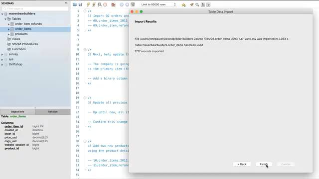
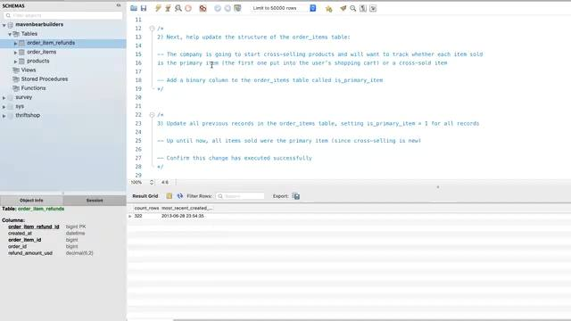
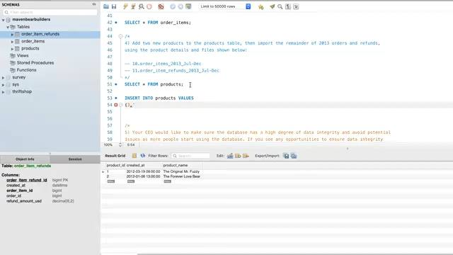
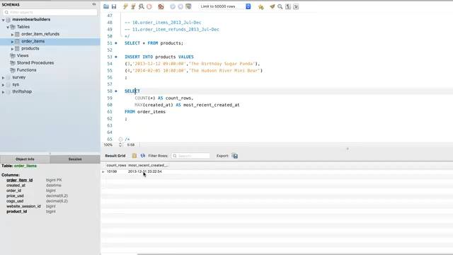
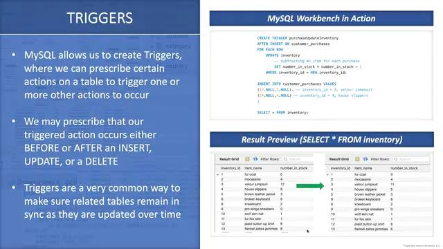
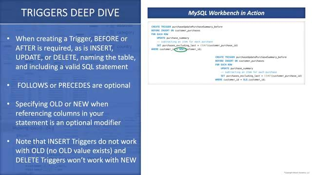
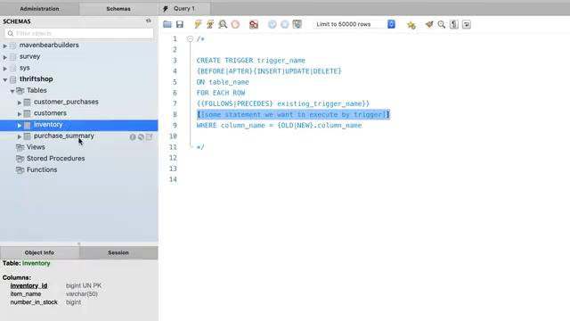

# 1. 这一节做什么

这一段课由两个独立但前后衔接的部分组成。

第一部分是 **Bear Builders 期中项目**（P45–P46）：你已经有一个运行了约一年的 Bear Builders 数据库，任务是继续用 SQL 导入新数据、改表结构、回填字段、增加产品、补约束，并从 DBA 角度给出备份/恢复/安全建议。它不是“再讲一遍知识点”，而是把前面学过的 `ALTER TABLE`、`UPDATE`、`INSERT`、数据导入向导、约束、备份思路串成一个可交付的数据库维护任务。

第二部分是 **MySQL 触发器**（P47–P48）：先用 `thrift_shop` 演示“插入购买记录后自动扣库存”，再深入讲 `BEFORE/AFTER`、`INSERT/UPDATE/DELETE`、`NEW/OLD`、`FOLLOWS/PRECEDES`、触发器权限、`SHOW TRIGGERS`、`information_schema.TRIGGERS`，以及“MySQL 只有行级触发器、没有 `ALTER TRIGGER`，要改只能先 `DROP TRIGGER` 再重建”。

这一节结束时，你应当能做出两套可检查的结果：

1. Bear Builders 库中：
   - `order_items` 多出 `isPrimaryItem` 字段，历史数据全部回填为 `1`；
   - `products` 多出 2 个产品；
   - `order_items`、`order_item_refunds` 的导入后总数分别达到课程口述的约 `10,199` 和 `508`；
   - `products`、`order_items`、`order_item_refunds` 加上非空/唯一约束。
2. `thrift_shop` 库中：
   - 插入 `customer_purchases` 后，`inventory.number_in_stock` 自动减 1；
   - `BEFORE INSERT` 触发器把“插入前的购买数”写入 `purchases_excluding_last`；
   - `AFTER INSERT` 触发器把“插入后的总购买数”写入 `total_purchases`；
   - 能用 `SHOW TRIGGERS` 看到触发器，能演示 `PRECEDES` 改变触发器排序。


> 注意：Bear Builders 的基础表来自前 44 集，逐字稿没有在本段重新给出完整建库脚本。因此本文对 Bear Builders 部分只覆盖 P45–P48 明确做的新增、导入、改表和约束；如果你没有前 44 集的库，先用课程资源里的数据库/备份恢复，再跑本文 SQL。触发器部分因为表结构较小，本文给了可独立运行的 `thrift_shop` 初始化脚本。

---

# 2. 讲师原话（带「—— pNNN [MM:SS]」）

下面只摘和“怎么做”直接相关的原话，英文保留原样，后面用中文说明它在项目中的位置。

- “Your objective for this project is to use SQL to import additional data into the Bear Builders database and then enhance the data structure to accommodate new tracking needs for the business.”  
  —— p045 [00:24]  
  中文：项目目标不是看视频，而是把新数据导入 Bear Builders，并改表结构来支持新的业务跟踪需求。

- “we can do just a select from Order items and we'll do Count star as rows and we'll do maybe a max created at”  
  —— p046 [02:45]  
  中文：导入后要做 QA。讲师用 `COUNT(*)` 和 `MAX(created_at)` 快速确认行数和最新日期。后面因为 `rows` 是保留字报错，改成 `count_rows`。

- “we'll use an alter table statement and that'll be on the order items table and we'll be adding a column called isPrimaryItem”  
  —— p046 [05:34]  
  中文：Q2 是给 `order_items` 加 `isPrimaryItem`，用来标记“主商品/交叉销售商品”。

- “update order items and we're gonna be setting is primary product equal to one”  
  —— p046 [06:57]  
  中文：Q3 是把历史记录全部回填为 `1`，因为过去没有交叉销售，所有已售商品都算主商品。讲师在这里故意写错列名 `is primary product`，引出 `Unknown column` 错误。

- “a couple of solutions here are to have a replication server ... Additionally, you could have some kind of either a physical or logical backup. I really like using MySQL Dump”  
  —— p046 [18:29]  
  中文：Q6 的备份思路：复制服务器做冗余；物理/逻辑备份；讲师偏好 `mysqldump`，因为它能导出 `CREATE` 和 `INSERT` 语句。

- “we have create trigger purchase update inventory and Then we say after the insert on the customer purchase table for each row we will update inventory”  
  —— p047 [01:51]  
  中文：触发器基础示例：`AFTER INSERT ON customer_purchases FOR EACH ROW`，然后 `UPDATE inventory`。

- “where inventory ID equals new dot inventory ID ... if we didn't have this where clause ... subtracting one from every single number in stock value”  
  —— p047 [05:36]  
  中文：`WHERE inventory_id = NEW.inventory_id` 是触发器不误伤全表的关键。

- “MySQL only supports row level triggers and not statement level triggers”  
  —— p048 [00:28]  
  中文：MySQL 只支持行级触发器；每次影响一行就触发一次，不是每条语句只触发一次。

- “there is no old row on an insert trigger”  
  —— p048 [22:35 附近，逐字稿在 23:03 展示该错误]  
  中文：`INSERT` 触发器不能用 `OLD`，因为插入没有旧行；同理 `DELETE` 不能用 `NEW`。

- “we're doing a select count of customer purchase ID from customer purchases where customer purchases dot customer ID equals purchase summary dot customer ID”  
  —— p048 [30:01]  
  中文：`BEFORE/AFTER` 示例里不能只写 `COUNT(customer_purchase_id)`，要写成相关子查询，把当前 `purchase_summary.customer_id` 和 `customer_purchases.customer_id` 对上。

- “I'm going to say where purchase summary ID is greater than zero. So this is just to handle safe mode.”  
  —— p048 [30:28]  
  中文：Workbench 安全更新模式要求 `UPDATE` 的 `WHERE` 里带主键/键列，所以讲师加了 `purchase_summary_id > 0`。

---

# 3. 从零复现

## 3.1 环境、目录和依赖

这门课没有使用 Node/Python 项目，也没有 npm/pip 依赖；核心环境是 MySQL Server + MySQL Workbench。

**依赖版本说明**：逐字稿没有写具体小版本号。本文按 MySQL 8.x + MySQL Workbench 8.x 写；如果你用 MySQL 5.7，部分 UI 位置和默认字符集可能不同，以你本机为准。

建议目录：

```text
mysql-advanced-admin/
├── bear_builders_course_files/
│   ├── file_08_order_items.csv
│   ├── file_09_order_item_refunds.csv
│   ├── file_10_order_items.csv
│   └── file_11_order_item_refunds.csv
├── 01_bear_builders_midcourse.sql
├── 02_thrift_shop_setup.sql
├── 03_trigger_inventory.sql
├── 04_trigger_summary_before_after.sql
├── 05_trigger_precedes_example.sql
└── 99_qa_queries.sql
```

> 文件名说明：逐字稿只说“file eight / file nine / file ten / file eleven”，没有在逐字稿里给出真实
文件名，所以上面用 `file_08_order_items.csv` 这类占位名。你实际下载的课程资源里文件名可能不同，导入时按“第 8、9、10、11 个文件”的顺序对应即可，不要照抄文件名。

## 3.2 第一步：确认 Bear Builders 库和四张表存在

打开 MySQL Workbench，连上本地实例，先确认库和表在不在。逐字稿没有给出建库语句，所以这里只做“检查”，不重建：

```sql
-- 01_bear_builders_midcourse.sql 的开头：只做检查，不建表
USE bear_builders;

SHOW TABLES;
-- 期望至少看到：customers, order_items, order_item_refunds, orders, products, website_sessions 等

SELECT COUNT(*) AS product_count FROM products;
-- 讲师在 p046 [09:19] 说“There should be two products”，所以这里期望 2

SELECT COUNT(*) AS order_item_count FROM order_items;
SELECT COUNT(*) AS refund_count FROM order_item_refunds;
```

如果 `USE bear_builders;` 报 `Unknown database`，说明你还没导入前 44 集的库。**课里没讲**怎么从零建 Bear Builders 全库，这一步必须靠课程资源里的数据库备份/脚本恢复，本文不编造建表语句。

## 3.3 第二步：Q1 导入 Q2 的订单和退款（file 8 / file 9）

逐字稿用的是 Workbench 的 **Table Data Import Wizard**，不是 `LOAD DATA`。操作路径：

1. 左侧 Schemas 面板展开 `bear_builders` → Tables；
2. 右键 `order_items` → **Table Data Import Wizard**；
3. 选择 file 8（order items，2013 年 4–6 月）；
4. Next → 确认目标表是 `order_items` → Next；
5. 确认 Source Columns 与 Destination Columns 匹配 → Next → Next → 执行导入；
6. 讲师口述导入 **1,717 条**，点 Finish；
7. 对 `order_item_refunds` 重复，选 file 9，讲师口述导入 **88 条**。



导入后立刻 QA。注意讲师第一次写 `AS rows` 报错，因为 `ROWS` 是保留字，改成 `count_rows`：

```sql
-- Q1 QA：order_items
SELECT COUNT(*) AS count_rows FROM order_items;
-- 讲师口述期望：5,576

SELECT MAX(created_at) AS latest_created_at FROM order_items;
-- 讲师口述期望：能看到 2013-06-30 的订单项

-- Q1 QA：order_item_refunds
SELECT COUNT(*) AS count_rows FROM order_item_refunds;
-- 讲师口述期望：322

SELECT MAX(created_at) AS latest_created_at FROM order_item_refunds;
-- 讲师口述期望：能看到 2013-06-28 的退款
```

> 这里的 `5,576` / `322` 是**导入 file 8、file 9 之后**的累计值，不是本次新增行数。本次新增分别是 1,717 和 88。如果你前面库里的基数不同，累计值会对不上，先查基数。

## 3.4 第三步：Q2 给 order_items 加 isPrimaryItem

```sql
-- Q2：加交叉销售标记列
ALTER TABLE order_items
ADD COLUMN isPrimaryItem INT NULL;
```

讲师说“I'll just make it an integer. You could do a binary, might even be better. You could do a big int. As long as it can take a one and a zero, I'm gonna call that correct answer.”——p046 [05:34]。所以 `INT` 是课里的写法，`TINYINT(1)` / `BIT(1)` 也算对，本文按课里写 `INT`。

验证：

```sql
SELECT * FROM order_items LIMIT 5;
-- 期望看到 isPrimaryItem 列存在，值为 NULL
```



## 3.5 第四步：Q3 回填历史记录 isPrimaryItem = 1

```sql
-- Q3：历史数据全部是主商品
UPDATE order_items
SET isPrimaryItem = 1
WHERE order_item_id > 0;
```

讲师原话用的是 `WHERE order_item_id > 0` 来表示“所有记录”，并强调这里故意先写错列名 `is primary product` 触发 `Unknown column` 错误——p046 [06:57]。正确列名是 `isPrimaryItem`。

验证：

```sql
SELECT * FROM order_items LIMIT 10;
-- 期望 isPrimaryItem 全部为 1
```

## 3.6 第五步：Q4 新增两个产品并导入 file 10 / file 11

先看现有产品：

```sql
SELECT * FROM products;
-- 期望 2 条
```

插入两个新产品。讲师口述的字段是 `product_id`、`created_at`、`product_name`，日期分别是 2013-12-12 和 2014-02-05 10:00：

```sql
-- Q4：新增产品
INSERT INTO products (product_id, created_at, product_name)
VALUES
  (3, '2013-12-12 00:00:00', 'The Birthday Sugar Panda'),
  (4, '2014-02-05 10:00:00', 'The Hudson River Mini Bear');
```

> 逐字稿里产品名是口语化的 “birthday sugar panda” / “Hudson River Mini Bear”，大小写和冠词以你课程资源里的实际数据为准；如果后续导入的订单项要按 `product_id` 关联，名字不影响关联，但会影响显示。

验证：

```sql
SELECT * FROM products;
-- 期望 4 条
```

然后用导入向导把 file 10 导入 `order_items`（讲师口述新增 **4,623 条**），file 11 导入 `order_item_refunds`（讲师口述新增 **186 条**）。导入后 QA：

```sql
SELECT COUNT(*) AS count_rows FROM order_items;
-- 讲师口述期望：10,199

SELECT MAX(created_at) AS latest_created_at FROM order_items;
-- 讲师口述期望：2013-12-31

SELECT COUNT(*) AS count_rows FROM order_item_refunds;
-- 讲师口述期望：508

SELECT MAX(created_at) AS latest_created_at FROM order_item_refunds;
-- 讲师口述期望：2013-12-31
```



## 3.7 第六步：Q5 加约束

逐字稿是用 Workbench 表设计器（点表旁边的扳手图标）加约束，并强调“make sure to hit apply”。等价 SQL 如下，可直接跑：

```sql
-- Q5：products 约束
ALTER TABLE products
  MODIFY COLUMN created_at DATETIME NOT NULL,
  MODIFY COLUMN product_name VARCHAR(255) NOT NULL,
  ADD CONSTRAINT uq_products_product_name UNIQUE (product_name);

-- Q5：order_items 约束
ALTER TABLE order_items
  MODIFY COLUMN created_at DATETIME NOT NULL,
  MODIFY COLUMN order_id INT NOT NULL,
  MODIFY COLUMN price DECIMAL(10,2) NOT NULL,
  MODIFY COLUMN cogs DECIMAL(10,2) NOT NULL,
  MODIFY COLUMN website_session_id INT NOT NULL,
  MODIFY COLUMN product_id INT NOT NULL,
  MODIFY COLUMN isPrimaryItem INT NOT NULL;

-- Q5：order_item_refunds 约束
ALTER TABLE order_item_refunds
  MODIFY COLUMN created_at DATETIME NOT NULL,
  MODIFY COLUMN order_item_id INT NOT NULL,
  MODIFY COLUMN order_id INT NOT NULL,
  MODIFY COLUMN refund_amount DECIMAL(10,2) NOT NULL,
  ADD CONSTRAINT uq_refunds_order_item UNIQUE (order_item_id);
```

> 字段类型（`VARCHAR(255)`、`DECIMAL(10,2)`、`INT`）逐字稿没有逐个念出来，这里按 Bear Builders 常见结构写；**执行前先用 `SHOW CREATE TABLE` 看你库里真实类型**，把 `MODIFY COLUMN` 的类型改成和原表一致，否则会改类型。唯一约束名 `uq_products_product_name` / `uq_refunds_order_item` 是我起的，课里没给名字。

讲师在 p046 [17:06] 明确说 `order_item_refunds` 的 `order_item_id` 要 `UNIQUE`，理由是“we should never be refunding the same product twice”。`order_items` 的其余列都**不加** UNIQUE，讲师逐条解释了为什么可以重复（同一时间两单、一单两商品、价格可重复、session 可重复、product_id 必然重复、isPrimaryItem 只有 0/1）。



## 3.8 第七步：Q6 备份与恢复方案（不是代码，是交付文档）

逐字稿没有让写 SQL，而是让 DBA 给出方案。讲师口述的三条：

1. **复制服务器（replication server）**：主库挂了还有副本可切，副本也能当一种备份；
2. **物理或逻辑备份**：讲师偏好 `mysqldump`，因为它导出 `CREATE` 和 `INSERT` 语句，能重建一切；
3. **代价**：数据集很大时 `INSERT` 语句会极大、恢复很慢。

可以落成一份 `backup_plan.md`：

```markdown
# Bear Builders 备份与恢复方案（基于 p046 Q6）

## 风险
- 硬件故障/服务器损坏
- 内部人员误删
- 外部恶意攻击

## 措施
1. 主从复制：master + replica，master 故障时切 replica
2. 逻辑备份：mysqldump 定期全量导出（含 CREATE + INSERT）
3. 恢复演练：定期在测试库用 dump 恢复，验证可用

## 已知代价
- 大数据集下 mysqldump 的 INSERT 语句巨大，恢复耗时长
```

`mysqldump` 的具体命令**课里没讲**，本文不编造参数；你只需要知道它是逻辑备份工具、导出 `CREATE`/`INSERT`。

## 3.9 第八步：搭 thrift_shop 并复现库存触发器

逐字稿没有给 `thrift_shop` 的完整建表脚本，但给了字段名和示例数据（inventory_id 3 的 velour jumpsuit 库存 12，inventory_id 4 的 house slippers 库存 6）。下面这份 `02_thrift_shop_setup.sql` 是**按逐字稿字段名重建的最小可运行版**，用于复现触发器；它不是讲师原脚本：

```sql
-- 02_thrift_shop_setup.sql
DROP DATABASE IF EXISTS thrift_shop;
CREATE DATABASE thrift_shop;
USE thrift_shop;

CREATE TABLE inventory (
  inventory_id INT PRIMARY KEY,
  name VARCHAR(100) NOT NULL,
  number_in_stock INT NOT NULL
);

CREATE TABLE customer_purchases (
  customer_purchase_id INT PRIMARY KEY,
  customer_id INT NOT NULL,
  inventory_id INT NOT NULL,
  purchased_amount DECIMAL(10,2) NULL,
  purchased_at DATETIME NULL
);

CREATE TABLE purchase_summary (
  purchase_summary_id INT PRIMARY KEY,
  customer_id INT NOT NULL,
  total_purchases INT NOT NULL DEFAULT 0,
  purchases_excluding_last INT NOT NULL DEFAULT 0
);

INSERT INTO inventory (inventory_id, name, number_in_stock) VALUES
  (1, 'moccasins', 4),
  (2, 'brown leather jacket', 3),
  (3, 'velour jumpsuit', 12),
  (4, 'house slippers', 6);

-- 讲师口述 customer_purchases 已有 1..12 条，这里给最小种子
INSERT INTO customer_purchases (customer_purchase_id, customer_id, inventory_id) VALUES
  (1, 1, 1),(2, 1, 1),(3, 1, 1),(4, 1, 1),(5, 1, 1),(6, 1, 1),
  (7, 2, 2),(8, 3, 3),(9, 4, 4),(10, 5, 1),(11, 5, 2),(12, 6, 4);

INSERT INTO purchase_summary (purchase_summary_id, customer_id, total_purchases, purchases_excluding_last) VALUES
  (1, 1, 6, 5),
  (2, 2, 1, 0),
  (3, 3, 1, 0),
  (4, 4, 1, 0),
  (5, 5, 2, 1),
  (6, 6, 1, 0);
```

> 种子数据是按讲师口述的“customer 1 有 6 单、customer 4 有 1 单、customer 6 有 1 单”凑的，**不是**课程原始数据；触发器逻辑不依赖具体种子值，只依赖字段名。

## 3.10 第九步：库存触发器（P47）

```sql
-- 03_trigger_inventory.sql
USE thrift_shop;

DROP TRIGGER IF EXISTS purchase_update_inventory;

CREATE TRIGGER purchase_update_inventory
AFTER INSERT ON customer_purchases
FOR EACH ROW
UPDATE inventory
SET number_in_stock = number_in_stock - 1
WHERE inventory_id = NEW.inventory_id;
```

验证：

```sql
SELECT * FROM inventory WHERE inventory_id IN (3,4);
-- 期望：velour jumpsuit 12，house slippers 6

INSERT INTO customer_purchases (customer_purchase_id, customer_id, inventory_id)
VALUES (13, 6, 3), (14, 6, 4);

SELECT * FROM inventory WHERE inventory_id IN (3,4);
-- 期望：velour jumpsuit 11，house slippers 5
```



## 3.11 第十步：BEFORE / AFTER 汇总触发器（P48）

讲师在这里踩了三个坑并修正，最终版如下。注意 `BEFORE` 写 `purchases_excluding_last`，`AFTER` 写 `total_purchases`，且 `UPDATE` 的 `WHERE` 要带 `purchase_summary_id > 0` 过安全模式：

```sql
-- 04_trigger_summary_before_after.sql
USE thrift_shop;

DROP TRIGGER IF EXISTS purchase_update_purchase_summary_before;
DROP TRIGGER IF EXISTS purchase_update_purchase_summary_after;

CREATE TRIGGER purchase_update_purchase_summary_before
BEFORE INSERT ON customer_purchases
FOR EACH ROW
UPDATE purchase_summary
SET purchases_excluding_last = (
  SELECT COUNT(customer_purchase_id)
  FROM customer_purchases
  WHERE customer_purchases.customer_id = purchase_summary.customer_id
)
WHERE customer_id = NEW.customer_id
  AND purchase_summary_id > 0;

CREATE TRIGGER purchase_update_purchase_summary_after
AFTER INSERT ON customer_purchases
FOR EACH ROW
UPDATE purchase_summary
SET total_purchases = (
  SELECT COUNT(customer_purchase_id)
  FROM customer_purchases
  WHERE customer_purchases.customer_id = purchase_summary.customer_id
)
WHERE customer_id = NEW.customer_id
  AND purchase_summary_id > 0;
```

验证（customer 6 插入前 `total_purchases=1`、`purchases_excluding_last=0`）：

```sql
SELECT * FROM purchase_summary WHERE customer_id = 6;

INSERT INTO customer_purchases (customer_purchase_id, customer_id, inventory_id)
VALUES (15, 6, 4);

SELECT * FROM purchase_summary WHERE customer_id = 6;
-- 期望：total_purchases=2，purchases_excluding_last=1
```



## 3.12 第十一步：PRECEDES 改变触发器顺序（P48）

```sql
-- 05_trigger_precedes_example.sql
USE thrift_shop;

DROP TRIGGER IF EXISTS purchase_update_purchase_summary_after;

CREATE TRIGGER purchase_update_purchase_summary_after
AFTER INSERT ON customer_purchases
FOR EACH ROW
PRECEDES purchase_update_purchase_summary_before
UPDATE purchase_summary
SET total_purchases = (
  SELECT COUNT(customer_purchase_id)
  FROM customer_purchases
  WHERE customer_purchases.customer_id = purchase_summary.customer_id
)
WHERE customer_id = NEW.customer_id
  AND purchase_summary_id > 0;
```

验证顺序：

```sql
SHOW TRIGGERS;
-- 期望 after 触发器排在 before 触发器前面（讲师 p048 [26:46] 演示）
```



## 3.13 第十二步：触发器权限（P48）

逐字稿演示了 Workbench 的 **Administration → Users and Privileges**：新建 `example user`，在 Schema Privileges 里只给 `thrift_shop` 加 `TRIGGER`（以及 `SELECT`/`INSERT`），或在 Administrative Roles 里给全局 `TRIGGER`。等价 SQL：

```sql
-- 课里用 UI 做，这里给等价 SQL；用户名/密码按你本机改
CREATE USER 'example_user'@'localhost' IDENTIFIED BY 'ChangeMe_123!';
GRANT TRIGGER, SELECT, INSERT ON thrift_shop.* TO 'example_user'@'localhost';
FLUSH PRIVILEGES;
```

> 讲师在 p048 [11:05] 强调“忘了设密码是个 no-no”，所以上面必须带 `IDENTIFIED BY`。

---

# 4. 完整代码

下面每个文件都是完整、可保存、可执行的。Bear Builders 部分依赖你已有前 44 集的库；`thrift_shop` 部分可独立跑。

## 4.1 `01_bear_builders_midcourse.sql`

```sql
-- 01_bear_builders_midcourse.sql
-- 依赖：已存在 bear_builders 库（来自前 44 集/课程资源）
-- 覆盖 P45-P46 Q1-Q5；Q6 是文档，不在 SQL 里

USE bear_builders;

-- ===== 前置检查 =====
SELECT COUNT(*) AS product_count FROM products;          -- 期望 2
SELECT COUNT(*) AS order_item_count FROM order_items;
SELECT COUNT(*) AS refund_count FROM order_item_refunds;

-- ===== Q1：file 8 / file 9 用 Workbench 导入向导完成，这里只做 QA =====
SELECT COUNT(*) AS count_rows FROM order_items;          -- 期望 5,576
SELECT MAX(created_at) AS latest_created_at FROM order_items; -- 期望 2013-06-30
SELECT COUNT(*) AS count_rows FROM order_item_refunds;   -- 期望 322
SELECT MAX(created_at) AS latest_created_at FROM order_item_refunds; -- 期望 2013-06-28

-- ===== Q2：加 isPrimaryItem =====
ALTER TABLE order_items
ADD COLUMN isPrimaryItem INT NULL;

SELECT * FROM order_items LIMIT 5;

-- ===== Q3：回填历史记录 =====
UPDATE order_items
SET isPrimaryItem = 1
WHERE order_item_id > 0;

SELECT * FROM order_items LIMIT 10;

-- ===== Q4：新增两个产品 =====
INSERT INTO products (product_id, created_at, product_name)
VALUES
  (3, '2013-12-12 00:00:00', 'The Birthday Sugar Panda'),
  (4, '2014-02-05 10:00:00', 'The Hudson River Mini Bear');

SELECT * FROM products;  -- 期望 4

-- file 10 / file 11 用导入向导完成，这里只做 QA
SELECT COUNT(*) AS count_rows FROM order_items;          -- 期望 10,199
SELECT MAX(created_at) AS latest_created_at FROM order_items; -- 期望 2013-12-31
SELECT COUNT(*) AS count_rows FROM order_item_refunds;   -- 期望 508
SELECT MAX(created_at) AS latest_created_at FROM order_item_refunds; -- 期望 2013-12-31

-- ===== Q5：约束 =====
-- 执行前先 SHOW CREATE TABLE 核对类型，把下面的类型改成和原表一致
ALTER TABLE products
  MODIFY COLUMN created_at DATETIME NOT NULL,
  MODIFY COLUMN product_name VARCHAR(255) NOT NULL,
  ADD CONSTRAINT uq_products_product_name UNIQUE (product_name);

ALTER TABLE order_items
  MODIFY COLUMN created_at DATETIME NOT NULL,
  MODIFY COLUMN order_id INT NOT NULL,
  MODIFY COLUMN price DECIMAL(10,2) NOT NULL,
  MODIFY COLUMN cogs DECIMAL(10,2) NOT NULL,
  MODIFY COLUMN website_session_id INT NOT NULL,
  MODIFY COLUMN product_id INT NOT NULL,
  MODIFY COLUMN isPrimaryItem INT NOT NULL;

ALTER TABLE order_item_refunds
  MODIFY COLUMN created_at DATETIME NOT NULL,
  MODIFY COLUMN order_item_id INT NOT NULL,
  MODIFY COLUMN order_id INT NOT NULL,
  MODIFY COLUMN refund_amount DECIMAL(10,2) NOT NULL,
  ADD CONSTRAINT uq_refunds_order_item UNIQUE (order_item_id);
```

## 4.2 `02_thrift_shop_setup.sql`

```sql
-- 02_thrift_shop_setup.sql
DROP DATABASE IF EXISTS thrift_shop;
CREATE DATABASE thrift_shop;
USE thrift_shop;

CREATE TABLE inventory (
  inventory_id INT PRIMARY KEY,
  name VARCHAR(100) NOT NULL,
  number_in_stock INT NOT NULL
);

CREATE TABLE customer_purchases (
  customer_purchase_id INT PRIMARY KEY,
  customer_id INT NOT NULL,
  inventory_id INT NOT NULL,
  purchased_amount DECIMAL(10,2) NULL,
  purchased_at DATETIME NULL
);

CREATE TABLE purchase_summary (
  purchase_summary_id INT PRIMARY KEY,
  customer_id INT NOT NULL,
  total_purchases INT NOT NULL DEFAULT 0,
  purchases_excluding_last INT NOT NULL DEFAULT 0
);

INSERT INTO inventory (inventory_id, name, number_in_stock) VALUES
  (1, 'moccasins', 4),
  (2, 'brown leather jacket', 3),
  (3, 'velour jumpsuit', 12),
  (4, 'house slippers', 6);

INSERT INTO customer_purchases (customer_purchase_id, customer_id, inventory_id) VALUES
  (1, 1, 1),(2, 1, 1),(3, 1, 1),(4, 1, 1),(5, 1, 1),(6, 1, 1),
  (7, 2, 2),(8, 3, 3),(9, 4, 4),(10, 5, 1),(11, 5, 2),(12, 6, 4);

INSERT INTO purchase_summary (purchase_summary_id, customer_id, total_purchases, purchases_excluding_last) VALUES
  (1, 1, 6, 5),
  (2, 2, 1, 0),
  (3, 3, 1, 0),
  (4, 4, 1, 0),
  (5, 5, 2, 1),
  (6, 6, 1, 0);
```

## 4.3 `03_trigger_inventory.sql`

```sql
-- 03_trigger_inventory.sql
USE thrift_shop;

DROP TRIGGER IF EXISTS purchase_update_inventory;

CREATE TRIGGER purchase_update_inventory
AFTER INSERT ON customer_purchases
FOR EACH ROW
UPDATE inventory
SET number_in_stock = number_in_stock - 1
WHERE inventory_id = NEW.inventory_id;

-- 验证
SELECT * FROM inventory WHERE inventory_id IN (3,4);
INSERT INTO customer_purchases (customer_purchase_id, customer_id, inventory_id)
VALUES (13, 6, 3), (14, 6, 4);
SELECT * FROM inventory WHERE inventory_id IN (3,4);
```

## 4.4 `04_trigger_summary_before_after.sql`

```sql
-- 04_trigger_summary_before_after.sql
USE thrift_shop;

DROP TRIGGER IF EXISTS purchase_update_purchase_summary_before;
DROP TRIGGER IF EXISTS purchase_update_purchase_summary_after;

CREATE TRIGGER purchase_update_purchase_summary_before
BEFORE INSERT ON customer_purchases
FOR EACH ROW
UPDATE purchase_summary
SET purchases_excluding_last = (
  SELECT COUNT(customer_purchase_id)
  FROM customer_purchases
  WHERE customer_purchases.customer_id = purchase_summary.customer_id
)
WHERE customer_id = NEW.customer_id
  AND purchase_summary_id > 0;

CREATE TRIGGER purchase_update_purchase_summary_after
AFTER INSERT ON customer_purchases
FOR EACH ROW
UPDATE purchase_summary
SET total_purchases = (
  SELECT COUNT(customer_purchase_id)
  FROM customer_purchases
  WHERE customer_purchases.customer_id = purchase_summary.customer_id
)
WHERE customer_id = NEW.customer_id
  AND purchase_summary_id > 0;

-- 验证
SELECT * FROM purchase_summary WHERE customer_id = 6;
INSERT INTO customer_purchases (customer_purchase_id, customer_id, inventory_id)
VALUES (15, 6, 4);
SELECT * FROM purchase_summary WHERE customer_id = 6;
```

## 4.5 `05_trigger_precedes_example.sql`

```sql
-- 05_trigger_precedes_example.sql
USE thrift_shop;

DROP TRIGGER IF EXISTS purchase_update_purchase_summary_after;

CREATE TRIGGER purchase_update_purchase_summary_after
AFTER INSERT ON customer_purchases
FOR EACH ROW
PRECEDES purchase_update_purchase_summary_before
UPDATE purchase_summary
SET total_purchases = (
  SELECT COUNT(customer_purchase_id)
  FROM customer_purchases
  WHERE customer_purchases.customer_id = purchase_summary.customer_id
)
WHERE customer_id = NEW.customer_id
  AND purchase_summary_id > 0;

SHOW TRIGGERS;
```

## 4.6 `99_qa_queries.sql`

```sql
-- 99_qa_queries.sql
USE bear_builders;

SELECT COUNT(*) AS count_rows FROM order_items;
SELECT MAX(created_at) AS latest_created_at FROM order_items;
SELECT COUNT(*) AS count_rows FROM order_item_refunds;
SELECT MAX(created_at) AS latest_created_at FROM order_item_refunds;
SELECT COUNT(*) AS product_count FROM products;
SELECT COUNT(*) AS null_primary FROM order_items WHERE isPrimaryItem IS NULL;

USE thrift_shop;
SHOW TRIGGERS;
SELECT * FROM inventory;
SELECT * FROM purchase_summary;
```

---

# 5. 逐行解释

## 5.1 Bear Builders 部分

- `USE bear_builders;`：切库。逐字稿默认你已经在 Workbench 里选中这个 schema，显式写出来是为了脚本可重复。
- `SELECT COUNT(*) AS count_rows FROM order_items;`：讲师原话用 `AS rows` 报错，因为 `ROWS` 是 MySQL 保留字。改别名 `count_rows` 是课里实际修正。**在 JS/Node 里**这相当于 `const { count_rows } = result[0]`，别名就是返回对象的 key。
- `MAX(created_at)`：讲师用它确认“最新数据到哪一天”，比看全表快。`created_at` 是时间列，`MAX` 走索引时很快；没索引就全表扫。
- `ALTER TABLE order_items ADD COLUMN isPrimaryItem INT NULL;`：加列。`NULL` 是必须的，因为已有行没有值；如果加 `NOT NULL` 且无默认值，MySQL 会报错或填默认值（取决于版本/sql_mode）。课里先加可空列，Q3 回填，Q5 再改 `NOT NULL`，这个顺序是对的。
- `UPDATE order_items SET isPrimaryItem = 1 WHERE order_item_id > 0;`：`WHERE order_item_id > 0` 是讲师用来表示“所有行”的写法。**在 JS/Node 里**相当于 `db.query('UPDATE order_items SET isPrimaryItem = 1 WHERE order_item_id > 0')`；如果你用 ORM，等价于 `OrderItem.update({ isPrimaryItem: 1 }, { where: { order_item_id: { [Op.gt]: 0 } } })`。注意：不加 `WHERE` 也能更新全表，但 Workbench 安全模式可能拦；讲师用 `> 0` 既过安全模式又表达“全部”。
- `INSERT INTO products (...) VALUES (...), (...);`：多行插入。`product_id` 显式给 3、4，因为表里已有 1、2；如果 `product_id` 是 `AUTO_INCREMENT`，显式给值也可以，但后续自增值会跳到 5。
- `MODIFY COLUMN ... NOT NULL`：把列改成非空。**执行前必须 `SHOW CREATE TABLE` 核对原类型**，否则 `MODIFY` 会把类型改成你写的类型。课里用 UI 勾选，UI 不会改类型；SQL 会。
- `ADD CONSTRAINT uq_products_product_name UNIQUE (product_name);`：唯一约束。讲师说“we probably shouldn't have two products that are named the same thing”，但补了一句“I'm not sure if that's something that everybody would have done”——所以这是**可选**加分项，不是硬性答案。
- `ADD CONSTRAINT uq_refunds_order_item UNIQUE (order_item_id);`：讲师明确要求，理由是同一订单项不应退两次。**在 JS/Node 里**这对应“数据库层唯一索引”，比应用层 `findOne` 再 `create` 可靠，因为并发下应用层检查会 race。

## 5.2 触发器部分

- `DROP TRIGGER IF EXISTS ...;`：MySQL 没有 `ALTER TRIGGER`，改逻辑只能 drop + create。讲师 p048 [01:54] 明确说“you can't just say alter trigger”。`IF EXISTS` 让脚本可重复跑。
- `CREATE TRIGGER purchase_update_inventory`：触发器名。同一 schema 内不能重名，和表名一样。
- `AFTER INSERT ON customer_purchases`：`AFTER` 表示插入完成后再执行；`INSERT` 是触发事件；`customer_purchases` 是监听表。讲师说可选 `BEFORE/AFTER` × `INSERT/UPDATE/DELETE`，但**必须各选一个**。
- `FOR EACH ROW`：MySQL 只支持行级触发器，所以这句是必需的（虽然语法上必须写）。讲师 p048 [00:28] 强调 MySQL 没有语句级触发器。
- `UPDATE inventory SET number_in_stock = number_in_stock - 1`：触发器体。注意这里没有 `BEGIN...END`，因为只有一条语句；多条语句才需要 `BEGIN...END` 和 `DELIMITER`。**课里没讲** `DELIMITER`，因为示例都是单语句。
- `WHERE inventory_id = NEW.inventory_id`：最关键的一行。`NEW` 指刚插入的那行；没有这个 `WHERE`，会把全表库存都减 1。讲师 p047 [05:36] 专门演示了“如果注释掉会怎样”。
- `BEFORE INSERT ... SET purchases_excluding_last = (SELECT COUNT(...) ...)`：`BEFORE` 时新行还没进表，所以 `COUNT` 不包含新行，正好是“除最后一条外的购买数”。讲师用列名 `purchases_excluding_last` 来强化这个语义。
- `AFTER INSERT ... SET total_purchases = (SELECT COUNT(...) ...)`：`AFTER` 时新行已进表，`COUNT` 包含新行，所以是总数。
- 子查询里 `WHERE customer_purchases.customer_id = purchase_summary.customer_id`：相关子查询，把外层 `purchase_summary` 的当前行和 `customer_purchases` 对上。讲师 p048 [30:01] 说不能只写 `COUNT(customer_purchase_id)`，因为那样没有分组/过滤，MySQL 会报错或语义不对。
- `WHERE customer_id = NEW.customer_id AND purchase_summary_id > 0`：第一个条件只更新“当前下单的客户”那一行；第二个条件是过 Workbench 安全模式（`SQL_SAFE_UPDATES`），要求 `WHERE` 带主键/键列。讲师 p048 [30:28] 明确说“just to handle safe mode”。
- `PRECEDES purchase_update_purchase_summary_before`：让新触发器排在指定触发器之前。讲师 p048 [25:52] 演示：不加时按创建顺序（before 先、after 后）；加了 `PRECEDES` 后 after 排到 before 前面。`FOLLOWS` 是反过来。两者都是可选。
- `SHOW TRIGGERS;`：列出当前库触发器，含 `Trigger`、`Event`、`Table`、`Statement`、`Timing` 等列（具体列名以你实际输出为准）。讲师 p048 [05:12] 说也可以用 `SELECT * FROM information_schema.TRIGGERS;` 看全实例。
- `GRANT TRIGGER, SELECT, INSERT ON thrift_shop.* TO ...`：触发器权限。讲师 p048 [02:21] 说创建/删除/查看触发器都需要 `TRIGGER` 权限；可以全局给，也可以按 schema 给。

---

# 6. 复现检查清单

按顺序打勾，任何一项不过，先修再往下。

**Bear Builders**

- [ ] `USE bear_builders;` 不报错，`SHOW TABLES;` 能看到 `products`、`order_items`、`order_item_refunds`。
- [ ] 导入 file 8 前 `products` 有 2 条。
- [ ] file 8 导入 `order_items` 后，`COUNT(*)` = 5,576，`MAX(created_at)` 到 2013-06-30。
- [ ] file 9 导入 `order_item_refunds` 后，`COUNT(*)` = 322，`MAX(created_at)` 到 2013-06-28。
- [ ] `ALTER TABLE order_items ADD COLUMN isPrimaryItem INT NULL;` 成功，`SELECT *` 能看到该列为 NULL。
- [ ] `UPDATE ... SET isPrimaryItem = 1 WHERE order_item_id > 0;` 成功，`SELECT` 全为 1。
- [ ] `INSERT INTO products` 后 `SELECT * FROM products;` 有 4 条，含 `product_id` 3、4。
- [ ] file 10 导入后 `order_items` = 10,199，`MAX(created_at)` 到 2013-12-31。
- [ ] file 11 导入后 `order_item_refunds` = 508，`MAX(created_at)` 到 2013-12-31。
- [ ] `products` 的 `created_at`、`product_name` 为 `NOT NULL`，`product_name` 有 UNIQUE。
- [ ] `order_items` 的 `created_at`、`order_id`、`price`、`cogs`、`website_session_id`、`product_id`、`isPrimaryItem` 为 `NOT NULL`。
- [ ] `order_item_refunds` 的 `created_at`、`order_item_id`、`order_id`、`refund_amount` 为 `NOT NULL`，`order_item_id` 有 UNIQUE。
- [ ] 能口述 Q6 三条：复制服务器、物理/逻辑备份、`mysqldump` 的代价。

**thrift_shop 触发器**

- [ ] `02_thrift_shop_setup.sql` 跑完，`inventory` 4 条，`customer_purchases` 12 条，`purchase_summary` 6 条。
- [ ] 建 `purchase_update_inventory` 后，`SELECT * FROM inventory WHERE inventory_id IN (3,4);` 是 12 / 6。
- [ ] 插入 `(13,6,3),(14,6,4)` 后，库存变 11 / 5。
- [ ] 建 before/after 两个汇总触发器后，`SHOW TRIGGERS;` 能看到它们。
- [ ] customer 6 插入前 `total_purchases=1`、`purchases_excluding_last=0`；插入 `(15,6,4)` 后变 `2` / `1`。
- [ ] 把 after 触发器改成 `PRECEDES ...before` 后，`SHOW TRIGGERS;` 里 after 排在 before 前。
- [ ] 故意在 `INSERT` 触发器里写 `OLD.customer_id`，能复现 “There is no OLD row in on INSERT trigger” 类错误（具体错误文案以你实际输出为准）。
- [ ] `example_user` 只有 `thrift_shop` 的 `TRIGGER`/`SELECT`/`INSERT` 时能建触发器；去掉 `TRIGGER` 后建触发器失败。

---

# 7. 课里没讲但你会撞上的

1. **Bear Builders 全库建表脚本**：P45–P48 只做增量，没给 `customers`/`orders`/`website_sessions` 等建表语句。你必须用课程资源恢复前 44 集的库，否则 `USE bear_builders;` 直接失败。本文不编造这些表结构。

2. **CSV 文件真实文件名和列顺序**：逐字稿只说 file 8/9/10/11，没给文件名，也没给 CSV 表头。导入向导靠“Source Columns 匹配 Destination Columns”自动映射；如果列顺序不同，向导可能映射错，导入后 QA 的 `COUNT(*)` 对但数据错位。**导入前在向导的 Data Preview 里肉眼核对一遍**。

3. **`MODIFY COLUMN` 会改类型**：课里用 UI 勾 `NOT NULL`，UI 不改类型；本文给的是 SQL，`MODIFY COLUMN created_at DATETIME NOT NULL` 会把 `created_at` 强制成 `DATETIME`。如果原表是 `TIMESTAMP` 或带精度，会丢精度。**先 `SHOW CREATE TABLE`，把类型抄成原样再改**。

4. **`SQL_SAFE_UPDATES`**：Workbench 默认开安全更新，`UPDATE`/`DELETE` 的 `WHERE` 不带键列会被拦。讲师在触发器里用 `purchase_summary_id > 0` 绕过；你在 Bear Builders 的 `UPDATE order_items ... WHERE order_item_id > 0` 也是同理。如果你用命令行 `mysql` 客户端，默认没有这个限制，但别因此养成不带 `WHERE` 的习惯。

5. **触发器里的 `BEGIN...END` 和 `DELIMITER`**：课里所有触发器都是单语句，所以没出现 `DELIMITER`。一旦你要写多条语句（比如先 `UPDATE` 再 `INSERT` 日志），必须：
   ```sql
   DELIMITER //
   CREATE TRIGGER ... FOR EACH ROW
   BEGIN
     ...;
     ...;
   END//
   DELIMITER ;
   ```
   课里没讲这个，但这是 MySQL 触发器最常见的“照着写报语法错”的原因。

6. **触发器递归/级联**：MySQL 默认不允许触发器自己触发自己（`recursive triggers` 默认关）。如果你在 `customer_purchases` 的触发器里又 `INSERT` 到 `customer_purchases`，会报错。课里没讲，但设计触发器时要避免。

7. **`NEW`/`OLD` 在 `UPDATE` 里的用法**：课里只演示了 `INSERT` 用 `NEW`、`DELETE` 不能用 `NEW`。`UPDATE` 触发器里 `NEW` 是更新后的值、`OLD` 是更新前的值，两者都能用。这是课里没展开但你会用到的。

8. **`information_schema.TRIGGERS` 的列名**：讲师说可以 `SELECT * FROM information_schema.TRIGGERS;`，但没列字段。实际列包括 `TRIGGER_NAME`、`EVENT_MANIPULATION`、`EVENT_OBJECT_TABLE`、`ACTION_TIMING`、`ACTION_STATEMENT` 等——**具体列名以你 `DESCRIBE information_schema.TRIGGERS;` 的实际输出为准**，本文不凭印象填。

9. **`mysqldump` 具体命令**：Q6 只讲了“用 mysqldump、导出 CREATE+INSERT、大数据集慢”，没给命令和参数。你需要自己查 `mysqldump --help`；常见坑是 `--single-transaction`（InnoDB 一致性快照）、`--routines`（含存储过程）、`--triggers`（默认含触发器，但 `--skip-triggers` 会丢）。这些课里都没讲。

10. **复制服务器（replication）配置**：Q6 只说了“有 replica 可以切”，没讲 `CHANGE REPLICATION SOURCE TO`、`server_id`、binlog 格式。这是后半程自动化的内容，本段不展开。

11. **前端/Node 视角的对应**：触发器是数据库层逻辑，Node 里你**看不到**它执行。如果你用 Prisma/Sequelize，`INSERT` 后返回的对象不含触发器改的字段，要重新 `SELECT` 才能看到 `number_in_stock` 变化。调试触发器时，先在 Workbench 里手动 `INSERT` 再 `SELECT`，别在应用层猜。

12. **`PRECEDES`/`FOLLOWS` 只在同事件同表同 timing 内有意义**：讲师演示的是两个 `AFTER INSERT ON customer_purchases`（一个 before 一个 after 是不同 timing，严格说 `PRECEDES` 跨 timing 的语义要看你 MySQL 版本行为）。**以你 `SHOW TRIGGERS;` 的实际顺序为准**，不要假设 `PRECEDES` 一定跨 timing 生效。