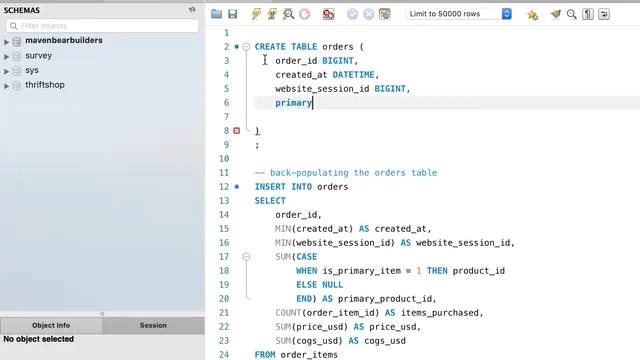
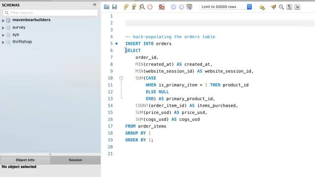
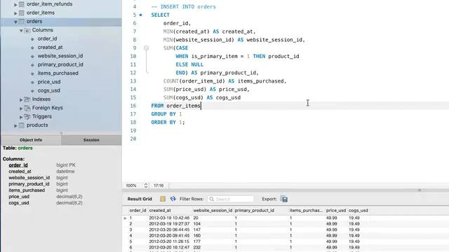
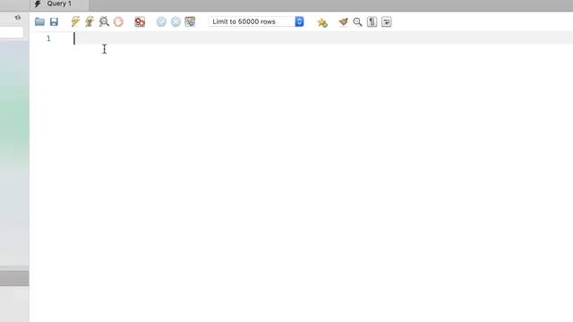
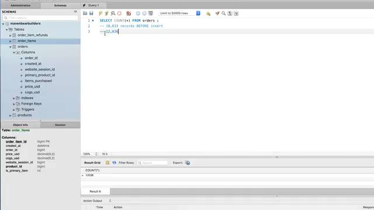
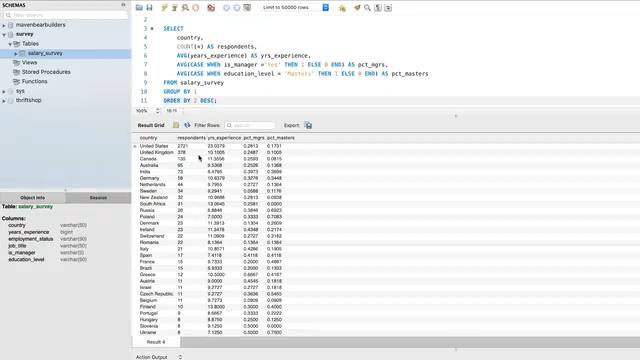
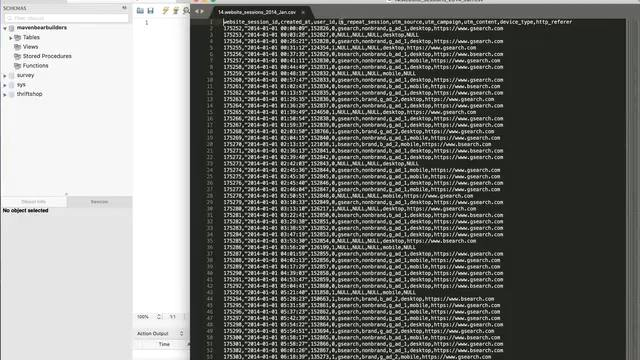
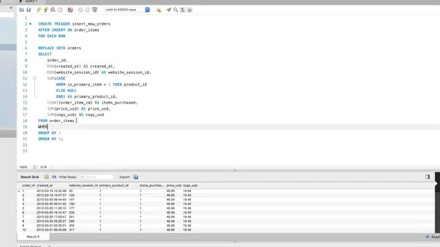

# Advanced MySQL Database Administration（P49–P57）复现文档

> 主题：把「订单明细（order_items）」汇总成「订单汇总表（orders）」，用触发器把汇总自动化，再用手工导入 + 计数 QA 验证触发器，最后学视图（view）并建一张 website_sessions 表并导入两批数据。
>
> 讲师环境：MySQL Workbench（课里没讲具体版本号，建议用 8.0.x，Workbench 与服务器同版本省心）。项目数据库 schema 名为 `Maven Bear Builders`（—— p050 [05:05] 讲师在左侧 schemas 面板点开的就是这个），视图演示用的是另一个 schema `survey`（—— p055 [02:10]）。

---

## 1. 这一节做什么

这一段课程是一条**完整的数据库交付链**，不是零散知识点。你要交付的东西按顺序是：

| 序号 | 产物 | 类型 | 验收标准（课里给出的具体数字） |
|---|---|---|---|
| 1 | `orders` 表（订单汇总表） | 表 DDL | 表存在，7 个列，`order_id` 为主键（p050 [04:36]） |
| 2 | `orders` 的回填数据 | `INSERT ... SELECT` | 回填后 **10,033** 行（p050 [05:32]） |
| 3 | `insert_new_orders` 触发器 | Trigger | 往 `order_items` 插一条，`orders` 自动多/更新记录（p052 [02:50]） |
| 4 | 2014 年 1–2 月新数据导入 | CSV 导入 | `order_items` 导入 **2,459** 行（p054 [02:23]），`order_item_refunds` 同期间数据一并导入 |
| 5 | 触发器 QA | 计数对比 | `orders` 从 **10,033 → 12,036**，净增 2,003（p054 [02:23]–[02:52]），`MAX(created_at)` = **2014-02-28**（p054 [03:20]） |
| 6 | 视图 `country_averages` | View | `survey` schema 下可见，`SELECT *` 结果与源 `SELECT` 一致（p055 [08:17]） |
| 7 | `website_sessions` 表 + 两批数据 | 表 DDL + 导入 | 1 月导入 **14,825** 行、2 月约 16,000 行，合计 **31,110** 行（p057 [06:46]–[07:42]，总数与 p056 [00:23] 作业要求一致） |

这条链的关键在于：**第 2 步和第 3 步用的是同一段聚合逻辑**，只是一个跑一次（回填），一个挂在触发器上每次新数据进来就跑。理解了这一点，这一节就没有难点了。

建议的本地目录（下文所有文件按这个结构放，你可以照抄）：

```
mysql-dba-p49-p57/
├── sql/
│   ├── 01_create_orders.sql
│   ├── 02_backpopulate_orders.sql
│   ├── 03_qa_orders.sql
│   ├── 04_create_trigger_insert_new_orders.sql
│   ├── 05_qa_trigger.sql
│   ├── 06_create_view_country_averages.sql
│   └── 07_create_website_sessions.sql
├── data/
│   ├── file_12_order_items_2014_jan_feb.csv      # 讲师念作 file number 12
│   ├── order_item_refunds_2014_jan_feb.csv       # 课里没念编号，文件名以你手上的为准
│   ├── file_15_website_sessions_2014_jan.csv     # 讲师念作 file 15
│   └── website_sessions_2014_feb.csv             # 课里没念编号
└── README.md
```

> 说明：CSV 的真实文件名课里只念了编号（`file number 12`、`file 15`），完整文件名并没有说出来，上表的文件名是**示意命名**，请以你手上的课程资料为准。

---

## 2. 讲师原话

> 「Sally 说，既然你已经有多个产品了，她想要一张表来汇总完整的订单。她要你建一张表，捕获订单 ID、订单创建时间、驱动这个订单的网站会话 ID、主产品 ID，以及美元口径的总价和销货成本。」—— p049 [00:00]

> 「她想让你在这张表创建好之后，用 order items 表里的记录来回填（backpopulate）这张表。也就是说，把 item 级别的数据上卷（roll up）到 order 级别。」—— p049 [00:26]

> 「对于那些上过我们分析课的同学，写这个回填查询没问题。直接进了 DBA 路径、没上过分析课的同学，这个查询对你们来说会比较难。所以我把查询贴在这里了。」—— p049 [00:53]

这是这段课最重要的一句：**回填查询是讲师直接给的，不要求你现场推导**。所以复现时你不需要自己造聚合逻辑，直接用第 4 章的 SQL 即可。

> 「我们会 select order ID，并且用 order ID 做 group by。所以这里所有用聚合函数 min、sum、count 做的事，都会按第一列 order ID 分组。」—— p050 [00:57]

> 「我们取 min 的 created at 值，把它当作订单创建时间。然后取 min 的 website session ID——其实所有订单都只会有一个 website session ID，但用 min 函数就能把它翻译出来，这样我们就可以把它塞进聚合函数里，这很方便。另一种做法是把 website session ID 放进 group by，两种方式都能得到正确答案。」—— p050 [01:26]

> 「这里我们用 case 语句来搞清主产品 ID 是什么。当 is primary item 标记为 1 时，我们选 product ID 的值。对非主项（cross-sell）我们给 null，这样当我们对这些值做 sum 时，只会拿到主产品的 product ID。」—— p050 [01:49]

> 「counting the order item ID 会给我们购买的商品数量。同理，sum 掉 price USD 和 COGS USD，就得到该订单里所有商品的总计。」—— p050 [02:18]

> 「当给主键命名时，要把列名放在括号里（这是语法问题）。」—— p050 [04:36]

> 「Sally 对这个新的 orders 表非常满意，她希望任何新的 order items 记录插入时，这张表都能自动更新。」—— p051 [00:00]

> 「你可能之前见过也可能没见过 replace into。Replace 的工作方式和 insert 一样，区别是如果记录已经存在，replace 会更新那条记录，而不是新增一条。」—— p051 [01:22]

> 「我们只想让它在 order items 有新记录时发生，所以 after insert on order items，然后 for each row。唯一还要改的就是加一个 where 条件，让我们知道要操作哪些行：order ID 等于 new 的 order ID 值。」—— p052 [02:50]–[03:45]

> 「我们在这种情况下没有真的测试这个触发器。我们会在下一个作业里测。」—— p052 [04:41]

> 「在做任何插入之前，如果你 select count star from orders，应该看到 10,033 条 orders 记录。然后插入数据，你应该看到计数上涨。」—— p053 [00:27]

> 「QA 这个数据有几种方式。很简单的一种：插入之后，从 order items 表里 select 最大的 order ID，那就告诉你有多少个订单在 order items 里。这里假设没有订单 ID 被跳过——在自增订单 ID 的表里这是合理的假设。然后简单 select count star from orders，看你的 orders 记录是否和 order items 表对得上。」—— p053 [00:56]

> 「值得注意的是，导入时你会明显感觉到变慢，因为公司在卖越来越多的产品，order items 数据量在变大。」—— p054 [01:53]

> 「你可以把视图想成一张虚拟表，内容由一条查询定义，但数据并不是真的被物理创建出来。」—— p055 [00:00]

> 「第二个好处是安全。你可以只把视图的访问权授予某人……把别人限制在他们完成工作所需的那部分数据上，这是 DBA 应该遵循的一条好原则。」—— p055 [00:21]–[01:15]

> 「UTM 参数通常用于营销，用来理解他们购买的点击流量。他们买广告时把这些参数附加到 URL 上，让营销人员能理解流量来自哪里。」—— p057 [02:06]

> 「website sessions 数据往往会比 orders 数据大得多，因为不是每个访问网站的人都会下单。所以每个订单对应很多会话，website sessions 表会比 orders 表大很多。」—— p057 [06:20]

---

## 3. 从零复现

### 步骤 0：环境与前置

1. 安装 MySQL 8.0.x + MySQL Workbench，本地起一个实例。
2. 建两个 schema：`CREATE DATABASE \`Maven Bear Builders\`;` 和 `CREATE DATABASE survey;`（schema 名带空格，SQL 里必须用反引号包住）。
3. 确认三张**前置表已存在**：`order_items`、`order_item_refunds`、`salary_survey`。
   - ⚠️ **课里没在这几集讲这三张表怎么建**——`order_items` 与 `order_item_refunds` 在更早的作业里已经建好并灌好数据（p049 [00:26] 说「你已经做过 order items 表，数据都在中央数据库里」），`salary_survey` 是 survey schema 里现成的示例表（p055 [02:10]）。如果你是从零开始，需要先按前面章节的作业把这些表建好；否则本节只能做 `orders`、触发器、视图、`website_sessions` 四件事。
4. 把 4 个 CSV 放进 `data/`。

### 步骤 1：建 `orders` 表

Workbench 里在 `Maven Bear Builders` 上右键 → **New Query Tab**，粘贴 `sql/01_create_orders.sql` 执行。执行完左侧 schemas 面板要**手动刷新**才能看到新表（—— p050 [05:05] 讲师专门点了这一点：「我们看不到任何东西，但刷新之后就看到了 orders」）。



### 步骤 2：回填数据

同一个 tab 里执行 `sql/02_backpopulate_orders.sql`。预期输出 **10,033 rows affected**（p050 [05:32]）。如果数字差很多，先别往下走——大概率是 `group by` 写成了按 item 分组，或者 `is_primary_item` 的取值判断不对。



### 步骤 3：先做一次表级检查

执行 `sql/03_qa_orders.sql`：`SELECT * FROM orders LIMIT 10;` 观察 `created_at`、`website_session_id`、`primary_product_id`、`number_of_items_purchased`、`price_usd`、`cogs_usd` 六列是否都有值，且买 2 件的订单金额明显高于买 1 件的（p050 [05:58]）。

### 步骤 4：建触发器

执行 `sql/04_create_trigger_insert_new_orders.sql`。注意 Workbench 里含 `BEGIN ... END` 的语句需要用 Delimiter 处理；本节的触发器是**单条 `REPLACE ... SELECT` 语句、没有 `BEGIN ... END`**，所以默认 `;` 分隔符可以直接跑（—— p052 [04:14] 讲师只说「我把它创建出来，看起来确实成功运行了」）。



### 步骤 5：导入 2014 年 1–2 月新数据

先记下基线（p054 [00:41]）：

```sql
SELECT COUNT(*) FROM orders;   -- 应为 10033
```

然后导 `order_items`：左侧树里右键 `order_items` → **Table Data Import Wizard** → Browse 选 `data/file_12_order_items_2014_jan_feb.csv` → Next → 确认目标表是 `order_items` → Next → 预览页确认源列头与目标列**全部匹配** → Next → 执行。预期 **2,459 records imported**（p054 [02:23]）。

再导 `order_item_refunds`，同一个 wizard，选对应 CSV。refunds 表的记录数课里没给，不用对数字。



> 导入前提醒：触发器此刻是**活的**。每插入一行 `order_items`，触发器就跑一次「按该 order_id 重算整单并 REPLACE」。所以导入 2,459 行会触发 2,459 次重算——讲师在 p054 [01:53] 也注意到「导入明显变慢了」。如果你要反复重跑导入做实验，先 `DROP TRIGGER insert_new_orders;` 再导，导完重新建触发器，会快很多。

### 步骤 6：验证触发器

执行 `sql/05_qa_trigger.sql`：

```sql
SELECT COUNT(*) FROM orders;                 -- 12036
SELECT MAX(created_at) FROM orders;          -- 2014-02-28
SELECT MAX(order_id) FROM order_items;       -- 与 orders 行数对照
```

预期 `orders` 从 10,033 涨到 **12,036**，净增 2,003（p054 [02:52]）。净增 **小于** 导入的 2,459 是正常的——一个订单可能含多个 item，多个 item 只对应一行 order 汇总（p054 [02:51]）。



### 步骤 7：视图（survey schema）

切到 `survey` schema，先跑 `SELECT` 确认结果，再把它包成 `CREATE VIEW country_averages AS ...`（`sql/06_create_view_country_averages.sql`）。执行成功后 Workbench **不会返回结果集**（p055 [07:48] 原话就是「你看到什么都没出来」），刷新 schema 面板才能在 Views 里看到它。



权限演示（p055 [09:15]）：Administration → **Users and Privileges** → 选中用户 → **Schema Privileges** → Add Entry 选 `survey` schema → 在 Object Rights 里只勾 **SHOW VIEW** → Apply。这样该用户只能读视图，读不到底层 `salary_survey`。

### 步骤 8：建 `website_sessions` 表并导入

执行 `sql/07_create_website_sessions.sql`，然后用同一个 Table Data Import Wizard 分两次导入 1 月和 2 月数据。预期 1 月 **14,825** 行（p057 [06:46]），2 月约 16,000 行（p057 [07:42] 讲师念的是「16,000 records」，与 14,825 相加后正好等于作业要求的 **31,110**）。

每导完一批做一次时间边界检查：

```sql
SELECT MAX(created_at) FROM website_sessions;  -- 1 月导完应为 2014-01-31
```



---

## 4. 完整代码

> 两条重要说明：
> 1. **回填 SELECT 的完整文本课程逐字稿里没有记下来**（讲师是「贴出来让大家复制」的，p049 [01:21]）。下面的 `02` / `04` 两个文件是**根据讲师在 p050 [00:57]–[02:18] 与 p052 [02:50]–[03:45] 逐句口述的字段与逻辑重建的**，字段名以你库里 `order_items` 的实际列名为准（不确定就 `DESC order_items;` 看一眼）。
> 2. 列名（`number_of_items_purchased`、`utm_source` 等）是讲师口头念法的规范化写法，你库里用什么名字就以什么名字为准，保持一致即可。

### sql/01_create_orders.sql

```sql
-- 订单汇总表：item 级数据上卷到 order 级
CREATE TABLE orders (
    order_id                    BIGINT,
    created_at                  DATETIME,
    website_session_id          BIGINT,
    primary_product_id          BIGINT,
    number_of_items_purchased   BIGINT,
    price_usd                   DECIMAL(6, 2),
    cogs_usd                    DECIMAL(6, 2),
    PRIMARY KEY (order_id)
);
```

### sql/02_backpopulate_orders.sql

```sql
INSERT INTO orders (
    order_id,
    created_at,
    website_session_id,
    primary_product_id,
    number_of_items_purchased,
    price_usd,
    cogs_usd
)
SELECT
    oi.order_id,
    MIN(oi.created_at)                                                    AS created_at,
    MIN(oi.website_session_id)                                            AS website_session_id,
    SUM(CASE WHEN oi.is_primary_item = 1 THEN oi.product_id ELSE NULL END) AS primary_product_id,
    COUNT(oi.order_item_id)                                               AS number_of_items_purchased,
    SUM(oi.price_usd)                                                     AS price_usd,
    SUM(oi.cogs_usd)                                                      AS cogs_usd
FROM order_items AS oi
GROUP BY
    oi.order_id;
```

### sql/03_qa_orders.sql

```sql
-- 核对回填结果
SELECT COUNT(*) FROM orders;              -- 期望 10033

SELECT *
FROM orders
ORDER BY order_id
LIMIT 10;

-- 抽查：买了 2 件的订单，金额应高于买 1 件的
SELECT number_of_items_purchased, COUNT(*) AS n
FROM orders
GROUP BY number_of_items_purchased;
```

### sql/04_create_trigger_insert_new_orders.sql

```sql
DROP TRIGGER IF EXISTS insert_new_orders;

CREATE TRIGGER insert_new_orders
AFTER INSERT ON order_items
FOR EACH ROW
REPLACE INTO orders (
    order_id,
    created_at,
    website_session_id,
    primary_product_id,
    number_of_items_purchased,
    price_usd,
    cogs_usd
)
SELECT
    oi.order_id,
    MIN(oi.created_at),
    MIN(oi.website_session_id),
    SUM(CASE WHEN oi.is_primary_item = 1 THEN oi.product_id ELSE NULL END),
    COUNT(oi.order_item_id),
    SUM(oi.price_usd),
    SUM(oi.cogs_usd)
FROM order_items AS oi
WHERE oi.order_id = NEW.order_id
GROUP BY oi.order_id;
```

### sql/05_qa_trigger.sql

```sql
-- 导入前跑一次，记下基线
SELECT COUNT(*) FROM orders;

-- 导入后跑下面的
SELECT COUNT(*) FROM orders;
SELECT MAX(created_at) FROM orders;
SELECT MAX(order_id)   FROM order_items;

-- 另一种 QA 思路：比对去重后的订单数
SELECT COUNT(DISTINCT order_id) FROM order_items;
SELECT COUNT(*)                 FROM orders;
```

### sql/06_create_view_country_averages.sql

```sql
USE survey;

-- 先看原始数据长什么样
SELECT * FROM salary_survey LIMIT 10;

-- 把聚合查询固化成视图
CREATE VIEW country_averages AS
SELECT
    country,
    AVG(years_experience)                                                     AS years_experience,
    AVG(CASE WHEN is_manager = 'yes' THEN 1 ELSE 0 END)                       AS percent_managers,
    AVG(CASE WHEN education_level = 'masters' THEN 1 ELSE 0 END)              AS percent_masters,
    COUNT(*)                                                                  AS total_respondents
FROM salary_survey
GROUP BY
    country
ORDER BY
    COUNT(*) DESC;

-- 之后任何有权访问该视图的人都可以直接这样查
SELECT * FROM country_averages;
```

### sql/07_create_website_sessions.sql

```sql
USE `Maven Bear Builders`;

CREATE TABLE website_sessions (
    website_session_id  BIGINT,
    created_at          DATETIME,
    user_id             BIGINT,
    is_repeat_session   INT,
    utm_source          VARCHAR(50),
    utm_campaign        VARCHAR(50),
    utm_content         VARCHAR(50),
    device_type         VARCHAR(50),
    http_referer        VARCHAR(100),
    PRIMARY KEY (website_session_id)
);

-- 导入完两批后自检
SELECT COUNT(*)        FROM website_sessions;   -- 期望 31110
SELECT MAX(created_at) FROM website_sessions;   -- 期望 2014-02-28
```

---

## 5. 逐行解释

### 5.1 建表 `orders`

- `order_id BIGINT` + `PRIMARY KEY (order_id)`：p050 [04:36] 讲师专门演示了一次语法错误——**主键声明里列名必须放在括号里**。`PRIMARY KEY order_id` 会报语法错，`PRIMARY KEY (order_id)` 才对。MySQL 里主键的额外语义在触发器这一步非常关键：`REPLACE INTO` 就是靠主键（或唯一索引）判断「已存在→替换」还是「不存在→插入」（p052 [00:57]）。
- `created_at DATETIME`：时间戳类型，和 `order_items` 的 `created_at` 同类型，因为值是从那边 `MIN()` 过来的。
- `website_session_id BIGINT`：会话 ID 来自会话表，量级大，用 BIGINT。
- `primary_product_id BIGINT`：讲师原话是这个字段「可以是 big int 也可以是 int，现在只有 4 个产品，big int 有点过度，但没关系」（p050 [03:41]）。`number_of_items_purchased` 同理。
- `price_usd DECIMAL(6,2)` / `cogs_usd DECIMAL(6,2)`：讲师称 `decimal 6-2` 是「我们最喜欢的金额格式」（p050 [04:08]）。**注意这是本节的隐藏坑，见第 7 章。**
- 为什么不用 `INT` 存金额：浮点会丢精度，金额一律 `DECIMAL`。在 JS/Node 侧对应「金额别用 Number 存，用字符串或以分为单位的整数」。

### 5.2 回填 `INSERT ... SELECT`

- `INSERT INTO orders (列清单)` 显式列出目标列：因为 `orders` 有 7 列，而 SELECT 只产出 7 个表达式，列顺序必须严格对齐。显式列清单还能防止以后给表加列时插入错位。
- `SELECT oi.order_id` + `GROUP BY oi.order_id`：讲师的原话是「我们 select order ID，也用 order ID 做 group by，所以这里所有聚合函数做的事，都会按第一列分组」（p050 [00:57]）。**改成 `GROUP BY oi.order_item_id` 就会得到 1 万多行 item 级数据而不是订单级**——这是最常见的错法。
- `MIN(oi.created_at) AS created_at`：一个订单里每个 item 的 `created_at` 理论上一致，取 `MIN()` 只是把它塞进聚合函数的一种手段（讲师原话 p050 [01:26]）。同理 `MIN(oi.website_session_id)`——讲师明确说了「其实所有订单都只有一个 website session ID……另一种做法是把它放进 group by，两种都能得到正确答案」。
- `SUM(CASE WHEN oi.is_primary_item = 1 THEN oi.product_id ELSE NULL END)`：这是本段最巧的一行。`is_primary_item` 为 1 时取 product_id，否则给 `NULL`；再 `SUM()`。因为 **`SUM` 会忽略 NULL**，所以最终结果就是那一个主产品的 product_id。如果误写成 `ELSE 0 END`，`SUM` 会把 0 也加进去，主产品 ID 就毁了——这是初学者踩得最多的一处。
- `COUNT(oi.order_item_id) AS number_of_items_purchased`：计数用 `COUNT(列)` 而不是 `COUNT(*)`，语义精确到「有 item id 的行数」。在 JS 侧对应「`reduce((acc, x) => acc + 1, 0)` 而不是 `arr.length`」这种较真，虽然结果一样。
- `SUM(oi.price_usd)` / `SUM(oi.cogs_usd)`：把 item 的钱加总成订单的钱。讲师原话：「sum 掉 price USD 和 COGS USD，就得到该订单里所有商品的总计」（p050 [02:18]）。
- 为什么用 `INSERT` 而不是 `REPLACE`：回填是一次性动作，表刚建出来是空的，没有重复风险。`REPLACE` 留给触发器。

### 5.3 触发器

- `DROP TRIGGER IF EXISTS`：讲义里没写这一行，但**强烈建议**加上，否则你第二次执行会报 `Trigger already exists`。课里没讲这个错误处理，这是复现时会撞上的。
- `CREATE TRIGGER insert_new_orders`：名字是讲师取的（p052 [02:50]）。
- `AFTER INSERT ON order_items`：时机选 **AFTER**，因为要读的那行数据必须已经落地；事件选 **INSERT**，因为只有新 item 进来才需要重算订单。
- `FOR EACH ROW`：批量插入时**每一行都触发一次**（讲师原话 p052 [03:17]：「这正是我们要做的」）。这也是为什么导入 2,459 行会变慢（p054 [01:53]）。
- `REPLACE INTO orders (...)`：讲师讲得很清楚——「如果主键或唯一索引值相同，就不是新增一行，而是用新数据更新那一行」（p052 [00:57]）。在这里 `order_id` 是主键，所以同一订单加第二个 item 时会**更新**已有 order 行，而不是产生重复。讲师补了一句：「你在这里用 insert into 还是 replace into 应该结果一样，因为你不会重复卖同样的 order items……但把 replace into 留着是个额外的保险」（p052 [01:25]）。
  - **在 JS/Node 里对应**：就是 `upsert`（Prisma `upsert` / Knex `.onConflict('order_id').merge()` / Mongo `updateOne(..., {upsert: true})`）。
  - 但注意 `REPLACE` 的语义是**先 DELETE 再 INSERT**，不是 `UPDATE`。如果 `orders` 以后被别的表外键引用，这个删除动作会有副作用——见第 7 章。
- `FROM order_items AS oi WHERE oi.order_id = NEW.order_id`：这一行是把「全表重算」收窄成「只算这一单」。讲师原话：「这个 filter 会保证我们只在记录包含的 order ID 等于 new 的 order ID 时，才执行这个 replace into 和 select」（p052 [03:45]）。`NEW` 是 MySQL 触发器里代表新插入行的伪记录（MySQL 语法，**知道即可**）。
- `GROUP BY oi.order_id`：因为 `WHERE` 已经锁死单一 order_id，这个 `GROUP BY` 实际只产生一行。保留它是为了和回填语句保持同一套聚合表达式，减少出错。



### 5.4 QA 数字怎么读

- 基线 **10,033**（p050 [05:32] 回填结果，p054 [00:41] 复核确认）。
- 导入 `order_items` **2,459** 行，`orders` 净增 **2,003**（12,036 − 10,033）。**净增小于导入行数是正确的**：一单多 item，多 item 只折成一行 order 汇总（p054 [02:51]）。
- `SELECT MAX(order_id) FROM order_items` 当作订单数来对照——讲师的假设是「自增主键没有跳过」（p053 [01:20]）。这在正常情况下成立，但如果导入过程中有过失败回滚，`AUTO_INCREMENT` 会跳号，这个校验就会失真。
- `SELECT MAX(created_at) FROM orders` = `2014-02-28`：这是最省事的「时间边界」校验（p054 [03:20]），比数行数更能证明新数据真的进了 `orders`。
- 讲师还给了另一种思路：「也可以对两张表做 `COUNT(DISTINCT order_id)` 比对」（p053 [01:20]）。

### 5.5 视图

- `CREATE VIEW country_averages AS SELECT ...`：视图 = 保存下来的 SELECT 语句，**数据不落盘**（p055 [00:00]）。所以 `CREATE VIEW` 执行后返回空、`SELECT * FROM country_averages` 直接复现原查询结果（p055 [07:48]）。
- `AVG(years_experience)`：维度是 `country`，指标是平均工作年限。
- `AVG(CASE WHEN is_manager = 'yes' THEN 1 ELSE 0 END)`：讲师特意解释了这个技巧——「1 和 0 求平均，会得到 0 到 1 之间的值，比如 0.6 就意味着 60% 是管理者、40% 不是」（p055 [04:02]）。所以列名叫 `percent_managers` 虽然「严格说不是百分比形式，要格式化成真百分比还得再费点事」（p055 [04:29]）。
- `AVG(CASE WHEN education_level = 'masters' THEN 1 ELSE 0 END)`：同一套套路，换成学历维度。
- `COUNT(*) AS total_respondents`：每个国家有多少样本。讲师说这是做分析时「我通常会加的」一列（p055 [05:54]）。
- `ORDER BY COUNT(*) DESC`：把样本量大的国家排在上面。讲师给的理由值得记住——「你不仅知道哪些组最大，而且对大样本组的数据更有信心；哥斯达黎加只有一个受访者，你不能凭一个人的回答判断整个国家」（p055 [06:22]）。
- 视图的两条收益，讲师各讲了一遍：**汇总多表/多维度到一张「表」里**（p055 [00:21]）、**安全隔离**（只给视图权限，不给底表写权限，p055 [00:50]）、**不影响下游**（改视图不会波及引用数据库的应用，p055 [01:15]）。
  - **JS/Node 里对应**：视图 ≈ 一个只读的报表 API 端点 / `SELECT` 封装出的 repository 方法；它**不是**物化视图，没有缓存，每次查都实时算——这点课里没强调，但你在前端做图表时要注意「视图查询本身可能很慢」。

### 5.6 `website_sessions` 表

- `website_session_id BIGINT` + `PRIMARY KEY`：讲师看文件时说「这看起来是个不错的主键」（p057 [00:45]），并且是先把它写好、再补其他列、最后回来加主键约束（p057 [03:33]）。
- `created_at DATETIME`：「和几乎所有我们做过的表一样的时间戳」（p057 [01:11]）。
- `user_id BIGINT`：讲师定义为「唯一标识网站上某个人的值」（p057 [01:39]）。
- `is_repeat_session INT`：0 = 新访客，1 = 回访。讲师说可以 `SMALLINT` 甚至 `TINYINT`（p057 [04:00]）——只有 0/1 两个值，用 `TINYINT(1)` 更省，但在 MySQL 里 `BOOLEAN` 就是 `TINYINT(1)` 的别名。
- `utm_source` / `utm_campaign` / `utm_content` 都是 `VARCHAR(50)`：讲师的理由是「用更小的长度会报错，所以宁可保守一点」（p057 [04:29]）。`device_type` 讲师说「其实也可以更小，25 也行」，最终仍用 50（p057 [04:56]）。
- `http_referer VARCHAR(100)`：来源站点（如 `gsearch`），可能是付费搜索也可能是自然搜索（p057 [03:04]）。
- 为什么不建外键指向 `user_id` / `website_session_id`：**课里没讲**。讲师只说了「这张表最终会和数据库里其他数据关联起来」（p056 [00:00]），没有演示加外键。

---

## 6. 复现检查清单

按顺序打勾，任何一项对不上就先停下排查：

| # | 检查项 | 命令 | 期望值 | 出处 |
|---|---|---|---|---|
| 1 | schema 存在 | `SHOW DATABASES;` | 能看到 `` `Maven Bear Builders` `` 和 `survey` | p050 [05:05] / p055 [02:10] |
| 2 | `orders` 表结构 | `DESC orders;` | 7 列，`order_id` 为 PRI | p050 [03:13] |
| 3 | 回填行数 | `SELECT COUNT(*) FROM orders;` | **10033** | p050 [05:32] |
| 4 | 回填质量 | `SELECT * FROM orders LIMIT 10;` | 无 NULL 的主产品 ID，2 件订单金额更高 | p050 [05:58] |
| 5 | 触发器存在 | `SHOW TRIGGERS;` | 有 `insert_new_orders`，Timing=AFTER，Event=INSERT，Table=order_items | p052 [04:14] |
| 6 | 导入 `order_items` | Import Wizard 结果页 | **2459** records imported | p054 [02:23] |
| 7 | 触发器生效 | `SELECT COUNT(*) FROM orders;` | **12036**（净增 2003） | p054 [02:52] |
| 8 | 时间边界 | `SELECT MAX(created_at) FROM orders;` | `2014-02-28` | p054 [03:20] |
| 9 | 视图存在 | `SELECT * FROM survey.country_averages;` | 每国家一行，含 `percent_managers` / `percent_masters` / `total_respondents` | p055 [08:17] |
| 10 | 视图权限 | Users and Privileges → Schema Privileges | 只有 SHOW VIEW 勾选 | p055 [09:15] |
| 11 | `website_sessions` 结构 | `DESC website_sessions;` | 9 列，`website_session_id` 为 PRI | p057 [03:33] |
| 12 | 1 月导入 | 导入结果页 | **14825** | p057 [06:46] |
| 13 | 1 月边界 | `SELECT MAX(created_at) FROM website_sessions;` | `2014-01-31` | p057 [07:15] |
| 14 | 2 月边界 | 同上 | `2014-02-28` | p057 [07:42] |
| 15 | 总行数 | `SELECT COUNT(*) FROM website_sessions;` | **31110** | p056 [00:23] |

补充说明两处：

- 第 3 项和第 7 项是**同一张表的两次读数**，所以第 6 项导入必须发生在两者之间；如果你先导了数据再回填，`10033` 这个基线就永远对不上（回填 `INSERT` 会因主键冲突整条失败）。
- 第 12 项 14,825 与 2 月约 16,000 相加等于 31,110。如果你两批导入后总数不是 31,110，先怀疑「2 月的文件是不是少导了一批」而不是触发器。

---

## 7. 课里没讲但你会撞上的

这一段是复现路上真正会让你卡住的地方，逐条给现象 + 处理方式。**其中每一条都超出了这几集视频的原话范围，属于我基于本节代码的实操提示。**

1. **`DECIMAL(6,2)` 会把大订单打爆。**
   `DECIMAL(6,2)` 的范围是 −9999.99 ~ 9999.99。`orders.price_usd` 是**整单总价**（多 item 求和），一旦一单金额过万，严格模式下报 `Out of range value`，回填整个 `INSERT` 失败——而讲师在 p050 [03:41] 只说「这是我最喜欢的金额格式」，没讨论上限。如果报这个错，改成 `DECIMAL(10,2)`。为什么 `order_items` 里的 `price_usd` 没炸：那是单件价格，量级小。

2. **MySQL 触发器内读写触发表可能报 `ERROR 1442`。**
   `Can't update table ... in stored function/trigger because it is already used by statement which invoked this stored function/trigger`。讲师环境能建能跑（p052 [04:14]、p054 [02:52] 都通过了），但换版本/换配置就有可能出现。真撞上了不要死磕，退一步用「应用层在写 `order_items` 后重算」（也就是把这段聚合逻辑搬到 Node 里跑），效果等价。课里没讲这个限制。

3. **`REPLACE INTO` 是「先 DELETE 再 INSERT」。**
   一旦有人给 `orders` 加了外键引用（比如 `order_payments.order_id → orders.order_id`），`REPLACE` 的删除动作会触发级联或直接失败。课里没讨论外键，所以这里只是提醒：**别在 `orders` 上加「ON DELETE CASCADE」的引用，除非你算清楚触发器会删行。**

4. **批量导入会被触发器拖慢，而且慢得非线性。**
   导入 2,459 行 = 2,459 次「按 order_id 重算 + REPLACE」。讲师在 p054 [01:53] 把这归因于「公司卖得越来越多、数据量变大」，这个解释是对的但不完整——触发器本身也在放大开销。实操建议：大批量历史数据导入前 `DROP TRIGGER insert_new_orders;`，导完再 `CREATE`，最后跑一次全量 `REPLACE` 或 `INSERT ... ON DUPLICATE KEY UPDATE` 把汇总补齐。**课里没有给出这个停用-重建的流程。**

5. **同一订单「后续再加 item」时，触发器会把整单重算——包括老 item。**
   这是 `WHERE order_id = NEW.order_id` 的必然结果（p052 [03:45]），逻辑上**正确**，不会漏算。但如果你在做「增量同步」的心理模型，会觉得「新插了一行，`COUNT` 应该是 1」，实际上 `number_of_items_purchased` 会变成 2。别把它当 bug。

6. **Workbench 新建的表/视图不会自动出现在左侧树里。**
   p050 [05:05] 与 p055 [08:17] 讲师都手动点了刷新才看到。脚本跑成功但左侧看不到时，先刷 schema 再怀疑脚本。

7. **CSV 里的空字符串 vs `NULL`。**
   `utm_source`、`utm_campaign`、`http_referer` 这些营销字段在自然流量下经常是空的。Import Wizard 可能把它们导成空串 `''` 而不是 `NULL`。如果你后续按 `WHERE utm_source IS NULL` 统计自然流量，会一条都查不到。导入后先 `SELECT COUNT(*) FROM website_sessions WHERE utm_source = '';` 看一眼。课里没讲空值处理。

8. **`http_referer` 的拼写。**
   讲师念的是 `HTTP referrer`（p057 [01:11]），而 HTTP 规范里这个头叫 `Referer`（当年拼错了，就沿用了）。**这张表的列名以你手上的 CSV 列头为准**——CSV 写 `http_referer` 就建 `http_referer`，别按「正确拼写」建 `http_referrer`，否则 Import Wizard 会报列不匹配。

9. **两个 schema、`USE` 语句、带空格库名的反引号。**
   `Maven Bear Builders` 带空格，任何 SQL 引用它都必须写 `` `Maven Bear Builders` ``。p050 之后的所有表操作都默认在这个 schema 里，而 p055 的视图在 `survey` 里。同一个 Workbench tab 里来回切换 schema 时**一定要显式 `USE`**，否则你会发现「表建到了别的库里」。

10. **JS/Node 侧的对应关系（帮你把概念挂到已有知识上）：**
    - 触发器 ≈ 数据库层的 `afterCreate` hook / 事件订阅。区别是它在**数据库进程内**执行，你在 Node 里连事务回滚都改不了它。
    - `REPLACE INTO` ≈ `upsert`，但语义是 delete+insert，所以返回的 `affectedRows` 会是 2（删 1 + 插 1），别拿它当 UPDATE 的计数。
    - 视图 ≈ 只读报表端点 / repository 方法，**没有缓存、不落盘**，每次查都重算。前端做图表时如果这个视图查询慢，问题不在前端。
    - `INSERT ... SELECT` 大事务 ≈ 一次性 `bulkCreate`，注意锁与回滚段；在 Node 里对应「分页写、别一把梭」。

11. **`order_items` / `order_item_refunds` / `salary_survey` 的 DDL 不在这几集里。**
    本段课程是「作业 → 讲师看我怎么做的」节奏，这三张表属于早前作业的产物。如果你是从 P49 开始看，先把它们补齐，否则 `INSERT INTO orders SELECT FROM order_items` 第一步就会报 `Table doesn't exist`。**课里没在这九集里给这三张表的建表语句。**

12. **`p057` 里 2 月批次的具体行数课里没给准数。**
    讲师念的是「16,000 records」（p057 [07:42]），但 14,825 + 16,285 = 31,110 才对得上 p056 [00:23] 给的总数。所以你手上 2 月文件的实际行数大概是 16,285，**以你导入结果页的数字为准，不要拿「16,000」当断言去对。**

---

### 一句话总结这条链

`order_items`（item 级）→ 一次性 `INSERT ... SELECT GROUP BY order_id` 回填出 `orders`（order 级）→ 把同一段聚合逻辑套进 `AFTER INSERT` 触发器 + `REPLACE INTO` 让它自动跟上 → 导 2014 年 1–2 月新数据，用「10,033 → 12,036」和「MAX(created_at)=2014-02-28」两个读数证明自动化真的在跑 → 再用视图把「多表聚合 + 权限隔离 + 不惊动下游」这三件事一次做完 → 最后把营销侧的 `website_sessions` 落地成 31,110 行，等下一步和 `orders.website_session_id` 关联。