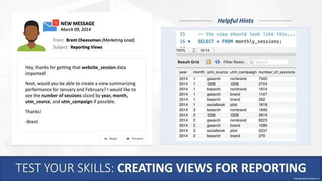
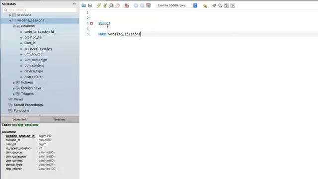
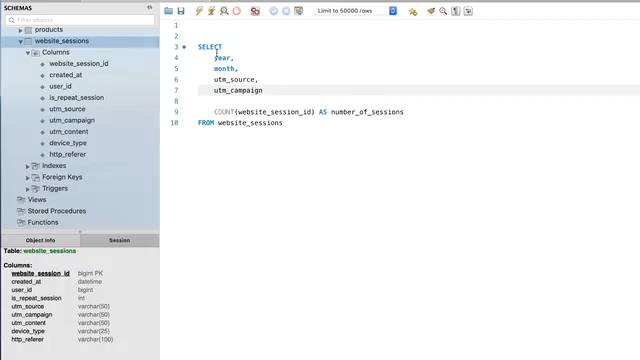
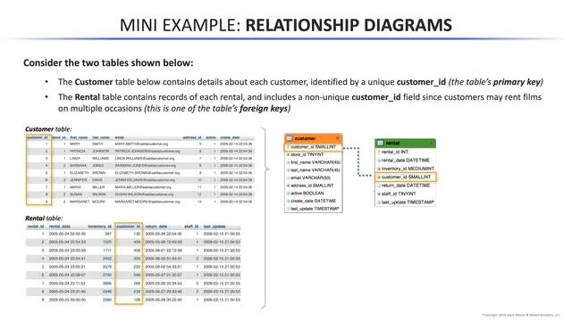
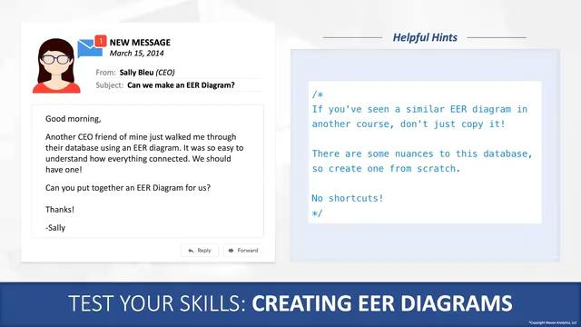
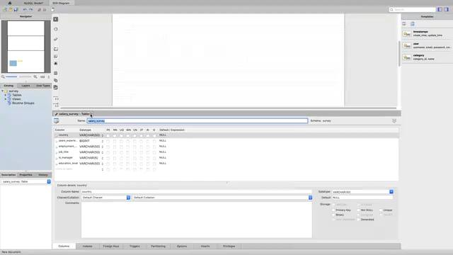
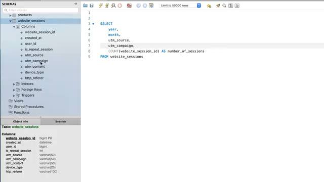
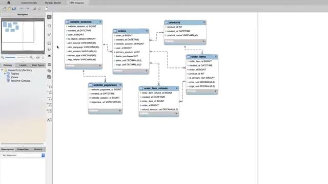
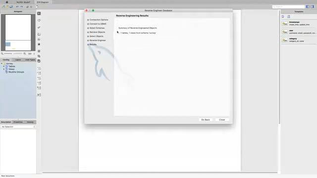

# Advanced MySQL Database Administration（P58–P63）复现文档：报表视图与 EER 图

## 1. 这一节做什么

这 6 节课（P58–P63）不是零散知识点，而是两个能交付给“业务方”的数据库产物：

1. **给市场负责人 Brent 做一个报表视图**：把 `website_sessions` 表汇总成“按年、月、UTM source、UTM campaign 统计会话数”的视图。业务方以后只需要 `SELECT * FROM monthly_sessions`，不用自己写 `YEAR()`、`MONTH()`、`COUNT()`、`GROUP BY`。  
2. **做 EER 图并理解它的边界**：先手工从零搭一个 EER 模型，再用 Workbench 的 **reverse engineering**（反向工程）从已有数据库生成 EER 图；重点不是“画得好看”，而是看清表、列、数据类型、主键/外键、一对多关系，以及一个关键事实：**在 EER 图里改外键，不会自动改真实表**。

最终你可以跑出这些东西：

- 一个可重复执行的数据库 `maven_bear_builders`
- 一个最小可运行的 `website_sessions` 表及若干用于 EER 练习的表
- 一个 `monthly_sessions` 视图
- 一条验证查询，能看到按年月、UTM source、UTM campaign 分组的会话数
- 一张由 Workbench 反向工程生成、并可继续编辑的 EER 图
- 一套从零创建 EER 图的练习步骤：`users`、`courses`、`user_course_enrollments`



---

## 2. 讲师原话（带「—— pNNN [MM:SS]」）

> "你将创建用于报表的视图……他希望把会话数作为指标，并希望你能按年份、月份、UTM 来源和 UTM 广告系列来切分这些数据。"
> —— p058 [00:00]

> "视图是我们为 SQL 使用频率不高的用户处理报表的一种方式，同时还能让他们获得完成工作所需的信息。"
> —— p059 [00:26]

> "创建视图时，我通常先写好用于填充该视图的 SELECT 语句，然后才真正编写 CREATE VIEW。"
> —— p059 [00:54]

> "要获取年份和月份，数据库里并没有 year 或 month 字段。所以我们会使用 created at 字段。"
> —— p059 [02:21]

> "我们会按前四列进行分组，所以直接写 1、2、3、4 就行。"
> —— p059 [02:49]

> "接下来就很容易写 CREATE VIEW 语句了：我们会写 CREATE VIEW，并将它命名为 monthly sessions，内容为……"
> —— p059 [03:18]

> "我们可以用可视化的方式对表之间的关系以及这些表内部的约束进行建模。"
> —— p060 [00:55]

> "当我们使用这个反向工程功能时，它会完全按照数据库中的内容来创建。它不会做任何推断，比如说这里应该是外键。"
> —— p061 [05:16]

> "在图中修改这里并不会改变实际的表……现在我们的图实际上已经和实际的表不同步了。"
> —— p063 [04:42]

> "理想情况下，最好的做法是直接在表中操作。之后无论什么时候需要，你都可以轻松执行一次反向工程，并获取整个模式的新快照。"
> —— p061 [08:34]

---

## 3. 从零复现

### 3.1 目录结构

建议你本地建一个独立目录，不要直接在课程原始数据库里乱改。目录如下：

```text
advanced-mysql-lab/
├─ sql/
│  ├─ 00_create_database.sql
│  ├─ 01_minimal_schema.sql
│  ├─ 02_seed.sql
│  ├─ 03_monthly_sessions_view.sql
│  ├─ 04_check.sql
│  └─ 05_eer_practice.sql
├─ models/
│  └─ maven_bear_builders_eer.mwb   # Workbench EER 模型，保存时生成
└─ README.md
```

`models/maven_bear_builders_eer.mwb` 是 Workbench 保存 EER 模型时生成的二进制模型文件。课程里没有指定保存路径，这里只是建议路径；你在 Workbench 里点保存时选它即可。

### 3.2 环境与依赖

课程没有明确给出 MySQL 与 Workbench 的版本号。为了能复现，这里建议：

- **MySQL Server**：课程未指定版本；建议使用 MySQL 8.0.x。下面的 SQL 使用 `utf8mb4`、`InnoDB`、`CREATE VIEW`、`YEAR()`、`MONTH()`，这些在 MySQL 8.0 上可直接运行。若你用 5.7，核心语法也成立，但 Workbench 菜单位置和默认字符集可能不同。
- **MySQL Workbench**：课程未指定版本；建议使用 8.0.x。EER 相关菜单名以你安装的 Workbench 实际界面为准。
- **操作系统**：课程未限定 Windows/macOS/Linux；只要能运行 MySQL Server 并让 Workbench 连上即可。
- **Node/Python**：本实验不需要。课程也没有讲 Node 连接 MySQL。你后续如果要用 Node 查这个视图，仍然把它当普通表查即可，但连接代码不在本课程范围内。

**环境变量**：本项目不使用环境变量。课程也没有定义 `.env` 或任何环境变量名。连接参数在 Workbench 里体现为：

- Host：`localhost`
- Port：`3306`
- Username：`root`
- Password：你本机 MySQL 的 root 密码
- 数据库名：本复现用 `maven_bear_builders`

这些连接参数在 P063 的反向工程段落里也出现过：stored connection、host localhost、username root、port 3306。连接名称在 Workbench 里可以叫 `Maven movies` 或别的名字，它只是保存的连接别名，不等于数据库名。

### 3.3 启动数据库并执行 SQL

先启动 MySQL 服务。课程没有讲系统安装和开机启动，下面只是常见启动方式，服务名以你本机安装为准：

```bash
# Windows（服务名可能是 mysql80，按你实际服务名改）
net start mysql80

# macOS，Homebrew 安装
brew services start mysql

# Linux，服务名可能是 mysql 或 mariadb
sudo systemctl start mysql
```

进入 MySQL 命令行：

```bash
mysql -u root -p
```

然后依次执行文件。下面用 `SOURCE`，路径相对于你进入 mysql 客户端时的工作目录；如果你不在 `advanced-mysql-lab` 目录下，请换成绝对路径：

```sql
SOURCE sql/00_create_database.sql;
SOURCE sql/01_minimal_schema.sql;
SOURCE sql/02_seed.sql;
SOURCE sql/03_monthly_sessions_view.sql;
SOURCE sql/04_check.sql;
```

也可以不开命令行，在 Workbench 的查询编辑器里逐个打开/粘贴这些文件并执行。执行顺序必须是 `00 → 01 → 02 → 03 → 04`。`05_eer_practice.sql` 是 EER 手工建模的 SQL 对照练习，放在 EER 练习阶段再执行。

### 3.4 在 Workbench 验证视图

执行 `03_monthly_sessions_view.sql` 后，在 Workbench 的 Schemas 左侧栏找到 `maven_bear_builders`，刷新 Schemas。P059 里讲师特别提醒：刚创建完视图，Schemas 里的 views 区域可能还没显示，刷新后才出现 `monthly_sessions` 和它的各个列。



验证查询就是：

```sql
SELECT *
FROM monthly_sessions
ORDER BY year, month, utm_source, utm_campaign;
```

课程里讲师用 `select star from monthly_sessions` 演示；加上 `ORDER BY` 只是为了让输出稳定，便于核对。视图的列名
```sql
SELECT *
FROM monthly_sessions
ORDER BY year, month, utm_source, utm_campaign;
```

视图的列名由 `SELECT` 里的别名决定：`year`、`month`、`utm_source`、`utm_campaign`、`number_of_sessions`。讲师口头说的是 “number of sessions”，没有逐字拼出列名；因此你机器上的实际列名请以 `DESC monthly_sessions` 或 Workbench 列面板的输出为准。若你的 MySQL 把 `year` / `month` 解析成函数名而不是列名，查询时给它们加反引号：`` ORDER BY `year`, `month` ``。



本复现的种子数据执行后，预期能看到 8 行分组结果（这不是课程原始数据，课程没有给出具体行数）：

| year | month | utm_source | utm_campaign | number_of_sessions |
|---:|---:|---|---|---:|
| 2023 | 1 | facebook | retargeting | 2 |
| 2023 | 1 | google | brand_search | 3 |
| 2023 | 2 | bing | launch | 1 |
| 2023 | 2 | google | brand_search | 2 |
| 2024 | 1 | facebook | retargeting | 3 |
| 2024 | 1 | google | brand_search | 1 |
| 2024 | 2 | bing | launch | 2 |
| 2024 | 2 | google | brand_search | 2 |

### 3.5 在 Workbench 里从零手工搭 EER 图

这一段对应 P060。讲师的操作入口是 Workbench 首页左侧的 **Models**：点 `+` 新建模型，进入空白 EER 画布，右侧会出现一批表模板。课程演示了从 `user` 模板、`categories` 模板复制出表，再改表名、列名、类型和约束。下面按同样的顺序做一遍。

1. 打开 Workbench 首页，不要点 Connections 里的连接，而是看左侧 `Models`。
2. 点 `Models` 旁边的 `+`，新建一个模型。会打开空白 EER 画布。
3. 在右侧模板列表里选中 `user` 模板，点“create a new table based on the selected table template”图标，画布上会出现一张基于 users 的表。
4. 点表头把表名改成 `users`。模板里已有 `username`、`email`、`password`、`created_time`。按讲师的做法，再加一列 `user_id`，类型设为 `BIGINT`，并把它移到第一列、设为主键。讲师的原话是：主键放第一列只是“human readable”的惯例，“doesn't actually impact the performance”。
5. 把 `email` 保持为可空；`password` 设为非空；`created_time` 保持 `TIMESTAMP`。
6. 再从 `categories` 模板建第二张表。表名改成 `courses`，`category_id` 改成 `course_id`（`INT`，主键），`category` 改成 `course_name`，再加一列 `instructor`，设为非空。
7. 再从 `user` 模板建第三张表，表名改成 `user_course_enrollments`。加 `enrollment_id`（`INT`，主键）、`course_id`（`INT`，非空）、`user_id`（`BIGINT`，非空）、`enrolled_at`（非空，记录报名时间）。
8. 选中 `user_course_enrollments`，打开下方的 `Foreign Keys` 面板：
   - 外键名可以随便取，讲师说这个名字“pretty arbitrary”，实际几乎不会用到；
   - 引用表选 `courses`，本表列选 `course_id`，引用列选 `course_id`；
   - 再建一个外键，引用表选 `users`，本表列选 `user_id`，引用列选 `user_id`。
9. 建完后，`course_id` 和 `user_id` 旁边会出现红色菱形，表示外键；`courses → user_course_enrollments`、`users → user_course_enrollments` 会出现一对多连线。
10. 保存模型，建议存成 `models/maven_bear_builders_eer.mwb`。这个 `.mwb` 是 Workbench 的二进制模型文件，不是 SQL 文件。



一对多的方向要能读出来：`courses.course_id` 在父表里只出现一次，但在 `user_course_enrollments.course_id` 里可以重复很多次，所以一门课可以被很多用户报名；`users.user_id` 同理，一个用户可以报名很多门课。画布上的“一条线 + 多条线”表达的就是这个方向，不是“两张表随便连一下”。

P062 的作业是让你**给自己的数据库**做 EER 图，并明确说不要直接抄 Maven Fuzzy Factory 的图，因为“There are some nuances to this database that are a little bit different”。所以上面的三表练习可以照做，但真正交作业时要以你自己库里的表结构为准。



### 3.6 用反向工程从已有数据库生成 EER 图

这一段对应 P061 和 P063。执行完 `05_eer_practice.sql` 后，库里至少有 `website_sessions`、`users`、`courses`、`user_course_enrollments` 四张表，可以做反向工程。

1. 回到 Workbench 首页，在左侧 `Models` 区域点旁边的小箭头展开下拉，选择 **Create EER model from database**。P061 明确说：不是点 `+`，而是点这个箭头。
2. 填写连接参数：Host `localhost`、Port `3306`、Username `root`，选择你已经保存的连接（课程里叫 `Maven movies`，名称本身不重要），点 Continue；如果弹出密码框，输入你本机 root 密码。
3. 选择要反向工程的 schema：本复现选 `maven_bear_builders`。如果库里有视图，界面会同时列出表和视图，你可以取消勾选不想要的视图；课程在 `survey` schema 演示时就是“一张表 + 一个视图”，并演示了取消勾选视图。
4. 点 Execute。成功后会出现一个摘要，告诉你取到了多少张表、多少个视图。
5. 打开生成的画布。P061 提醒过一个很实际的坑：初次打开可能看起来是空白，因为 Workbench 把对象放到了画布很靠下的位置，需要滚动/缩放才能看到。不要以为反向工程失败了。
6. 点任意一张表，可以看列名、数据类型、主键、非空约束；点视图，可以看到创建该视图的 `SELECT` 语句。


反向工程最重要的一条边界，P061 讲得很清楚：它“will create exactly what's in the database. It won't make any inference to say, this should be a foreign key”。也就是说，表里没有声明外键，反向工程就不会凭空给你画一条外键线。课程里的 `thrift shop` 例子中，`customer_purchases` 里的 `inventory_id`、`customer_id` 看起来“应该”是外键，但数据库里没有定义，所以图里就没有。你需要自己在模型的 `Foreign Keys` 面板里补。



补外键时，P061 还遇到过一次 “reference table has no candidate columns with compatible type” 的提示，讲师当时也觉得奇怪，重试后关系才出现。这个现象说明：**外键两端的列类型必须兼容**，父表被引用的列还应当是主键或有候选键性质。你在自己的库里如果加不上，先核对两边到底是 `INT` 还是 `BIGINT`、有没有 `UNSIGNED`，不要只盯着对话框反复点。


最后是整节最关键的结论：**在 EER 图里改外键，不会改真实表**。P061 和 P063 都演示了：在 `customer_purchases` 的模型里加完外键，回到表编辑器一看，`Foreign Keys` 里仍然是空的；P063 也再次强调“changing this in the diagram does not affect a change in the actual tables… now our diagram is actually out of sync”。所以正确工作流是：**以真实表为准，需要图的时候重新反向工程拿一张新快照**，而不是把模型当第二套数据库来维护。

---

## 4. 完整代码

下面每个文件都是完整文件，可以原样保存。执行顺序：`00 → 01 → 02 → 03 → 04`；`05` 在 EER 练习阶段执行。

### `sql/00_create_database.sql`

```sql
-- 00_create_database.sql
-- 用途：清空并重建本复现使用的数据库。
-- 注意：DROP DATABASE 会删除同名库，不要在生产环境执行。

DROP DATABASE IF EXISTS maven_bear_builders;

CREATE DATABASE maven_bear_builders
  CHARACTER SET utf8
mb4
  COLLATE utf8mb4_0900_ai_ci;

USE maven_bear_builders;
```

> 若你的 MySQL 是 5.7，把 `utf8mb4_0900_ai_ci` 换成 `utf8mb4_unicode_ci`。课程没有讲字符集和排序规则，这一行是让中文/emoji 数据不报错的通用做法。

### `sql/01_minimal_schema.sql`

```sql
-- 01_minimal_schema.sql
-- 用途：重建本复现用到的最小表结构。
-- 说明：课程这 6 节（P58–P63）没有给出 website_sessions 的完整建表语句，
--       字段名是依据逐字稿里点到的列（website session ID / created at / user ID /
--       repeat session / marketing channels / device type / HTTP referrer /
--       UTM source / UTM campaign）重建的，只为让视图能跑起来。

USE maven_bear_builders;

DROP VIEW IF EXISTS monthly_sessions;
DROP TABLE IF EXISTS website_sessions;

CREATE TABLE website_sessions (
  website_session_id BIGINT UNSIGNED NOT NULL AUTO_INCREMENT,
  created_at         DATETIME        NOT NULL,
  user_id            BIGINT UNSIGNED NOT NULL,
  is_repeat_session  TINYINT(1)      NOT NULL DEFAULT 0,
  utm_source         VARCHAR(100)             DEFAULT NULL,
  utm_campaign       VARCHAR(100)             DEFAULT NULL,
  utm_content        VARCHAR(100)             DEFAULT NULL,
  device_type        VARCHAR(50)              DEFAULT NULL,
  http_referer       VARCHAR(255)             DEFAULT NULL,
  PRIMARY KEY (website_session_id),
  KEY idx_sessions_created_at (created_at),
  KEY idx_sessions_utm (utm_source, utm_campaign)
) ENGINE=InnoDB DEFAULT CHARSET=utf8mb4;
```

### `sql/02_seed.sql`

```sql
-- 02_seed.sql
-- 用途：插入可复现的分组结果（8 个分组、共 16 行会话）。
USE maven_bear_builders;

TRUNCATE TABLE website_sessions;

INSERT INTO website_sessions
  (created_at, user_id, is_repeat_session, utm_source, utm_campaign, utm_content, device_type, http_referer)
VALUES
  -- 2023-01: facebook / retargeting -> 2
  ('2023-01-05 10:00:00', 1001, 0, 'facebook', 'retargeting', 'ad_a', 'desktop', 'https://facebook.com/'),
  ('2023-01-21 14:10:00', 1002, 1, 'facebook', 'retargeting', 'ad_b', 'mobile',  'https://facebook.com/'),

  -- 2023-01: google / brand_search -> 3
  ('2023-01-03 09:20:00', 1003, 0, 'google', 'brand_search', 'kw_1', 'desktop', 'https://google.com/'),
  ('2023-01-11 11:45:00', 1004, 0, 'google', 'brand_search', 'kw_1', 'mobile',  'https://google.com/'),
  ('2023-01-28 16:05:00', 1005, 1, 'google', 'brand_search', 'kw_2', 'desktop', 'https://google.com/'),

  -- 2023-02: bing / launch -> 1
  ('2023-02-07 08:30:00', 1006, 0, 'bing',   'launch',       'kw_3', 'desktop', 'https://bing.com/'),

  -- 2023-02: google / brand_search -> 2
  ('2023-02-14 13:15:00', 1007, 1, 'google', 'brand_search', 'kw_1', 'mobile',  'https://google.com/'),
  ('2023-02-25 19:40:00', 1008, 0, 'google', 'brand_search', 'kw_2', 'desktop', 'https://google.com/'),

  -- 2024-01: facebook / retargeting -> 3
  ('2024-01-02 07:50:00', 1009, 0, 'facebook', 'retargeting', 'ad_a', 'desktop', 'https://facebook.com/'),
  ('2024-01-09 12:25:00', 1010, 1, 'facebook', 'retargeting', 'ad_b', 'mobile',  'https://facebook.com/'),
  ('2024-01-30 20:05:00', 1011, 0, 'facebook', 'retargeting', 'ad_c', 'tablet',  'https://facebook.com/'),

  -- 2024-01: google / brand_search -> 1
  ('2024-01-18 15:35:00', 1012, 0, 'google', 'brand_search', 'kw_1', 'desktop', 'https://google.com/'),

  -- 2024-02: bing / launch -> 2
  ('2024-02-04 09:05:00', 1013, 0, 'bing',   'launch',       'kw_3', 'desktop', 'https://bing.com/'),
  ('2024-02-19 17:15:00', 1014, 1, 'bing',   'launch',       'kw_4', 'mobile',  'https://bing.com/'),

  -- 2024-02: google / brand_search -> 2
  ('2024-02-08 10:40:00', 1015, 0, 'google', 'brand_search', 'kw_2', 'desktop', 'https://google.com/'),
  ('2024-02-27 21:30:00', 1016, 1, 'google', 'brand_search', 'kw_1', 'mobile',  'https://google.com/');
```

### `sql/03_monthly_sessions_view.sql`

```sql
-- 03_monthly_sessions_view.sql
-- 用途：创建报表视图 monthly_sessions。
-- 对应 P059：先跑 SELECT 验证，再 CREATE VIEW。
USE maven_bear_builders;

DROP VIEW IF EXISTS monthly_sessions;

CREATE VIEW monthly_sessions AS
SELECT
  YEAR(created_at)             AS `year`,
  MONTH(created_at)            AS `month`,
  utm_source                   AS utm_source,
  utm_campaign                 AS utm_campaign,
  COUNT(website_session_id)    AS number_of_sessions
FROM website_sessions
GROUP BY 1, 2, 3, 4;
```

先跑一遍“不带 `CREATE VIEW` 的 SELECT”也是同样的语句，只把 `CREATE VIEW monthly_sessions AS` 去掉：

```sql
SELECT
  YEAR(created_at)             AS `year`,
  MONTH(created_at)            AS `month`,
  utm_source,
  utm_campaign,
  COUNT(website_session_id)    AS number_of_sessions
FROM website_sessions
GROUP BY 1, 2, 3, 4;
```

### `sql/04_check.sql`

```sql
-- 04_check.sql
-- 用途：验证视图输出与预期分组一致。
USE maven_bear_builders;

SELECT *
FROM monthly_sessions
ORDER BY `year`, `month`, utm_source, utm_campaign;

-- 行数核对：应为 8 行
SELECT COUNT(*) AS group_rows FROM monthly_sessions;

-- 总数核对：应为 16（与 02_seed.sql 插入的行数一致）
SELECT SUM(number_of_sessions) AS total_sessions FROM monthly_sessions;

-- 列定义核对：把实际列名打印出来，以它为准
SELECT COLUMN_NAME, DATA_TYPE
FROM information_schema.COLUMNS
WHERE TABLE_SCHEMA = 'maven_bear_builders'
  AND TABLE_NAME   = 'monthly_sessions'
ORDER BY ORDINAL_POSITION;
```

最后一条 `information_schema` 查询是为了解决上一节提到的“列名到底叫什么”的问题：它读的是视图的实际元数据，不是猜的。`COLUMN_NAME`、`DATA_TYPE`、`ORDINAL_POSITION` 是 `information_schema.COLUMNS` 的标准字段，你机器上的输出以实际为准。

### `sql/05_eer_practice.sql`

```sql
-- 05_eer_practice.sql
-- 用途：P060/P061 手工 EER 建模练习的 SQL 对照版本。
-- 说明：讲师是在 Workbench 的模型画布里建这三张表的；
--       这里给出等价的 DDL，方便反向工程时有真实对象可读。
USE maven_bear_builders;

DROP TABLE IF EXISTS user_course_enrollments;
DROP TABLE IF EXISTS courses;
DROP TABLE IF EXISTS users;

CREATE TABLE users (
  user_id      BIGINT UNSIGNED NOT NULL AUTO_INCREMENT,
  username     VARCHAR(100)    NOT NULL,
  email        VARCHAR(255)             DEFAULT NULL,
  password     VARCHAR(255)    NOT NULL,
  created_time TIMESTAMP       NOT NULL DEFAULT CURRENT_TIMESTAMP,
  PRIMARY KEY (user_id)
) ENGINE=InnoDB DEFAULT CHARSET=utf8mb4;

CREATE TABLE courses (
  course_id   INT UNSIGNED NOT NULL AUTO_INCREMENT,
  course_name VARCHAR(200) NOT NULL,
  instructor  VARCHAR(200) NOT NULL,
  PRIMARY KEY (course_id)
) ENGINE=InnoDB DEFAULT CHARSET=utf8mb4;

CREATE TABLE user_course_enrollments (
  enrollment_id INT UNSIGNED    NOT NULL AUTO_INCREMENT,
  course_id     INT UNSIGNED    NOT NULL,
  user_id       BIGINT UNSIGNED NOT NULL,
  enrolled_at   DATETIME        NOT NULL,
  PRIMARY KEY (enrollment_id),
  KEY idx_enroll_course (course_id),
  KEY idx_enroll_user (user_id),
  CONSTRAINT fk_enroll_course
    FOREIGN KEY (course_id) REFERENCES courses (course_id),
  CONSTRAINT fk_enroll_user
    FOREIGN KEY (user_id)   REFERENCES users (user_id)
) ENGINE=InnoDB DEFAULT CHARSET=utf8mb4;
```

对照 P061 的 `thrift shop` 例子，再补一个小练习：建一张**故意不带外键**的表，用来验证“反向工程不会替你做推断”。

```sql
-- 05_eer_practice.sql（续）
-- 用途：模拟 thrift shop 里 customer_purchases 的情况：
--       列看起来像外键，但数据库里没有声明 FOREIGN KEY。
USE maven_bear_builders;

DROP TABLE IF EXISTS customer_purchases;

CREATE TABLE customer_purchases (
  purchase_id  INT UNSIGNED    NOT NULL AUTO_INCREMENT,
  customer_id  BIGINT UNSIGNED NOT NULL,   -- 看起来像外键，但这里故意不建约束
  inventory_id INT UNSIGNED    NOT NULL,   -- 同上
  purchased_at DATETIME        NOT NULL,
  PRIMARY KEY (purchase_id)
) ENGINE=InnoDB DEFAULT CHARSET=utf8mb4;
```

建完后对它做一次反向工程，你会看到两张表之间**没有**外键连线。这就是 P061 那句话的可验证版本。之后你在模型里手动加外键、再回表编辑器看，`Foreign Keys` 面板仍然是空的——图和表不同步，验证完毕。

---

## 5. 逐行解释

### 5.1 `00_create_database.sql`

- `DROP DATABASE IF EXISTS maven_bear_builders`：让整个流程可重复。没有这一句，你第二次跑会因为库已存在而失败，或者残留上一轮的视图和表，导致“为什么我的输出跟文档不一样”。
- `CREATE DATABASE ... CHARACTER SET utf8mb4`：`utf8mb4` 是 MySQL 里能完整存 4 字节字符（emoji）的字符集。课程全程没提字符集，但 `utm_source`、`utm_campaign` 这类渠道名以后很可能带中文或 emoji，先用宽字符集省事。
- `COLLATE utf8mb4_0900_ai_ci`：MySQL 8.0 的默认排序规则。`ai` = accent insensitive，`ci` = case insensitive。**注意**：`utm_source` 是 `VARCHAR`，在 `ci` 排序规则下 `'Google'` 和 `'google'` 会被当成同一个分组值。这不是课程讲的内容，但对“按渠道分组统计”的结果有实际影响——如果上游数据大小写混乱，你会看到它们被合成一组。想要区分大小写就把列的排序规则写成 `utf8mb4_0900_as_cs`。
- `USE maven_bear_builders`：让后面所有语句默认落到这个库，不用每条都写库名前缀。

### 5.2 `01_minimal_schema.sql`

- `DROP VIEW IF EXISTS monthly_sessions;` 放在 `DROP TABLE` 之前：视图依赖 `website_sessions`。先删视图再删表，顺序反了在某些版本会报依赖错误。这也是为什么 `03` 里再写一次 `DROP VIEW`——两个文件单独执行时都能跑。
- `website_session_id BIGINT UNSIGNED ... AUTO_INCREMENT`：讲师在 P060 讲 EER 时说 `website session ID` 是 `website_sessions` 的**主键**，并且它同时是 `orders`、`website_page_views` 的外键。主键用自增整数是常规做法；**讲师在这 6 节里没有说过 `AUTO_INCREMENT`**，这是为了让 `02_seed.sql` 不用手填 ID 而加的实现选择。
- `created_at DATETIME NOT NULL`：整节课的关键就在这一列。P059 [02:21] 原话是“there's no year or month field in the database. So we're going to be using the created at field.”——视图里的 `year`、`month` 两个维度是从这里**算**出来的，不是存下来的。`NOT NULL` 很重要：如果 `created_at` 可空，那些 `NULL` 行会被 `YEAR()` 算成 `NULL`，然后聚成一个 `year = NULL` 的诡异分组。
- `user_id BIGINT UNSIGNED NOT NULL`：对应 P060 提到的 `user ID`。用 `BIGINT` 是因为讲师在 EER 练习里明确说“User ID will need to get pretty large if we have a lot of users”，所以他给 `user_id` 选了 `BIGINT`，给 `course_id` 选了 `INT`。这个先后关系后面会变成外键类型兼容问题（见 5.6）。
- `is_repeat_session TINYINT(1) NOT NULL DEFAULT 0`：对应 P060 的“whether that session is repeat or not”。MySQL 没有真正的 `BOOLEAN`，`TINYINT(1)` 是事实标准。讲师在 EER 里提到过 `boolean` 这个类型，落到 DDL 就是它。
- `utm_source` / `utm_campaign` 设为 `DEFAULT NULL`：P059 说这两个“are fields in the table here. So we don't need to do any kind of transformation.”——视图里直接引用，不做变换。允许 `NULL` 是现实情况：自然流量、直接访问的会话没有 UTM 参数。代价是视图里会出现一个 `utm_source IS NULL AND utm_campaign IS NULL` 的“直接访问”分组，这不是 bug。
- `utm_content`、`device_type`、`http_referer`：P060 提到过 “marketing channels, users, device type, and the HTTP referrer”。加上它们是为了让反向工程的图看起来更像真实结构，**但视图不用它们**。
- 两个 `KEY`：`idx_sessions_created_at`、`idx_sessions_utm`。**这 6 节课完全没讲索引**，是我为了让 16 行数据之外的真实数据量下 `GROUP BY` 不至于全表扫而加的。你可以删掉，功能不受影响。在 MySQL 里，`YEAR(created_at)`、`MONTH(created_at)` 这种**函数包裹的列用不上普通索引**，所以 `idx_sessions_created_at` 只对 `WHERE created_at >= ...` 这类范围过滤有用，对视图本身的聚合没帮助。
- `ENGINE=InnoDB`：支持外键、支持事务的引擎。P060/P061 大篇幅讲外键，只有 InnoDB 上外键才真正生效；MyISAM 会**静默忽略**外键定义。课程没有明说引擎，但如果你在 Workbench 里选了 MyISAM，反向工程出来的图就没有外键线，很容易误判成“Workbench 有 bug”。

### 5.3 `02_seed.sql`

- `TRUNCATE TABLE website_sessions`：比 `DELETE` 快，并且会把 `AUTO_INCREMENT` 重置回 1。代价是不能回滚（隐式提交），且如果这张表被别的表用外键引用会直接报错。本文件里 `website_sessions` 没有被引用，所以安全。
- 16 行数据被切成 8 组，每组行数正好等于你期望的 `number_of_sessions`。**这是刻意构造的**：只要视图写错（比如漏了 `utm_campaign` 导致 8 组变 4 组、或者 `GROUP BY` 少一个维度），`04_check.sql` 里的“8 行 / 16 总数”就会立刻对不上，你能靠数字而不是靠眼睛发现问题。
- 每一行都填了 `created_at` 的完整日期时间，分布刻意跨了两个年、两个月份（`2023-01`、`2023-02`、`2024-01`、`2024-02`）。这样 `YEAR()` 和 `MONTH()` 是否真的在工作，一眼就能看出来：如果只出现一个 `year`，说明你的 `created_at` 全是同年，或者 `YEAR()` 没起作用。

### 5.4 `03_monthly_sessions_view.sql`

- **先 SELECT 后 CREATE VIEW**：这是 P059 [00:54] 讲师的原话方法——“the first thing I like to do is just create the select statement that will populate that view first before actually even writing create view”。理由很实际：`CREATE VIEW` 只做语法校验，不验证逻辑；如果先写 `CREATE VIEW`，你看到的是“创建成功”，看不到结果对不对。先跑 SELECT 你能直接看到 8 行输出，确认无误后再包一层 `CREATE VIEW`，风险为零。所以文档里两段 SQL 是同一段语句的两种包装。
- `YEAR(created_at) AS \`year\``：`year` 在 MySQL 里既是列名也可能被解析成函数名（`YEAR()`）。用反引号包住别名，避免下游 `ORDER BY year` 时报语法歧义。讲师口述时只说 “we'll do year created at as year”，没有提反引号，但这是让它稳定运行的必要细节。
- `COUNT(website_session_id)`：**为什么用 `website_session_id` 而不是 `COUNT(*)`**，这一层差别很关键。`COUNT(列)` 只统计该列非 `NULL` 的行；由于 `website_session_id` 是主键、永远非空，两者在这里结果相同。但它们不是等价的：如果以后有人把 `COUNT(utm_source)` 写进去，`NULL` 的自然流量会话就会被漏掉，会话总数会偏小。讲师在 P059 [01:24] 说的是 “we'll use the count function. And we'll do count website session ID. And we can call that number of sessions”，所以照抄他选主键列，是更安全的选择。
- `AS number_of_sessions`：这是视图对外暴露的列名。业务方 Brent 看到的就是这个名字。**讲师是口头说的 “number of sessions”，逐字稿里没有逐字拼出下划线形式**，所以你的机器上到底叫 `number_of_sessions` 还是别的，请以 `04_check.sql` 里 `information_schema.COLUMNS` 的输出为准，不要以本文档为准。
- `GROUP BY 1, 2, 3, 4`：讲师在 P059 [02:49] 明确用位置序号分组——“We're gonna group by all of the first four columns so we can just do one two three four”。位置序号分组在开启了 `ONLY_FULL_GROUP_BY` 的 MySQL 8 上依然合法，因为 1–4 位置都是非聚合表达式。它的**风险**是：以后有人在 SELECT 列表中间插一列，序号就整体错位，而且不报错、只是悄悄分了别的组。生产环境里更稳的写法是重复写列名，但这里是照讲师的做法。
- `DROP VIEW IF EXISTS monthly_sessions;`：视图不能 `CREATE OR REPLACE` 到你想要的所有场景（比如列数变化时），先删再建最省心。没有这句，你第二次跑 `03` 会报 “view already exists”。
- **视图不存数据**：这一点课程没细说，但必须理解。`monthly_sessions` 每次被查询时都会重新执行那段 `SELECT`。所以如果 `website_sessions` 加了新行，视图立刻反映出来，不需要“刷新”。反过来说，视图也**没有索引**可用（MySQL 不支持物化视图），数据量大时每次查它都是一次完整聚合。要给 Brent 做高频报表，这个方案会变慢，需要另做汇总表——这属于课程范围外。
- 给前端同学的类比：这段 `GROUP BY ... + COUNT(...)` 等价于 JS 里 `arr.reduce()` 按 `(year, month, utm_source, utm_campaign)` 做复合 key 累加计数。差别在于 SQL 的复合 key 里，`NULL` 会被视为彼此相等并聚成一组，而 JS 的 `Map` 里 `null` 也恰好相等——这一点上两者行为一致，但 SQL 不会像 `undefined` 那样给你意外的额外分组。



### 5.5 `04_check.sql`

- `ORDER BY \`year\`, \`month\` ...`：视图本身不保证行顺序。不加 `ORDER BY` 时，两次查询的行序可能不同，你就没法用“第 1 行是 2023-01 facebook”来核对。排序列的写法与 5.4 同理，加反引号避开函数名歧义。
- `COUNT(*) AS group_rows` 期望 8：验证**分组维度**是否正确。如果写成了 `GROUP BY year, month` 只有 4 组，这里立刻暴露。
- `SUM(number_of_sessions) AS total_sessions` 期望 16：验证**有没有丢行**。如果 `COUNT` 用错了列、或者某处有隐式类型转换导致行被过滤，总数会小于 16。8 组 + 总数 16 两条一起查，比只看一张结果表可靠得多。
- `information_schema.COLUMNS` 那条：读的是视图的**真实元数据**，不是我的猜测。`TABLE_SCHEMA` 限定到本库、`TABLE_NAME` 限定到 `monthly_sessions`，`ORDER BY ORDINAL_POSITION` 让输出顺序和 `SELECT` 列表一致。这是本文档里唯一一条“用数据库自己的答案替代人肉描述”的检查。

### 5.6 `05_eer_practice.sql`

- `DROP` 顺序：`user_course_enrollments → courses → users`。子表先删、父表后删。反过来删会因外键约束报错。这就是外键给你带来的第一项日常成本。
- `users.user_id BIGINT UNSIGNED`、`courses.course_id INT UNSIGNED`：刻意保持和 P060 讲师选择一致。讲师在建模时对 `course_id` 说“was an integer”，对 `user_id` 说“will need to get pretty large... so we'll call it a big int”。**子表必须用相同类型**，否则就是 P061 那个报错的来源：“reference table has no candidate columns with compatible type”。MySQL 要求外键两端类型兼容，`INT` 和 `BIGINT` 之间、带不带 `UNSIGNED` 之间都不兼容。所以 `user_course_enrollments.user_id` 必须也是 `BIGINT UNSIGNED`，`course_id` 必须也是 `INT UNSIGNED`。
- `email VARCHAR(255) DEFAULT NULL`：讲师在 P060 [13:46] 说模板里的 email “right now is a nullable field. It doesn't have to have a value”，`password` 则“is a non-nullable field, so we can't create a new record without a password”。DDL 就是这两句话的字面翻译。
- `created_time TIMESTAMP NOT NULL DEFAULT CURRENT_TIMESTAMP`：模板自带 `timestamp`。加 `DEFAULT CURRENT_TIMESTAMP` 让插入时不填也能落值——**这一层讲师没有演示过**，是为了让表能直接插数据。
- `enrolled_at DATETIME NOT NULL`：讲师建这个列时说的是“that's when the user signed up”，并把它设为非空。用 `DATETIME` 而不是 `TIMESTAMP`，是因为 `TIMESTAMP` 在 MySQL 里受 `2038` 上限和时区转换影响；课程没讨论这个取舍。
- `PRIMARY KEY (enrollment_id)` 而不是用 `(user_id, course_id)` 做联合主键：讲师的做法是给这张表单独一个 `enrollment_id` 主键。**副作用**是数据库层面允许同一个用户重复报名同一门课。如果他想要“一人一课只能报一次”，应该加 `UNIQUE KEY (user_id, course_id)`。课程没有讲这一点，你按业务决定要不要加。
- `KEY idx_enroll_course / idx_enroll_user`：MySQL 会为外键列自动建索引，所以这两个 `KEY` 在功能上可能是冗余的。显式写出来的好处是名字可控、反向工程出来的图更干净。可以删。
- `customer_purchases` 里 `customer_id`、`inventory_id` **故意不建外键**：这是把 P061 的 `thrift shop` 场景最小化复现。反向工程跑一遍，你就能亲眼确认“图里没有线 ≠ 我操作错了”，而是数据库里本来就没有约束。

### 5.7 EER 建模步骤里那些不在 SQL 里的决策

- **主键放第一列**：讲师原话是“general convention is the primary key should always be the first listed column… It doesn't actually impact the performance of the table. It's just a general convention for making everything human readable”。也就是说这纯粹是可读性，不是性能。MySQL 的聚簇索引（InnoDB）确实按主键组织数据，但**主键列在 `CREATE TABLE` 里写第几个位置，不影响存储布局**。所以别把这条当性能优化。
- **外键名随便取**：讲师说“The name of the foreign key is pretty arbitrary and you're basically never really going to use it”。但注意——在真实 DDL 里，约束名会出现在报错信息中（比如删除父表行被拦时，错误里会带约束名）。名字乱取会让排错变难，所以我上面用了 `fk_enroll_course` 这种有含义的名字。
- **模板复制而不是从空表开始**：讲师用 `user` 模板建 `users`、用 `categories` 模板改造成 `courses`。好处是省事，坏处是残留字段（比如模板里的 `category_id`）得手动改名。这就是为什么 `courses` 里没有 `category` 这个字段。
- **红菱形 / 一对多连线怎么读**：讲师解释得很明确——`courses.course_id` 只会出现一次，`user_course_enrollments.course_id` 会重复多次，所以是“courses 到 enrollments 的一对多”。读图时先找父表的主键（黄钥匙图标），再顺着线找子表里带红菱形的列。方向读反了，你在写 JOIN 时就会不确定谁是“一”谁是“多”。
- **反向工程“不推断”这条**：它的实际含义是，反向工程只读 `information_schema` 里已经存在的约束元数据。所以如果你在别的库（或者别人交接给你的库）里看到“这两个列明明该有关系却没有线”，正确动作是去查表定义，而不是在图上补。补在图上等于给团队留了一个假信息源。



---

## 6. 复现检查清单

按顺序打勾，任何一项不过就停下来修，不要往下走。

**环境**

- [ ] MySQL 服务已启动，`mysql -u root -p` 能进命令行。
- [ ] Workbench 能连上同一个实例（Host `localhost`、Port `3306`、Username `root`）。
- [ ] 你记下了自己的 MySQL 版本：`SELECT VERSION();`。8.0 以下要把 `utf8mb4_0900_ai_ci` 换成 `utf8mb4_unicode_ci`。
- [ ] `advanced-mysql-lab/` 目录里 `sql/` 下的 6 个文件都已保存，文件名与内容对应。

**建库与建表**

- [ ] `00_create_database.sql` 执行无报错。
- [ ] `SHOW DATABASES;` 能看到 `maven_bear_builders`。
- [ ] `01_minimal_schema.sql` 执行无报错。
- [ ] `SELECT COUNT(*) FROM website_sessions;` 返回 `0`（此时还没插数据）。
- [ ] `SHOW CREATE TABLE website_sessions;` 里能看到 `PRIMARY KEY (website_session_id)` 和 `ENGINE=InnoDB`。

**数据**

- [ ] `02_seed.sql` 执行无报错，`Affected rows` 为 16。
- [ ] `SELECT COUNT(*) FROM website_sessions;` 返回 `16`。
- [ ] `SELECT MIN(created_at), MAX(created_at) FROM website_sessions;` 覆盖 `2023-01` 到 `2024-02` 四个年月。

**视图**

- [ ] 先跑不带 `CREATE VIEW` 的 SELECT，结果正好 8 行。
- [ ] `03_monthly_sessions_view.sql` 执行无报错。
- [ ] 在 Workbench 的 Schemas 栏**刷新**后，`maven_bear_builders` 下出现 views 分组，里面有 `monthly_sessions`（P059 [04:14] 提醒过不刷新看不到）。
- [ ] `04_check.sql` 里 `group_rows = 8`、`total_sessions = 16`。
- [ ] `information_schema.COLUMNS` 输出 5 列，列顺序为 year、month、utm_source、utm_campaign、number_of_sessions（**名称以实际输出为准**）。
- [ ] `SELECT * FROM monthly_sessions;` 的输出与第 3.4 节的预期表逐行一致（顺序可能不同，靠 `ORDER BY` 对齐）。

**EER 手工建模**

- [ ] `05_eer_practice.sql` 执行无报错。
- [ ] `SHOW CREATE TABLE user_course_enrollments;` 里能看到两条 `CONSTRAINT ... FOREIGN KEY`。
- [ ] `SHOW CREATE TABLE customer_purchases;` 里**看不到**任何 `FOREIGN KEY`（这是故意的）。
- [ ] Workbench 首页左侧 `Models` 点 `+` 能打开空白模型画布，右侧出现表模板。
- [ ] 从 `user` 模板建表后，能把表名改成 `users`，并加 `user_id BIGINT` 主键、移到第一列。
- [ ] `courses` 表有 `course_id`（`INT`，主键）、`course_name`、`instructor` 非空。
- [ ] `user_course_enrollments` 的外键面板里两条外键都指向正确的表与列。
- [ ] 画布上出现两条一对多连线，`course_id`、`user_id` 旁有红菱形。
- [ ] 模型已保存为 `models/maven_bear_builders_eer.mwb`（或你自选路径），文件存在。

**反向工程**

- [ ] 从 `Models` 的**下拉箭头**（不是 `+`）进入 `Create EER model from database`。
- [ ] 连接参数填对，Continue 后能选到 `maven_bear_builders`。
- [ ] Execute 后的摘要里表数量 ≥ 5（`website_sessions`、`users`、`courses`、`user_course_enrollments`、`customer_purchases`）。
- [ ] 画布第一次打开若看起来空白，滚动/缩放后能看到表（P061 [02:30] 说明过这个现象）。
- [ ] `users`、`courses`、`user_course_enrollments` 之间有连线；`customer_purchases` **没有**任何连线。
- [ ] 点 `monthly_sessions` 视图，能看到它的 `SELECT` 语句。
- [ ] 在模型里给 `customer_purchases` 加一条外键后，回到真实表的 `Foreign Keys` 面板仍是空的——**这证明图和表不同步**，这是本节的验收点，不是失败。



---

## 7. 课里没讲但你会撞上的

**1）`website_sessions` 的完整表结构，这 6 节课没给。**
P058–P063 只说了它有 `website session ID`（主键）、`created at`、`user ID`、是否 repeat、marketing channels、`device type`、`HTTP referrer`，以及视图要用 `utm_source`、`utm_campaign`。真实课程数据库里这张表的完整 DDL 来自更早的课程。本文档 `01_minimal_schema.sql` 是按这些线索重建的，能跑通视图，但**不等于**课程原始表结构。如果你手上有课程资源包里的建库脚本，用它替换 `01`，视图那段不用改。

**2）视图没有枚举值校验，脏数据会直接进报表。**
`utm_source` 是自由文本 `VARCHAR`，`'facebook'` / `'Facebook'` / `'fb'` 会被当成三个不同渠道分别统计。在 `utf8mb4_0900_ai_ci` 下大小写会被合并（见 5.1），但 `'fb'` 和 `'facebook'` 不会。课程里 Brent 这个需求没提数据清洗。真实项目里要么在上游做规范化，要么建一张 `utm_source` 字典表然后 JOIN，要么在 ETL 里映射。这是报表类需求最常见的“上线后才被发现”的问题。

**3）`NULL` 会聚成一个分组。**
没有 UTM 参数的会话（直接访问、自然搜索）在 `utm_source`、`utm_campaign` 里是 `NULL`，`GROUP BY` 会把它们全部归到一组。这不是错误，但如果你用 `WHERE utm_source = 'google'` 去过滤，`NULL` 行会被排除。要给 Brent 解释“为什么总和对不上网站后台总访问量”时，这个点是第一嫌疑。

**4）视图查得动，但会越来越慢。**
MySQL 不支持物化视图。每次 `SELECT * FROM monthly_sessions` 都会重新算一遍 `COUNT` + `GROUP BY`。16 行没事，1600 万行时 Brent 每点一次刷新都会让数据库跑一次全表聚合。缓解手段（汇总表 + 定时任务 / 预聚合）**课程完全没讲**，不要在本文档之外替课程“补”方案。

**5）Workbench 的界面和版本强相关。**
`Models` 面板的位置、`Create EER model from database` 在 `+` 旁边还是下拉里、外键面板叫 `Foreign Keys` 还是 `Foreign Keys & Indexes`，不同 Workbench 版本都不一样。P061 里讲师也遇到过“加外键报 `reference table has no candidate columns with compatible type`、重试就好了”的不稳定行为。遇到菜单找不到，先看你的版本，别怀疑自己的操作。

**6）EER 模型 ≠ 数据库，这是最容易吃亏的一条。**
P061 [08:06] 和 P063 [04:42] 两次强调：在模型里改外键，真实表不动。所以如果你在模型里加了外键、以为生产库上也有了、然后直接插一条违反约束的数据——它会插进去。反过来，如果有人在真实表上加了外键，你的模型不会自动更新，你会拿着一份过期文档做设计。唯一可靠的工作流是 P061 [08:34] 说的：**在真实表上改，需要图时重新反向工程拿快照**。别把 `.mwb` 提交到代码库当“schema 的唯一真相”——真相在数据库，或者在你手写的迁移脚本里。

**7）`ENGINE` 决定外键究竟生不生效。**
P060/P061 花大篇幅讲外键关系，但没点名引擎。如果表是 `MyISAM`，`FOREIGN KEY` 子句会被**静默忽略**——不报错、不建约束、反向工程也画不出线。你会以为“我明明写了外键”。`SHOW CREATE TABLE ...` 里确认 `ENGINE=InnoDB`，这是外键能用的前提条件。

**8）报告对象（视图）的权限，课程没提。**
真实场景里 Brent 不应该用 `root`。你需要单独建一个只读账号，然后 `GRANT SELECT ON maven_bear_builders.monthly_sessions TO ...`。视图默认以 `SQL SECURITY DEFINER` 执行——**这意味着只要给了视图的 SELECT 权限，Brent 就能间接读到 `website_sessions` 里的数据，哪怕他没被直接授权**。这和“视图能隐藏复杂 SQL”是两件事：视图隐藏的是**复杂度**，不是**访问控制**。要收紧权限得显式设 `SQL SECURITY INVOKER`，并给底层表授权。这一整套课程里完全没有出现。

**9）给前端工程师的两个类比，帮你在写 Node 时不出错。**
（以下为类比，课程未涉及 Node）
- 视图在应用层就是“一张只读表”。用 `mysql2` 时 `SELECT * FROM monthly_sessions` 和查普通表没区别，但你**不能** `INSERT`/`UPDATE`/`DELETE` 到这个视图（除非它是可更新的简单视图，本课的视图带 `GROUP BY` + 聚合函数，一定不可写）。
- 这里的 `GROUP BY` 聚合对应 JS 里的 `groupBy + reduce`，但 SQL 的执行发生在服务端。别想着“我先把全表拉到 Node 再分组”——那等于把数据库的工作搬到网络传输上。
- 本次内容**不涉及锁和事务**，所以没有“在 JS/Node 里对应什么”的映射可写。真要补这块，属于课程之外的另一个主题。

**10）`DROP DATABASE` 那行不要在生产环境跑。**
`00_create_database.sql` 为了让流程可重复用了 `DROP DATABASE IF EXISTS`。如果有人在已连生产库的 Workbench 里手滑执行了整个脚本，库就没了。实践上：本地复现用这个脚本；任何共享环境都改成手动建库，脚本只保留 `CREATE TABLE IF NOT EXISTS` / `CREATE OR REPLACE VIEW` 这种幂等写法。课程里讲师是在教学环境演示，没有讨论这个风险。