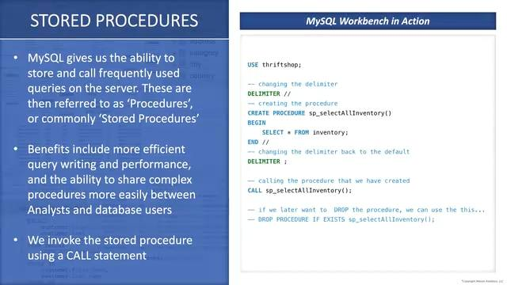
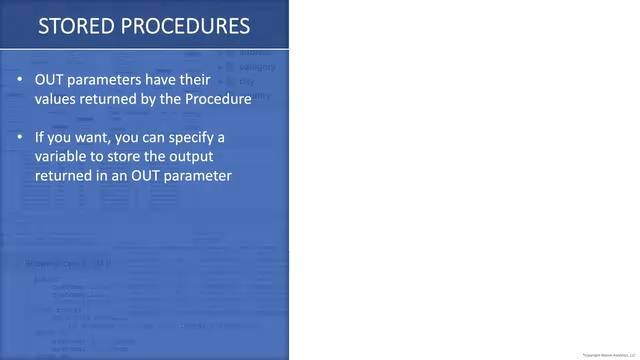
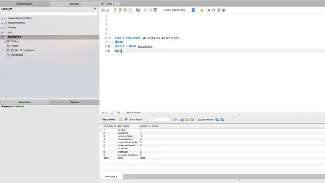
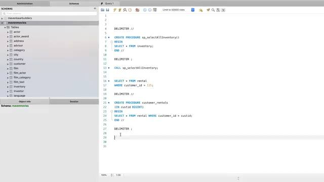
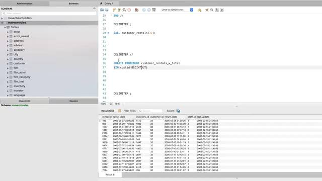
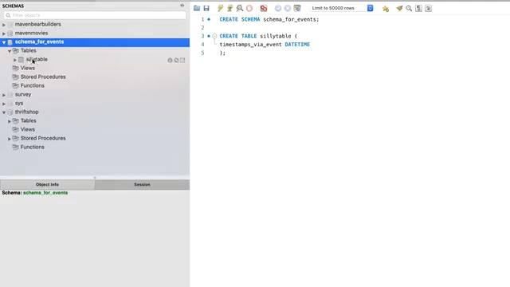
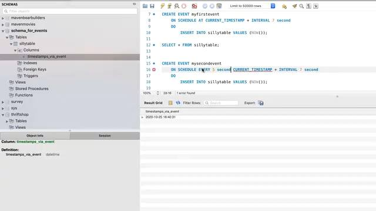
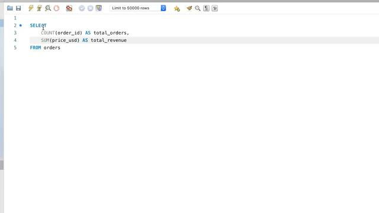
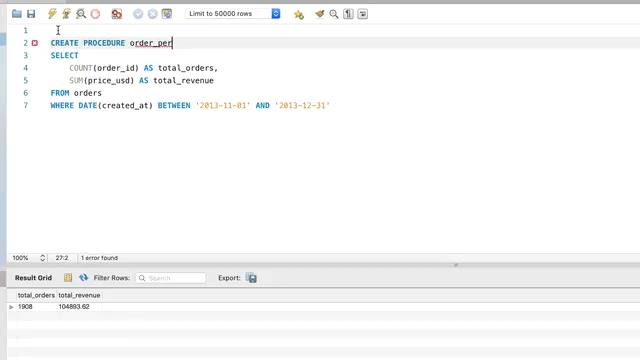

# Advanced MySQL Database Administration：存储过程与定时事件（P64–P67）复现文档

## 1. 这一节做什么

P64–P67 的目标不是“知道存储过程和事件是什么”，而是把 MySQL 里的常用查询真正做成别人可以直接调用的数据库侧工具。学完并照着本文做完，你会得到五个可保存、可执行的 SQL 文件，产出包括：

1. 一个最简单的存储过程 `sp_select_all_inventory()`，用来理解 `CREATE PROCEDURE ... BEGIN ... END` 和 `DELIMITER`。
2. 一个带 `IN` 参数的存储过程 `customer_rentals(cust_id)`，用来按客户筛选租赁记录。
3. 一个同时带 `IN` 和 `OUT` 参数的存储过程 `customer_rentals_with_total(cust_id, OUT total_rentals)`，用来同时返回记录和计数。
4. 两个定时事件：`my_first_event` 用 `ON SCHEDULE AT` 做一次性插入，`my_second_event` 用 `ON SCHEDULE EVERY` 做每 5 秒重复插入。
5. 作业的最终产物 `order_performance(start_date, end_date)`：Sally 不需要会写复杂 SQL，只需要执行 `CALL order_performance('2013-11-01', '2013-12-31');`，就能拿到某段时间的 `total_orders` 和 `total_revenue`。

从前端转 AI 应用工程师的视角看，可以把存储过程理解成“数据库侧的函数/接口”：`IN` 参数像函数入参，`OUT` 参数像额外的返回值，`CALL` 像调用函数。定时事件则像数据库内置的定时任务。课里没有涉及锁、事务、并发控制，所以本文不会硬塞这些内容；只在必要处用 JS/Node 做类比，并明确标注“课里没讲”。

---

## 2. 讲师原话（带「—— pNNN [MM:SS]」）

> "MySQL 让我们可以在服务器上存储并调用常用查询……好处包括更高效地编写查询和更好的性能，以及让分析师和数据库用户更容易共享复杂的存储过程。"
> —— p064 [00:00]

> "这些可以是 IN 参数、OUT 参数或 INOUT 参数。IN 参数会从用户或应用程序接收一个值……OUT 参数的值则由存储过程返回。"
> —— p064 [01:24]

> "做法是临时修改分隔符，写成 delimiter //……最后再在末尾把分隔符改回来。"
> —— p064 [07:58]

> "我们看到错误代码 1318：存储过程的参数数量不正确，预期一个，实际为零。"
> —— p064 [13:37]

> "事件会在某个特定时间触发，或按固定的重复间隔触发。"
> —— p065 [00:27]

> "使用 ON SCHEDULE AT 时，意味着它只会是一次性事件……使用 EVERY 则会创建一个重复事件。"
> —— p065 [04:11]

> "因为 1231 是 BETWEEN 语句的结束边界……在这个确切时刻之后发生的任何事情都不会包含在此输出中。"
> —— p067 [01:57]

> "你在 CREATE PROCEDURE 中设置的参数或实参，始终会按照创建该存储过程时定义它们的顺序被接收。"
> —— p067 [11:22]

讲师反复强调的三件事是：第一，存储过程体里有分号，所以创建时要临时改 `DELIMITER`；第二，有 `IN` 参数时 `CALL` 必须按顺序传参，否则会报 1318；第三，`BETWEEN '2013-11-01' AND '2013-12-31'` 对 `DATETIME` 字段会漏掉 12 月 31 日当天更晚的时间，需要把 `created_at` 用 `DATE()` 截断到日期。





---

## 3. 从零复现

### 3.1 目录结构

在本地新建一个项目目录，例如 `mysql-advanced-p64-67/`，把第 4 节的代码原样保存成下面五个文件：

```text
mysql-advanced-p64-67/
└── sql/
    ├── 01_thrift_shop_inventory.sql
    ├── 02_maven_movies_procedures.sql
    ├── 03_scheduled_events.sql
    ├── 04_order_performance.sql
    └── 99_cleanup.sql
```

### 3.2 依赖、版本与环境变量

- MySQL Server：课程没有说明具体版本号。本文不虚构版本号；你实际使用的版本请在 Workbench 里执行 `SELECT VERSION();` 查看（这条命令课里没讲）。只要实例支持 `CREATE PROCEDURE`、`CREATE EVENT` 和客户端 `DELIMITER`，就能按本文复现。
- MySQL Workbench：课里只称 Workbench，没有给出具体版本号。界面菜单可能因版本略有差异，但核心操作是打开 SQL 脚本并执行。
- 课程资源数据集：P64 明确使用了 `create_mavenmovies.sql`；P67 使用 Maven Bear Builders 数据集里的 `orders` 表，课里没有给出这个数据集的文件名，请从课程资源里找到并导入。
- 环境变量：无。课里没有使用任何环境变量，本文也不需要设置环境变量。
- 第三方 npm 包：无。本节是纯 MySQL 练习，不需要安装 Node 依赖。

### 3.3 启动与执行方式

课里使用的是 MySQL Workbench。启动命令不是 shell 命令，而是：打开 Workbench，连接到你的 MySQL 实例，然后用 `Run SQL Script` 或打开 SQL 文件后点击执行按钮。

如果你更习惯命令行，可以用下面这种方式执行某个文件；**这是课里没讲的补充方式**，不是讲师原话：

```bash
mysql -u root -p < sql/04_order_performance.sql
```

### 3.4 复现步骤

**步骤 1：连接 Workbench。** 打开 MySQL Workbench，双击你的本地连接，进入 SQL 编辑器。左侧 `Schemas` 面板刷新后应能看到已有数据库。

**步骤 2：导入 `create_mavenmovies.sql`。** 讲师在 P64 的做法是使用 `Run SQL Script`，选择课程资源里的 `create_mavenmovies.sql`，执行后会创建并填充 Maven Movies 数据库。执行完刷新左侧 `Schemas`，应能看到很多表。这个数据集是后面 `rental` 表和 `customer_rentals` 示例的前置条件。

**步骤 3：执行 `01_thrift_shop_inventory.sql`。** 这个文件复现 P64 的第一个存储过程。课程假设 `thrift_shop.inventory` 已经存在；如果你没有原始 thrift shop 数据集，文件里给了一个按逐字稿描述构造的最小可运行表，列名是 `id`、`name`、`number_in_stock`。注意：**课程没有给出 thrift shop 的原始 DDL，这个建表语句是按“ID、name、number in stock”的描述构造的复现辅助，不是课程原始结构。** 执行后运行：

```sql
CALL sp_select_all_inventory();
```

应能返回 `inventory` 的内容；如果表是空的，返回空结果也正常。



**步骤 4：执行 `02_maven_movies_procedures.sql`。** 这个文件包含两个存储过程。先执行 `CALL customer_rentals(135);`，应返回 `customer_id = 135` 的租赁记录；讲师在 P64 说这个客户大约返回 30 行。然后执行：

```sql
CALL customer_rentals_with_total(50, @total_rentals);
SELECT @total_rentals;
```

第一条 `CALL` 会先返回客户 50 的租赁记录，第二条 `SELECT` 会返回刚才 `OUT` 参数写出的计数。讲师演示时这个值是 35。



你也可以故意执行 `CALL customer_rentals();`，会看到 1318 错误：过程期望 1 个参数，实际给了 0 个。这个错误是讲师特意演示的，不是你的环境坏了。



**步骤 5：执行 `03_scheduled_events.sql`，但要分段执行。** 先执行建 schema、建 `silly_table`、创建 `my_first_event` 的部分。`my_first_event` 使用：

```sql
ON SCHEDULE AT CURRENT_TIMESTAMP + INTERVAL 15 SECOND
```

意思是 15 秒后执行一次。创建后等 15 秒，执行 `SELECT * FROM silly_table;`，应看到一行时间戳。讲师在 P65 演示时先遇到 `seconds` 的语法问题，改成单数 `SECOND` 才成功；这是一个很容易撞上的细节。



然后执行创建 `my_second_event` 的部分：

```sql
ON SCHEDULE EVERY 5 SECOND
```

每隔 5 秒插入一次。等 10 到 20 秒，反复执行 `SELECT * FROM silly_table ORDER BY timestamps_via_event;`，会看到行数持续增加。观察够了执行：

```sql
DROP EVENT IF EXISTS my_second_event;
```

再刷新几次，行数不再增加。讲师在 P65 就是这样停止事件的。



**步骤 6：导入 Maven Bear Builders 数据集，执行 `04_order_performance.sql`。** 这个文件依赖 `orders` 表，字段包括 `order_id`、`price_usd`
`、`created_at`。字段名来自讲师在 P67 的 SELECT 语句原话：`count(order_id)`、`sum(price_usd)`、`where created_at between ...`。课程没有给出这个数据集的建表 DDL，所以本文不编造，直接沿用课程资源里的 `orders` 表。导入后先执行文件里被注释掉的那段纯 SELECT，确认日期过滤逻辑，再执行完整的 `CREATE PROCEDURE` 部分。



执行：

```sql
CALL order_performance('2013-11-01', '2013-12-31');
```

应返回一行，列名是 `total_orders` 和 `total_revenue`。讲师在 P67 的演示中，未用 `DATE()` 包裹时得到 1875 和 102985；用 `DATE(created_at)` 包裹后数字上升。具体数值取决于你导入的数据集版本，以实际输出为准。



---

## 4. 完整代码

### 4.1 `sql/01_thrift_shop_inventory.sql`

```sql
-- 01_thrift_shop_inventory.sql
-- 复现 P64 的第一个存储过程：不带参数，只做 SELECT * FROM inventory。
-- 注意：课程没有提供 thrift_shop 的原始建表语句。
-- 下面这段 CREATE TABLE 是按逐字稿「ID、name、number in stock」的描述
-- 构造的复现辅助，方便没有原始数据集的人也能跑通 CALL。
-- 如果你已经有 thrift_shop.inventory，请把这段 CREATE TABLE 注释掉。

CREATE DATABASE IF NOT EXISTS thrift_shop;
USE thrift_shop;

CREATE TABLE IF NOT EXISTS inventory (
  id INT PRIMARY KEY AUTO_INCREMENT,
  name VARCHAR(255) NOT NULL,
  number_in_stock INT NOT NULL DEFAULT 0
);

INSERT INTO inventory (name, number_in_stock)
SELECT 'demo item A', 10
WHERE NOT EXISTS (SELECT 1 FROM inventory);

DROP PROCEDURE IF EXISTS sp_select_all_inventory;

DELIMITER //

CREATE PROCEDURE sp_select_all_inventory()
BEGIN
  SELECT * FROM inventory;
END //

DELIMITER ;

-- 调用示例：
-- CALL sp_select_all_inventory();
```

### 4.2 `sql/02_maven_movies_procedures.sql`

```sql
-- 02_maven_movies_procedures.sql
-- 复现 P64 的 customer_rentals（IN）和 customer_rentals_with_total（IN + OUT）。
-- 前置条件：已经通过 Run SQL Script 导入课程资源里的 create_mavenmovies.sql。
-- 下面这行库名按讲师在 Workbench 里看到的 schema 名填写；
-- 如果你的库名大小写或拼写不同，请改成你实际的库名。
USE mavenmovies;

-- ---------------------------------------------------------------
-- 1) 只有 IN 参数：按 customer_id 过滤 rental 表
-- ---------------------------------------------------------------
DROP PROCEDURE IF EXISTS customer_rentals;

DELIMITER //

CREATE PROCEDURE customer_rentals(
  IN cust_id BIGINT
)
BEGIN
  SELECT *
  FROM rental
  WHERE customer_id = cust_id;
END //

DELIMITER ;

-- ---------------------------------------------------------------
-- 2) IN + OUT：先算出该客户的租赁总数写入 OUT 变量，
--    再返回该客户的租赁明细
-- ---------------------------------------------------------------
DROP PROCEDURE IF EXISTS customer_rentals_with_total;

DELIMITER //

CREATE PROCEDURE customer_rentals_with_total(
  IN cust_id BIGINT,
  OUT total_rentals BIGINT
)
BEGIN
  SELECT COUNT(rental_id)
  INTO total_rentals
  FROM rental
  WHERE customer_id = cust_id;

  SELECT *
  FROM rental
  WHERE customer_id = cust_id;
END //

DELIMITER ;

-- 调用示例：
-- CALL customer_rentals(135);
-- CALL customer_rentals_with_total(50, @total_rentals);
-- SELECT @total_rentals;
```

### 4.3 `sql/03_scheduled_events.sql`

```sql
-- 03_scheduled_events.sql
-- 复现 P65 的两个定时事件。
-- 建议在 Workbench 里「分段执行」：先执行第 1 段，观察 15 秒；
-- 再执行第 2 段，观察 5 秒间隔；最后执行第 3 段停掉重复事件。

-- ===============================================================
-- 第 1 段：建 schema、建表、创建一次性事件
-- ===============================================================

CREATE DATABASE IF NOT EXISTS schema_for_events;
USE schema_for_events;

CREATE TABLE IF NOT EXISTS silly_table (
  timestamps_via_event DATETIME
);

-- 先看一眼，确认表是空的
-- SELECT * FROM silly_table;

DROP EVENT IF EXISTS my_first_event;

CREATE EVENT my_first_event
ON SCHEDULE AT CURRENT_TIMESTAMP + INTERVAL 15 SECOND
DO
  INSERT INTO silly_table (timestamps_via_event)
  VALUES (NOW());

-- 创建后等 15 秒，再执行：
-- SELECT * FROM silly_table;

-- ===============================================================
-- 第 2 段：创建每 5 秒重复执行的事件
-- ===============================================================

DROP EVENT IF EXISTS my_second_event;

CREATE EVENT my_second_event
ON SCHEDULE EVERY 5 SECOND
DO
  INSERT INTO silly_table (timestamps_via_event)
  VALUES (NOW());

-- 等 10–20 秒，反复执行：
-- SELECT * FROM silly_table ORDER BY timestamps_via_event;

-- ===============================================================
-- 第 3 段：停掉重复事件
-- ===============================================================

DROP EVENT IF EXISTS my_second_event;

-- 再执行 SELECT，行数应不再增加。
```

### 4.4 `sql/04_order_performance.sql`

```sql
-- 04_order_performance.sql
-- P66 作业 + P67 解答：给 Sally 一个只需要传开始日期和结束日期的存储过程。
-- 前置条件：已经导入 Maven Bear Builders 数据集，存在 orders 表，
-- 且该表有 order_id、price_usd、created_at 三个字段
-- （字段名来自 P67 讲师写的 SELECT 语句）。

USE maven_bear_builders;

-- ---------------------------------------------------------------
-- 第 0 步：先写纯 SELECT，验证日期区间逻辑
-- 讲师在 P67 就是这么做的：先跑通查询，再包进存储过程。
-- ---------------------------------------------------------------
-- 注意下面这段是「会被 DATE() 截断」的正确写法。
-- 讲师演示时先用了不带 DATE() 的版本，结果漏掉 12 月 31 日当天
-- 午夜之后的所有订单，数字偏小（1875 / 102985）。
-- 加上 DATE() 之后 between 两端都按「日期」比较，12 月 31 日全天被包含。

SELECT
  COUNT(order_id) AS total_orders,
  SUM(price_usd) AS total_revenue
FROM orders
WHERE DATE(created_at) BETWEEN '2013-11-01' AND '2013-12-31';

-- ---------------------------------------------------------------
-- 第 1 步：把上面的 SELECT 包进存储过程
-- 两个 IN 参数都是 DATE 类型
-- ---------------------------------------------------------------
DROP PROCEDURE IF EXISTS order_performance;

DELIMITER //

CREATE PROCEDURE order_performance(
  IN start_date DATE,
  IN end_date DATE
)
BEGIN
  SELECT
    COUNT(order_id) AS total_orders,
    SUM(price_usd) AS total_revenue
  FROM orders
  WHERE DATE(created_at) BETWEEN start_date AND end_date;
END //

DELIMITER ;

-- 调用示例：
-- CALL order_performance('2013-11-01', '2013-12-31');
-- 只看 12 月：
-- CALL order_performance('2013-12-01', '2013-12-31');
```

### 4.5 `sql/99_cleanup.sql`

```sql
-- 99_cleanup.sql
-- 可选：把本节创建的对象清掉，方便反复练习。
-- 注意：删除 schema 会连带删除其中的表和事件，
-- 如果你还想保留 mavenmovies / maven_bear_builders 的数据，请先备份。

-- thrift_shop 里的存储过程
DROP PROCEDURE IF EXISTS thrift_shop.sp_select_all_inventory;

-- mavenmovies 里的两个存储过程
DROP PROCEDURE IF EXISTS mavenmovies.customer_rentals;
DROP PROCEDURE IF EXISTS mavenmovies.customer_rentals_with_total;

-- 事件练习库（会连带删掉 silly_table 和事件）
DROP DATABASE IF EXISTS schema_for_events;

-- Maven Bear Builders 的作业存储过程
DROP PROCEDURE IF EXISTS maven_bear_builders.order_performance;
```

---

## 5. 逐行解释

### 5.1 为什么存储过程体里要临时改 `DELIMITER`

`DELIMITER` 不是 SQL 语句，而是 MySQL 客户端（Workbench、`mysql` 命令行）的指令。它告诉客户端「遇到什么符号才算一条语句结束」。默认是分号。

问题在于：`CREATE PROCEDURE ... BEGIN ... END` 内部本身就有分号。如果客户端仍然以分号作为结束符，它会在 `BEGIN` 后的第一条 `SELECT ...;` 处就认为语句结束了，然后把后面的 `END` 当成一条独立语句发出去，于是报语法错误。讲师在 P64 [07:32] 讲的就是这件事：“when the server sees this, it thinks the query is over”。

解决办法：

```sql
DELIMITER //
CREATE PROCEDURE ... BEGIN ...; END //
DELIMITER ;
```

- `DELIMITER //`：把结束符临时改成 `//`。
- 过程体里的 `;` 现在只是普通字符，客户端不会在这里断开。
- `END //`：真正的语句结束。
- `DELIMITER ;`：改回默认，避免影响后面的普通 SQL。

**JS/Node 类比（课里没讲）：** 这有点像模板字符串。普通字符串遇到引号就结束，模板字符串用反引号包住，内部可以随便出现单双引号。`DELIMITER` 只是换了「结束标记」，不是换了 SQL 语义。

### 5.2 `IN cust_id BIGINT` 与 `CALL` 的传参顺序

```sql
CREATE PROCEDURE customer_rentals(IN cust_id BIGINT)
```

- `IN`：入参，调用方必须提供值，过程内部只读使用。
- `cust_id`：过程内部的参数名，在 `WHERE customer_id = cust_id` 里被引用。
- `BIGINT`：类型。讲师在 P64 [11:17] 明确说 “I'm going to give this a value of cust ID. And I'm going to say that that value should always be a big int.”

调用：

```sql
CALL customer_rentals(135);
```

如果写成 `CALL customer_rentals();`，MySQL 报 1318：`Incorrect number of arguments for procedure`。讲师在 P64 [13:37] 特意复制了这个错误码。这不是 bug，是接口契约：过程声明了几个 `IN`，调用就必须给几个，而且**按声明顺序对应**。讲师在 P67 [11:22] 专门强调：“The parameters or arguments that you put into your create procedure will always just be accepted in the order in which you define them.”

**JS/Node 类比（课里没讲）：** 相当于一个函数 `function customerRentals(custId) {}`，调用时少传参数在 JS 里会得到 `undefined` 且不报错；MySQL 存储过程更严格，直接抛 1318。这个差异对前端同学很重要。

### 5.3 `OUT total_rentals` 与会话变量 `@total_rentals`

```sql
CREATE PROCEDURE customer_rentals_with_total(
  IN cust_id BIGINT,
  OUT total_rentals BIGINT
)
BEGIN
  SELECT COUNT(rental_id) INTO total_rentals
  FROM rental WHERE customer_id = cust_id;

  SELECT * FROM rental WHERE customer_id = cust_id;
END
```

- `OUT`：过程内部会给这个参数赋值，调用结束后调用方可以读到。
- `SELECT ... INTO total_rentals`：把聚合结果写入 OUT 参数。讲师在 P64 [16:09] 原话是 “select count of rental ID into total rentals”。
- 过程里有两个 `SELECT`：第一个负责「算」，第二个负责「返回明细」。所以 `CALL` 之后你会先看到明细结果集，再通过 `SELECT @total_rentals` 看到计数。

调用：

```sql
CALL customer_rentals_with_total(50, @total_rentals);
SELECT @total_rentals;
```

`@total_rentals` 是 MySQL 的会话变量（用户变量），以 `@` 开头。它不属于任何表，在当前连接内一直存在，直到你断开或重新赋值。讲师在 P64 [18:32] 说 “a variable that we're going to name called total rentals”，然后 `SELECT total rentals` 验证。

**为什么不能直接 `CALL customer_rentals_with_total(50, 35)`？** 因为 `OUT` 位置需要的是「能被写入的变量」，不是字面量。用 `@` 变量是课里演示的做法。

**JS/Node 类比（课里没讲）：** 这更像 Node 里 `function f(input, out) { out.value = ... }` 这种「传一个容器进去让它写」的写法，而不是 JS 原生的多返回值。JS 里通常直接 `return { rows, total }`；MySQL 存储过程没有这种返回对象，所以用 `OUT` 参数 + 结果集两条通道。

### 5.4 `ON SCHEDULE AT` 与 `ON SCHEDULE EVERY`

```sql
CREATE EVENT my_first_event
ON SCHEDULE AT CURRENT_TIMESTAMP + INTERVAL 15 SECOND
DO
  INSERT INTO silly_table (timestamps_via_event) VALUES (NOW());
```

- `CREATE EVENT`：创建一个事件对象，存在数据库里。
- `ON SCHEDULE AT ...`：一次性触发。到点执行一次，然后事件自动失效。讲师 P65 [04:11] 原话：“at is just a one time thing”。
- `INTERVAL 15 SECOND`：单位必须写单数 `SECOND`。讲师在 P65 [04:38] 先写了 `seconds`，报错，改成 `second` 才通过。`MINUTE`、`HOUR`、`DAY` 同理，都是单数。

```sql
CREATE EVENT my_second_event
ON SCHEDULE EVERY 5 SECOND
DO
  INSERT INTO silly_table (timestamps_via_event) VALUES (NOW());
```

- `ON SCHEDULE EVERY 5 SECOND`：每 5 秒重复一次，直到被 `DROP EVENT` 或 `ALTER EVENT ... DISABLE` 停掉。
- 讲师 P65 [07:02] 为了演示方便把间隔从 20 秒改成 10 秒再改成 5 秒，并说 “it's got to be second, not seconds, even though that's not intuitive”。

**为什么演示完要 `DROP EVENT my_second_event`？** 讲师 P65 [07:59] 的原话是 “Just because I don't want this to populate on my local machine forever, it'll eventually eat up a lot.” 重复事件不会自己停，表会一直长。养成「建完重复事件就准备好停它」的习惯。

### 5.5 为什么 `BETWEEN '2013-11-01' AND '2013-12-31'` 会漏数据

这是 P67 最值得记住的一个坑。假设 `created_at` 是 `DATETIME`：

```sql
WHERE created_at BETWEEN '2013-11-01' AND '2013-12-31'
```

MySQL 会把 `'2013-12-31'` 补成 `'2013-12-31 00:00:00'`。`BETWEEN` 是闭区间，所以 `2013-12-31 00:00:00` 这一刻本身包含在内，但 `2013-12-31 01:00:00`、`12:00:00`、`23:59:59` 全都大于右端点，被排除。讲师 P67 [01:57] 说得很清楚：“Anything that happens after this exact moment will not be included in this output.”

修复：

```sql
WHERE DATE(created_at) BETWEEN start_date AND end_date
```

`DATE(created_at)` 把 `2013-12-31 06:00:00` 截成 `2013-12-31`，与右端点 `2013-12-31` 相等，闭区间包含，12 月 31 日全天数据回来了。讲师 P67 [03:25] 演示时数字从 1875 / 102985 上升，就是因为补回了当天更晚的订单。

**代价（课里没讲）：** `DATE(created_at)` 让 `created_at` 上的索引可能失效，因为函数包住了列，MySQL 无法直接用索引定位范围。数据量大时更常见的写法是半开区间：

```sql
WHERE created_at >= start_date
  AND created_at < end_date + INTERVAL 1 DAY
```

但这个写法课里没讲，讲师选择的是 `DATE()`，因为对 Sally 这类非 SQL 用户更直观。你如果要在生产环境用，需要自己评估索引和数据量；这属于课程之外的内容。

**JS/Node 类比（课里没讲）：** 类似 `new Date('2013-12-31')` 在 JS 里被解析成当天 00:00:00 UTC，`>=` 和 `<=` 比较时同样会漏掉当天后面的时间。前端处理日期区间时也常犯这个错。

### 5.6 `DROP PROCEDURE` 不需要括号，以及 1305 错误

```sql
DROP PROCEDURE IF EXISTS order_performance;
```

删除过程时写过程名即可，**不加括号、不加参数**。讲师 P67 [08:07] 特别说明：“when you're dropping it, you don't need to include the parentheses.”

讲师在 P67 [08:36] 还演示了一个 1305 错误：`PROCEDURE ... does not exist`。原因是他在 `DROP` 时把 `order_performance` 拼错了，而之前创建时用的是另一个拼写。MySQL 只做字面匹配，不会猜你想删哪个。这跟前端里 `import` 路径大小写写错、构建工具直接报找不到模块是同一类问题。

**养成习惯：** 改存储过程前先 `DROP PROCEDURE IF EXISTS 原名;`，再 `CREATE`。讲师在 P67 修改 `order_performance` 加参数时，就是先 `DROP` 再重建。

---

## 6. 复现检查清单

按顺序打勾，任何一项不通过就回到对应章节排查。

**环境与数据**

- [ ] Workbench 能连上本地 MySQL 实例，左侧 `Schemas` 面板能刷新。
- [ ] 已执行 `create_mavenmovies.sql`，`Schemas` 里能看到 mavenmovies 相关表。
- [ ] `SELECT * FROM rental LIMIT 5;` 能返回数据，且列里确实有 `rental_id`、`customer_id`。
- [ ] 已导入 Maven Bear Builders 数据集，`orders` 表存在，且有 `order_id`、`price_usd`、`created_at`。
- [ ] 如果库名不是 `mavenmovies` / `maven_bear_builders`，已把脚本里的 `USE` 改成实际库名。

**存储过程基础**

- [ ] `01_thrift_shop_inventory.sql` 执行无报错。
- [ ] `CALL sp_select_all_inventory();` 能执行，返回 `inventory` 的内容（空表返回空结果也算通过）。
- [ ] 能说清为什么 `CREATE PROCEDURE` 前后要各写一次 `DELIMITER`。

**IN 参数**

- [ ] `02_maven_movies_procedures.sql` 执行无报错。
- [ ] `CALL customer_rentals(135);` 返回客户 135 的租赁记录，行数与讲师说的「大约 30 行」量级接近。
- [ ] 故意执行 `CALL customer_rentals();`，能看到 1318 错误，错误信息里含 `Incorrect number of arguments`。
- [ ] 能说清 1318 出现的原因：过程声明了 1 个 `IN`，调用给了 0 个。

**IN + OUT**

- [ ] `CALL customer_rentals_with_total(50, @total_rentals);` 执行成功，先返回客户 50 的明细结果集。
- [ ] 紧接着 `SELECT @total_rentals;` 返回一个数字（讲师演示值是 35，你的数据可能不同）。
- [ ] 能说清为什么第二个参数要写成 `@total_rentals` 而不是字面量。
- [ ] 能说清 `OUT` 参数和第一个 `SELECT` 结果集是两条不同的输出通道。

**定时事件**

- [ ] `schema_for_events` 和 `silly_table` 创建成功。
- [ ] 创建 `my_first_event` 时用了 `INTERVAL 15 SECOND`，没有写成 `SECONDS`。
- [ ] 等 15 秒后 `SELECT * FROM silly_table;` 能看到 1 行时间戳。
- [ ] 创建 `my_second_event` 后，反复 `SELECT` 能看到行数按约 5 秒间隔增长。
- [ ] 执行 `DROP EVENT IF EXISTS my_second_event;` 后，再等 10 秒以上，行数不再增加。
- [ ] 知道重复事件不 `DROP` 会一直写表。

**作业 `order_performance`**

- [ ] 先单独执行文件里的纯 `SELECT`，能返回 `total_orders` 和 `total_revenue` 两列。
- [ ] 能观察到「不加 `DATE()`」与「加 `DATE()`」两次查询的数字差异；如果差异为 0，说明你的数据里 12 月 31 日当天没有更晚时间的订单，换一个月再验证。
- [ ] `CREATE PROCEDURE order_performance` 执行成功。
- [ ] `CALL order_performance('2013-11-01', '2013-12-31');` 返回一行两列，数值与纯 `SELECT` 一致。
- [ ] `CALL order_performance('2013-12-01', '2013-12-31');` 只返回 12 月的数据，数值小于 11–12 月合计。
- [ ] 故意执行 `CALL order_performance();`，能看到 1318，错误信息提示期望 2 个参数、实际 0 个。
- [ ] 故意 `DROP PROCEDURE order_performance` 时把名字拼错，能看到 1305 `does not exist`，理解讲师为什么强调拼写。

**清理**

- [ ] 需要重练时执行 `99_cleanup.sql`，确认存储过程和 `schema_for_events` 被清掉。
- [ ] 清理前确认自己不需要保留 `order_performance` 或事件数据。

---

## 7. 课里没讲但你会撞上的

以下问题逐字稿和截图里都没有出现，但你按本文操作时大概率会遇到。写在这里是为了让你不卡住，同时明确区分「讲师讲的」和「补充的」。

**1. 事件调度器可能是关闭的。** 创建事件成功，但到点没执行，最常见的原因是 MySQL 的 `event_scheduler` 处于 `OFF`。课里没有提这个开关。你可以用 `SHOW VARIABLES LIKE 'event_scheduler';` 查看状态；如果值是 `OFF`，需要把它打开。具体怎么开取决于你的环境和权限，课里没讲，本文不编造命令细节，请以你环境的实际输出和官方文档为准。排查时先看这个，再看事件是否被 `DISABLE`。

**2. `CREATE EVENT` 需要 `EVENT` 权限。** 课里用的是本地高权限账号，没提权限问题。如果你用的是受限账号，可能报权限错误。同样，课里没讲授权语句，需要时查你环境的管理员配置。

**3. 库名大小写和拼写。** 脚本里写的是 `USE mavenmovies;` 和 `USE maven_bear_builders;`，这是按讲师在 Workbench 里出现的名字推断的。逐字稿里讲师说的是 “Maven Movies” 和 “Maven Bear Builders”，没有逐字符念出 schema 名。如果你的实际库名是 `MavenMovies`、`maven_bear_builders` 或其他拼写，`USE` 会报「Unknown database」。先刷新 `Schemas` 面板，照抄实际名字改脚本。这跟 P67 [08:36] 讲师遇到的 1305 是同一类「字面必须完全一致」的问题。

**4. thrift shop 的 `inventory` 表结构。** 第 4.1 节里的建表语句是本文按逐字稿描述构造的，不是课程原始 DDL。讲师只说了表里有 “an ID, a name, and then the number that's in stock”，没有给出列名、类型、是否自增。如果你的课程资源里有原始 thrift shop 数据集，优先用原始的；没有的话用本文这份也能跑通 `CALL`，但不要以为这就是课程原始结构。

**5. `DELIMITER` 只在客户端生效，通过某些驱动执行会失败。** 这是前端转 AI 应用时很容易踩的坑：`DELIMITER` 是 Workbench / `mysql` 命令行这类客户端的指令，不是 MySQL 服务端认识的 SQL。如果你从 Node 的 `mysql2`、Python 的 `pymysql`、ORM 或迁移工具里把整段 `DELIMITER // ... DELIMITER ;` 发过去，服务端会报语法错误。课里全程在 Workbench 里操作，所以没讲这一点。实际工程里通常是：建存储过程的脚本用命令行或迁移工具执行，或者由驱动提供单独的 API。具体怎么做取决于你的驱动，课里没讲，本文不展开。

**6. `OUT` 参数在连接池下会串。** 课里是单个 Workbench 会话，`@total_rentals` 一直有效。如果你在 Node 里用连接池，`CALL` 和后续 `SELECT @total_rentals` 可能落在不同连接上，会话变量读不到。这是课里完全没涉及的场景。前端同学记住一句话：`@` 变量是「连接级」的，不是「请求级」的。实际项目里更稳的做法是让存储过程直接 `SELECT` 出结果，而不是依赖 `OUT` + 会话变量；但这已经偏离课程内容了。

**7. `BETWEEN` + `DATE()` 的性能问题。** 5.5 节已经说过，再强调一次：`DATE(created_at)` 会让 `created_at` 上的索引在范围过滤时可能用不上。课里讲师选这个写法是为了给非 SQL 用户直观的日期语义，没有讨论性能。数据量小时无所谓；数据量大时你会看到查询变慢，那时需要换成半开区间或函数索引，这属于课程之外的内容，课里没讲。

**8. 事件执行失败不会弹窗。** 事件是后台执行的，`DO` 里的 SQL 如果报错（比如表被删了），你在 Workbench 里不会收到即时提示。讲师的 `silly_table` 演示很简单所以没出错。实际使用时要自己去查事件执行情况；课里没讲怎么查，本文不编造具体的系统表或命令名。遇到「事件建了但表没数据」时，除了第 1 条的 `event_scheduler`，也要怀疑 `DO` 里的语句本身失败了。

**9. `NOW()` 与 `CURRENT_TIMESTAMP` 的混用。** 脚本里 `ON SCHEDULE AT CURRENT_TIMESTAMP + INTERVAL 15 SECOND` 用的是 `CURRENT_TIMESTAMP`，`DO INSERT ... VALUES (NOW())` 用的是 `NOW()`。讲师在 P65 的演示里两者都出现过。在你这个场景下它们等价，都是当前时刻。知道即可，不用纠结。

**10. 重复事件没停就关 Workbench，事件仍在跑。** 事件定义存在数据库里，不是存在 Workbench 会话里。关掉 Workbench 不会停掉 `my_second_event`。讲师 P65 [07:59] 演示完立刻 `DROP EVENT`，就是怕这个。你练习时如果中途离开，回来先执行 `DROP EVENT IF EXISTS my_second_event;` 再继续。

---

以上是 P64–P67 的完整复现路径。核心只有三件事：用 `DELIMITER` 把带分号的存储过程体包成一条语句；用 `IN` / `OUT` 把参数契约定清楚并严格按顺序 `CALL`；用 `DATE()` 把 `DATETIME` 截到日期再 `BETWEEN`，否则区间右端点当天会被漏掉。作业 `order_performance` 把这三件事合在一次实现里，做完它，本节的自动化目标就达成了。