# Advanced MySQL Database Administration：P68–P74 复现文档

> 覆盖内容：网站数据写入、页面浏览数据导入、MySQL 安全威胁与安全最佳实践。  
> 复现目标：在 MySQL Workbench 中创建 `website_page_views` 表，导入 2014 年 2 月页面浏览数据，并得到一套可检查的安全实践清单。  
> 说明：本节逐字稿没有给出完整业务数据库结构、附件文件内容、MySQL 版本号，也没有给出 Web 应用代码。下面凡逐字稿没有讲到的内容，我会明确标注「课里没讲」。

## 1. 这一节做什么

这一节围绕两条线展开。

第一条线是「网站数据怎么进入数据库」。讲师先说明 DBA 与工程团队的职责边界：表结构、数据该不该采集、表之间怎么关联，可能由 DBA 主导；而把 Web 应用、营销网站里的行为写进表，通常由工程团队完成。两者边界在不同公司会模糊，有些组织里工程师会承担 DBA 职责，有些组织会有专门 DBA。这个背景很重要，因为后面的页面浏览数据导入不是孤立 SQL 练习，而是「网站分析数据」和「业务数据库」之间的一次对接。

第二条线是「数据库安全」。讲师讲了常见威胁：弱认证、DoS/DDoS、权限提升、SQL 注入、缓冲区溢出、勒索软件；又讲了安全最佳实践：少存 PII、敏感数据加密、最小权限、强密码、多因素认证、备份、日志、审计、第三方渗透测试。这里没有写具体安全系统代码，但给出了 DBA 和工程团队应该共同落地的检查项。

本节最终可交付的产物是：

1. 一个 `website_page_views` 表，字段为 `website_page_view_id`、`created_at`、`website_session_id`、`page_view_url`；
2. 一次通过 Workbench `Table Data Import Wizard` 完成的页面浏览数据导入；
3. 一次 `SELECT * FROM website_page_views;` 验证；
4. 一个基于 P73–P74 的安全检查清单；
5. 对页面浏览表数据量过大的保留策略说明：讲师建议可以按时间截断，只保留最近一段时间的数据。

需要注意：逐字稿没有提供附件 CSV 的实际内容，也没有给出完整 `website_sessions`、`orders`、`order_items`、`products` 表的建表语句。因此本文可以复现「建表和导入流程」，但不能凭空复原附件里的 38,391 条页面浏览记录。若你没有课程附件，可以先用你自己的同结构数据走通流程，但不要把行数伪造成 38,391。

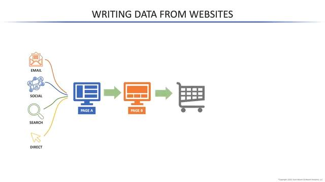

## 2. 讲师原话（带「—— pNNN [MM:SS]」）

下面保留讲师英文原话，括号外是我为复现补充的中文说明。

> "工程师和数据库管理员之间的合作非常重要，有时他们实际上是同一个人，同时承担两种职能。"
> —— p068 [00:58]

这说明复现时不要把它理解成「DBA 一个人把所有 Web 埋点写完」。表结构可以先行，但数据写入通常要和工程团队约定事件、字段、写入时机。

> "我们可能会跟踪用户 ID。我们可能会有某种字段，用来表示这是重复会话还是新客户。我们使用 Cookie 完成所有这些。"
> —— p068 [03:38]

讲师把用户相关数据、cookie、重复访问识别讲在一起。复现页面浏览表时只落地了页面浏览数据结构，cookie 和用户识别逻辑课里没有给出实现代码。

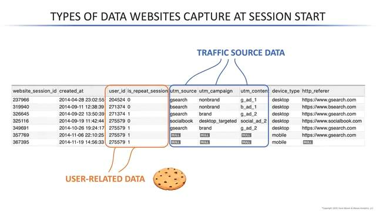

> "你肯定希望采集的一些内容，是与关键业务活动有关的，尤其是购买行为。"
> —— p068 [07:22]

网站数据不仅是 page view，还包括购买、订阅、lead signup、退款等收入相关活动。逐字稿提到 `orders` 表会记录 website session、user ID、primary product、USD 收入、cost of goods sold；但完整表结构课里没讲。

> "目前缺失的主要部分，是页面浏览数据……"
> —— p070 [02:17]

P70 的作业讲评结论是：现有数据库已经在采集部分 traffic source、technology、orders 数据，但缺少页面浏览数据。补上页面浏览表后，才能做用户如何在网站中移动、转化漏斗之类的分析。

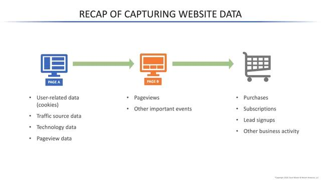

> "在导入网站页面浏览数据之前，我们需要做的第一件事，实际上是创建那张表……我们可以把它叫作 website_page_views。"
> —— p072 [00:25]

导入之前先建表。不是先导入再让向导自动猜结构。

> "我们会有一个 website_page_view_id 列，类型是 bigint。还会有一个 created_at 时间戳，类型是 datetime。我们有 website_session_id……类型是 bigint。还会有一个 page_view_url……类型用 varchar(50) 应该就够了。最后，确保把 website_page_view_id 列设为主键。"
> —— p072 [00:53]

这段是本节最关键的建表依据。逐字稿明确：`website_page_view_id` 是 `BIGINT`，`created_at` 使用 date time 类型，`website_session_id` 是 `BIGINT`，`page_view_url` 是 `VARCHAR(50)`，主键是 `website_page_view_id`。讲师没有说 `AUTO_INCREMENT`，也没有说外键。

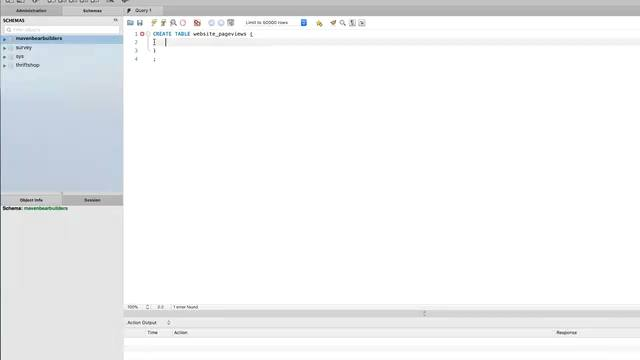

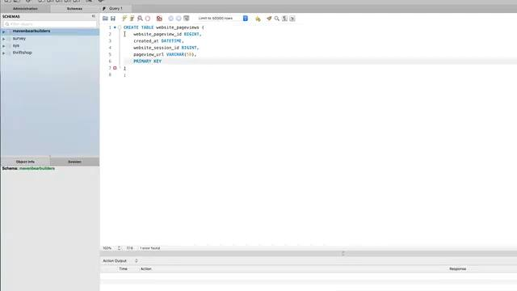

> "因此我们看到导入了 38,391 条记录。"
> —— p072 [04:39]

如果使用课程附件，导入向导结束时讲师读到的数量是 38,391 条。这个数字只对课程附件成立；你自己的文件行数不同是正常的。

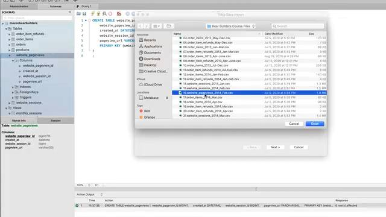

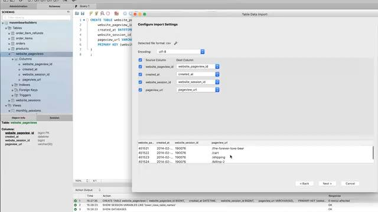

> "在 SQL 注入攻击中，黑客会试图通过修改后端使用的 SQL 语句，让你的应用执行你本不希望它执行的操作。"
> —— p073 [05:34]

安全部分不是让 DBA 单独写应用代码，而是要求 DBA 理解后端 SQL 拼接、输入校验、权限控制与工程团队之间的协作风险。


> "尽可能少地存储个人可识别信息。"
> —— p074 [01:22]

PII 越少存越好；如果必须存敏感字段，就要尽可能加密，并盘点哪些应用和人员能访问。

> "只授予完成该工作所需的权限，不要多给。"
> —— p074 [02:48]

这是最小权限原则的原话。数据库复现时可以先落实为：应用账号只给需要的 `SELECT`、`INSERT` 等权限，不随便给全库管理权限。具体 `GRANT` 语句课里没有演示。

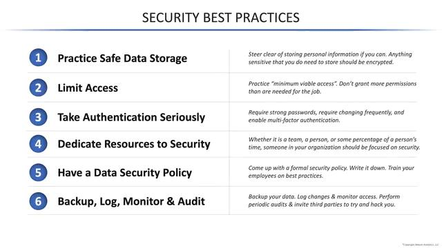

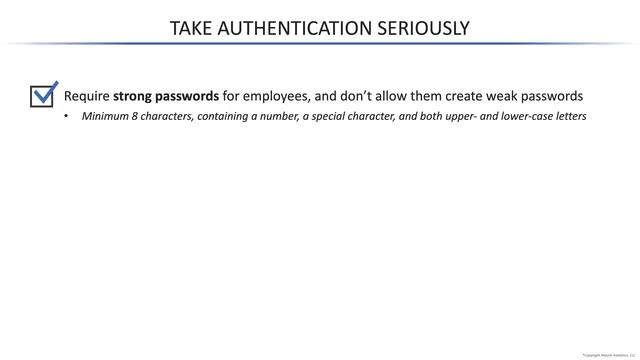

## 3. 从零复现

### 3.1 准备环境与目录

课里使用的工具是 MySQL Workbench，导入功能是 `Table Data Import Wizard`。逐字稿没有给出 MySQL Server、MySQL Workbench 的具体版本，也没有给出操作系统。复现时建议使用你本机已经可连接的 MySQL 实例和兼容版本的 Workbench。本文 SQL 只使用 `BIGINT`、`DATETIME`、`VARCHAR(50)`、`PRIMARY KEY` 这些基础语法，避免依赖课程未说明的版本特性。

建议建立如下目录。路径和数据库名是复现用约定，不是讲师给出的原始项目路径：

```text
advanced-mysql-lab/
├─ sql/
│  ├─ 00_optional_create_database.sql
│  ├─ 01_create_website_page_views.sql
│  └─ 02_verify_website_page_views.sql
├─ data/
│  └─ file-16-website-page-views-february-2014.<附件真实扩展名>
└─ notes/
   └─ security-review.md
```

其中 `data/` 下应放课程附件。逐字稿里讲师把它称为 `file 16 website page views February 2014`，但没有展示扩展名。Workbench 向导中按实际文件类型选择；不要为了复现把扩展名随便改掉。

环境变量：课里没有使用环境变量。Workbench 使用连接配置，不需要 `.env`。如果你使用命令行客户端，这部分不是本节内容；课里也没有演示命令行导入。

### 3.2 选择或创建数据库

Workbench 里先连接 MySQL，然后在左侧 Schemas 中选中一个业务库。逐字稿没有给数据库名；课程默认你已经有一个「central database」。如果你是独立复现、没有现成库，可以运行下面的可选 SQL 建一个本地实验库。这个库名 `advanced_mysql_lab` 是我为复现加的，不是课程原数据库名。

```sql
-- 00_optional_create_database.sql
-- 仅用于独立复现。课里没有给出数据库名。
CREATE DATABASE IF NOT EXISTS advanced_mysql_lab;
USE advanced_mysql_lab;
```

运行后刷新左侧 Schemas，选中 `advanced_mysql_lab`。

### 3.3 建 `website_page_views` 表

在 Workbench 中打开 SQL 编辑器，选中目标数据库，粘贴并执行 `01_create_website_page_views.sql`。讲师的操作顺序是：

1. 写 `CREATE TABLE website_page_views`；
2. 定义 `website_page_view_id BIGINT`；
3. 定义 `created_at DATETIME`；
4. 定义 `website_session_id BIGINT`；
5. 定义 `page_view_url VARCHAR(50)`；
6. 把 `website_page_view_id` 设为主键；
7. 执行 SQL；
8. 刷新左侧 Tables 列表，看到 `website_page_views`；
9. 再展开表或查看列，确认四个字段都在。

讲师在 P072 [01:49] 附近明确说过：执行后会先在表列表中看不到，刷新后才出现。复现时这是正常现象。

注意：逐字稿没有让讲师加 `AUTO_INCREMENT`，也没有让讲师加外键。不要自行把这两个东西加进去后声称是课程原操作。`website_session_id` 在语义上「tie back to the website sessions table」，但本节没有建 `FOREIGN KEY`。在页面浏览数据量很大的场景里，是否加外键、什么时候加索引，是另一个设计问题；P68–P74 没讲。

### 3.4 用 Workbench 导入页面浏览数据

表创建完成后，在 Workbench 左侧 Tables 中找到 `website_page_views`，右键选择 `Table Data Import Wizard`。然后按讲师的操作路径走：

1. 点击 `Browse`，选择课程附件 `file 16 website page views February 2014`；
2. 点击 `Next`；
3. 向导会展示字段与预览数据，讲师说 “Everything looks good here”；
4. 继续 `Next`；
5. 等待导入完成；
6. 课程附件对应结果是 38,391 条记录；
7. 点击 `Finish`；
8. 刷新或直接运行 `SELECT * FROM website_page_views;` 查看数据。

这里有一个复现风险：逐字稿没有展示字段映射的每一个细节，只展示导入向导预览。若你的文件列名、日期格式、分隔符、编码、表头行与讲师附件不一致，向导的默认判断可能不同。你要在预览页确认四个目标字段映射正确：

| 表字段 | 类型 | 来源文件中的对应列 |
|---|---|---|
| `website_page_view_id` | `BIGINT` | 页面浏览事件 ID，具体列名以你的附件为准 |
| `created_at` | `DATETIME` | 页面浏览时间，具体格式以你的附件为准 |
| `website_session_id` | `BIGINT` | 所属网站会话 ID |
| `page_view_url` | `VARCHAR(50)` | 页面 URL |

如果预览页出现列错位、日期被识别成字符串、第一行数据被当成表头等情况，先停止导入并修正，不要直接 `Finish`。

### 3.5 验证导入结果

讲师演示的是简单查询：

```sql
SELECT * FROM website_page_views;
```

如果你使用课程附件，导入后应能查到页面 URL 等数据，并在导入结束时看到讲师读出的 38,391 这个数量。若你要额外核对行数，可以运行：

```sql
SELECT COUNT(*) FROM website_page_views;
```

这条计数 SQL 是我为复现检查补的，不是讲师在逐字稿里演示的原句。它的输出字段名以你的 MySQL 客户端实际显示为准；如果你只记得课程原操作，就以 `SELECT *` 和导入向导结束页的数量为准。

### 3.6 理解页面浏览表为什么会很大

讲师在导入等待时解释了一个重要事实：页面浏览数据每加载一个页面就产生一条记录；而 website sessions 数据通常只在会话第一次页面加载时产生一条记录，后续页面不会为同一个 session 重复建 session 记录。所以 `website_page_views` 很容易成为整库中单月数据量最大的表之一。

讲师给的现实处理方式是：页面浏览数据不一定永久保留。订单数据可能希望从公司历史开始一直保留，但页面浏览历史越久越可能不重要，而且数据量会让查询和维护变得笨重。常见做法是按时间截断，比如只保留最近两个月、最近一个月，甚至两周。具体截断周期要看网站访问量。这里有一个关键取舍：保留全部历史，查询和存储成本高；只保留最近
一段时间的数据，查询和维护更轻，但会失去更早的历史分析能力。讲师没有给出按时间保留的具体 SQL、定时任务或分区方案；他只讲了取舍。复现时把这条写进设计说明即可，不要在本节直接对表执行清空操作。

### 3.7 把安全最佳实践落成评审清单

P73–P74 不是代码课，不能像建表一样“执行一下就看到结果”。这部分的可复现产物是一份安全评审清单。按讲师给出的顺序做：

1. **盘点 PII**：列出数据库里哪些字段可能是个人信息，例如邮箱、电话、密码、信用卡、社会安全号码。讲师特别说，如果应用不需要，就不要存；必须存就尽量加密。
2. **盘点访问者**：列出哪些应用、哪些人有权限接触这些敏感数据，然后问一句“这个名单是不是太长了”。不需要的应用去掉，不需要的人降权。
3. **检查权限粒度**：能不能把编辑权限降成只读？离职人员的权限能不能立刻回收？讲师的原话是“grant only what people need for that job and no more”。
4. **检查认证**：是否有强密码要求，是否定期更换，敏感权限是否启用双因素或多因素认证。
5. **指定安全责任人**：可以是团队、一个人，或某个人的一部分工作时间；但必须写进职责，并给予推动改进的授权。
6. **形成书面策略**：写下来、发给全员、定期复审。
7. **检查备份与日志**：重要数据是否有不被勒索软件影响的备份；管理端和数据库活动是否有日志；是否安排定期审查和第三方渗透测试。

这七步不需要改表结构，但会反过来影响表设计。例如页面浏览 URL 可能带邮箱、token 等敏感参数，按 P74 的“少存 PII”原则，就应该在写入前决定是否脱敏。课里没有讲 URL 脱敏的具体实现，这个决定要由你和工程团队补。

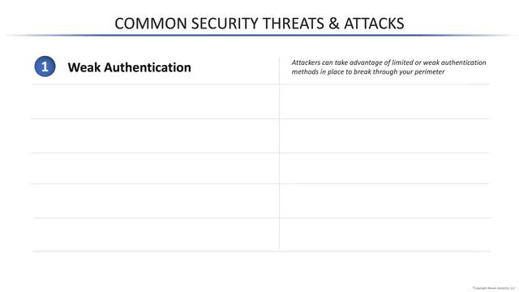

## 4. 完整代码

`00_optional_create_database.sql` 已在 3.2 完整给出，不重复。下面是其余可直接保存的文件。

### 4.1 `sql/01_create_website_page_views.sql`

```sql
-- 01_create_website_page_views.sql
-- 在 MySQL Workbench 中先选中目标数据库，再执行本文件。
-- 字段与主键依据 P072 讲师演示；课里没有加 AUTO_INCREMENT，也没有加外键。

CREATE TABLE website_page_views (
    website_page_view_id BIGINT,
    created_at DATETIME,
    website_session_id BIGINT,
    page_view_url VARCHAR(50),
    PRIMARY KEY (website_page_view_id)
);
```

### 4.2 `sql/02_verify_website_page_views.sql`

```sql
-- 02_verify_website_page_views.sql
-- 课程演示的验证查询
SELECT * FROM website_page_views;

-- 复现补充：核对导入行数。
-- 课程没有演示这条；输出字段名以你的 MySQL 客户端实际显示为准。
SELECT COUNT(*) FROM website_page_views;
```

### 4.3 `notes/security-review.md`

```markdown
# 数据库安全评审清单

依据：P073–P074。以下不是 MySQL 配置命令，而是需要与工程、IT、安全负责人共同确认的检查项。

## 1. 数据最小化与 PII

- [ ] 已列出数据库中所有可能属于 PII 的字段：邮箱、电话、密码、信用卡、社会安全号码等。
- [ ] 每个 PII 字段都回答了“业务是否真的需要存”。
- [ ] 不需要的 PII 已停止采集，或已安排删除。
- [ ] 必须保留的敏感字段已评估加密方案。
- [ ] 页面浏览 URL 已检查是否携带邮箱、token、手机号等敏感参数；如有，已决定脱敏或停止记录。
- [ ] 已列出能访问敏感数据的应用清单。
- [ ] 已列出能访问敏感数据的人员清单，并确认名单没有过长。

## 2. 权限与访问控制

- [ ] 应用账号只拥有完成工作所需的最小权限。
- [ ] 能只读就不给编辑权限。
- [ ] 普通分析人员没有不必要的写权限或管理权限。
- [ ] 离职人员的系统访问权限有即时回收流程。
- [ ] 高权限账号数量已盘点，没有共用账号。

## 3. 认证

- [ ] 要求强密码：至少 8 个字符，包含数字、特殊字符、大小写字母。
- [ ] 要求员工每 60–90 天更换密码。
- [ ] 能访问最敏感信息的账号启用了双因素或多因素认证。
- [ ] 认证失败和异常登录有记录可供审查。

## 4. 安全责任

- [ ] 已指定安全负责人、安全团队，或明确由谁投入部分工作时间负责安全。
- [ ] 安全职责已写进岗位职责。
- [ ] 安全职责已纳入绩效 review。
- [ ] 负责人有权限推动工程、IT 和业务团队完成整改。

## 5. 书面安全策略

- [ ] 已形成正式书面安全策略。
- [ ] 策略已发布给所有员工。
- [ ] 策略中包含员工责任和具体行动项。
- [ ] 已约定定期复审和修订机制。

## 6. 备份、日志、审计

- [ ] 重要数据有备份。
- [ ] 备份不会在勒索软件攻击中被同时加密或破坏。
- [ ] 管理端系统有日志。
- [ ] 数据库活动有日志。
- [ ] 有定期审查日志的安排。
- [ ] 已安排第三方渗透测试或安全审计。
- [ ] 渗透测试发现的问题有跟踪和修复责任人。

## 7. 威胁认知

- [ ] 团队了解弱认证风险。
- [ ] 团队了解 DoS / DDoS 风险，并知道它可能是其他攻击的掩护。
- [ ] 团队了解权限提升风险。
- [ ] 团队了解 SQL 注入风险，应用端不信任用户输入。
- [ ] 团队了解缓冲区溢出风险。
- [ ] 团队了解勒索软件风险，并做过员工教育。
```

## 5. 逐行解释

### 5.1 建表 SQL 逐行解释

`CREATE TABLE website_page_views (`：表名来自讲师原话 “we’ll call it website page views”。如果表已经存在，这条语句会报错；课里没有讲 `IF NOT EXISTS`，所以复现前要先确认目标库里没有同名表。加 `IF NOT EXISTS` 会更方便重复执行，但那就不是讲师演示的原句了。

`website_page_view_id BIGINT,`：这是页面浏览事件的唯一标识。讲师明确说用 `BIGINT`。页面浏览是“每加载一个页面就产生一条记录”的数据，增长速度远快于会话表，因此 ID 范围要留足。课里没有说 `AUTO_INCREMENT`；从导入场景看，附件很可能自带这一列，否则导入向导无法凭空生成历史事件 ID。但附件表头课里没有展示，具体以你的文件为准。如果让数据库自增，需要改表定义，这是课程外的设计选择。

`created_at DATETIME,`：记录页面浏览发生时间。讲师说 “a created at timestamp and that’ll be a date time”，也就是字段名叫 `created_at`，类型用日期时间。这里没有 `DEFAULT CURRENT_TIMESTAMP`，也没有 `ON UPDATE`，因为历史数据导入时要使用文件里的原始时间，而不是导入那一刻的时间。若加默认值，导入映射出错时可能悄悄写入当前时间，反而不容易发现。课里没有讲时区处理；如果附件时间是 UTC，而数据库连接时区不同，显示时间可能偏移，这是复现时要自己确认的。

`website_session_id BIGINT,`：用来把页面浏览记录关联回网站会话。讲师原话是 “that’s what we’ll tie back to the website sessions table”。注意这里只是建了列，没有建 `FOREIGN KEY`。没有外键时，数据库不会阻止你插入一个不存在的 session ID；引用完整性要靠应用层或后续清洗保证。课里没有讲要不要加外键，也没有给 `website_sessions` 的完整建表语句，所以不要凭空补一张完整的会话表。

`page_view_url VARCHAR(50),`：记录页面 URL。讲师说 “50 is probably safe”。这句话在课程演示数据上可能成立，但在真实网站里要小心：带查询参数、UTM 参数、商品 ID 的 URL 很容易超过 50 个字符。超过长度时，严格 SQL mode 下可能报错，非严格模式下可能截断，具体行为取决于你的 `sql_mode`，课里没有讲。复现时如果导入失败或 URL 看起来不完整，先检查源文件 URL 长度和数据库 SQL mode，不要盲目重复导入。

`PRIMARY KEY (website_page_view_id)`：把事件 ID 设为主键。主键保证每条页面浏览记录可唯一定位，也会阻止同一个 ID 插入两次。没有主键的话，重复导入同一批文件可能产生重复记录，后面做漏斗分析时会把一次浏览算成多次。主键列在 MySQL 中不能为 NULL；课里没有显式写 `NOT NULL`，但主键语义已经包含这一点。

`);`：结束建表语句。执行后 Workbench 左侧表列表可能不会立刻刷新，讲师也演示了刷新后才看到表。这是客户端刷新问题，不是建表失败。

### 5.2 验证 SQL 逐行解释

`SELECT * FROM website_page_views;`：讲师用它确认导入成功。`*` 会返回所有列，课程数据量是 38,391 条，直接执行尚可；如果表已经是生产级大表，`SELECT *` 可能拉回大量数据，应该加 `LIMIT`。课里演示的是验证场景，不是生产查询规范。

`SELECT COUNT(*) FROM website_page_views;`：这是我为复现补充的行数核对，不是讲师原句。它回答“到底导入了多少行”。如果你使用课程附件，结果应当与导入向导结束页显示的数量一致；讲师读到的是 38,391。如果你没有附件，这个数字没有参考意义，不要为了对齐课程而修改数据。输出列名以你的客户端实际显示为准。

### 5.3 安全清单逐项解释

**PII 最小化**：讲师说 “store as little personally identifiable information as you possibly can”。不这样做，一旦泄露，攻击者能拿到的个人信息更多，企业责任也更大。清单先盘点再决定删什么，是因为很多团队根本不知道哪个表里有邮箱或电话。

**敏感字段加密**：讲师把信用卡、社会安全号码、邮箱、电话、密码都列为敏感数据。这里要注意，讲师用的是 “encrypt” 这个泛称；在实际系统里，密码通常应该用不可逆哈希，而不是可逆加密。课里没有展开密码哈希算法，复现时不要把“加密密码”理解成把密码明文 reversible 地存起来。

**最小权限**：讲师说 “grant only what people need for that job and no more”。如果给分析人员写权限，他们误操作或账号被盗时可能改坏数据；如果给应用账号管理权限，SQL 注入成功后攻击者能做的事情会大得多。课里没有给 `GRANT` 语句，所以本文不编造具体授权命令。

**离职回收**：讲师说要有“quickly removing access”的计划。不这样做，前员工账号可能长期有效，尤其是共用账号或临时账号。

**强密码与定期更换**：讲师给了具体建议：至少 8 个字符，包含数字、特殊字符、大小写字母，每 60–90 天更换。他还说员工会讨厌这件事，但能降低暴力破解风险。这些是组织认证策略，不是 MySQL 参数；不要把它们写成 `my.cnf` 配置。

**双因素/多因素认证**：讲师特别强调能访问最敏感信息的员工。密码泄露后，攻击者还需要第二层验证码。课里用短信验证码举例，但没有指定具体产品。

**安全责任人**：讲师说这可以是整个团队、一个人，或一个人的部分时间；关键是写进职责和绩效，并给予推动组织整改的授权。只指定责任不给权限，安全改进会停在纸面。

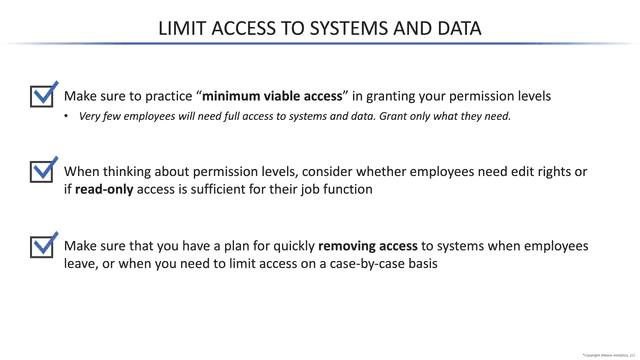

**书面策略**：写下来才能发布、培训、复审。讲师说随着业务增长和风险变化要持续修订。没有书面策略，安全要求容易停留在口头上，出问题后也无法追责。

**备份**：讲师说 DBA 和 CTO 要准备“adequate backups that will not be impacted”。勒索软件会加密数据，如果备份和源数据在同一个可写环境里，备份也可能一起被加密。课里没有给备份工具或隔离方案，复现时不要把某个云厂商的备份产品写成课程内容。

**日志与审计**：讲师要求记录管理端系统和数据库活动，回答“谁在做什么、有没有人访问了不该访问的信息”。还要定期审查，并请第三方做渗透测试。日志本身不会阻止攻击，但不记录就无从发现和追责。

## 6. 复现检查清单

### A. 环境与数据库

- [ ] 本机或实验环境有可连接的 MySQL 实例。
- [ ] 已安装并能打开 MySQL Workbench。
- [ ] 已确认 Workbench 连接的是实验库，不是生产库。
- [ ] 如果使用本文的独立实验库，已执行 `00_optional_create_database.sql`。
- [ ] 已在左侧 Schemas 中选中目标数据库。
- [ ] 已确认目标库里没有同名 `website_page_views` 表，或已明确知道如何处理同名表。

### B. 建表

- [ ] 已执行 `01_create_website_page_views.sql`。
- [ ] 刷新左侧 Tables 后能看到 `website_page_views`。
- [ ] 表中有四个字段：`website_page_view_id`、`created_at`、`website_session_id`、`page_view_url`。
- [ ] `website_page_view_id` 是 `BIGINT`。
- [ ] `created_at` 是 `DATETIME`。
- [ ] `website_session_id` 是 `BIGINT`。
- [ ] `page_view_url` 是 `VARCHAR(50)`。
- [ ] 主键在 `website_page_view_id` 上。
- [ ] 没有误加课程未演示的 `AUTO_INCREMENT` 或外键，或者加了但清楚知道自己偏离了课程原操作。

### C. 导入

- [ ] 已找到课程附件，并在导入前确认其真实扩展名。
- [ ] 已右键 `website_page_views`，选择 `Table Data Import Wizard`。
- [ ] 已通过 `Browse` 选中页面浏览数据文件。
- [ ] 在预览页确认四个目标字段映射正确。
- [ ] 确认第一行没有被错误当成数据或表头。
- [ ] 确认日期列能被识别为日期时间，而不是普通字符串。
- [ ] 确认 URL 列完整显示，没有明显截断。
- [ ] 导入结束后记录向导显示的行数。
- [ ] 如果使用课程附件，行数是 38,391；如果没有附件，不把 38,391 当作自己的验收标准。
- [ ] 点击了 `Finish`。

### D. 验证

- [ ] 已执行 `SELECT * FROM website_page_views;`。
- [ ] 能看到页面 URL、时间、session ID 等实际数据。
- [ ] 已执行 `SELECT COUNT(*) FROM website_page_views;` 核对行数。
- [ ] 如果行数与导入向导不一致，已停止后续分析并排查，而不是继续使用。
- [ ] 已检查是否有明显异常的 URL 或日期。
- [ ] 已确认自己没有在真实生产库上做实验。

### E. 数据保留设计

- [ ] 已记录页面浏览表会随访问量快速增长。
- [ ] 已明确本实验是否要保留全部历史。
- [ ] 已理解讲师说的“按时间截断”是取舍，不是一条可直接执行的 SQL。
- [ ] 没有把 `TRUNCATE TABLE website_page_views;` 当成“只保留最近一个月”的方案；它会清空整表。
- [ ] 如果要做按时间清理，已另行设计删除或归档方案，并知道这部分课里没讲。

### F. 安全评审

- [ ] 已创建 `notes/security-review.md`。
- [ ] 已盘点 PII 字段。
- [ ] 已盘点能访问敏感数据的应用和人员。
- [ ] 已检查最小权限和离职回收流程。
- [ ] 已检查强密码、定期更换、双因素认证要求。
- [ ] 已指定安全责任人或责任团队。
- [ ] 已有书面安全策略，或已把“编写书面策略”列为待办。
- [ ] 已检查备份是否可能被勒索软件一并影响。
- [ ] 已检查管理端和数据库活动日志。
- [ ] 已安排或计划第三方渗透测试。
- [ ] 已检查页面浏览 URL 是否可能携带 PII。

## 7. 课里没讲但你会撞上的

### 7.1 没有课程附件，就无法复现 38,391 行

逐字稿只提到附件叫 `file 16 website page views February 2014`，没有展示文件扩展名、表头、分隔符和完整内容。你如果没有附件，可以自己造同结构数据练建表和导入，但不能声称复现了课程里的 38,391 条记录。本文能保证的是表结构和操作流程；数据本身必须来自课程附件或你自己的合法数据。

### 7.2 `VARCHAR(50)` 对真实 URL 很可能不够

讲师说 50 “probably safe”，但现代网站 URL 常带 UTM、搜索关键词、商品过滤条件，超过 50 个字符很常见。你会遇到两种现象：严格模式下导入报长度错误；非严格模式下 URL 被截断，查询时看起来像少了后半截。具体行为取决于你的 `sql_mode`，课里没有讲。复现课程时按 50 建表；如果你要用于真实项目，先统计源文件 URL 长度再决定字段宽度，不要直接照搬 50。

### 7.3 重复导入同一批数据会撞主键

表以 `website_page_view_id` 为主键。同一批文件导入第二次时，相同 ID 可能触发主键冲突，或被向导按某种策略跳过；具体行为取决于 Workbench 向导和数据库设置，课里没有讲。复现时如果想重来，先确认表里已有数据，再决定是清空重导还是换表名实验。不要在没确认的情况下直接再点一次 `Finish`。

### 7.4 时区与日期格式

`created_at` 用 `DATETIME`，它保存日期和时间，但不携带时区偏移。课程附件里的时间到底是 UTC、本地时间还是其他时区，逐字稿没有说明。你导入后如果发现时间和网页分析工具里看到的差几个小时，先查源文件时区和数据库连接时区，不要先怀疑导入失败。课里没有讲 `CONVERT_TZ` 或连接时区配置。

### 7.5 页面浏览表会膨胀，但课程没给清理 SQL

讲师明确说页面浏览表可能成为最大的表，常见做法是按时间截断，只保留最近两个月、一个月甚至两周。但他没有给删除语句、定时任务、分区或归档方案。你要特别注意：`TRUNCATE TABLE website_page_views;` 会清空整张表，不是“保留最近一个月”。按时间清理需要另行设计条件删除或归档，这部分课里没讲。若在 Node 服务里做定时清理，也不要把它放在用户请求链路中同步执行；课里没有讲任务队列工具，别把具体框架当成课程内容。

### 7.6 没有外键，引用完整性要自己保证

`website_session_id` 只是普通 `BIGINT` 列，没有 `FOREIGN KEY`。这意味着你可以导入一个在 `website_sessions` 里不存在的 session ID，数据库不会阻止。做转化漏斗分析时，这种“孤儿页面浏览”会导致关联不上会话。课里没有讲怎么清洗，也没有给完整会话表结构。复现课程时保持原样；真实项目要在导入前校验或导入后检查关联覆盖率。

### 7.7 没有索引设计，大表查询会慢

课程只建了主键，没有讨论按 `website_session_id`、`created_at` 查询时是否需要二级索引。页面浏览表数据量大，按 session 做漏斗分析时可能很慢。课里没有讲索引，也没有讲执行计划。不要因为本文没写就以为生产上不需要；这是课程范围之外的设计问题。

### 7.8 安全部分不是可执行配置

P73–P74 讲的是威胁认知和最佳实践，没有给 `GRANT`、TLS、审计插件、备份命令、密码策略参数。你可以把第 4 章的 `security-review.md` 当作评审表，但不能把它当成“已经完成安全加固”。特别是最小权限，课里只说了原则，没有给应用账号的具体授权语句；不要从网上复制一段 `GRANT ALL ON *.*` 然后说这是课程内容。

### 7.9 SQL 注入演示只是讲解，不要拿去打真实系统

讲师用登录表单说明：后端把用户名和密码拼进 SQL，恶意输入可能用两个连字符把后半段注释掉，从而绕过密码条件。这是教学演示，不是让你对真实网站做测试。课里没有讲参数化查询、ORM、输入白名单的具体实现；这些是工程团队的修复手段。你能从课程里带走的重点是：不要信任用户输入，不要在后端直接拼接 SQL，发现风险要和工程团队一起修。

### 7.10 页面浏览 URL 可能本身就是 PII

P74 要求少存 PII，但页面浏览 URL 可能带邮箱、手机号、重置密码 token、订单号。课程没有把这两件事连起来讲，但你在真实项目里一定会撞上：一边说少存个人信息，一边把完整 URL 全量落库。复现课程时按原样存 URL；真实项目要先和业务确认哪些查询参数必须脱敏。课里没有给脱敏规则。

### 7.11 `BIGINT` 在 JavaScript/Node 里可能精度丢失

这一条是给前端转 AI 应用工程师的补充，不是讲师原话。MySQL 的 `BIGINT` 范围可能超过 JavaScript `Number.MAX_SAFE_INTEGER`。如果 Node 驱动把大整数直接转成 JS `Number`，`website_page_view_id` 或 `website_session_id` 可能丢失精度，表现为两个不同 ID 变成同一个数。实际行为取决于驱动版本和配置，本文不锁定具体驱动；你需要让驱动以字符串或 `BigInt` 接收这些列，并以实际测试为准。课里没有讲应用端读取，这一条属于你接 API 时会遇到的坑。

### 7.12 批量导入可能影响线上写入

`Table Data Import Wizard` 导入 38,391 行在课程演示里可以接受，但真实页面浏览数据可能是百万级。批量导入会产生大量写入，可能影响同一数据库上的线上请求。课里没有讲锁、事务隔离级别或导入窗口。在 Node 服务里，这类导入应该作为离线任务运行，不要在处理用户请求的同一个进程里同步执行。课里没有讲具体任务调度工具，不要把某个队列框架写成讲师推荐。

### 7.13 课程没有给完整业务库结构

P68 提到 `orders`、`order_items`、`products`、`website_sessions` 等表，P70 也对比了已有数据和缺失数据，但逐字稿没有给出这些表的完整建表语句。你无法仅凭本节从零重建整个业务库，只能复现 `website_page_views` 这一张表和导入流程。若要做完整漏斗分析，需要课程其他章节的表结构或你自己的业务表；不要把本文的四个字段当成整个网站分析模型。

### 7.14 导入向导不是唯一方案，但课程只演示了它

课里使用的是 Workbench 的 `Table Data Import Wizard`，没有演示 `LOAD DATA`、命令行客户端或编程语言驱动。你当然可以用别的工具导入，但那就不是“照课程复现”了。本文不把其他工具冒充课程内容；如果你在向导里遇到文件过大、编码错误或预览失败，先检查文件本身，再考虑课程外的替代方案。