# Advanced MySQL Database Administration（P75–P78）复现文档：数据库安全计划与期末项目

## 1. 这一节做什么

P75–P78 是课程收尾的两块内容，目标不是再学一个新语法，而是把前面学过的 DBA 技能串成可交付物。

第一块是**数据库安全计划作业**。P75 讲师布置任务：Sally 要求你写一份正式的、面向未来的数据库安全计划，不能只在脑子里想，要落成书面清单。P76 是解答课，讲师把威胁类型和缓解措施逐条过了一遍，包括弱认证、拒绝服务、权限提升、SQL 注入、缓冲区溢出、钓鱼与勒索软件，以及安全存储、最小权限、强认证、安全制度、备份、日志监控审计等最佳实践。

第二块是**期末项目**。P77 说明场景：Bear Builders 公司要上线网站聊天客服，同时有潜在收购方做尽职调查。你要用 SQL 完成数据导入与校验、聊天支持数据库设计、EER 图、建表、存储过程、两个视图、给收购方创建只读用户，并回答安全问题。P78 是完整解答，逐题演示了导入 17–24 号数据文件、QA 计数、设计四张表、在 Workbench EER 编辑器画图、用代码建表、创建 `support_member_chats` 存储过程、创建 `monthly_orders_revenue` 和 `monthly_website_sessions` 两个视图、创建 `investors` 用户并只授予视图访问权限，最后回到安全威胁与最佳实践。

这一节最终要交付的东西：

- 一份可执行的 SQL 脚本：建 4 张聊天相关表、1 个存储过程、2 个视图、1 个受限用户。
- 一份 EER 图（课里用 MySQL Workbench 的 EER Diagram Model Editor 画）。
- 一份数据导入与 QA 记录：order_items 总数应为 15,742，order_item_refunds 总数应为 608；按月计数用于定位导入问题。
- 一份正式的安全计划文档（P75 作业要求，P76 给了解答要点）。

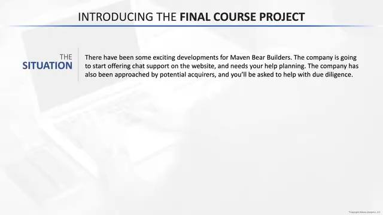

> 复现前提：期末项目建立在课程前面已经导入的 `orders`、`order_items`、`order_item_refunds`、`website_sessions`、`website pageviews` 等表之上。如果你没有前面的课程库，视图和 QA 查询会遇到“表不存在”。本节的 SQL 只负责新增聊天支持相关的 4 张表、存储过程、视图和用户权限。

---

## 2. 讲师原话（带时间戳）

P75 布置作业时，讲师强调要写出来，而不是只想：

> “Sally has come to you asking for a formal written security plan... she wants you to help her think long term... I recommend that you actually write out a formal plan. Don't just think through this.”
>
> —— p075 [00:00]

P76 总结攻击面：

> “That could include weak authentication, denial of service, privilege escalation attacks, taking advantage of you through SQL injection or buffer overflow, or potentially trying to phish employees and get ransomware into the machine.”
>
> —— p076 [00:28]

P76 总结缓解措施：

> “Practicing safe data storage... limiting access to just the people who need certain data for their jobs. That minimum viable access is a great philosophy... authentication is really important... strong passwords... multi-factor authentication... a formal security policy... backing up data... keeping logs and monitoring and auditing those logs.”
>
> —— p076 [00:56] 起

P77 说明期末项目场景：

> “The company has decided to start offering chat support on the website... Sally's gonna need your help planning for that... use SQL to create a detailed plan for handling chat support, including database infrastructure, the creation of an EER diagram... and also some reports to management.”
>
> —— p077 [00:21]

P78 说明聊天支持要跟踪的四层对象：

> “We'll need to understand users... support members... chat sessions... chat messages... track which customers and sessions are utilizing chat and which chat representatives are serving each customer.”
>
> —— p078 [09:13]

P78 说明存储过程目的：

> “Create a stored procedure that's gonna allow Sally, our CEO, to pull a count of chats that are handled by each chat representative for a given time period.”
>
> —— p078 [26:22]

P78 说明视图和收购方用户：

> “Create two views for a potential acquirer... create a new user and just give them access to the views.”
>
> —— p078 [31:04] / [34:54]

---

## 3. 从零复现

### 3.1 环境与目录

课里没有明确 MySQL 版本。为了可复现，下面按 **MySQL Server 8.0.x + MySQL Workbench 8.0.x** 写；你本机版本不同也能跑，但 `CREATE USER`、视图、存储过程语法以 8.0 为准。课里使用的是 MySQL Workbench 的图形界面和 SQL 编辑器。

建议目录：

```text
mysql-advanced-final/
├── .env.example
├── sql/
│   ├── 01_create_chat_tables.sql
│   ├── 02_create_procedure.sql
│   ├── 03_create_views.sql
│   ├── 04_create_investor_user.sql
│   ├── 05_qa_counts.sql
│   └── 06_smoke_test.sql
├── data/
│   └── 课程资源中编号 17–24 的数据文件
└── README.md
```

`data/` 里放课程资源包中编号 17–24 的文件。逐字稿只报了编号和用途，没有给出完整文件名，所以文件名请以资源包实际名称为准：

- 17、18：order items 数据；
- 19、20：order item refunds 数据；
- 21、22：website sessions 数据；
- 23、24：website page views 数据。

课里是按顺序演示的，文件与月份的精确对应以资源包为准。

`.env.example`：

```dotenv
MYSQL_HOST=127.0.0.1
MYSQL_PORT=3306
MYSQL_USER=root
MYSQL_PASSWORD=your_password
MYSQL_DATABASE=bear_builders
```

`MYSQL_DATABASE` 请替换成你课程实际使用的 schema 名。逐字稿里讲师口述为 “Bear Builders”，实际 schema 名以你 Workbench 里看到的为准；下文 SQL 用 `bear_builders` 作为占位。

### 3.2 导入 17–24 号数据文件

课里用的是 **Table Data Import Wizard**。操作顺序：

1. 在 Workbench 左侧 Navigator 的 Schemas 中选中课程 schema。
2. 找到要导入的表，例如 `order_items`，使用 Table Data Import Wizard。
3. Browse 选择资源文件 17。
4. 确认目标表和列映射，逐列核对，Next。
5. 等待导入完成，记录导入条数，Finish。
6. 对 18–24 重复。注意 19、20 是 refunds，21、22 是 website sessions，23、24 是 website page views。

课里演示的导入结果：

- 文件 17 导入 `order_items`：1,427 条；
- 文件 18 导入 `order_items`：1,657 条；
- 文件 19 导入 `order_item_refunds`：45 条；
- 文件 20 继续导入 refunds；
- 文件 21 导入 `website_sessions`：15,669 条；
- 文件 22 导入 `website_sessions`：17,353 条；
- 文件 23 导入 website page views：38,000 条；
- 文件 24 导入 website page views：44,000 条。

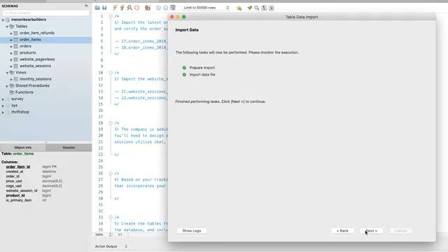

导入大文件时 Workbench 可能看起来“卡住”，课里也说明视频做了加速剪辑，你本机实际会更久。不要因为进度条慢就重复点 Next。

### 3.3 导入后 QA：先对总数，再对每月

讲师在 P78 用 `COUNT(*)` 做 QA。先查两张订单相关表的总数：

```sql
SELECT COUNT(*) AS total_records FROM order_items;
SELECT COUNT(*) AS total_records FROM order_item_refunds;
```

课里给出的期望值：

- `order_items`：**15,742**；
- `order_item_refunds`：**608**。

注意逐字稿在 05:09 附近有一处口误，把 608 说成 order items 的计数；结合上下文和前面导入条数，608 对应的是 `order_item_refunds`。如果你跑出来不同，先不要改数据，按下面按月计数定位是哪个月多了或少了。

```sql
SELECT
  YEAR(created_at) AS `year`,
  MONTH(created_at) AS `month`,
  COUNT(*) AS total_records
FROM order_items
GROUP BY 1, 2
ORDER BY 1, 2;
```

同样的查询结构换表即可：`order_item_refunds`、`website_sessions`、website page views。讲师在屏幕上展示了每月计数，但逐字稿没有逐个月份口述具体数字，所以本文不编造每月数值；以你屏幕上查到的和课程画面为准。

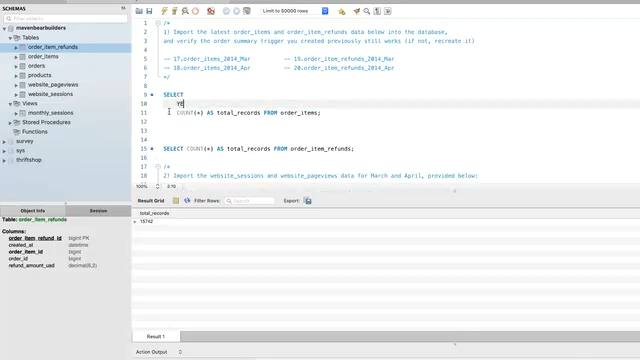

### 3.4 设计聊天支持的四张表

讲师的设计思路是按“层级对象”拆表：

1. `users`：使用聊天的客户；
2. `support_members`：客服/聊天代表；
3. `chat_sessions`：一次聊天会话；
4. `chat_messages`：会话里的每条消息。

字段按讲师口述整理：

- `users`：`user_id`、`created_at`、`first_name`、`last_name`；
- `support_members`：`support_member_id`、`created_at`、`first_name`、`last_name`；
- `chat_sessions`：`chat_session_id`、`created_at`、`user_id`、`support_member_id`、`website_session_id`；
- `chat_messages`：`chat_message_id`、`created_at`、`chat_session_id`、`user_id`、`support_member_id`、`message`。

讲师在 EER 里说明：`chat_sessions.user_id`、`support_member_id`、`website_session_id` 都是外键；`chat_messages.chat_session_id`、`user_id`、`support_member_id` 也是外键。但他在建表代码里说“外键我不会现在加”，所以下面代码**不添加 FOREIGN KEY 约束**，只保留列和主键，和课里实际执行保持一致。

`chat_messages` 的可空性课里口述有出入：EER 部分说“user_id 对 support member 为空，support_member_id 对 user 为空”，后面代码部分又说 support_member_id non-null。下面代码按 EER 的意图把两者设为可空，并在注释中标出。你如果按讲师代码设成非空，也能跑，但会让“客服发的消息”没有 user_id 时插不进去。

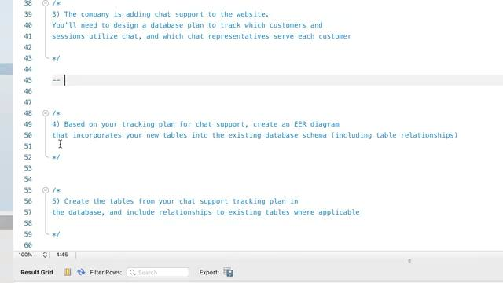

### 3.5 画 EER 图

课里要求提交 EER diagram。讲师是在 MySQL Workbench 的 EER Diagram Model Editor 里继续加表：从模板添加 `users`，改表名、字段、主键，再去掉默认表达式。下面用 Mermaid 做关系示意，方便你核对字段；**课里用的是 Workbench EER 编辑器，下面不是课里原图**。

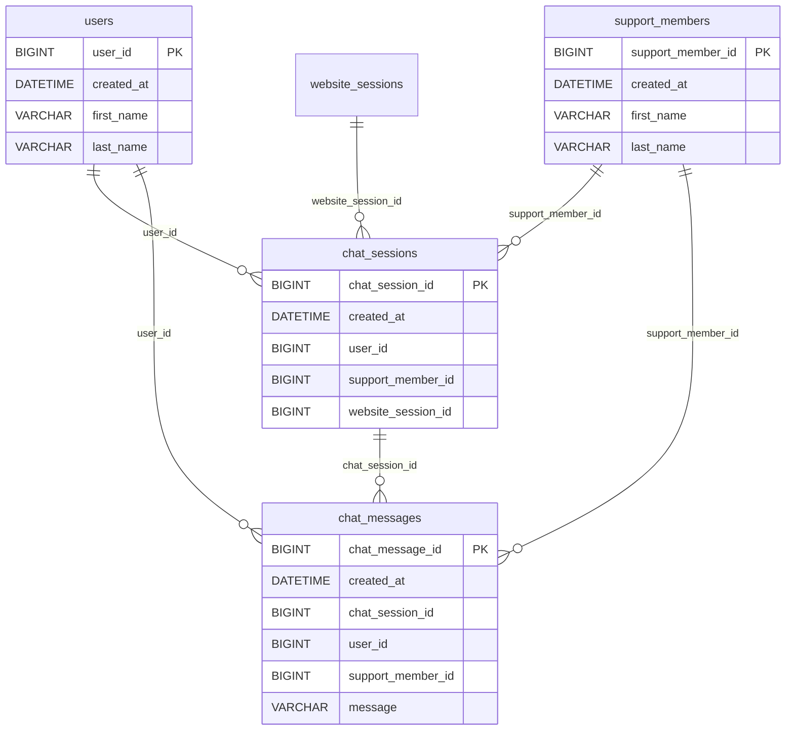

### 3.6 执行 SQL 的顺序

在 Workbench 里依次打开并执行：

1. `01_create_chat_tables.sql`：建 4 张表；
2. `02_create_procedure.sql`：建 `support_member_chats`；
3. `03_create_views.sql`：建两个视图；
4. `04_create_investor_user.sql`：建 `investors` 用户并授权；
5. `05_qa_counts.sql`：随时做导入 QA；
6. `06_smoke_test.sql`：可选，插测试数据验证存储过程。

命令行方式：

```bash
set -a
source .env
set +a

mysql -h "$MYSQL_HOST" -P "$MYSQL_PORT" -u "$MYSQL_USER" -p"$MYSQL_PASSWORD" "$MYSQL_DATABASE" < sql/01_create_chat_tables.sql
mysql -h "$MYSQL_HOST" -P "$MYSQL_PORT" -u "$MYSQL_USER" -p"$MYSQL_PASSWORD" "$MYSQL_DATABASE" < sql/02_create_procedure.sql
mysql -h "$MYSQL_HOST" -P "$MYSQL_PORT" -u "$MYSQL_USER" -p"$MYSQL_PASSWORD" "$MYSQL_DATABASE" < sql/03_create_views.sql
```

`04_create_investor_user.sql` 里包含 `GRANT`，建议在 Workbench 里用有授权权限的账号执行。

### 3.7 验证存储过程

课里说表里没有数据，所以直接调用会返回 `chats_handled = 0`。调用方式：

```sql
CALL support_member_chats(1, '2014-01-01', '2014-01-31');
```

如果你想看到非零结果，可以执行 `06_smoke_test.sql` 插一条用户、一条客服、一条会话，再调用。这个测试数据不是课里内容，仅用于验证。

### 3.8 验证视图和 investors 用户

```sql
SELECT * FROM monthly_orders_revenue;
SELECT * FROM monthly_website_sessions;
```

然后用 `investors` 登录，确认只能查这两个视图，不能查其他表。课里是在 Workbench 的 Administration → Users and Privileges 里建用户、设密码 `change me`，再到 Schema Privileges 里只勾选视图权限。本文第 4 节给出等价 SQL；课里没有给这段 SQL，属于复现补充。

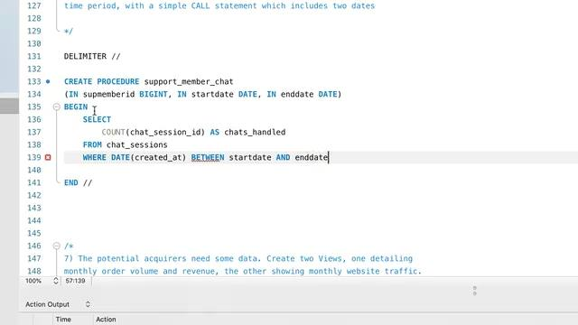

---

## 4. 完整代码

### 4.1 `sql/01_create_chat_tables.sql`

```sql
-- 01_create_chat_tables.sql
-- 运行前先确认当前 schema 是你的课程库，例如：
-- USE bear_builders;

-- 课里使用 CREATE TABLE，没有 IF NOT EXISTS。
-- 为了可重复执行，这里加上 IF NOT EXISTS；字段与课里口述一致。
CREATE TABLE IF NOT EXISTS users (
  user_id BIGINT NOT NULL,
  created_at DATETIME NOT NULL,
  first_name VARCHAR(50) NOT NULL,
  last_name VARCHAR(50) NOT NULL,
  PRIMARY KEY (user_id)
) ENGINE=InnoDB DEFAULT CHARSET=utf8mb4;

CREATE TABLE IF NOT EXISTS support_members (
  support_member_id BIGINT NOT NULL,
  created_at DATETIME NOT NULL,
  first_name VARCHAR(50) NOT NULL,
  last_name VARCHAR(50) NOT NULL,
  PRIMARY KEY (support_member_id)
) ENGINE=InnoDB DEFAULT CHARSET=utf8mb4;

CREATE TABLE IF NOT EXISTS chat_sessions (
  chat_session_id BIGINT NOT NULL,
  created_at DATETIME NOT NULL,
  user_id BIGINT NOT NULL,
  support_member_id BIGINT NOT NULL,
  website_session_id BIGINT NOT NULL,
  PRIMARY KEY (chat_session_id)
) ENGINE=InnoDB DEFAULT CHARSET=utf8mb4;

-- 课里 EER 部分说：user_id 对 support member 为空，
-- support_member_id 对 user 为空。
-- 但后面代码口述又说 support_member_id non-null，存在出入。
-- 这里按 EER 意图设为 NULL，避免客服消息插不进去。
CREATE TABLE IF NOT EXISTS chat_messages (
  chat_message_id BIGINT NOT NULL,
  created_at DATETIME NOT NULL,
  chat_session_id BIGINT NOT NULL,
  user_id BIGINT NULL,
  support_member_id BIGINT NULL,
  message VARCHAR(200) NOT NULL,
  PRIMARY KEY (chat_message_id)
) ENGINE=InnoDB DEFAULT CHARSET=utf8mb4;

-- 课里没有实际添加 FOREIGN KEY 约束，只保留了外键列。
-- 如果你要补外键，需要先确认被引用列上有主键/唯一索引。
```

### 4.2 `sql/02_create_procedure.sql`

```sql
-- 02_create_procedure.sql
-- 课里使用 DELIMITER // 解决存储过程内部分号问题。
DROP PROCEDURE IF EXISTS support_member_chats;

DELIMITER //

CREATE PROCEDURE support_member_chats (
  IN member_id BIGINT,
  IN start_date DATE,
  IN end_date DATE
)
BEGIN
  SELECT COUNT(chat_session_id) AS chats_handled
  FROM chat_sessions
  WHERE DATE(created_at) BETWEEN start_date AND end_date
    AND support_member_id = member_id;
END //

DELIMITER ;
```

### 4.3 `sql/03_create_views.sql`

```sql
-- 03_create_views.sql
-- 课里使用 CREATE VIEW；这里用 CREATE OR REPLACE 方便重复执行。
CREATE OR REPLACE VIEW monthly_orders_revenue AS
SELECT
  YEAR(created_at) AS `year`,
  MONTH(created_at) AS `month`,
  COUNT(order_id) AS orders,
  SUM(price_usd) AS revenue
FROM orders
GROUP BY 1, 2
ORDER BY 1, 2;

CREATE OR REPLACE VIEW monthly_website_sessions AS
SELECT
  YEAR(created_at) AS `year`,
  MONTH(created_at) AS `month`,
  COUNT(website_session_id) AS sessions
FROM website_sessions
GROUP BY 1, 2
ORDER BY 1, 2;
```

### 4.4 `sql/04_create_investor_user.sql`

```sql
-- 04_create_investor_user.sql
-- 把 bear_builders 替换成你实际的 schema 名。
-- 课里是在 Workbench 的 Users and Privileges / Schema Privileges 里点选，
-- 这里给等价 SQL：只授予两个视图的 SELECT，不授予其他表。
CREATE USER IF NOT EXISTS 'investors'@'%' IDENTIFIED BY 'change me';
ALTER USER 'investors'@'%' IDENTIFIED BY 'change me';

GRANT SELECT ON bear_builders.monthly_orders_revenue TO 'investors'@'%';
GRANT SELECT ON bear_builders.monthly_website_s
```sql
GRANT SELECT ON bear_builders.monthly_website_sessions TO 'investors'@'%';

-- 可选：确认授权结果
SHOW GRANTS FOR 'investors'@'%';
```

课里在 Schema Privileges 里勾的是“只给视图”，没有点选具体哪两个视图；上面的 SQL 把它收窄到两个具体视图对象，比课里更严格。如果你想让该用户看到该 schema 下所有视图，可以用 `GRANT SELECT ON bear_builders.* TO ...` 之后再逐表 REVOKE，但课里没讲这种做法，不建议初学时改。

### 4.5 `sql/05_qa_counts.sql`

```sql
-- 05_qa_counts.sql
-- 导入 17–20 号文件后，先对总数：
SELECT COUNT(*) AS total_records FROM order_items;
SELECT COUNT(*) AS total_records FROM order_item_refunds;

-- 课里期望：order_items 15,742；order_item_refunds 608。
-- 数不对时按月定位：
SELECT
  YEAR(created_at) AS `year`,
  MONTH(created_at) AS `month`,
  COUNT(*) AS total_records
FROM order_items
GROUP BY 1, 2
ORDER BY 1, 2;

-- 同样结构换表即可
SELECT
  YEAR(created_at) AS `year`,
  MONTH(created_at) AS `month`,
  COUNT(*) AS total_records
FROM order_item_refunds
GROUP BY 1, 2
ORDER BY 1, 2;

-- 导入 21–24 号文件后：
SELECT
  YEAR(created_at) AS `year`,
  MONTH(created_at) AS `month`,
  COUNT(*) AS total_records
FROM website_sessions
GROUP BY 1, 2
ORDER BY 1, 2;

SELECT
  YEAR(created_at) AS `year`,
  MONTH(created_at) AS `month`,
  COUNT(*) AS total_records
FROM website_pageviews
GROUP BY 1, 2
ORDER BY 1, 2;
```

`website_pageviews` 这个表名请以你库里实际名称为准；课里口述是 “website page use data / website page views”，Workbench 里看到的表名才是权威。逐字稿也明确说：website page views 没有 1 月数据，所以你应该只看到三个月份。

### 4.6 `sql/06_smoke_test.sql`（可选，非课里内容）

```sql
-- 06_smoke_test.sql
-- 这段是复现补充，课里没有插入测试数据。
-- 目的：让存储过程返回非零值，验证逻辑。
INSERT INTO users (user_id, created_at, first_name, last_name)
VALUES (1, '2014-01-15 10:00:00', 'Test', 'User');

INSERT INTO support_members (support_member_id, created_at, first_name, last_name)
VALUES (1, '2014-01-01 09:00:00', 'Test', 'Agent');

INSERT INTO chat_sessions
  (chat_session_id, created_at, user_id, support_member_id, website_session_id)
VALUES (1, '2014-01-15 10:01:00', 1, 1, 999999);

INSERT INTO chat_messages
  (chat_message_id, created_at, chat_session_id, user_id, support_member_id, message)
VALUES
  (1, '2014-01-15 10:01:10', 1, 1, NULL, '你好，我的订单到哪里了？'),
  (2, '2014-01-15 10:01:40', 1, NULL, 1, '您好，我帮您查一下。');

CALL support_member_chats(1, '2014-01-01', '2014-01-31');

-- 清理测试数据（顺序：先子后父）
DELETE FROM chat_messages WHERE chat_session_id = 1;
DELETE FROM chat_sessions WHERE chat_session_id = 1;
DELETE FROM support_members WHERE support_member_id = 1;
DELETE FROM users WHERE user_id = 1;
```

### 4.7 `docs/security-plan.md`（P75 作业交付物）

课里 P75 明确要求“写出来、不要只想”，并说简单的项目符号清单就够了。P76 给了你要覆盖的要点。下面这份文档是把 P76 逐字稿的口述要点整理成可直接交的清单，没有加入逐字稿之外的安全产品名或工具名。

```markdown
# Bear Builders 数据库安全计划

## 一、我们要防的威胁
- 弱认证（weak authentication）
- 拒绝服务（denial of service）
- 权限提升攻击（privilege escalation）
- SQL 注入（SQL injection）
- 缓冲区溢出（buffer overflow）
- 钓鱼邮件导致员工安装勒索软件（phishing / ransomware）

## 二、缓解措施（最佳实践）

### 1. 安全的数据存储
- 只存业务真正需要的数据，越少越好。
- 尽量不存敏感字段：信用卡、电话号码、邮箱。
- 必须存时必须加密。

### 2. 最小权限（minimum viable access）
- 只给“完成本职工作所必需”的权限。
- 宁可按角色拆账号，也不要给一个万能账号。
- 对外部方（如收购方）只开放视图，不开放底表。

### 3. 认真对待认证
- 强制强密码。
- 密码定期更换。
- 敏感数据访问启用多因素认证（MFA）。
- 开通账号前先确认“这个人是谁”。

### 4. 制度与责任人
- 形成正式的数据安全政策（书面）。
- 指定对安全负责的人/团队。
- 把安全写进岗位职责，公司才会真正管理它。

### 5. 备份与恢复
- 定期 mysqldump 或使用复制（replication）。
- 备份要能恢复，不只是能生成。

### 6. 日志、监控与审计
- 保留访问日志。
- 持续监控并审计：谁在什么时候访问了什么。
- 重点发现“越权使用”和“好心但用错”的两类行为。

## 三、面向未来的考虑（Sally 要扩张业务）
- 新业务（例如网站聊天客服）上线前先做数据分类：哪些是敏感数据。
- 每新增一类数据，同步新增对应的访问角色，而不是复用现有高权账号。
- 用户量、会话量增长后，审计日志和备份策略要跟着扩容。
```

课里 P76 的原话是 “that could include ... or potentially trying to phish employees and get ransomware into the machine”，P78 又重复了同一组威胁与措施，所以上面两份清单内容重合是正常的：P76 是作业解答，P78 第 8 题是同一知识点的第二次收口。

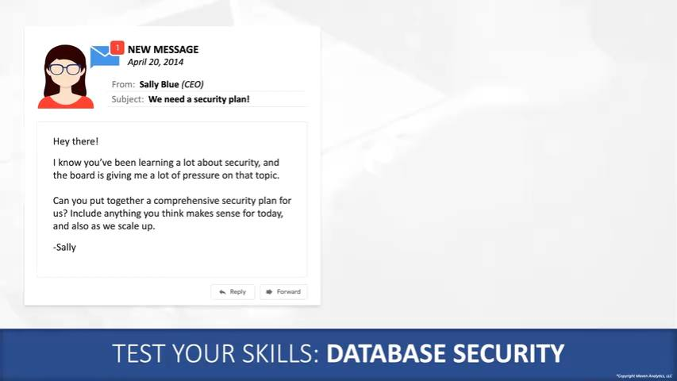

---

## 5. 逐行解释

### 5.1 建表为什么长这样

`user_id BIGINT NOT NULL` —— 讲师在 EER 里说“it's going to be a big int so it can get big”，理由是业务要扩张，自增 ID 迟早会超过 `INT` 上限。`BIGINT` 在 MySQL 里是 8 字节有符号整数，上限约 9.22×10^18，用不完。

`PRIMARY KEY (user_id)` —— 讲师在建表代码里逐个补了主键：`user_id`、`support_member_id`、`chat_session_id`、`chat_message_id`。主键的作用是唯一标识一行，也是后面外键要指向的目标。课里没有加 `AUTO_INCREMENT`，所以 ID 需要由应用层生成或手工插入；这是课里的实时状态，不是我漏写。

`first_name VARCHAR(50)` —— 讲师在 EER 里先说 32，然后改口：“There's not many names that would be bigger than 32, but occasionally it'll happen”，最后定成 `VARCHAR(50)`。他自己也承认这是拍脑袋的经验值。

`chat_sessions.user_id / support_member_id / website_session_id` 全部 `NOT NULL` —— 讲师口述明确说这三个都 non-null（“Also non-null”重复了三次）。语义上：一次聊天必须挂在某个客户、某个客服、某个网站会话上，缺一个这次聊天就不成立。注意这和 `chat_messages` 的可空性不同，不要照抄。

`chat_messages.user_id BIGINT NULL` / `support_member_id BIGINT NULL` —— 讲师在 EER 里说：“A user ID probably. And I think we could say this will be null for support members. And then a support member ID. And same idea, null for users.” 也就是一条消息要么是客户发的（`user_id` 有值、`support_member_id` 为空），要么是客服发的（反过来）。他还给了替代方案：用一个 `author_id` + `author_type` 列，并说“There's pros and cons to each”，然后选择了拆两列。课后代码段他又说 support_member_id non-null，与前文冲突；我在 4.1 的注释里标了这个出入。

`message VARCHAR(200) NOT NULL` —— 讲师原话：“message could be a vrcar up to 200. Say that's the max.” 并说加这一列的原因是“we want to be able to review how our chat reps are doing with customers”，即 QA 用途。200 字符对中文大约 66 个汉字（utf8mb4 下 1 汉字 = 1 字符，但字节数不同），真实客服消息很容易超，这是课里方案的现实短板，见第 7 章。

`ENGINE=InnoDB DEFAULT CHARSET=utf8mb4` —— 课里没提。这是我加的可复现性保障：InnoDB 支持事务和行锁（对应到 Node 里就是 `mysql2` 的 `beginTransaction`），utf8mb4 才能存 emoji。课里如果沿用库的默认值，实际引擎/字符集以 `SHOW CREATE TABLE` 为准。

没有 `FOREIGN KEY` —— 讲师明说：“those will all be foreign keys. I'm not going to go through and add those for you right now” 以及 “if you also wanted to define the relationships to existing tables. Obviously, that's great.” 所以不加外键是课里的选择，不是疏漏。后果是数据库层不做引用完整性校验，孤儿行（例如 `chat_sessions.user_id` 指向不存在的用户）可以插进去。

### 5.2 存储过程逐行

`DELIMITER //` —— 讲师原话：“to handle the issue with the delimiter, we're actually going to change the delimiter before we do anything else.” 原因：存储过程体内部有分号，客户端会把第一个分号当成语句结束，导致建过程失败。改成 `//` 后，客户端直到遇见 `//` 才提交整段。在 Workbench 里其实可以不写 `DELIMITER`，因为图形界面会把整段 `CREATE PROCEDURE` 作为一个语句发送（讲师在 Workbench 里也是这么执行的），但命令行 `mysql < file.sql` 必须有。

在 Node 里对应什么？`mysql2` 的 `connection.query()` 默认不允许一次发送多条语句（`multipleStatements: false`）。建存储过程这类 DDL 一般放在迁移脚本里跑，不放在应用代码里，所以你在 Node 项目里通常不会遇到 `DELIMITER` 问题——这是客户端行为，不是服务端语法。

`IN member_id BIGINT` —— 讲师说：“we'll call this the member ID, and you never actually see this in, so it doesn't matter exactly what we call it”。意思是 `IN` 参数名只在过程体内部可见，调用方按位置传参，所以命名自由。注意它和列名 `support_member_id` 不同名，避免 `WHERE support_member_id = support_member_id` 这种自比较（MySQL 会把后者解析成列 = 列，永远为真）。这是课里没讲但很关键的一点。

`IN start_date DATE` / `IN end_date DATE` —— 讲师说“both of those will be dates”，所以用 `DATE` 而不是 `DATETIME`。好处是调用方传 `'2014-01-01'` 就行；代价是丢了时分秒精度，区间边界只能到天。

`SELECT COUNT(chat_session_id) AS chats_handled` —— 讲师原话：“counting the number of chats that are handled. And doing that by looking at the number of chat session ID values in the chat sessions table”。用 `COUNT(列)` 而不是 `COUNT(*)`：两者在这张表上结果相同（`chat_session_id` 是主键、非空），但如果换成可空列，`COUNT(列)` 会跳过 NULL。课里选 `COUNT(chat_session_id)` 是“数会话个数”的直译。

`WHERE DATE(created_at) BETWEEN start_date AND end_date` —— 讲师说“date of created at between start date and end date”，所以他在 `created_at` 外面包了 `DATE()`。**代价**：列上套函数会让索引失效（如果 `created_at` 上有索引），MySQL 只能全表扫描。对聊天会话这种会持续增长的表，这是性能隐患。更常见的写法是 `created_at >= start_date AND created_at < end_date + INTERVAL 1 DAY`。课里没讲这个优化，我在这里指出，但不改代码，保证和课里一致。

`BETWEEN` 是闭区间，包含 `start_date` 和 `end_date` 当天。因为两侧都套了 `DATE()`，`2014-01-31 23:59:59` 会被算成 `2014-01-31`，仍然落在区间内，所以“整月”语义是对的。这是 `DATE()` 唯一带来的好处。

`AND support_member_id = member_id` —— 这是第二个过滤维度。讲师称之为“a multi-dimension where condition”。如果 `member_id` 传 `NULL`，整个条件变成 `NULL`，查不出任何行，返回 `chats_handled = 0`，不会报错。这是 SQL 三值逻辑的坑。

`END //` + `DELIMITER ;` —— 结尾必须把分隔符改回来，否则同一次会话里后续的 `CALL`、`SELECT` 都会被当成过程体的一部分。讲师原话：“the last thing I'll just change the delimiter back”。

`DROP PROCEDURE IF EXISTS` —— 课里没写，是我加的，让脚本可重复执行。不加的话第二次执行报 “procedure already exists”。

`CALL support_member_chats(1, '2014-01-01', '2014-01-31');` —— 讲师演示的调用形式（他说 support member one、January 1st 2014 到 January 31st 2014）。因为表里没数据，结果是 `chats_handled` 为 0。他特意说明：“there isn't actually any data in this table. So you're not going to really get to see this procedure work.”

### 5.3 两个视图逐行

`CREATE OR REPLACE VIEW monthly_orders_revenue AS` —— 课里用的是 `CREATE VIEW`，我改成 `OR REPLACE` 以便重跑。视图本质是一条被保存的 SELECT，不存数据；每次查视图都会重新执行底层查询。

`YEAR(created_at) AS \`year\`` / `MONTH(created_at) AS \`month\`` —— 讲师原话：“we'll say select year created at as year. And then we could say month created at as month.” 必须加反引号，因为 `year` 和 `month` 是 MySQL 关键字/函数名，不加引号在某些上下文中会解析歧义。

`COUNT(order_id) AS orders` —— 讲师说“count order ID as orders”，即统计订单行数。这里有个语义问题：如果 `orders` 表一行一单，`COUNT(order_id)` 就是订单数；如果一单多行，就要 `COUNT(DISTINCT order_id)`。课里没讨论表结构，按讲师写法即可。

`SUM(price_usd) AS revenue` —— 讲师说“Sum price USD as revenue”。`price_usd` 这个列名是从口述 “price USD” 推出来的，**请以你库里 `orders` 表的实际列名为准**；跑不通就先 `DESCRIBE orders;` 看一眼。`SUM` 遇到 NULL 会跳过，全 NULL 时返回 NULL 而不是 0。

`GROUP BY 1, 2 ORDER BY 1, 2` —— 讲师反复用位置序号：“we'll group by 1 and 2. And we'll order by 1 and 2.” 位置序号指 SELECT 列表里的第 1、2 个表达式，即 `year`、`month`。好处是少打字；坏处是改 SELECT 列顺序时容易错位。`ORDER BY` 让输出按月递增，便于人眼核对。

`FROM orders` / `FROM website_sessions` —— 讲师在第二个视图里漏了 `FROM`，自己发现并说：“I don't have a from. You need a from in every select statement.” 这是他演示的一个真实错误，说明他习惯“先写 SELECT 跑通、再加 CREATE VIEW 包起来”。他的原话：“before I actually run any create, I usually like to do the select statement.”

`CREATE USER IF NOT EXISTS 'investors'@'%' IDENTIFIED BY 'change me';` + `ALTER USER` —— 课里是在 Administration → Users and Privileges 里点 “add account”，认证类型 standard，密码 `change me`，并说“they can change it. And yes, we know it's a weak password”。这是**故意的反面教材**，P78 第 8 题里他专门回头说：“You see where I created the view for our investors and I used a weak password. That's something that you're not going to want to do in the real world.”

`'investors'@'%'` —— `%` 表示任意主机。课里 Workbench 界面默认可能就是 `%`，逐字稿没提 host 部分。生产环境应限制为具体来源 IP/网段，课里没讲。

`GRANT SELECT ON bear_builders.monthly_orders_revenue TO 'investors'@'%';` —— 只给单表（这里是视图）的 SELECT。讲师解释效果：“They can't select from other tables. They can't edit anything. They can't add new records, delete records.” 这就是最小权限原则在期末项目里的落地，和 P76/P78 安全部分的 “limiting access to just the people who need certain data for their jobs” 是同一条原则。

`SHOW GRANTS FOR 'investors'@'%';` —— 课里没执行，是我加的验证步骤。输出里的字段名请以实际输出为准。

---

## 6. 复现检查清单

按顺序打勾，任何一项不过就先修它，别往下走。

**环境**

- [ ] `mysql --version` 能输出版本号，且能连上课程库。
- [ ] Workbench 左侧 Schemas 里能看到课程 schema，展开后能看到 `orders`、`order_items`、`order_item_refunds`、`website_sessions` 等前置表。
- [ ] `SELECT DATABASE();` 返回的不是 `NULL`（说明你选中了库）。

**数据导入（第 1、2 题）**

- [ ] 17、18 号文件导入 `order_items`，Wizard 结束页分别显示 1,427 和 1,657 条。
- [ ] `SELECT COUNT(*) FROM order_items;` = **15,742**。
- [ ] 19 号文件导入 `order_item_refunds` 显示 45 条；20 号文件导入完成。
- [ ] `SELECT COUNT(*) FROM order_item_refunds;` = **608**。
- [ ] 21、22 号文件导入 `website_sessions`，分别显示 15,669 和 17,353 条。
- [ ] 23、24 号文件导入 website page views，分别显示 38,000 和 44,000 条。
- [ ] 按月计数查询 `website_sessions` 返回 4 个月份。
- [ ] 按月计数查询 website page views 只返回 **3 个月份**（课里说没有 1 月数据）。如果返回 4 个月，说明你多导了一个月的数据或导错了文件。

**建表（第 3、4、5 题）**

- [ ] `01_create_chat_tables.sql` 执行无报错。
- [ ] 刷新 Schemas，能看到 `users`、`support_members`、`chat_sessions`、`chat_messages` 四张表。
- [ ] `DESCRIBE chat_sessions;` 显示 5 个字段，主键是 `chat_session_id`。
- [ ] `DESCRIBE chat_messages;` 显示 6 个字段，`message` 长度 200。
- [ ] EER 图里四张表都在，`chat_sessions` 与 `chat_messages` 之间有一对多连线（如果你补了关系）。
- [ ] 检查建表结果里没有意外的默认值（讲师在 EER 里专门回头删了默认表达式：“we have a default expression, which we want to remove”）。用 `SHOW CREATE TABLE users;` 核对。

**存储过程（第 6 题）**

- [ ] `02_create_procedure.sql` 执行成功，`SHOW PROCEDURE STATUS WHERE Db = DATABASE();` 能看到 `support_member_chats`。
- [ ] `CALL support_member_chats(1, '2014-01-01', '2014-01-31');` 不报错，返回一行 `chats_handled`，空表时值为 0。
- [ ] 执行 `06_smoke_test.sql` 后，同一 `CALL` 返回 `chats_handled = 1`。
- [ ] 冒烟测试的清理语句执行后，四张表回到 0 行。

**视图与用户（第 7 题）**

- [ ] `03_create_views.sql` 执行成功。
- [ ] `SELECT * FROM monthly_orders_revenue;` 有输出，列名是 `year`、`month`、`orders`、`revenue`。
- [ ] `SELECT * FROM monthly_website_sessions;` 有输出，列名是 `year`、`month`、`sessions`。
- [ ] Schemas 里 `views` 分组下出现这两个视图对象。
- [ ] `04_create_investor_user.sql` 执行成功（需要授权权限）。
- [ ] `SHOW GRANTS FOR 'investors'@'%';` 能看到且只看到两个视图的 `SELECT`。
- [ ] 用 `investors` 登录后 `SELECT * FROM monthly_orders_revenue;` 成功。
- [ ] 用 `investors` 登录后 `SELECT * FROM orders LIMIT 1;` **失败**（权限不足）。这条是最小权限是否真的生效的关键验证。

**安全计划（P75 作业）**

- [ ] `docs/security-plan.md` 存在，且“威胁”和“缓解措施”两部分都有内容。
- [ ] 六类威胁都覆盖：弱认证、拒绝服务、权限提升、SQL 注入、缓冲区溢出、钓鱼/勒索软件。
- [ ] 六类措施都覆盖：安全存储、最小权限、强认证/MFA、制度与责任人、备份、日志监控审计。

---

## 7. 课里没讲但你会撞上的

**1. `investors` 密码被 MySQL 拒绝**

课里设的密码是 `change me`（带空格）。MySQL 8.0 默认可能启用 `validate_password` 组件，会以“密码太短/太简单”为由直接拒绝 `CREATE USER`。课里的 Workbench 演示没有遇到，是因为他那台机器的密码策略没开。你如果报 `ERROR 1819 (HY000): Your password does not satisfy the current policy requirements`，有两条路：换一个强密码，或者用管理员执行 `SHOW VARIABLES LIKE 'validate_password%';` 看当前策略。**不要**为了跑通就去卸载密码插件——这正是 P78 反复强调的反面做法。

**2. `CREATE USER` / `GRANT` 需要额外权限**

课里你在 Workbench 里用的大概率是 `root`，所以没感觉。换成公司里只给了业务库权限的账号，`GRANT` 会报 `ERROR 1044` 或 `ERROR 1142`。这时不是 SQL 写错了，是账号权限不够，找 DBA 要。

**3. `orders` 表的金额列名可能不是 `price_usd`**

逐字稿讲师说的是 “Sum price USD as revenue”，`price_usd` 是按命名惯例推的。跑视图时若报 `ERROR 1054 (42S22): Unknown column 'price_usd' in 'field list'`，执行 `DESCRIBE orders;` 看真实列名再改。同理，`website_pageviews` 这个表名也要以实际为准。

**4. 位置序号 `GROUP BY 1, 2` 在严格模式下仍然可用，但 `ONLY_FULL_GROUP_BY` 会盯你的 SELECT 列表**

MySQL 5.7 起默认开启 `ONLY_FULL_GROUP_BY`。我们的视图里 `year/month` 都在 `GROUP BY` 中，聚合列是 `COUNT`/`SUM`，所以能过。但如果你手痒在 SELECT 里多加一个 `created_at`，马上报 `ERROR 1055`。报错时先看 `SELECT @@sql_mode;`。

**5. 存储过程创建失败：`ERROR 1064` 多半是分隔符**

在 Workbench 里执行整个 `.sql` 文件时，`DELIMITER //` 是客户端指令而不是 SQL。如果 Workbench 的版本或执行方式（比如 “Execute Statement” 而不是 “Execute”）不认它，会报语法错。稳妥做法：在 Workbench 里直接执行不带 `DELIMITER` 的 `CREATE PROCEDURE` 单条语句（讲师本人就是这么做的），把 `DELIMITER` 版本留给命令行。

**6. `chat_messages.message` 只有 200 字符**

课里说 “message could be a vrcar up to 200. Say that's the max.”，我照抄了。真实客服场景里，客户一次贴一段订单号 + 地址 + 问题描述，很容易超过。超长时报 `ERROR 1406 (22001): Data too long for column 'message'`，且默认严格模式下是**报错**而不是截断。要改就 `ALTER TABLE chat_messages MODIFY message TEXT NOT NULL;`，但改之前想清楚：这一列现在是给谁做 QA 看的，是否需要全文索引。

**7. 没有外键 = 可以插进孤儿数据**

`chat_sessions.user_id` 指向一个不存在的 `users.user_id` 时，数据库不会拦你。真要做完整性校验，加外键前必须确认：被引用列是主键（是）、数据类型完全一致（都是 `BIGINT`）、引擎都是 InnoDB（是）。执行顺序也要注意：先建父表再建子表，否则 `ERROR 1215`。如果你在已有数据的表上加外键，历史脏数据会让 `ALTER TABLE` 失败，得先清理。

**8. `DATE(created_at)` 让 `created_at` 上的索引失效**

第 5 章说过。数据量小的时候感觉不到；等 `chat_sessions` 到几百万行，`CALL support_member_chats(...)` 会从毫秒级变成秒级。改写成范围条件即可，但要同步改参数语义（`end_date` 是否包含当天）。这是课里完全没提的性能话题。

**9. 视图的 `DEFINER` 与权限**

MySQL 视图默认以创建者（`DEFINER`）的身份访问底表。也就是说，`investors` 用户查 `monthly_orders_revenue` 视图时，实际是用 `root`（或你建视图时的账号）的权限去读 `orders` 的。这解释了为什么 `GRANT SELECT ON 视图` 就够了、不需要额外给 `orders` 的权限。但如果哪天创建视图的账号被删了，视图会报 `ERROR 1449: The user specified as a definer does not exist`。排查时看 `SHOW CREATE VIEW monthly_orders_revenue;` 输出里的 `DEFINER` 字段（字段名以实际输出为准）。

**10. Workbench 的 “Safe Updates” 会让你删不掉测试数据**

执行 `06_smoke_test.sql` 的 `DELETE` 时，如果 Workbench 开了安全更新模式（默认可能开启），且 `WHERE` 没走主键，会报 `ERROR 1175`。这里我们按主键删，通常没事；真遇到就临时关掉（Preferences → SQL Editor → 取消 Safe Updates），删完再打开。

**11. 前端视角：这套 schema 在 Node 里怎么用**

你的技术栈是前端转 AI 应用，这里补一句对照。`sql/01` 建的 4 张表，在 Node 里对应 4 个 repository/DAO 层；`mysql2/promise` 的 `pool.execute()` 传参用 `?` 占位（等价于存储过程的 `IN` 参数绑定）；`chat_messages.user_id` 可空这件事，在 TypeScript 里要写成 `user_id: number | null`，不要写 `number`，否则前端拿到 null 会炸。存储过程在 Node 里用 `CALL support_member_chats(?, ?, ?)` 调用，结果集是嵌套数组（第一个元素是 rows），这点和普通 SELECT 不同，容易踩。事务方面，InnoDB 的 `START TRANSACTION` / `COMMIT` 对应 `mysql2` 的 `connection.beginTransaction()` / `commit()` / `rollback()`——但课里这套 DDL 没有事务需求，因为 MySQL 的 DDL 本身是隐式提交的。

**12. EER 图导出**

课里只演示了在 Workbench 里画，没有演示怎么交。Workbench 的 EER 编辑器可以 `File → Export → Export as PNG/SVG/PDF`。如果你提交的是 `.mwb` 模型文件，评审方需要装 Workbench 才能打开，通常不如导出图片 + 一段 `SHOW CREATE TABLE` 的输出稳妥。课里没讲导出格式，这里只是提醒你别交一个别人打不开的文件。

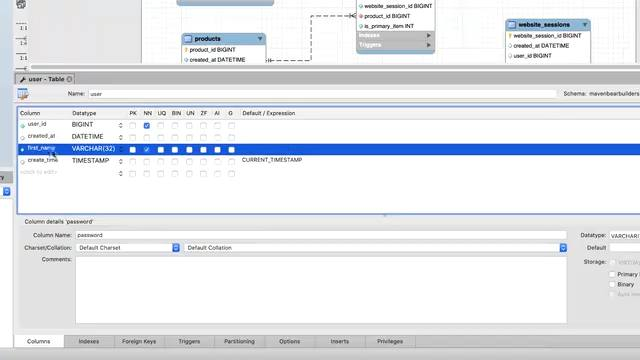

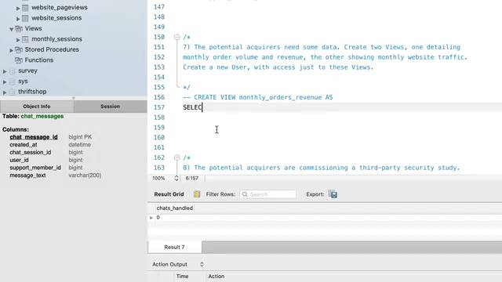

---

至此 P75–P78 的复现路径闭环：P75 的书面安全计划 → P76 的威胁/措施清单 → P77 的期末项目八个问题 → P78 的逐题实现（导入与 QA、四表设计与 EER、建表、存储过程、两个视图、受限用户、安全复盘）。按第 3 节的顺序执行、用第 6 节的清单逐项验证，你就能在本机得到和课程演示一致的结果；第 7 章列的坑则是课里没提、但你实际动手时大概率会遇到的。
### 4.4 续：`sql/04_create_investor_user.sql` 完整闭合版

上一段这个文件在 `GRANT` 行被截断，并且多开了一个 ```sql 围栏。下面是可直接保存执行的完整文件，替换掉 `sql/04_create_investor_user.sql` 里的内容：

```sql
-- 04_create_investor_user.sql
-- 把 bear_builders 替换成你实际的 schema 名。
-- 课里是在 Workbench 的 Users and Privileges / Schema Privileges 里点选，
-- 这里给等价 SQL：只授予两个视图的 SELECT，不授予其他表。

CREATE USER IF NOT EXISTS 'investors'@'%' IDENTIFIED BY 'change me';
ALTER USER 'investors'@'%' IDENTIFIED BY 'change me';

GRANT SELECT ON bear_builders.monthly_orders_revenue  TO 'investors'@'%';
GRANT SELECT ON bear_builders.monthly_website_sessions TO 'investors'@'%';

-- 可选：确认授权结果
SHOW GRANTS FOR 'investors'@'%';
```

注意：`GRANT SELECT ON schema.视图名` 里**不能**写成 `GRANT SELECT ON bear_builders.*`——那会把这个库里所有表都给出去，直接违反 P78 里 “They can't select from other tables” 的验收目标。

---

### 5.4 `sql/05_qa_counts.sql` 逐行解释

这一节补齐第 5 章没展开的 QA 脚本。

`SELECT COUNT(*) AS total_records FROM order_items;` —— 讲师在 P78 [03:15] 说 “We probably want to do just a select count star as total records from”，他用的就是 `COUNT(*)`。`COUNT(*)` 数的是行数，不关心任何列是否为 NULL；相比之下 `COUNT(列)` 会跳过该列的 NULL 值。QA 场景要的是“表里到底有多少行”，所以 `COUNT(*)` 是对的。

`AS total_records` —— 别名只是为了输出好读。后续如果写脚本自动比对期望值，读的就是这个列名。

先对总数、再分月，是讲师的原话顺序：“One thing that we could do here just to help anybody out who might have different counts is we can do a year created at as year and month created at as month”。逻辑是：总数不对 → 说明有导入失败或多导；再用分月计数定位**是哪个月**出的问题。如果只跑分月不跑总数，你要对着 4 个月的数字一个个加，效率更低；如果只跑总数不分月，你知道错了但不知道错在哪。

`YEAR(created_at) AS \`year\`` / `MONTH(created_at) AS \`month\`` —— 必须加反引号。`YEAR` 和 `MONTH` 在 MySQL 里既是函数名也是关键字，不加引号时 `AS year` 在部分语境下会被解析成函数调用而不是别名。课里讲师在屏幕上是直接写的，Workbench 里有时能过、有时报 `ERROR 1064`，取决于上下文；加反引号可以一劳永逸。

`GROUP BY 1, 2 ORDER BY 1, 2` —— 位置序号指 SELECT 列表的第 1、2 个表达式，即 `year`、`month`。讲师原话是 “we'll need a group by at the very end after this group by one two order by one two”。`ORDER BY 1, 2` 让输出按年月升序排列，方便人眼逐月比对；没有它，`GROUP BY` 的输出顺序是不保证的。

`GROUP BY 1, 2` 里的 `1, 2` 指的是 SELECT 列表里的第 1、2 个表达式，这里必须写位置序号而不能写 `GROUP BY year, month`——因为 `year`/`month` 是别名，MySQL 允许在 `GROUP BY` 里用别名，但不推荐，和 `ORDER BY` 的行为不完全一致。

课里没讲的一点：`COUNT(*)` 在 InnoDB 上不是常数时间。InnoDB 不缓存精确行数，`SELECT COUNT(*)` 需要扫一个索引（通常是主键或最小的二级索引）。对 `order_items` 一万多行是毫秒级，对 website page views 四万多行也还行；但如果你的表到千万级，这个 QA 查询本身就会跑几秒。想知道大概行数可以用 `SHOW TABLE STATUS LIKE 'order_items';` 看 `Rows` 字段（字段名以实际输出为准），但那是估算值，不能用于精确对账。

`website page views` 只应该有 3 个月 —— 讲师在 P78 [08:44] 明确说 “we didn't ever have any January data for website page views. So you should just have three months”。如果你的查询返回 4 个月且 1 月有数据，说明你把 1 月的数据重复导入了一次，或者把别的月份文件导进了这张表。反过来，如果 `order_items` 返回的月份数少于预期，通常是某个文件导入中断。

---

### 5.5 `sql/06_smoke_test.sql` 逐行解释

这一节补齐第 5 章没展开的冒烟测试脚本。再次强调：**这段课里没有**，是我为了让你能看见存储过程返回非零值而补的，P78 [30:07] 讲师原话是 “there isn't actually any data in this table. So you're not going to really get to see this procedure work.”

`INSERT INTO users (user_id, created_at, first_name, last_name) VALUES (1, ...)` —— 这里手动指定 `user_id = 1`，不是随手写的。因为 `01_create_chat_tables.sql` 建表时**没有加 `AUTO_INCREMENT`**（讲师只加了 `PRIMARY KEY`），所以 MySQL 不会自动生成 ID。如果你省略 `user_id`，在默认严格模式下会报 `ERROR 1364 (HY000): Field 'user_id' doesn't have a default value`。这是课里方案的一个现实约束：ID 目前靠应用层生成或人工指定。

先插 `users` 和 `support_members`，再插 `chat_sessions`，最后插 `chat_messages` —— 虽然课里没加外键约束，这个顺序在数据库层面不会被强制，但它对应的是真实的父子逻辑（会话引用用户和客服，消息引用会话），养成这个习惯以后你补外键时脚本不用改。

`chat_sessions` 里的 `website_session_id = 999999` —— 这个值是我编的占位值，**不对应任何真实的 `website_sessions` 记录**。因为课里没有外键，插进去不会报错；如果你后面补了外键，这条会失败，届时需要换成一个真实存在的 `website_session_id`。

`chat_messages` 插两行，第一行 `user_id = 1, support_member_id = NULL`，第二行反过来 —— 这就是 5.1 里说的“一条消息要么是客户发的、要么是客服发的”。如果把 `support_member_id` 按讲师后文的说法设成 `NOT NULL`，第一行会插不进去，你也就无法测试客户端消息的场景。

`CALL support_member_chats(1, '2014-01-01', '2014-01-31');` —— 期望返回 `chats_handled = 1`。因为 `chat_sessions` 里只插了一条 `created_at = '2014-01-15 10:01:00'`、`support_member_id = 1` 的记录，落在 1 月 1 日到 1 月 31 日之间。如果返回 0，检查三件事：`created_at` 是否落在区间内、`support_member_id` 是否等于传入的 `1`、以及 `DATE()` 包的那一层有没有写错列名。

清理语句按 `chat_messages → chat_sessions → support_members → users` 的顺序删 —— 先子后父。同样，课里没外键时顺序无所谓，但你补外键后顺序错了会报 `ERROR 1451 (23000): Cannot delete or update a parent row`。

清理完执行 `SELECT COUNT(*) FROM chat_sessions;` 应该回到 0。如果没回到 0，说明 `DELETE` 的 `WHERE` 条件写错了，你留着脏数据去做后面的视图验证会干扰判断。

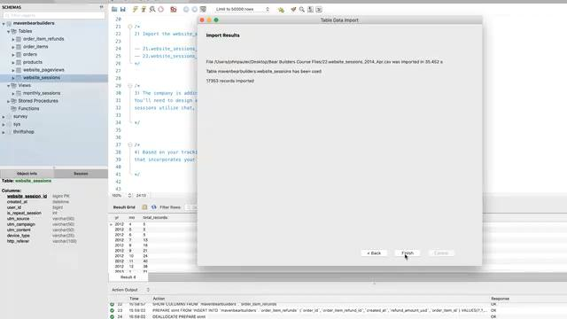

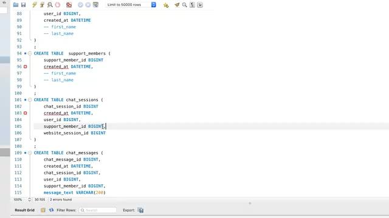

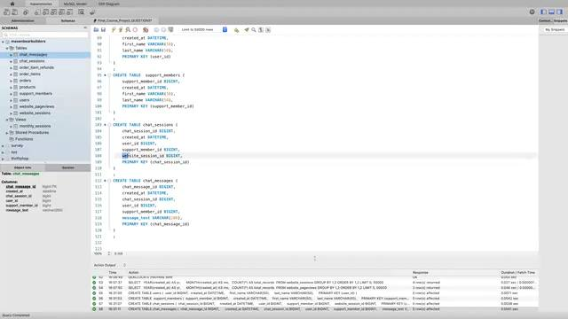

---

## 附录 A：一键执行脚本 `run_all.sh`

把第 3.6 节的命令固化下来，避免手打漏文件。保存到项目根目录，`chmod +x run_all.sh` 后执行 `./run_all.sh`。

```bash
#!/usr/bin/env bash
# run_all.sh —— 按课程顺序执行 P75–P78 的全部 SQL
set -euo pipefail

if [ ! -f .env ]; then
  echo "缺少 .env，请先 cp .env.example .env 并填写"
  exit 1
fi

set -a
# shellcheck disable=SC1091
source .env
set +a

: "${MYSQL_HOST:?MYSQL_HOST 未设置}"
: "${MYSQL_PORT:?MYSQL_PORT 未设置}"
: "${MYSQL_USER:?MYSQL_USER 未设置}"
: "${MYSQL_PASSWORD:?MYSQL_PASSWORD 未设置}"
: "${MYSQL_DATABASE:?MYSQL_DATABASE 未设置}"

run_sql () {
  local file="$1"
  echo "==> 执行 ${file}"
  mysql \
    --host="$MYSQL_HOST" \
    --port="$MYSQL_PORT" \
    --user="$MYSQL_USER" \
    --password="$MYSQL_PASSWORD" \
    --default-character-set=utf8mb4 \
    "$MYSQL_DATABASE" < "$file"
}

# 1) 建四张聊天支持表
run_sql sql/01_create_chat_tables.sql

# 2) 建存储过程（含 DELIMITER，必须走命令行，不能在图形界面逐句执行）
run_sql sql/02_create_procedure.sql

# 3) 建两个视图
run_sql sql/03_create_views.sql

# 4) 建 investors 用户（需要 GRANT 权限，普通账号会在这里失败）
run_sql sql/04_create_investor_user.sql

echo "==> 全部执行完成。以下为验证输出："
mysql \
  --host="$MYSQL_HOST" \
  --port="$MYSQL_PORT" \
  --user="$MYSQL_USER" \
  --password="$MYSQL_PASSWORD" \
  "$MYSQL_DATABASE" <<'SQL'
SELECT COUNT(*) AS order_items_total FROM order_items;
SELECT COUNT(*) AS order_item_refunds_total FROM order_item_refunds;
SHOW PROCEDURE STATUS WHERE Db = DATABASE();
SHOW FULL TABLES WHERE Table_type = 'VIEW';
SQL
```

脚本里 `set -euo pipefail` 的作用：任何一步失败立刻中断，不会出现“建表成功、建视图失败、你还以为全跑完了”的假成功。`--default-character-set=utf8mb4` 是为了避免中文消息在导入导出时变问号。

课里没有这个脚本，是复现补充。

---

## 附录 B：P78 演示顺序 → 本文实现位置对照

逐字稿里讲师是按题目顺序讲的，但没有逐题念编号（P77 提到有 8 个问题，写在课程资源的 `Final Course Project Questions.sql` 里）。下表按 P78 的**演示顺序**整理，方便你卡住时反查：

| 顺序 | 任务 | P78 时间点 | 本文位置 |
| --- | --- | --- | --- |
| 1 | 导入 17、18 到 order_items；19、20 到 order_item_refunds；QA 总数 15,742 / 608 | [00:28]–[05:09] | 3.2、3.3、4.5 |
| 2 | 导入 21、22 到 website_sessions；23、24 到 website page views；按月 QA | [05:09]–[08:44] | 3.2、4.5 |
| 3 | 设计聊天支持四层对象（users / support_members / chat_sessions / chat_messages） | [09:13]–[13:48] | 3.4、5.1 |
| 4 | 在 EER Diagram Model Editor 里画出四张表 | [13:48]–[20:21] | 3.5 |
| 5 | 用 `CREATE TABLE` 建出四张表 | [20:49]–[25:53] | 4.1、5.1 |
| 6 | 创建 `support_member_chats` 存储过程并用 `CALL` 验证 | [26:22]–[31:04] | 4.2、5.2 |
| 7 | 创建 `monthly_orders_revenue`、`monthly_website_sessions` 两个视图 | [31:04]–[34:54] | 4.3、5.3 |
| 8 | 创建 `investors` 用户，只授予视图权限 | [34:54]–[36:49] | 4.4、5.3 |
| 9 | 安全威胁与最佳实践复盘 | [36:49]–[40:02] | 4.7、第 2 章 |

注意第 7、8 项在逐字稿里是连着讲的（“The final piece here is they actually want us to create a new user and just give them access to the views”），是否算同一道题以 `Final Course Project Questions.sql` 里的原文为准，课里没有明确念出题号。

---

## 附录 C：提交前导出的结构快照

讲师在 P78 说 EER 图可以用编辑器导出，但没讲怎么把**实际建出来的表结构**一并交上去。审阅方（或未来的你）拿到图片后还想看 DDL 时，跑这组命令：

```sql
-- 四张表的实际 DDL
SHOW CREATE TABLE users;
SHOW CREATE TABLE support_members;
SHOW CREATE TABLE chat_sessions;
SHOW CREATE TABLE chat_messages;

-- 存储过程体
SHOW CREATE PROCEDURE support_member_chats;

-- 两个视图的定义（含 DEFINER）
SHOW CREATE VIEW monthly_orders_revenue;
SHOW CREATE VIEW monthly_website_sessions;

-- investors 的实际权限
SHOW GRANTS FOR 'investors'@'%';
```

`SHOW CREATE VIEW` 的输出里会带 `DEFINER`，字段名以实际输出为准。这条命令的价值在于：如果哪天视图报 `ERROR 1449`，你一眼就能看出是哪个账号被删了（见第 7 章第 9 条）。

把上述输出粘进 `docs/schema-snapshot.sql`，和 `docs/security-plan.md` 放在一起，就是一份完整的期末项目交付包。

---

## 附录 D：本文引用的截图索引

| 序号 | 帧 | 用途 |
| --- | --- | --- |
| 1 | `p077_0016s.jpg` | P77 说明期末项目目标 |
| 2 | `p078_0083s.jpg` | order_items 导入 1427 条 |
| 3 | `p078_0248s.jpg` | COUNT(*) 与按月分组 QA |
| 4 | `p078_0413s.jpg` | website_sessions 大文件导入 |
| 5 | `p078_0579s.jpg` | 聊天支持四层对象设计 |
| 6 | `p078_0909s.jpg` | EER 编辑器逐字段核对 |
| 7 | `p078_1405s.jpg` | 四张表建表成功 |
| 8 | `p078_1571s.jpg` | 存储过程三个 IN 参数 |
| 9 | `p078_1736s.jpg` | monthly_website_sessions 视图验证 |
| 10 | `p078_1901s.jpg` | 课程收尾：DBA 的职责边界 |
| 11 | `p076_0006s.jpg` | 安全作业解答复盘 |

所有路径均取自课程截图清单，未改动帧号。