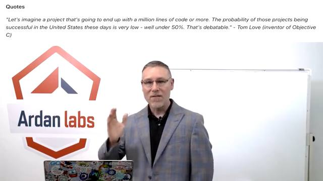
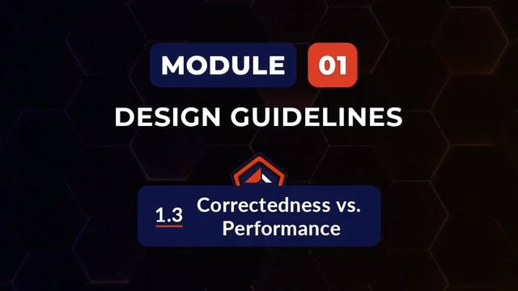
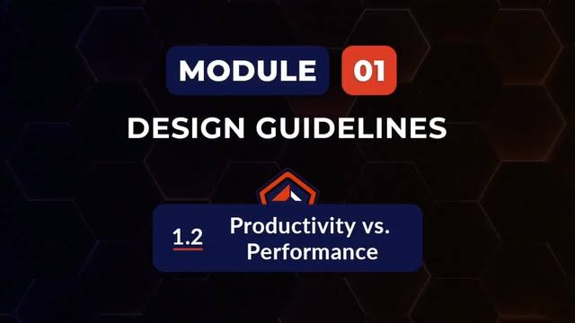

# Ultimate Go（并发 + benchmark）P1–P4 复现文档

> 覆盖：P001–P004。**先说清楚一件事**：这四集是整门课的理念铺垫，逐字稿里**没有一行代码、没有一条命令、没有配置文件**。所以本文档的「复现」不是复现一个工程，而是复现讲师的推导链，并把它落成一套你能直接提交、能贴到 PR 里的笔记与检查表（第 4 章给了 7 个完整文件，逐个保存即可）。第 4 章末尾那段 Go 代码是本文档补的示意，只为对比「薄抽象 / 厚抽象」，已明确标注「课里没有代码」。
>
> 目录结构、文件路径、运行命令在第 3、4 章写全；本节**不需要任何依赖、不需要环境变量**。

---

## 1. 这一节做什么

P001 只有不到一分钟，是导览：讲师说要先讲「为什么 Go 被设计成这样」，否则后面的代码规范和设计取舍你只会背、不会用（—— p001 [00:28]）。真正的内容在 P002–P004 三集，主题不是语法，是**三组对立面**：

1. **代码量与可维护性**：讲师认为行业误把「代码多」当成「工程强」，而 Go 的目标之一是「减少任何项目需要的代码量」，让你管得动（—— p002 [01:20]）。他给出的锚点数字是：Linux 内核超过 2500 万行（p002 [01:20]），而一个开发者能维持的心智模型上限大约 1 万行（p002 [14:08]）。
2. **生产力与性能**：他明确拒绝「性能第一」的说法。Ruby、PHP、Java、C# 这些语言都是把生产力放在第一位（—— p003 [00:52]），Go 想做的是两者都要，并且把问题改成「我能不能写出**足够快**的 Go 程序」，而不是「Go 能不能比 C 快」（—— p003 [01:18]）。
3. **正确性与性能（写代码的当下）**：写代码时你想性能就是在猜，而「我们不猜，我们从不猜」（—— p004 [00:29]）。写的时候只盯正确性：完整性、可读性、简洁；等程序能跑了，再用工具去测快不快。

这一节还埋了一个贯穿全课的概念——**心智模型（mental model）**：你没法在心里维持一个代码库的形状，就没法调试、没法扩展、没法带团队（—— p002 [12:39] 附近）。以及一个非常实用的工作方式：**把「草稿（draft）→ 评审 → 重构 → 发布」写进日常**，而不是要求自己一次写对（—— p004 [03:15]）。

对前端转 AI 应用工程师的你，这一节的实际价值是：你接下来要写的 Go 服务（推理网关、流式转发、限流、缓存）大多是「后端空调」——装上去就不该有人想起它（—— p004 [05:07]）。这套「先正确、再测量、别猜」的顺序，正是你在 Node 里靠经验拍脑袋、在 Go 里必须改成靠工具的那部分。

本节**没有**任何关于 goroutine、channel、调度器、`go test -bench` 的内容。标题里的「并发」和「benchmark」在这一节只是被提及「有工具可以不猜」（—— p004 [01:26] 前后），具体命令课里没讲。

---

## 2. 讲师原话（带「—— pNNN [MM:SS]」）

**关于为什么要先讲理念**

> "这些信息非常重要，因为它会为你理解后面大量的惯用法、准则和设计哲学奠定基础。"
> —— p001 [00:28]

**四条「我们忘了的事」**

> "在某个阶段，我们开始对代码量极大的程序心生敬佩……而 Go 想做的事情之一，就是减少任意给定项目所需的代码量，从而让它更容易管理。"
> —— p002 [01:20]

> "这里我们关注的是尽量薄的解耦层，以及精确而尽量薄的抽象层。"
> —— p002 [01:49]

> "硬件就是平台……Go 的模型就是硬件本身，而不是夹在我们与硬件之间的虚拟机。"
> —— p002 [02:42]

> "我们做出的每一个决定都有代价……如果你并没有真正理解这些决定的代价，那你不是在编程，你是在胡乱拼凑。"
> —— p002 [03:11]

**先写后读的行业怪象**

> "我们要求人们先学会如何写，再教他们如何读。"
> —— p002 [05:36]

**遗留代码**

> "软件项目有两种：一种是失败的，另一种是变成遗留系统噩梦的。"
> —— p002 [08:20]
>
> "我们以为糟糕的代码是糟糕的开发者写出来的，但现实中，它是通情达理的开发者在糟糕环境下写出来的。"
> —— p002 [11:42]

**心智模型的两个数字**

> Tom Love：项目到 100 万行以上，在美国成功率大约 50%。
> —— p002 [13:09]
>
> "普通开发者实际上无法在脑中维持超过一万行代码的心智模型。"
> —— p002 [14:08]
>
> "用 Go 写一万行代码，能完成的事情比用其他语言多得多。"
> —— p002 [15:05]

**生产力 vs 性能**

> "这些语言真正追求的是把生产力放在首位。"
> —— p003 [00:52]
>
> "重要的是，我能不能写出足够快的 Go 程序？"
> —— p003 [01:18]
>
> "硬件在大约二十年里其实并没有发生根本变化。"
> —— p003 [03:09]
>
> "里克·哈德森（2015 年 Go 开发者大会）：“如果软件不会用到更多核心，硬件厂商就不会在硬件中加入更多核心。”"
> —— p003 [03:36]

**正确性优先**

> "我们不猜。我们从不猜。一旦你在猜，你就一定会错。"
> —— p004 [00:29]
>
> "先让它正确，再让它清晰，再让它简洁，最后才让它快；顺序就是如此。"
> —— p004 [01:26]
>
> "好的工程更多不是找到完美方案，而是理解各项取舍，并能把它们解释清楚。"
> —— p004 [01:52]
>
> "关于把代码当作草稿：我们是在起草代码，然后评审、修订、重构，最后才发布。"
> —— p004 [03:15]
>
> "我造空调……我构建的是日复一日运行的系统，没人知道我是谁。因为如果有人知道我是谁，那就说明我失败了。"
> —— p004 [05:07]


---

## 3. 从零复现

这一节没有可运行的工程，所以「复现」= 按讲师的三段推导，产出三份**能在 PR 里用**的文档。整个流程 6 步，全程只需要编辑器和 git。

### Step 0：建目录（不需要 Go 工具链）

```bash
mkdir -p ultimate-go-notes/00-philosophy
mkdir -p ultimate-go-notes/01-quotes
mkdir -p ultimate-go-notes/02-checks
mkdir -p ultimate-go-notes/demo/abstraction
cd ultimate-go-notes
git init
```

最终目录结构（第 4 章会把每个文件内容写全）：

```
ultimate-go-notes/
├── README.md
├── 00-philosophy/
│   ├── constraints.md          # 四条设计约束 → 变成 PR 检查项
│   ├── decision-costs.md       # 每条决策：收益 / 成本 / 什么时候别用
│   ├── capacity-estimate.md    # 1 万行心智模型的算式
│   └── draft-workflow.md       # draft → review → refactor → publish
├── 01-quotes/
│   └── quotes.md               # 讲师引用的原话 + 出处 + 不确定标注
├── 02-checks/
│   └── pr-review-checklist.md  # 把上面三份折叠成一张 PR 勾选表
└── demo/
    └── abstraction/
        └── main.go             # 课里没有代码，这里是示意
```

### Step 1：需求 —— 写下「我为什么学 Go」

产出：`README.md` 里的第一节。写三行就够：我要做的服务是什么、它的性能敏感点在哪、我最担心自己写出的坏味道是什么。讲师的判断标准是「如果你不认同这门语言的工程决策，你就不该用它写代码，否则你只会被折磨」（—— p002 [00:26]）。所以这一步不是走形式：如果你写完发现自己想要的是「自动 DI、装饰器、运行时反射框架」，那你和 Go 的默认审美是冲突的，先记下来。

### Step 2：约束 —— 把「四条」抄成可勾选的检查项

产出：`00-philosophy/constraints.md`（内容见 4.1）。四条对应 p002 [01:20]、[01:49]、[02:42]、[03:11]。每条必须写成**疑问句**，因为检查项的作用是在你写代码时打断你，而不是给你一个读起来很爽的宣言。参考做法：每条约束只留 2 个问题，超过 2 个就没人会看。


### Step 3：估算 —— 把讲师的数字变成算式

产出：`00-philosophy/capacity-estimate.md`（内容见 4.3）。讲师只给了 4 个原始数字：2500 万行（Linux 内核）、1 万行（一令纸 = 一个人能维持的心智模型）、100 万行（成功率 ~50%）、硬件停滞 15–20 年。**结论要由你自己算出来**，并且必须标注「这是我算的，不是讲师说的」，否则这份笔记三个月后就会变成谣言来源。

三个必算的式子：
- 2500 万 ÷ 1 万 = 2500 人份心智模型
- 100 万 ÷ 1 万 = 100 人份心智模型
- 10 人团队 × 1 万行 = 约 10 万行共同心智上限

### Step 4：方案 —— 定义「草稿工作流」

产出：`00-philosophy/draft-workflow.md`（内容见 4.4）。讲师的原话是我们在「drafting code」，然后 review、revise、refactor，直到它可以 publish（—— p004 [03:15]）。把它做成四阶段的状态表，每阶段写清「准入」和「准出」，这样「重构」才真的进了日常流程，而不是一句口号。

### Step 5：取舍 —— 每条决策写清成本

产出：`00-philosophy/decision-costs.md`（内容见 4.2）。讲师说「工程就是理解你为决策付出的成本，不理解成本就不是编程，是在 hack」（—— p002 [03:11]），又说好的工程是「理解取舍并把它解释清楚」（—— p004 [01:52]）。所以每条决策必须有三列：收益、成本、什么情况下不选。

### Step 6：验收 —— 用一句话自检

产出：`02-checks/pr-review-checklist.md`（内容见 4.6）。验收标准只有一条：**随便挑一个你上个月写的 PR，你能不能用一句话说出「我拿了什么成本，换了什么收益」**。说不出来，说明当时是在猜——正是 p004 [00:29] 说的那种状态。

---

## 4. 完整代码

以下 7 个文件全部是完整内容，按路径逐个保存即可。**除了 4.7 的 `main.go`（已标注为示意），其余都是纯文本笔记，不依赖任何工具**。

### 4.1 文件路径：`README.md`

```markdown
# Ultimate Go 前四集笔记（BV1XXcozTE1y P001–P004）

## 我要做什么服务
（写一行：例如「给前端用的 LLM 流式转发网关」）

## 性能敏感点
（写一行：例如「首 token 延迟、并发连接数」）

## 我最担心的坏味道
（写一行：例如「为了以后可能换模型供应商，先抽了三层接口」）

## 这一节没有代码
P001–P004 是理念铺垫。真正的并发与 benchmark 在后续集数。
本仓库的产物是 00-philosophy/ 下的 4 份笔记 + 02-checks/ 下的 1 张检查表。

## 自检一句话
我能用一句话说出这个 PR 的成本和收益吗？说不出来 → 先写进 PR 描述再合并。
来源：p004 [00:29]「we do not guess」；p002 [03:11]「every decision comes with a cost」。
```

### 4.2 文件路径：`00-philosophy/constraints.md`

```markdown
# 四条设计约束（来自 P002 [01:20]–[03:11]）

> 引号内为讲师原话，括号内是时间戳。检查项是我从他原话里翻译出来的，不是他逐字说的。

## 约束 1：代码量要少
原话：「One of the things Go is trying to do is reduce the amount of code that we need
in any given project just to make it easier to manage.」(p002 [01:20])
对照数字：Linux 内核「well over 25 million lines of code」(p002 [01:20])
- [ ] 这个 PR 里，有没有可以删掉的类型、包装层、只为「以后可能」而提前抽的接口？
- [ ] 我新增的文件，能不能用一个职责名说清楚？

## 约束 2：抽象层要薄、要精确
原话：「We want to focus here on thin layers of decoupling ... thin layers of abstraction
that are precise.」(p002 [01:49])
- [ ] 从调用点走到真正干活那行代码，中间隔了几层？
- [ ] 这一层是为了隔离「已发生的变化」，还是只为了「看起来像架构」？

## 约束 3：硬件就是平台
原话：「the hardware is the platform ... Go's model is the hardware. It's not a virtual
machine that's sitting between us and the hardware.」(p002 [02:42])
- [ ] 我能不能说清这段代码在机器上大致怎么跑（占多少内存、用几个核）？
- [ ] 有没有我解释不了的「黑盒」依赖？（Go 没有虚拟机这一层，但课里没讲 runtime 细节）

## 约束 4：每个决定都有成本
原话：「every decision that we make comes with a cost ... if you're not really
understanding the cost of your decisions, you're not programming. You're hacking.」
(p002 [03:11])
- [ ] 这个 PR 我能不能一句话说出「拿了什么成本，换了什么收益」？
- [ ] 说不出来 → 先写进 PR 描述，再合并。
```

### 4.3 文件路径：`00-philosophy/capacity-estimate.md`

```markdown
# 容量与心智模型估算

## 一、讲师给的原始数字（只抄，不改）
| 数字 | 出处 |
|---|---|
| Linux 内核「well over 25 million lines of code」 | p002 [01:20] |
| 一令打印纸 ≈ 10,000 行（讲师引 Tom Love） | p002 [13:39] |
| 单个开发者心智模型上限 ≈ 10,000 行 | p002 [14:08] |
| 项目 ≥ 100 万行，美国成功率约 50%（讲师引 Tom Love） | p002 [13:09] |
| 硬件「hasn't changed in about 20 years」 / 「stuck for the last 15, 20 years」 | p003 [03:09]、p003 [04:04] |

## 二、我按上面数字推的算式（课里没给这些结论，是我算的）
1) Linux 内核需要多少人份心智模型？
   25,000,000 / 10,000 = 2,500
2) 100 万行项目需要多少人份心智模型？
   1,000,000 / 10,000 = 100
3) 反过来用：10 人团队按上限能共同维持多少行？
   10 × 10,000 = 100,000 行
   注意：这不等于「10 人做 100 万行必然失败」。人数上去了，沟通成本和人员流动会额外
   扣分（这一条课里没讲，是我的补充）。
4) 每少写 1,000 行 ≈ 把 0.1 个人的心智预算还回来。
   用法：PR 里删掉 500 行 → 相当于给团队省了 5% 的一个人。

## 三、用在哪里
新服务立项时先估：预估行数 / 10,000 = 需要几个人份的心智模型。
超过团队现有容量 → 先拆包（讲师提到 packaging 能帮上忙，但 P1–P4 没展开，课里没讲细节）。
```

### 4.4 文件路径：`00-philosophy/decision-costs.md`

```markdown
# 决策成本表

> 讲师：工程就是理解你为决策付出的成本（p002 [03:11]）；
> 好工程是理解取舍并把它解释清楚（p004 [01:52]，讲师引 JBD）。

| # | 决策 | 收益 | 成本 | 什么时候别这么干 |
|---|---|---|---|---|
| 1 | 抽象层尽量薄 | 调用点能直接看到规则，心智模型短 | 变化真的来时，改动点会变多 | 变化已经反复发生过 3 次以上，还硬扛 |
| 2 | 写代码时只想正确性 | 不猜；错误在测试和 review 暴露 | 第一版可能慢 | 已经测出瓶颈、且改动只在热点函数里 |
| 3 | 先正确 → 清晰 → 简洁 → 再快（p004 [01:26]） | 顺序错了会白改三轮 | 需要一套测量工具（本课后面才讲） | 无（讲师明确说这个顺序不能倒） |
| 4 | 少写代码 | 团队心智预算省下来 | 有时要多写几行直白代码而不是复用 | 无（讲师把它当 Go 的核心目标之一） |
| 5 | 不依赖 debugger，先看日志和心智模型 | 生产环境没有 debugger（p002 [16:27] 前后） | 前期排查会慢一点 | 心智模型和日志都确认失效之后，再上 debugger |
| 6 | 把重构放进日常（draft → publish） | 不追求一次写对，敢动手 | 每轮都要真的回来重构，否则就是烂尾 | 无（讲师强调问题出在「hack 完不回来」） |
| 7 | 做「后端空调」：装上去没人想起它（p004 [05:07]） | 系统稳定，你不出名 | 没有「炫技」的成就感 | 你真正想做的是前端展示层 |
```

### 4.5 文件路径：`00-philosophy/draft-workflow.md`

```markdown
# 草稿工作流（draft → review → refactor → publish）

> 讲师原话：我们是「drafting code」，然后 review、revise、refactor，直到可以 publish。
> （p004 [03:15] 前后）

| 阶段 | 准入 | 我在这一阶段只做 | 准出 |
|---|---|---|---|
| 1 Draft | 有一个能描述清楚的需求 | 让它跑通，允许丑，允许写死 | 有一个能运行的版本 + 3 条已知问题 |
| 2 Review | 有 diff | 只看正确性和可读性，不看性能 | 每个 if 都能解释为什么存在 |
| 3 Refactor | Review 通过 | 删代码、压薄抽象、改名、补测试 | 行数不增；四条约束全过 |
| 4 Publish | 测试绿 | 写 PR 描述：成本 / 收益各一句 | 合并 |

规则：**第 2 阶段禁止讨论性能**。理由见 p004 [00:29]：写代码时想性能就是猜。
```

### 4.6 文件路径：`02-checks/pr-review-checklist.md`

```markdown
# PR 检查表（把四条约束折叠成 8 个问题）

## 正确性（写代码时唯一要想的事）
- [ ] 这段逻辑的边界条件写下来了吗（空值、超长、并发写）？
- [ ] 我能不用 debugger、只看代码就说出它的执行路径吗？

## 代码量
- [ ] 这个 PR 删掉的行数 / 新增的行数 = ?
- [ ] 有没有「只为以后可能用到」的接口或参数？

## 抽象层
- [ ] 从 handler 到真正干活的地方，隔了几层？（> 2 层要解释）
- [ ] 这一层抽象是隔离已发生的变化，还是预防想象中的变化？

## 成本
- [ ] PR 描述里有一句「成本」和一句「收益」吗？

## 前端类比（给自己看的）
- [ ] 我在 Node/TS 里靠 DI 容器、装饰器、中间件堆出来的那套结构，
      在这个 PR 里有没有被无意识地照搬过来？
```

### 4.7 文件路径：`demo/abstraction/main.go`（**课里没有代码，以下为示意**）

> 这段代码不是讲师写的，讲师在 P1–P4 里一行代码都没给。它只是把「薄抽象 vs 厚抽象」变成你能跑一遍看到的东西。运行方式见下方命令。

```go
// 课里没有代码，以下为示意：用两个函数对比「薄抽象」和「厚抽象」。
// 运行：go run ./demo/abstraction
package main

import (
	"fmt"
	"strings"
)

// 业务规则：名字非空、长度不超过 64、只能是 a-z 和 0-9。

// validateNameThin：薄抽象。调用点能直接看到规则本身。
func validateNameThin(name string) error {
	if name == "" {
		return fmt.Errorf("name is empty")
	}
	if len(name) > 64 {
		return fmt.Errorf("name too long: %d", len(name))
	}
	for _, r := range name {
		if !(r >= 'a' && r <= 'z') && !(r >= '0' && r <= '9') {
			return fmt.Errorf("invalid char %q", r)
		}
	}
	return nil
}

// 下面是厚抽象的反面例子：为了「以后可能换校验规则」抽了三层。
// 同样的规则，调用者要跳 4 次才能看到那个 if。

type Rule interface {
	Check(string) error
}

type RuleSet struct {
	rules []Rule
}

func (s RuleSet) Validate(v string) error {
	for _, r := range s.rules {
		if err := r.Check(v); err != nil {
			return err
		}
	}
	return nil
}

type notEmpty struct{}

func (notEmpty) Check(v string) error {
	if v == "" {
		return fmt.Errorf("empty")
	}
	return nil
}

type maxLen struct {
	n int
}

func (m maxLen) Check(v string) error {
	if len(v) > m.n {
		return fmt.Errorf("too long")
	}
	return nil
}

type charset struct{}

func (charset) Check(v string) error {
	for _, r := range v {
		if !(r >= 'a' && r <= 'z') && !(r >= '0' && r <= '9') {
			return fmt.Errorf("invalid char %q", r)
		}
	}
	return nil
}

func validateNameThick(name string) error {
	return RuleSet{rules: []Rule{notEmpty{}, maxLen{64}, charset{}}}.Validate(name)
}

func main() {
	cases := []string{"aiagent", "", strings.Repeat("x", 65), "BadName"}
	for _, name := range cases {
		fmt.Printf("%-8q thin=%v thick=%v\n", name, validateNameThin(name), validateNameThick(name))
	}
}
```

运行命令（**课里没讲，这是 Go 工具链的标准用法**；不指定版本，示意代码只用到 `fmt` 和 `strings`，各 Go 1.x 都能跑）：

```bash
cd ultimate-go-notes
go run ./demo/abstraction
```

你会看到两个版本对同一批输入给出**一致的结论**（同时为 `nil` 或同时为 `error`，错误文案不同）。这就把「薄厚两种写法功能等价、但成本差 4 层跳转」变成了可观察的事实。具体输出请以你本机实际输出为准，本文档不抄录命令输出。

---

## 5. 逐行解释

**先说估算表（4.3），因为它是整份文档里唯一有数字的东西。**

- `25,000,000 / 10,000 = 2,500`：为什么除的是 1 万而不是别的数？因为讲师把「一令纸」和「一个人能维持的心智模型」都定在 1 万行这个量级（—— p002 [13:39]、[14:08]）。他强调的不是「记住每一行」，而是「知道这块代码怎么流转、要改某个东西去哪个文件找」。这个除法得出的 2500 不是「Linux 需要 2500 个开发者」，而是「Linux 这个规模的代码库，需要 2500 份互相独立的心智模型才能覆盖」——这也解释了为什么讲师说项目过 1 万行就该有第二个队友（—— p002 [15:05]）。
- `1,000,000 / 10,000 = 100`：和 Tom Love 的「百万行 50% 成功率」（—— p002 [13:09]）放在一起看，结论才成立：100 人份的心智模型意味着协调成本，而不是 100 个人并排写代码。
- `10 × 10,000 = 100,000`：这条是反向用法，也是最容易误用的一条。**人数上去不等于心智模型等量叠加**，因为人员流动会让模型失效（讲师举了 COBOL 维护者退休的例子，—— p002 [08:50]）。所以我在文件里明确写了「这一条课里没讲，是我的补充」，避免三个月后你把我的推论当成讲师的结论。
- 「每少写 1000 行 ≈ 还回 0.1 个人」：这是把讲师「Go 让你在 1 万行里做更多事」（—— p002 [15:05]) 翻译成可汇报的数字。不这么写，「减少代码量」就永远是一句正确但无法执行的空话。

**再看决策成本表（4.4）的每一行，重点说「不这样会怎样」。**

- 第 1 行「抽象层尽量薄」：如果不这样，你从 handler 到 SQL 要穿 5 层，任何一次排查都得靠 debugger——而这正是讲师说「debugger 不消除 bug，只是把 bug 慢放」的场景（—— p002 [16:01] 前后）。注意括号里的「什么时候别这么干」：如果同一个变化已经反复发生三次以上，继续硬扛薄抽象，成本会转移到每次改动上，那时候抽一层是划算的。
- 第 2 行「写代码时只想正确性」：反过来（边写边优化）就是讲师定义的「猜」（—— p004 [00:29]）。为什么猜一定错？因为你对编译器、内存布局、CPU 缓存的直觉在热点路径上基本不准，而 Go 有工具可以测（工具本课后面才讲，P1–P4 没出现具体命令）。
- 第 3 行「正确 → 清晰 → 简洁 → 再快」：这个顺序不能倒的直接原因是——如果你先为性能把代码写复杂，后面发现优化错了方向，你要回滚的是一坨难读的代码，而不是一个函数。讲师用「调试难度是写代码的两倍」（—— p002 [15:33] 附近，引 Kernighan）来说明：写得越聪明，越没法调试。
- 第 4 行「少写代码」：不这样的成本是**团队心智预算**，不是编译时间。这条在前端语境里最反直觉：前端生态默认「先装库」，而 Go 的默认审美是「先写 20 行」。
- 第 5 行「不依赖 debugger」：不这样的代价在生产环境才结算。讲师的原话很直接：生产里你不会有 debugger，你只有日志和心智模型（—— p002 [16:54] 前后）。
- 第 6 行「把重构放进日常」：讲师说得很清楚，hack 本身不是问题，「hack 完不回来」才是问题（—— p002 [03:40] 前后）。所以这条的成本项写的是「每轮都要真的回来重构」，这是唯一会被人偷工减料的地方。
- 第 7 行「后端空调」：不这样（追求炫技）的直接后果是——你的系统只有你能维护，于是你成了那个「必须被叫来修空调的人」（—— p004 [05:07]）。讲师把这件事说成失败，不是谦虚。

**最后解释 4.7 那段示意代码为什么这么写。**

- `validateNameThin` 里三个 `if` 是平铺的：调用者跳到函数里，一眼能看到全部规则。这就是「薄、且精确」——层数少，但规则一点没含糊。
- 厚版本里 `Rule` / `RuleSet` / `notEmpty` / `maxLen` / `charset` 五个类型，服务的规则和薄版本**完全一样**。这就是成本：你多付出了 4 个类型和一次接口调用，换到的是「以后可能换校验规则」这个尚未发生的收益。
- `main` 里用同一批输入跑两遍，是为了让你亲眼确认「两者结论一致」。如果不一致，说明厚版本里有 bug——这恰恰是厚抽象的第二个成本：**同一份规则写两遍，就会有两种偏差**。
- `%-8q` 只是把字符串带引号左对齐输出，方便你对比；与本节理念无关。




---

## 6. 复现检查清单

按顺序勾，全部打勾才算这一节复现完成。

- [ ] `ultimate-go-notes/` 目录建好，`git init` 执行过
- [ ] `README.md` 里写清了「我要做什么服务 / 性能敏感点 / 最担心的坏味道」三行
- [ ] `00-philosophy/constraints.md` 四条约束齐全，每条至少 1 个疑问式检查项
- [ ] `00-philosophy/capacity-estimate.md` 里，**讲师原始数字**和**我算的式子**分成两节，且推算部分标注了「课里没给这些结论」
- [ ] `00-philosophy/decision-costs.md` 至少 7 行，每行都有「什么时候别这么干」
- [ ] `00-philosophy/draft-workflow.md` 四个阶段都有准入/准出，且写明「第 2 阶段禁止讨论性能」
- [ ] `02-checks/pr-review-checklist.md` 里有一条「成本 / 收益各一句」
- [ ] `demo/abstraction/main.go` 能 `go run` 起来，thin 和 thick 对同一批输入结论一致
- [ ] 随便挑一个自己上个月的
个月的 PR，你能不能用一句话说出「我拿了什么成本、换了什么收益」（说不出来 → 回到 4.4 表补一行，别急着往下学）

- [ ] 五张截图对应的五个论断，你都能不看笔记复述一句（大代码量崇拜 / 硬件是平台 / 技术变得快但人的想法变得慢 / 两种项目 / 百万行 50%）






---

## 7. 课里没讲但你会撞上的

这一节全是「讲师没讲、但你一动手就会卡住」的东西。凡是课里没提的，我都明确标注为**课里没讲**，并把来源说清楚（Go 官方工具链的标准行为，或行业惯例），不要把它们当成讲师的原话。

### 7.1 环境：P1–P4 根本不需要装 Go，但你迟早要装

P001–P004 全程没有出现任何命令，也没有提到版本号（**课里没讲**）。所以严格按这四集复现，你只需要一个能写 Markdown 的编辑器。只有 4.7 那段示意代码需要 Go。

- **课里没讲** Go 版本。示意代码只用到 `fmt` 和 `strings`，属于 Go 1.0 就有的标准库，任意 Go 1.x 都能编译。如果你要装，直接去 go.dev 下当前稳定版，不要为了「对上课程」去找老版本——这四集没有版本相关内容。
- **课里没讲** `go mod init`。但我给你的 `demo/abstraction/main.go` 只依赖标准库，`go run ./demo/abstraction` 在**没有 go.mod** 的目录里也能跑（Go 的 module 模式下对纯标准库单文件是可运行的）。如果你之后要引第三方包，才需要 `go mod init <模块名>`。
- **课里没讲** IDE 或编辑器插件。Go 的官方语言服务器叫 `gopls`，主流编辑器都能接；这属于工具链常识，不是本节论点。
- **前端类比**：这一步的体验接近「`node` 自带，不需要 `npx create-xxx`」。Go 没有 `node_modules` 这个概念，标准库覆盖了 `net/http`、`encoding/json`、`crypto/*`——这也是讲师说「少写代码」能落地的现实基础（**这条因果是我的推断，讲师在 P1–P4 没有展开标准库**）。

### 7.2 「benchmark」这个词在这一节只出现为「有工具，所以不用猜」

标题里写着 benchmark，但 P001–P004 **没有任何一条 benchmark 命令**（**课里没讲**）。讲师只做了两个承诺：

1. 我们不猜，Go 有足够工具让我们不猜（—— p004 [00:29]）；
2. 99/100 的情况下你写的 Go 代码开箱就够快，不够快的时候他会教你用工具（—— p003 [01:18]）。

所以在这份文档里，**不要**往 `decision-costs.md` 里写 `go test -bench` 的具体参数，那是后面的内容。你在这里要建立的只是纪律：**性能结论必须来自测量，不来自嘴**。至于 `go test -bench=.`、`-benchmem`、`-count` 这些具体写法，等你看到对应集数再补，现在写进笔记只会变成抄来的、你自己没验证过的条目。

同理，「并发」在这一节同样只是被承诺：

- 「we're trying to leverage the full CPU capacity of our machines ... I'm going to show you at some point how we do that」（—— p003 [00:25] 附近）——只有承诺，没有 goroutine、没有 channel、没有调度器。**课里没讲**。
- Rick Hudson 那句「硬件厂商不会在软件不用的情况下继续加核」（—— p003 [03:36]）是**动机**，不是实现。

对前端来说这里有个真实的落差：Node 里你处理并发的默认手段是 `async/await` + 事件循环（单线程，I/O 密集靠非阻塞）；Go 走的是另一条路（多核并行靠语言层面的调度）。**这个对比课里没讲**，我只提醒你：不要把 Node 的心智模型直接搬过来，等看到并发那几集再重建。

### 7.3 你会被「1 万行」这个数字带偏

这是本节最容易出事的地方。讲师说的是「平均开发者维持不了超过 1 万行代码的心智模型」（—— p002 [14:08]），紧接着补了一句关键的：「不是要 Go 去把 1 万这个数字撑大，而是我们在 1 万行里能做的事比别的语言多」（—— p002 [15:05]）。

你会撞上的三种误读：

1. **把它当硬指标去砍代码**。1 万行是**一个人的认知容量**，不是你 PR 的行数上限。一个 300 行的文件如果全是嵌套判断，心智负担可能超过 3000 行平铺代码。
2. **拿它去反对拆包**。讲师的用法恰恰相反：正因为单人心智有限，才需要靠 packaging 让大项目、大团队可维护（—— p002 [15:05]，他只说了 packaging 能帮忙，**具体怎么做课里没讲**）。
3. **把它当成功率公式**。「百万行 → 50%」是 Tom Love 给的一个统计说法（—— p002 [13:09]），不是你能拿去算自己项目命运的公式。我在 `capacity-estimate.md` 里把「我算的」和「他说的」分成两节，就是为了防这个。

**前端类比**：前端经常用「这个组件 800 行了，该拆了」来判断，这是行数驱动的；讲师的标准是认知驱动的——**你还能不能在心里跑一遍它的数据流**。这两个标准大多数时候同向，但不同源。

### 7.4 「不猜」在 Go 里意味着什么，以及你会在哪里破功

讲师的定义很锋利：写代码时想性能 = 猜，猜就会错（—— p004 [00:29]）。落到实操，你会在三个地方破功：

- **微优化冲动**：看到 `for` 里有个 `len()` 就想提到循环外。在 Go 里你**没有任何依据**说这有用——依据只能来自测量工具，而工具这一节没讲。所以现在的正确动作是：写清楚的版本，记一条「待测」，走人。
- **提前抽接口**：这是前端转过来的人最容易犯的。TS 里你可能先定义 `interface LLMProvider` 再写两个实现；Go 的审美是先写具体类型，等**第二个实现真的出现**时再抽接口。第 4.7 节的 `RuleSet` 就是给你看的反面标本（**这是我的示意，不是讲师写的代码**）。
- **把「后端空调」理解成「不要设计」**：讲师说的是**不要炫技**（—— p004 [05:07]），不是说不用想清楚边界。`pr-review-checklist.md` 里那两条「边界条件」「执行路径」就是在防你把「简单」理解成「随便」。

### 7.5 遗留代码这几句，你是要真用上的

讲师花了很长一段讲遗留代码（—— p002 [08:20] 到 [12:39]），核心是两句：

- 「awful code 是**在糟糕处境下的合理开发者**写出来的」（—— p002 [11:42]，引 Sarah May）；
- 你写的代码**将来是别人维护的**，但你今天不会按这个前提去设计（—— p002 [10:43] 附近，引 Gerald）。

你会撞上的具体场景：接手一个 AI 应用的老服务（比如一个早期用某种框架拼起来的推理网关），里面有一堆你看不懂的抽象和写死的 prompt 模板。按讲师的态度，第一反应不该是「这谁写的」，而是「他当时受什么约束——是不是那会儿还没有流式接口、是不是模型只支持同步调用」。**约束是不是真的存在过，你没法考证，课里也没给方法**；但先把「假设它是合理的」作为默认，能让你少删掉一些其实在兜底的东西。

### 7.6 关于「心智模型」这个工具，课里没给操作步骤

讲师反复说心智模型是调试、扩展、带团队的前提（—— p002 [12:39]），也说了「不能维持心智模型就没法调试」。但**他没有给出「怎么建立心智模型」的具体方法**（**课里没讲**）。你能从这四集里直接拿走的只有反向指标：

- 你需要打开 debugger 才能知道程序在干什么 → 心智模型已经有洞了（—— p002 [16:01] 前后）；
- 你没法预测这段代码大致跑多快 → 你对机器的心智模型是空的（—— p003 [05:02] 附近，引 Kernighan）。

我在 `pr-review-checklist.md` 里放的那条「我能不用 debugger、只看代码就说出它的执行路径吗」，就是把上面第一条翻译成了可勾选的问句。这是**我的翻译**，不是讲师的原话。

### 7.7 这一节结束后，你手上应该有什么

写到这里，如果你按第 3 章六步走完，你应该有：

```
ultimate-go-notes/
├── README.md                         ← 三行：服务 / 敏感点 / 坏味道
├── 00-philosophy/
│   ├── constraints.md                ← 四条约束，8 个问句
│   ├── capacity-estimate.md          ← 原始数字 + 4 条自算式子
│   ├── decision-costs.md             ← 7 行，每行带「什么时候别这么干」
│   └── draft-workflow.md             ← 4 阶段，第 2 阶段禁谈性能
├── 01-quotes/
│   └── quotes.md                     ← 见 7.8，这一步别跳过
├── 02-checks/
│   └── pr-review-checklist.md        ← 8 个问句
└── demo/
    └── abstraction/
        └── main.go                   ← 只用于对比薄/厚，非课程代码
```

**并且手上没有任何可运行的「课程项目」**——因为 P1–P4 里就没有。这不是文档缺陷，是这四集的真实形态。看到这里如果你觉得「什么都没做出来」，那说明预期对上了：这四集买的是判断力，不是脚手架。

### 7.8 补一个文件：`01-quotes/quotes.md`

第 3 章 Step 0 建了 `01-quotes/` 却一直没给内容，这里补全。这个文件的作用是防止你三个月后把讲师的话、引用别人的话、和我（文档作者）的推断混成一锅。

```markdown
# 引用台账

规则：每行必须能回答「谁说的 / 讲师在哪一集说的 / 原话还是我的转述」。
凡是「我的转述」，一律不许再往下引用，只能自己看。

| 原话 | 真正的说话人 | 讲师在哪 | 性质 |
|---|---|---|---|
| 两条路：失败，或变成遗留噩梦 | Peter（讲师引） | p002 [08:20] | 讲师引用他人 |
| awful code 由合理开发者在糟糕处境下写出 | Sarah May（讲师引） | p002 [11:42] | 讲师引用他人 |
| 百万行项目成功率约 50% | Tom Love（讲师引） | p002 [13:09] | 讲师引用他人 |
| 一令纸 ≈ 10,000 行 | Tom Love（讲师引） | p002 [13:39] | 讲师引用他人 |
| 开发者心智模型上限约 10,000 行 | Tom Love（讲师引） | p002 [14:08] | 讲师引用他人 |
| 调试难度是写代码的两倍 | Kernighan（讲师引） | p002 [15:33] 附近 | 讲师引用他人 |
| 硬件厂商不会在软件不用时继续加核 | Rick Hudson（讲师引，GopherCon 2015） | p003 [03:36] | 讲师引用他人 |
| 硬件约 20 年没大变 | 讲师本人 | p003 [03:09] | 讲师观点 |
| 我们都先教写、后教读 | 讲师本人 | p002 [05:36] | 讲师观点 |
| 我们不猜，我们从不猜 | 讲师本人 | p004 [00:29] | 讲师观点 |
| 正确 → 清晰 → 简洁 → 再快 | West Dyer（讲师引） | p004 [01:26] | 讲师引用他人 |
| 好工程是理解取舍并解释清楚 | JBD（讲师引） | p004 [01:52] | 讲师引用他人 |
| 我造空调 | 讲师本人 | p004 [05:07] | 讲师观点 |
| 25,000,000 / 10,000 = 2,500 | 本文档作者 | 无 | 我的推算，禁止外引 |
| 每少 1000 行 ≈ 还回 0.1 个人 | 本文档作者 | 无 | 我的推算，禁止外引 |
| Node 的事件循环 vs Go 的多核并行 | 本文档作者 | 无 | 我的类比，禁止外引 |
```

补完这个文件，第 6 章的最后一条检查项才真的能勾上——因为「不看笔记复述五个论断」的前提，是你知道那五个论断**分别是谁说的**。讲师自己在 P002 引用了一大串人（Peter、Sarah May、Tom Love、Kernighan、Rick Hudson……），他引的时候都报了名字（见上表时间戳），这也是本节一个隐性的示范：**观点要能溯源**。你在 PR 里写「为了性能」，也应该能溯源到某次测量，而不是某篇博客。

到这里，P001–P004 的复现就完整了。下一节开始才真正进代码，届时第 4 章会换成能跑的完整文件，第 6 章会换成能对照的终端输出——那时候本文档里所有「课里没讲」的标注，就是你要拿新集数去填的坑。