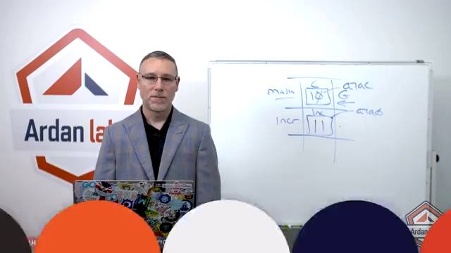
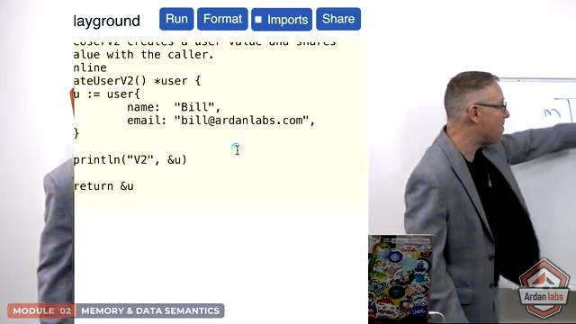
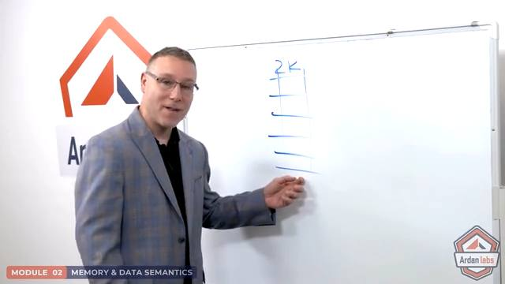
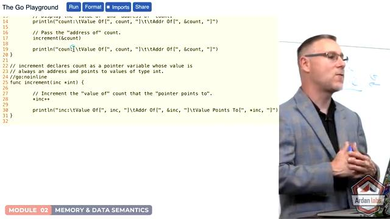
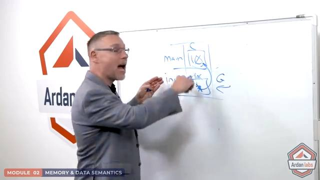
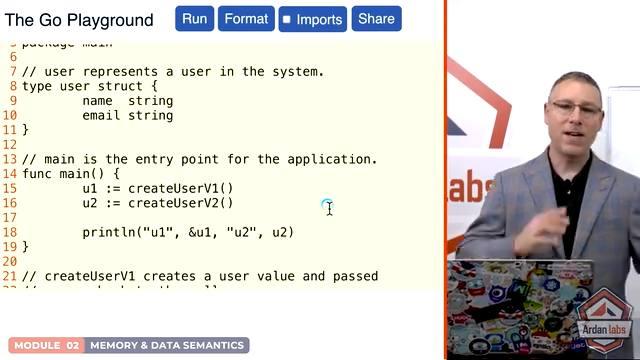
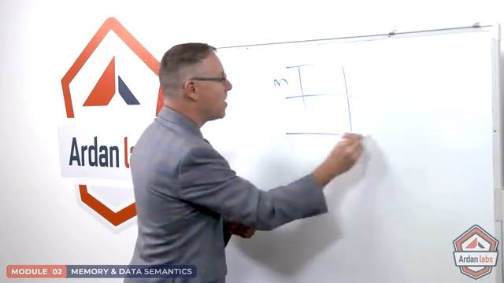
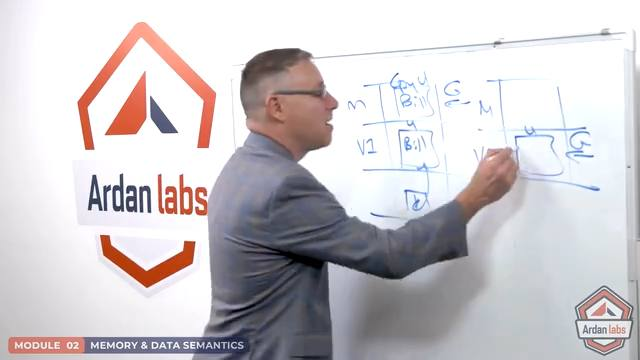
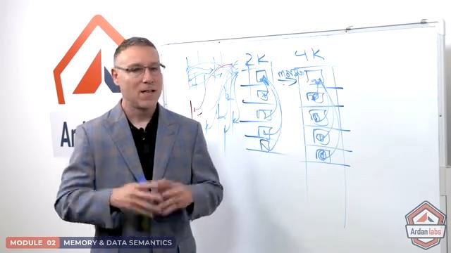
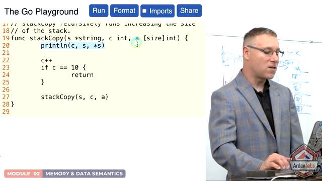

## 1. 这一节做什么

P10–P12 不是直接教你写 benchmark，而是在给后面所有并发、分配、性能分析打地基。这一段的核心是三个东西：

1. **值语义（value semantics）**：函数调用、goroutine 跨程序边界时，拿到的是数据副本。改副本不会影响调用方。讲师用 `int` 和 `user` 两个例子反复画栈帧。
2. **指针语义（pointer semantics）**：函数拿到的是地址，仍然属于“按值传递”，只不过传递的值是地址；被调用函数可以通过 `*` 间接读写调用方栈帧里的数据，因此出现“副作用（side effect）”。
3. **逃逸分析与栈增长**：Go 编译器通过静态分析决定一个值构造在栈上还是堆上；goroutine 初始栈很小（课里说 2K），不够时会分配新的连续栈并搬移值，因此栈上地址可能变化。跨 goroutine 共享的值不能留在某个 goroutine 的栈上，通常要逃逸到堆。

本段没有讲 `testing.B`、benchmark 函数怎么写、pprof 怎么采；这些属于“标题里有 benchmark，但 P10–P12 还没进入 benchmark 实操”。本文只复现这一段真正讲到的内容：指针语义示例、两个工厂函数版本、逃逸分析报告、栈增长观察。

> 说明：逐字稿只描述了代码结构和部分行号，没有给出完整源码。下面第 4 节的代码是按逐字稿描述重建的**最小可运行复现版**，变量名、打印语句、行号不可能与讲师屏幕完全一致；但语义、调用关系、逃逸触发点与逐字稿一致。



---

## 2. 讲师原话（带「—— pNNN [MM:SS]」）

下面只摘与复现直接相关的原话，不做“P005 讲了 A、P006 讲了 B”的流水账。

> “This is still a pass by value... the value being passed across the program boundary is an address.”
>
> —— p010 [00:58]

讲师强调：传指针不是“传引用”，Go 里仍然是按值传递，只是这个“值”是地址。

> “Anytime we're going to modify data outside of the sandbox, the frame that we're operating in, we have the potential of that side effect.”
>
> —— p010 [03:53]

这里的 sandbox 指当前 goroutine 正在操作的栈帧。通过指针改到当前帧外面的数据，就有副作用风险。

> “Value semantics means that every single function call, every go routine as it transitions from one program boundary to the other, it's going to operate on its own copy of the data.”
>
> —— p010 [05:47]

值语义的关键不是“值类型/引用类型”这种说法，而是每次跨函数边界是否复制数据。

> “Escape analysis is trying to read your code at compile time and try to determine where a value should be constructed in memory, whether it's on the stack or on the heap.”
>
> —— p011 [07:58]

逃逸分析不是运行时搬移，而是编译期决定“构造在哪里”。

> “If the compiler recognizes code where value is being shared up the call stack, it immediately goes, OK, we can no longer construct this value on the stack. It's going to have to be on the heap.”
>
> —— p011 [09:50]

`return &u` 这种把地址往调用方返回的写法，是典型的“share up”，会触发堆分配。

> “If we're going to be doing construction to a variable, then we're going to be using our value construction.”
>
> —— p011 [15:31]

讲师给了一个可执行 guideline：构造到局部变量时优先值构造 `u := user{...}`，返回时再 `return &u`，这样读代码的人能看到 `&`，知道这里发生了共享/逃逸成本。不要一上来写 `u := &user{...}` 把成本藏起来。

> “We can use these GC flags... if we use the M2 option... the compiler will not build your program, but it will produce that escape analysis report.”
>
> —— p011 [17:24]

课里用编译器 GC flags 看逃逸报告。具体输出措辞随 Go 版本变化，不要背字段名。

> “No go routine can share a value with another go routine that's on its stack.”
>
> —— p012 [04:14]

因为栈会增长、值会搬移，Go 不允许一个 goroutine 的栈上值被另一个 goroutine 直接共享；要共享就上堆。

> “You're going to see the address... has moved. In fact, it's moved again a couple of times.”
>
> —— p012 [06:38]

把数组从很小改成很大后，栈空间不够，栈增长，地址发生变化。

---

## 3. 从零复现

### 3.1 复现环境与依赖

- 语言：Go。**课里没有指定 Go 版本**；本文示例不引入任何第三方依赖，使用本机已安装的 Go 即可。
- 依赖：**无**。不需要 `go get`。
- 环境变量：**本段没有需要设置的环境变量；课里没讲环境变量。**
- 目录：一个本地 module，四个 `package main` 子目录，分别复现：
  - `pointer`：值语义 vs 指针语义，`*int` 修改调用方数据；
  - `factory`：`createUserV1` 返回值、`createUserV2` 返回指针；
  - `stack`：小数组，观察栈帧；
  - `stack_growth`：大数组，观察栈增长后地址变化。

### 3.2 创建目录和 module

在终端执行：

```bash
mkdir -p ultimate-go-labs/{pointer,factory,stack,stack_growth}
cd ultimate-go-labs
go mod init example.com/ultimate-go-labs
```

`go.mod` 内容如下。**课里没讲 Go modules；这里只是为了让你能直接 `go run ./目录`，不是讲师要求。**

```go
module example.com/ultimate-go-labs

go 1.20
```

> `go 1.20` 是本文复现示例的写法，不是逐字稿指定版本。你用更高版本通常也能跑；如果本机 Go 版本较老，把这一行改成你的版本或删掉后重新 `go mod init`。

### 3.3 目录结构

最终应当长这样：

```text
ultimate-go-labs/
├── go.mod
├── pointer/
│   └── main.go
├── factory/
│   └── main.go
├── stack/
│   └── main.go
└── stack_growth/
    └── main.go
```

### 3.4 运行四个示例

按顺序执行：

```bash
go run ./pointer
go run ./factory
go run ./stack
go run ./stack_growth
```

你应当看到：

- `pointer`：`main before` 是 10，`main after` 是 11；`increment` 里拿到的 `ptr` 指向 `main` 的 `value`。
- `factory`：`createUserV1` 返回后，`main` 里的 `u1` 是另一份副本；`createUserV2` 返回指针，`main` 通过 `*u2` 读到的值来自堆上的 `u`。
- `stack`：递归 10 层，每层打印 `depth`、`&s`、`&a`；小数组通常不会把 2K 栈撑爆。
- `stack_growth`：同样递归 10 层，但每层有 `[1000]int` 大数组，栈会增长，`&a` 的地址会发生明显变化。

### 3.5 看逃逸分析报告

进入 `factory`，执行：

```bash
go build -gcflags="-m=2" ./factory
```

如果 `-m=2` 在你的 Go 版本上不认，退回：

```bash
go build -gcflags="-m" ./factory
```

课里说的是“GC flags 的 M2 选项”，目的是让编译器输出逃逸分析报告，而不是正常运行程序。你应该重点看 `createUserV2` 里的局部变量 `u` 是否被报告为逃逸到堆。**报告的具体字段名、行号、措辞以你本机实际输出为准**；本文不伪造 `ExitCode`、`OOMKilled`、`HostConfig` 这类字段，因为本段代码和逐字稿都没有出现它们。



---

## 4. 完整代码

以下文件可以逐个保存后直接运行。再次说明：逐字稿没有给出完整源码，下面是按讲授内容重建的可运行版本。

### 4.1 `go.mod`

```go
module example.com/ultimate-go-labs

go 1.20
```

### 4.2 `pointer/main.go`

```go
package main

import "fmt"

func main() {
	value := 10
	fmt.Printf("main before: value=%d address=%p\n", value, &value)

	increment(&value)

	fmt.Printf("main after:  value=%d address=%p\n", value, &value)
}

func increment(ptr *int) {
	fmt.Printf("increment input:  ptr=%p points-to=%d\n", ptr, *ptr)

	// 课里 line 28 用 * 做 read-modify-write。
	// 这里写成 (*ptr)++，避免读者误以为是在改 ptr 本身。
	(*ptr)++

	fmt.Printf("increment output: ptr=%p points-to=%d\n", ptr, *ptr)
}
```

### 4.3 `factory/main.go`

```go
package main

import "fmt"

type user struct {
	name  string
	email string
}

// createUserV1 使用值语义：调用方拿到一份 user 副本。
func createUserV1() user {
	u := user{name: "Bill", email: "bill@example.com"}
	fmt.Printf("V1 inside: u=%+v address=%p\n", u, &u)
	return u
}

// createUserV2 使用指针语义：调用方拿到共享访问权。
// u 是局部变量，但 return &u 会把地址往调用方方向返回，
// 触发 escape analysis，u 通常被构造到堆上。
func createUserV2() *user {
	u := user{name: "Bill", email: "bill@example.com"}
	fmt.Printf("V2 inside: u=%+v address=%p\n", u, &u)
	return &u
}

func main() {
	u1 := createUserV1()
	fmt.Printf("main V1: u1=%+v address=%p\n", u1, &u1)

	u2 := createUserV2()
	fmt.Printf("main V2: *u2=%+v pointer=%p\n", *u2, u2)
}
```

### 4.4 `stack/main.go`

```go
package main

import "fmt"

const size = 10

func main() {
	s := "hello"
	stackTrace(s, 0)
}

func stackTrace(s string, depth int) {
	var a [size]int
	fmt.Printf("depth=%02d s=%q &s=%p &a=%p\n", depth, s, &s, &a)

	if depth < 10 {
		stackTrace(s, depth+1)
	}
}
```

> 课里用字符串和数组模拟栈帧。这里打印的是局部参数 `s` 的地址和局部数组 `a` 的地址，便于观察栈帧位置。`%p` 对字符串/数组的显示细节、地址数值每次运行都可能不同，不要写死。

### 4.5 `stack_growth/main.go`

```go
package main

import "fmt"

const size = 1000

func main() {
	s := "hello"
	stackTrace(s, 0)
}

func stackTrace(s string, depth int) {
	var a [size]int
	fmt.Printf("depth=%02d s=%q &s=%p &a=%p\n", depth, s, &s, &a)

	if depth < 10 {
		stackTrace(s, depth+1)
	}
}
```

> 课里说的是把数组改大，例如从很小改到“四千字节”级别，触发栈增长。这里用 `[1000]int` 作为大数组示例；`int` 的实际字节宽度随平台变化，所以不保证恰好是 4000 字节。课里没有展开 `unsafe.Sizeof`，本文也不把“4000 字节”写死成运行时事实。



---

## 5. 逐行解释

### 5.1 `pointer/main.go`：为什么改的是调用方数据

1. `value := 10`：在 `main` 的栈帧里放一个 `int`。`value` 是局部变量，`main` 直接拥有它。
2. `fmt.Printf("main before...", value, &value)`：打印值和地址。`&value` 取地址，类型是 `*int`。
3. `increment(&value)`：把 `value` 的地址传进去。注意：这仍然是按值传递，因为传过去的是“地址这个值”的副本；`increment` 的 `ptr` 是另一个局部变量，里面存的是 `main.value` 的地址。
4. `func increment(ptr *int)`：参数类型不是 `int`，而是 `*int`。课里 line 25 说的就是这一点：我不要一个整数，我要一个整数的地址。
5. `*ptr`：间接访问。`ptr` 指向 `main` 的 `value`，所以 `*ptr` 读的是 `main` 栈帧里的数据。
6. `(*ptr)++`：对 `ptr` 指向的整数做 read-modify-write。不是改 `ptr` 本身。课里强调：如果直接改指针本身，Go 不会让你随便做，因为那是完整性问题；用 `*` 才是改它指向的整数。
7. 返回后 `main` 打印 `value` 变成 11。这就是课里说的副作用：`increment` 在自己的帧里，却改了自己 sandbox 外面的数据。
8. 在 JS/Node 里可以类比：传对象属性时，函数改 `obj.x++` 会影响外部对象；但如果你在函数里写 `param = ...` 重新赋值，外部不受影响。Go 的 `*int` 更直接：它明确拿到地址并解引用修改。





### 5.2 `factory/main.go`：V1 和 V2 的成本差在哪

1. `type user struct { name string; email string }`：用户定义类型。课里 p011 开头展示的就是这个类型。
2. `createUserV1() user`：返回类型是 `user`，不是 `*user`。只看签名就能知道调用方拿到副本，这是值语义工厂函数。
3. `u := user{...}`：在 V1 的栈帧里构造并初始化 `u`。
4. `fmt.Printf(... &u)`：打印 V1 内部 `u` 的地址；返回后 `main` 的 `u1` 地址通常不同，因为 `return u` 复制了一份。
5. `return u`：把 `u` 复制给调用方。调用方拿到自己的副本，后续改 `u1` 不影响 V1 函数里的 `u`。
6. `createUserV2() *user`：返回类型是 `*user`，表示调用方拿到共享访问权。只看返回类型就知道这里不是复制整个 `user`，而是共享。
7. `u := user{...}`：课里 guideline：构造到变量时用值构造。不要一上来写 `u := &user{...}`，否则后面 `return u` 看不出成本。
8. `return &u`：把局部变量 `u` 的地址往调用方方向返回，这就是 `share up`。编译器做逃逸分析后，不能把 `u` 留在 V2 的栈帧里，因为函数返回后栈帧会失效/被复用。于是 `u` 通常构造到堆上。
9. `main` 里 `u2 := createUserV2()`：`u2` 是 `*user`，指向堆上的 `user`。打印 `*u2` 读值，打印 `u2` 看地址。
10. 课里还展示了反例：如果第 39 行写成指针语义构造 `u := &user{...}`，那么第 46 行 `return u` 就没有 `&`，读代码的人不容易看出这里发生了共享/逃逸。这就是“可读性 = 不隐藏成本”的意思。
11. 在 JS/Node 里：返回对象引用很像 V2；返回对象字面量后外部拿到的是引用。但 JS 没有 Go 这种“栈上构造还是堆上构造”的显式观察方式，V8 自己管理。不要把 Go 的逃逸分析 guideline 生搬到 JS。







### 5.3 `stack/main.go` 与 `stack_growth/main.go`：为什么地址会变

1. `const size = 10`：小数组版本。课里 line 9 有常量 size=10，数组是 10 个 int，课里按 40 字节讲；实际字节数取决于平台，不要死记。
2. `s := "hello"`：在 `main` 里创建字符串。字符串本身是 header + 底层字节；这里我们只打印局部参数 `s` 的地址，不展开底层数据指针。
3. `stackTrace(s, 0)`：从深度 0 开始递归。课里说把字符串 share down 调用栈 10 次。
4. `stackTrace(s string, depth int)`：每次调用都会拿到 `s` 的副本（值语义），并在新栈帧里创建局部数组 `a`。
5. `var a [size]int`：小数组版本每层只有 10 个 int，10 层通常不会超过 2K 初始栈；大数组版本 `[1000]int` 会迅速把栈撑大。
6. `fmt.Printf(... &s, &a)`：打印地址。小数组版本里，地址通常落在同一段栈空间；大数组版本里，栈增长后新的连续栈块会搬移值，地址发生变化。
7. `if depth < 10 { stackTrace(s, depth+1) }`：递归 10 层。课里让观察第 2 个和第 6 个调用附近的地址；你可以按 `depth=02`、`depth=06` 看。
8. 栈增长机制：课里说初始栈 2K，不够时分配一个**新的、连续的两倍大小**的栈块，然后把现有值搬过去，相关指针要调整。因此栈上值的地址不是永远不变。
9. 为什么不能让 50,000 个 goroutine 互相指向对方栈上的值？因为任意一个栈增长都可能搬移值，如果允许跨 goroutine 栈共享指针，就要在全程序范围调整大量指针，带来 stop-the-world 级别延迟。所以跨 goroutine 共享的值要放堆上。
10. 在 JS/Node 里：调用栈和堆由引擎管理，开发者不直接控制“栈增长后地址搬移”。这段知识主要用于理解 Go 的分配成本和逃逸分析，不是让你在 JS 里手写栈增长逻辑。





---

## 6. 复现检查清单

- [ ] 已执行 `go version`，本机 Go 可用。
- [ ] 已创建 `ultimate-go-labs` 目录，并执行 `go mod init example.com/ultimate-go-labs`。
- [ ] `go.mod` 存在，且没有第三方依赖。
- [ ] `pointer/main.go` 保存后，`go run ./pointer` 输出中 `main before` 为 10，`main after` 为 11。
- [ ] `pointer` 输出里 `increment input` 的 `ptr` 与 `main` 的 `&value` 指向同一地址（数值应一致；格式以实际输出为准）。
- [ ] `factory/main.go` 保存后，`go run ./factory` 能打印 V1、V2 的 `user` 值和地址。
- [ ] `factory` 中 V1 的 `main` 副本地址与 V1 内部 `&u` 通常不同；V2 的 `u2` 指针指向堆上的 `u`。
- [ ] 已运行 `go build -gcflags="-m=2" ./factory`；如果失败，改用 `go build -gcflags="-m" ./factory`。
- [ ] 逃逸报告中能看到 `createUserV2` 的局部变量 `u` 与堆/逃逸相关提示；具体措辞以本机输出为准。
- [ ] `stack/main.go` 保存后，`go run ./stack` 输出 11 行左右（depth 0 到 10）。
- [ ] `stack_growth/main.go` 保存后，`go run ./stack_growth` 输出同样层数，但 `&a` 地址与 `stack` 版本相比出现明显搬移/变化。
- [ ] 没有把地址数值写死到代码或测试里；地址每次运行都可能不同。
- [ ] 知道本段没有讲 benchmark 的 `testing.B`、pprof、GC trace；不要在本段复现里硬塞这些内容。

---

## 7. 课里没讲但你会撞上的

1. **逐字稿没有完整源码。** 你照着本文能跑，但行号、变量名不会和讲师屏幕一模一样。不要用行号去对代码，按“值构造 / 指针返回 / share up / 栈增长”这些语义点对。
2. **课里没讲 Go modules。** `go.mod`、`go mod init` 是为了本地复现，不是讲师在本段讲的知识点。你如果已有 Go 工程，也可以把四个 `main.go` 放到已有 module 的子目录里。
3. **`-gcflags="-m=2"` 的输出随 Go 版本变化。** 课里说用 GC flags 的 M2 选项看逃逸报告；你本机可能显示不同措辞、不同行号。不要背某个字段名，看到 `createUserV2` 的 `u` 与堆/逃逸相关即可。若 `-m=2` 不认，用 `-m`。
4. **`%p` 打印字符串/数组的细节容易误解。** 本文打印的是 `&s`（局部字符串参数的地址）和 `&a`（局部数组的地址），不是字符串底层字节的地址。课里用地址变化说明栈增长；你复现时看“地址是否变化”即可，不要纠结具体十六进制值。
5. **`int` 宽度不是全平台固定。** 课里按 40 字节讲 10 个 int 的数组；在 64 位环境里 `int` 可能是 8 字节，数组大小会不同。本文不把“4000 字节”写成硬事实，只用 `[1000]int` 触发栈增长。课里没讲 `unsafe.Sizeof`，这里也不展开。
6. **栈增长不是每次运行都给你完全相同的地址序列。** 编译器优化、Go 版本、递归深度、打印语句都会影响栈布局。你只需观察到：小数组时地址相对稳定；大数组时地址发生搬移。
7. **本段没有讲锁、事务、原子操作。** 指针语义能共享数据，但如果你在多个 goroutine 里同时写同一个堆上的值，会有数据竞争。课里 P10–P12 没有讲 `sync`、`atomic`、channel 的同步细节；不要因为“指针能共享”就直接并发写。在 JS/Node 里对应的是共享对象/`SharedArrayBuffer` 等需要同步的场景，但课里没讲这些。
8. **标题有 benchmark，但 P10–P12 没有 benchmark 代码。** 这段讲的是逃逸、分配、栈增长这些会影响 benchmark 中 alloc/op 和 GC 延迟的底层机制。真正的 `testing.B`、benchmark 对比、pprof 排障，按课程后续内容再学；本文不编造。
9. **JS/Node 转过来最容易误判的一点：** Go 的“指针语义”不是 JS 的“对象引用传参”完全等价。Go 里你可以对 `int` 取地址并用 `*int` 改调用方数据；JS 原始值不能这样。Go 的逃逸分析 guideline（构造到变量用值构造，返回时用 `&` 显示共享）是 Go 代码可读性规范，不是 JS 规范。