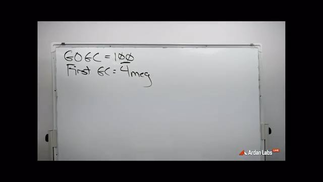
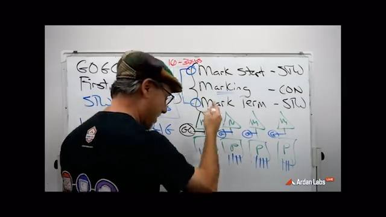
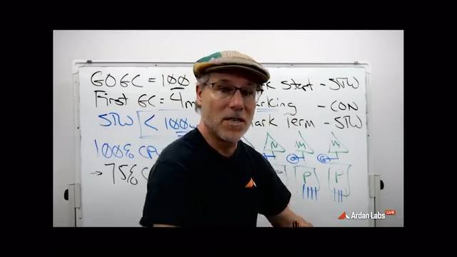
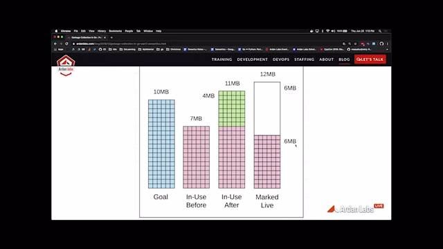
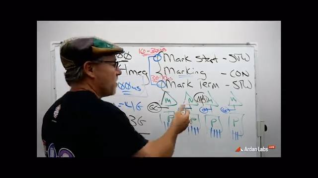
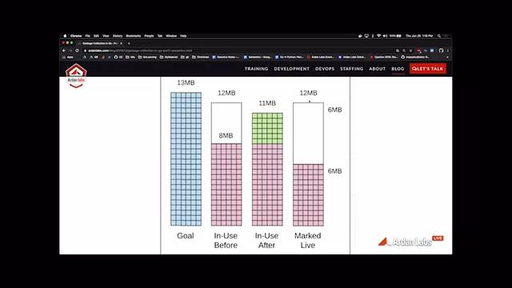

## 1. 这一节做什么

P13–P15 不是让你从零写一个垃圾回收器，也不是一个完整的 Web 项目。它要做的是把 Go GC 的“语义”变成可观察、可估算、可调优的东西：知道第一次 GC 什么时候来，知道一次 GC 的三个阶段各发生了什么，知道 GC 会占走多少 CPU 配额，知道三色标记怎么判断“谁还活着”，以及最关键的一点——**不要盯着某一次 GC，而要盯着同一批工作负载下 GC 的总次数和总停顿成本**。

这三段课最后要得到的能力是：

1. 会开 `GODEBUG=gctrace=1` 观察 GC trace；
2. 会从 trace 里找到“GC 目标、GC 前堆大小、GC 后堆大小、标记存活量、下一次目标”这些信息；
3. 会用 `GOGC=100` 默认值估算下一次 GC 的触发点：默认 100 时，下一次目标约等于 `mark live × (1+100%)`；
4. 知道 4 线程程序中 GC 大约拿 1 个 P，应用只剩 3 个 P，也就是 75% 的应用吞吐容量；
5. 会用“减少分配数量”或“减少每次请求的分配量”来减少 GC 次数，而不是幻想写出“零分配软件”。

课里先给了一个总称呼：


讲师的原话是“non-generational, non-compacting, concurrent, tricolor, mark, and sweep collector.”，但他马上说，背这些词不会让你成为更好的 Go 开发者，重点应该放在语义和调优上。—— p013 [00:29]

所以本文的“复现物”不是业务系统，而是一套**最小 GC 观察实验**：一个完整可运行的示意 Go 程序、两条环境变量命令、一张实验记录表和一套读 trace 的检查清单。注意：P13–P15 的逐字稿没有给出讲师源码，下面第 4 节的程序是**课里没有代码，以下为示意**，仅用于复现讲师的观察方法，不是课程项目源码。

---

## 2. 讲师原话（带「—— pNNN [MM:SS]」）

下面挑出直接决定复现实验怎么做的原话。英文保留原话，中文是我补的说明。

> "第一次垃圾回收会在堆的已用内存达到 4 兆字节时开始"
> —— p013 [05:40]

默认 `GOGC=100` 时，讲师用“堆上已有 4MB 正在使用”作为第一次 GC 的触发点例子。注意这是讲师在默认设置下给出的例子，不是所有程序永远精确等于 4MB。


> "标记开始……暂停所有应用线程……标记……并发标记……标记终止……暂停所有应用线程"
> —— p013 [06:39]

一次 GC 分三段：`mark start` 是停世界阶段，标记阶段和应用程序并发执行，`mark termination` 又是停世界阶段。



> "垃圾回收器会占用可用处理器容量的 25%"
> —— p014 [03:11]

GC 不是免费跑在后台的幽灵，它会拿走 CPU 配额。4 线程程序里，讲师用“拿走 1 个 P”来表达 25%；应用只剩 3 个 P，也就是 75% 的应用吞吐容量。



> "垃圾回收器……会在堆达到 10 兆字节之前设定一个空间目标"
> —— p014 [13:12]

Go 的 GC 目标不是“必须在多少微秒内完成”，而是“堆最多涨到多少 MB 之前要完成”。这就是后面读 trace 时最核心的 `goal` 思路。



> "下一次回收从 12 兆字节开始，每次垃圾回收结束时已标记为存活的对象占 100%"
> —— p015 [04:14]

讲师的例子是：这次 GC 后 `mark live` 是 6MB，`GOGC=100`，所以下一次目标约 12MB。也就是默认 100% 时，下一次目标约等于存活量的两倍：`6MB × (1+100%) = 12MB`。



> "停止执行应用程序的工作，转而以我们所说的“标记辅助”形式开始执行垃圾回收工作"
> —— p015 [06:59]

如果 GC 发现目标要被冲爆，它会让某些 goroutine 停下来做 `mark assist`，帮忙做标记工作，避免堆冲得太猛；代价是应用吞吐会短时间掉到 75% 以下。



> "关键不在于编写零分配软件……而在于随着时间推移减少我们所需的垃圾回收量"
> —— p015 [11:28]

不要追求零分配。真正可做的是：同一批请求下，减少分配数量或减少每次请求的分配量，从而减少 GC 次数和停世界/降吞吐的时间点。



---

## 3. 从零复现

### 3.1 复现目标：不是“写 GC”，而是“观察并估算 GC”

按纯讲解课的复现逻辑，我们把讲师的推导过程还原成下面五步。

#### 第一步：需求

你要回答四个问题：

1. 第一次 GC 大概什么时候发生？
2. 一次 GC 有哪几个阶段？哪些阶段会停世界？
3. GC 运行时应用还能用多少 CPU？4 线程、8 线程、12 线程分别损失多少？
4. 下一次 GC 的目标由什么决定？如果目标被冲爆，GC 会做什么补救？

#### 第二步：约束

- Go 版本：讲师在 P14 明确提到 Go 1.14 及以上有抢占式调度器，能更容易让 goroutine 进入上下文切换点。—— p014 [00:44]
- 因此复现建议使用 **Go 1.14+**。更高版本也能跑，但 `GODEBUG=gctrace=1` 的具体输出格式可能变化，字段名请以实际输出为准。
- 不引入第三方依赖。
- 不改 runtime，不写自定义 GC；只通过 `GOGC` 和 `GODEBUG=gctrace=1` 观察。
- 课里没有给出 benchmark 文件或 `go test -bench` 流程；P13–P15 的复现重点是 trace，不是基准测试报告。

#### 第三步：估算

讲师给出的估算关系先写成表：

| 项目 | 讲师例子 | 用途 |
|---|---|---|
| 默认 GOGC | 100 | 默认触发策略 |
| 第一次 GC | 堆使用约 4MB | 默认设置下的初始观察点 |
| 下一次目标 | `mark live × (1+GOGC/100)` | 默认 100 时为存活量两倍 |
| 4 线程 GC CPU | 1 个 P，占 25% | 应用剩 3 个 P，75% |
| 8 线程 GC CPU | 2 个 P，占 25% | 应用剩 6 个 P，75% |
| 12 线程 GC CPU | 3 个 P，占 25% | 应用剩 9 个 P，75% |
| mark start 停世界 | 讲师举例约 10–30 微秒 | 只作量级参考 |
| mark termination 停世界 | 讲师举例约 30–70 微秒 | 只作量级参考 |
| 停世界总目标 | 小于 100 微秒 | 讲师说 GC 会尽量靠近这个目标 |

#### 第四步：方案

做一个最小程序：

- 先保留约 4MB 的存活对象，制造 `live` 堆；
- 再循环分配大量临时 1KB 对象，制造垃圾；
- 每轮之间短暂 sleep，让 GC trace 更容易观察；
- 用 `GODEBUG=gctrace=1` 输出 trace；
- 先用 `GOGC=100` 跑一遍，再用 `GOGC=200` 跑一遍，比较 GC 次数和堆目标变化。

目录结构固定为：

```text
gc-semantics-demo/
├── go.mod
└── main.go
```

#### 第五步：取舍

- 选择“减少每次请求分配量”还是“减少分配对象数”？讲师说两个方向都可以：减少对象数量能缩短标记扫描；减少分配量能让两次 GC 之间做更多业务工作。
- 不要追求零分配。讲师原话是 “not writing zero allocation software, that's not possible”。—— p015 [11:28]
- 生产环境还要考虑云上 fractional CPU 的问题：GC 要拿 25%，如果你只给程序半个 CPU，这个 25% 的假设会变得更危险。—— p014 [03:40] 讲到云环境分数 CPU 会影响 GC。

### 3.2 创建并运行

在 macOS/Linux：

```bash
mkdir -p gc-semantics-demo
cd gc-semantics-demo

# 把第 4 节的 go.mod 和 main.go 保存进去

go version
GODEBUG=gctrace=1 GOGC=100 go run .
```

在 Windows PowerShell：

```powershell
mkdir gc-semantics-demo
cd gc-semantics-demo

# 保存 go.mod 和 main.go

go version
$env:GODEBUG="gctrace=1"
$env:GOGC="100"
go run .
```

在 Windows CMD：

```bat
mkdir gc-semantics-demo
cd gc-semantics-demo
set GODEBUG=gctrace=1
set GOGC=100
go run .
```

把 trace 单独保存下来：

```bash
GODEBUG=gctrace=1 GOGC=100 go run . > stdout.log 2> gctrace.log
```

然后做对照实验：

```bash
GODEBUG=gctrace=1 GOGC=200 go run . > stdout_gc200.log 2> gctrace_gc200.log
```

注意：`GODEBUG=gctrace=1` 的输出走标准错误；程序自己的 `fmt.Printf` 走标准输出。上面命令把两者分开了。

### 3.3 读 trace 的顺序

不要一上来背字段名。按讲师在 P14–P15 的思路，只找五类信息：

1. 这次 GC 的目标是多少 MB；
2. GC 开始前堆上已经用了多少 MB；
3. GC 结束后堆上用了多少 MB；
4. 其中 `mark live` 是多少 MB，也就是有多少被标成黑色、还活着；
5. 下一次目标是多少 MB，以及下一次实际从多少 MB 开始。

讲师举过一个例子：目标是 10MB 以内，GC 前 7MB，GC 后 11MB，说明这次没守住目标；但 `mark live` 只有 6MB，11MB 里另外约 5MB 是白色、可复用。默认 `GOGC=100` 下，下一次目标按 6MB 存活量算成 12MB。下一次讲师观察到 GC 没等到 12MB，而是在 8MB 就开始了，目标 13MB，最后到 11MB，守住了目标并留出约 2MB 余量。—— p014 [13:12] 至 p015 [09:33]

> 说明：上面这些 MB 数是讲师演示应用的例子，不是你的程序必然出现的数字。你的 trace 字段名和列顺序请以实际 Go 版本输出为准。

---

## 4. 完整代码

再次强调：**课里没有代码，以下为示意**。这个程序不是讲师源码，也不声称等价于课程项目；它只负责稳定地制造 live 堆和临时垃圾，让你能亲眼看到 `GODEBUG=gctrace=1` 的输出，并按第 3 节的方法读 trace。

### 4.1 `go.mod`

```go
module gc-semantics-demo

go 1.14
```

依赖：无第三方依赖。Go 版本要求：1.14+；更高版本可运行，但 trace 格式可能不同。

### 4.2 `main.go`

```go
package main

import (
	"flag"
	"fmt"
	"runtime"
	"time"
)

// block 是 1KB 左右的分配单元。
// 用固定大小是为了让 live 堆和临时垃圾的量更容易估算。
type block struct {
	payload [1024]byte
}

func main() {
	liveCount := flag.Int("live", 4096, "number of live 1KB blocks to keep")
	tempCount := flag.Int("temp", 50000, "number of temporary 1KB blocks allocated per round")
	rounds := flag.Int("rounds", 8, "allocation rounds")
	pause := flag.Duration("pause", 50*time.Millisecond, "pause between rounds")
	workers := flag.Int("workers", 4, "GOMAXPROCS")

	flag.Parse()

	// 课里用“4 线程 Go 程序”讲 P/M/G 模型。
	// 这里固定成 4 只是为了复现观察，不代表生产环境应该固定 4。
	runtime.GOMAXPROCS(*workers)

	// 先制造一批长期存活对象，近似 live 堆。
	live := make([]*block, 0, *liveCount)
	for i := 0; i < *liveCount; i++ {
		live = append(live, &block{})
	}

	fmt.Printf(
		"GOMAXPROCS=%d live=%d temp/round=%d rounds=%d\n",
		runtime.GOMAXPROCS(0),
		len(live),
		*tempCount,
		*rounds,
	)

	for r := 0; r < *rounds; r++ {
		// temp 每轮重新分配，上一轮 temp 变成不可达垃圾。
		temp := make([]*block, 0, *tempCount)
		for i := 0; i < *tempCount; i++ {
			temp = append(temp, &block{})
		}

		// 使用一下 temp，避免编译器把分配完全消掉；
		// 实际是否被优化，请以 trace 和后续 profiling 结果为准。
		if len(temp) > 0 {
			temp[0].payload[0] = byte(r)
		}

		fmt.Printf(
			"round=%d temp_len=%d live_len=%d\n",
			r,
			len(temp),
			len(live),
		)

		time.Sleep(*pause)
	}

	// 保持 live 到程序结束。
	fmt.Printf("done live_len=%d\n", len(live))
}
```

### 4.3 直接运行

```bash
GODEBUG=gctrace=1 GOGC=100 go run .
```

如果要保存日志：

```bash
GODEBUG=gctrace=1 GOGC=100 go run . > stdout.log 2> gctrace.log
```

如果要缩小分配量：

```bash
GODEBUG=gctrace=1 GOGC=100 go run . -live=1024 -temp=10000 -rounds=4
```

如果要观察更大堆目标：

```bash
GODEBUG=gctrace=1 GOGC=200 go run . -live=4096 -temp=50000 -rounds=8
```

---

## 5. 逐行解释

这一节既解释示意代码，也解释讲师每个决策和估算为什么这么定、不这么定会怎样。

### 5.1 为什么用 `runtime.GOMAXPROCS(*workers)`

讲师用“4 线程 Go 程序”来讲 P/M/G：4 个 P，4 个 M，4 个 goroutine 并行。把 `GOMAXPROCS` 设为 4，是为了让你在观察时有一个明确的心理模型：4 个可运行 CPU 配额，GC 拿走 1 个 P，应用剩 3 个，正好对应 75%。

注意：这是复现实验的固定变量，不是生产建议。生产环境里 `GOMAXPROCS` 要不要跟随容器 CPU limit 调整，P13–P15 没有展开，不要在这里擅自下定论。

对前端/Node 读者：Node 没有可调的 P 数组，也没有 Go 这种 `GOMAXPROCS` 模型；不要把 Node 的 worker 数硬套成 P。你能迁移的是“给 GC 留出 CPU 预算”的思维，而不是具体数字。

### 5.2 为什么先分配 `live`

`liveCount=4096`，每个 `block` 约 1KB，所以 live 堆大约 4MB。这正好贴着讲师说的“默认设置下第一次 GC 在堆使用约 4MB 时开始”的例子。—— p013 [05:40]

但要注意：Go 的实际堆占用还包括运行时元数据、分配器开销、栈、其他对象。你不可能用 4096 个 1KB 对象精确卡出 4.000MB。因此复现时看到第一次 GC 在 3MB、5MB、6MB 附近都正常，具体以你的 trace 为准。

### 5.3 为什么每轮分配 `temp`

`tempCount=50000`，每个约 1KB，每轮约 50MB 临时分配。上一轮 `temp` 在下一轮不可达，变成垃圾，于是能逼出 GC。这样你才能在一小段程序里看到多次 GC，而不是只看到一次启动时的 GC。

如果你把 `temp` 调得太小，可能全程看不到几次 GC；如果调得太大，程序会跑得慢、日志刷屏。先用默认值跑通，再按第 6 节检查清单调整。

### 5.4 为什么写 `temp[0].payload[0] = byte(r)`

这是一句“使用一下分配结果”的代码，用来降低编译器把分配优化掉的风险。但我不承诺它一定阻止所有优化；Go 的逃逸分析和内联很复杂。正确态度是：以 `GODEBUG=gctrace=1` 的实际输出为准，必要时再进入后续 profiling 工具看对象计数。P13–P15 只讲了“Go Profiler 可以看对象数量”，没有展开具体命令。

### 5.5 GC 三阶段与停世界成本

讲师把三个阶段拆成：

1. `mark start`：停世界，打开写屏障（讲师口播为 “right barrier”，按上下文是写屏障相关标志）。这个阶段要等 goroutine 进入可被上下文切换的位置。Go 1.14+ 有抢占式调度器，所以比 1.13 更容易到达切换点。—— p014 [00:44]
2. `marking`：并发标记。应用 goroutine 继续跑，GC 也在跑。三色标记在这里展开。
3. `mark termination`：再次停世界，关闭写屏障、做收尾。讲师举例这个阶段约 30–70 微秒，`mark start` 约 10–30 微秒，两个停世界阶段合计目标小于 100 微秒。这些是量级，不是保证值。

为什么不把整个 GC 都做成并发？因为打开/关闭写屏障、确认标记状态需要一致性窗口；停世界能把边界条件收干净。代价就是每次 GC 都有一次小停顿。讲师反复强调：只能给量级，不能给固定数字，因为 goroutine 数量、堆对象数量、应用负载都不同。

### 5.6 25% CPU 与 75% 吞吐

讲师说 GC 拿 25% 的可用 CPU。4 线程时是 1 个 P 给 GC，应用剩 3 个 P：

```text
4 P × 25% = 1 P 给 GC
4 P - 1 P = 3 P 给应用
3 / 4 = 75%
```

8 线程：2 个 P 给 GC，应用 6 个 P，仍是 75%。12 线程：3 个 P 给 GC，应用 9 个 P，仍是 75%。

这个模型的用途不是让你在代码里写死 25%，而是让你做容量规划时不要把 100% CPU 都算给业务。云上如果你只申请了 fractional CPU，GC 仍要拿 25%，应用可用的绝对 CPU 会更少；讲师明确提醒，云环境分数 CPU 会给 GC 带来问题。—— p014 [03:40]

### 5.7 三色标记为什么能判断“谁还活着”

讲师把堆看成一幅图：

- 初始把所有堆值涂白：白色表示“尚未证明存活”；
- 从所有 goroutine 的栈上扫描根指针，能找到的堆值涂灰，放进队列；
- 从队列取出灰色值，涂黑，再看它指向谁；指向的白色值涂灰入队；
- 循环直到队列空。最后黑色是用中的，白色是可回收的。

关键点：标记阶段结束时只剩黑和白。黑不能动，白可以之后被分配器复用。讲师特别说，**sweep 不在 GC 块里发生，而是在 GC 结束后由分配器做**。—— p014 [13:35]

对 JS/Node 读者：Node 的 GC 细节和 Go 不同，你不需要把三色标记硬套到 Node；你要学的是“根可达性 + 存活量决定下一次预算”的分析方式。

### 5.8 `GOGC` 与下一次 GC 目标

默认 `GOGC=100` 表示下一次目标相对 `mark live` 再增长 100%：

```text
下一次目标 ≈ mark live × (1 + GOGC/100)
GOGC=100 时：下一次目标 ≈ mark live × 2
```

讲师的例子：`mark live=6MB`，所以下一次目标约 12MB。为什么不是“堆一到 12MB 就立刻 GC”？因为 GC 结束后有约 5MB 白色内存可被分配器复用，程序可以先复用这 5MB，再继续长到新目标，所以实际上还能再做不少新分配。—— p015 [04:14] 至 p015 [04:41]

如果 GC 发现按当前分配速度会冲爆目标，它会提前开始，或者让 goroutine 做 `mark assist`。讲师观察到下一次 GC 在 8MB 就开始，而不是等 12MB；这不是 GC 不尊重目标，而是它在用提前开始和 mark assist 控制堆增长。—— p015 [05:11] 至 p015 [09:33]

### 5.9 mark assist 为什么会让吞吐掉到 75% 以下

GC 不想把 goroutine 从 M 上摘下来再换一个上去，因为那也有约 200 纳秒级成本，而且新换上来的 goroutine 可能继续猛分配。更直接的做法是告诉当前 goroutine：“你先别做业务，来做一段标记协助。”这就是 mark assist。

在 4 线程例子里，本来应用有 3 个 P 在做业务，现在某些 G 被拉去做 GC 工作，应用吞吐会短时间低于 75%。讲师说 GC 不喜欢这样，所以它会尽量提前开始、减少 mark assist 的量。—— p015 [06:59] 至 p015 [08:44]

### 5.10 为什么最终策略是“减少 GC 次数”，不是“零分配”

讲师给了一组示例数字：10,000 个请求，原本需要 5,000 次 GC，维持 40MB 堆；如果每个请求的分配量从 1MB 降到 0.5MB，同样 10,000 个请求可能只需要 2,500 次 GC，堆大小仍维持 40MB。GC 次数少了一半，停世界和降吞吐的时间点就少了一半，整体就会更快。—— p015 [11:28] 至 p015 [12:58]

所以优化方向有两个：

1. 减少分配对象数量：标记要扫描的对象少，标记阶段更短；
2. 减少每次请求的分配量：两次 GC 之间能做更多业务，GC 次数更少。

不要写“零分配”神话。讲师原话是零分配软件不可能，应该把目标放在“同样工作量下减少 GC 次数和 GC 总时间”。

---

## 6. 复现检查清单

按顺序打勾。任何一项失败，先回到对应章节，不要直接改代码猜。

- [ ] `go version` 显示 1.14 或更高。低于 1.14 时，抢占式调度器部分不成立，讲师在 P14 讲的上下文切换行为会不同。
- [ ] 目录结构是 `gc-semantics-demo/go.mod` 和 `gc-semantics-demo/main.go`，没有省略号，没有缺文件。
- [ ] `go.mod` 的模块名是 `gc-semantics-demo`，`go 1.14`。
- [ ] `main.go` 能通过 `go build .`，没有未使用变量、没有缺失 import。
- [ ] 能在终端看到程序自己打印的 `GOMAXPROCS=4 live=4096 ...`。
- [ ] 设置 `GODEBUG=gctrace=1` 后，标准错误里出现 GC trace；如果终端只显示业务输出，检查是否把 stderr 重定向丢了。
- [ ] 能从至少一条 trace 里找到讲师说的五类信息：目标、GC 前堆、GC 后堆、`mark live`、下一次目标。字段名以实际输出为准。
- [ ] 能用自己的话解释：为什么 `mark live=6MB`、`GOGC=100` 时下一次目标约 12MB。
- [ ] 能用自己的话解释：4 线程时为什么 GC 拿 1 个 P，应用剩 3 个 P，即 75%。
- [ ] 能用 `GOGC=200` 再跑一次，观察 GC 次数或目标是否变化；不要只跑一次就下结论。
- [ ] 能说清：本次实验是示意程序，不是讲师源码；trace 数字不是固定答案。
- [ ] 没有把 `mark live` 当成进程 RSS，也没有把“白色可复用”当成“立刻归还操作系统”。课里只讲到白色内存可被分配器复用，没讲 OS 归还细节。
- [ ] 没有把 P13–P15 当成 benchmark 课。课程标题有 benchmark，但这三段逐字稿没有 `go test -bench` 流程；后续 profiling 工具课里才展开。

建议记录表：

| 实验 | GOGC | live 参数 | temp 参数 | GC 次数（人工数） | 第一次目标 | 任一次 mark live | 下一次目标 | 备注 |
|---|---:|---:|---:|---:|---|---|---|---|
| 基线 | 100 | 4096 | 50000 |  |  |  |  |  |
| 大目标 | 200 | 4096 | 50000 |  |  |  |  |  |
| 小分配 | 100 | 1024 | 10000 |  |  |  |  |  |

“GC 次数”可以人工数 trace 行，也可以只做定性比较。不要在没有工具的情况下假装精确统计。

---

## 7. 课里没讲但你会撞上的

1. **`GODEBUG=gctrace=1` 的输出格式会随 Go 版本变化。**  
   讲师在 P14–P15 用口头方式读列，没有承诺每一列永远同名、同顺序。复现时不要死背字段名；先找“目标、GC 前、GC 后、mark live、下一次目标”这五类信息。字段名请以实际输出为准。

2. **“第一次 GC 在 4MB”不是永恒定律。**  
   这是讲师在默认 `GOGC=100` 下给的例子。你的程序有栈、运行时元数据、分配器开销，第一次 GC 可能不在精确 4MB。不要为了凑 4MB 把业务代码写死。

3. **`GOGC=200` 不是无脑越快。**  
   讲师在 P15 说，调大 GC