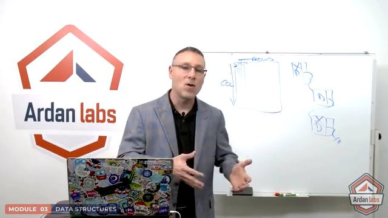
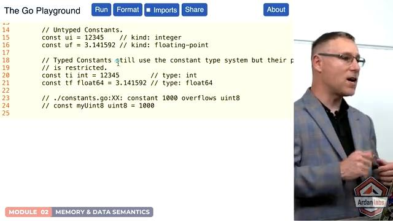
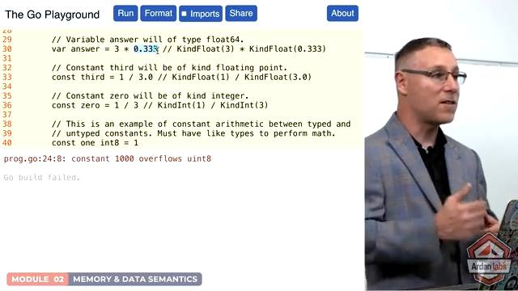
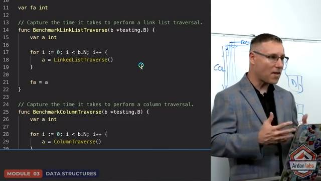
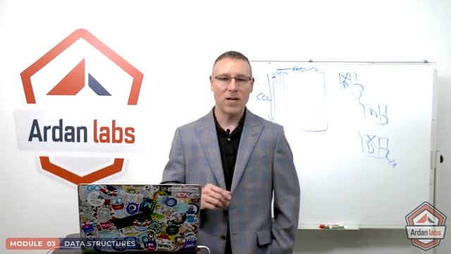
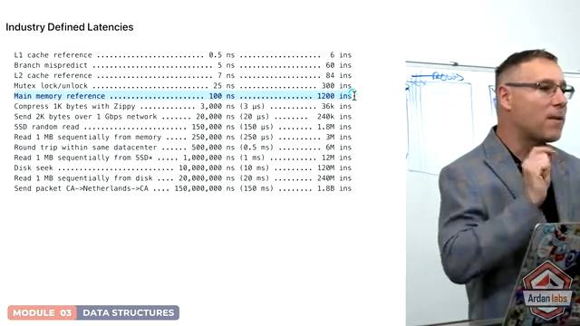
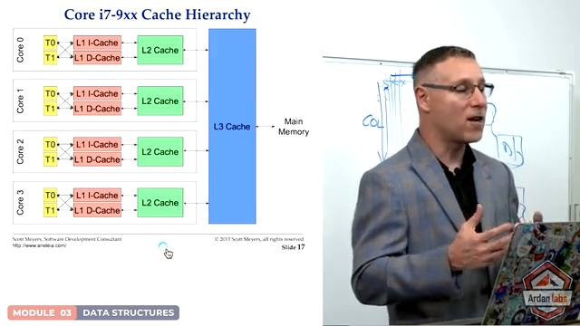
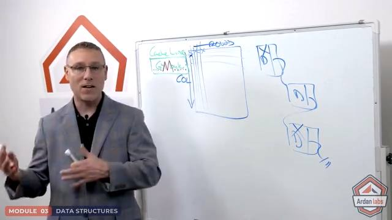
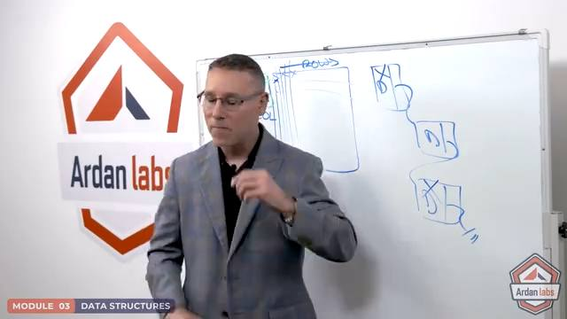

# Ultimate Go Language（P16–P18）复现文档：常量 kind/type、数据结构 benchmark 与硬件机械同情

> 复现范围：P16 常量、P17 数据结构章节导览、P18 数组/切片/map 与 benchmark、缓存行/TLB。  
> 课里没有固定 Go 版本，也没有要求环境变量；下面用 Go 1.21+ 复现。除标准库 `fmt`、`testing` 外无第三方依赖。  
> 注意：逐字稿展示了代码行号和运行结果，但没有给出完整源码。下面代码是按逐字稿描述重建的**可运行版本**，变量名、注释、初始化细节可能与讲师原始文件不同；关键行为保持一致。

## 1. 这一节做什么

这三段的目标不是写一个业务项目，而是建立两个可重复的实验：

1. **常量实验**：验证 Go 常量只存在于编译期，分为“有 kind 的常量”和“有 type 的常量”，并观察 kind promotion、256 bit 常量精度、`iota` 常量块。
2. **数据结构 benchmark 实验**：构造一个 2000×2000 的字节矩阵，再构造一个节点数相同的链表；分别做链表遍历、矩阵列遍历、矩阵行遍历，用 `go test` benchmark 比较耗时。
3. **硬件解释**：用缓存行、prefetcher、TLB、页表解释为什么“同样是四行遍历代码”，行遍历会明显快于列遍历。讲师反复强调 mechanical sympathy：硬件是平台，代码要顺着硬件工作。

课程标题里有“并发+benchmark”，但 P16–P18 没有讲 goroutine、channel、锁或事务；课里没讲这些，所以本文不编造并发代码。这里真正要复现的是“benchmark 怎么做”和“数据访问方式如何影响性能”。



P17 本身只是 Lesson 3 的导览：接下来会学 arrays、maps、slices，其中 slices 是 Go 最重要的数据结构；还会学硬件和 data-oriented design。P17 没有可复现代码，实际代码实验集中在 P16 和 P18。

从 JS/Node 视角先校准两个概念：

- JS 的 `const` 是“运行时绑定不可重新赋值”，不是 Go 这种编译期常量。
- JS 只有 `number`；Go 有 `int`、`int8`、`uint8`、`float64` 等类型。Go 的无类型常量可以由编译器做 kind promotion；Node 里没有对应机制，通常要自己写 `Number()`、`parseInt()` 或显式转换。

## 2. 讲师原话（带「—— pNNN [MM:SS]」）

> "常量只在编译期存在。"
> —— p016 [00:24]

> "当常量有具体类型时，它就受该类型的规则约束。"
> —— p016 [02:46]

> "float 会提升到 int 之上；任何有类型的常量都会压在 kind 之上。"
> —— p016 [07:32]

> "规范要求常量至少具备 256 位精度。"
> —— p016 [02:46]

> "第三课讲数据结构，数组、map、slice，以及硬件。"
> —— p017 [00:00]

> "跑 benchmark 时机器必须空闲；结果只具有相对意义。"
> —— p018 [05:41]

> "benchmark 循环会执行 `b.N` 次；测试框架会找一个 `b.N`，让循环跑满设定的 bench time。"
> —— p018 [06:07]

> "按行遍历矩阵时，我们以可预测的步长沿着连续缓存行行走。"
> —— p018 [27:12]

> "按列遍历会跨页，基本上变成随机内存访问。"
> —— p018 [27:41]







## 3. 从零复现

### 3.1 目录结构

在任意空目录下执行：

```bash
mkdir ultimate-go-repro
cd ultimate-go-repro
go mod init ultimate-go-repro
mkdir -p lesson16_constants lesson18_matrixbench
```

最终目录：

```text
ultimate-go-repro/
├── go.mod
├── lesson16_constants/
│   └── main.go
└── lesson18_matrixbench/
    ├── matrix_benchmark.go
    └── matrix_benchmark_test.go
```

依赖版本：

- Go：课里没讲固定版本；复现建议 Go 1.21+。
- 第三方依赖：无。
- 环境变量：无；课里没有要求设置任何环境变量。
- 使用标准库：`fmt`、`testing`。

### 3.2 运行常量实验

```bash
go run ./lesson16_constants
```

你会看到 `ki`、`kf`、`ti`、`tf`、`answer`、`third`、`integerThird`、`promoted`、`huge > maxInt64`、`iota`、`bitmask` 等输出。一个可能的输出是：

```text
ki=int 1
kf=float64 3.14
ti=int8 1
tf=float64 3.14
answer=float64 3
third=float64 0.3333333333333333
integerThird=int 0
promoted=int8 2
huge > maxInt64: true
iota: 0 1 2
iota+1: 1 2 3
bitmask: 1 2 4
```

`huge = 1 << 200` 能在编译期存在，是因为它是无类型常量；不要直接 `fmt.Println(huge)`，那会要求默认类型并可能溢出。代码里用 `huge > maxInt64` 只产生 bool，能避开这个问题。

### 3.3 运行 benchmark

```bash
go test ./lesson18_matrixbench -run none -bench . -benchtime 3s
```

参数含义：

- `-run none`：用正则过滤测试函数，`none` 基本匹配不到测试，避免普通测试混进来。
- `-bench .`：显式要求跑所有 benchmark；Go 不会默认跑 benchmark。
- `-benchtime 3s`：把默认 1 秒改成 3 秒，让框架寻找一个让循环跑满约 3 秒的 `b.N`。

建议连续跑三次，因为讲师明确说机器必须 idle，绝对数字会受当前机器负载影响：

```bash
go test ./lesson18_matrixbench -run none -bench . -benchtime 3s
go test ./lesson18_matrixbench -run none -bench . -benchtime 3s
go test ./lesson18_matrixbench -run none -bench . -benchtime 3s
```

逐字稿里讲师的机器上得到的是：链表约 8.1ms，列遍历约 9.3ms，行遍历约 3.9ms。你的机器、Go 版本、后台程序不同，绝对值会不同；关键是观察“行遍历明显快于列遍历”的相对关系。benchmark 输出字段名和统计格式以你实际终端为准。


## 4. 完整代码

### 4.1 `go.mod`

路径：`ultimate-go-repro/go.mod`

```go
module ultimate-go-repro

go 1.21
```

如果你的本机是 Go 1.22/1.23，也可以保留 `go 1.21`，或让 `go mod init` 生成对应版本行。

### 4.2 `lesson16_constants/main.go`

路径：`ultimate-go-repro/lesson16_constants/main.go`

```go
package main

import "fmt"

// 常量 of a kind：没有显式类型信息。
// 编译器会根据字面值推导 kind：1 是 kind int，3.14 是 kind float。
const (
	ki = 1
	kf = 3.14
)

// 常量 of a type：显式写了类型，受该类型规则约束。
const (
	ti int8    = 1
	tf float64 = 3.14
)

// 下面这行用于说明 uint8 溢出。
// 取消注释后，整个包会编译失败：1000 不能放进 uint8。
//
// const overflow uint8 = 1000

// 无类型常量可以达到规范要求的 256 bit 精度。
// maxInt64 是 64 位有符号整数最大值。
const maxInt64 = 9223372036854775807

// 1 << 200 远大于 int64，但作为无类型常量可以在编译期存在。
const huge = 1 << 200

// iota 在每个 const 块开头从 0 开始。
const (
	zero = iota
	one
	two
)

// 可以基于 iota 做数学，让第一个值从 1 开始。
const (
	a1 = iota + 1
	b1
	c1
)

// 用 iota 和左移构造 bitmask：1、2、4。
const (
	flagA = 1 << iota
	flagB
	flagC
)

func main() {
	// 3 是 kind int，1.0 是 kind float。
	// float 提升到 int 之上，结果是默认类型 float64。
	answer := 3 * 1.0

	// 1 是 kind int，3.0 是 kind float。
	// 结果保留浮点表示，默认类型 float64。
	third := 1 / 3.0

	// 两边都是 kind int，不会变成浮点。
	// 整数除法结果是 0。
	integerThird := 1 / 3

	// 2 是 kind int，ti 是 type int8。
	// 有 type 的常量优先，2 被转换为 int8。
	promoted := 2 * ti

	fmt.Printf("ki=%T %v\n", ki, ki)
	fmt.Printf("kf=%T %v\n", kf, kf)
	fmt.Printf("ti=%T %v\n", ti, ti)
	fmt.Printf("tf=%T %v\n", tf, tf)
	fmt.Printf("answer=%T %v\n", answer, answer)
	fmt.Printf("third=%T %v\n", third, third)
	fmt.Printf("integerThird=%T %v\n", integerThird, integerThird)
	fmt.Printf("promoted=%T %v\n", promoted, promoted)

	// 只比较，不把 huge 赋给 int64。
	// 这样能展示无类型常量的高精度，又不会触发默认类型溢出。
	fmt.Println("huge > maxInt64:", huge > maxInt64)

	fmt.Println("iota:", zero, one, two)
	fmt.Println("iota+1:", a1, b1, c1)
	fmt.Println("bitmask:", flagA, flagB, flagC)
}
```

验证溢出时，临时把 `const overflow uint8 = 1000` 取消注释，再运行：

```bash
go run ./lesson16_constants
```

你会得到编译错误，说明 1000 超出 `uint8` 范围。验证完请恢复注释，否则包无法编译。


### 4.3 `lesson18_matrixbench/matrix_benchmark.go`

路径：`ultimate-go-repro/lesson18_matrixbench/matrix_benchmark.go`

```go
package matrixbench

const (
	rows    = 2000
	columns = 2000
)

// 2000 * 2000 = 4,000,000 字节。
// Go 的多维数组在内存中是连续布局，按行优先。
var matrix [rows][columns]byte

type node struct {
	value byte
	next  *node
}

var head *node

func init() {
	// 逐字稿说明：init 里遍历矩阵，构造节点数相同的链表；
	// 并且每隔一个元素/节点做一次非零重置，让遍历有实际工作可做。
	// 下面是最小可运行重建：偶数编号设为 1，奇数编号保持 0。
	count := 0
	for i := 0; i < rows; i++ {
		for j := 0; j < columns; j++ {
			var v byte
			if count%2 == 0 {
				v = 1
			}

			matrix[i][j] = v

			n := &node{value: v}
			n.next = head
			head = n

			count++
		}
	}
}

func linkedListTraversal() int {
	count := 0
	for n := head; n != nil; n = n.next {
		if n.value != 0 {
			count++
		}
	}
	return count
}

func columnTraversal() int {
	count := 0
	for j := 0; j < columns; j++ {
		for i := 0; i < rows; i++ {
			if matrix[i][j] != 0 {
				count++
			}
		}
	}
	return count
}

func rowTraversal() int {
	count := 0
	for i := 0; i < rows; i++ {
		for j := 0; j < columns; j++ {
			if matrix[i][j] != 0 {
				count++
			}
		}
	}
	return count
}
```

### 4.4 `lesson18_matrixbench/matrix_benchmark_test.go`

路径：`ultimate-go-repro/lesson18_matrixbench/matrix_benchmark_test.go`

```go
package matrixbench

import "testing"

// 包级变量用于保存遍历结果，
// 防止编译器认为 benchmark 里的调用结果没被使用而做死代码优化。
var benchmarkResult int

func BenchmarkLinkedListTraversal(b *testing.B) {
	var r int
	for i := 0; i < b.N; i++ {
		r = linkedListTraversal()
	}
	benchmarkResult = r
}

func BenchmarkColumnTraversal(b *testing.B) {
	var r int
	for i := 0; i < b.N; i++ {
		r = columnTraversal()
	}
	benchmarkResult = r
}

func BenchmarkRowTraversal(b *testing.B) {
	var r int
	for i := 0; i < b.N; i++ {
		r = rowTraversal()
	}
	benchmarkResult = r
}
```



## 5. 逐行解释

### 5.1 常量代码逐段解释

- `const ki = 1`：这是“常量 of a kind”。没有写类型，编译器知道字面值 `1` 是整数 kind。它还不是运行时变量，只在编译期参与计算。
- `const kf = 3.14`：这是 kind float。逐字稿强调，常量规范要求至少 256 bit 精度，所以 kind float 和 `float64` 不是一回事；`float64` 只有 64 bit 精度。
- `const ti int8 = 1`：这是“常量 of a type”。它受 `int8` 规则约束，不能超过 `int8` 范围。
- `const overflow uint8 = 1000`：如果取消注释，编译失败。逐字稿用类似例子说明：常量不是只读变量，不能运行时再检查；它在编译期就要满足类型范围。
- `const maxInt64 = 9223372036854775807`：无类型整数常量。
- `const huge = 1 << 200`：无类型整数常量，远大于 64 位。它能存在，是因为常量有 256 bit 精度。注意不要直接把它传给 `fmt.Println` 当普通值；否则会要求默认类型并可能溢出。代码里用 `huge > maxInt64` 只产生 bool。
- `zero = iota`：`iota` 在每个 `const` 块开头是 0，后续行隐式重复表达式并递增。
- `a1 = iota + 1`：让第一个值是 1，后续是 2、3。
- `flagA = 1 << iota`：`1 << 0`、`1 << 1`、`1 << 2`，得到 1、2、4，适合做 bitmask。
- `answer := 3 * 1.0`：`3` 是 kind int，`1.0` 是 kind float；float 提升到 int 之上，结果是 `float64`。
- `third := 1 / 3.0`：`3.0` 让右边变成 kind float，所以得到浮点三分之一；如果写成 `1 / 3`，两边都是 kind int，结果是整数 0。这一点和 JS 很不一样：JS 的 `1 / 3` 天然是浮点。
- `promoted := 2 * ti`：`2` 是 kind int，`ti` 是 type `int8`；有 type 的常量优先，`2` 被转换为 `int8`，结果类型是 `int8`。


### 5.2 矩阵与链表逐段解释

- `const rows = 2000`、`columns = 2000`：矩阵是 2000×2000，共 4,000,000 个字节。
- `var matrix [rows][columns]byte`：这是二维数组，不是 `[][]byte`。Go 的二维数组在内存中连续、按行优先；这正是行遍历能形成可预测步长的关键。
- `type node struct { value byte; next *node }`：链表节点带一个字节值和一个指向下一个节点的指针。
- `head *node`：链表头指针。
- `init()`：Go 包初始化时自动执行。这里构建矩阵和链表。逐字稿没有给出完整初始化源码，只说明“构造相同数量节点”和“每隔一个元素/节点做一次非零重置”。本复现用偶数编号设为 1、奇数编号为 0，保证遍历里 `if value != 0` 有实际工作。
- `matrix[i][j] = v`：按行优先连续写入。
- `n := &node{...}`：每次分配一个节点，链表节点通常不在连续内存里；这会导致缓存行利用率低。逐字稿说，一个缓存行 64 字节，但链表节点可能只让其中很少字节有用。
- `linkedListTraversal`：从头指针一路 `next`，这是指针追逐；没有可预测的连续步长。
- `rowTraversal`：外层 `i` 行，内层 `j` 列。访问地址连续前进，步长是 1 字节，prefetcher 容易识别。
- `columnTraversal`：外层 `j` 列，内层 `i` 行。访问 `matrix[i][j]` 时，地址每次跳 `columns` 个字节。2000×2000 下，这种跳跃会跨缓存行，甚至跨操作系统页，TLB 也容易失效。逐字稿说这基本变成随机内存访问。
- `Benchmark...`：函数名以 `Benchmark` 开头，参数是 `*testing.B`；`for i := 0; i < b.N; i++` 让测试框架调整 `b.N`，直到循环跑满 `-benchtime`。
- `benchmarkResult = r`：把结果写到包级变量，避免编译器把“没有副作用”的遍历调用优化掉。逐字稿专门提醒了死代码优化问题。

### 5.3 硬件解释

逐字稿给出一套硬件直觉：L1/L2 每核私有，L3 共享，主存很远；缓存行是 64 字节；prefetcher 会根据访问模式提前取数据；TLB 负责虚拟地址到物理地址的转换。行遍历是连续步长，缓存行和 TLB 都容易命中；列遍历跨页，TLB 失效，缓存行利用率低；链表没有可预测步长，缓存行利用率也低，但节点可能较多落在同一批操作系统页里，所以它未必像列遍历那么惨。

逐字稿里有两套延迟口径，不要混：

- 该机器缓存动画口径：L1 约 4 个时钟周期，L2 约 12，L3 约 40，主存约 100 个时钟周期；按 3GHz、每周期约 4 条指令估算，分别约 16、48、160、400 条指令损失。
- 行业参考口径：主存参考约 100ns，约 1200 条指令损失。









## 6. 复现检查清单

- [ ] `go version` 能正常输出，建议 Go 1.21+。
- [ ] 目录结构包含 `go.mod`、`lesson16_constants/main.go`、`lesson18_matrixbench/matrix_benchmark.go`、`lesson18_matrixbench/matrix_benchmark_test.go`。
- [ ] `go run ./lesson16_constants` 能运行，输出里能看到 `integerThird=int 0`，说明 `1 / 3` 是整数除法。
- [ ] 临时取消注释 `const overflow uint8 = 1000` 后，`go run ./lesson16_constants` 编译失败；验证后恢复注释。
- [ ] `go test ./lesson18_matrixbench -run none -bench . -benchtime 3s` 能
正常输出三行 `Benchmark...` 结果，字段格式以你实际终端为准。
- [ ] 连续三次跑 benchmark，观察行遍历相对列遍历的稳定优势；不要用一次结果下结论。
- [ ] 确认不存在 `const overflow uint8 = 1000` 这类已取消注释的代码，否则测试包或主包编译失败。
- [ ] 如果你把 `matrix` 改成 `[][]byte` 再跑，行遍历仍是连续访问，但每行是独立分配；这是课后可做的对照实验，不属于逐字稿内容。
- [ ] 如果 benchmark 报 `no benchmarks found`，检查函数名是否以 `Benchmark` 开头、参数是否为 `*testing.B`、文件名是否以 `_test.go` 结尾、包名是否一致。
- [ ] 如果 `go test` 报 “no Go files” 或 “cannot find package”，检查是否在模块根目录 `ultimate-go-repro` 下执行，而不是在子目录里执行。

## 7. 课里没讲但你会撞上的

以下都是逐字稿没讲、但你按本文复现时容易遇到的具体问题。逐字稿没提的内容，我明确标成“课里没讲”。

**1）`fmt.Println(huge)` 会编译失败。** 课里只演示了把 `huge` 和 `maxInt64` 做比较。`huge = 1 << 200` 是无类型常量，一旦要作为普通值传给 `fmt.Println`，编译器要给它选默认类型（`int`），64 位装不下，就会报 overflow。本文代码用 `huge > maxInt64` 只产生 `bool`，规避了这个问题。这是课里没讲、但复现时第一脚就会踩到的坑。

**2）`init()` 里的链表构建顺序会导致访问方向。** 本文用头插法，链表顺序和矩阵扫描顺序是反的。这不影响遍历总字节数和缓存行为的大方向，但如果你希望链表顺序与矩阵一致，可以把 `n.next = head; head = n` 改成维护 `tail` 的尾插法。逐字稿没有给出完整 `init`，所以两种都可以；关键点是“节点分散分配、指针追逐”，不是顺序本身。

**3）benchmark 的绝对数字不可信。** 讲师反复强调“机器必须 idle”。在 macOS 上，Spotlight 索引、Xcode、浏览器、Docker Desktop 都可能让数字漂移。建议：
- 关闭明显占 CPU 的进程；
- 连续跑三次取相对关系；
- 不要在笔记本电池模式下跑；
- 不要用一天里不同时段的结果对比。
课里只说了“机器要 idle”，没讲具体怎么关后台，这部分是工程经验。

**4）`b.N` 不是你能预设的。** 很多人第一次写 benchmark 会以为 `b.N` 是固定值。实际是测试框架反复调整 `b.N`，让循环跑满 `-benchtime`。所以 `benchmarkResult` 必须是包级变量，否则不同 `b.N` 下的结果没法保留。课里讲了“`b.N` 由框架找”，没讲“为什么结果要写全局变量”，本文补了这层因果。

**5）二维数组和切片的分配行为不同。** `var matrix [rows][columns]byte` 是编译期确定大小的数组，整个 4MB 在全局区，布局连续。如果你写成 `make([][]byte, rows)` 再逐行 `make`，每行是独立分配，行遍历仍大体连续，但行与行之间不保证相邻。逐字稿用“矩阵”这个词，没有展开数组 vs 切片的内存布局差异；这是后面 Lesson 3 正文才会讲的内容。

**6）列遍历在 2000×2000 下跨页，这是讲师故意选的尺寸。** 逐字稿明确说“I played a little bit of a game with this matrix. I made it a very large square matrix.” 所以元素和元素之间会落在不同操作系统页上。如果你把 `rows`/`columns` 改小，比如 64×64，列遍历和行遍历的差距会缩小甚至消失。复现时请保留 2000，才能看到逐字稿里的现象。课里说了“我玩了个小把戏”，没讲具体阈值在哪，这里也不编造精确阈值。

**7）`-benchmem` 和 `-benchtime` 是两回事。** 本文只用了 `-benchtime 3s`。如果你加 `-benchmem`，输出会多出内存分配相关字段；逐字稿没提这个 flag，所以本文不写具体字段名，以你实际输出为准。想对比分配情况可以自己加，但不属于这次复现要求。

**8）Go 版本会影响 benchmark 输出格式。** 旧版本 Go 的 benchmark 输出列可能和 1.21+ 略有差异。逐字稿只给了“纳秒换毫秒”的叙述，没有贴完整原始输出。所以本文不承诺字段名逐字一致；判断标准是“同一台机器上，行遍历显著快于列遍历”。

**9）`uint8` 溢出验证后一定要恢复注释。** `go run ./lesson16_constants` 在 `const overflow uint8 = 1000` 未注释时会直接编译失败，这与“运行时 panic”不同——它是编译期错误。Go 的常量不是 JS 的 `const`，后者运行到那行才报错（而且还不会报，只是不可重新赋值）。这一点对前端转过来的人最容易混淆。

**10）课程标题写“并发+benchmark”，但 P16–P18 没有并发内容。** 逐字稿里没有 goroutine、channel、`sync.Mutex`、`context`、`select` 这些词，也没有讲锁、事务、data race。如果你想在这三节里找并发代码，会找不到；并发内容在课程的其它 P 里。本文没有把并发代码硬塞进来，因为那会变成编造。若你后续要学并发，建议先把这三节的“数据访问 = 性能”直觉建立起来，再去看 `go func`，会更容易理解为什么“共享内存的布局”比“开了多少 goroutine”更底层。

**11）在 Node 里对应什么。** 如果你把“行遍历 vs 列遍历”搬到 JS：JS 的 `Array` 是对象数组，元素是指针，不是连续字节；TypedArray（如 `Uint8Array`）才是连续内存。所以 Go 的行遍历优势，在 JS 里要用 `Uint8Array` + 行优先索引才能部分复现；普通嵌套数组复现不出来。课里没有讲 JS，这是给前端读者的迁移提示，不是讲师原话。

**12）TLB 大小、页大小因平台而异。** 逐字稿提到 Linux 上有些发行版用 2MB 大页来减少 TLB miss，但没给具体命令。macOS 和 Linux 的页大小不同，Windows 也不同。本文不写“你的机器页大小一定是 X”，因为课里没讲，且各平台不一致。想查可以用系统命令，但不在复现范围内。

**13）benchmark 结果的单位换算。** `go test -bench` 默认输出纳秒级 `ns/op`。逐字稿里讲师把六位数纳秒换算成毫秒来讲（8.1ms、9.3ms、3.9ms）。你终端里看到的可能是 `ns/op` 或带单位的科学计数，具体格式以你实际输出为准。换算方法：1ms = 1,000,000ns。

**14）`-run none` 里的 `none` 是正则，不是关键字。** 讲师说“I like putting none”，意思是随便放一个匹配不到测试名的正则。你写 `-run XXX` 效果一样。课里没解释正则语义，这里补一句：`-run` 只过滤 `TestXxx`，不影响 `BenchmarkXxx`；要跑 benchmark 必须显式 `-bench`。

**15）如果 `go test` 卡住很久。** 默认 `-benchtime 1s`，三个 benchmark 至少几秒；如果链表有 400 万节点，`init()` 构建链表本身也要时间。第一次跑慢是正常的。如果超过一两分钟，检查是不是 `-benchtime` 写成了很大的值，或者 `init()` 里循环写错了导致节点数爆炸。

**16）内存占用。** 400 万节点，每个 `node` 是 `byte + *node`，在 64 位平台上约 16 字节（含对齐），总计数十 MB。加上 4MB 矩阵，一般机器没问题；但在容器内存限制很紧的环境里可能 OOM。逐字稿没讲内存上限，这里提醒一句。

**17）关于“常量 256 bit 精度”的边界。** 逐字稿说规范要求至少 256 bit，但没说“超过 256 bit 会怎样”。实际上超过之后编译器可能报错或实现相关。本文的 `1 << 200` 在 256 bit 内，所以安全。不要据此写 `1 << 300` 然后期待一定行为，课里没讲这个边界。

**18）`iota` 的“隐式重复”容易看错。** `const ( zero = iota; one; two )` 里 `one`、`two` 没有写表达式，是隐式重复上一行的 `iota` 表达式，同时 `iota` 递增。很多人误以为 `one` 是 0。逐字稿讲了“编译器默认递增”，但没逐行拆这个语法糖；这里补清楚：`one` 的值是 1，`two` 是 2。

**19）benchmark 函数不能有返回值。** `func BenchmarkX(b *testing.B)` 签名固定，返回值会被测试框架忽略或报错。本文三个函数都无返回值，结果通过包级变量传出。课里没讲签名约束，这里点明。

**20）`init()` 只执行一次，且在每个测试二进制里都会执行。** `go test` 会编译出一个测试二进制，`init()` 在 benchmark 开始前跑一次。这意味着链表构建时间不计入单个 benchmark 的 `ns/op`，但会计入总耗时。逐字稿没区分“初始化成本”和“被测代码成本”，这里补一句：如果你要测构建成本，得单独写 benchmark。

---

以上为 P16–P18 的完整复现文档续写。核心可复现产物是两份 Go 文件：`lesson16_constants/main.go` 验证常量 kind/type/promotion/iota，`lesson18_matrixbench/` 验证行遍历 vs 列遍历 vs 链表的 benchmark 差异。硬件部分（缓存行、prefetcher、TLB）是解释性内容，不产生代码，但决定了你应该怎么读 benchmark 数字：先看相对关系，再看绝对耗时；先保证机器 idle，再谈优化。