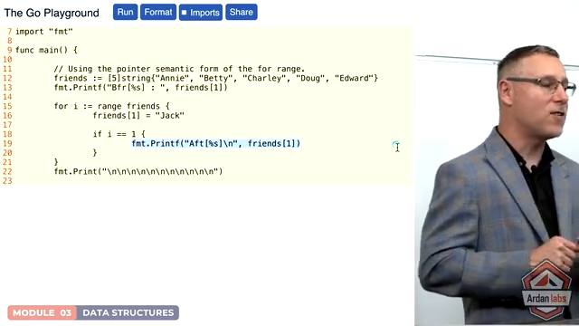
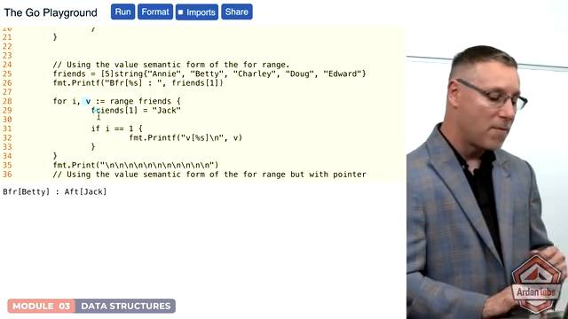
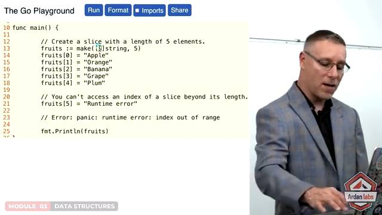
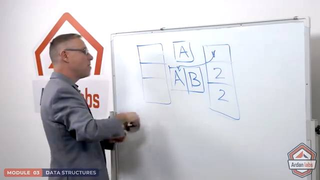
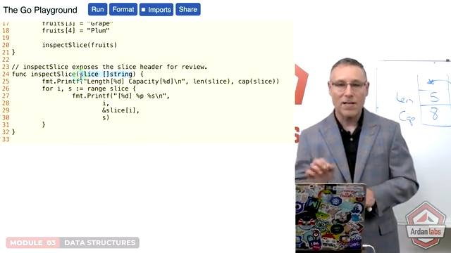

# Ultimate Go Language 数据语义与切片机制（P19–P22）复现文档

> 覆盖 P019–P022 四集。逐字稿实际讲的是：数组的数据语义、`for range` 的两种形式、切片的三字结构（data / len / cap）、nil slice 与 empty slice、`append` 的增长与内存泄漏排查。
> **需要提前说明**：课程标题里的「并发 + benchmark」在这四集逐字稿里**没有出现**，本文不写这部分内容，第 7 节会单独交代。

---

## 1. 这一节做什么

这四集不是在讲新语法，而是在建立一条贯穿整个 Go 工程的**数据语义（data semantics）规则**，然后用这条规则去解释三件事：

1. **数组为什么可以放心复制。** `var fruits [5]string` 在内存里是一块连续区域；`fruits[0] = "Apple"` 做的是拷贝，而且只拷贝 `string` 的「头」（两个 word），字节内容仍然被共享。
2. **`for range` 有两种形式，语义不同。** `for i := range x` 是指针语义（直接索引回原数据），`for i, v := range x` 是值语义（迭代的是 x 的副本，`v` 又是元素的副本）。这直接决定了你在循环里改数据，外面看不看得到。
3. **切片的本质是一个三字结构。** 它本身是值类型（跨函数传递时拷贝 24 字节 / 在 64 位下），但内部的第一个 word 是指向底层数组的指针，所以读写时使用的是指针语义——这就是讲师反复强调的「引用类型的二元性」。围绕这个结构，又引出 `make` 的 length 和 capacity、nil slice 与 empty slice 的区别、`append` 的翻倍增长和值语义变更 API。

复现完成后你应该能拿到这些**可观察的结果**：

- 一个程序，能打印出 `for range` 两种形式下「Betty / Jack」的行为差异；
- 一个程序，能打印出切片底层数组的**连续地址和固定 stride**（课里是 `0x08`，64 位机器上是 `0x10`）；
- 一个程序，能打印出 `append` 每次更换底层数组时的 `len` / `cap` 轨迹；
- 一个程序，能演示「只设 length 不设 capacity」导致 `append` 从第 100000 个位置开始写入的错误。

![p019 01:51 讲师在白板上画出 [5]string 的 40 字节连续内存](images/p019_0111s.jpg)

---

## 2. 讲师原话

> "当我们谈值语义时，指的是每一段代码操作的都是自己的一份数据副本。这带来了隔离，帮助我们避免副作用。"
> —— p019 [03:20]

> "指针语义意味着任意一份数据只有一个版本，并且是共享的。共享能带来效率，但我们必须担心副作用。"
> —— p019 [03:49]

> "当我们处理内置类型时，如果处理的数据是数值、字符串或布尔值，就应该使用值语义在程序中传递这些数据。"
> —— p019 [08:07]

> "很多 Go 开发者，甚至是非常有经验的 Go 开发者，都没有意识到 for range 有两种形式；而他们没有意识到的是，这两种形式实际上分别代表不同的数据语义。"
> —— p019 [04:49]

> "当我们说这是 for range 的值语义形式时，意思是这个 for range 操作的是自己的一份数据副本。说实话，这是实现值语义的唯一方式。"
> —— p020 [04:48]

> "切片始终是一个由三个字组成的数据结构。……接下来的字表示长度。……然后还有第三个值，也就是容量。"
> —— p021 [02:26]

> "长度非常像数组。它描述的是从该位置开始，我们可以读取和/或写入的元素总数。容量表示底层数组中实际存在的元素总数，而不一定是你能读取和写入的元素数。"
> —— p021 [03:14]

> "我不希望看到指向切片的指针、指向通道的指针、指向接口的指针。我不希望看到这些东西。后面我们还会讲到一些例外。"
> —— p021 [05:09]

> "任何引用类型被设为零值时，都会被视为 nil，就像指针被设为零值时一样。"
> —— p022 [00:28]

> "如果当前底层数组的元素少于 1,000 个，就会翻倍。……当元素超过 1,000 个时，就会按 25% 增长。"
> —— p022 [08:58]

> "Append 的设计围绕值语义展开，因为我们使用值语义在程序中传递切片值。并且 Append 是值语义修改接口的一个很好的示例。"
> —— p022 [18:58]

---

## 3. 从零复现

### 3.1 前置条件

- 装好 Go。**课里没有说用哪个版本号**，逐字稿里讲师是在 Go Playground 上演示的。本文的 `go.mod` 声明 `go 1.21`；如果你装的是更高版本，第 6 个程序打印出的 `cap` 轨迹可能和课里不同（原因见第 7 节）。
- 确认命令可用：

```bash
go version
```

- 课里没有提任何第三方依赖，所以整个复现**只用标准库**，`go mod tidy` 之后 `go.sum` 会为空或不生成。

### 3.2 建目录

```bash
mkdir -p ultimate-go-p19-p22
cd ultimate-go-p19-p22
go mod init ultimate-go/p19-p22
mkdir -p internal/inspect
mkdir -p cmd/01-array-value-semantics
mkdir -p cmd/02-range-pointer-semantics
mkdir -p cmd/03-range-value-semantics
mkdir -p cmd/04-make-length-capacity
mkdir -p cmd/05-nil-vs-empty-slice
mkdir -p cmd/06-append-growth
mkdir -p cmd/07-preallocate
```

目录树最终长这样：

```
ultimate-go-p19-p22/
├── go.mod
├── internal/
│   └── inspect/
│       └── inspect.go
└── cmd/
    ├── 01-array-value-semantics/main.go
    ├── 02-range-pointer-semantics/main.go
    ├── 03-range-value-semantics/main.go
    ├── 04-make-length-capacity/main.go
    ├── 05-nil-vs-empty-slice/main.go
    ├── 06-append-growth/main.go
    └── 07-preallocate/main.go
```

**为什么要拆成多个 `cmd/` 子目录**：每个例子都是一个 `package main` + `func main()`，同一个目录里放多个 `main` 会编译报重复声明。拆开后每个目录可以单独 `go run`，互不干扰。

### 3.3 复现顺序

按下面的顺序跑，每一步的输出对应讲师的某一段讲解：

| 步骤 | 命令 | 对应讲解 |
|---|---|---|
| 1 | `go run ./cmd/01-array-value-semantics` | p019 [01:51]–[06:11] 数组、赋值拷贝、跨边界传值 |
| 2 | `go run ./cmd/02-range-pointer-semantics` | p020 [01:27]–[02:53] `for i := range` 直接改到原数组 |
| 3 | `go run ./cmd/03-range-value-semantics` | p020 [03:22]–[05:18] `for i, v := range` 改不到被迭代的那份数据 |
| 4 | `go run ./cmd/04-make-length-capacity` | p021 [01:26]–[05:36] `make` 的 length / capacity、三字结构、跨边界传 slice |
| 5 | `go run ./cmd/05-nil-vs-empty-slice` | p022 [00:28]–[04:18] nil slice、empty slice、empty struct |
| 6 | `go run ./cmd/06-append-growth` | p022 [04:44]–[16:39] `append` 的第一次分配、翻倍增长 |
| 7 | `go run ./cmd/07-preallocate` | p022 [17:04]–[18:30] 预分配、以及「只设 length」的坑 |

### 3.4 每个步骤的观察点

**步骤 1**：输出里 `index[0]` 是 `Apple`，`index[1]`–`index[4]` 是空字符串——这就是 `var` 带来的零值。`printFruit` 里再打印一次 `Apple`，证明 `string` 是以值的形式跨过的程序边界。

**步骤 2**：先打印 `Betty`，循环里 `i == 1` 时打印 `Jack`。这就是讲师的「指针语义形式」——循环体直接写回了 `friends` 这个数组本身。

**步骤 3**：先打印 `Betty`，循环里 `i == 1` 时打印的 `v` **仍然是 `Betty`**，但循环结束后 `friends[1]` 变成了 `Jack`。这是本节最容易让人困惑的一点：代码确实改了数组，但 `range` 迭代的是自己被拷贝出来的那份，所以 `v` 看到的是旧值。讲师原话是「any changes to friends is irrelevant in terms of this iteration」。

**步骤 4**：`inspect.Slice` 会打印每个元素所在地址和相邻元素的地址差（stride）。你会看到地址逐格递增、差值恒为 `0x10`（32 位 playground 上讲师看到的是 `0x08`）。这就把「切片是底层数组上连续、固定步长的窗口」变成肉眼可见的东西。

**步骤 5**：`nilSlice == nil` 为 `true`，`emptySlice == nil` 为 `false`，但两者的 `len` 和 `cap` 都是 0。这个差异就是讲师说的「集合不存在」和「集合存在但为空」两种语义。

**步骤 6**：输出里每出现一行 `new backing array` 就代表 `append` 换了一次底层数组。观察 `cap` 的序列，再对照 p022 [08:58] 那句「小于 1000 翻倍，超过 1000 涨 25%」。

**步骤 7**：`good` 全程只打印一行 grow（因为一开始就分配够了），`wrong` 则演示了「只设 length」的后果——`append` 从索引 100000 开始写，前面的 100000 个空字符串一个没动。



---

## 4. 完整代码

以下所有文件可直接保存运行。`inspect` 包是本复现自建的辅助包，用来打印切片地址和 stride；逐字稿里讲师提到了 `InspectSlice` 这个函数的**行为**（打印 len/cap、迭代出连续内存和固定 stride），但没给出源码，下面是按该行为写的最小实现。

### 4.1 `go.mod`

```
module ultimate-go/p19-p22

go 1.21
```

### 4.2 `internal/inspect/inspect.go`

```go
// Package inspect 提供打印切片底层布局的辅助函数。
// 逐字稿只描述了 InspectSlice 的行为：打印 length/capacity，
// 并展示底层数组是"连续、固定 stride"的内存块。
// 下面是按该描述实现的最小版本。
package inspect

import (
	"fmt"
	"unsafe"
)

// Slice 打印 name 对应切片的 length / capacity，
// 以及每个元素所在地址和相邻元素之间的 stride。
func Slice(name string, slice []string) {
	fmt.Printf("%s: length[%d] capacity[%d]\n", name, len(slice), cap(slice))
	if len(slice) == 0 {
		return
	}

	var prev uintptr
	for i, v := range slice {
		addr := uintptr(unsafe.Pointer(&slice[i]))
		if i == 0 {
			fmt.Printf("  [%d] addr[%#x] value[%q]\n", i, addr, v)
		} else {
			fmt.Printf("  [%d] addr[%#x] stride[%#x] value[%q]\n", i, addr, addr-prev, v)
		}
		prev = addr
	}
}
```

### 4.3 `cmd/01-array-value-semantics/main.go`

```go
package main

import "fmt"

// 对应 p019 [01:24] - [06:41]
func main() {
	// line 14：用 var 声明，得到 [5]string 的零值——
	// 5 个空字符串，底层是一整块连续内存。
	var fruits [5]string

	// line 15：赋值就是一次拷贝。
	// 拷贝的只是 string 的"头"（两个 word），
	// 真正的字节内容被共享，不会被复制。
	fruits[0] = "Apple"

	// line 22：值语义形式的 for range。
	// fruit 是每个元素的副本。
	for i, fruit := range fruits {
		fmt.Printf("index[%d] fruit[%q]\n", i, fruit)
	}

	// line 23：跨程序边界。printFruit 拿到自己的一份 string 副本。
	printFruit(fruits[0])
}

// printFruit 用值语义接收 string。
// 注意：不能写成 *string —— 对内置类型用指针违反本节的数据语义规则，
// 唯一合理的例外是"需要表达 null"的场景（课里没在本段代码体现）。
func printFruit(fruit string) {
	fmt.Printf("inside printFruit: %q\n", fruit)
}
```

### 4.4 `cmd/02-range-pointer-semantics/main.go`

```go
package main

import "fmt"

// 对应 p020 [01:27] - [02:53]
func main() {
	friends := [5]string{"Annie", "Betty", "Charles", "Doug", "Edward"}

	// 还没动过任何东西，应该是 Betty。
	fmt.Printf("first read  -> friends[1] = %s\n", friends[1])

	// 指针语义形式的 for range：
	// 只拿迭代器，不拿元素副本，循环体直接索引回 friends 本身。
	for i := range friends {
		friends[1] = "Jack"
		if i == 1 {
			fmt.Printf("during loop -> friends[1] = %s\n", friends[1])
		}
	}
}
```

### 4.5 `cmd/03-range-value-semantics/main.go`

```go
package main

import "fmt"

// 对应 p020 [03:22] - [05:18]
func main() {
	friends := [5]string{"Annie", "Betty", "Charles", "Doug", "Edward"}

	fmt.Printf("first read  -> friends[1] = %s\n", friends[1])

	// 值语义形式的 for range：
	// 迭代的是 friends 的一份副本，v 又是该副本中元素的副本。
	// 循环体里改 friends，改的是另一个数组，迭代看不到。
	for i, v := range friends {
		friends[1] = "Jack"
		if i == 1 {
			fmt.Printf("during loop -> v = %s\n", v)
		}
	}

	fmt.Printf("after loop  -> friends[1] = %s\n", friends[1])
}
```

### 4.6 `cmd/04-make-length-capacity/main.go`

```go
package main

import (
	"fmt"

	"ultimate-go/p19-p22/internal/inspect"
)

// 对应 p021 [01:26] - [09:26]
func main() {
	// 只设 length，capacity 自动等于 length。
	fruits := make([]string, 5)
	inspect.Slice("make([]string, 5)", fruits)

	// length 是读写边界，下标 5 会 panic。
	// 想看到 panic 就把下一行注释解开：
	// fmt.Println(fruits[5])
	// panic: runtime error: index out of range [5] with length 5

	// 同时设 length 和 capacity。
	// 能读写的仍然只有前 5 个，多出来的 3 个是给未来 append 用的余量。
	more := make([]string, 5, 8)
	inspect.Slice("make([]string, 5, 8)", more)
	fmt.Printf("more: len[%d] cap[%d]\n", len(more), cap(more))

	// 跨程序边界时传的是 slice 值（三字结构的副本），
	// 不能传 *[]string。
	printSlice(fruits)
}

func printSlice(fruits []string) {
	fmt.Printf("inside printSlice: len[%d] cap[%d]\n", len(fruits), cap(fruits))
}
```

### 4.7 `cmd/05-nil-vs-empty-slice/main.go`

```go
package main

import (
	"fmt"

	"ultimate-go/p19-p22/internal/inspect"
)

// 对应 p022 [00:28] - [04:18]
func main() {
	// 零值：data / len / cap 三个 word 全是 0。
	var nilSlice []string
	inspect.Slice("var nilSlice []string", nilSlice)
	fmt.Printf("nilSlice == nil  -> %v\n", nilSlice == nil)

	// 空切片：len 和 cap 都是 0，但 data 指针不为 nil。
	// 它代表"集合存在，但是空的"，比如一次返回 0 行的查询结果。
	emptySlice := []string{}
	inspect.Slice("[]string{}", emptySlice)
	fmt.Printf("emptySlice == nil -> %v\n", emptySlice == nil)

	// 空结构体 struct{} 是零大小类型，所有实例共用同一个地址。
	// 用 []struct{} 可以直接观察这一点。
	zeros := make([]struct{}, 2)
	fmt.Printf("&zeros[0] == &zeros[1] -> %v  (addr %p / %p)\n",
		&zeros[0] == &zeros[1], &zeros[0], &zeros[1])
}
```

### 4.8 `cmd/06-append-growth/main.go`

```go
package main

import "fmt"

// 对应 p022 [04:44] - [16:39]
func main() {
	// 课里用的是 100000 次 append。这里默认 1000，
	// 想看完整量级把 total 改成 100000 即可。
	const total = 1000

	// 从一个 nil slice 开始：没有底层数组。
	var data []string
	lastCap := 0

	for i := 1; i <= total; i++ {
		data = append(data, fmt.Sprintf("rec-%04d", i))
		// 每次 capacity 变化，说明 append 换了一个新的底层数组。
		if cap(data) != lastCap {
			fmt.Printf("new backing array: len[%d] cap[%d]\n", len(data), cap(data))
			lastCap = cap(data)
		}
	}

	fmt.Printf("final: len[%d] cap[%d]\n", len(data), cap(data))
}
```

### 4.9 `cmd/07-preallocate/main.go`

```go
package main

import "fmt"

// 对应 p022 [17:04] - [18:30]
func main() {
	const total = 100000

	// 正确姿势：length 设 0，capacity 设 total。
	// append 从 index 0 开始往已经分配好的空间里写，全程不换底层数组。
	good := make([]string, 0, total)
	lastCap := 0
	for i := 1; i <= total; i++ {
		good = append(good, fmt.Sprintf("rec-%d", i))
		if cap(good) != lastCap {
			lastCap = cap(good)
			fmt.Printf("good grow -> len[%d] cap[%d]\n", len(good), cap(good))
		}
	}
	fmt.Printf("good final: len[%d] cap[%d]\n", len(good), cap(good))

	// 坑：预分配时"顺手"把 length 也设成了 total。
	// append 是贴着 length 往后写的，所以第一个元素落在 index total 上，
	// 前面 100000 个空字符串一个都没动。
	wrong := make([]string, total)
	wrong = append(wrong, "one-more")
	fmt.Printf("wrong: len[%d] cap[%d] wrong[%d] = %q\n",
		len(wrong), cap(wrong), total, wrong[total])
}
```

---

## 5. 逐行解释

### 5.1 `01-array-value-semantics`：为什么复制数组是安全的

`var fruits [5]string` 是本节的地基。讲师在 p019 [01:51] 说得很具体：playground 上 `string` 是**两个 word 的数据结构**，每个 word 四个字节，5 个 string 就是 40 字节。你换成 64 位机器，一个 word 是 8 字节，一个 `string` 头就是 16 字节，5 个就是 80 字节——**数字变了，结构没变**。

关键在于 `fruits[0] = "Apple"` 到底复制了什么。讲师用的是「两字拷贝」这个说法：`string` 是「一个指向字节内容的指针 + 一个长度」，所以赋值时拷贝的只是这两个 word，`Apple` 这五个字节本身躺在只读区里，压根没被搬动。这就是「值语义的外壳 + 指针语义的内核」第一次出现：**外部看起来每人一份，内部共享真正贵的那块**。

`for i, fruit := range fruits` 这一行，`fruit` 是从数组里拷贝出来的。讲师在 p019 [05:13] 特别强调 `fruit` 是「every string that we're iterating over」的副本。再加上 `printFruit(fruits[0])` 传参又拷一次，此时内存里同时存在 3 个 `string` 头指向同一份 `Apple` 字节——但每一个都能独立寻址，可以分布在不同的 cache line 上。

`printFruit(fruit string)` 的签名是本节的一条**代码评审规则**：讲师在 p021 [05:09] 说得很直接——「I don't want to see a pointer of that slice」，同理，对 `string`、`int`、`bool` 这些内置类型，他看到 `*string` 字段就会叫停评审。唯一的例外是 p019 [09:31] 提到的：Go 没有 `null`，当数据库里某个字段「存在但为空」和「根本没查这个字段」必须区分时，`*string` 才有意义。

**对应到 JS/Node**：`string` / `number` / `boolean` 在 JS 里本身就是值语义（`let a = s; a += "x"` 不影响 `s`），所以这一段的直觉前端是有的。真正需要切换到 Go 思维的是下一节。

### 5.2 `02` / `03`：同一个 `for range`，两种完全不同的语义

这是整段课程最容易被「写了两年代码的人」忽略的地方。讲师在 p019 [04:49] 的原话是：「there's two flavors of the for range, but each flavor actually represents a different data semantic」。

**`for i := range friends`（指针语义）**：循环只拿到下标，`friends[1] = "Jack"` 是直接写回原数组的。第一次迭代 `i = 0` 就把 `Betty` 改成了 `Jack`，第二次迭代 `i = 1` 打印出来的自然是 `Jack`。输出是 `Betty` → `Jack`。

**`for i, v := range friends`（值语义）**：这里有两层拷贝。

- 第一层：`range` 表达式求值时，`friends` 这个**数组**被整体复制了一份，循环迭代的是这份副本。
- 第二层：`v` 是副本里当前元素的再一份拷贝。

所以循环体里的 `friends[1] = "Jack"` 改的是原数组——**改动是真的发生了**，循环结束后打印 `friends[1]` 确实是 `Jack`。但 `v` 来自那份副本，它看到的永远是 `Betty`。讲师在 p020 [04:21] 反复强调：「I'm not talking about V, though V is an aspect of the fact that we're making a copy. […] the for range is operating on its own copy of the data」。

这里有个**特别容易踩的坑**：如果 `friends` 不是数组而是**切片**，`for i, v := range friends` 迭代的是切片头的那份副本，但切片头里的指针指向的还是**同一个底层数组**——于是循环体里改 `friends[1]`，下一次迭代的 `v` 就会看到新值。数组和切片在这里的表现不同，务必分开验证。

**对应到 JS/Node**：`for (const v of arr)` 里 `v` 是元素的值，`arr` 是引用；如果你在循环里 `arr[1] = "Jack"`，后续迭代的 `v` 会读到 `Jack`（因为 JS 的数组是引用类型，没有「range 复制整个数组」这一步）。Go 的数组版本恰好相反。这一点如果不亲手跑一遍，靠类比是推不出来的。



### 5.3 `04-make`：切片的三个 word

`make([]string, 5)` 返回的不是一个「指向切片的指针」，而是**一个 24 字节（64 位）/ 12 字节（32 位）的三字结构值**：

| word | 含义 | `make([]string, 5)` 时的值 |
|---|---|---|
| 1 | data：指向底层数组的指针 | 指向一块 `[5]string` |
| 2 | len：可读写的元素个数 | 5 |
| 3 | cap：底层数组的总元素个数 | 5 |

讲师在 p021 [03:14] 把 len 和 cap 的区别讲得很清楚：len 是**读写边界**，cap 是**底层数组还能装多少**。所以 `fruits[5]` 会 panic，哪怕底层数组其实什么都没少。`make([]string,
5)` 只是设了 length，capacity 跟着 length 走。讲师在 p021 [06:19] 演示了第三步：`make([]string, 5, 8)`，此时底层数组有 8 个格子，但你仍然只能读写前 5 个，多出来的 3 个是留给 `append` 的余量。这个「多出来的空间只能通过 `append` 用，不能通过下标用」是 len/cap 这对概念的核心。

`make` 的适用面讲师在 p021 [01:26] 就圈定了：**只用于 slice、map、channel 三种类型**，因为只有它们的底层数据结构需要预分配。数组、struct 用字面量或 `var` 即可，不需要 `make`。

`printSlice(fruits []string)` 这个签名同样是一条评审规则。讲师在 p021 [05:09] 的原话是「I don't want to see a pointer of that slice, a pointer of a channel, a pointer of interface」。原因在 p021 [05:36] 讲透了：**引用类型有二元性**——跨程序边界时用值语义传（每个函数拿到 24 字节的切片头副本，全部留在栈上，不污染堆），但读写时用的是指针语义（副本里的 data 指针指向同一个底层数组）。既然指针语义已经内建在结构里了，再套一层 `*[]string` 就是多余的间接层，还会让被调函数有能力把调用方的切片头整个替换掉——这在语义上是不该发生的。



### 5.4 `05`：nil slice、empty slice、空结构体

讲师在 p022 [00:28] 给的判断标准很干脆：**所有引用类型的零值都算 nil**，就像指针的零值一样。`string` 之所以被归为内置类型而不是引用类型，正是因为它的零值是「空字符串」而不是 nil——这是讲师说的「duality」的另一面。

| 写法 | data | len | cap | `== nil` |
|---|---|---|---|---|
| `var s []string` | nil | 0 | 0 | `true` |
| `[]string{}` | 指向空结构体 | 0 | 0 | `false` |
| `make([]string, 0)` | 指向空结构体 | 0 | 0 | `false` |

前两行必须区分开，是因为它们表达**两种不同的业务语义**。讲师在 p022 [02:23] 举的例子最清楚：「查询所有 100 岁以上的用户」返回 0 行，这不是查询失败，而是「集合存在但是空的」；而如果某个字段压根没被查询，那才是「集合不存在」。前端最常见的对应场景是「接口返回 `[]`」和「接口返回 `null`」——这两种在 Go 里恰好对应 empty slice 和 nil slice，序列化成 JSON 也会得到 `[]` 和 `null` 两种结果。

`make([]struct{}, 2)` 那三行是为了让「空结构体共享同一个地址」这件事可观察。讲师在 p022 [03:22] 说的是：空结构体是「zero allocation type」，是一个内嵌在 runtime 里的值，「If I were to construct 100,000 empty structs, they'd all have the same address」。跑出来 `true` 就说明 `&zeros[0]` 和 `&zeros[1]` 指向同一个位置。

最后回到 p022 [02:53] 那条反复出现的规则：**零值一律用 `var` 声明，不要用字面量**。因为字面量 `[]string{}` 在切片上表示 empty 而不是 zero value，而在 struct 上又确实表示零值——同一套写法在不同类型上含义不一致，只有 `var` 是稳定的。

### 5.5 `06`：`append` 是一个「值语义变更 API」

这是 p022 整集的核心论点，讲师在 [18:58] 总结成一句话：「append has been designed around value semantics」。

走一遍第一次 `append` 发生了什么（p022 [05:42]–[07:35]）：

1. `data` 是 nil slice，data=nil、len=0、cap=0。
2. 调 `append(data, ...)`。**`append` 拿到的是切片头的一份副本**——这是它作为普通函数必须遵守的数据语义，讲师原话是「an API can't decide how it wants to do things. It has to respect the data」。
3. `append` 检查 `len == cap`。相等，说明没有余量，必须新分配。此刻连底层数组都没有，于是新建一个长度 1 的数组，把字符串放进去。
4. 修改**自己那份**副本：data 指向新数组，len=1，cap=1。
5. **返回这份新副本**。

关键在第 5 步：调用方必须写 `data = append(data, x)` 把返回值接回去。函数内部的修改发生在副本上，不接返回值等于什么都没做。这正是「值语义变更」的含义——**在隔离中修改自己的副本，再把新副本返回出来**。讲师评价这是「the safest way to do mutation」。

后续几次 `append`（cap 1 → 2 → 4）重复同样的流程，只是多了一步：长度和容量相等时要**把旧数组的数据复制到新数组**。讲师在 p022 [09:28] 特意点出「the data has to move」，然后在 [09:56] 补了一句关键信息：旧数组此时没有任何引用了，**GC 的标记阶段不会标记它，随后被清扫掉**——所以「数据搬移 + 旧数组回收」是 `append` 扩容的完整代价，不需要你手动管理。

增长策略在 p022 [08:58] 说得很明确：**当前底层数组小于 1000 个元素时翻倍，超过 1000 时增长 25%**。代码里我用 `cap(data) != lastCap` 作为「换数组了」的探测器，因为它比「数据变了」更准确——只有真正分配新数组时 cap 才会跳变。

代码里 `total` 默认写成 1000 而不是课里的 100000，是为了让输出不至于刷屏；改成 100000 就能看到讲师说的「1000 之前翻倍、1000 之后 25%」。**注意**：这两个数字是讲师在课上给的，现代 Go 版本的实际增长曲线已经变了，见第 7 节。



### 5.6 `07`：预分配的正确姿势与那个著名 bug

讲师在 p022 [17:04] 的反问很有意思：「we know exactly how many appends we're going to be doing. We're doing 100,000 of them. So think about it. I mean, it's really silly for me to be starting with a nil slice in this case.」——知道总量就预分配，不知道就别预分配，靠 profile 说话。

`make([]string, 0, total)` 里 **length 必须是 0**。原因是 `append` 的写入位置**贴着 length 走**，不是贴着 capacity 走。len=0 时第一个元素落在 index 0，把 cap 提供的空间一格格填满，全程零次重新分配，所以代码里 `good grow` 只应该打印一行 `len[0] cap[100000]`（严格说第一行出现在 cap 变化时，实际是第一次 append 之后）。

`make([]string, total)` 就是讲师在 p022 [18:01] 说的那个「我先写过的 bug」：length 被设成了 100000，`append` 于是从 index 100000 开始写。`wrong[100000]` 是 `"one-more"`，而前面 100000 个格子全是空字符串——数据「写进去了」，但位置完全不是你想要的。而且这次 `append` 还会重新分配一个更大的底层数组（因为 len == cap），把 100000 个空字符串一起搬过去，白白浪费一次大拷贝。

讲师接着给了更省事的方案（p022 [18:30]）：既然知道总量、又不需要动态增长，**直接用下标赋值，连 `append` 都可以不要**：

```go
// 课里 [18:30] 提到的等价写法：知道总量时直接写下标，
// 但长度必须给够，否则一样的越界问题。
bulk := make([]string, total)
for i := 1; i <= total; i++ {
	bulk[i-1] = fmt.Sprintf("rec-%d", i)
}
```

代价是长度必须先给够。这两种写法怎么选，取决于「写入时是否已经知道全部内容」——不知道就只能 `append`，那就把 length 设为 0、capacity 设为目标量。

### 5.7 p022 后半段：内存泄漏与一个警示性的 `append` 写法

讲师在 p022 [10:25] 把「内存泄漏」重新定义了一遍，这个定义值得原样记住：在 C 里泄漏是「忘了 `free`」，可以靠工具扫出来；在 Go 里泄漏是「**堆上有值、有引用指向它，但这个引用本来不该存在**」，所以**工具扫不出来**，只能先拿 GC trace 确认。讲师说 os 层工具（VMStats、Htop）「may be lying to you」。

确认之后按四类排查（p022 [12:22]–[14:47]）：

1. **goroutine 泄漏或阻塞**。讲师说是「usually the number one cause」，goroutine 卡在 channel 或同步原语上永不退出，它引用的所有东西都跟着泄漏。注意：本集**没有真正演示 goroutine**，这部分是排查清单，具体并发代码不在这四集里。
2. **map 当缓存用**。按 size 上限的缓存不会漏，按时间过期的可能漏，按事件（比如 socket 连接）维护的缓存最容易在连接断开时忘了删 key。
3. **`append` 调用**。这是本节唯一直接对应到我们代码的一点：讲师在 [14:17] 说，如果看到 `append` 的返回值**没有被接回去**，就是「a sure sign of a really bad smell」，因为可能还持有对旧底层数组的多余引用。
4. **该 `close` 没 `close` 的 API**。HTTP 的 get/post 调用都有 close 函数，忘了调用会泄漏，也可能耗尽文件句柄。

第 3 条在代码上的体现就是我们的 `data = append(data, ...)`——**赋值符左边的 `data =` 不是可省的习惯，是语义的一部分**，去掉它轻则数据丢失，重则让旧数组一直被某个残留引用钉住。


---

## 6. 复现检查清单

按顺序跑，每一条都能对上讲师在某一段讲的东西。**输出里的具体数字（地址、cap 序列）以你机器的实际输出为准**，下表给的是定性判断标准。

```bash
# 0. 环境
go version                     # 能打印出版本即可，课里没指定版本
cd ultimate-go-p19-p22
go vet ./...                   # 应该无输出；有输出先修，再往下走
```

| # | 命令 | 应该看到 | 对应讲解 |
|---|---|---|---|
| 1 | `go run ./cmd/01-array-value-semantics` | `index[0] fruit["Apple"]`；`index[1]`–`index[4]` 是 `""`；最后一行 `inside printFruit: "Apple"` | p019 [01:51]–[06:41] |
| 2 | `go run ./cmd/02-range-pointer-semantics` | `first read -> friends[1] = Betty`，然后 `during loop -> friends[1] = Jack` | p020 [01:27]–[02:53] |
| 3 | `go run ./cmd/03-range-value-semantics` | `first read -> ... Betty`，`during loop -> v = Betty`，`after loop -> friends[1] = Jack` | p020 [03:22]–[05:18] |
| 4 | `go run ./cmd/04-make-length-capacity` | 两组 `length[5] capacity[5]` / `length[5] capacity[8]`；地址逐格递增，`stride` 恒定（64 位机器上为 `0x10`）；`inside printSlice: len[5] cap[5]` | p021 [01:26]–[09:26] |
| 5 | `go run ./cmd/05-nil-vs-empty-slice` | `nilSlice == nil -> true`；`emptySlice == nil -> false`；`&zeros[0] == &zeros[1] -> true` | p022 [00:28]–[04:18] |
| 6 | `go run ./cmd/06-append-growth` | 多行 `new backing array:`，`cap` 序列按 1、2、4… 递增；最后一行 `final: len[1000] cap[...]` | p022 [04:44]–[16:39] |
| 7 | `go run ./cmd/07-preallocate` | `good` 只有一行 grow，且 `cap` 一次到 100000；`wrong: len[100001] ... wrong[100000] = "one-more"` | p022 [17:04]–[18:30] |

逐条自查（勾掉才往下走）：

- [ ] 步骤 3 里 `during loop -> v = Betty` 和 `after loop -> friends[1] = Jack` **同时出现**。如果 `v` 打印出 `Jack`，说明你把 `friends` 写成了切片，回去改回数组再跑一次——这一步是整个 P020 的理解分水岭。
- [ ] 步骤 4 的 stride 是**恒定值**，不是递减或跳跃的。这证明底层数组是连续、固定步长的内存块。
- [ ] 步骤 4 里 `make([]string, 5, 8)` 打印出来的 `capacity[8]`，但 `inspect.Slice` 只遍历了 5 个元素——因为 len 才是遍历边界。
- [ ] 步骤 5 三个布尔值分别是 `true` / `false` / `true`。
- [ ] 步骤 6 的 `cap` 序列严格单调不减，且只在换数组时才打印。
- [ ] 步骤 7 的 `wrong` 里 `wrong[0]` 是空字符串。可以临时加一行 `fmt.Printf("%q\n", wrong[0])` 验证——如果它不是空的，说明你的 length 处理逻辑写错了。
- [ ] 把 `cmd/04` 里 `fmt.Println(fruits[5])` 的注释解开，确认得到的是 `index out of range` 的 panic 而不是编译错误。**看完记得注释回去**，否则后面 `go vet ./...` 会失败。
- [ ] `go vet ./...` 全绿。



---

## 7. 课里没讲但你会撞上的

这一节全部是**逐字稿里没有的内容**，是为了让你照着上文跑通时不被卡住。凡涉及 Go 版本行为的，都请以你本地 `go version` 的实际输出为准，不要拿课里的数字当规范。

**（1）标题写着「并发 + benchmark」，但这四集里没有。**

P019–P022 的内容只有数据语义、`for range` 两种形式、切片三字结构、nil/empty slice、`append` 增长、内存泄漏排查清单。逐字稿里**没有出现 goroutine、channel 的实际代码，也没有出现 `testing.B`、`go test -bench` 这类 benchmark 内容**。内存泄漏那一段（p022 [12:22]）虽然把 goroutine 泄漏列为第一排查项，但那只是清单，没有演示。想看并发和 benchmark，需要去找后续集数，本文不做推测。

**（2）`append` 的增长比例和课里不一样。**

讲师在 p022 [08:58] 给的是「小于 1000 翻倍，超过 1000 涨 25%」。这是他所处 Go 版本的行为。**较新的 Go 版本已经改过扩容策略**（大致在 256 个元素这个量级之后从翻倍切到较小比例增长，并带平滑）。所以步骤 6 你跑出来的 `cap` 序列很可能和「1、2、4、8…」对不上，这不是你写错了，是版本差异。判断标准只看**单调递增且只在换数组时变化**，不要拿具体数字对答案。

**（3）`string` 头到底是 8 字节还是 16 字节。**

讲师在 playground 上看到的是「两个 word，每个 word 四字节」，所以他算出 40 字节。64 位机器上一个 word 是 8 字节，`string` 头就是 16 字节，`[5]string` 是 80 字节。**「每个 word 多少字节」是平台相关的，课里没讲这一点**，别把 40 硬编码进任何注释或计算里。同理，步骤 4 的 stride 在 64 位上是 `0x10`，在 32 位上是 `0x08`。

**（4）`internal/inspect` 里用了 `unsafe`。**

打印地址必须用 `unsafe.Pointer`，这是本文为了把「连续内存 + 固定 stride」变成可观察结果而引入的**辅助手段**。逐字稿只说到了 `InspectSlice` 这个函数的行为（打印 len/cap、迭代展示连续内存和固定 stride），**没有给源码，也没有提 `unsafe` 包**。生产代码里不要为了让日志好看而引入 `unsafe`——它会让 `go vet` 之外的更多检查失效，也会阻止编译器做某些优化。

**（5）GC trace 的具体命令课里没给。**

讲师在 p022 [11:53] 说「the only way to do that is to get a GC trace of the program, which I'm going to be showing you later」——**这四集里没有兑现**。所以本文没有写任何 GC trace 命令。想知道怎么开，等看到对应的那集再补，不要凭印象往 `main.go` 里加环境变量。

**（6）`for range` 的变量捕获在 Go 1.22 有变化。**

课件（P020）只讲了「值语义形式迭代的是副本，所以改原数组看不到」，这一点在任何版本都成立。但如果你在循环里写**闭包**去捕获 `i` 或 `v`，Go 1.22 之前所有迭代共享同一组变量，之后每次迭代都是新变量——这个差异**课里完全没提**，而它恰好是最容易和 P020 的内容混淆的地方。本复现的 7 个程序都没有在循环里建闭包，所以不受影响；你自己扩展时要注意。

**（7）多个 `main` 包不能用 `./...` 一次跑。**

`go run ./...` 会尝试把所有 `main` 包一起构建并执行，行为不是你想要的（Go 会报「cannot run multiple packages」之类）。正确姿势是像第 6 节那样**一个目录一个目录地 `go run`**。但 `go build ./...` 和 `go vet ./...` 是合法的，可以把全部目录一次编译检查完。

**（8）`exit code` / `OOMKilled` 这类容器字段这节用不上。**

如果你是从别的课程（容器、Kubernetes 那类）过来的，会习惯性想往日志里塞这些字段。这四集全程在讲内存布局和切片语义，**没有任何容器、部署、运行时字段相关的内容**，本文也就没有写。任何你在别处看到的字段名，都不要往这份文档的代码里加。

**（9）前端视角的等价物对照（课程没有做这个映射，以下是本文补充）。**

| Go 概念 | JS/Node 里的对应 | 不一致的地方 |
|---|---|---|
| 内置类型的值语义 | 基本类型天然值语义 | 一致，直觉可直接迁移 |
| 数组的值语义传参 | JS 数组是引用，传参不复制 | **不一致**，Go 的 `[5]string` 会整体复制 |
| 切片的「值语义传、指针语义读写」 | 类似 JS 数组传引用 | Go 多了一层「头会被复制」，但底层数组共享 |
| `append` 的值语义变更 | `arr.push()` 原地修改 | **不一致**，Go 必须接返回值 |
| nil slice vs empty slice | `null` vs `[]` | 语义完全对应，可以直接借用前端直觉 |

其中最后一行是唯一「可以放心靠前端直觉推」的一条；前面四条都必须靠第 6 节的实际输出验证，不能靠类比。