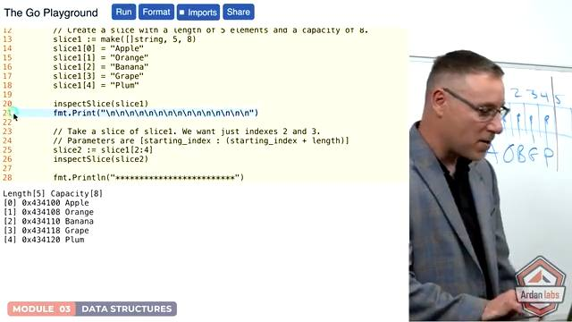
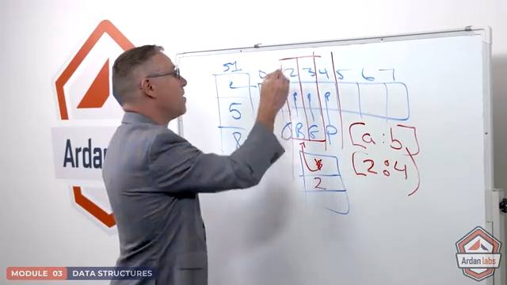
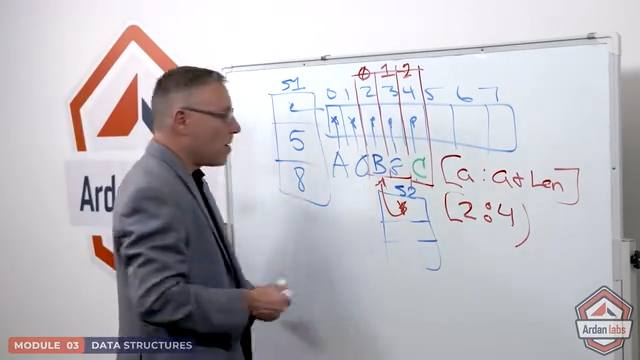
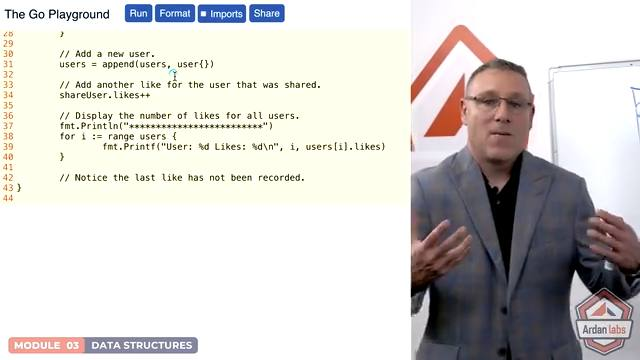
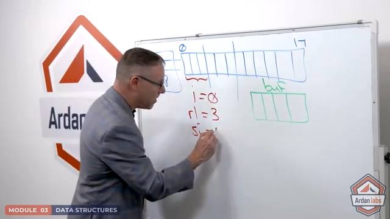
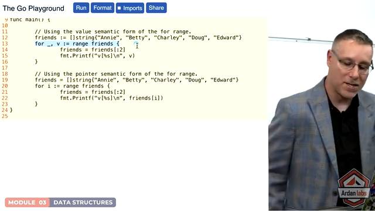
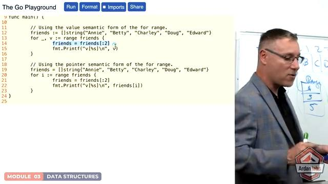

# Ultimate Go Language（P23–P26）复现文档：Slice 视图、副作用、String 与 Range

> 说明：这四段虽然属于“Ultimate Go Language（并发+benchmark）”课程，但 P23–P26 实际讲的是 Go 的 slice 视图、指针语义副作用、string 的 UTF-8 表示、以及 range 机制。**课里没有讲 benchmark 代码**，所以本文不会伪造 benchmark 内容。下面按“能跑起来”的目标组织：先建一个 Go module，再逐个运行 5 个完整程序，观察 slice 共享底层数组、append 扩容、三索引切片、字符串按 rune 遍历、以及 range 在值语义/指针语义下的差异。

---

## 1. 这一节做什么

这一节要复现的核心不是语法名词，而是四个能亲手跑出来的现象：

1. **slice 的切片视图**：`s2 := s1[2:4]` 之后，`s2` 的 `len=2`、`cap=6`，并且和 `s1` 共享同一块底层数组。读写下标时用的是指针语义，因此改 `s2[0]` 会改到 `s1[2]`。  
2. **append 的副作用**：如果 `s2` 还有额外容量，`append(s2, x)` 可能直接写回原底层数组，从而改到 `s1` 的某个位置；用三索引切片 `s1[2:4:4]` 把容量限制成 2 后，append 才会触发复制，得到独立底层数组。  
3. **string 是字节数组**：Go 的 string 是两字长结构，底层是只读字节数组。中文 UTF-8 字符通常占 3 字节；range string 时按 code point（rune）遍历，而不是按字节或字符遍历。  
4. **range 的值语义与指针语义**：值语义 range 会拿到 slice 头部的副本，循环中改原 slice 变量不一定影响迭代；指针语义写法下，循环中缩短原 slice 后再按下标访问，可能越界 panic。

最终目录结构如下。你可以直接照着建：

```text
go-slices-demo/
├── go.mod
├── p23_slice_view/
│   └── main.go
├── p24_users/
│   └── main.go
├── p25_string_utf8/
│   └── main.go
├── p26_range_value/
│   └── main.go
└── p26_range_pointer/
    └── main.go
```

环境说明：

- Go 版本：**课里没讲固定版本**。下面的 `go.mod` 用 `go 1.20` 作为复现环境声明；代码只用标准库，没有第三方依赖。
- 依赖：`fmt`、`unicode/utf8`，都是标准库。
- 环境变量：**不需要设置任何环境变量**。课里也没讲 `GOPROXY` 等配置。
- 启动命令：在 `go-slices-demo` 根目录下执行 `go run ./目录名`。


---

## 2. 讲师原话（带「—— pNNN [MM:SS]」）

下面只摘和复现直接相关的原话，不按“第几页讲了什么”流水账展开。

> "切片的思路是，我们要复用底层数组，因为底层数组是核心数据。"
> —— p023 [02:19]

这句话对应复现目标 1：切片视图复用底层数组，不是复制整个大数组。

> "与其把 b 当成一个单独的数字，……这个数字不是从 A 到 B，而是从 A 到 A 加长度。"
> —— p023 [04:13]

讲师建议用“起始下标 + 长度”来算切片结束位置。比如从 index 2 开始、想要长度 2，就写成 `2:4`，这样不容易错。

> "如果，如果我们能这样设置呢？让调用之后长度和容量都是 2。那意味着什么？意味着现在调用 append 时，append 会说：嘿，我没有额外容量了。"
> —— p023 [09:20]

这是三索引切片 `s1[2:4:4]` 的动机：把容量限制成 2，append 就没有额外容量可用，只能复制。

> "新容量意味着新的内存分配。"
> —— p024 [02:50]

用户点赞例子中，`append` 触发扩容后，原指针还指向旧底层数组，于是出现“旧指针更新旧数组、新 slice 更新新数组”的分裂。

> "如果你在代码里看到 append 调用，而它不在 decode 或 unmarshal 这样的函数里，那我大概会跟你说，你应该停下代码审查……"
> —— p024 [04:46]

讲师在提醒：看到 `append` 要警惕它是否可能替换底层数组，尤其在数据已经被共享出去之后。

> "字符串是一个由两个机器字组成的数据结构……从头到尾的长度会是 18 个字节。"
> —— p025 [00:58]

string 是两字长结构，底层是字节数组；例子里的字符串总字节数是 18。

> "当你用 range 遍历字符串时，我们不是按字节遍历，也不是按字符遍历，而是按码点遍历，走的是中间路线。"
> —— p025 [03:19]

range string 得到的是 code point，也就是 rune，不是逐字节，也不是直接按“人眼字符”切。

> "上面那个能正常工作，下面那个会触发 panic。"
> —— p026 [02:49]

range 机制对比：值语义写法安全，指针语义写法下在循环中缩短 slice 再按下标访问，会越界 panic。



---

## 3. 从零复现

### 3.1 安装 Go 并创建 module

先确认本机有 Go：

```bash
go version
```

然后创建目录和 module：

```bash
mkdir go-slices-demo
cd go-slices-demo
go mod init go-slices-demo
```

创建子目录：

```bash
mkdir -p p23_slice_view
mkdir -p p24_users
mkdir -p p25_string_utf8
mkdir -p p26_range_value
mkdir -p p26_range_pointer
```

把第 4 节的 5 个 `main.go` 和 `go.mod` 分别保存进去。**不要把所有 `package main` 的 `main` 函数塞进同一个目录**，否则 `go run` 会因为重复 `main` 函数报错。本文用“一个子目录一个 main 包”的方式，方便逐个运行。

### 3.2 复现 slice 视图与 append 副作用

运行：

```bash
go run ./p23_slice_view
```

你会看到三组现象：

1. `s2 := s1[2:4]` 后，`s2` 的 `len=2`、`cap=6`；`s1` 的 `len=5`、`cap=8`。  
2. `s2[0] = "banana-mutated"` 后，`s1[2]` 也变了，因为二者共享底层数组。  
3. 第二次用 `s2 := s1[2:4]` 后执行 `append(s2, "date")`，因为 `s2` 还有额外容量，`date` 会写回原底层数组，覆盖 `s1[4]`。  
4. 第三次用 `s2 := s1[2:4:4]` 把容量限制成 2，再 append 就会复制，`s1` 不再被改。






### 3.3 复现用户点赞的 stale pointer 问题

运行：

```bash
go run ./p24_users
```

观察点：

- 初始 `users` 是长度 3、容量 3 的 slice。  
- 取 `ed := &users[1]` 后，通过 `ed.likes++` 改的是原底层数组里的 Ed。  
- 执行 `users = append(users, user{...})` 时，因为长度和容量相同，append 触发新分配，`users` 指向新底层数组，但 `ed` 还指向旧底层数组。  
- 之后分别改 `ed.likes` 和 `users[1].likes`，两边会分裂。这个 bug 在重启服务后可能“消失”，所以测试也不容易抓到。



### 3.4 复现 string 的 UTF-8 与 rune 遍历

运行：

```bash
go run ./p25_string_utf8
```

代码里的字符串是：

```go
s := "Go UTF8 世界 OK!"
```

它的字节长度是 18，包含两个中文字符“世”“界”，每个中文字符占 3 字节。程序会按 rune 遍历，打印每个 code point 的起始字节下标、rune 长度、对应字符串片段和十六进制字节。




### 3.5 复现值语义 range 与指针语义 range

先运行安全版本：

```bash
go run ./p26_range_value
```

它会打印 5 次迭代。循环中虽然执行了 `friends = friends[:2]`，但 `for i, v := range friends` 使用的是 range 表达式求值时的 slice 副本，所以仍然按原来的 5 个元素迭代，不会 panic。

再运行会 panic 的版本：

```bash
go run ./p26_range_pointer
```

它使用 `for i := range friends`，循环中把 `friends` 缩成 `friends[:2]`，但仍然用 `friends[i]` 访问。到 `i=2` 时，`friends` 长度已经是 2，于是 `friends[2]` 越界 panic。**这个非零退出是预期结果**，不是环境装坏了。





---

## 4. 完整代码

### 4.1 `go.mod`

文件路径：`go-slices-demo/go.mod`

```go
module go-slices-demo

go 1.20
```

### 4.2 `p23_slice_view/main.go`

文件路径：`go-slices-demo/p23_slice_view/main.go`

```go
package main

import "fmt"

func baseSlice() []string {
	s := make([]string, 5, 8)
	s[0] = "apple"
	s[1] = "orange"
	s[2] = "banana"
	s[3] = "grape"
	s[4] = "plum"
	return s
}

func inspectSlice(label string, s []string) {
	fmt.Printf("%s: len=%d cap=%d values=%v\n", label, len(s), cap(s), s)
	for i := range s {
		fmt.Printf("  &%s[%d]=%p\n", label, i, &s[i])
	}
}

func main() {
	fmt.Println("== 1. 两索引切片：共享底层数组，len=2 cap=6 ==")
	s1 := baseSlice()
	s2 := s1[2:4]

	inspectSlice("s1", s1)
	inspectSlice("s2", s2)

	fmt.Println("-- 修改 s2[0]，观察 s1[2] 是否变化 --")
	s2[0] = "banana-mutated"
	inspectSlice("s1", s1)
	inspectSlice("s2", s2)

	fmt.Println()
	fmt.Println("== 2. append 时 s2 还有额外容量：写回原底层数组 ==")
	s1 = baseSlice()
	s2 = s1[2:4]
	inspectSlice("s1-before-append", s1)
	inspectSlice("s2-before-append", s2)

	s2 = append(s2, "date")
	inspectSlice("s1-after-append", s1)
	inspectSlice("s2-after-append", s2)

	fmt.Println()
	fmt.Println("== 3. 三索引切片：把 cap 限制为 2，append 触发复制 ==")
	s1 = baseSlice()
	s2 = s1[2:4:4]
	inspectSlice("s1-before-3-index-append", s1)
	inspectSlice("s2-before-3-index-append", s2)

	s2 = append(s2, "date")
	inspectSlice("s1-after-3-index-append", s1)
	inspectSlice("s2-after-3-index-append", s2)
}
```

### 4.3 `p24_users/main.go`

文件路径：`go-slices-demo/p24_users/main.go`

```go
package main

import "fmt"

type user struct {
	name  string
	likes int
}

func main() {
	users := []user{
		{name: "Bill", likes: 0},
		{name: "Ed", likes: 0},
		{name: "Jane", likes: 0},
	}

	ed := &users[1]

	for i := 0; i < 3; i++ {
		ed.likes++
	}

	fmt.Printf("append 前: users=%+v len=%d cap=%d ed.likes=%d\n",
		users, len(users), cap(users), ed.likes)

	users = append(users, user{name: "New", likes: 0})

	fmt.Printf("append 后: users=%+v len=%d cap=%d ed.likes=%d\n",
		users, len(users), cap(users), ed.likes)

	ed.likes = 100
	users[1].likes = 5

	fmt.Printf("分别更新后: users=%+v ed.likes=%d users[1].likes=%d\n",
		users, ed.likes, users[1].likes)
}
```

### 4.4 `p25_string_utf8/main.go`

文件路径：`go-slices-demo/p25_string_utf8/main.go`

```go
package main

import (
	"fmt"
	"unicode/utf8"
)

func main() {
	s := "Go UTF8 世界 OK!"

	fmt.Printf("string=%q\n", s)
	fmt.Printf("byte len=%d\n", len(s))
	fmt.Println()

	for i, r := range s {
		runeLen := utf8.RuneLen(r)
		stringIndex := i + runeLen

		var buf [utf8.UTFMax]byte
		copy(buf[:], s[i:stringIndex])

		fmt.Printf(
			"index=%2d rune=%q runeLen=%d s[i:stringIndex]=%q bytes=% X\n",
			i,
			r,
			runeLen,
			s[i:stringIndex],
			buf[:runeLen],
		)
	}
}
```

### 4.5 `p26_range_value/main.go`

文件路径：`go-slices-demo/p26_range_value/main.go`

```go
package main

import "fmt"

func main() {
	friends := []string{"Annie", "Betty", "Charley", "Doug", "Edward"}

	for i, v := range friends {
		friends = friends[:2]
		fmt.Printf("i=%d v=%s len(friends)=%d cap(friends)=%d\n",
			i, v, len(friends), cap(friends))
	}

	fmt.Printf("after loop: friends=%v len=%d cap=%d\n",
		friends, len(friends), cap(friends))
}
```

### 4.6 `p26_range_pointer/main.go`

文件路径：`go-slices-demo/p26_range_pointer/main.go`

```go
package main

import "fmt"

func main() {
	friends := []string{"Annie", "Betty", "Charley", "Doug", "Edward"}

	for i := range friends {
		friends = friends[:2]
		fmt.Printf("i=%d value=%s len(friends)=%d cap(friends)=%d\n",
			i, friends[i], len(friends), cap(friends))
	}
}
```

---

## 5. 逐行解释

### 5.1 `p23_slice_view/main.go` 为什么这样写

`make([]string, 5, 8)` 创建的是长度 5、容量 8 的 slice。长度 5 表示前 5 个元素可读写；容量 8 表示底层数组一共有 8 个 `string` 槽位。`s[5]`、`s[6]`、`s[7]` 当前不能直接通过这个 slice 读写，但它们属于底层数组的容量范围。

`s2 := s1[2:4]` 的语义是：从 `s1` 的 index 2 开始，到 index 4 之前结束，所以取到 index 2、3 两个元素。`s2` 的 `len=2`。它的容量从 index 2 一直数到底层数组末尾，所以是 6。讲师在 p023 里建议用“起始 + 长度”来算：从 2 开始、长度 2，结束就是 `2+2=4`，写成 `2:4`，能减少 off-by-one 错误。

`s2[0] = "banana-mutated"` 改的是 `s2` 的第 0 个元素，但它映射到 `s1` 的第 2 个元素。因为 slice 的读写是指针语义，所以 `s1[2]` 会一起变。截图 p023 04:02 和 p023 07:37 对应的就是这类下标映射和 append 写入位置。

`append(s2, "date")` 是否改到 `s1`，取决于 `s2` 的 `len` 和 `cap`。如果 `len=2`、`cap=6`，append 会直接在底层数组的下一个槽位写入，不复制，于是 `s1[4]` 被覆盖。`[2:4:4]` 是三索引切片：起始 2、结束 4、容量上限 4。这样 `s2` 的 `len=2`、`cap=2`，append 时没有额外容量，只能分配新数组并复制。这就是讲师在 p023 [09:20] 说的“no extra capacity”要触发复制。

在前端视角里，JS 普通数组没有 `cap` 概念，扩容策略由引擎决定；Go 的 slice 明确暴露 `len/cap`，所以“append 会不会复用底层数组”是必须盯住的点。类似 `ArrayBuffer` 的 `subarray` 共享同一块 buffer，但 Go 还多了一个容量边界。

### 5.2 `p24_users/main.go` 的 stale pointer 怎么发生

`users` 初始是 `[]user{...}`，长度 3、容量通常也是 3。`ed := &users[1]` 拿到的是“当前底层数组 index 1”的地址。之后 `ed.likes++` 改的是旧底层数组里的 Ed。

`users = append(users, user{...})` 时，因为 `len(users)==cap(users)`，append 需要新底层数组。Go 会把旧数组里的 3 个 user 复制到新数组，然后把 `users` 指向新数组。可是 `ed` 仍然保存旧数组 index 1 的地址，不会自动跟着 `users` 换过去。

所以后面 `ed.likes = 100` 改旧数组，`users[1].likes = 5` 改新数组，打印结果会分裂。这个例子对应 p024 的原意：共享指针后再 append，底层数组可能被替换，指针就“过期”了。课里建议看到 `append` 要停一下 code review，尤其是数据已经共享出去的时候。

这里不涉及锁或事务。在 JS/Node 里可以类比为：你保存了一个对象引用，后来整个数组被替换/复制，旧引用仍指向旧对象；Go 的 slice+append 让这种问题更隐蔽，因为 `append` 看起来像“往数组后面加一个”。

### 5.3 `p25_string_utf8/main.go` 的 UTF-8 细节

`len(s)` 返回的是字节数，不是“字符数”。`"Go UTF8 世界 OK!"` 中“世”“界”各占 3 字节，所以总长度是 18。`for i, r := range s` 中，`i` 是当前 rune 在字符串里的起始字节下标，`r` 是 code point。`utf8.RuneLen(r)` 返回这个 rune 用 UTF-8 编码需要多少字节；对中文通常是 3。

`copy(buf[:], s[i:stringIndex])` 里，`buf` 是 `[utf8.UTFMax]byte` 数组，`buf[:]` 把数组转成 slice 作为 copy 的目标；`s[i:stringIndex]` 是源字符串片段。Go 的 `copy` 目标必须是 slice，源可以是 string。讲师在 p025 里强调“every array in Go is just a slice waiting to happen”，`buf[:]` 就是这个动作。

`buf[:runeLen]` 再把数组转成只显示当前 rune 字节长度的 slice。这样既用了固定大小数组避免额外分配，又通过 slice 控制显示范围。截图 p025 01:02 和 p025 04:30 对应 string 字节长度、rune 长度、copy 到数组再转 slice 的过程。

### 5.4 `p26_range_value/main.go` 与 `p26_range_pointer/main.go`

`for i, v := range friends` 是值语义形式：range 表达式在循环开始时取到 slice 头部的一个副本，循环按这个副本的长度推进。循环体里执行 `friends = friends[:2]` 改的是外层变量 `friends`，不会改变 range 正在使用的副本长度，所以仍然打印 5 次。`v` 是元素副本，安全。

`for i := range friends` 配合循环体里的 `friends[i]` 是另一种写法：循环推进仍按 range 开始时的副本，但访问时用的是已经被缩短的 `friends` 变量。到 `i=2` 时，`friends` 长度已经是 2，`friends[2]` 越界 panic。讲师在 p026 [02:49] 说的“top one works, bottom one panics”就是这组对比。

---

## 6. 复现检查清单

- [ ] 已执行 `go version`，本机 Go 可用。  
- [ ] 已在 `go-slices-demo` 下执行 `go mod init go-slices-demo`。  
- [ ] 目录中有 5 个子目录，每个子目录只有一个 `main.go` 且都是 `package main`。  
- [ ] `go run ./p23_slice_view` 能运行；输出中 `s2` 第一次是 `len=2 cap=6`。  
- [ ] 修改 `s2[0]` 后，`s1[2]` 变成 `banana-mutated`。  
- [ ] 两索引 append 后，`
`append` 后 `s1[4]` 被覆盖成 `date`。  
- [ ] 三索引 `s1[2:4:4]` 后，`s2` 是 `len=2 cap=2`；再 append 后 `s1` 不再被改。  
- [ ] `go run ./p24_users` 能运行；append 前 `ed.likes` 是 3；append 后 `users[1].likes` 仍是 3、`ed.likes` 仍是 3，但最后分别赋 100 和 5 后两者不一致。  
- [ ] `go run ./p25_string_utf8` 能运行；输出 `byte len=18`；能看到“世”“界”的 `runeLen=3`。  
- [ ] `go run ./p26_range_value` 能运行并打印 5 行 `i=0..4`，不 panic。  
- [ ] `go run ./p26_range_pointer` 预期 panic，输出包含 `index out of range`，这是课程要展示的现象之一。  
- [ ] 所有命令都在 `go-slices-demo` 根目录下执行，没有把多个 `main` 函数放进同一个目录。

---

## 7. 课里没讲但你会撞上的

这一节只写“你照着上面跑一定会遇到、但逐字稿没有交代”的坑。凡是课里没讲的，我都会明确写“课里没讲”，不替讲师补充观点。

### 7.1 `go.mod` 的 `go` 指令和 append 扩容策略

本文 `go.mod` 写的是 `go 1.20`，这只是复现用的环境声明，**课里没讲 Go 版本**。实际运行结果里，append 的容量变化会随 Go 版本略有差异：讲师在 p023 [10:18] 只说了例子中“capacity doubles to 4”，从 2 到 4 翻倍；更一般的扩容倍数（比如多大以后按什么比例增长）**课里没讲**，不要把它当成固定规则背。

你复现时如果看到 `cap` 不是 4、而是别的值，先确认 `go version`，再对照 p23 程序里打印的 `cap`，不要怀疑代码写错。三索引切片 `[2:4:4]` 的行为是语言规范保证的：容量上限被压到 2，append 只能新分配。这一点在本文的代码里能直接观察到。

### 7.2 多个 `package main` 塞进同一目录会直接报错

这是新手最容易撞的一条。上面 5 个程序都是 `package main` 且都有 `func main()`。如果你图省事，把它们全放进一个目录，然后 `go run .`，会报“`main` redeclared in this block”之类的错误。**课里没讲目录组织方式**，但 Go 的工具链要求同一个目录下同一个包内不能有重复的 `main` 函数。所以本文才强制一个子目录一个程序，用 `go run ./p23_slice_view` 这种形式启动。

同理，`go build ./...` 会一次编译所有子目录，但每个子目录各自产出可执行文件；`go run` 一次只能跑一个包。

### 7.3 `&s[i]` 打印出来的地址不是“永久地址”

`p23_slice_view` 里用 `&s[i]` 打印元素地址，是为了让你直观看到 `s1[2]` 和 `s2[0]` 指向同一处。但要注意两点：

1. 地址的值每次运行都可能不同，操作系统和 Go 运行时都会影响布局，**不要拿两次运行的地址做比较**。  
2. append 触发扩容后，原地址会“失效”成旧数组的地址，新 slice 的元素地址会变。p024 的 stale pointer 例子本质就是这件事。

课里没讲地址打印的具体格式，`%p` 在不同平台（Linux / macOS / Windows）输出宽度可能不一样，看到不一致属正常。


### 7.4 slice 的 `nil` 与空 slice 不是一回事

课里这几个例子都用 `make` 或字面量创建 slice，没有讲 `var s []string`。实际写业务代码时你会撞上：`nil` slice 的 `len` 和 `cap` 都是 0，可以直接 `append`，但 `s[0]` 会 panic；`s := []string{}` 是空 slice，`len=0`、`cap=0`，和 `nil` 在 `fmt` 打印、JSON 序列化里的表现不同。**课里没讲**这个区别，但你在把上面代码改造成真实业务结构时会遇到。

前端视角：JS 的 `[]` 和 `null` 是两种东西，Go 的 `nil slice` 更像“没初始化的数组引用”，但 `append` 会帮你兜底分配。不要因为 `append` 能兜底就到处用 `nil`，团队里通常要求显式初始化，行为更可预期。

### 7.5 string 的不可变性与 `s[i]` 只能读不能写

`p25_string_utf8` 里我们只读 `s[i:stringIndex]`，没有写。Go 的 string 底层是只读字节数组，`s[0] = 'x'` **编译不过**。想改一个字节，必须先转 `[]byte(s)`，改完再 `string(b)`，这会复制整段数据。课里 p025 讲了 string 是两字长结构、是字节数组，但**没讲“想改怎么办”**，你如果直接照抄去写，会卡在编译错误上。

前端视角：JS 字符串也是不可变的，`s[0] = 'x'` 在非严格模式下静默失败、严格模式抛错；Go 是编译期直接拒绝，比 JS 更早暴露问题。`Buffer` 才是可变的，对应 Go 里的 `[]byte`。

### 7.6 range string 遇到非法 UTF-8 会怎样

`p25_string_utf8` 用的是合法的 UTF-8 字符串。如果字符串里混入非法字节，`for i, r := range s` 在非法位置会返回 `utf8.RuneError`（U+FFFD），并且前进 1 个字节继续扫。**课里没讲**这个行为，但你在读网络请求、读文件、处理用户输入时一定会遇到截断的多字节字符。

复现方法：把 `s` 改成 `"世界\x80OK"`，再跑一次，你会看到 `rune` 变成 `'\uFFFD'`、`runeLen` 是 3（`RuneError` 的 UTF-8 编码长度）而不是 1。这里要提醒：`utf8.RuneLen` 对 `RuneError` 返回的是 3，但实际被替换掉的原始字节只有 1 个，**字节下标推进和 rune 长度不再一一对应**，写解析逻辑时不能假设 `i + runeLen` 一定是下一个 rune 的起点。课里没讲这种边界，我也没有替讲师延伸出其他结论。

### 7.7 值语义 range 的“保护”只保护 range 副本，不保护元素内部指针

`p26_range_value` 里 `friends = friends[:2]` 不影响迭代，这是 range 拿到 slice 头部副本带来的保护。但课里 p026 [03:16] 说的“value semantics protect us”有边界：如果 `friends` 是 `[]*user` 而不是 `[]string`，range 拿到的是指针副本，循环里通过指针改 `user` 字段，原数据一样会变。**课里没讲** `[]*T` 的情况，你在业务代码里用指针切片时会撞上“以为值语义安全、结果还是改到原对象”。

前端视角：这就像 `const arr = [{a: 1}]; for (const x of arr) { x.a = 2 }`，`x` 是对象引用的副本，但改的是同一个对象。Go 的 `for _, v := range` 对 `[]*T` 完全同理。

### 7.8 macOS / Linux 下 `go run` 的退出码，以及 panic 的预期性

`p26_range_pointer` 会 panic，`go run` 的退出码非 0。如果你在 CI 或脚本里跑 `go run ./...`，这一条会把整条流水线判失败。**课里没讲**怎么在自动化里区分“预期 panic 的演示程序”和“真出错的程序”。实操建议：把这两个 range 程序命名成 `_test.go` 里的 `Example` 或单独的 `go test` 用例，而不是放进 `go run ./...` 的默认扫描路径；或者只在本地手动跑 `p26_range_pointer`。

### 7.9 并发写同一底层数组时的 data race（课里没讲）

这四段属于“并发+benchmark”课程，但 **P23–P26 逐字稿没有讲并发场景**，所以本文不伪造 goroutine 代码。你只要记住一个推论：两个 slice 共享底层数组时，如果两个 goroutine 分别通过各自 slice 写同一个下标，就是 data race。Go 的 `-race` 检测器能抓这类问题，但**课里没讲 `-race` 的用法**，这里只作为你后续扩写时的提醒，不写成课程内容。

前端视角：JS 单线程没有这个问题，但 Node 里 `Worker` 共享 `SharedArrayBuffer` 时是同类问题；Go 的 `-race` 相当于给你一个运行时检查器，遇到共享底层数组的并发写一定要打开。

### 7.10 `copy` 的返回值与“复制了几个元素”

`p25_string_utf8` 里 `copy(buf[:], s[i:stringIndex])` 没有接返回值。`copy` 返回实际复制的元素个数（对 `[]byte` 就是字节数），**课里没讲**这个返回值有什么用。实际写协议解析时你会用到：源比目标长时，`copy` 只复制目标长度那么多，返回值告诉你复制了几个，剩下的要分多次读。上面代码里 `buf` 是 `[4]byte`、源最多 3 字节，所以不会截断，不接返回值也没问题；换成更大的 rune 流就要接了。

### 7.11 `fmt.Printf("% X", buf[:runeLen])` 里的格式串

`% X` 是“十六进制、字节间加空格”的格式。课里 p025 结尾提到“look at the hex values”，但**没讲具体格式串**。你在不同 Go 版本里跑，输出格式一致；但如果你把 `% X` 写成 `%x`，会变成不带空格的连续十六进制，看起来像一坨，排查字节边界时更费劲。这个格式串是本文为了让你看清每个 rune 的字节边界才这么写的，不是课程原文。

### 7.12 复现顺序建议

最后给一个不踩坑的顺序，避免你把预期 panic 当成环境坏了：

1. `go run ./p23_slice_view`，确认 `cap` 变化符合预期。  
2. `go run ./p24_users`，确认 stale pointer 的分裂。  
3. `go run ./p25_string_utf8`，确认 `byte len=18` 和两个 `runeLen=3`。  
4. `go run ./p26_range_value`，确认 5 行输出。  
5. 最后再跑 `go run ./p26_range_pointer`，看到 panic 是“成功复现”，不是失败。

跑完这五步，P23–P26 想让你看到的 slice 视图、append 副作用、UTF-8 字节与 rune、range 的值/指针语义差异，就都用你自己的机器验证过一遍了。课里没有 benchmark 内容，本文也没有编造 benchmark 代码；如果你要继续学 benchmark，那属于后续 P 的内容，不在本次复现范围内。