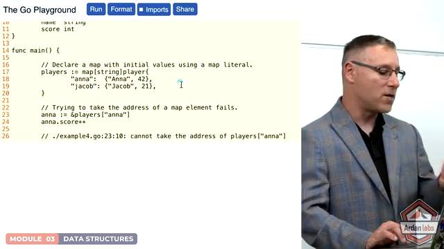
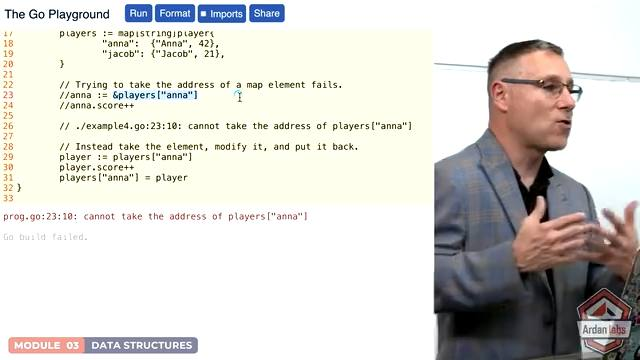
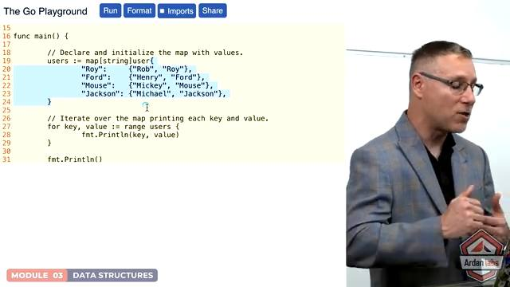

## 1. 这一节做什么

这一节覆盖 P27–P30，主题不是“再学一遍语法”，而是把 Go 里三类最常用的数据行为跑通、看清，并且能解释它们的成本：

1. **P27：map 的完整操作与坑**。包括 `make` 创建 map、插入/读取/替换/删除、读取不存在的 key 为什么返回零值、`v, ok := m[k]` 的布尔形式、map literal、range 顺序随机、排序 key、不能对 map 元素取地址、map 是引用类型但传参仍按值传递。
2. **P28：第 4 课的开场**。这一页基本没有代码，只是引出“把代码与数据变化解耦”的接口主题。课里没有展开接口实现，所以本文不编造接口代码。
3. **P29：三类数据类型的语义指南**。内置类型用值语义；引用类型（slice、map、channel、function、interface）用值语义传递、但读写时是指针语义；struct 要在定义类型时决定用值语义还是指针语义，并保持一致。课里用 `time.Time`、`net.IP`、`net.IPMask` 举例。
4. **P30：方法、方法值、方法表达式与解耦成本**。课里把 `d.displayName()` 解释成 `data.displayName(d)` 的语法糖；把 `f1 := d.displayName` 和 `f2 := d.setAge` 分别画出“复制数据”和“共享数据”的差别；最后落到“解耦的成本永远包含间接调用和分配”。

最终产物是一个可以直接运行的 Go module，包含：

- `p27_maps`：map 基本操作、零值、ok 形式、literal、range、排序、引用类型传参、取地址报错的替代写法；
- `p27_invalid_key`：故意编译失败的 map key 示例；
- `p27_address`：故意编译失败的“对 map 元素取地址”示例；
- `p27_race`：课里只讲了“map 并发不安全”，这里给一个最小示意程序用于观察；
- `p29_semantics`：`time.Time` 与 `net.IP` 的值语义示例；
- `p30_methods`：值接收者/指针接收者、方法值、方法表达式。

> 说明：逐字稿是按视频行号讲解的，下面代码按主题重新组织，行号不会和视频一一对应；类型名、字段名、方法名按逐字稿里出现的 `user`、`player`、`data`、`displayName`、`setAge` 还原。课里没有给完整仓库，本文补的是“能跑起来的最小完整文件”。

---

## 2. 讲师原话（带「—— pNNN [MM:SS]」）

P27 开头先定位 map 在 Go 数据结构里的位置：

> "Go 提供给我们的第三种数据结构是 map，一种键值对类型的数据结构。"
> —— p027 [00:00]

map 的零值不能直接拿来写，这是后面所有示例的前提：

> "如果一个 map 被设为零值，就不能使用它。尝试添加或读取时就会开始出问题。所以 map 必须被创建出来。"
> —— p027 [00:56]

读取不存在的 key 不会失败，而是返回 value 类型的零值；如果要判断 key 是否存在，用第二个布尔返回值：

> "map 会成功返回，并且会给出该值类型的零值……map 读取还有第二种形式，它会接收一个布尔变量。在 Go 中我们通常使用 ok 这个变量。"
> —— p027 [03:20]

map 的 range 顺序是故意的随机：

> "Go 做的一件事，是让遍历 map 的顺序变成随机的……你无法预测 map 中元素出来的顺序。"
> —— p027 [05:45]

不能对 map 里取出来的值直接取地址，因为那个值没有稳定的变量位置：

> "我们试图从 map 中读出值并取它的地址，但由于这个值不会直接被放到内存中，也没有与之关联的变量，编译器就会对你说：嘿，嘿，嘿，嘿，在这里不能取地址，除非先把它存到某个地方。"
> —— p027 [07:42]

map 是引用类型，但传参仍然是值语义；读写时才是指针语义：

> "尽管我们在程序中使用值语义来传递这个 map，但请记住，这里任何形式的读写使用的都是指针语义。"
> —— p027 [10:28]

P28 只是第 4 课开场，明确主题是“解耦”：

> "第四课开始带我们探索如何让代码与变化解耦。这里所说的变化，是数据变化。"
> —— p028 [00:00]

P29 把三类数据类型的语义指南收束起来。内置类型不要随便取地址：

> "如果是数值类型、string 或 bool，我不希望你取这些数据类型的地址。我唯一能接受 int、string 或 bool 类型指针的场景，是 struct 中需要表示空值概念的字段。"
> —— p029 [00:26]

引用类型是“双面”的：移动时值语义，读写时指针语义：

> "第二类类型是引用类型，我们在程序中传递这类数据时也应该使用值语义……问题在于，当你用引用类型进行读写时，你其实处于指针语义模式。"
> —— p029 [01:23]

struct 类型要在定义时决定语义；不确定时讲师建议先用指针语义，并强调绝不能从指针语义退回值语义：

> "如果你不是 100% 确定该使用哪种语义，我们总是使用指针语义，尽管从修改数据的角度看，使用它会更危险一些……"
> —— p029 [07:32]

> "在像这个特定方法这样非常小的范围里，从值语义切换到指针语义是可以的。但从指针语义切换到值语义永远都不可以。"
> —— p029 [12:10]

P30 把“方法”还原成函数调用：

> "方法本质上只是函数调用的语法糖……编译器真正做的事情，就是你在第 42 行和第 43 行看到的内容。"
> —— p030 [03:45]

方法值 `f1 := d.displayName` 不是方法调用，而是把“代码指针 + 接收者数据”绑成一个函数变量；值接收者会复制，指针接收者会共享：

> "我们把已经绑定到 d 值上的方法 displayName 赋给一个新变量 f1。我们并不是在发起方法调用。"
> —— p030 [05:13]

> "无论我们使用哪种数据语义，解耦的代价始终是分配和间接寻址。"
> —— p030 [12:30]

---

## 3. 从零复现

### 3.1 环境与目录

课里没有讲具体 Go 版本，也没有讲 `go mod init`。本文按标准库示例写，不需要第三方依赖。建议使用 Go 1.20 及以上；如果你的环境更旧，请以实际编译结果为准。

```bash
mkdir -p ultimate-go-p27-30
cd ultimate-go-p27-30
go mod init example.com/ultimate-go-p27-30
mkdir -p p27_maps p27_invalid_key p27_address p27_race p29_semantics p30_methods
```

目录结构如下：

```text
ultimate-go-p27-30/
├── go.mod
├── p27_maps/
│   └── main.go
├── p27_invalid_key/
│   └── main.go
├── p27_address/
│   └── main.go
├── p27_race/
│   └── main.go
├── p29_semantics/
│   └── main.go
└── p30_methods/
    └── main.go
```

### 3.2 先跑 map 示例

把第 4 节的 `p27_maps/main.go` 保存好，然后执行：

```bash
go run ./p27_maps
```

你会看到类似输出（map 的打印顺序可能不同，以实际输出为准）：

```text
read mouse: {Mouse Jackson}
after replace: {Mouse Updated}
len after delete: 3
missing anna: 0
anna: 1 true
bob: 0 false
range 1:
...
range 2:
...
sorted keys:
ford Ford
jackson Jackson
mouse Mouse
roy Roy
players after double: map[anna:84 jacob:42]
anna after increment: {Anna 43}
```

这里要观察四件事：

1. `delete(users, "roy")` 连续删两次不会崩，说明删除不存在的 key 是安全的；
2. 读取不存在的 `counts["anna"]` 得到 `0`，并且 `counts["anna"]++` 能直接把它变成 `1`；
3. 两次 `range` 的顺序通常不同，不要写依赖 map 顺序的业务代码；
4. `double(players)` 修改了原 map，因为 map 内部数据是共享的，但函数参数本身仍然是“map 值的副本”。


### 3.3 再跑故意失败的示例

先跑“非法 key”：

```bash
go run ./p27_invalid_key
```

预期编译失败，核心错误是 `invalid map key type users`。原因是 `users` 的底层类型是 slice，slice 不能用于比较，因此不能做 map key。

再跑“对 map 元素取地址”：

```bash
go run ./p27_address
```

预期编译失败，核心错误是 `cannot take address of players["anna"]`。正确写法不是取地址，而是先把值取到局部变量，修改后再写回 map：

```go
p := players["anna"]
p.score++
players["anna"] = p
```



### 3.4 跑数据语义示例

```bash
go run ./p29_semantics
```

观察 `now` 和 `later` 是两个不同的时间值；`ip.Mask(mask)` 返回新的 IP 值，原来的 `ip` 没有被改。课里用这两个例子说明：引用类型底层虽然是 slice，但移动和返回时仍然按值语义处理。


### 3.5 跑方法值示例

```bash
go run ./p30_methods
```

重点看两行：

- `f1 := d.displayName` 之后，即使把 `d.name` 改成 `"Joan"`，`f1()` 仍然输出旧名字 `"Bill"`，因为值接收者方法值绑定的是当时的副本；
- `f2 := d.setAge` 之后，`f2(44)` 能改到原始 `d`，因为指针接收者方法值绑定的是原对象地址。


### 3.6 观察 map 并发不安全（示意）

课里在 P27 末尾明确说 map 在多线程下不安全，运行时可能抓到 data race 并让程序 panic。逐字稿没有给完整并发示例，下面 `p27_race` 是本文补的最小示意，不是讲师原代码：

```bash
go run -race ./p27_race
```

预期会看到 data race 报告，或者直接出现 `fatal error: concurrent map writes`。`-race` 这个命令课里没讲，这里只是帮助你观察。



---

## 4. 完整代码

### 4.1 `go.mod`

```go
module example.com/ultimate-go-p27-30

go 1.20
```

### 4.2 `p27_maps/main.go`

```go
package main

import (
	"fmt"
	"sort"
)

type user struct {
	name    string
	surname string
}

type player struct {
	name  string
	score int
}

func main() {
	basicMap()
	zeroValueAndOK()
	literalAndRange()
	sortKeys()
	referenceType()
	playerAddressWorkaround()
}

func basicMap() {
	// map 的零值不能直接写，必须 make 或使用字面量构造。
	users := make(map[string]user)

	users["roy"] = user{name: "Roy", surname: "Ford"}
	users["ford"] = user{name: "Ford", surname: "Mouse"}
	users["mouse"] = user{name: "Mouse", surname: "Jackson"}
	users["jackson"] = user{name: "Jackson", surname: "Roy"}

	fmt.Println("read mouse:", users["mouse"])

	// 替换同一个 key 的值。
	users["mouse"] = user{name: "Mouse", surname: "Updated"}
	fmt.Println("after replace:", users["mouse"])

	// delete 不存在的 key 是安全的。
	delete(users, "roy")
	delete(users, "roy")
	fmt.Println("len after delete:", len(users))
}

func zeroValueAndOK() {
	counts := make(map[string]int)

	// 读取不存在的 key，返回 value 类型的零值。
	fmt.Println("missing anna:", counts["anna"])

	// 利用零值直接 ++。
	counts["anna"]++

	v, ok := counts["anna"]
	fmt.Println("anna:", v, ok)

	v, ok = counts["bob"]
	fmt.Println("bob:", v, ok)
}

func literalAndRange() {
	users := map[string]user{
		"roy":     user{name: "Roy", surname: "Ford"},
		"ford":    user{name: "Ford", surname: "Mouse"},
		"mouse":   user{name: "Mouse", surname: "Jackson"},
		"jackson": user{name: "Jackson", surname: "Roy"},
	}

	fmt.Println("range 1:")
	for k, v := range users {
		fmt.Println(k, v.name)
	}

	fmt.Println("range 2:")
	for k, v := range users {
		fmt.Println(k, v.name)
	}
}

func sortKeys() {
	users := map[string]user{
		"roy":     user{name: "Roy", surname: "Ford"},
		"ford":    user{name: "Ford", surname: "Mouse"},
		"mouse":   user{name: "Mouse", surname: "Jackson"},
		"jackson": user{name: "Jackson", surname: "Roy"},
	}

	keys := make([]string, 0, len(users))
	for k := range users {
		keys = append(keys, k)
	}

	// map 本身没有顺序，需要排序时先把 key 放进 slice。
	sort.Strings(keys)

	fmt.Println("sorted keys:")
	for _, k := range keys {
		fmt.Println(k, users[k].name)
	}
}

func referenceType() {
	players := map[string]int{
		"anna":  42,
		"jacob": 21,
	}

	double(players)
	fmt.Println("players after double:", players)
}

func double(m map[string]int) {
	// 参数 m 是 map 值的副本，但内部数据共享。
	for k, v := range m {
		m[k] = v * 2
	}
}

func playerAddressWorkaround() {
	players := map[string]player{
		"anna": player{name: "Anna", score: 42},
	}

	// 不能写 &players["anna"]。
	// 正确做法：先复制到局部变量，修改后写回。
	p := players["anna"]
	p.score++
	players["anna"] = p

	fmt.Println("anna after increment:", players["anna"])
}
```

### 4.3 `p27_invalid_key/main.go`（故意编译失败）

```go
package main

type user struct {
	name    string
	surname string
}

// users 的底层类型是 slice，slice 不能比较，所以不能做 map key。
type users []user

func main() {
	m := make(map[users]int)
	_ = m
}
```

### 4.4 `p27_address/main.go`（故意编译失败）

```go
package main

type player struct {
	name  string
	score int
}

func main() {
	players := map[string]player{
		"anna": player{name: "Anna", score: 42},
	}

	// 编译错误：cannot take address of players["anna"]。
	_ = &players["anna"]
}
```

### 4.5 `p27_race/main.go`（课里没有完整并发示例，以下为示意）

```go
package main

import (
	"fmt"
	"sync"
)

func main() {
	m := make(map[int]int)

	var wg sync.WaitGroup
	for i := 0; i < 2; i++ {
		wg.Add(1)

		go func(id int) {
			defer wg.Done()
			for j := 0; j < 1000; j++ {
				m[j] = id
			}
		}(i)
	}

	wg.Wait()
	fmt.Println("len:", len(m))
}
```

### 4.6 `p29_semantics/main.go`

```go
package main

import (
	"fmt"
	"net"
	"time"
)

func main() {
	// time.Time 用值语义：Add 返回新的时间值。
	now := time.Now()
	later := now.Add(5 * time.Minute)

	fmt.Println("now:  ", now)
	fmt.Println("later:", later)

	// net.IP / net.IPMask 底层是 []byte，技术上是引用类型；
	// 但 API 仍然按值语义返回新值。
	ip := net.IP{192, 168, 1, 10}
	mask := net.IPMask{255, 255, 255, 0}

	masked := ip.Mask(mask)

	fmt.Println("ip:     ", ip)
	fmt.Println("masked: ", masked)
	fmt.Println("ip after Mask:", ip)
}
```

### 4.7 `p30_methods/main.go`

```go
package main

import "fmt"

type data struct {
	name string
	age  int
}

// 值接收者：每次调用拿到的是副本。
func (d data) displayName() string {
	return d.name
}

// 指针接收者：调用时共享原对象。
func (d *data) setAge(age int) {
	d.age = age
}

func main() {
	d := data{name: "Bill", age: 42}

	fmt.Println("1:", d.displayName(), d.age)

	d.setAge(43)
	fmt.Println("2:", d.displayName(), d.age)

	// f1 是方法值：不是方法调用，而是把 displayName 和当前 d 的副本绑定。
	f1 := d.displayName
	fmt.Println("3 f1:", f1())

	// 修改原始 d 的 name，不会影响 f1 已绑定的副本。
	d.name = "Joan"
	fmt.Println("4 d:", d.displayName())
	fmt.Println("5 f1 after d.name=Joan:", f1())

	// f2 绑定指针接收者，会操作原始 d。
	f2 := d.setAge
	f2(44)
	fmt.Println("6 after f2(44):", d.displayName(), d.age)

	f2(45)
	fmt.Println("7 after f2(45):", d.displayName(), d.age)

	// 方法表达式：仅用于观察“方法就是函数 + 第一个接收者参数”。
	// 课里说实际业务代码不要这样调用方法。
	f3 := data.displayName
	fmt.Println("8 method expression:", f3(d))

	f4 := (*data).setAge
	f4(&d, 46)
	fmt.Println("9 after f4(&d,46):", d.displayName(), d.age)
}
```

---

## 5. 逐行解释

### 5.1 map 为什么要 `make`

`basicMap` 里第一行是 `users := make(map[string]user)`。逐字稿说得很直接：map 的零值是 `nil`，你不能往 `nil` map 里写，读也会遇到问题。Go 的 slice 可以用 `append` 从 nil 长出来，但 map 没有类似的“自动初始化”写路径，所以必须 `make` 或使用 map literal。

在 JS/Node 里，`const m = {}` 天然可写；Go 的 `var m map[string]int` 只是声明了一个 nil map，写进去会 panic。这是前端转 Go 最容易踩的第一个坑。

### 5.2 读取不存在的 key 为什么是零值

`counts["anna"]` 在 key 不存在时返回 `0`，不是报错。讲师在 P27 用这个例子说明 Go 把零值做成了有用的东西：

```go
counts["anna"]++
```

因为读到 `0`，自增后变 `1`，再写回 map。如果你不想依赖“零值恰好合理”，就要用：

```go
v, ok := counts["bob"]
```

`ok == false` 时，`v` 仍然是零值。注意：`ok` 只表示 key 是否存在，不表示值是否“有效”。

### 5.3 `delete` 为什么可以重复调用

`delete(users, "roy")` 连续两次不会崩。Go 的 `delete` 对不存在的 key 是 no-op。课里明确说“it is safe to delete keys that have already been removed or not there”。所以删除逻辑不需要先判断 `if _, ok := m[k]; ok`，除非你需要在不存在时做别的事。

### 5.4 map literal 与 range 随机

`literalAndRange` 用 map literal 一次性构造。注意：Go 不保证 range 顺序，而且这是**故意**的。讲师在 P27 说 map 的 range 被设计成随机，防止你写出依赖顺序的代码，也避免未来 map 实现变化时把你的程序搞崩。

因此，`sortKeys` 才是正确做法：先把 key 收进 `[]string`，再用 `sort.Strings` 排序，最后按排序后的 key 遍历 map。课里明确提到 `sort` 包可以帮助排序 map 的 key。



### 5.5 为什么不能 `&players["anna"]`

`players["anna"]` 是 map 内部存储的一个“读出来的副本”，它没有稳定的变量地址。Go 编译器直接拒绝 `&players["anna"]`，这是完整性保护：如果允许你拿到内部元素的地址，map 扩容、重排时就可能让指针失效。

正确做法是课里 P27 第 29 到 31 行的思路：

```go
p := players["anna"]
p.score++
players["anna"] = p
```

先复制出来，改副本，再写回。注意这不是“引用修改”，而是“读副本—改副本—写回”。在 JS 里对象通常是引用，`obj.score++` 会直接改原对象；Go 的 map 元素不是这种体验。

### 5.6 map 是引用类型，但传参仍是值语义

`double(m map[string]int)` 收到的是 map 值的副本。map 值本身很小，内部指向 map 的运行时结构；所以函数里 `m[k] = v*2` 会改到原 map 的数据。但如果你在函数里写 `m = make(map[string]int)`，只是让局部变量指向新 map，调用方看不到。

讲师在 P27 末尾强调：map 的“移动”是值语义，“读写”是指针语义。这个双面性在并发里非常关键：多个 goroutine 同时读写同一个 map 不是安全的，必须加锁或改用其他同步结构。课里说运行时会抓到 map 的 data race 并让程序 panic；本文的 `p27_race` 只是让你观察这个结论。

在 JS/Node 里，单线程事件循环不会出现 Go 这种多 goroutine 同时写 map 的 data race；但如果你用 `worker_threads` 共享 `SharedArrayBuffer` 或自己做多进程共享内存，仍然需要同步。概念上对应“共享可变状态必须加锁”。

### 5.7 P29 的三类语义指南

P29 把类型分成三类：

| 类型类别 | 移动方式 | 读写方式 | 课里例子 |
|---|---|---|---|
| 内置类型 | 值语义 | 值语义，隔离修改 | `int`、`string`、`bool` |
| 引用类型 | 值语义，复制 slice/map/channel/function/interface 的值 | 指针语义，共享底层数据 | `[]byte`、`map`、`chan`、`func`、`interface` |
| struct | 定义类型时决定 | 跟随决定 | `time.Time` 用值；`File` 用指针 |

`time.Time` 的例子很典型：`now.Add(5*time.Minute)` 返回新的时间值，不是把 `now` 改掉。讲师说 5 点和 5:05 是两个不同的数据，所以值语义更合理。`net.IP` 和 `net.IPMask` 底层是 `[]byte`，技术上是引用类型，但它们的 `Mask` 方法仍然是值接收者并返回新值，因为 API 必须尊重数据语义。

讲师还给了一个“绝对规则”：可以在很小范围内从值语义转到指针语义（例如 `Unmarshal`、`Decode` 这类需要写入的场景），但**永远不要从指针语义退回值语义**。一旦一个值是指针共享的，你不能假设复制它是安全的。在 JS 里可以类比：一个对象被多处引用时，不要随便深拷贝后假装它是同一个状态；共享状态就要明确共享边界。


### 5.8 P30 方法值：`f1` 为什么看不到 `d.name` 的变化

`f1 := d.displayName` 不是调用，而是“方法值”。它把两样东西绑在一起：

1. `displayName` 的代码地址；
2. 当前 `d` 的副本（因为 `displayName` 是值接收者）。

所以后面 `d.name = "Joan"` 只改了原始 `d`，`f1` 里保存的副本仍然是 `Bill`。这正好对应讲师在 P30 画的“两字结构”：第一字指向代码，第二字指向数据副本。

`f2 := d.setAge` 不同：`setAge` 是指针接收者，方法值绑定的是 `&d`，所以 `f2(44)` 改的是原始 `d`。这就是“值语义复制 / 指针语义共享”在方法值上的直接体现。

`f3 := data.displayName` 是方法表达式，类型是 `func(data) string`；`f4 := (*data).setAge` 类型是 `func(*data, int)`。课里展示它只是为了说明“方法就是函数，接收者是第一个参数”，并明确说实际业务代码不要这样调用。

### 5.9 解耦的成本：间接 + 分配

P30 最后把成本说透：方法值、接口、函数变量都会引入间接调用；如果值接收者需要在运行时复制，还可能把值逃逸到堆上。讲师说“解耦的成本永远是 allocation 和 indirection，不管用什么数据语义”。这不是说不要解耦，而是说你要知道成本在哪里，团队要接受这个成本。

在 JS/Node 里，闭包和 `bind` 也会产生额外对象和间接调用；V8 会做优化，但语义上仍然是“绑定 + 调用”。Go 这里更显式：`f1` 是一个函数变量，调用时要通过它间接找到代码和数据。


---

## 6. 复现检查清单

按顺序打勾：

- [ ] 已创建 `ultimate-go-p27-30` 目录，并执行 `go mod init example.com/ultimate-go-p27-30`。
- [ ] `go run ./p27_maps` 能跑通，输出里能看到 `missing anna: 0`、`anna: 1 true`、`bob: 0 false`。
- [ ] `go run ./p27_maps` 的两次 `range` 顺序通常不同；如果没有不同，多跑几次，不要写依赖顺序的代码。
- [ ] `sorted keys` 输出按字母顺序排列，证明 `sort.Strings(keys)` 生效。
- [ ] `players after double` 里 `anna` 变成 `84`、`jacob` 变成 `42`，说明 map 传参后函数内修改影响原 map。
- [ ] `anna after increment` 输出 `{Anna 43}`，说明“取值—改副本—写回”的替代写法正确。
- [ ] `go run ./p27_invalid_key` 预期编译失败，错误包含 `invalid map key type users`。
- [ ] `go run ./p27_address` 预期编译失败，错误包含 `cannot take address of players["anna"]`。
- [ ] `go run ./p29_semantics` 能跑通，`now` 与 `later` 不同，`ip after Mask` 与 `ip` 相同。
- [ ] `go run ./p30_methods` 能跑通，`f1 after d.name=Joan` 仍输出 `Bill`，`after f2(44)` 的 age 变成 `44`。
- [ ] `go run -race ./p27_race` 能观察到 data race 或 `concurrent map writes`（该命令课里没讲，仅用于验证结论）。
- [ ] 所有代码只依赖标准库，没有第三方依赖。

---

## 7. 课里没讲但你会撞上的

1. **Go 版本和 `go.mod`**  
   课里没有讲 `go mod init`，也没有给 `go.mod` 内容。本文用 `go 1.20` 是为了兼容性；如果你的环境是 1.21/1.22，`go mod tidy` 可能会改写版本行，以实际为准。

2. **`go run -race` 不是讲师在本段提的命令**  
   P27 只讲了“map 并发不安全，运行时可能抓到 data race 并 panic”。`-race` 是 Go 工具链的 race detector，本文用它来观察结论，但不是课程原话。

3. **`fatal error: concurrent map writes` 通常不可 recover**  
   课里说运行时会 catch 并 panic 程序。实际你会看到 `fatal error`，它和普通 `panic` 不完全一样，通常不能靠 `recover` 兜住。生产代码应该在设计上避免共享 map 无锁写，而不是指望 recover。

4. **这四页逐字稿没有 benchmark 代码**  
   课程标题含“benchmark”，但 P27–P30 的逐字稿里没有出现 `testing.B`、`go test -bench` 或基准测试文件。本文不编造 benchmark 章节。如果你要补 benchmark，需要另找课程后面的页。

5. **`sort.Strings` 只适合字符串 key**  
   课里用 `sort` 包排序字符串 key。如果 key 是 int 或自定义类型，需要对应的排序函数或 `sort.Slice`；课里没展开。

6. **`net.IP` / `net.IPMask` 的 API 细节**  
   课里只讲了它们的语义（底层 slice、值语义 API），没有逐行讲 `Mask` 的实现。本文示例只调用 `ip.Mask(mask)` 和打印，不涉及更深的网络编程。

7. **方法表达式不要用在业务代码里**  
   课里展示 `data.displayName(d)` 和 `(*data).setAge(&d, 46)` 是为了解释“方法就是函数”。实际代码仍应写 `d.displayName()`、`d.setAge(46)`。

8. **nil map 与空 map 的区别**  
   `var m map[string]int` 是 nil map，读不存在的 key 返回零值，但写入会 panic；`make(map[string]int)` 是可写空 map。课里强调“map 必须 make”，但没有展开 nil map 的读写差异，这个坑你一定会遇到。

9. **在 JS/Node 里的对应关系**  
   Go 的 map 像 JS 的 `Map`/普通对象，但 Go 的 map 元素不是稳定引用；Go 的值接收者方法值像“绑定当时副本”，指针接收者方法值像“绑定原对象”。并发部分，Node 单线程事件循环不会出现 goroutine 同时写 map 的 race，但多线程/共享内存场景仍需同步。