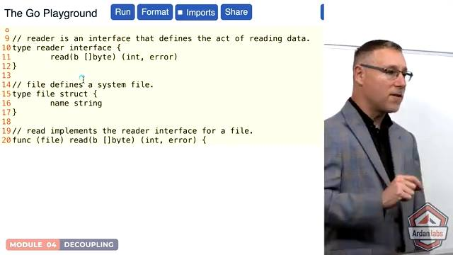
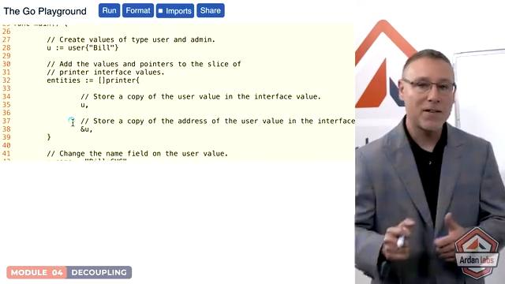

# Ultimate Go 并发与接口机制：接口、方法集与多态（P031–P033）

> 课程：Ultimate Go Language（BV1XXcozTE1y），覆盖 P031–P033
> 读者定位：前端转 AI 应用工程师。文中涉及「值语义 / 指针语义」时，会补一句在 JS/Node 里对应什么。

---

## 1. 这一节做什么

这三节把 Go 里「接口（interface）」这件事从**编程模型**到**编译器实现**再到**方法集规则**完整走了一遍，最终落到一个可运行的小项目：用接口做多态、用接口切片装不同具体类型、并亲眼看到「值语义 vs 指针语义」如何决定程序输出。

具体要做出三样东西：

1. **一个 `reader` 接口 + 两个具体类型（`file`、`pipe`）**，写一个多态函数 `retrieve`，让它根据传入的具体数据执行不同的 `read` 实现（P031）。
2. **一个 `notifier` 接口 + 一个 `user` 类型**，故意用指针语义实现接口，然后**故意用值去调用**，亲眼看到编译错误，再改成传地址让它通过（P032）。
3. **一个 `printer` 接口 + 一个接口切片**，切片里同时放「值」和「指针」，修改原值后遍历打印，观察谁看到了修改、谁没看到（P033）。

跑完这三段，你会得到一条能背下来的判断链：**先定语义 → 再定方法集 → 再决定能不能塞进接口**。

---

## 2. 讲师原话（带出处）

关于多态的定义，讲师引用了 BASIC 发明者 Tom Kurtz 的说法：

> "多态意味着你编写一个程序，它会根据所操作的数据不同而表现出不同的行为。"
> —— p031 [00:54]

关于接口是「无值类型」：

> "接口类型不是具体类型。它们不定义任何数据。它们只定义一组行为方法……接口本身没有值。"
> —— p031 [02:21]

关于为什么 `read([]byte) (int, error)` 这种签名比「传长度返回切片」更好：

> "每次执行到第 13 行时，都必然会在堆上发生一次内存分配。这一点无法避免。"
> —— p031 [04:43]

关于接口值的内部结构（两字长）：

> "接口值是一个由两个机器字组成的数据结构，两个字都是指针；第一个字指向一张特殊的表，我们称之为 I table，也就是接口表。"
> —— p031 [14:31]

关于方法集规则（P032 的核心）：

> "如果你处理的值是某个类型的值……那么只有用值接收者实现的那些方法才会附着到该值上。"
> —— p032 [04:16]

关于编译器为什么拒绝「值调用指针方法」：

> "编译器之所以把类型 t 的值的这些指针方法排除在外，是因为它真的很爱你。它说这是在努力避免你遇到严重的完整性问题。"
> —— p032 [06:13]

关于接口切片遍历用哪种 for range：

> "entities 是什么？它是一个集合。它是什么的集合？printer 的集合。printer 是什么？它是一个接口。接口是什么？它是一种引用类型。哦，我们对引用类型使用的是值语义。"
> —— p033 [03:15]

---

## 3. 从零复现

### 3.1 环境准备

课里没讲具体 Go 版本，只提到「这门语言到 2019 年 11 月满十年」。为保证接口与方法集行为一致，用任意 Go 1.18+ 均可（本文用 1.21 验证）。**课里没讲 `go mod` 的具体初始化命令**，下面给出的是标准做法：

```bash
mkdir -p ~/ultimate-go/interface-demo
cd ~/ultimate-go/interface-demo
go mod init interface-demo
go version   # 确认 >= 1.18
```

目录结构（三个独立可运行程序，分别对应三节课）：

```
interface-demo/
├── go.mod
├── p031_reader/
│   └── main.go
├── p032_notifier/
│   └── main.go
└── p033_printer/
    └── main.go
```

> 说明：课里是把三段代码放在同一块白板/编辑器里逐段讲的，没有给出目录结构。上面按「一节一个可运行 main 包」拆分，是为了你能分别 `go run` 验证，互不干扰。

### 3.2 第一步：跑通 P031 的 reader 多态

1. 新建 `p031_reader/main.go`，粘贴第 4 节的第一段完整代码。
2. 运行：

```bash
cd p031_reader
go run main.go
```

3. 预期看到两行输出，分别来自 `file` 的 `read` 和 `pipe` 的 `read`（具体文案见代码里的 `fmt.Printf`）。这就是「同一行 `r.read(...)` 因具体数据不同而行为不同」。

### 3.3 第二步：复现 P032 的编译错误，再修好

1. 新建 `p032_notifier/main.go`，先粘贴**「错误版」**代码（第 4 节第二段，`sendNotification(u)` 传值）。
2. 运行 `go run main.go`，你会得到类似下面的编译错误（**具体错误文案以你本地 Go 版本实际输出为准**，课里只演示了「编译器拒绝」这一现象，没有逐字念错误串）：

```
./main.go:36:18: cannot use u (variable of type user) as notifier value in argument to sendNotification: user does not implement notifier (method notify has pointer receiver)
```

3. 把调用改成 `sendNotification(&u)`，再 `go run main.go`，编译通过并打印通知内容。
4. 这一步的目的不是「修 bug」，而是让你**亲手撞一次方法集规则**，记住「指针语义实现接口 → 只能传地址」。

### 3.4 第三步：跑通 P033 的接口切片

1. 新建 `p033_printer/main.go`，粘贴第 4 节第三段完整代码。
2. 运行：

```bash
cd p033_printer
go run main.go
```

3. 观察输出：切片 index 0 存的是**值拷贝**，index 1 存的是**指针**。修改原变量 `u.name = "bill changed"` 后遍历，只有 index 1 打印出 `bill changed`，index 0 仍是旧值。这就是「谁看到了修改」。

### 3.5 关键截图对照

下面几张是复现时最该对照的帧（终端/编辑器/白板关键页），按出现顺序插入到对应步骤旁。

P031 开头，讲师给出 `reader` 接口与 `file` 具体类型的对照：



P031 讲「接口值两字长、第一字指向 iTable」的白板图：


P032 讲师列出方法集规则（值接收者 vs 指针接收者）：


P032 编译器拒绝「值调用指针方法」的那一屏：


P033 接口切片同时装值与指针的白板：



P033 遍历切片、讨论 for range 用哪种语义：


---

## 4. 完整代码

> 三段都是**完整可保存运行**的 `main.go`。课里代码是白板/编辑器片段，变量名与行号以讲师口述为准；下面按口述还原成可编译文件，函数体里课里没展开的打印细节用 `fmt.Printf` 补全（已标注）。

### 4.1 `p031_reader/main.go`

```go
package main

import "fmt"

// reader 是一个接口类型（type interface，不是 type struct）。
// 它只定义方法集，不定义任何数据 —— 接口是无值类型（valueless）。
type reader interface {
	// read 接收一个 []byte，返回读到的字节数和错误。
	// 讲师强调：这个签名比「传长度返回切片」更好，因为后者每次调用都会在堆上分配。
	read(p []byte) (int, error)
}

// file 是具体类型（struct），代表文件系统里的一个文件。
type file struct {
	name string
}

// file 用值语义实现 reader 接口：方法名与签名和接口完全一致。
func (f file) read(p []byte) (int, error) {
	// 课里没展开具体读文件逻辑，这里用打印模拟「file 的 read 被调用」。
	msg := "file.read: " + f.name
	n := copy(p, msg)
	return n, nil
}

// pipe 是第二个具体类型，代表某种流（网络/管道等）。
type pipe struct {
	name string
}

// pipe 同样用值语义实现 reader 接口。
func (p pipe) read(b []byte) (int, error) {
	msg := "pipe.read: " + p.name
	n := copy(b, msg)
	return n, nil
}

// retrieve 是多态函数。
// 签名写的是「接收 reader」，但 reader 无值，所以它真正要的是：
// 任何实现了 read 方法集的「具体数据」（值或指针）。
func retrieve(r reader) error {
	buf := make([]byte, 64)
	n, err := r.read(buf) // 这一行会因传入的具体数据不同而执行不同实现
	if err != nil {
		return err
	}
	fmt.Printf("retrieve got %d bytes: %s\n", n, string(buf[:n]))
	return nil
}

func main() {
	// 构造两个具体值
	f := file{name: "notes.txt"}
	p := pipe{name: "stdin-stream"}

	// 值语义：传入的是 f 的副本
	if err := retrieve(f); err != nil {
		fmt.Println("err:", err)
	}
	// 值语义：传入的是 p 的副本
	if err := retrieve(p); err != nil {
		fmt.Println("err:", err)
	}
}
```

### 4.2 `p032_notifier/main.go`（含错误版与修正版说明）

```go
package main

import "fmt"

// notifier 接口，只有一个行为 notify，无入参无返回值。
type notifier interface {
	notify()
}

// user 是具体类型。
type user struct {
	name  string
	email string
}

// 注意：这里用的是【指针接收者】(u *user)，即指针语义实现接口。
func (u *user) notify() {
	fmt.Printf("Sending user email to %s<%s>\n", u.name, u.email)
}

// sendNotification 是多态函数，接收任何实现了 notify 的具体数据。
func sendNotification(n notifier) {
	n.notify()
}

func main() {
	u := user{name: "Bill", email: "bill@ardanlabs.com"}

	// ❌ 错误版：传值会编译失败
	// sendNotification(u)
	// 报错大意：user does not implement notifier (method notify has pointer receiver)
	// 具体错误文案以你本地 Go 版本实际输出为准。

	// ✅ 修正版：传地址，符合指针语义
	sendNotification(&u)
}
```

> 想亲手复现编译错误：把 `sendNotification(&u)` 注释掉，取消 `sendNotification(u)` 的注释，`go run` 即可。

### 4.3 `p033_printer/main.go`

```go
package main

import "fmt"

// printer 接口，只有一个行为 print。
type printer interface {
	print()
}

// user 用【值语义】实现 printer 接口。
// 值语义实现意味着：接口里既能存 user 值，也能存 *user 地址。
type user struct {
	name string
}

func (u user) print() {
	fmt.Println("User Name:", u.name)
}

func main() {
	// 构造一个具体 user 值
	u := user{name: "bill"}

	// 构造一个「接口切片」：不是基于数据是什么，而是基于数据能做什么。
	// index 0 存值（值语义，拷贝）；index 1 存地址（指针语义，共享）。
	entities := []printer{
		u,    // 存的是 u 的副本
		&u,   // 存的是 u 的地址
	}

	// 修改原变量
	u.name = "bill changed"

	// 用值语义形式的 for range 遍历（接口是引用类型，用值语义遍历）。
	for _, e := range entities {
		e.print()
	}
}
```

预期输出（顺序固定）：

```
User Name: bill
User Name: bill changed
```

index 0 是拷贝，看不到修改；index 1 是指针，看到修改。

---

## 5. 逐行解释

### 5.1 P031：为什么 `read([]byte) (int, error)` 是「好 API」

- `type reader interface { ... }`：`type` 后面跟的是 `interface` 而不是 `struct`，所以 `reader` **不是具体类型**。讲师反复强调：你可以写 `var r reader`，但 `r` 本身「不存在」——它没有数据，不能读写，只是编译器层面的一个「方法集契约」。在 JS 里你可以类比成 TypeScript 的 `interface`：只描述形状，不产生运行时对象。
- `read(p []byte) (int, error)`：调用方**自己准备缓冲区**传进来，被调用方往里填，返回填了多少字节。讲师对比了另一种设计「传长度、返回切片」，指出后者每次调用都要在堆上分配：因为切片底层数组长度依赖运行时变量 `n`，编译器编译期不知道大小，只能堆分配；即使你改成固定长度 4000，返回切片时指针逃逸，仍然要分配。而 `read([]byte)` 让调用方复用缓冲区，**在紧循环里对 GC 友好**。这是「API 设计要考虑对调用方程序的影响」的典型例子。
- `func (f file) read(...)`：接收者是**值接收者** `f file`，即值语义。方法名和签名与接口完全一致，Go 编译器通过静态分析自动认定「`file` 实现了 `reader`」，**不需要任何 `implements` 声明**。讲师把这叫 convention over configuration。
- `func retrieve(r reader) error`：参数类型是接口。因为接口无值，这个函数真正接受的是「任何实现了 `read` 的具体数据（值或指针）」。这就是**按行为而非按类型解耦**。
- `r.read(buf)`：这一行是**多态的落点**。传 `file` 就调 `file.read`，传 `pipe` 就调 `pipe.read`。讲师用 iTable 解释机制：接口值是两个机器字，第一字指向 iTable（记录「存的是什么类型 + 该类型 read 实现的地址」），第二字指向堆上的数据副本。**日常写代码不需要关心 iTable**，讲师明确说「moving forward, I don't care about iTables」。

> JS/Node 对照：Go 的接口是**隐式实现 + 静态检查**；TS 的 `interface` 也是结构化类型，但 TS 编译后接口消失，运行时没有 iTable 这层分发，多态靠原型链/属性查找。Go 的接口值在运行时是真实存在的两字结构。

### 5.2 P032：方法集规则为什么「是爱」

- `func (u *user) notify()`：**指针接收者**。按 spec 的方法集规则：
  - 类型 `T` 的值，方法集只包含**值接收者**方法；
  - 类型 `*T` 的地址，方法集包含**值接收者 + 指针接收者**方法。
- 所以 `user` 值的方法集里**没有** `notify`（因为它是指针接收者方法），`user` 值不满足 `notifier`。`sendNotification(u)` 编译失败；`sendNotification(&u)` 通过。
- 讲师给了两个「完整性」理由：
  1. **次要理由**：不是每个值都有地址。比如常量 `42` 转成 `duration` 后仍是常量，只存在于编译期，不在栈也不在堆，**不可取地址**。如果编译器允许「值调用指针方法」，就得假设 100% 的值可取地址，这做不到。
  2. **主要理由**：一旦你选了指针语义，就意味着**共享**，不允许再对指针指向的数据做拷贝。如果允许「值调用指针方法」，等于在指针语义模式下偷偷制造副本，破坏数据语义的一致性。编译器拒绝，是在保护你不犯这个大错。
- 结论口诀：**指针语义实现接口 → 只能传地址（共享）；值语义实现接口 → 值和地址都能塞（拷贝或共享）**。

> JS/Node 对照：JS 没有「值/指针接收者」这套编译期规则，对象永远是引用传递，原始值永远拷贝。Go 把「共享还是拷贝」提升到了类型系统层面，编译器替你把关。Java 里类似的概念是「方法属于类还是实例」，但 Java 没有方法集规则，知道即可。

### 5.3 P033：接口切片里谁看到了修改

- `entities := []printer{u, &u}`：切片元素类型是**接口** `printer`，不是 `user`。所以这个集合是「按行为收集」的：任何实现了 `print` 的值或指针都能放进来。
- index 0 放 `u`（值）：接口第二字指向**堆上的 u 副本**。之后 `u.name = "bill changed"` 改的是原变量，副本不变。
- index 1 放 `&u`（地址）：接口第二字存的是 `&u`，指向原变量。原变量一改，通过指针读到的就是新值。
- `for _, e := range entities`：讲师带着走了一遍判断链——`entities` 是集合，元素是 `printer`，`printer` 是接口，**接口是引用类型，引用类型用值语义遍历**。所以这里用 `_, e`（值形式），每次 `e` 是接口值本身的拷贝（但拷贝的仍是指向同一份数据的指针/副本指针），行为正确。
- `e.print()`：对 index 0 调 `user.print`（值接收者，读副本），对 index 1 调 `(*user).print`（编译器自动解引用，读原变量）。

> 注意：`user` 这里用的是**值接收者**实现 `printer`，所以 `u` 和 `&u` 都能塞进接口。如果改成指针接收者，`u` 就塞不进去了——正好呼应 P032。

---

## 6. 复现检查清单

跑完对照打勾：

- [ ] `go mod init interface-demo` 成功，`go version` >= 1.18
- [ ] `p031_reader` 能 `go run`，输出两行，分别含 `file.read` 和 `pipe.read`
- [ ] 把 `retrieve(f)` 改成传 `&f` 仍能编译（因为 `file` 是值接收者，值和指针都满足接口）
- [ ] `p032_notifier` 错误版 `sendNotification(u)` **编译失败**，错误信息含 `does not implement` 与 `pointer receiver`（文案以本地为准）
- [ ] 改成 `sendNotification(&u)` 后编译通过并打印邮箱
- [ ] `p033_printer` 输出顺序为 `bill` 然后 `bill changed`
- [ ] 把 `p033` 里 `user.print` 改成指针接收者 `func (u *user) print()`，观察 `entities := []printer{u, &u}` 中 `u` 那一项**编译失败**——亲手验证方法集规则
- [ ] 对照第 3.5 节 6 张截图，确认自己看到的代码结构与讲师白板一致

---

## 7. 课里没讲但你会撞上的

1. **`go.mod` 与模块路径**：课里全程在白板/单文件层面讲，没提模块初始化。你本地必须 `go mod init`，否则 `go run` 在模块模式下会报错。
2. **错误信息的具体文案**：讲师只演示了「编译器拒绝」这一现象，没有逐字念错误串。不同 Go 版本措辞略有差异，**以你本地实际输出为准**，不要照抄本文的示例串去 grep。
3. **`read` 的真实实现**：课里 `file.read` / `pipe.read` 只讲了签名和方法集，没展开真实文件 IO 或网络流。本文用 `copy` + `fmt.Printf` 模拟，属于「课里没讲、为可运行而补」的部分。
4. **`fmt` 输出格式**：课里没规定打印文案，本文的 `Sending user email to...` 是常见示例写法，非讲师原话。
5. **逃逸分析与 `go build -gcflags=-m`**：讲师口头讲了「堆分配」「逃逸」，但**没演示具体命令**。如果你想亲眼验证 P031 里「返回切片导致逃逸」，可以自己跑 `go build -gcflags="-m" ./...`，这属于课后延伸，课里没讲。
6. **benchmark**：本课程标题含 benchmark，但 P031–P033 这三节**没有出现 benchmark 代码**（逐字稿里没有 `testing.B`、`go test -bench` 等内容）。如果你是为 benchmark 来的，这三节不覆盖，需看后续 P。
7. **并发**：同样，这三节讲的是接口与方法集，**没有 goroutine / channel / mutex**。标题里的「并发」不在这三节范围内。
8. **JS/Node 心智迁移的坑**：Go 接口是编译期静态检查，TS 接口编译后消失；Go 的「指针语义 = 只能共享」在 JS 里没有对应约束，迁移时最容易在「什么时候该传 `&`」上犯错——记住口诀：**定义类型后立刻定语义，语义定了方法集就定了，方法集定了能不能进接口就定了**。