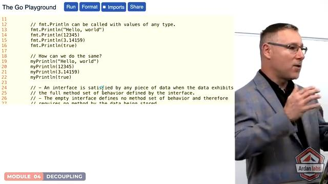
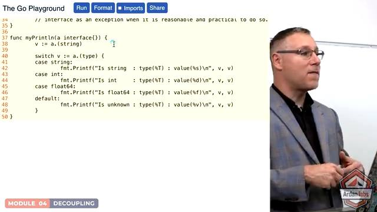
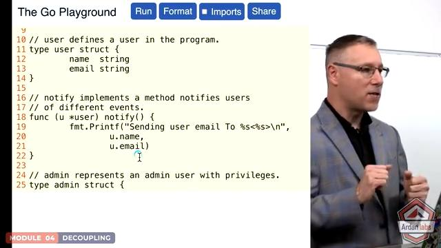
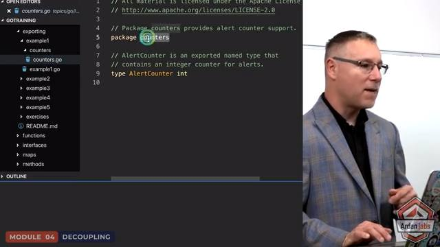
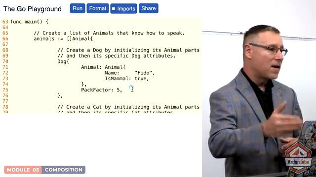

# Ultimate Go Language（P34–P38）复现文档：空接口、类型断言、嵌入、包导出与按行为组合

> **范围说明**：本文覆盖 P34–P38。P34 讲空接口与类型断言；P35 讲嵌入与内层类型提升；P36 讲包级导出/未导出；P37 是 composition 章节的极短开场；P38 用 animal/dog/cat 的例子讲“按行为组合，而不是按类型分组”。  
> **重要说明**：课程标题虽然含“并发+benchmark”，但 P34–P38 的逐字稿里**没有讲 goroutine、channel、锁、事务、benchmark**。本文不补造这些内容。  
> **代码说明**：逐字稿展示的是讲师编辑器画面和行号描述，并没有逐字给出完整源码。下面的代码是**依据逐字稿描述重建的可运行示例**，用于复现讲师讲的行为；不是讲师原始仓库的逐字复制。课程未指定 Go 版本，示例只使用标准库和基础语法，无第三方依赖。现代环境用 module 复现；讲师提到的 GOPATH/vendor 物理路径属于当时语境，本文在“课里没讲但你会撞上”里说明。

---

## 1. 这一节做什么

这一节要做出四个可运行的小项目，分别对应 P34–P38 的语言机制：

1. **空接口 + 类型断言**：写一个 `MyPrintLine`，接收 `interface{}`，在运行时判断具体类型，并区分“显式断言会 panic”和“带 ok 的安全断言”，最后用 `switch data.(type)` 统一处理。
2. **嵌入与内层类型提升**：让 `admin` 嵌入 `user`，验证 `admin` 可以直接调用内层 `user` 的方法；再引入 `Notifier` 接口，验证内层实现会“提升”到外层；最后让 `admin` 自己实现 `Notify`，验证外层实现会覆盖提升。
3. **包导出规则**：用 `counters` 包验证首字母大写导出、小写不导出；用工厂函数返回未导出类型；用 `users.Manager` 嵌入未导出 `user`，验证“构造时不能直接访问，构造后可通过提升字段访问”。
4. **按行为组合**：先用 bad 示例复现“把 dog/cat 塞进 `[]Animal` 编译失败”的思维误区；再用 `Speaker` 接口把 dog/cat 按“会 speak”分组，而不是按“是 animal”分组。

最终目录结构如下：

```text
ultimate-go-p34-p38/
├── go.mod
├── 01_empty_interface/
│   └── main.go
├── 02_embedding/
│   └── main.go
├── 03_exporting/
│   ├── example1/
│   │   ├── main.go
│   │   └── counters/
│   │       └── counters.go
│   ├── example2/
│   │   ├── main.go
│   │   └── counters/
│   │       └── counters.go
│   ├── users/
│   │   └── users.go
│   └── users_demo/
│       └── main.go
└── 04_grouping/
    ├── bad/
    │   └── main.go
    └── good/
        └── main.go
```

环境准备：

```bash
mkdir ultimate-go-p34-p38
cd ultimate-go-p34-p38
go mod init example.com/ultimatego
```

运行命令：

```bash
go run ./01_empty_interface
go run ./02_embedding
go run ./03_exporting/example1
go run ./03_exporting/example2
go run ./03_exporting/users_demo
go run ./04_grouping/good
go build ./...
```

`04_grouping/bad` 是**故意不能编译的反面示例**，文件里带 `//go:build ignore`，不参与 `go build ./...`，只用于阅读和对照。



---

## 2. 讲师原话（带「—— pNNN [MM:SS]」）

P34 讲空接口时，讲师说：

> "我们通过利用空接口来实现这一点。"
> —— p034 [01:19]

这句话对应本文的 `MyPrintLine(data interface{})`：函数不关心传入的是 string、int、float64 还是 bool，先用空接口把具体数据接进来，再在运行时判断。

> "所以我们可以像这样进行类型断言，并写得非常、非常明确。A 是 string 吗？如果是，那么 V 就会是那份数据的一个副本……"
> —— p034 [02:45]

讲师明确提醒：显式断言 `v := data.(string)` 在类型不匹配时会 panic；所以又讲了带 `ok` 的第二形式。

> "我们可以使用第二种形式，也就是布尔标志。"
> —— p034 [03:14]

这就是本文 `stringOnly` 里的 `v, ok := data.(string)`。

> "Go 在 switch 上有一种特殊机制……让我们对关键字 type 做类型断言。"
> —— p034 [03:43]

对应 `switch v := data.(type)`。本文的 `MyPrintLine` 就是围绕这个机制写的。



P35 讲嵌入时，讲师说：

> "接下来我们要做的是，把 person 字段从 admin 类型中抽出来，只保留 user 类型。这就是嵌入。"
> —— p035 [02:25]

本文的 `admin` 里不再写 `person user`，而是直接嵌入 `user`。

> "但这里至关重要的是，嵌入并不会建立子类型关系。"
> —— p035 [03:22]

这句话非常关键：`admin` 嵌入 `user` 不等于 `admin` 是 `user`，所以不能把 `admin` 当成 `user` 塞进 `[]user`。它只在“字段和方法提升”这个层面起作用。

> "但现在外层类型 admin 实现了 Notifier 接口，因此会覆盖这一提升。"
> —— p035 [07:05]

本文的 `admin.Notify()` 覆盖了内层 `user.Notify()`；但 `a.user.Notify()` 仍可直接访问内层实现。



P36 讲导出时，讲师说：

> "如果被命名的对象以大写字母开头，那么它就会从包中导出。"
> —— p036 [02:39]

本文的 `AlertCounter` 大写导出，`alertCounter` 小写不导出。

> "这些部分构造的思路总是会导致缺陷。"
> —— p036 [08:23]

讲师用 `users.Manager` 嵌入未导出 `user` 举例：构造时不能直接碰 `name`/`ID`，但构造后因为提升可以访问。本文保留这个“能跑但设计上值得警惕”的示例。


P38 讲组合时，讲师说：

> "所以我们要做的是添加 speaker 接口，其中只有一个主动行为：speak。"
> —— p038 [08:55]

本文的 `Speaker` 接口只有一个 `Speak()` 行为。

> "而在我看来，animal 这个类型是错误的抽象。"
> —— p038 [09:23]

所以 good 示例删掉 `Animal` 基类，让 `Dog`、`Cat` 各自拥有自己的字段，并通过 `Speak()` 被组合。

> "因此现在我们可以把狗和猫归到一起，不是按它们是什么，而是按它们做什么。"
> —— p038 [10:46]（原文如此，指 dogs and cats）

这就是 `[]Speaker{Dog{...}, Cat{...}}` 的依据。


---

## 3. 从零复现

### 3.1 初始化 module

```bash
mkdir ultimate-go-p34-p38
cd ultimate-go-p34-p38
go mod init example.com/ultimatego
```

`go.mod` 内容如下：

```go
module example.com/ultimatego

go 1.20
```

这里的 module 路径只是本地示例。因为后面 `03_exporting/example1/main.go` 要 import `example.com/ultimatego/03_exporting/example1/counters`，所以 module 名要和 import 前缀一致。

### 3.2 创建目录

```bash
mkdir -p 01_empty_interface
mkdir -p 02_embedding
mkdir -p 03_exporting/example1/counters
mkdir -p 03_exporting/example2/counters
mkdir -p 03_exporting/users
mkdir -p 03_exporting/users_demo
mkdir -p 04_grouping/bad
mkdir -p 04_grouping/good
```

### 3.3 按顺序写入完整代码

把第 4 节的所有文件原样保存。注意：

- `04_grouping/bad/main.go` 第一行必须是 `//go:build ignore`，后面空一行，再写 `package main`。它只用于对照，不参与构建。
- `03_exporting/example2` 是“工厂函数返回未导出类型”的反面示例，但代码本身可以编译运行。
- `03_exporting/users_demo` 演示“构造时不能设置未导出嵌入字段，构造后可以通过提升字段访问”。

### 3.4 运行并观察输出

```bash
go run ./01_empty_interface
```

预期输出：

```text
fmt.Println: hello
string: hello (type=string)
fmt.Println: 42
int: 42 (type=int)
fmt.Println: 3.14
float64: 3.14 (type=float64)
fmt.Println: true
bool: true (type=bool)
fmt.Println: {Bill}
unknown: {Bill} (type=struct { Name string })
stringOnly: 42 不是 string，ok=false，s 是空字符串
```

```bash
go run ./02_embedding
```

预期输出：

```text
user.Notify: Bill <bill@example.com>
admin.Notify: Bill level=super
admin.Notify: Bill level=super
user.Notify: Joan <joan@example.com>
```

这里第三个输出说明 `sendNotification(&a)` 调用的是 `admin` 自己覆盖后的 `Notify`；第四个输出说明 `moderator` 没有覆盖，`&m` 通过内层 `user` 的 `Notify` 提升了接口实现。

```bash
go run ./03_exporting/example1
```

预期输出：

```text
counter=10 type=counters.AlertCounter
```

```bash
go run ./03_exporting/example2
```

预期输出：

```text
c=10 type=counters.alertCounter
```

这个输出能跑，但讲师的评价是：这种“工厂函数返回未导出类型”的封装方式并不好，代码审查会停。

```bash
go run ./03_exporting/users_demo
```

预期输出：

```text
title=boss name=Alice id=7
```

```bash
go run ./04_grouping/good
```

预期输出：

```text
Woof
Meow
```

最后编译所有非忽略文件：

```bash
go build ./...
```

如果没有任何输出，说明编译通过。



---

## 4. 完整代码

### 4.1 `go.mod`

```go
module example.com/ultimatego

go 1.20
```

### 4.2 `01_empty_interface/main.go`

```go
package main

import "fmt"

func MyPrintLine(data interface{}) {
	switch v := data.(type) {
	case string:
		fmt.Printf("string: %s (type=%T)\n", v, v)
	case int:
		fmt.Printf("int: %d (type=%T)\n", v, v)
	case float64:
		fmt.Printf("float64: %.2f (type=%T)\n", v, v)
	case bool:
		fmt.Printf("bool: %t (type=%T)\n", v, v)
	default:
		fmt.Printf("unknown: %v (type=%T)\n", v, v)
	}
}

func stringOnly(data interface{}) (string, bool) {
	v, ok := data.(string)
	return v, ok
}

func mustString(data interface{}) string {
	return data.(string)
}

func main() {
	values := []interface{}{"hello", 42, 3.14, true, struct{ Name string }{Name: "Bill"}}

	for _, v := range values {
		fmt.Print("fmt.Println: ")
		fmt.Println(v)
		MyPrintLine(v)
	}

	if s, ok := stringOnly(42); ok {
		fmt.Println("stringOnly:", s)
	} else {
		fmt.Println("stringOnly: 42 不是 string，ok=false，s 是空字符串")
	}

	_ = mustString
}
```

### 4.3 `02_embedding/main.go`

```go
package main

import "fmt"

type Notifier interface {
	Notify()
}

type user struct {
	name  string
	email string
}

func (u *user) Notify() {
	fmt.Printf("user.Notify: %s <%s>\n", u.name, u.email)
}

type admin struct {
	user
	level string
}

func (a *admin) Notify() {
	fmt.Printf("admin.Notify: %s level=%s\n", a.name, a.level)
}

type moderator struct {
	user
	level string
}

func sendNotification(n Notifier) {
	n.Notify()
}

func main() {
	a := admin{
		user:  user{name: "Bill", email: "bill@example.com"},
		level: "super",
	}

	a.user.Notify()
	a.Notify()
	sendNotification(&a)

	m := moderator{
		user:  user{name: "Joan", email: "joan@example.com"},
		level: "mod",
	}
	sendNotification(&m)
}
```

### 4.4 `03_exporting/example1/counters/counters.go`

```go
package counters

type AlertCounter int
```

### 4.5 `03_exporting/example1/main.go`

```go
package main

import (
	"fmt"

	"example.com/ultimatego/03_exporting/example1/counters"
)

func main() {
	counter := counters.AlertCounter(10)
	fmt.Printf("counter=%d type=%T\n", counter, counter)
}
```

### 4.6 `03_exporting/example2/counters/counters.go`

```go
package counters

type alertCounter int

func New(value int) alertCounter {
	return alertCounter(value)
}
```

### 4.7 `03_exporting/example2/main.go`

```go
package main

import (
	"fmt"

	"example.com/ultimatego/03_exporting/example2/counters"
)

func main() {
	c := counters.New(10)
	fmt.Printf("c=%v type=%T\n", c, c)
}
```

### 4.8 `03_exporting/users/users.go`

```go
package users

type user struct {
	Name string
	ID   int
}

type Manager struct {
	Title string
	user
}
```

### 4.9 `03_exporting/users_demo/main.go`

```go
package main

import (
	"fmt"

	"example.com/ultimatego/03_exporting/users"
)

func main() {
	m := users.Manager{Title: "boss"}
	m.Name = "Alice"
	m.ID = 7

	fmt.Printf("title=%s name=%s id=%d\n", m.Title, m.Name, m.ID)
}
```

### 4.10 `04_grouping/good/main.go`

```go
package main

import "fmt"

type Speaker interface {
	Speak() string
}

type Dog struct {
	Name     string
	IsMammal bool
}

func (d Dog) Speak() string {
	return "Woof"
}

type Cat struct {
	Name        string
	IsMammal    bool
	ClimbFactor int
}

func (c Cat) Speak() string {
	return "Meow"
}

func main() {
	speakers := []Speaker{
		Dog{Name: "Rex", IsMammal: true},
		Cat{Name: "Tom", IsMammal: true, ClimbFactor: 9},
	}

	for _, s := range speakers {
		fmt.Println(s.Speak())
	}
}
```

### 4.11 `04_grouping/bad/main.go`

```go
//go:build ignore

package main

import "fmt"

type Animal struct {
	Name     string
	IsMammal bool
}

func (a Animal) Speak() {
	// 逐字稿说：通用 animal 的 speak 实现没有实际用途。
}

type Dog struct {
	Animal
}

func (d Dog) Speak() {
	fmt.Println("Woof")
}

type Cat struct {
	Animal
	ClimbFactor int
}

func (c Cat) Speak() {
	fmt.Println("Meow")
}

func main() {
	// 注意：下面这段在真实 Go 中不能编译。
	// Dog 嵌入 Animal 不等于 Dog 是 Animal，不能把 Dog 塞进 []Animal。
	animals := []Animal{
		Dog{Animal: Animal{Name: "Rex", IsMammal: true}},
		Cat{Animal: Animal{Name: "Tom", IsMammal: true}, ClimbFactor: 9},
	}
	_ = animals
}
```



---

## 5. 逐行解释

### 5.1 `MyPrintLine`：空接口不是“什么都能随便用”，而是“运行时再判断”

`func MyPrintLine(data interface{})` 的参数类型是空接口。P34 讲师反复强调：空接口不描述数据“是什么”，也不描述数据“能做什么”，它只是把具体数据接进来。因此在函数体里必须用类型断言或反射重新获得具体类型。

`switch v := data.(type)` 是 Go 的特殊语法。它不是普通 switch，而是对 `data` 做类型断言，并把每个 case 里的 `v` 绑定为对应具体类型。比如 case `string` 时，`v` 是 `string`；case `int` 时，`v` 是 `int`。这正好对应讲师说的“let V be a copy of the data of that type”——拿到的是值的副本。

`fmt.Printf("... (type=%T)\n", v, v)` 里的 `%T` 是讲师在 P34 [04:12] 附近展示的格式化动词，用来打印类型。注意：`%T` 是 `fmt` 的能力，不是类型断言本身；类型断言负责“分类”，`%T` 负责“显示类型名”。

`stringOnly` 用 `v, ok := data.(string)`。这是安全断言：如果 `data` 里不是 string，`ok` 为 false，`v` 是 string 的零值，也就是空字符串。不会 panic。讲师在 P34 [03:14] 讲的就是这个 Boolean flag 形式。

`mustString` 用 `return data.(string)`。这是显式断言：如果实际类型不是 string，程序会 panic。讲师在 P34 [02:45] 明确说“if A is not a string, this program is going to panic”。本文没有在 `main` 里调用它，只保留函数签名，避免示例一运行就崩。

`values := []interface{}{...}` 把 string、int、float64、bool、匿名 struct 都装进同一个切片。注意这里不是“它们有共同父类”，而是“它们都满足空接口”。这和前端里把不同值放进 `unknown[]` 有点像：你可以装进去，但用之前必须 narrow。

### 5.2 嵌入：`admin` 有 `user`，但 `admin` 不是 `user`

`type admin struct { user; level string }` 里的 `user` 没有字段名，这叫嵌入。P35 讲师说，访问内层值时“we just use the name of the type”。所以构造时写 `user: user{...}`，访问时写 `a.user.Notify()`。

`func (u *user) Notify()` 使用指针接收者。也就是说，`user` 的指针方法集包含 `Notify`；`user` 值本身的方法集不包含这个指针方法。本文在需要接口时传 `&a`、`&m`，就是为了满足指针语义。

`type Notifier interface { Notify() }` 只有一个行为。P35 讲师说，`user` 已经用指针语义实现了 `Notifier`；因为 `admin` 嵌入了 `user`，内层方法会提升到外层，所以 `admin` 也“知道如何 Notify”。本文的 `moderator` 没有自己实现 `Notify`，`sendNotification(&m)` 能跑，就是内层提升的结果。

`func (a *admin) Notify()` 是外层覆盖。讲师在 P35 [07:05] 说，外层实现会覆盖提升。所以 `a.Notify()` 和 `sendNotification(&a)` 都走 `admin.Notify`，输出 `admin.Notify:`。但 `a.user.Notify()` 仍然可以直接访问内层实现，输出 `user.Notify:`。这验证了“覆盖不等于丢失内层行为”。

对前端读者：这不像 `class Admin extends User` 的继承。继承会让 `Admin` 是 `User` 的子类型；Go 的嵌入只是把内层字段和方法“提升”到外层，类型关系仍然是 `admin` 和 `user` 两个独立类型。JS 里可以类比为 mixin/委托，但不要类比成原型链上的子类判断。

### 5.3 导出：首字母是“名字访问权限”，不是 public/private 数据权限

`type AlertCounter int` 首字母大写，所以包外可以写 `counters.AlertCounter(10)`。`type alertCounter int` 首字母小写，包外不能直接命名这个类型。

`func New(value int) alertCounter` 是工厂函数。它返回未导出类型。P36 讲师说，这段代码能跑，但设计上不好：你没有得到真正的封装，只是让外部不能直接写类型名，却仍然可以通过 `New` 拿到值。本文的 `03_exporting/example2` 就是复现这个“能跑但代码审查会停”的点。

`users` 包里：

```go
type user struct {
	Name string
	ID   int
}

type Manager struct {
	Title string
	user
}
```

`user` 未导出，但 `Name`、`ID` 是导出字段。外部包可以写 `users.Manager{Title: "boss"}`，因为构造时只设置了导出字段 `Title`，省略了未导出的嵌入字段 `user`。但构造完成后，`m.Name`、`m.ID` 可以通过内层类型提升访问。讲师在 P36 [08:23] 说，构造时不能访问 `name` 和 `ID`，因为那要经过未导出的 `user`；但构造后可以。这个例子能跑，但讲师明确说“partial constructions always result in bugs”，真实项目里应优先把 `user` 导出，避免半初始化。

对前端读者：Go 的包导出规则很像 ES module 的 named export，但粒度是“包内所有名字”，不是文件级。首字母大写就是“包外可见”，小写就是“包内可见”。它不是 Java 的 private/protected 那套类成员访问控制。

### 5.4 按行为组合：不要先造 `Animal` 基类

`04_grouping/bad/main.go` 里，`Dog` 嵌入 `Animal`，`Cat` 嵌入 `Animal`，然后写：

```go
animals := []Animal{
	Dog{...},
	Cat{...},
}
```

这在 Go 里不能编译。原因不是语法写错，而是类型系统不承认“Dog 是 Animal”。P35 已经讲过：嵌入不创建子类型关系。P38 讲师用这个例子说明，从面向对象语言转过来的人容易把“嵌入”误当成“继承”，然后试图按“它们都是 animal”分组。

good 示例删掉 `Animal`，让 `Dog` 和 `Cat` 各自拥有 `Name`、`IsMammal` 等字段。这里确实有重复字段，但讲师引用 Sandy Metz 的话：duplication is far cheaper than the wrong abstraction。对 Go 来说，错误的 `Animal` 抽象会带来无用实现、无用测试、类型污染；重复两个字段反而更清晰。

`type Speaker interface { Speak() string }` 只描述行为。`Dog` 有 `Speak() string`，`Cat` 有 `Speak() string`，所以它们都实现 `Speaker`。`[]Speaker{Dog{...}, Cat{...}}` 的分组依据是“会 Speak”，不是“是 Animal”。这就是讲师说的“not by what they are, but by what they do”。

对前端读者：这类似 TypeScript 的结构化类型/接口：只要对象有 `Speak()` 方法，就可以赋给 `Speaker`。但 Go 的接口实现是隐式的，不需要 `implements` 关键字；同时 Go 是静态类型，方法签名必须匹配。

---

## 6. 复现检查清单

- [ ] 已创建 `ultimate-go-p34-p38` 目录，并在其中执行 `go mod init example.com/ultimatego`。
- [ ] `go.mod` 的 module 是 `example.com/ultimatego`，否则 `03_exporting` 的 import 会找不到。
- [ ] `01_empty_interface/main.go` 能运行，输出包含 `string:`、`int:`、`float64:`、`bool:`、`unknown:`。
- [ ] `02_embedding/main.go` 能运行，输出里既有 `user.Notify:`，也有 `admin.Notify:`。
- [ ] `02_embedding` 中 `sendNotification(&a)` 走 `admin.Notify`，`sendNotification(&m)` 走 `user.Notify`。
- [ ] `03_exporting/example1` 能运行，输出 `counter=10 type=counters.AlertCounter`。
- [ ] `03_exporting/example2` 能运行，输出 `c=10 type=counters.alertCounter`，并理解这是反面示例。
- [ ] `03_exporting/users_demo` 能运行，输出 `title=boss name=Alice id=7`。
- [ ] `04_grouping/good` 能运行，输出 `Woof`、`Meow`。
- [ ] `04_grouping/bad/main.go` 第一行是 `//go:build ignore`，不参与 `go build ./...`。
- [ ] 执行 `go build ./...` 没有编译错误。
- [ ] 能复述：嵌入不是子类型；接口按行为分组；首字母大写才是包外可命名。
- [ ] 能指出：P34–P38 没有讲并发和 benchmark，本文没有补造 goroutine/channel/benchmark 内容。

---

## 7. 课里没讲但你会撞上的

**1. GOPATH/vendor 与 Go module 的差异。**  
P36 讲师说 import path 是磁盘上的物理位置，相对于 GOPATH 或 vendor。这是 GOPATH 时代的语境。现代 Go 默认用 module，本文用 `go mod init` 和 module import path 复现。你如果按老教程把项目放进 GOPATH，可能会遇到“找不到包”的问题；用本文的 module 方式即可。

**2. `interface{}` 与 `any`。**  
课里用的是 `interface{}`。现代 Go 里 `any` 是 `interface{}` 的别名，写法更短，但 P34–P38 没有讲 `any`。本文保持 `interface{}`，避免把新语法安到讲师头上。

**3. 类型断言 panic。**  
`data.(string)` 在类型不匹配时会 panic；`v, ok := data.(string)` 不会。课里讲了这个区别，但真实项目里更常见的是“先 ok 再使用”。前端里类似 `JSON.parse` 失败要 try/catch，但 Go 的类型断言不是异常机制，panic 需要 recover 才能接住；本段没讲 recover。

**4. 方法集与指针接收者。**  
`func (u *user) Notify()` 是指针接收者。`user` 值的方法集不包含 `Notify`，`*user` 才包含。`admin` 嵌入 `user` 后，`*admin` 能获得提升的 `Notify`，所以本文传 `&a`。如果你改成值接收者，方法集会变化；这部分课里没有展开方法集规则，只展示了指针语义的现象。

**5. 导出规则不是“数据私有”。**  
首字母小写只限制“包外能不能用这个名字”，不限制反射、序列化、工厂函数返回值。P36 的 `New` 返回未导出类型就是例子。对前端读者：不要把它类比成 JS 的 `#private` 字段；它更像模块级命名可见性。

**6. 嵌入字段的构造写法。**  
本文写 `admin{user: user{...}, level: "super"}`。嵌入字段的字段名就是类型名 `user`。如果你写成 `admin{person: ...}` 会编译失败；如果嵌入的是 `*user`，构造和提升规则又会不同。课里展示的是值嵌入 `user`，本文保持一致。

**7. `go run ./...` 不一定适合多 main 包。**  
本文目录里有多个 `package main`。不要指望一条 `go run ./...` 全部跑完；按第 3 节的命令逐个运行。`go build ./...` 用来检查编译更稳。

**8. build tag 不是课程内容。**  
`//go:build ignore` 是本文为了让“故意不能编译的反面示例”不破坏 `go build ./...` 而加的。P34–P38 没讲 build tag；你只需要知道那一行让 `04_grouping/bad` 被工具链忽略。

**9. 并发与 benchmark 不在本段。**  
课程标题含“并发+benchmark”，但 P34–P38 逐字稿实际讲的是空接口、类型断言、嵌入、导出、组合。goroutine、channel、`sync`、`go test -bench` 都没有出现。不要在本段文档里硬塞这些内容；后续章节如果讲到，再单独复现。

**10. Go 编译器的“严格”会让你不习惯。**  
未使用的 import、未使用的局部变量都会编译失败。前端工具链通常警告，Go 直接报错