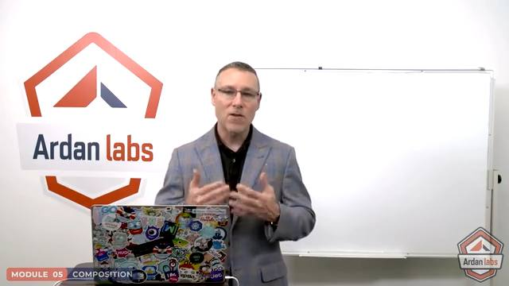
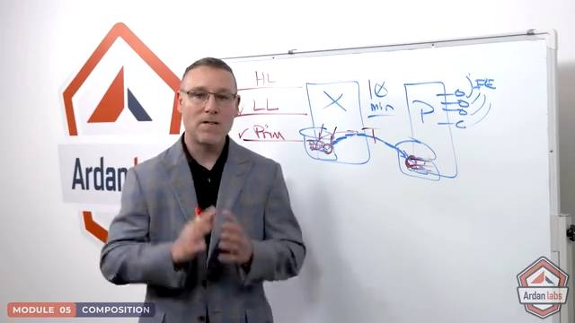
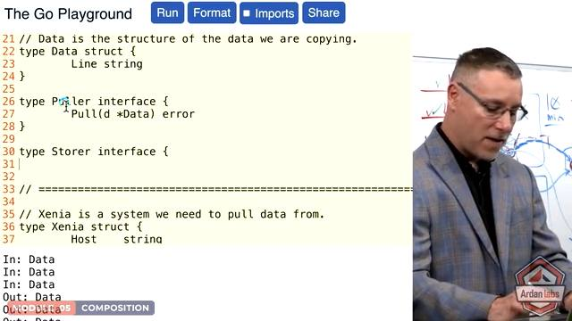
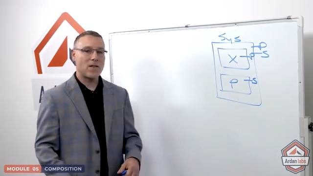
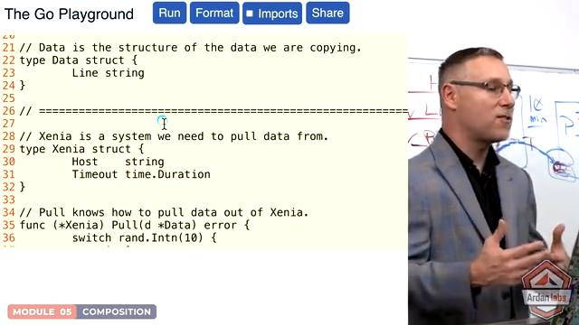
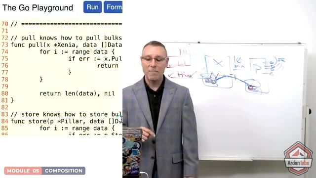
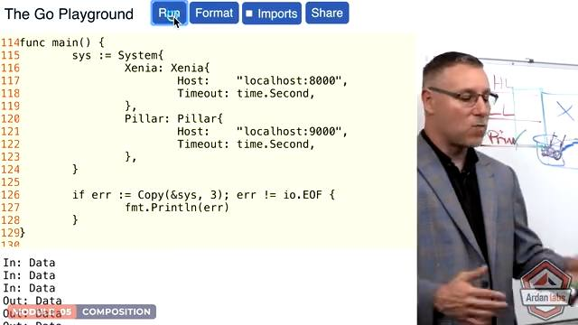
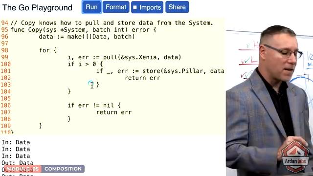
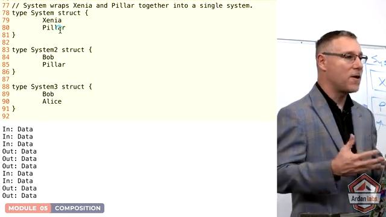

# Ultimate Go Language（并发 + benchmark）P039 复现文档

**这一节的真实主题**：Composition & Interface Discovery（用组合把代码分层，再从已经跑通的具体实现里「发现」接口）。
**注意**：本节的逐字稿里**没有出现任何 benchmark 和并发代码**，尽管课程标题带了「并发 + benchmark」。讲师这一节讲的是 Xenia → Pillar 的数据搬运项目如何从「具体实现」演进到「完全解耦」。benchmark 相关内容课里没讲，本文第 7 节会明确标注哪些是我的补充。

---

## 一、这一节做什么

讲师虚构了一个真实的商业场景，然后带你把它做完：

- 老机房里有台机器叫 **Xenia**（讲师原话说是 AS/400 一类的大型机），上面跑着私有数据库，里面有值钱的数据。
- 公司现有的赚钱系统叫 **Pillar**，对外提供 API，有自己更传统的数据库。
- 客户说：把 Xenia 里的数据搬到 Pillar，我们愿意付钱。
- 讲师接受的唯一条件是**不要实时**，只要「每 10 分钟跑一次」。
- 项目上线跑通之后，销售又来了：我们要从 Xenia 迁到新的 **Bob**，还要往新的 **Alice** 写数据。系统要换了。

于是这一节的完整链路是：

1. 先把四个「原始问题」拆出来（连 Xenia、读 Xenia、连 Pillar、写入 Pillar）。
2. 用**具体实现**写出 primitive 层（`Xenia.pull` / `Pillar.store`）。
3. 在上面叠一个 lower level API（批量 `pull` / 批量 `store`，函数式）。
4. 再叠 high level API（`copy`，一次搬完）。
5. 代码进生产后，问「**变化是什么**」，答案是「系统会换」。
6. 于是做**接口发现**：从 `pull` 方法发现 `Puller`，从 `store` 方法发现 `Storer`，用嵌入组合出 `PullStorer`。
7. 最后做一次**可读性评审**，把 `PullStorer` 和 `System` 当成「type pollution（类型污染）」删掉，`copy` 直接收两个行为参数。



本节的核心工程结论只有三句话，其余都是围绕它们的代码推演：

- **先具体，后抽象**：`We don't design with interfaces, we discover them`。
- **分层**：每一层只关心数据，层与层之间不跨界，这样最可测。
- **正确性优先于性能**：先跑通，再让工具告诉你哪里要优化。

---

## 二、讲师原话

> "我们会先从某个代码的具体版本开始……我们要借此发现接口。而发现这些接口的唯一方式，就是先基于具体实现来设计代码。"
> —— p039 [00:29]

> "这和我们以前做过的任何事情没有本质区别。它就是一个数据转换问题。"
> —— p039 [03:17]

> "实时这个概念本身就很可笑。"
> —— p039 [03:45]（所以需求被压成「每 10 分钟一次」）

> "当我梳理这些问题时，我看到这里其实有四个问题。首先是，这是一个专有数据库，我得弄清楚如何连接它。连接上之后，我得弄清楚如何把其中的数据识别出来并取出来……然后我得弄清楚如何连接到这个系统……接着我得把数据转换好，对吧？然后再存储起来。"
> —— p039 [04:13] ~ [04:43]

> "我看到太多开发者没有关注这种分层……当你开始让 API 函数跨越这些边界时，通常会很难弄清楚如何测试那段代码，甚至会出大问题。"
> —— p039 [06:08] ~ [06:36]

> "我希望先有这个东西的具体实现。在这个代码库里，完全不要给我接口。"
> —— p039 [07:30]

> "我现在不会为性能做优化。我优化的是正确性。"
> —— p039 [09:54]

> "先用函数，直到继续用函数变得不合理或不实际为止。"
> —— p039 [12:48]（有状态的 Xenia / Pillar 用方法，其余用函数）

> "完成意味着两件事。第一，我们的测试覆盖率至少达到 70%……不过正常路径应该是 100%。"
> —— p039 [16:03]



> "更高层的 API 关注两种行为，而我们的低层 API 只关注一种……先从这些小接口开始，再组合出更大的接口。"
> —— p039 [18:26] ~ [18:55]

> "我不在乎这个系统是什么，西尼亚、鲍勃，随便什么，只要它知道如何拉取就行。"
> —— p039 [19:24]



> "只有具体的数据才能跨越这些程序边界传递。"
> —— p039 [24:39]（这是在解释为什么 `PullStorer` 能传给只要 `Puller` 的函数）



> "这个程序里会有多少个 PullStorer 的实现？……如果你不打算有多个 PullStorer 实现，那它就只是类型污染。"
> —— p039 [31:17] ~ [31:44]

> "好的 API 不仅要易于使用，还要难以误用。"
> —— p039 [35:06]

> "重复的代价远低于错误的抽象。"
> —— p039 [36:03]

---

## 三、从零复现

### 3.0 前置

- Go 1.22 以上（课里没讲版本；本文代码只用最基础语法，1.16+ 也能编译）。
- 不需要数据库，不需要网络。Xenia 和 Pillar 都是本地 struct 模拟。
- 目录名随意，下面统一叫 `xenia2pillar`。

### 3.1 建工程

```bash
mkdir -p ~/go-demo/xenia2pillar && cd ~/go-demo/xenia2pillar
go mod init xenia2pillar
```

生成的目录结构（最终形态，一共 5 个文件）：

```
xenia2pillar/
├── go.mod
├── data.go        // Data 类型
├── xenia.go       // primitive 层：数据源（有状态 → 方法）
├── pillar.go      // primitive 层：数据目的地（有状态 → 方法）
├── api.go         // lower level API + high level API + 两个接口
├── main.go        // 组装 & 跑一次
└── api_test.go    // 测试（对应讲师说的 70% 覆盖率）
```

### 3.2 第一步：先只写具体实现，一个 interface 都不许有

按讲师的原话，第一版代码里**不允许出现 `interface`**。所以顺序是：

1. `data.go`：定义 `Data`。讲师明确说数据不重要，「we're just going to define a type name data. It's just going to be a string」。
2. `xenia.go`：`Xenia` 有 host、timeout，还有「上次搬到哪」的状态 → 所以用**方法** `pull`。
3. `pillar.go`：`Pillar` 同样有状态 → 用**方法** `store`，并且为了 API 对称，接收同样的 `*Data`。

`Data` 为什么用指针传？讲师原话：

> "我们沿着调用栈向下共享它，这样那里就不会有任何分配。这段代码可能会处在紧凑循环中。"
> —— p039 [09:25]



### 3.3 第二步：叠 lower level API（批量）

有了单条的 `pull` / `store`，就能写批量的版本。这一层是**函数**而不是方法，因为「state 可以继续由 Xenia / Pillar 持有」：

> "先用函数，直到继续用函数变得不合理或不实际为止……目前，我们不一定需要再维护更多状态。"
> —— p039 [12:48] ~ [13:14]

批量 `pull(p Puller, data []Data)` 的语义：用 `range` 拿指针语义（`&data[i]`），一直拉，拉到 EOF 就停，返回**真正拉到了几条**。



### 3.4 第三步：叠 high level API（`copy`）

`copy` 一次搬完所有数据：分配一个 batch 大小的切片（讲师原话说「one allocation... is not going to affect us」），然后无限循环，直到整个集合搬完。

这一版里 `copy` 直接接收具体的 Xenia 和 Pillar（此时还没有接口）。跑起来看输出就说明 primitive 层 + 两层 API 都通了。



### 3.5 第四步：回答「变化是什么」，开始接口发现

讲师的标准「done」有两个条件（p039 [16:03]）：

1. 覆盖率 ≥ 70%，happy path 100%；
2. 评估过具体实现：**变化是什么？解耦了吗？**

变化是：系统会从 Xenia 换成 Bob，目的地会从 Pillar 换成 Alice。所以现在解耦。

关键操作顺序（讲师强调过要**从低层往高层做**）：

> "我们最好先关注那个低层 API。先把这些小接口发现出来，然后再组合成更大的接口。"
> —— p039 [18:26] ~ [18:55]



**草稿阶段的接口（后面会被删，别和最终代码放一个包里）**：

```go
// 草稿 v2：从已经跑通的 pull / store 方法上「发现」出来的小接口
type Puller interface {
	pull(data *Data) error
}

type Storer interface {
	store(data *Data) error
}

// 草稿 v2：用嵌入把两个小接口组合成大接口（讲师说的 pullStorer 命名法）
type PullStorer interface {
	Puller
	Storer
}

// 草稿 v2：用嵌入把两个具体类型组合成一个「既能读又能写」的具体类型
type System struct {
	Xenia
	Pillar
}
```

**草稿 v3：把 `System` 改成嵌入接口而不是嵌入具体类型** —— 这一手是讲师全节最漂亮的一步：

```go
// 草稿 v3：System 不再绑死 Xenia / Pillar，而是在初始化时注入行为
type System struct {
	Puller
	Storer
}
```

> "System 也可以是这些接口类型的组合……这将允许我在类型层面解耦行为。"
> —— p039 [28:30] ~ [28:58]



到这里，`main` 里可以写 `System{Puller: &bob, Storer: &alice}`，换系统不用改任何类型。

### 3.6 第五步：可读性评审，删掉「类型污染」

> "项目早期，30% 写新代码，70% 做评审。"
> —— p039 [30:50]

两个问题：

- `PullStorer` 会有几个实现？只有一个（`System`）。所以它是 pollution，删掉。
- `copy(sys *System, ...)` 这个签名精确吗？不精确：看签名不知道 `System` 必须被初始化成什么样。改成直接要两个行为。

最终形态（也就是第 4 节的正式代码）：

```go
func copy(p Puller, s Storer, batch int) (int, error)
```

`main` 也随之简化：不再构造 `System`，直接构造 Xenia 和 Pillar 传进去。

> "我们把 main 变得更容易编写和初始化。我们把 copy 做得尽可能精确。而这部分代码仍然与所有这些改动完全解耦。"
> —— p039 [34:06] ~ [34:36]

### 3.7 跑起来

```bash
go vet ./...
go build ./...
go run .
```

预期输出（你自己程序打的，可以对照）：

```
moved 1000 rows: 10.0.0.10:8471(next=1000) -> 10.0.0.20:5432(stored=1000)
```

跑测试与覆盖率：

```bash
go test -v -cover ./...
```

期望看到 3 个测试全 PASS，`coverage: 90%+`（实际数字以你机器输出为准）。

---

## 四、完整代码

> 以下 6 个文件放在同一个 `main` 包里，直接保存即可运行。**没有任何省略号**。

### go.mod

```
module xenia2pillar

go 1.22
```

### data.go

```go
package main

// Data 是这个练习里流转的数据单元。
// 讲师刻意把它简化成字符串：重要的是「搬运的结构」，不是数据本身。
type Data string
```

### xenia.go

```go
package main

import (
	"errors"
	"fmt"
	"time"
)

// ErrEOF 表示数据源已经没有数据了。
//
// 讲师在课上是用「随机数」模拟「这一条是最后一条 / 出错 / 真的拿到数据」三种情况。
// 本文改成计数，好处是每次运行结果一致，你能对着文档核对输出。
var ErrEOF = errors.New("no more data in xenia")

// Xenia 是那台老机器房里的 AS/400（讲师原话）的替身。
//
// 它有关键的「状态」：连哪台机器、超时多久、上次搬到第几行。
// 正因为有状态，讲师才用「方法」而不是「函数」来建模它。
type Xenia struct {
	Host    string
	Timeout time.Duration

	next  int // 上次搬到第几行
	total int // 这台机器上一共有多少行
}

// pull 只做一件事：把下一条数据写进调用方给的 Data 里。
//
// 参数用 *Data，是讲师说的
// "We share it down the call stack so we don't have any allocations there."
func (x *Xenia) pull(data *Data) error {
	if x.next >= x.total {
		return ErrEOF
	}

	x.next++
	*data = Data(fmt.Sprintf("xenia-row-%d", x.next))
	return nil
}
```

### pillar.go

```go
package main

import "time"

// Pillar 是公司现有赚钱系统的替身（对外提供 API，背后是传统数据库）。
type Pillar struct {
	Host    string
	Timeout time.Duration

	Stored int // 已经写进去多少条，用来验证搬运条数
}

// store 与 Xenia.pull 保持对称：同样的 *Data 指针语义。
//
// 真实实现这里是 INSERT / UPDATE；这里只记数，
// 目的是让「搬过去了多少条」可以在终端里被亲眼看到。
func (p *Pillar) store(data *Data) error {
	p.Stored++
	return nil
}
```

### api.go

```go
package main

import "errors"

// Puller / Storer 是讲师从「已经跑通的 pull / store 方法」上
// 发现（discover）出来的接口，不是事先设计的。
//
// 注意：方法名是小写，所以这个接口只在 main 包内可用。
// 如果要把 Xenia 拆到独立包里，方法名和接口方法名都要首字母大写（见第 7 节）。
type Puller interface {
	pull(data *Data) error
}

type Storer interface {
	store(data *Data) error
}

// pull 是 lower level API 的批量版本：
// 一次能搬多少搬多少，遇到 EOF 就把「实际搬了几条」和错误一起返回。
//
// 用 range 拿 &data[i]，是讲师说的指针语义：
// 直接把结果写进切片，不再额外分配。
func pull(p Puller, data []Data) (int, error) {
	for i := range data {
		if err := p.pull(&data[i]); err != nil {
			return i, err
		}
	}
	return len(data), nil
}

// store 是 pull 的对称版本。
func store(s Storer, data []Data) (int, error) {
	for i := range data {
		if err := s.store(&data[i]); err != nil {
			return i, err
		}
	}
	return len(data), nil
}

// copy 是 high level API：一个批次一个批次地搬，直到没有数据为止。
//
// 讲师最初写的是 copy(ps PullStorer, ...)，可读性评审后改成
// 直接要两个行为（Puller + Storer），这样 API 更精确：
// 一眼就能看出「必须有一个能读的、一个能写的」。
//
// 函数名沿用讲师课上的 copy。注意：它会遮蔽 Go 的内建 copy（见第 7 节）。
func copy(p Puller, s Storer, batch int) (int, error) {
	if batch <= 0 {
		return 0, errors.New("batch must be greater than zero")
	}

	// 讲师原话："one allocation on line 96, but it's one allocation,
	// it's not going to affect us."
	data := make([]Data, batch)

	var total int
	for {
		n, err := pull(p, data)
		if n > 0 {
			if _, serr := store(s, data[:n]); serr != nil {
				return total, serr
			}
			total += n
		}

		if err != nil {
			if errors.Is(err, ErrEOF) {
				return total, nil
			}
			return total, err
		}
	}
}
```

### main.go

```go
package main

import (
	"fmt"
	"log"
	"time"
)

func main() {
	// 初始化阶段只关心具体数据 —— 讲师说的
	// "during initialization we're focused just on the concrete data the way we should be."
	x := Xenia{
		Host:    "10.0.0.10:8471",
		Timeout: 5 * time.Second,
		total:   1000,
	}

	p := Pillar{
		Host:    "10.0.0.20:5432",
		Timeout: 5 * time.Second,
	}

	// 换系统只需要换这一行：
	//   n, err := copy(&bob, &alice, 25)
	// 因为 copy 只认「能读」和「能写」，不认具体类型。
	n, err := copy(&x, &p, 25)
	if err != nil {
		log.Fatalf("copy failed after %d rows: %v", n, err)
	}

	fmt.Printf("moved %d rows: %s(next=%d) -> %s(stored=%d)\n",
		n, x.Host, x.next, p.Host, p.Stored)
}
```

### api_test.go

```go
package main

import (
	"errors"
	"testing"
)

// fakePuller 是只有行为的假数据源：它只实现 pull，别的什么都没有。
// 这正是讲师说的
// "I don't care what the system is, Xenia, Bob, whatever,
//  as long as it knows how to pull."
//
// 注意：failAt 的零值是 0，会被当成「第 0 次调用就报错」。
// 想让它不报错，必须显式写 failAt: -1。
type fakePuller struct {
	rows   []Data
	pos    int
	failAt int
	calls  int
}

func (f *fakePuller) pull(data *Data) error {
	f.calls++
	if f.failAt >= 0 && f.calls == f.failAt {
		return errors.New("connection reset")
	}
	if f.pos >= len(f.rows) {
		return ErrEOF
	}
	*data = f.rows[f.pos]
	f.pos++
	return nil
}

type fakeStorer struct {
	got []Data
}

func (f *fakeStorer) store(data *Data) error {
	f.got = append(f.got, *data)
	return nil
}

func TestCopyMovesAllRows(t *testing.T) {
	p := &fakePuller{rows: []Data{"a", "b", "c", "d", "e"}, failAt: -1}
	s := &fakeStorer{}

	n, err := copy(p, s, 2)
	if err != nil {
		t.Fatalf("unexpected error: %v", err)
	}
	if n != 5 {
		t.Fatalf("want 5 rows moved, got %d", n)
	}
	if len(s.got) != 5 {
		t.Fatalf("want 5 rows stored, got %d", len(s.got))
	}
	for i, want := range []Data{"a", "b", "c", "d", "e"} {
		if s.got[i] != want {
			t.Fatalf("row %d: want %q, got %q", i, want, s.got[i])
		}
	}
}

func TestCopyStopsOnRealError(t *testing.T) {
	p := &fakePuller{
		rows:   []Data{"a", "b", "c", "d", "e"},
		failAt: 3,
	}
	s := &fakeStorer{}

	n, err := copy(p, s, 2)
	if err == nil {
		t.Fatal("want an error, got nil")
	}
	if n != 2 {
		t.Fatalf("want 2 rows moved before the error, got %d", n)
	}
	if len(s.got) != 2 {
		t.Fatalf("want 2 rows stored, got %d", len(s.got))
	}
}

func TestPullHonorsBatchBoundary(t *testing.T) {
	p := &fakePuller{rows: []Data{"a", "b", "c"}, failAt: -1}
	buf := make([]Data, 2)

	n, err := pull(p, buf)
	if n != 2 || err != nil {
		t.Fatalf("first batch: want (2, nil), got (%d, %v)", n, err)
	}

	n, err = pull(p, buf)
	if n != 1 {
		t.Fatalf("second batch: want 1 row, got %d", n)
	}
	if !errors.Is(err, ErrEOF) {
		t.Fatalf("second batch: want ErrEOF, got %v", err)
	}
	if buf[0] != "c" {
		t.Fatalf("second batch: want c, got %q", buf[0])
	}
}

func TestCopyRejectsBadBatch(t *testing.T) {
	p := &fakePuller{failAt: -1}
	s := &fakeStorer{}

	if _, err := copy(p, s, 0); err == nil {
		t.Fatal("want an error for batch=0, got nil")
	}
}
```

---

## 五、逐行解释

**为什么 `Xenia` 用方法、`pull` / `store` 用函数？**
`Xenia` 有状态（host、timeout、上次搬到第几行），状态需要跟着值走，所以是方法。到了批量那一层，讲师说「state 可以继续由 Xenia / Pillar 持有，我们这层不需要新的状态」，于是回到函数。这就是那句 `Use functions until it's not reasonable or practical to do so.`（p039 [12:48]）。

**`func (x *Xenia) pull(data *Data) error` 为什么接收者是 `*Xenia`？**
因为要改 `x.next`。如果写成值接收者，`next` 的改动会丢掉，程序会永远返回第一行、永远不 EOF —— 死循环。这是复现时最容易踩的坑。

**`pull(data *Data)` 为什么参数是指针？**
讲师原话是「share it down the call stack so we don't have any allocations」。这一层可能被很紧的循环反复调用，每次返回一个 `Data` 值意味着每次可能触发分配；把结果写进调用方给的地址，就一次分配都不用。在 JS/Node 里你可以理解成「传进去一个对象，函数直接往里写字段」，避免每个元素都新建对象。

**为什么接口里的方法名是小写的 `pull` / `store`？**
因为本文所有代码放在同一个 `main` 包里，小写是包内可见，够用。**代价**：一旦你想把 `Xenia` 拆到别的包，这个接口就实现不了了。讲师课上用的是单包推演，所以没展开这一点；我在第 7 节专门补了改法。

**`pull(p Puller, data []Data) (int, error)` 为什么返回「实际条数」而不是只返回 error？**
因为最后一批通常不满。比如 1000 行、batch=25 是刚好整除，但如果总数是 1003，最后一轮只会拉到 3 条。调用方必须知道「切片里前几条是有效数据」，所以 `data[:n]` 这个裁剪是必需的，不是可选的。

**`copy` 里为什么要先 `store` 再判断 `err`？**
因为 `pull` 返回 `ErrEOF` 时，`n` 可能大于 0：最后一次拉取往往「拉到几条 + 到末尾」同时发生。如果先看 `err` 直接返回，最后那几条就永远写不进去。这是搬运类程序最经典的丢数据 bug。

**`if _, serr := store(...)` 为什么用 `serr` 而不是 `err`？**
为了不遮蔽外层的 `err`。如果把内层也写成 `err`，`if err != nil` 判断的就是内层那个变量，外层 `pull` 的 `ErrEOF` 判断会被绕过，循环要么提前退出要么退化成死循环。

**为什么 `copy` 的参数从 `PullStorer` 改成 `Puller + Storer`？**
讲师问了两个问题：`PullStorer` 有几个实现？只有一个（`System`）。那它就是 type pollution。而改成两个行为参数后，签名本身就说明了「必须有一个能读的、一个能写的」，比传一个含义不明的 `System` 精确得多。这就是那句 `A good API is not just easy to use, but it's hard to misuse.`（p039 [35:06]）。

**为什么 `PullStorer` 能传给只要 `Puller` 的函数？**
这是全节最绕的一段，讲师专门花了两分钟解释（p039 [23:25] ~ [25:09]）：接口本身**没有值**，函数真正收到的是接口里**装着的那个具体值**。`PS` 里装的是 `*System`，而 `*System` 会 pull 也会 store，所以传给只要 `Puller` 的位置完全合法。换成 TS 的视角：`PullStorer` 的结构里包含了 `Puller` 的所有成员，结构化类型当然兼容。

**`make([]Data, batch)` 为什么可以接受？**
讲师自己承认这是「one allocation」。每次 `copy` 只分配一次缓冲区，然后反复复用，成本被摊薄到可以忽略。这和他「先正确、再优化」的立场一致：先不纠结分配，等 benchmark 出来再说。

**为什么 `copy` 要检查 `batch <= 0`？**
`make([]Data, 0)` 会让 `pull` 永远返回 `(0, nil)`，`copy` 的 `for` 循环永远不会退出。讲师课上没提这个边界（因为他自己传的是常数），但这是你复现时真会撞上的死循环。

**测试为什么用 `fakePuller` 而不是 mock 框架？**
讲师立场很明确：「There is a place for mocking, but it shouldn't be our number one choice.」（p039 [06:36]）首选是「传具体数据进去、拿具体数据出来」。`fakePuller` 就是一个只实现 `pull` 的具体值，它能在各种场景下（正常、末尾、真错误）返回不同数据，测试就覆盖了三条分支。

---

## 六、复现检查清单

- [ ] `go mod init xenia2pillar` 执行成功，`go.mod` 里 module 名是 `xenia2pillar`。
- [ ] `data.go` / `xenia.go` / `pillar.go` / `api.go` / `main.go` / `api_test.go` 六个文件都在同一个目录下，**同一个 `package main`**。
- [ ] `xenia.go` 的 `pull` 接收者是 `*Xenia`（不是 `Xenia`），否则 EOF 永远不会返回。
- [ ] `pillar.go` 的 `store` 接收者是 `*Pillar`，`main` 里传的是 `&p`，最后打印的 `stored` 正好是 1000。
- [ ] `api.go` 里 `Puller` 只有 `pull` 一个方法，`Storer` 只有 `store` 一个方法，接口里**没有**多余方法。
- [ ] `copy` 的实现里，「store 成功后才累加 total」和「先 store 再判 err」两条顺序都没写反。
- [ ] `go run .` 输出 `moved 1000 rows: ...(next=1000) -> ...(stored=1000)`。
- [ ] 把 `main.go` 里的 `copy(&x, &p, 25)` 换成 `copy(&x, &p, 7)`（不能整除 1000 以外的数，比如 999），再跑一次，输出仍然是 `moved 1000 rows`，证明最后一批没丢。
- [ ] `go test -v -cover ./...` 4 个测试全部 PASS，覆盖率 > 70%。
- [ ] 故意把 `next` 的 `++` 删掉，跑一次能观察到死循环或 0 条 —— 说明你真的理解了状态在哪里。
- [ ] 在 `main.go` 里新建一个 `type Bob struct{ Xenia }`，把 `copy(&bob, &p, 25)` 跑通，验证「换系统不改 `copy` 一行代码」。
- [ ] 确认代码里**没有** `System` 类型、没有 `PullStorer` 接口 —— 它们在可读性评审里被删掉了。

---

## 七、课里没讲但你会撞上的

这一节全部是**课程之外**的补充，不是讲师原话，我逐条标清楚。

**1. 小写方法名出不了包。**
本文为了和逐字稿一致，把方法写成 `pull` / `store`、接口方法也是小写。一旦你把 `Xenia` 挪到 `internal/xenia` 包里，`api.go` 里的 `Puller` 就再也匹配不上它。实际项目里应该写成 `Pull` / `Store` / `Puller{ Pull(*Data) error }`。课程没讲跨包的情形，这是单包推演的局限。

**2. 包级函数 `copy` 会遮蔽内建 `copy`。**
讲师原话就叫 `copy`，本文照抄。但它遮蔽了 Go 的内建 `copy(dst, src)`，同一个包里如果再写 `copy(a, b)` 想复制切片，就会编译报错（参数类型不匹配）。要么改名（`copyData` / `moveAll`），要么确保同包内不再使用内建 `copy`。这是个「能编译、但后来会恶心到自己」的坑。

**3. 用随机数模拟 EOF 会挂。**
我换成了计数，但如果你照讲师课堂版本用 `rand.Intn`，有两种失败：运气好时几轮就 EOF（运行太快，看不出分批效果）；运气差时长时间不 EOF（看起来像死循环）。真要用随机数，务必加一个「最大迭代次数」保护。课程没有讨论这个边界。

**4. 真正的并发。**
这节课**完全没有**并发代码，尽管课程标题里有「并发」。如果你真的要开多个 goroutine 同时搬数据，`Pillar.Stored++` 会变成数据竞争（`go test -race` 会报）。在 Go 里对应的解法是 `sync.Mutex` 或把写入收敛到单个 goroutine 用 channel 串行化；在 JS/Node 里单线程事件循环不会在同一个变量自增上炸，但换成 worker_threads 或集群后是同一类问题。

**5. benchmark。**
这一节**没有**任何 benchmark。讲师反复说的「先正确、再优化，让工具告诉我们优化哪里」（p039 [09:54]、[10:24]）是他的一贯立场，但具体的 `go test -bench` 写法不在本节。如果你要补，最小形态是：

```go
// 课里没有代码，以下为示意：用来验证讲师说的「先跑通，再看要不要优化」
func BenchmarkCopy1000(b *testing.B) {
	for i := 0; i < b.N; i++ {
		x := Xenia{total: 1000}
		p := Pillar{}
		if _, err := copy(&x, &p, 25); err != nil {
			b.Fatal(err)
		}
	}
}
```

配合 `go test -bench . -benchmem` 看分配情况。**注意**：这段是我的补充，不是讲师本节内容。

**6. 「接口发现」不是无限期允许加抽象。**
讲师最后亲手删掉了自己刚写的 `PullStorer` 和 `System`（p039 [31:17] ~ [34:36]），这一点很多人会漏掉：发现接口 ≠ 保留所有接口。判断标准就一句——**这个接口会有第二个实现吗？** 不会，就是污染。这条标准是讲师给的，但「怎么在团队里落地成 code review 规则」他没展开。

**7. `Xenia` 和 `Pillar` 的真实实现。**
课里全是模拟：`pull` 返回格式化字符串、`store` 只做计数。讲师明说「I don't care about the data so much」「we don't know how we're going to actually talk to this thing」（p039 [08:29]）。所以连真实数据库、真实 TCP 连接、真实超时处理，课里**都没有讲**。你的生产实现要自己补：连接复用、超时、重试、断点续搬（`next` 要持久化到磁盘或数据库，不能放在内存里）。

**8. 那 70% 覆盖率是谁定的？**
讲师说的是他自己的「done 的定义」：总体 ≥ 70%，happy path 100%（p039 [16:03]）。这是个人工程标准，不是行业硬指标，也不是 Go 工具链的默认门禁。别把它当成规范引用。