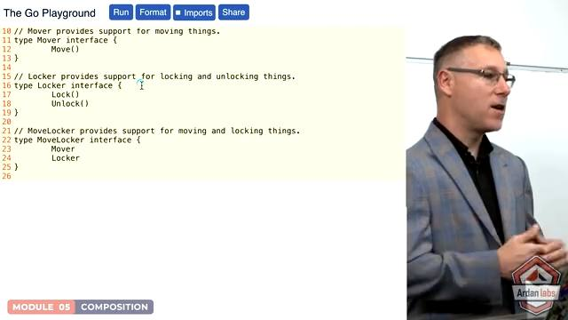
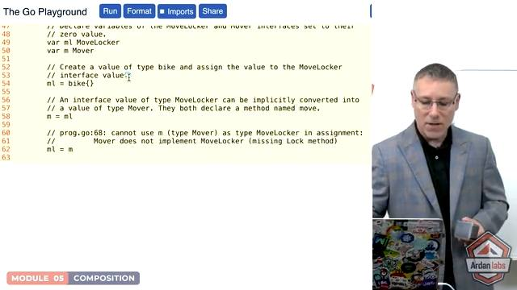
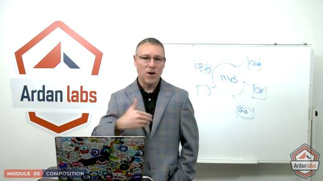

以下文档按 **P40–P44 逐字稿**重组。先说明一个关键事实：课程标题里出现“并发+benchmark”，但 **P40–P44 逐字稿实际讲的是接口机制、类型断言、接口污染、接口发现/自测 mock，以及第 6 课 error handling 的开场**，没有出现并发或 benchmark 的具体代码。本文不补编并发/benchmark 内容；这些在此区间属于“课里没讲”。

---

## 1. 这一节做什么

这一节要复现的不是一个“大项目”，而是一组能直接跑起来的 Go 小实验，用来把接口的编译期完整性、运行时类型断言、接口污染、用户侧接口发现和 mock 责任边界串起来。最终你会得到一个本地 Go module：

```text
ultimate-go-p40-p44/
├── go.mod
└── cmd/
    ├── p040/main.go             // mover / locker / moveLocker / bike：接口赋值
    ├── p041assert/main.go       // 类型断言与 comma-ok
    ├── p041stringer/main.go     // 运行时断言：car / cloud 随机判断
    ├── p041user/main.go         // 指针接收者 Stringer 与打印行为
    ├── p042before/main.go       // 接口污染：server interface + 工厂返回接口
    ├── p042after/main.go        // 重构后：导出具体类型，不再为用而用接口
    └── p043pubsub/main.go       // 具体 PubSub + 用户自己定义 publisher 接口 + mock
```

每个目录都能单独 `go run`。P40 里会演示“接口到更小接口可以编译”，同时把“更小接口到更大接口”的反向赋值保留为注释；取消注释后应触发编译失败。P44 逐字稿只有 error handling 的开场，没有给出错误处理代码，因此项目里不伪造 P44 实现，只在检查清单里明确标注“课里没讲”。



这一节最容易被前端转 AI 应用工程师误解的一点：`locker` 里的 `lock/unlock` 在逐字稿里是接口行为示例，不是在讲并发锁，也不是 mutex。它不能被直接类比成 Node 里的锁；逐字稿没有把这段当并发同步讲。本文按逐字稿原意只把它当“行为集合”处理。

---

## 2. 讲师原话

下面保留逐字稿里的英文原句作为锚点，并给出中文解释。时间戳按逐字稿标注。

> "我们会有一个 mover 接口，其中有一个行为方法 move；还有一个 locker 接口，它真正的作用就是 lock 和 unlock。接着是我之前给你展示过的同一种模式：move locker，它由另外两个接口组合而成。"
> —— p040 [00:26]

讲师先定义三个东西：`mover` 只有 `move`，`locker` 有 `lock/unlock`，`moveLocker` 是前两者的组合。这个组合关系是后面编译期检查的基础。

> "任何实现了 move、lock 和 unlock 的数据、值或指针，都可以作为 move locker。"
> —— p040 [00:26]

`moveLocker` 不是一个神秘类型，而是“同时具备 move、lock、unlock 三项行为的任意具体数据”。

> "我们能否把当前存储在 ML 中的 bike 值复制一份赋给 M？"
> —— p040 [02:22]

讲师强调：接口赋值不是“把接口搬来搬去”，运行时真正流动的是接口里装着的**具体值副本**。`ml` 里装的是 `bike`，赋值给 `mover` 时，编译器看的是 `bike` 的类型信息是否满足 `mover`。

> "编译器会说：不行，不能反过来赋值。因为对于 mover 来说，我们只知道它具备 move 的能力。"
> —— p040 [03:46]

反向赋值 `m = ml` 可以，`ml = m` 不行。因为 `mover` 只承诺 `move`，不能保证 `lock/unlock`，所以不能装进要求三项行为的 `moveLocker`。



> "你能把存储在 m 里的 bike 值复制一份给我吗？……如果 m 里存着一个 bike，那么 B……会是一个副本。但如果这里面没有 bike 值呢？……我们就会触发 panic。"
> —— p041 [00:59]

这是类型断言的短形式：`b := m.(bike)`。成功时拿到副本；失败时运行时 panic。

> "然后我们就不确定了……再说第二种形式……OK 会是 true……如果里面放的是 car，那么最终 OK 得到的会是 false。而这个值会被设成对应的零值。"
> —— p041 [01:56]

第二种形式是 comma-ok：`b, ok := m.(bike)`。失败不 panic，`ok` 为 `false`，`b` 是该类型的零值。


> "我们做类型断言时，真正面对的是运行时操作，而不是编译时操作。"
> —— p041 [02:53]

类型断言是运行时检查，不是编译期检查。编译期能保证你写的类型关系大致合法，但接口里到底装的是 car 还是 cloud，要运行时才知道。

> "如果为 source 传入的具体数据……实现了 writer 接口，那就别管我的默认实现，改用那个自定义实现。"
> —— p041 [09:29]

讲师在标准库 `io` 的 `Copy/CopyBuffer` 里展示同样的 API 设计：先有默认实现，再通过类型断言询问“你有没有更专门的实现”，有就用你的。这是“默认能力 + 可选覆盖”的接口用法。

> "有一件事我大老远就能看出来，通常就是接口污染。这同样是人们试图用接口去设计，而不是去发现接口所导致的问题。"
> —— p042 [00:00]

接口污染来自“为了设计而先造接口”，而不是先写具体实现，再发现哪里需要解耦。

> "这个接口的名字是 server……它实际上是个名词，描述的是某个事物……而接口本应描述行为。"
> —— p042 [01:53]

讲师批评的坏例子里，接口叫 `server`，是名词，描述“东西”，而接口应描述“行为”。另外它有三个方法，且只有一个实现。


> "你是有多个 server 的实现，还是在要求使用你这个包的开发者来写这个行为？而这两种情况下，答案都是否定的。"
> —— p042 [03:18]

没有多实现，也不要求调用方实现，就不需要解耦；这个接口只是增加间接层和分配成本。

> "我们不会为了用接口而用接口。这个东西你只有一个实现，那就用那个具体类型。"
> —— p042 [05:41]

重构方向：删接口，导出具体类型，构造函数返回具体数据。


> "如果你有模拟需求，可以自己完成模拟，也完全可以自己定义那些接口。"
> —— p043 [05:37]

在 Go 里，mock 需要的接口可以由**使用方**自己定义，不需要 API 作者提前造接口。API 作者只返回具体类型；使用方按自己用到的方法定义小接口。



> "第六课讲的是错误处理……我们必须始终考虑失败情况。"
> —— p044 [00:00]

P44 只是第 6 课开场，强调错误处理重要性，尚未进入具体语言机制和代码。后文不会为 P44 编造实现。


---

## 3. 从零复现

### 3.1 环境与版本说明

逐字稿没有给出 Go 版本。为避免假装课程指定了版本，这里明确写：**本复现以 `go.mod` 中的 `go 1.20` 作为本地验证基线，不是讲师声明**。代码只依赖标准库，不引入第三方依赖。若你的 Go 低于 1.18，`any` 可能不可用，可以把 `any` 改成 `interface{}`。

建议先验证：

```bash
go version
```

只要你的 Go 支持 `interface`、`fmt.Stringer`、`any` 和 `math/rand`，就能运行本文代码。

### 3.2 创建目录

在你自己的练习目录执行：

```bash
mkdir -p ultimate-go-p40-p44/cmd/{p040,p041assert,p041stringer,p041user,p042before,p042after,p043pubsub}
cd ultimate-go-p40-p44
go mod init ultimatego/p40p44
```

`go mod init` 会生成 `go.mod`。你可以直接使用第 4 节给出的 `go.mod` 内容覆盖它。

### 3.3 写入文件

按第 4 节，把每个文件保存到对应路径。不要只复制片段；每个 `main.go` 都是完整文件。

### 3.4 启动命令

每个实验单独运行：

```bash
go run ./cmd/p040
go run ./cmd/p041assert
go run ./cmd/p041stringer
go run ./cmd/p041user
go run ./cmd/p042before
go run ./cmd/p042after
go run ./cmd/p043pubsub
```

检查全仓库是否至少能编译：

```bash
go test ./...
```

注意：`cmd/p040/main.go` 里故意保留了一行被注释掉的反向赋值。正常仓库应能编译；要观察编译失败，需要手动取消该行注释，再运行 `go run ./cmd/p040`。

### 3.5 复现 P40 的编译失败实验

打开 `cmd/p040/main.go`，找到：

```go
// ml = m // 取消注释会编译失败：mover 不保证 lock/unlock
```

把 `//` 去掉，保存后执行：

```bash
go run ./cmd/p040
```

你应看到一个编译错误，核心意思是：`m` 的静态类型是 `mover`，它不满足 `moveLocker` 要求的 `lock/unlock`。**精确报错文本会随 Go 版本变化，以你本地输出为准**。看完后把那行重新注释回去，保证全仓库可编译。

### 3.6 P44 的复现边界

P44 逐字稿只有：

> “Lesson six is about error handling … We have to always be considering failure cases.” —— p044 [00:00]

没有给错误类型、包装、`errors.Is/As`、自定义错误等代码。因此本文项目不含 P44 代码。不要把其他教程里的 `errors.Is` 示例硬说成这节课讲的；这里只能复现到“课程开场与主题边界”。

---

## 4. 完整代码

以下代码是按逐字稿描述重建的**最小可运行复现**。逐字稿没有给出逐字完整源码，所以文件内行号、变量名、打印文案不完全等同原课；接口关系、断言行为、接口污染与接口发现逻辑按逐字稿复原。

### 4.1 `go.mod`

路径：`ultimate-go-p40-p44/go.mod`

```go
module ultimatego/p40p44

go 1.20
```

### 4.2 `cmd/p040/main.go`

路径：`ultimate-go-p40-p44/cmd/p040/main.go`

```go
package main

import "fmt"

type mover interface {
	move()
}

type locker interface {
	lock()
	unlock()
}

type moveLocker interface {
	mover
	locker
}

type bike struct {
	id string
}

func (b bike) move() {
	fmt.Printf("bike %s moves\n", b.id)
}

func (b bike) lock() {
	fmt.Printf("bike %s locked\n", b.id)
}

func (b bike) unlock() {
	fmt.Printf("bike %s unlocked\n", b.id)
}

func main() {
	var ml moveLocker
	var m mover
	var l locker

	fmt.Printf("zero values: ml=(%T,%v) m=(%T,%v) l=(%T,%v)\n", ml, ml, m, m, l, l)

	b := bike{id: "b1"}
	ml = b
	m = ml
	l = ml

	fmt.Printf("after assign: ml=(%T,%v) m=(%T,%v) l=(%T,%v)\n", ml, ml, m, m, l, l)

	// 下面这行取消注释会编译失败：
	// ml = m // mover 只保证 move，不保证 lock/unlock，不能装进 moveLocker

	ml.move()
	m.move()
	l.lock()
	l.unlock()
}
```

### 4.3 `cmd/p041assert/main.go`

路径：`ultimate-go-p40-p44/cmd/p041assert/main.go`

```go
package main

import "fmt"

type mover interface {
	move()
}

type locker interface {
	lock()
	unlock()
}

type moveLocker interface {
	mover
	locker
}

type bike struct {
	id string
}

func (b bike) move() {
	fmt.Printf("bike %s moves\n", b.id)
}

func (b bike) lock() {
	fmt.Printf("bike %s locked\n", b.id)
}

func (b bike) unlock() {
	fmt.Printf("bike %s unlocked\n", b.id)
}

func main() {
	var m mover = bike{id: "b1"}

	b, ok := m.(bike)
	fmt.Println("comma-ok:", ok)
	fmt.Printf("copy from interface: %+v\n", b)

	b.lock()
	b.unlock()

	var ml moveLocker = b
	ml.move()

	// 短断言在失败时会 panic。逐字稿用这句话演示运行时断言：
	// b2 := m.(bike)
	// 如果把 m 里面换成别的具体类型，这一行就会 panic。
}
```

### 4.4 `cmd/p041stringer/main.go`

路径：`ultimate-go-p40-p44/cmd/p041stringer/main.go`

```go
package main

import (
	"fmt"
	"math/rand"
	"time"
)

type car struct{}

func (car) String() string {
	return "I am a car"
}

type cloud struct{}

func (cloud) String() string {
	return "I am a cloud"
}

func main() {
	source := rand.NewSource(time.Now().UnixNano())
	r := rand.New(source)

	values := []fmt.Stringer{car{}, cloud{}}

	for i := 0; i < 10; i++ {
		v := values[r.Intn(len(values))]

		if c, ok := v.(cloud); ok {
			fmt.Println("got lucky, cloud:", c.String())
		} else {
			fmt.Println("did not get lucky, value:", v.String())
		}
	}
}
```

### 4.5 `cmd/p041user/main.go`

路径：`ultimate-go-p40-p44/cmd/p041user/main.go`

```go
package main

import "fmt"

type user struct {
	name  string
	email string
}

func (u *user) String() string {
	return fmt.Sprintf("%s <%s>", u.name, u.email)
}

func printIt(v any) {
	if s, ok := v.(fmt.Stringer); ok {
		fmt.Println("custom formatter:", s.String())
		return
	}
	fmt.Println("default formatter:", v)
}

func main() {
	u := user{name: "Alice", email: "alice@example.com"}

	printIt(u)
	printIt(&u)
}
```

### 4.6 `cmd/p042before/main.go`

路径：`ultimate-go-p40-p44/cmd/p042before/main.go`

```go
package main

import "fmt"

type server interface {
	start()
	stop()
	wait()
}

type serverImpl struct{}

func (s *serverImpl) start() {
	fmt.Println("serverImpl.start")
}

func (s *serverImpl) stop() {
	fmt.Println("serverImpl.stop")
}

func (s *serverImpl) wait() {
	fmt.Println("serverImpl.wait")
}

func newServer() server {
	return &serverImpl{}
}

func main() {
	srv := newServer()
	srv.start()
	srv.stop()
	srv.wait()
}
```

### 4.7 `cmd/p042after/main.go`

路径：`ultimate-go-p40-p44/cmd/p042after/main.go`

```go
package main

import "fmt"

type Server struct{}

func (s *Server) Start() {
	fmt.Println("Server.Start")
}

func (s *Server) Stop() {
	fmt.Println("Server.Stop")
}

func (s *Server) Wait() {
	fmt.Println("Server.Wait")
}

func NewServer() *Server {
	return &Server{}
}

func main() {
	srv := NewServer()
	srv.Start()
	srv.Stop()
	srv.Wait()
}
```

### 4.8 `cmd/p043pubsub/main.go`

路径：`ultimate-go-p40-p44/cmd/p043pubsub/main.go`

说明：逐字稿没有给出真实 PubSub 的二进制协议和方法名。下面 `Publish/Subscribe` 是**为复现“用户自己定义小接口并 mock”而写的示意 API**，不是课程原 API。

```go
package main

import "fmt"

type PubSub struct {
	topic string
}

func NewPubSub() *PubSub {
	return &PubSub{topic: "events"}
}

func (p *PubSub) Publish(topic string, msg string) error {
	fmt.Printf("[real bus] publish topic=%s msg=%s\n", topic, msg)
	return nil
}

func (p *PubSub) Subscribe(topic string) error {
	fmt.Printf("[real bus] subscribe topic=%s\n", topic)
	return nil
}

// 使用方自己定义的小接口：只声明自己用到的方法。
type publisher interface {
	Publish(topic string, msg string) error
}

type mockPublisher struct{}

func (m *mockPublisher) Publish(topic string, msg string) error {
	fmt.Printf("[mock] publish topic=%s msg=%s\n", topic, msg)
	return nil
}

func send(p publisher) {
	_ = p.Publish("events", "hello")
}

func main() {
	real := NewPubSub()
	send(real)

	var mock publisher = &mockPublisher{}
	send(mock)
}
```

---

## 5. 逐行解释

### 5.1 P40：接口组合与接口赋值

`type mover interface { move() }` 只描述“能移动”。`type locker interface { lock(); unlock() }` 只描述“能上锁、解锁”。`type moveLocker interface { mover; locker }` 是接口嵌入，等价于同时要求 `move/lock/unlock`。逐字稿称它是 composition，即组合关系。

`type bike struct{ id string }` 是具体数据。三个方法都用**值接收者**：

```go
func (b bike) move()
func (b bike) lock()
func (b bike) unlock()
```

因此 `bike` 值和 `*bike` 指针都能满足三个接口。这里对应到前端/TS 的直觉：不是“接口继承”，而是“这份具体数据有没有这些方法”。Go 的接口满足是隐式的，类型不需要写 `implements`。

`var ml moveLocker`、`var m mover`、`var l locker` 创建接口零值。零值接口内部是 nil，打印 `%T` 会显示 `<nil>`。逐字稿专门讲“zero value”“nil nil”，就是提醒你接口变量不是具体值，它有两部分语义：动态类型和动态值。

`ml = b` 把 `bike` 副本装进 `moveLocker`。逐字稿说“不是移动接口，而是移动具体数据”。Go 接口赋值会复制具体值；如果装的是大结构，会有复制成本。前端同学可把它类比成把一个对象快照塞进一个“能力盒子”。

`m = ml` 能编译，因为 `moveLocker` 的方法集包含 `mover` 的方法。接口到更小接口是安全收窄。运行时装进 `m` 的仍然是 `bike` 的副本。

被注释的 `ml = m` 是反向扩大。静态类型 `mover` 只保证 `move`，编译器不能保证 `lock/unlock`，所以不满足 `moveLocker`。这正是逐字稿的 compile-level integrity。

### 5.2 P41 断言：短形式与 comma-ok

`b, ok := m.(bike)` 是 comma-ok 断言。若 `m` 里是 `bike`，`b` 是副本，`ok` 为 true。若 `m` 里是 car，`ok` 为 false，`b` 是 `bike` 零值，即 `bike{id:""}`。逐字稿说“faults for OK”“zero value”，就是这个行为。

短断言 `b2 := m.(bike)` 失败会 panic。逐字稿用 “boom, panic” 描述它。工程上更常用 comma-ok，因为你不总是确定接口里装的是谁。

`b.lock()` 之所以能调用，是因为断言后 `b` 的静态类型已经是具体 `bike`，不再是 `mover`。接口断言像“开箱”：从只暴露 `move` 的盒子里，把具体的 bike 拿出来，才能调用 bike 的其他方法。

### 5.3 P41 Stringer：运行时断言与多态

`car` 和 `cloud` 各自实现 `String() string`，所以它们都满足 `fmt.Stringer`。`values := []fmt.Stringer{car{}, cloud{}}` 是按“能 String”收集，不是按“是 car 还是 cloud”收集。循环里随机取出一个，然后 `v.(cloud)` 做运行时判断：抽到 cloud 就 lucky，否则走 else。

这段代码直接证明类型断言是运行时行为：同一行断言，有时 true，有时 false。编译期只知道 `v` 是 `fmt.Stringer`，不知道具体是 car 还是 cloud。

`printIt` 里 `v.(fmt.Stringer)` 是 API 风格的断言。函数先检查传入数据是否自带自定义格式化能力，有则用自定义，没有则退回默认。逐字稿用 `fump` 和 `log` 包说明 `Stringer`；本复现用 `fmt.Stringer` 和 `fmt.Println`，因为本地标准库可运行。

`func (u *user) String()` 用指针接收者。Go 方法集规则：指针接收者方法只属于 `*user`，不属于 `user` 值。因此 `printIt(u)` 不会进入 `fmt.Stringer` 分支，走默认格式化；`printIt(&u)` 进入自定义分支。逐字稿特别强调：这不是随便改 API 能解决的事，数据语义应提前定好。对应前端直觉：类实例方法通常在实例上；但 Go 的“值/指针接收者”会改变接口满足关系，这是额外的类型规则。

### 5.4 P42：接口污染坏例子

`type server interface { start(); stop(); wait() }` 是逐字稿批评的接口。问题不是“三方法一定错”，而是：

1. 名称 `server` 是名词，接口应描述行为；
2. 三个行为可能应拆开组合；
3. 只有一个实现；
4. 不要求调用方实现；
5. 工厂 `newServer() server` 返回接口而不是具体数据。

`newServer()` 里 `return &serverImpl{}` 返回接口，调用方 `main` 拿到 `server`。逐字稿说“用户的世界有没有变化？没有；还多了一层间接和分配成本”。重构版把 `Server` 导出，`NewServer() *Server` 返回指针具体类型。`main` 的调用形态几乎一样，但用户拿到的不是接口盒子，后续可以做更多具体优化。

注意：逐字稿没有给出精确重构后命名大小写；本复现采用 Go 导出的 `Server/Start/Stop/Wait` 作为可运行示范。原课的坏例子具体源码逐字稿未完整给出。

### 5.5 P43：用户侧接口发现与 mock

`PubSub` 是具体实现。`publisher` 是使用方自己定义的小接口，只包含 `Publish`。`PubSub` 没有声明自己实现 `publisher`，但因为方法签名匹配，`*PubSub` 满足它。`send(real)` 能接收 `*PubSub`。

`mockPublisher` 也实现 `Publish`，所以 `send(mock)` 能编译。逐字稿的核心是：mock 接口不应由 API 作者提前塞进包里；使用方需要 mock，就自己定义使用方接口。API 作者把具体 type 做好，使用方按用到的 API 切出小接口。这正是“discover interfaces”而不是“design with interfaces”。

课里没有给真实消息总线的协议、方法名、Docker 包装代码；本复现的 `Publish/Subscribe` 只是示意，不能声称是课程原 API。

### 5.6 P44：为什么没有代码

P44 逐字稿只有 lesson six 的开场，没有错误处理机制示例。本文不提供“看起来像课程”的错误包装代码，因为那会是编造。你可以在项目里保留这一节的阅读笔记，但不要伪造 `errors.Is/As` 是 P44 所讲。

---

## 6. 复现检查清单

按顺序执行，全部通过即说明 P40–P43 的复现成立，P44 边界标注正确。

- [ ] 已创建 `ultimate-go-p40-p44` 目录，并在其中执行 `go mod init ultimatego/p40p44`。
- [ ] `go.mod` 内容与第 4.1 节一致；没有第三方依赖。
- [ ] 七个 `main.go` 路径与第 1 节目录树一致。
- [ ] 执行 `go test ./...`，全部包至少编译通过。
- [ ] 执行 `go run ./cmd/p040`，看到零值接口打印 `<nil>`，并看到 `bike` 的 move/lock/unlock 输出。
- [ ] 在 `cmd/p040/main.go` 中取消 `// ml = m` 注释，执行 `go run ./cmd/p040`，得到编译失败；随后重新注释，恢复可编译。
- [ ] 执行 `go run ./cmd/p041assert`，看到 comma-ok 为 true，打印 bike 副本并调用 lock/unlock。
- [ ] 执行 `go run ./cmd/p041stringer`，多跑几次，输出中同时出现 lucky 和 did not get lucky。
- [ ] 执行 `go run ./cmd/p041user`，第一行是 default formatter，第二行是 custom formatter。若顺序相反，说明你把 `String` 改成了值接收者。
- [ ] 执行 `go run ./cmd/p042before`，能打印 start/stop/wait。
- [ ] 执行 `go run ./cmd/p042after`，同样打印 Start/Stop/Wait，并确认 `NewServer` 返回 `*Server` 具体类型。
- [ ] 执行 `go run ./cmd/p043pubsub`，先出现 `[real bus]`，再出现 `[mock]`。
- [ ] 确认 `cmd/p043pubsub/main.go` 里的 `publisher` 接口在使用方代码中定义，而不是塞进 PubSub 包。
- [ ] 确认文档明确写了：P44 没有代码，课里只讲了 error handling 开场。
- [ ] 确认没有把 `lock/unlock` 误讲成并发锁/mutex。

---

## 7. 课里没讲但你会撞上的

1. **完整源码没有逐字给出**。逐字稿是按行号讲解 playground 代码，但没有附完整源码。本文代码是重建复现，行号不可能与讲师 playground 一一对应。不要把本文行号当成原课行号。

2. **精确编译错误文本随 Go 版本变化**。P40 的 `ml = m` 编译失败是确定的，但错误字符串可能不同。不要背报错文本，理解“mover 不保证 lock/unlock”即可。

3. **短断言 panic 需要恢复吗？** 课里讲了短断言会 panic，也讲了 comma-ok 的两种返回值，但没有展开 `recover`。P40–P44 逐字稿没有系统讲 panic/recover；如果你在服务里用短断言，要自己决定是否用 comma-ok。

4. **typed nil 坑课里没讲**。接口变量为 nil 和“接口里装了一个 nil 指针”不是一回事。例如 `var err error = (*MyError)(nil)` 这类情况可能让 `err != nil` 为 true。P40–P44 没展开这个坑，但它是接口语义常见坑；遇到时按实际类型和输出排查。

5. **`fmt.Stringer` 的方法集规则容易踩**。`func (u *user) String()` 只有 `*user` 满足 `fmt.Stringer`；`func (u user) String()` 则值和指针都满足。P41 逐字稿用“pointer semantics”解释了这一点；写 API 前先定值语义/指针语义，不要为了打印临时改接收者。

6. **P43 的真实 PubSub 协议课里没讲**。逐字稿只讲“有一条内部消息总线、多语言、二进制协议、Go 包、可能有 10 个方法”，没有给方法名、消息格式、Docker 包装细节。本文的 `Publish/Subscribe` 是示意；接真实系统时要以真实 API 为准。

7. **Docker 跑真实依赖课里只是提及**。P43 讲师提到“可以把消息总线包进 Docker 容器，测试直接打真实总线”，但 P40–P44 没有给 Dockerfile 或 compose 文件。不要声称这里复现了 Docker；本文没有实现。

8. **并发和 benchmark 在本区间没有代码**。课程标题含“并发+benchmark”，但 P40–P44 逐字稿没有出现 goroutine、channel、`testing.B` 等实现内容。若你需要那部分，应另找对应 P 区间，不要在这份文档里补编。

9. **P44 错误处理只有开场**。`errors.Is`、`errors.As`、自定义错误、包装、sentinel error 等都没有在 P44 这段逐字稿里出现。本文不提供这些实现；等后续课程逐字稿再补。

10. **前端/Node 对照的边界**。Go 的接口是隐式满足，TS 的 `interface` 更偏结构化类型检查；Go 的“值/指针接收者”没有完全等价的 JS/TS 日常概念。你可以用“能力盒子”“开箱断言”帮助理解，但不要把 Go 方法集规则简化成 JS 原型链规则。