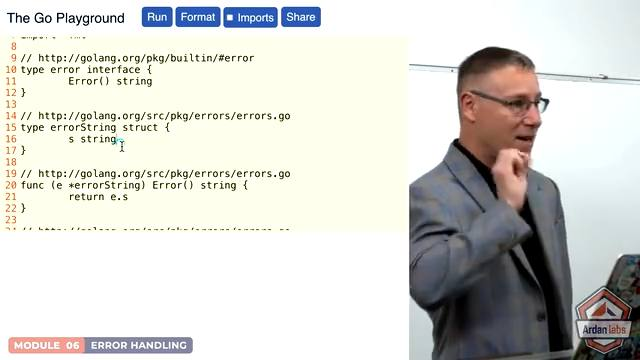
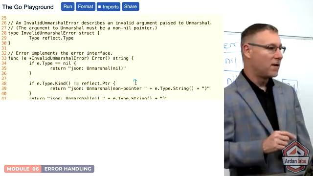
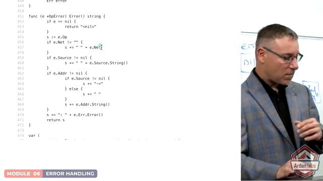
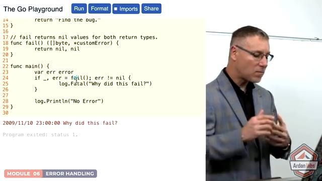

# Ultimate Go Language（P45–P49）错误处理复现文档

> 说明：课程标题包含“并发+benchmark”，但 P45–P49 的逐字稿实际主题是 Go 的 **error handling（错误处理）**，没有讲 goroutine、channel、锁、benchmark。本文只复现逐字稿里出现的错误处理机制；并发与 benchmark 部分，课里没讲。

## 1. 这一节做什么

这一节要做一个可以直接跑起来的 Go 小项目，把 P45–P49 里的错误处理链路串起来：

1. 用 `error` 接口表示错误，理解 `err != nil` 到底在判断什么。
2. 当函数可能返回多种错误时，用包级 `Err...` 变量做 sentinel error，再用 `switch err` 分流。
3. 当错误变量不够表达上下文时，用自定义错误类型，并用 `type switch` 做“type as context”。
4. 不想绑定具体错误类型时，用接口断言做“behavior as context”，只关心错误值有没有某个行为方法。
5. 复现一个经典 bug：函数签名直接返回具体错误类型，`return nil` 后赋值给 `error` 接口，`err != nil` 竟然为真。

最终目录里会有 5 个可独立运行的 `main` 包、1 个 `go.mod`、1 个 `run_all.sh`。没有任何第三方依赖，也不需要环境变量。读者是前端转 AI 应用工程师，Go 的接口语法可以按 TypeScript 的结构类型来理解：方法集匹配就算实现，语法细节知道即可。


## 2. 讲师原话（带「—— pNNN [MM:SS]」）

> "对我来说，错误处理只关乎一件事：要表现出对 API 用户的足够尊重，向他们提供关于其应用状态的有依据的信息。"
> —— p045 [00:28]

> "不能假设人类能够编写数百万行代码而不出错来开发系统。而且，仅靠调试并不是开发可靠系统的有效方式。"
> —— p045 [00:58]

> "这实际上是在问，error != nil 究竟是不是指 error 接口值里存着一个具体值？"
> —— p045 [07:35]

> "如果这个我们调用的函数返回了不止一个错误，会怎样？……当一个函数可能返回多个错误时，我希望你做的就是使用这些错误变量。"
> —— p046 [00:28]



> "既然现在你需要那个类型，对吧？也就是那个自定义错误类型，我们就可以开始讨论所谓的“类型作为上下文”了。"
> —— p047 [00:00]

> "我不在乎这个错误是 op、add 还是 DNS。我在乎的是这个错误值是否带有 temporary 方法。"
> —— p048 [06:13]


> "问题在于，每当我们在写代码并且要处理错误时，我们并没有使用自定义错误类型，而是使用了 error 接口。"
> —— p049 [03:16]



## 3. 从零复现

### 3.1 前置条件

- 本机已安装 `go` 命令。课里没讲如何安装 Go，下面假设你已经能运行 `go version`。
- 课里没讲 Go 版本。本文的 `go.mod` 写 `go 1.16`，示例代码只用 `interface{}` 而不是 `any`，避免版本差异。
- 第三方依赖：无。
- 环境变量：无。
- 启动方式：命令行 `go run`，程序跑完自然退出。

### 3.2 目录结构

```text
ultimate-go-error-handling/
├── go.mod
├── run_all.sh
├── p45_basic/
│   └── main.go
├── p46_error_vars/
│   └── main.go
├── p47_type_as_context/
│   └── main.go
├── p48_behavior_as_context/
│   └── main.go
└── p49_find_bug/
    └── main.go
```

### 3.3 初始化命令

```bash
mkdir ultimate-go-error-handling
cd ultimate-go-error-handling
go mod init ultimate-go-error-handling

mkdir -p p45_basic p46_error_vars p47_type_as_context p48_behavior_as_context p49_find_bug
```

然后把第 4 节的代码按文件路径保存。保存后执行：

```bash
go run ./p45_basic
go run ./p46_error_vars
go run ./p47_type_as_context
go run ./p48_behavior_as_context
go run ./p49_find_bug
```

或者一次跑完：

```bash
bash run_all.sh
```


## 4. 完整代码

### 4.1 `go.mod`

```go
// 文件：go.mod
module ultimate-go-error-handling

go 1.16
```

### 4.2 `p45_basic/main.go`

```go
// 文件：p45_basic/main.go
package main

import (
	"errors"
	"fmt"
)

// webCall 只返回一种错误，所以调用方只要知道“有没有错误”就够了。
func webCall() error {
	return errors.New("bad request")
}

func main() {
	if err := webCall(); err != nil {
		fmt.Println("error:", err)
		return
	}
	fmt.Println("happy path: webCall ok")
}
```

### 4.3 `p46_error_vars/main.go`

```go
// 文件：p46_error_vars/main.go
package main

import (
	"errors"
	"fmt"
)

// 逐字稿口述为 ERR bad request / ERR page moved。
// Go 导出变量通常写成 Err 开头，下面按 ErrBadRequest、ErrPageMoved 落地。
var (
	ErrBadRequest = errors.New("bad request")
	ErrPageMoved  = errors.New("page moved")
)

// webCall 可能返回两种错误之一。
func webCall(flag bool) error {
	if flag {
		return ErrBadRequest
	}
	return ErrPageMoved
}

func handle(err error) {
	if err == nil {
		return
	}

	switch err {
	case ErrBadRequest:
		fmt.Println("handle bad request")
	case ErrPageMoved:
		fmt.Println("handle page moved")
	default:
		fmt.Println("handle unknown error:", err)
	}
}

func main() {
	handle(webCall(true))
	handle(webCall(false))
}
```

### 4.4 `p47_type_as_context/main.go`

```go
// 文件：p47_type_as_context/main.go
package main

import (
	"encoding/json"
	"fmt"
)

type Person struct {
	Age int `json:"age"`
}

// 这里用 type switch 判断 error 接口里装的具体类型。
func handle(err error) {
	if err == nil {
		return
	}

	switch e := err.(type) {
	case *json.UnmarshalTypeError:
		fmt.Println("UnmarshalTypeError:", e)
	case *json.InvalidUnmarshalError:
		fmt.Println("InvalidUnmarshalError:", e)
	default:
		fmt.Println("default error:", e)
	}
}

func main() {
	var p Person

	// JSON 里 age 是字符串，Go 结构体里 Age 是 int，会得到 *json.UnmarshalTypeError。
	handle(json.Unmarshal([]byte(`{"age":"not-int"}`), &p))

	// 故意传入非指针，会得到 *json.InvalidUnmarshalError。
	handle(json.Unmarshal([]byte(`{"age":1}`), p))
}
```

### 4.5 `p48_behavior_as_context/main.go`

```go
// 文件：p48_behavior_as_context/main.go
package main

import "fmt"

// 课里用 net 包的 OpError、AddrError、DNSError 讲 behavior as context。
// 真实网络错误需要实际网络调用才稳定触发；下面用同形状的自定义错误值演示同一个行为断言。
// 这不表示讲师讲过这个自定义类型，只是复现用的稳定错误值。
type temporary interface {
	Temporary() bool
}

type networkError struct {
	msg  string
	temp bool
}

func (e *networkError) Error() string {
	return e.msg
}

func (e *networkError) Temporary() bool {
	return e.temp
}

func readString(temp bool) error {
	return &networkError{msg: "network error", temp: temp}
}

func main() {
	for _, temp := range []bool{true, false} {
		err := readString(temp)
		if err == nil {
			fmt.Println("read ok")
			continue
		}

		// 不关心具体是 *networkError 还是 net.OpError，
		// 只关心 error 里的具体值有没有 Temporary() bool 这个方法。
		if e, ok := err.(temporary); ok {
			if e.Temporary() {
				fmt.Println("temporary error, retry:", err)
				continue
			}
			fmt.Println("permanent error, stop:", err)
			continue
		}

		fmt.Println("unknown error:", err)
	}
}
```

### 4.6 `p49_find_bug/main.go`

```go
// 文件：p49_find_bug/main.go
package main

import "fmt"

type customError struct{}

func (e *customError) Error() string {
	return "custom error"
}

// 有 bug 的版本：函数签名直接返回具体错误类型 *customError。
func failBuggy() ([]byte, *customError) {
	return nil, nil
}

// 修复版：函数签名返回 error 接口。
// 修复版不是逐字稿显式给出的完整代码，是按讲师结论补的最小修复。
func failFixed() ([]byte, error) {
	return nil, nil
}

func main() {
	var err error
	_, err = failBuggy()
	if err != nil {
		fmt.Println("BUG: err != nil, but failBuggy returned nil")
		fmt.Printf("err type=%T value=%v\n", err, err)
	} else {
		fmt.Println("no error")
	}

	var fixed error
	_, fixed = failFixed()
	if fixed != nil {
		fmt.Println("fixed: unexpected error")
	} else {
		fmt.Println("fixed: no error, as expected")
	}
}
```

### 4.7 `run_all.sh`

```bash
#!/usr/bin/env bash
set -euo pipefail

cd "$(dirname "$0")"

go run ./p45_basic
go run ./p46_error_vars
go run ./p47_type_as_context
go run ./p48_behavior_as_context
go run ./p49_find_bug
```


## 5. 逐行解释

### 5.1 `p45_basic`：先判断“error 接口里有没有具体值”

- `func webCall() error`：函数返回 `error` 接口，而不是某个具体错误类型。逐字稿反复强调，错误处理要尽量保持 decoupled，也就是调用方先跟接口打交道。
- `errors.New("bad request")`：`errors.New` 返回的是 `error` 接口值，内部装的是一个指向 `errorString` 的具体值。逐字稿里说，这是 error 场景下工厂函数返回接口的一个例外。
- `if err := webCall(); err != nil`：这是 Go 常见的“一行里做两件事”：先调用，再把返回值赋给 `err`，然后判断 `err != nil`。`err` 的作用域只在 `if` 里，所以后面还可以复用同名变量。
- `err != nil` 不是“错误文本是不是空”，而是问：这个 `error` 接口里有没有装一个具体值。没有具体值就是 nil interface；有具体值，即使具体值本身是某种零值，它也可能不是 nil。这个点会在 `p49` 变成 bug。
- 成功路径保持最短：没有错误就继续往下走；有错误就处理并 `return`，避免 `else` 把正常逻辑缩进得很深。这是逐字稿强调的 happy path / line of sight。

在 JS/Node
/TypeScript 里，`err != nil` 最接近的类比是 `err != null`，但两者有个关键差别：JS 的 `throw` 只能抛出值，没有“接口里装没装具体值”这一层；Go 的 `error` 是一个接口，所以 `nil` 判断实际上是在检查接口的“动态类型 + 动态值”是否都为空。前端同学可以把它想成：一个 `Result<T, E>` 里的 `E` 槽位是不是空的，而不是 `E` 的字符串字段是不是空串。

另一点是变量命名：逐字稿明确说错误变量要用 `err`，如果你写成 `e`、`error1`、`problem`，讲师在代码评审里会挑出来。`p45_basic` 里 `if err := webCall(); err != nil` 就是标准写法。

### 5.2 `p46_error_vars`：多个错误值时改用 sentinel error 变量

- `var ( ErrBadRequest = ...; ErrPageMoved = ... )`：逐字稿讲的是把错误变量放在一个变量块里，定义在包的顶层，命名以 `ERR` 开头。Go 的导出标识符要以大写开头，所以落地成 `ErrBadRequest`、`ErrPageMoved`。课里口述的是“ERR bad request”“ERR page moved”这种命名风格，实际写代码时按 Go 惯例用 `Err` 前缀。
- `webCall(flag bool) error`：逐字稿里的 `webCall` 根据传入真假返回不同错误。这里保留这个形状，用 `flag` 决定返回哪一个 sentinel error。
- `switch err { case ErrBadRequest: ... }`：逐字稿说，当“只知道有错误”不够用时，就用 `switch` 对错误变量做分流。`switch err` 比较的是接口里的具体值和变量是否相等；因为 `ErrBadRequest` 和 `ErrPageMoved` 都是包级单例，所以可以直接用 `==` 比较。
- `default:` 分支必须有。逐字稿里说，要保留 default case，防止将来出现第三种错误时静默漏掉。
- 为什么不用自定义错误类型？逐字稿的回答是：先用默认的 `errorString`，先用错误变量；只有在变量给不出足够上下文时，才考虑自定义类型。不要为了自定义而自定义，那是 type pollution。

在 JS/Node 里对应的做法是：定义 `const ErrBadRequest = new Error("bad request")` 这样的单例，然后 `if (err === ErrBadRequest)`。区别是 JS 里 `Error` 不是接口，没法玩“接口里装具体值”这一层，只能靠引用相等或 `err.code` 之类的字段来分流。

### 5.3 `p47_type_as_context`：类型本身就是上下文

- `type Person struct { Age int }`：用来触发 JSON 反序列化的类型不匹配。
- `json.Unmarshal([]byte(`{"age":"not-int"}`), &p)`：JSON 里 `age` 是字符串，结构体里 `Age` 是 `int`，`encoding/json` 会返回 `*json.UnmarshalTypeError`。逐字稿里专门拿这个类型举例，说它是 JSON 包里用自定义错误类型补上下文的典型。
- `json.Unmarshal([]byte(`{"age":1}`), p)`：第二个参数传的是值而不是指针，会返回 `*json.InvalidUnmarshalError`。逐字稿里说，这个类型是用来提示“你忘了传地址”。
- `switch e := err.(type)`：这是 Go 的 type switch。`err.(type)` 只能在 `switch` 里用，作用是判断 `error` 接口里装的具体类型。逐字稿称之为 “type as context”：条件逻辑不再基于错误值本身，而是基于错误值的类型。
- `case *json.UnmarshalTypeError:`：注意这里匹配的是指针类型。逐字稿反复强调，自定义错误类型的 `Error()` 方法通常用指针语义实现，所以返回的是 `*T`，`type switch` 也要写 `*T`。
- `default:` 同样保留。逐字稿说 default 是兜底。
- 代价：逐字稿明确警告，type as context 是从解耦状态走回耦合状态。一旦具体错误类型改名、改字段、改包路径，这段 `switch` 就会跟着坏。所以讲师本人“tend to want to avoid it when it comes to error handling”。这一段代码是反面教材式的示范：能用，但要清楚代价。

在 JS/Node 里对应的是 `instanceof` 判断，比如 `if (err instanceof MyError)`。同样的问题：你把错误类改名或换继承结构，所有 `instanceof` 判断都会失效。TypeScript 里也可以用可辨识联合的 `kind` 字段，但那已经是另一套思路了，课里没讲。

### 5.4 `p48_behavior_as_context`：只关心“能不能做某事”

- `type temporary interface { Temporary() bool }`：逐字稿里说，`net` 包内部有一个未导出的 `temporary` 接口，`OpError`、`AddrError`、`DNSError` 这些具体错误类型都实现了它。因为接口未导出，包外不能直接用它做类型断言，所以讲师的做法是自己定义一个同形状的接口，逐字稿里开玩笑说“I could also call it the bill interface”。
- `networkError` 和它的 `Error()`、`Temporary()` 方法：这是本文为了稳定复现加的自定义错误值。逐字稿用的是 `net` 包的真实错误，但要稳定触发 `net.OpError` 需要真的发起网络调用，结果不稳定。这里用同形状的错误值演示同一套断言逻辑，并在代码注释里写清楚“不是讲师讲过的类型”。
- `if e, ok := err.(temporary); ok`：这是普通的类型断言，不是 type switch。断言的目标是接口 `temporary`，不是具体类型。只要 `err` 里的具体值有 `Temporary() bool` 方法，`ok` 就是 `true`。
- `if e.Temporary() { ... } else { ... }`：逐字稿里说，网络错误的处理逻辑就是调 `Temporary()`：临时错误可以重试，非临时错误说明 socket 或 listener 出了问题，属于完整性事故。
- 为什么这比 type as context 好：逐字稿的原话是“我不在乎错误是 op、add 还是 DNS，我在乎的是错误值有没有 temporary 方法”。将来 `net` 包新增一种带 `Temporary()` 的错误类型，这段代码不用改，因为它断言的是行为，不是具体类型。这就是 behavior as context。
- 注意：`p48` 用的是“接口断言 + if”，不是 type switch。逐字稿里讲师是把原来三个 `case` 合并成一个 `case`，这个“合并”在 Go 里既能用 type switch 写 `case temporary:`，也能用单次类型断言写。这里选单次断言，因为它最直接地表达“只问一个问题：有没有这个行为”。

在 JS/Node 里对应的是 duck typing：`if (typeof err.temporary === "function" && err.temporary())`。JS 没有接口，所以行为判断只能靠运行时检查方法是否存在。Go 的接口断言等于把这个检查变成了编译期可验证的方法集匹配。

### 5.5 `p49_find_bug`：nil 的两种类型

- `func failBuggy() ([]byte, *customError)`：bug 就在这里。返回类型写的是具体类型 `*customError`，不是 `error` 接口。
- `return nil, nil`：函数确实返回了 nil，逐字稿说“There is no doubt that nil is being returned”。
- `var err error; _, err = failBuggy()`：赋值时发生了隐式转换。右边第二个返回值是 `*customError` 类型的 nil 指针，赋给 `error` 接口后，接口里装了一个“类型是 `*customError`、值是 nil”的具体值。于是接口本身不是 nil。
- `if err != nil` 为真：逐字稿的原话是“at runtime, the program is saying that there is a concrete value stored inside of ERR”。明明返回了 nil，调用方却认为有错误，这就是 bug。
- `fmt.Printf("err type=%T value=%v\n", err, err)`：`%T` 打出动态类型 `*main.customError`，`%v` 打出 `<nil>`。这两个输出正好把“类型非空、值空”的状态摊开给你看。注意：这个格式化输出是本文为了让你看到 bug 加的，逐字稿没有逐字给这条打印语句。
- `failFixed() ([]byte, error)`：修复方式就是把返回类型从 `*customError` 改成 `error`。这样 `return nil, nil` 里的第二个 nil 直接成为 nil interface，`err != nil` 为假。逐字稿的结论是“写错误处理时不要用自定义错误类型做返回类型，要用 error 接口”，修复版代码是按这个结论补的最小改动。
- 这个 bug 的通用教训：任何“返回具体错误类型”的函数，只要它可能返回 nil，调用方用 `err != nil` 判断就会踩坑。逐字稿说这个 bug“eventually everybody makes usually very early on”。

在 JS/Node 里没有完全对应的坑，因为 JS 没有接口和 typed nil。最接近的是 `Promise` resolve 了一个 `undefined` 但还是走了 `.catch`，或者 TypeScript 里 `null` 和 `undefined` 的区分。Go 的 typed nil 是接口机制特有的，前端同学记住结论即可：**错误一律用 `error` 接口返回，不要用具体错误类型做返回类型**。





## 6. 复现检查清单

按顺序打勾，任何一项不通过就回到对应小节。

**环境与初始化**

- [ ] `go version` 能输出版本号。
- [ ] 当前目录下有 `go.mod`，第一行是 `module ultimate-go-error-handling`。
- [ ] 五个子目录都存在：`p45_basic`、`p46_error_vars`、`p47_type_as_context`、`p48_behavior_as_context`、`p49_find_bug`。
- [ ] 每个子目录下都有一个 `main.go`，且都是 `package main`。

**P45 基础错误处理**

- [ ] `go run ./p45_basic` 输出 `error: bad request`。
- [ ] 能口头解释 `err != nil` 问的是“接口里有没有具体值”，不是“字符串是不是空”。

**P46 多个错误变量**

- [ ] `go run ./p46_error_vars` 依次输出 `handle bad request` 和 `handle page moved`。
- [ ] 代码里 `ErrBadRequest`、`ErrPageMoved` 定义在包级 `var` 块里。
- [ ] `switch` 带 `default` 分支。

**P47 type as context**

- [ ] `go run ./p47_type_as_context` 先输出 `UnmarshalTypeError:` 开头的一行，再输出 `InvalidUnmarshalError:` 开头的一行。
- [ ] 能解释为什么 `case` 写的是 `*json.UnmarshalTypeError` 而不是 `json.UnmarshalTypeError`（因为 `Error()` 用指针语义实现）。
- [ ] 能说出 type as context 的代价：绑定具体类型，类型一改代码就坏。

**P48 behavior as context**

- [ ] `go run ./p48_behavior_as_context` 依次输出 `temporary error, retry: network error` 和 `permanent error, stop: network error`。
- [ ] 能解释 `err.(temporary)` 断言的是接口，不是具体类型。
- [ ] 能说出这比 type as context 好在哪：新增错误类型只要带 `Temporary()` 方法就自动被处理，代码不用改。

**P49 find the bug**

- [ ] `go run ./p49_find_bug` 先输出 `BUG: err != nil, but failBuggy returned nil`，再输出类型为 `*main.customError`、值为 `<nil>` 的一行，最后输出 `fixed: no error, as expected`。
- [ ] 能指出 bug 的具体位置：`failBuggy` 的返回类型写的是 `*customError` 而不是 `error`。
- [ ] 能说出修复方式：把返回类型改成 `error`。

**一次跑完**

- [ ] `bash run_all.sh` 能按 p45 → p46 → p47 → p48 → p49 的顺序跑完，没有报错。

## 7. 课里没讲但你会撞上的

1. **Go 的安装和版本。** P45–P49 没有讲怎么装 Go，也没有指定 Go 版本。`go.mod` 里的 `go 1.16` 是本文为了兼容 `interface{}` 写的示例值，不是课程要求。你本机版本更高也能跑，`go mod init` 可能会自动改写这一行。

2. **`go vet` 和 `staticcheck` 对 `p49` 这类 bug 的检测。** 课里没提静态检查工具。实际上，把具体错误类型作为返回类型这种写法，部分 linter 会警告，但不是所有情况都能抓到。所以最终还是靠人记住“错误返回用 `error` 接口”这条规则。

3. **错误包装（`%w`、`errors.Is`、`errors.As`）。** 逐字稿里只讲了 sentinel error 变量、type switch、接口断言三种方式，完全没讲 Go 1.13 引入的错误包装机制。如果你按本文写完 `p46`，再去看现代 Go 代码，会大量看到 `fmt.Errorf("...: %w", err)` 和 `errors.Is(err, ErrBadRequest)`。那套机制和本课的 sentinel 比较是同一件事的升级版：`errors.Is` 能穿透包装层去比较 sentinel，`errors.As` 能穿透包装层做类型断言。课里没讲，但你在真实项目里一定会撞上。

4. **`%w` 和本文 `switch err` 的冲突。** 一旦有人用 `fmt.Errorf("...: %w", ErrBadRequest)` 包装过错误，`switch err { case ErrBadRequest: }` 就不再匹配了，因为 `err` 里装的已经不是那个 sentinel 单例，而是一个包装后的错误值。这时候必须改用 `errors.Is`。这个坑课里没讲，但它是把本文 `p46` 代码搬进现代项目后最常见的失效方式。

5. **并发场景下的 error 处理。** 课程标题里有“并发”，但 P45–P49 的逐字稿没有涉及 goroutine、channel、`sync`、`context`。如果你后面要在并发里收集多个错误，会遇到 `errgroup`、`channel` 传错误、`context` 取消这类问题，这些都不在本文覆盖范围里，课里这几集也没讲。

6. **`net` 包错误类型的真实触发条件。** `p48` 用自定义 `networkError` 替代了 `net.OpError`、`AddrError`、`DNSError`，因为稳定触发真实网络错误需要实际网络环境。逐字稿里讲师是直接在标准库源码里看 `OpError` 和 `Temporary()` 的实现，没有跑真实网络调用。如果你想知道这些真实错误长什么样，需要自己发起 TCP/UDP 请求并断网或连不存在的地址，那部分课里没讲。

7. **`error` 接口的 `Error()` 方法为什么用指针接收者。** 逐字稿反复说自定义错误类型的 `Error()` 用 pointer semantics，但没有展开讲“值接收者会怎样”。实际后果是：如果 `Error()` 用值接收者，那么 `T` 和 `*T` 都实现 `error`；如果用指针接收者，只有 `*T` 实现 `error`。`p49` 的 bug 正是指针接收者 + 具体返回类型组合出来的。这个机制课里点到了指针语义，但没有系统讲清值接收者和指针接收者的差别。

8. **`type switch` 里 `case` 的匹配顺序。** 课里展示了 `switch e := err.(type)` 的写法，但没讲多个 `case` 的匹配顺序和“第一个匹配生效”的规则。如果你把接口类型的 `case` 写在具体类型 `case` 前面，具体类型的分支可能永远进不去，因为接口 `case` 先匹配上了。这个顺序坑课里没讲。

9. **前端同学最容易误用的地方：把 `err.Error()` 的字符串当判断依据。** 逐字稿明确说“If they have to parse the string, you failed”，但实际项目里很多人会写 `if strings.Contains(err.Error(), "bad request")`。这在 JS 里对应 `if (err.message.includes("bad request"))`，是同一个反模式。课里讲了原则，但没有专门列这个反例，这里补一句：不要在调用方解析错误字符串。

10. **`p47` 依赖 `encoding/json` 的具体错误类型，这些类型不是稳定 API 的全部。** `json.UnmarshalTypeError` 和 `json.InvalidUnmarshalError` 是导出类型，可以断言，但它们的字段和 `Error()` 输出格式不保证跨 Go 版本完全不变。这正是逐字稿警告 type as context 会耦合的原因：你绑定了别人包里的具体类型，别人改实现你就得跟着改。课里讲了原则，没有逐个字段核对，实际项目里升级 Go 版本时建议跑一遍 `p47` 确认输出。

---

至此 P45–P49 的复现文档完整。核心记住三句话：`err != nil` 问的是接口里有没有具体值；能用 sentinel 变量就别上自定义类型；非得上自定义类型时，优先用行为断言而不是类型断言。P49 的 bug 是这三条规则的集中反例。