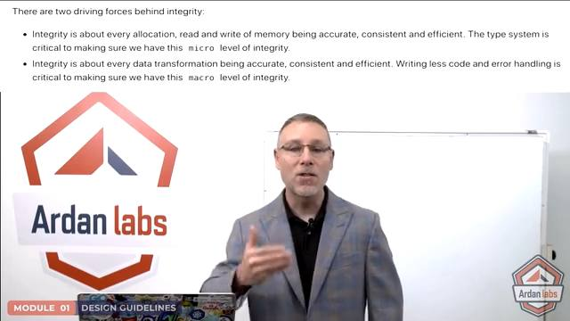
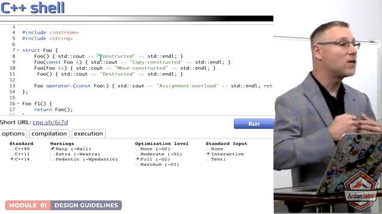
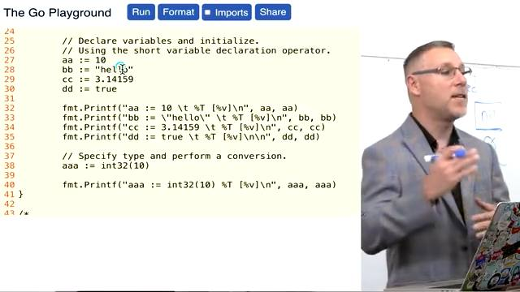

# Ultimate Go 语言（并发 + benchmark）P5–P7 复现文档

> 适用读者：前端转 AI 应用工程师。本课程 P5–P7 是**纯讲解课**（逐字稿里没有可运行代码，只有讲师在 Go Playground 上展示的变量声明片段）。因此本文档按「纯讲解课」结构写：第 3 节复现讲师的推导过程，第 4 节把讲师的结论落成可用的产物（决策表 + 示意代码），第 5 节逐条解释为什么这样定。凡是逐字稿没讲的内容，一律标注「课里没讲」。

---

## 1. 这一节做什么

P5–P7 三集是整门课**动手写代码之前的「心智模型安装」**，不产出可运行项目，产出的是三条贯穿全课的工程准则和一套 Go 变量声明规范。具体交付物是：

- **P5**：确立代码评审的三级优先级 —— **integrity（完整性）> readability（可读性）> simplicity（简洁性）**，并解释为什么 Go 语言在设计上（没有构造函数/析构函数/运算符重载、有 error 返回值、有零值）是在为 integrity 服务。
- **P6**：给出「性能为什么不够快」的四层原因排序 —— **外部延迟 > 内部延迟 > 数据访问方式 > 算法效率**，并给出每层对应的量级（毫秒 / 微秒 / 纳秒）。
- **P7**：讲 Go 的**类型系统与变量声明**，核心结论是「type is life」——类型同时告诉你**内存大小**和**内存表示**；并定下团队规范：`var` 只用于零值声明，短变量声明 `:=` 只用于非零值初始化，Go 用**转换（conversion）**而不是**强转（casting）**。

对前端转 AI 应用工程师来说，这一节的价值在于：你以后写 Go 服务（比如给 LLM 推理服务做 API 网关、写并发调用多个模型的编排层）时，会不断遇到「这个变量该用 `var` 还是 `:=`」「这个错误要不要吞」「这个抽象层是不是在藏成本」这类判断，P5–P7 给的就是判断依据。

---

## 2. 讲师原话

以下引用均来自逐字稿，标注页码与时间戳。

**关于 integrity 是第一优先级：**

> "我需要你把完整性放在首位。没有什么能凌驾于完整性之上。一旦我们看到一段不具备完整性的代码，那次代码审查就必须停下来。"
> —— p005 [03:42]

> "关于完整性，有意思的一点是，它并非没有代价。就像没有什么是不需要代价的。通常，完整性的代价是性能。我们会损失一点性能，也许只是几纳秒的性能，但没有什么是不需要代价的。"
> —— p005 [08:52]

**关于「每 20 行代码一个 bug」：**

> "每编写一千行代码，普通开发者每千行代码会产生 15 到 50 个缺陷……你每写 20 行代码，就会有一个缺陷被引入软件中。"
> —— p005 [04:12] – [04:42]

**关于错误处理不是可选项：**

> "在那 48 次严重故障中，92% 本来只要更好的错误处理就能避免。"
> —— p005 [07:29]

**关于可读性 = 不隐藏成本：**

> "可读性的另一个方面是，我们不隐藏代码的代价。我们不会编写隐藏代价的代码。"
> —— p005 [09:47]

> "同一个函数调用放在两个不同的上下文中，会产生两种不同的行为和两种不同的代价。我们不可能一边保留这样的代码，一边还维持任何心智模型或任何可预测性。"
> —— p005 [13:33]

**关于简洁性是最后一步、要靠重构得到：**

> "简洁放在最后，因为它是你必须通过重构才能达到的状态。你不可能第一天就做到简洁……如果说可读性关乎不隐藏代价，那么简洁则关乎隐藏复杂度。"
> —— p005 [16:46] – [17:13]

**关于性能四层原因：**

> "第一是外部延迟……这里说的是毫秒级的延迟。"
> —— p006 [00:27] – [00:55]

> "第二是内部延迟成本。这里更多说的是微秒级的延迟。"
> —— p006 [01:25]

> "第三……是我们如何访问机器上的数据……延迟从纳秒级一直到甚至微秒级。"
> —— p006 [02:50]

> "第四是算法效率……除非我们确实在讨论紧密循环，否则我总会把算法效率归到第四位。"
> —— p006 [02:22] – [02:50]

**关于 type is life：**

> "作为一名软件开发者，你能理解的最重要的事情，就是类型这个概念。类型就是生命……类型代表两件事：我们将要读写的内存大小，以及这块内存所表示的内容。"
> —— p007 [00:23] – [00:51]

**关于 var 与短变量声明的分工：**

> "我们使用关键字 var 来表示零值构造……如果我们不想要零值呢？……这时我们就会使用短变量声明运算符。"
> —— p007 [08:20] – [10:05]

**关于 conversion over casting：**

> "Go 已经取消了强制转换；你仍然可以从 unsafe 包中用到它，但作为语言的核心部分，我们选择类型转换而不是强制转换，因为完整性必须更重要。"
> —— p007 [13:41]

---

## 3. 从零复现

这一节没有「跑起来」的项目，复现的是**讲师的推导链条**。按顺序走一遍，你就能得到第 4 节那几张表。

### 步骤 1：确立评审优先级（P5）

讲师给的顺序是固定的，不能调换：

1. **Integrity** —— 每一次内存读、每一次内存写都必须 **accurate（准确）、consistent（一致）、efficient（高效）**。三者丢一个就是 integrity 问题；恢复不了就必须停掉软件。
2. **Readability** —— 分主观和可测量两部分：主观部分是「团队里**平均水平的开发者**要能对代码库有完整心智模型」；可测量部分是「**不隐藏成本**」。
3. **Simplicity** —— 通过重构得到，不是第一天能写出来的。它和 readability 有张力：readability 要求不隐藏成本，simplicity 要求隐藏复杂度，**但隐藏复杂度不能以丢失可读性为代价**。



### 步骤 2：算一笔「代码行数 → bug 数」的账（P5）

讲师引用的研究结论：**每 1000 行代码产生 15–50 个 bug**。取悲观值 50，则：

```
50 bugs / 1000 LOC = 1 bug / 20 LOC
```

结论：**每写 20 行代码，就有一个 bug 被引入**（是否暴露是另一回事）。所以「写更少的代码」本身就是 integrity 手段。讲师还补了三条副作用：多余的代码给 bug 提供藏身处、导致测试写不全、最终让人放弃既有模式开始 hack。

### 步骤 3：用 C++ 反例说明「隐藏成本」（P5）

讲师展示了一段 C++（约 27 行）：第 7–14 行定义类型 `foo`，带构造函数、析构函数、移动构造、拷贝构造、赋值运算符重载；第 16 行函数 `f1` 构造一个 `foo` 并**按值返回**；第 23 行和第 27 行各调用一次 `f1`。

讲师提出的问题：**这个程序运行时到底创建了几个 `foo` 对象？构造/析构/拷贝/移动分别在什么时候执行？** 答案是「取决于 C++ 编译器版本和优化」。讲师实际运行的结果是：第 23 行那次调用，编译器把拷贝优化掉了，只构造 1 个对象；第 27 行那次调用，函数内构造 + 返回拷贝，行为完全不同。

**同一个函数调用，两个上下文，两种成本。** 这就是「隐藏成本」。Go 没有构造函数、析构函数、运算符重载，正是为了让你看一行代码就能大致预测它的开销。



### 步骤 4：给性能问题排四层（P6）

讲师给的排序和量级：

| 排名 | 原因 | 量级 | 课里是否展开 |
|---|---|---|---|
| 1 | 外部延迟（系统调用、等网络） | 毫秒 | 本课不展开 |
| 2 | 内部延迟（GC、同步、编排） | 微秒 | 本课展开 |
| 3 | 数据在机器上的访问/存储方式 | 纳秒 ~ 微秒 | 本课展开 |
| 4 | 算法效率 | 仅在 tight loop 里才重要 | 本课展开 |

讲师对第 4 名的态度很明确：**如果算法效率低一点能换来更好的可读性，选可读性。** 对第 1 名，他顺带吐槽了微服务——跨进程处理请求，光这一跳就已经吃进毫秒级延迟。


### 步骤 5：建立「类型 = 大小 + 表示」的模型（P7）

讲师从最小单位推起：

- Go 的基本内存单位是 **byte = 8 bit**。
- 给你一个字节的位模式，**不告诉你类型，你无法说出它代表什么**。
- 告诉你是 1 字节整数 → 它是 10；告诉你是颜色表 → 它是红色。
- 所以**类型提供两条信息**：要读写多少内存（大小），以及这块内存代表什么（表示）。integrity 就来自这两条。


### 步骤 6：推导 `int` 为什么不该写精度（P7）

- Go 有 `int8/16/32/64`，但**大多数时候应该用 `int`**。
- 理由：机器是整数机器，读写都是整数；**最高效的整数宽度取决于架构的地址宽度**。
- 32 位架构 → 最高效 int 是 4 字节；64 位架构 → 8 字节。
- 用 `int` 让编译器替你选。写 `int32` 属于「不 obvious 就停下代码评审」的范畴。
- 例外：确实需要固定宽度时（讲师说后面讲并发时会遇到），才用精度版。

**word（字）的定义**：一个通用分配单元，能装一个整数**或**一个地址。64 位机器上 word = 8 字节，32 位机器上 word = 4 字节。

**Playground 的特殊性**：讲师说 Playground 是 `amd64p32` 架构 —— 除了地址是 32 位（4 字节）之外，其他都是 64 位。所以**在 Playground 上，int 是 4 字节，word 是 4 字节**；在讲师的本地 64 位机器上，int 是 8 字节，word 是 8 字节。这一点直接影响你后面看 benchmark 数字时的解读。

### 步骤 7：推导零值（zero value）（P7）

- Go 规定：**内存一旦分配就必须初始化**。不指定初始值，编译器把这块内存的**所有位清零**。
- 所以 `var a int` → 0，`var s string` → 空串，`var f float64` → 0，`var b bool` → false。
- 声明变量时你要先决定：**我要零值，还是要别的值？**

### 步骤 8：定下声明规范（P7）

讲师承认 Go 的变量声明方式「太多，是个 wart（缺陷）」，然后给出团队规范：

- **`var` 关键字 = 零值构造**。看到 `var` 就知道「这块内存被清零了」。
- **短变量声明 `:=` = 非零值初始化**。它是「生产力运算符」，声明 + 构造一步完成，右侧的值决定类型。
- 讲师说：你可以全部用 `:=`，只要你团队一致；但他承诺「`var` 管零值、`:=` 管非零值」会让代码库**更一致、更可读**。

### 步骤 9：推导 string 的内存布局（P7）

- Go 的 string 是**两字（two-word）值**。
- 第一个 word 是**指针**，指向字节序列起始处；零值时是 `nil`。
- 第二个 word 是**整数**，表示字节数；零值时是 0。
- 所以空串 = (nil, 0)；`"hello"` = (指向 5 字节的指针, 5)。


### 步骤 10：推导 conversion over casting（P7）

- **casting（强转）**：分配了 1 字节，却让编译器「假装」它是 4 字节，去读那 4 个字节。多出来的 3 字节内容不可控。讲师说这在「把网络来的内存上叠加一个结构体」时最容易出大 bug —— 差一个字节就完蛋。
- **conversion（转换）**：老老实实分配 4 字节，把值拷/移过去。多一次分配，但安全。
- Go 把 casting 从语言核心拿掉了，只留在 `unsafe` 包里。语法上 conversion 长得像函数调用：`int32(10)`。



---

## 4. 完整代码

> **课里没有可运行的项目代码。** P5–P7 逐字稿中讲师只在 Go Playground 上展示了变量声明片段（第 15–18 行、第 27–30 行、第 38 行），没有给出完整文件。下面第 4.1 节是**按讲师描述复原的示意代码**，明确标注「课里没有代码，以下为示意」；第 4.2–4.4 节是把讲师结论落成的**决策表**，这才是本节真正的交付物。

### 4.1 示意代码：变量声明与转换（课里没有完整代码，以下为示意）

以下文件按讲师在 P7 描述的行号结构复原，**不是逐字稿原文**，仅用于让你把第 5 节的解释对上具体行。

`variables/main.go`：

```go
package main

import "fmt"

func main() {
	// ---- 零值构造：用 var ----
	var a int      // 0
	var b string   // ""
	var c float64  // 0
	var d bool     // false

	fmt.Printf("a=%d b=%q c=%f d=%t\n", a, b, c, d)

	// ---- 非零值初始化：用短变量声明 ----
	aa := 10
	bb := "hello"
	cc := 3.14
	dd := true

	fmt.Printf("aa=%d bb=%q cc=%f dd=%t\n", aa, bb, cc, dd)

	// ---- 转换，不是强转 ----
	var small int8 = 10
	big := int32(small) // 新分配 4 字节，把值移过去
	fmt.Printf("small=%d big=%d\n", small, big)
}
```

运行：

```bash
go run variables/main.go
```

预期输出（字段名以你本地 `fmt` 实际输出为准）：

```
a=0 b="" c=0.000000 d=false
aa=10 bb="hello" cc=3.140000 dd=true
small=10 big=10
```

> 说明：逐字稿里讲师没有给出这段代码的完整 `main` 函数和 `fmt.Printf` 语句，上面是为了让文件能直接 `go run` 而补的最小骨架。变量声明本身（`var a int` / `aa := 10` / `int32(...)`）与讲师在 Playground 上展示的形式一致。

### 4.2 决策表 A：代码评审优先级（来自 P5）

| 优先级 | 准则 | 判定问题 | 违反时的动作 | 代价 |
|---|---|---|---|---|
| 1 | Integrity | 每次读写是否 accurate / consistent / efficient？ | 评审立即停止，先修 | 牺牲一点性能（可能只是纳秒级） |
| 2 | Readability（主观） | 团队**平均水平**开发者能否对代码库有完整心智模型、能 debug、能教别人？ | 重构到能 | 需要持续投入重构时间 |
| 3 | Readability（可测量） | 这行代码有没有隐藏成本？看一行能否预测它的开销？ | 拆掉隐藏成本的抽象层 | 可能要多写一点冗余代码 |
| 4 | Simplicity | 能否在不丢失可读性的前提下隐藏复杂度？ | 通过重构逐步达成 | 不能第一天就有 |

### 4.3 决策表 B：性能问题排查顺序（来自 P6）

| 顺序 | 类别 | 量级 | 典型来源 | 本课是否深入 |
|---|---|---|---|---|
| 1 | 外部延迟 | 毫秒 | 系统调用、等网络、跨进程/微服务跳转 | 否 |
| 2 | 内部延迟 | 微秒 | 垃圾回收、同步、编排 | 是 |
| 3 | 数据访问方式 | 纳秒 ~ 微秒 | 数据在机器上如何存取 | 是 |
| 4 | 算法效率 | — | 仅在 tight loop 中才成为瓶颈 | 是（有限） |

### 4.4 决策表 C：变量声明规范（来自 P7）

| 场景 | 写法 | 示例 | 读者能推断出什么 |
|---|---|---|---|
| 要零值 | `var` | `var a int` | 这块内存已被清零 |
| 要非零值 | `:=` | `aa := 10` | 声明 + 构造一步完成，类型由右值决定 |
| 需要固定宽度整数 | 精度类型 | `var x int32` | 必须固定宽度（否则评审会问为什么） |
| 一般整数 | `int` | `var n int` | 宽度跟随架构，最高效 |
| 类型转换 | `T(v)` | `int32(small)` | 新分配 + 移动值，安全 |
| 真的需要强转 | `unsafe` 包 | 课里没展开 | 风险自负 |

### 4.5 决策表 D：类型提供的信息（来自 P7）

| 类型 | 大小 | 表示 | 零值 |
|---|---|---|---|
| `bool` | 1 字节（实际只需 1 bit） | true / false | false |
| `int` | 跟随架构（32 位机 4 字节 / 64 位机 8 字节） | 整数 | 0 |
| `int8/16/32/64` | 固定 1/2/4/8 字节 | 整数 | 0 |
| `float64` | 8 字节 | IEEE 754 二进制浮点 | 0 |
| `string` | 2 个 word（64 位机 16 字节 / Playground 8 字节） | 第一个 word 是指针，第二个 word 是字节长度 | (nil, 0) 即空串 |

---

## 5. 逐行解释

### 5.1 为什么 integrity 排第一，且「不免费」

讲师的原话是 integrity 的代价「通常是性能，也许只是纳秒」。这句话要这么读：**你为了正确性多做的每一次检查、多分配的每一块内存、多返回的每一个 error，都在花性能。** 但讲师的选择是「全天候接受这个损失」，因为一旦 integrity 崩了（数据被悄悄写坏、错误被吞掉），软件不是变慢，是**必须停机**。

对前端背景的读者：你在 JS 里习惯的 `try/catch` 吞异常、`any` 类型绕过检查，在 Go 的这套价值观里都属于「拿 integrity 换省事」。Go 的 `error` 返回值很啰嗦，但讲师认为**啰嗦是对的**——他拿「双因素认证很烦但很安全」作类比。

### 5.2 为什么「每 20 行一个 bug」能推出「少写代码」

这是一个纯算术推论，不是修辞：

```
悲观 bug 密度 = 50 bugs / 1000 LOC
             = 1 bug / 20 LOC
```

所以「少写代码」不是风格偏好，是**直接降低 bug 引入速率**。讲师还补了三条间接机制：多余代码给 bug 提供藏身处；代码多了测试写不完，留下不完整测试；最后人会放弃既有模式开始 hack。这三条都是「代码量 → 维护心智模型崩塌」的传导链。

### 5.3 为什么 C++ 那段是「隐藏成本」的教科书反例

关键不在 C++ 本身，而在**同一行源码在不同上下文产生不同开销**。第 23 行 `foo foo1 = f1();` 和第 27 行 `foo1 = f1();` 看起来都是「调一次 f1」，但：

- 第 23 行：编译器可以把返回值的拷贝优化掉，只构造 1 个对象。
- 第 27 行：函数内构造 1 个 + 返回拷贝 1 个，行为不同。

讲师说「你不问我是哪个 C++ 版本，你已经答错了」——因为不同编译器版本优化策略不同。**当一行代码的开销取决于你看不见的编译器决策时，你就无法建立心智模型，也无法预测 profiler 里会不会出现它。** Go 去掉构造/析构/运算符重载，就是为了让「看一行、猜开销」这件事重新变得可能。

### 5.4 为什么 readability 要分「主观」和「可测量」两半

- **主观那半**的判据是「团队**平均水平**开发者」。讲师特意强调 average，不是最强的人。他还给了一个自我评估法：先问「我是不是平均水平」，如果不是，问「我在做什么让自己变成平均」；如果是，问「我有没有在帮团队维持平均」。他甚至说「写聪明的代码伤害团队，可能比写得差更糟」。
- **可测量那半**就是「不隐藏成本」。这两半必须同时满足：一段代码可以「团队都看得懂」但「藏了成本」（比如一个看起来无害的 getter 实际发起了网络请求），那也不算可读。

### 5.5 为什么 simplicity 排最后，且和 readability 有张力

讲师的原话是「readability 是不隐藏成本，simplicity 是隐藏复杂度」。这两件事方向相反：

- 隐藏成本 = 坏（你预测不了开销）。
- 隐藏复杂度 = 好（你把一堆细节包起来，调用方不用管）。

**分界线是「隐藏复杂度之后可读性还在不在」。** 如果你用一个泛型抽象把复杂度藏起来，但团队平均开发者看不懂了，那这个抽象不合格。所以 simplicity 只能通过**持续重构**得到，不能第一天设计出来。讲师还专门反驳了「我没时间重构」：他说「你是没时间**不**重构」。

### 5.6 为什么性能排序把「算法」放最后

因为前三项的量级差太大：

- 外部延迟是**毫秒**（10⁻³ 秒）。
- 内部延迟是**微秒**（10⁻⁶ 秒）。
- 数据访问是**纳秒到微秒**。
- 算法效率只在 **tight loop**（热点循环）里才累积成可观开销。

所以讲师的实践建议是：**如果一个稍低效的算法能让代码明显更可读，选可读的。** 这和第 5.1 节的价值观一致——可读性优先级高于那点性能。注意这不是说算法不重要，而是说**在非热点路径上，别为了常数因子牺牲可读性**。

### 5.7 为什么 `int` 不写精度

因为「最高效的整数宽度 = 架构地址宽度」。写 `int32` 在 64 位机上等于**主动放弃最高效的宽度**。讲师的评审规则是：如果你用了精度版 int 而理由不 obvious，评审停下。他还预告了例外场景（后面讲并发时会遇到确实需要固定宽度的地方），但那是例外。

**对前端读者的类比**：这有点像 JS 里你不写 `new Number()` 而用字面量——让运行时选它最优的表示，而不是你手动指定一个可能更差的。

### 5.8 为什么 Playground 的 int 是 4 字节

讲师说 Playground 是 `amd64p32`：**除了地址是 32 位，其他都是 64 位**。所以：

- 地址 = 4 字节 → `int` 跟随地址宽度 = 4 字节。
- word = 4 字节。
- string 是 2 个 word = 8 字节。

而讲师本地 64 位机：地址 8 字节 → `int` 8 字节，word 8 字节，string 16 字节。**这个差异会直接影响你后面读 benchmark 数字**——同一个程序在 Playground 和本地跑，内存布局不同。

### 5.9 为什么零值能提升 integrity

因为「内存一旦分配就必须初始化」这条规则**消灭了一整类 bug**：读到未初始化内存的垃圾位模式。编译器强制把所有位清零，你就永远不会读到「上次谁留下的值」。代价是每次分配都要写零（性能），收益是「读到的每个值都是确定的」（integrity）。这又是第 5.1 节那个 trade-off 的具体实例。

### 5.10 为什么 `var` 和 `:=` 要分工

因为 Go 的声明方式太多，**读者看到一种写法时无法推断作者的意图**。分工之后：

- 看到 `var a int` → 读者知道「作者要零值」。
- 看到 `aa := 10` → 读者知道「作者要 10，类型由 10 推出」。

讲师承认「你全用 `:=` 也行，只要团队一致」，但他承诺这个分工让代码库**更一致、更可读**。这是第 5.4 节「主观可读性」的具体落地——一致性本身就是可读性。

### 5.11 为什么 string 是两字结构

因为 Go 的 string 需要同时表达「数据在哪」和「有多长」：

- 第一个 word 是指针 → 数据起始地址。零值时是 `nil`。
- 第二个 word 是整数 → 字节数。零值时是 0。

所以空串不是「一个特殊值」，而是 `(nil, 0)` 这个普通组合。`"hello"` 是 `(指向 5 字节的指针, 5)`。理解这个结构，你才能理解为什么 Go 的 string 是**不可变**的、为什么切片 string 不拷贝底层字节、为什么 string 和 `[]byte` 互转要拷贝。

### 5.12 为什么 conversion 比 casting 安全

casting 的本质是「**用更大的类型去读一块更小的内存**」：

```
分配了 1 字节：[10]
casting 成 4 字节整数：读 [10][?][?][?]  ← 后 3 字节内容不可控
```

讲师说这在「网络来的内存上叠加结构体」时最危险——差一个字节就解析出垃圾。conversion 的做法是：

```
分配了 1 字节：[10]
conversion 成 4 字节：新分配 [0][0][0][10]，把 10 移过去
```

多一次分配，但**读到的每个字节都是你写的**。Go 把 casting 赶进 `unsafe` 包，就是逼你走安全路径。语法上 `int32(x)` 长得像函数调用，这是 Go 的刻意设计——让转换看起来像一次「操作」，而不是一次「免费的重解释」。

---

## 6. 复现检查清单

按顺序打勾，全部通过说明你已把 P5–P7 的结论内化并能落地。

**环境准备**

- [ ] 已安装 Go（版本课里没指定，用你本地最新稳定版即可），`go version` 能输出。
- [ ] 已建目录 `variables/`，把 4.1 节的 `main.go` 存进去。
- [ ] `go run variables/main.go` 能跑通，输出与 4.1 节预期一致（字段名以实际为准）。

**P5 价值观检查**

- [ ] 能背出三级优先级：integrity > readability > simplicity，且知道 simplicity 要靠重构。
- [ ] 能复述「每 20 行一个 bug」的算式（50/1000 = 1/20）。
- [ ] 能用自己的话解释 C++ 那段为什么是「隐藏成本」（同一行源码，不同上下文，不同开销）。
- [ ] 能说出 readability 的两半：团队平均水平的心智模型 + 不隐藏成本。

**P6 性能排序检查**

- [ ] 能按顺序说出四层：外部延迟（毫秒）> 内部延迟（微秒）> 数据访问（纳秒~微秒）> 算法（仅 tight loop）。
- [ ] 能解释为什么算法排最后（量级差 + 可读性优先）。
- [ ] 知道本课会深入第 2、3、4 层，第 1 层不展开。

**P7 类型与声明检查**

- [ ] 能说出类型提供的两条信息：大小 + 表示。
- [ ] 能解释为什么一般用 `int` 而不是 `int32`（跟随架构地址宽度）。
- [ ] 知道自己机器上 `int` 是几字节（`unsafe.Sizeof(int(0))` 可验证，课里没讲这个用法，属于自测手段）。
- [ ] 能画出 string 的两字结构（指针 + 长度），并说出空串是 `(nil, 0)`。
- [ ] 团队规范已定：`var` 管零值，`:=` 管非零值。
- [ ] 能解释 conversion 和 casting 的区别，并知道 casting 只在 `unsafe` 包里。

**代码评审自测**

- [ ] 拿你最近写的一段代码，用 4.2 节的表逐条过一遍，记录违反项。
- [ ] 找出至少一处「用了 `:=` 但其实是零值」或「用了 `var` 但其实是非零值」的地方，改掉。

---

## 7. 课里没讲但你会撞上的

以下是逐字稿 P5–P7 **没有涉及**、但你实际动手时会遇到的问题。标注清楚哪些是课里没讲、哪些是课里提了但没展开。

**7.1 怎么验证 `int` 的实际宽度**

课里说「`int` 跟随架构」，但没给验证方法。你可以用 `unsafe.Sizeof(int(0))` 打印字节数。注意：`unsafe` 包课里只在讲 casting 时提了一句「还在」，没展开用法。

**7.2 Playground 和本地的差异会咬你**

课里明确说 Playground 是 `amd64p32`（地址 32 位、其他 64 位），本地是 64 位。这意味着**你在 Playground 上看到的 `int` 大小、string 大小、benchmark 数字，都不能直接搬到本地**。课里没讲怎么在本地模拟 Playground 环境。

**7.3 `go vet` / `golangci-lint` 和这套规范的关系**

课里定的「`var` 管零值、`:=` 管非零值」是**团队约定**，不是编译器强制。课里没讲用什么工具来检查这条约定。实际上标准工具链不会因为你用 `:=` 声明零值就报错，你需要靠 code review 或自定义 lint 规则。

**7.4 error 处理的具体写法**

P5 花了大量篇幅论证「error 处理必须啰嗦、必须认真」，但**没有给任何 error 处理的代码**。讲师说「we'll talk about error handling when we get into the design aspects of this video」，也就是留到后面。你现在如果写 Go，需要自己先查 `if err != nil` 的标准模式。

**7.5 GC 的具体调优**

P6 把「垃圾回收带来的内部延迟」列为第 2 层原因之一，但**没有讲任何 GC 参数或调优手段**。课里只说「会讲」，具体内容在后续集数。

**7.6 并发里的同步与编排**

P6 提到「synchronization and orchestration」是内部延迟的一部分，P7 提到「讲并发时会遇到确实需要固定宽度 int 的场景」，但**这两处都只是预告，P5–P7 没有展开**。对前端读者：Go 的 goroutine + channel 对应 JS 里没有直接等价物（JS 是单线程事件循环），学到那里时需要重新建立模型。

**7.7 benchmark 怎么写**

课程标题含 benchmark，但 P5–P7 **完全没有涉及 `testing.B`、`-bench` 参数、`benchstat` 等**。这些在后续集数。

**7.8 C++ 那段代码的完整版**

讲师展示了约 27 行 C++，但逐字稿只描述了结构（第 7–14 行定义类型、第 16 行 f1、第 23/27 行调用），**没有给出可编译的完整源码**。如果你想亲手复现「同一函数两种开销」的现象，需要自己补全 `foo` 的成员和 `f1` 的函数体——课里没给。

**7.9 「平均开发者」怎么定义**

P5 反复用「average developer」作为可读性判据，但**没有给可操作的度量方法**。这是个主观标准，实际落地时你需要和团队自己约定（比如「入职 3 个月的工程师能否独立 debug 这个模块」）。

**7.10 前端类比：锁/事务/并发**

P5–P7 没有涉及锁和事务。但既然你是前端转过来，提前说一句：Go 里的 `sync.Mutex` 大致对应 JS 里「你需要自己保证一段异步代码不被重入」的那种场景——JS 单线程所以没有真正的数据竞争，但 Go 有。学到并发那集时，**不要用 JS 的直觉套 Go**。课里没讲这部分，这里只是提醒。

---

**文档结束。** 本文档对应课程 P5–P7，共插入 6 张截图（p005 两张、p006 一张、p007 三张），全部来自给定清单，帧号未改动。第 4.1 节代码为示意，已在文中标注；其余决策表内容均可从逐字稿直接追溯。