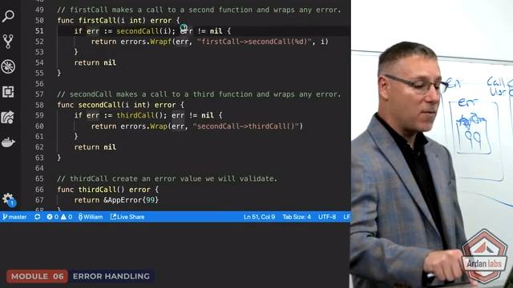
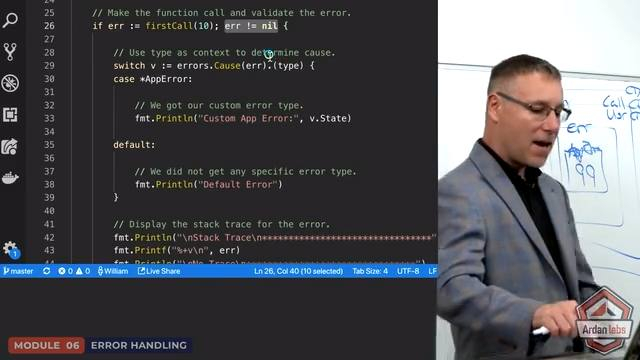
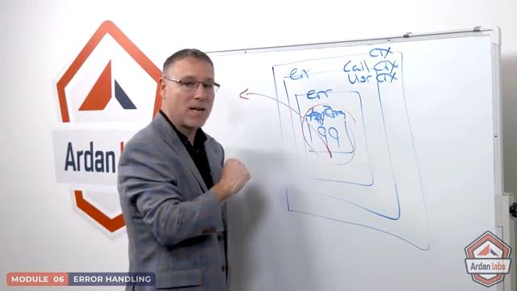
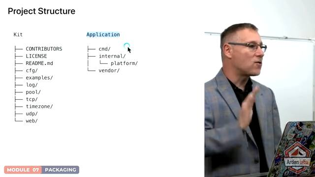

# Ultimate Go P50–P53 复现文档：错误包装与 Go 包设计

## 1. 这一节做什么

这一段 P50–P53 的实际内容不是 benchmark，也不是并发原语，而是两块工程化主题：

1. **P50：错误处理与错误包装**  
   讲师用一个 `appError` 例子演示：底层函数产生根因错误，中间函数不“处理”错误，只负责 `Wrap` 上下文并向上返回；最上层用 `Cause` 拆回根因，再做类型断言和日志输出。核心规则是：  
   - 处理错误 = 错误停在这里 + 记录完整上下文 + 决定 recover 还是 shutdown。  
   - 不处理错误 = 只做一件事：包装上下文，然后向上返回。  
   - 不要在每一层重复 log 同一个错误。

   这一段真正要建立的是一种“错误责任边界”意识：错误在哪一层被记录、在哪一层被决定恢复或退出、在哪一层只负责补充上下文，必须非常清楚。中间层看到 `err != nil` 时，最忌讳既 `log.Println(err)` 又 `return err`，因为同一个错误会在日志里出现多次，调用链越长日志越脏，最后反而看不出真正的根因在哪里。讲师给出的原则是：如果你不准备在这一层“终止”这个错误，就不要 log，只包装上下文并返回。

2. **P51–P52：package-oriented design**  
   讲师讲 Go 的包设计：文件夹不是“源码分类”，而是 API / 组件的边界；Go 的文件夹是编译单元；两个包不能互相 import；包要有 purpose，不要做 `utils`、`helpers`、`models` 这种“装东西”的包。

   这和前端项目里常见的 `components/`、`utils/`、`hooks/` 分类不完全一样。Go 更强调包作为 API 边界：一个包应该对外提供一组清晰能力，而不是把“看起来差不多”的文件塞进同一个文件夹。文件夹一旦成为包，就会产生 import 路径、导出符号、依赖方向、编译单元这些硬边界，所以不能只按“文件类型”随便分。

3. **P53：项目结构**  
   讲师推荐一个很轻的项目结构：`cmd`、`internal`、`internal/platform`、`vendor`。并给出一套依赖方向：`cmd` 可以 import 下面所有层；`internal` 只能 import `internal` 和 `platform`；`platform` 只能 import `platform` 和 `vendor`；不能反向 import。`kit` 项目作为团队/公司的标准库，`platform` 放本项目的基础包，`vendor` 锁第三方源码。

   这一段的关键不是让你马上搭一个庞大架构，而是让你知道“最小可用结构”是什么。目录越少，团队越不容易出现“周一放这里、周三放那里”的不一致；依赖方向越明确，越不容易出现循环 import 和业务层反向依赖基础层的问题。

本文的产出是：

- 一个可直接运行的 `example6` 错误包装示例。
- 一个可落地的 `app-project` 目录骨架，包含 `cmd`、`internal/platform`、`vendor`，并能用 `go mod vendor` 生成 vendor。
- 一套检查清单，保证你照着做时不会漏掉路径、版本、启动命令。

> 说明：逐字稿没有逐字给出完整源码文本，P50 的函数体是按讲师口述的调用链和字段还原的最小可运行版本；P51–P53 没有可运行代码，本文给出的 `app-project` 只是目录结构演练，代码里已标注“不是逐字稿业务代码”。

阅读时建议把本文分成两条线：第一条线是 `example6`，重点看错误如何被 `Wrap`、如何被 `Cause` 拆回、为什么中间层不 log；第二条线是 `app-project`，重点看目录边界、import 方向和 vendor 如何生成。两条线不需要混在一起运行，先跑通 `example6`，再验证 `app-project`，排查成本最低。

---

## 2. 讲师原话

下面引用逐字稿中的关键原话，保留英文，后面给中文解释。引用格式按 `—— pNNN [MM:SS]`。

> "处理错误意味着三件事……错误会在这里停下……我们会记录这个错误……并决定是恢复运行还是关闭。"
> —— p050 [00:59]

讲师把“处理错误”定义得很严格：错误不再向上传播、必须记录完整上下文、必须决定恢复还是关闭。不是“看到了 err 就 return”就叫处理。换句话说，`return err` 只是把错误继续交给上层，它不等于处理错误；只有当你决定这个错误到此为止，并且记录完整日志、决定恢复或关闭时，才叫 handling。

> "如果你不打算处理这个错误，那就只有一个选择：把需要向上传递的所有上下文都包装起来，再沿调用栈向上抛回。"
> —— p050 [04:14]

不处理错误时，中间层只做包装：把调用参数、用户上下文、调用位置一起包进去，再向上返回。不要在每一层重复 log 同一个错误。包装的目的不是“让错误看起来更复杂”，而是让最上层拿到错误时还能还原调用链和用户上下文。

> "这个 cause 函数……让我们可以解开所有这些包装，并把这个错误值取回来。"
> —— p050 [06:09]

最上层用 `Cause` 拆掉包装，拿回最初的根因错误，再做类型断言和错误处理。这里要注意：被 `Wrap` 过的错误已经不是原始的 `*appError`，直接断言会失败，必须先拆包装。

> "在项目源码树的范围内，我们不再用文件夹来组织源代码。文件夹实际上是对 API 的组织。"
> —— p052 [03:46]

Go 里文件夹不是“源码分类”，而是 API/组件边界。一个文件夹最终会编译成一个静态库，所有静态库再链接成应用。因此不要把文件夹只当成“放文件的地方”，它同时决定了包的导入路径和对外 API 边界。

> "两个包不能相互交叉导入。因此，导入路径必须非常非常清晰。"
> —— p052 [05:41]

两个包不能互相 import。import 路径必须清晰，依赖方向必须明确。前端项目里循环依赖有时还能靠打包工具或运行时绕过去，但 Go 里循环 import 是编译错误，必须在设计阶段就拆清楚。

> "每个团队……都要有一个我称为 kit 项目的东西……那就是你的标准库。"
> —— p053 [00:27]

每个团队最好有一个 `kit` 项目，作为团队或公司的标准库，放 Web 支持、数据库支持、日志、配置等基础包。它不是你项目的业务代码，而是团队层面的基础能力集合。

> "导入可以沿着项目树向下发生，但不能向上。"
> —— p053 [07:29]

依赖只能沿着项目树向下，不能向上。`cmd` 可以 import 所有层；`platform` 不能 import `internal` 的业务代码。这条规则如果破坏，基础包就会被业务细节污染，最后难以复用和测试。

> "kit 和 platform 内部的包不应该制定策略。"
> —— p053 [08:54]

`kit` 和 `platform` 里的包不应该替使用者决定日志、数据库、配置等 policy。否则别人想换 logger，就不得不连这个包一起换掉。基础包应该提供能力，而不是替应用层做决定。


---

## 3. 从零复现

### 3.1 环境与目录

逐字稿没有指定 Go 版本，也没有指定 `github.com/pkg/errors` 的版本。为了让读者可复现，本文锁定：

- Go：`1.22.x`
- 错误包装库：`github.com/pkg/errors v0.9.1`
- 不需要环境变量
- 不需要数据库、Redis、Docker

这里锁定版本只是复现需要，不是讲师在课里指定的版本。复现前先执行 `go version`，确认输出类似 `go version go1.22.x ...`。如果命令不存在，先安装 Go 或把 Go 的 `bin` 目录加入 `PATH`；如果版本不是 1.22.x，代码本身大概率也能运行，但请以你本机版本的实际行为为准，不要把本文输出当成唯一正确结果。

先建两个目录：

```bash
mkdir -p ~/ultimate-go/example6
mkdir -p ~/ultimate-go/app-project
```

`mkdir -p` 的作用是递归创建目录，并且目录已存在时不会报错。这里把两个示例放在 `~/ultimate-go` 下，是为了避免路径过深或权限问题；如果你在 Windows 下复现，`~` 和 `mkdir -p` 要换成 PowerShell 或资源管理器操作，Go 代码本身跨平台。

最终目录结构：

```text
~/ultimate-go/
├── example6/
│   ├── go.mod
│   ├── go.sum          # 由 go mod tidy 生成
│   └── main.go
└── app-project/
    ├── cmd/
    │   └── app/
    │       └── main.go
    ├── internal/
    │   └── platform/
    │       └── doc.go
    ├── vendor/         # 由 go mod vendor 生成
    ├── go.mod
    └── go.sum          # 由 go mod tidy 生成
```

前端对照：`go.mod` 可以粗略类比 `package.json`，`go.sum` 可以粗略类比 lockfile，`vendor` 可以粗略类比把 `node_modules` 中构建所需依赖锁进仓库。但 Go 的模块、包、vendor 机制和 npm 不是一一对应关系，这里只用于帮助理解，不要把概念完全等同。

### 3.2 复现 P50：错误包装 demo

进入目录，初始化模块并拉依赖：

```bash
cd ~/ultimate-go/example6
go mod init example6
go get github.com/pkg/errors@v0.9.1
```

命令解释：

- `cd ~/ultimate-go/example6`：进入示例目录，后续 `go.mod` 和 `main.go` 都会在这里生成。
- `go mod init example6`：初始化 Go module，生成 `go.mod`，module 名为 `example6`。这个名称是本地示例模块名，不要求是可访问域名。
- `go get github.com/pkg/errors@v0.9.1`：拉取指定版本依赖，并写入 `go.mod`。如果网络受限，`go get` 可能失败，先看 `go env GOPROXY`，必要时配置可用代理后重试。

创建 `main.go`，完整内容见第 4 节 4.2。保存后执行：

```bash
go mod tidy
go run .
```

`go mod tidy` 会根据代码里的 import 补齐缺失依赖、移除未使用依赖，并生成或更新 `go.sum`；`go run .` 会编译当前目录的 `main` 包并运行。常见错误与排查：

- `go: command not found`：Go 未安装或 `PATH` 没配好，先执行 `go version` 验证。
- `missing go.sum entry`：通常是依赖未整理，执行 `go mod tidy`。
- `undefined: errors.Cause`：多半是 import 了标准库 `errors`，本示例必须用 `github.com/pkg/errors`。
- `cannot find package` 或网络超时：检查 `GOPROXY`、网络和代理配置，确认能拉取 `github.com/pkg/errors@v0.9.1`。
- 类型断言失败：先确认 `thirdCall` 返回的是 `&appError{state: 99}`，并且 `main` 里先调用 `errors.Cause(err)` 再断言。

你会看到类似下面的输出。注意：`%+v` 的堆栈路径和行号会随机器变化，下面只是结构示意：

```text
---- user context ----
firstCall(10): secondCall(10): app error, state: 99
---- full context ----
app error, state: 99
main.thirdCall
    /Users/you/ultimate-go/example6/main.go:...
main.secondCall
    /Users/you/ultimate-go/example6/main.go:...
main.firstCall
    /Users/you/ultimate-go/example6/main.go:...
main.main
    /Users/you/ultimate-go/example6/main.go:...
root cause: state=99
```

这里的关键不是输出必须一模一样，而是你要看到三件事：

1. `%v` 输出用户上下文：`firstCall(10): secondCall(10): app error, state: 99`。
2. `%+v` 输出带堆栈的完整上下文。
3. `errors.Cause(err)` 拆回 `*appError`，所以能打印 `root cause: state=99`。

如果你只看到第一段用户上下文，没有看到堆栈，先检查是否用了 `%+v`；如果看到 `%v` 输出里已经包含堆栈，可能你改动了格式化方式。如果 `root cause` 没打印，先检查 `Cause` 后的类型断言是否用了 `*appError`。前端对照：这类似 `try/catch` 里重新抛出带有上下文的错误，再由最外层统一处理；但 Go 这里用 `Wrap` 和 `Cause` 显式拆包，不要直接类比成 JS 的 `cause` 字段。







### 3.3 复现 P53：项目结构骨架

进入 `app-project`：

```bash
cd ~/ultimate-go/app-project
go mod init example.com/ultimate-go-app
go get github.com/pkg/errors@v0.9.1
mkdir -p cmd/app internal/platform
```

命令解释：

- `go mod init example.com/ultimate-go-app`：初始化项目模块，module 路径使用示例域名，便于展示真实项目常见形式。
- `go get github.com/pkg/errors@v0.9.1`：让项目拥有一个第三方依赖，后面才能演示 `go mod vendor` 收源码。
- `mkdir -p cmd/app internal/platform`：一次性创建入口目录和基础包目录；如果目录已存在不会报错。

创建第 4 节里的 `cmd/app/main.go` 和 `internal/platform/doc.go`。然后执行：

```bash
go mod tidy
go mod vendor
go run ./cmd/app
```

`go mod tidy` 负责整理依赖；`go mod vendor` 会把当前构建所需的依赖源码复制到 `vendor` 目录；`go run ./cmd/app` 指定运行 `cmd/app` 这个 main 包，而不是运行项目根目录。常见错误：

- `no Go files in ...`：目标目录没有 `.go` 文件，检查 `cmd/app/main.go` 是否创建成功。
- `go: cannot find main module`：当前目录不在 module 内，确认先执行了 `go mod init` 并位于 `app-project`。
- `package ... is not a main package`：`cmd/app/main.go` 必须声明 `package main` 且有 `func main()`。
- `vendor` 目录不存在：先确认代码 import 了 `github.com/pkg/errors`，执行 `go mod tidy` 后再执行 `go mod vendor`；不要手写 `vendor/modules.txt`。
- `import cycle not allowed`：检查是否让基础包反向 import 了业务包，依赖方向必须向下。

`go run ./cmd/app` 应输出：

```text
app binary demo error
```

`go mod vendor` 后检查目录：

```bash
find . -maxdepth 3 -type d | sort
```

`find` 的解释：`.` 表示当前目录，`-maxdepth 3` 限制最多向下三层，`-type d` 只看目录，`sort` 让结果按字典序排列，便于观察结构。你应该能看到 `vendor` 目录，并且里面有 `github.com/pkg/errors` 的源码。vendor 内容由 Go 命令生成，不要手写。

前端对照：`cmd/app` 类似应用入口文件，`internal` 类似只允许项目内部使用的 `src` 区域，`platform` 类似共享基础能力层，`vendor` 类似被锁进仓库的依赖源码。区别是 Go 的 `internal` 有编译器层面的 import 限制，不是团队口头约定。





---

## 4. 完整代码

### 4.1 `example6/go.mod`

```go
module example6

go 1.22

require github.com/pkg/errors v0.9.1
```

这个文件声明 module 名称、Go 版本和直接依赖。`go.sum` 不需要手写，执行 `go mod tidy` 后由 Go 命令生成。不要把 `go.sum` 当成可随意编辑的配置，它用于校验依赖内容。

### 4.2 `example6/main.go`

```go
package main

import (
	"fmt"

	"github.com/pkg/errors"
)

// appError 是根因错误类型。
// 逐字稿中讲师说它在示例代码第 14 行附近定义，并带一个 state 字段。
type appError struct {
	state int
}

// Error 使用指针接收者实现 error 接口。
// 逐字稿中讲师特别提到这里是指针语义。
func (e *appError) Error() string {
	return fmt.Sprintf("app error, state: %d", e.state)
}

func main() {
	err := firstCall(10)
	if err == nil {
		fmt.Println("no error")
		return
	}

	// 只输出用户上下文，不带完整堆栈。
	fmt.Println("---- user context ----")
	fmt.Printf("%v\n", err)

	// %+v 会输出 pkg/errors 记录的完整堆栈上下文。
	// 具体堆栈路径和行号会因机器不同而变化。
	fmt.Println("---- full context ----")
	fmt.Printf("%+v\n", err)

	// Cause 拆掉所有 Wrap，拿回最初的根因错误。
	cause := errors.Cause(err)
	if appErr, ok := cause.(*appError); ok {
		fmt.Printf("root cause: state=%d\n", appErr.state)
	}
}

// firstCall 不处理错误，只包装本层上下文后继续向上返回。
func firstCall(i int) error {
	if err := secondCall(i); err != nil {
		return errors.Wrapf(err, "firstCall(%d)", i)
	}
	return nil
}

// secondCall 同样不处理错误，只包装本层上下文。
func secondCall(i int) error {
	if err := thirdCall(); err != nil {
		return errors.Wrapf(err, "secondCall(%d)", i)
	}
	return nil
}

// thirdCall 是错误根因的产生点。
// 逐字稿中讲师说它返回 appError，值为 99。
func thirdCall() error {
	return &appError{state: 99}
}
```

这份代码只保留 P50 需要的最小调用链：`main -> firstCall -> secondCall -> thirdCall`。`thirdCall` 产生根因，`secondCall` 和 `firstCall` 只包装上下文，`main` 负责拆包和类型断言。复现时不要额外加日志，否则会破坏“中间层不处理错误”的观察点。

### 4.3 `app-project/go.mod`

```go
module example.com/ultimate-go-app

go 1.22

require github.com/pkg/errors v0.9.1
```

这个 module 只用于结构演练。`go mod vendor` 会根据这里的依赖和实际 import 生成 vendor 内容。

### 4.4 `app-project/cmd/app/main.go`

> 这不是逐字稿里的业务代码，只是为了验证 `cmd/app` 可编译、第三方依赖可被 `go mod vendor` 收进 `vendor`。

```go
package main

import (
	"fmt"

	"github.com/pkg/errors"
)

func main() {
	err := errors.New("app binary demo error")
	fmt.Printf("%v\n", err)
}
```

这个入口文件故意引用 `github.com/pkg/errors`，目的是让 `go mod vendor` 有实际依赖可收。如果入口完全不 import 第三方包，vendor 可能不会出现你预期的内容，排查时容易误以为命令失败。

### 4.5 `app-project/internal/platform/doc.go`

> 逐字稿没有给出具体 platform 包实现。这里放一个可编译的占位包，保证 `internal/platform` 目录存在，并且后续可以继续加基础包。

```go
// Package platform 用于占位 internal/platform 目录。
// 逐字稿没有给出具体基础包实现；
// 真实项目中这里放本项目的基础能力包，例如日志、配置、数据库支持等。
package platform
```

这个占位包不提供业务能力，只验证目录和包声明可用。真实落地时，`platform` 里每个包都应该有明确 purpose，不能变成新的 `utils`。

### 4.6 生成文件

`go.sum`、`vendor/modules.txt`、`vendor/github.com/pkg/errors/...` 都由 Go 命令生成。执行顺序：

```bash
cd ~/ultimate-go/example6
go mod tidy

cd ~/ultimate-go/app-project
go mod tidy
go mod vendor
```

不要手写 `go.sum`、`vendor/modules.txt`，也不要在 vendor 目录里直接改第三方源码。vendor 的意义是锁定构建输入，不是让你绕过模块管理。

---

## 5. 逐行解释

### 5.1 `appError` 为什么用指针接收者

```go
type appError struct {
	state int
}

func (e *appError) Error() string {
	return fmt.Sprintf("app error, state: %d", e.state)
}
```

`appError` 是根因错误的具体类型，`state` 用来保存业务状态。`Error()` 用 `*appError` 指针接收者实现 `error` 接口。逐字稿里讲师特别提醒：函数返回错误时，要返回 `error` 接口值，而不是把自定义错误类型直接暴露出去。这样上层才能用统一的 `error` 机制处理，也方便后面做类型断言和 `Cause`。

这里最容易踩的坑是值接收者和指针接收者不一致：`thirdCall` 返回的是 `&appError{state: 99}`，所以 `Cause` 拿回的是 `*appError`，`main` 里断言 `cause.(*appError)` 才能成功。如果把 `thirdCall` 改成返回 `appError{state: 99}`，而断言仍写 `*appError`，就会失败。复现时保持指针语义一致。

在 JS/Node 里你可以大致类比为：不要把自定义错误对象到处传，而是用统一的 `Error` 包装并保留 `cause`。但注意，`github.com/pkg/errors` 的 `Wrap/Cause` 是 Go 这一课的用法，Node 的 `cause` 不是讲师讲的内容。

### 5.2 `main` 为什么要先 `Cause` 再类型断言

```go
cause := errors.Cause(err)
if appErr, ok := cause.(*appError); ok {
	fmt.Printf("root cause: state=%d\n", appErr.state)
}
```

`firstCall` 和 `secondCall` 都做了 `Wrapf`，所以 `err` 不是原始的 `*appError`，而是被包装过的错误。直接 `err.(*appError)` 会失败。`errors.Cause(err)` 会一层层拆掉包装，拿回 `thirdCall` 返回的 `*appError`，然后再做类型断言。这就是讲师说的“ unwind all of this wrapping，get this error value back out”。

类型断言使用 `appErr, ok := cause.(*appError)` 的 comma-ok 形式，避免断言失败时 panic。常见错误是写成 `appErr := cause.(*appError)` 且没有判断，一旦 `Cause` 返回的不是 `*appError`，程序会直接 panic。排查时先打印 `%T` 看 `cause` 的真实类型，再检查 `thirdCall` 返回类型是否一致。

前端对照：类似先把被包装的错误层层 `unwrap` 到根因，再判断根因类型。但 Go 这里必须使用 `github.com/pkg/errors.Cause`，不能误用标准库 `errors`，因为标准库 `errors` 没有 `Cause` 这个函数。

### 5.3 `firstCall` / `secondCall` 为什么只 Wrap 不 Log

```go
func firstCall(i int) error {
	if err := secondCall(i); err != nil {
		return errors.Wrapf(err, "firstCall(%d)", i)
	}
	return nil
}
```

```go
func secondCall(i int) error {
	if err := thirdCall(); err != nil {
		return errors.Wrapf(err, "secondCall(%d)", i)
	}
	return nil
}
```

这两层都没有 `log.Println(err)`，也没有 `panic`，也没有 `os.Exit`。因为讲师的定义是：如果你不处理错误，就只有一件事可做——包装上下文，向上返回。每一层都 log 一次会导致同一个错误在日志里出现多次，污染日志。真正处理错误的地方应该在最上层，或者由明确拥有处理权的层来做。

`Wrapf` 里加了 `i` 参数，目的是保留“用户上下文/调用参数”。讲师在 P50 里说，包装时要把调用参数、用户上下文、代码位置一起带上去，这样日志里才能还原问题。常见错误是包装信息写得太泛，例如只写 `"firstCall 失败"`，没有参数、没有用户标识、没有关键状态，最后排查时仍然不知道哪次调用出错。

前端对照：类似 `catch (err) { throw new Error("firstCall(10): " + err.message, { cause: err }) }`，只补充上下文再抛出，不在每一层都 `console.error`。否则控制台会重复打印同一条错误链。

### 5.4 `thirdCall` 为什么是根因

```go
func thirdCall() error {
	return &appError{state: 99}
}
```

`thirdCall` 是错误产生点，它不包装、不处理，直接返回具体错误。逐字稿里讲师说这个错误值是 `appError`，里面是 `99`。它是整条调用链的 root cause。上层通过 `Cause` 拿回它，才能做类型断言和业务判断。

验证时可以在 `main` 里临时打印 `fmt.Printf("%T\n", cause)`，确认是 `*main.appError`。如果打印出来是 `*errors.withStack`、`*errors.withMessage` 之类，说明 `Cause` 没有正确拆到根因，检查是否误用了标准库 `errors` 或其他包装库。

### 5.5 P53 的目录为什么这样放

| 目录 | 放什么 | 依赖规则 | 原因 |
|---|---|---|---|
| `cmd/` | 二进制入口，每个二进制一个子目录，里面放 `main.go` | 可以 import 所有层 | 应用层，允许设置 policy，允许决定是否 shutdown |
| `internal/` | 业务逻辑、服务逻辑 | 只能 import `internal` 和 `platform` | 编译器保护，外部项目不能 import 本项目的 `internal` |
| `internal/platform/` | 本项目的基础包 | 只能 import `platform` 和 `vendor` | 高可移植性，不设置日志/数据库等 policy |
| `vendor/` | 第三方源码，包括 kit 包 | 由 `go mod vendor` 生成 | 锁定源码，不只依赖 semver 社会契约 |

讲师在 P53 里反复强调“less is more”：文件夹越少，选择越少，越不容易出现“周一放这里、周三放那里”的不一致。`cmd`、`internal`、`platform` 三层就够用了。`platform` 放在 `internal` 下面，是为了同时获得 `internal` 的编译器保护。

常见错误是把 `platform` 放到 module 根目录下，导致外部项目也能 import；或者让 `internal/platform` import 了 `internal` 里的业务包，造成基础层反向依赖业务层。前者削弱了保护，后者会让基础包无法复用，牵一发动全身。

前端对照：不能把 Go 的文件夹当成普通 `components/` 分类。Go 的目录就是包边界，import 方向错了不是“风格问题”，而是编译错误或架构污染。

### 5.6 为什么 `platform` 不能设置 policy

P53 里讲师说：`kit` 和 `platform` 里的包不应该设置 policy。比如一个 platform 包如果 import 了某个 logger，那么任何使用这个 platform 包的人都被迫接受这个 logger。这样这个包就不再高可移植、高复用。`cmd` 是应用层，`internal` 是业务层，它们可以设置 policy；`platform` 应该尽量只依赖标准库，或者只依赖非常基础的 vendor 包。

更具体地说，基础包可以提供“记录日志的能力接口”，但不应该替调用方决定用哪个 logger、日志级别是什么、输出到哪里。应用层可以选择具体实现并注入进去。常见错误是 platform 包内部直接 import 某个日志库并全局初始化，导致换日志库时要改基础包。

前端对照：类似共享库不要直接绑定某个全局 `logger` 或全局配置；它应该接收依赖或暴露可替换接口，由应用入口决定具体实现。

### 5.7 为什么 `vendor` 要由 `go mod vendor` 生成

P53 里讲师说用 `go mod init`、`go mod tidy`、`go mod vendor` 把第三方源码收进 `vendor`。这样构建时不只是依赖 `go.mod` 里的版本号，而是把源码锁在项目里。讲师也说明：像 Kubernetes 这种大项目可能不适合 vendor，但大多数项目在“合理、实际”的范围内应该 vendor。本文的 `app-project` 用 `github.com/pkg/errors` 演示了 vendor 的生成过程。

常见错误是手写 `vendor/modules.txt` 或直接改 vendor 里的第三方代码，然后下一次 `go mod vendor` 被覆盖。正确做法是改依赖版本、改 import、重新执行 `go mod tidy` 和 `go mod vendor`。如果 vendor 和 `go.mod` 不一致，构建可能报 vendor 校验错误，重新生成即可。

前端对照：`vendor` 类似把依赖源码提交进仓库，但 Go 的 vendor 由工具生成并参与模块一致性校验；不要把它当成可以随意编辑的 `node_modules`。

---

## 6. 复现检查清单

下表把每条检查项、验证方法和常见失败点放在一起。不要只看“有没有做”，要实际执行命令验证结果。

| 检查项 | 怎么验证 | 如果失败先看什么 |
|---|---|---|
| Go 版本为 `1.22.x`，`go version` 能正常输出。 | 执行 `go version`，确认输出包含 `go1.22`。 | 命令不存在看安装和 `PATH`；版本不同先记录实际版本，再继续验证代码。 |
| `~/ultimate-go/example6/go.mod` 中 module 为 `example6`，依赖为 `github.com/pkg/errors v0.9.1`。 | `cat ~/ultimate-go/example6/go.mod`，检查 `module` 和 `require` 行。 | 是否在错误目录执行了 `go mod init`；依赖是否被 `go mod tidy` 改写。 |
| `example6/main.go` 包含 `appError`、`Error()`、`firstCall`、`secondCall`、`thirdCall`、`main`。 | 用编辑器搜索这些符号，或执行 `grep -n "func | type appError" main.go`。 | 是否保存了完整代码；是否漏了 `Error()` 方法导致不实现 `error`。 |
| 执行 `cd ~/ultimate-go/example6 && go mod tidy && go run .` 能运行。 | 在 `example6` 目录执行整条命令，确认退出码为 0。 | 先看 `go mod tidy` 是否报网络或 `go.sum` 错误，再看 `main.go` 编译错误。 |
| 输出中能看到 `app error, state: 99`。 | 运行后检查 `%v` 用户上下文输出。 | 检查 `appError.Error()` 格式和 `thirdCall` 的 `state` 是否为 99。 |
| 输出中能看到 `root cause: state=99`。 | 运行后检查最后一行是否打印根因。 | 检查是否先 `errors.Cause(err)` 再断言 `*appError`；是否误用标准库 `errors`。 |
| `%+v` 输出包含堆栈信息；路径和行号与本文不同是正常的。 | 观察 `---- full context ----` 后是否有函数名和文件路径。 | 是否用了 `%v` 而不是 `%+v`；是否没有使用 `pkg/errors.Wrapf`。 |
| `app-project/go.mod` 中 module 为 `example.com/ultimate-go-app`。 | `cat ~/ultimate-go/app-project/go.mod`。 | 是否在 `app-project` 目录执行 `go mod init`；是否误在 `example6` 里初始化。 |
| `app-project/cmd/app/main.go` 可编译，`go run ./cmd/app` 输出 `app binary demo error`。 | 在 `app-project` 目录执行 `go run ./cmd/app`。 | 是否 `package main`；是否有 `func main()`；是否从错误目录运行。 |
| `app-project/internal/platform/doc.go` 存在，包名为 `platform`。 | `cat internal/platform/doc.go`，确认 `package platform`。 | 文件名是否存在；包名是否误写成 `main` 或其他名称。 |
| 执行 `cd ~/ultimate-go/app-project && go mod tidy && go mod vendor` 成功。 | 连续执行两条命令，确认无报错。 | 先看 `go mod tidy`；再看代码是否真的 import 了第三方依赖。 |
| `vendor` 目录中存在 `github.com/pkg/errors` 源码。 | 执行 `find vendor -maxdepth 4 -type d \| grep pkg/errors` 或直接查看目录。 | 是否执行了 `go mod vendor`；入口是否 import 了 `pkg/errors`。 |
| 没有把 `platform` 包放到 `cmd` 或 `internal` 之外。 | 检查目录树，确认 `internal/platform` 在 `internal` 下。 | 是否手动建到了根目录；是否为了“方便”绕开 internal 保护。 |
| 没有让 `platform` import `internal` 的业务包。 | 查看 `internal/platform` 下文件的 import。 | 是否让基础包依赖业务包；依赖方向是否反了。 |
| 没有在 `firstCall`、`secondCall` 里重复 log 同一个错误。 | 搜索 `log.`、`fmt.Print`、`println` 等输出语句。 | 是否在中间层加了日志；错误是否应该只在最上层处理。 |

---

## 7. 课里没讲但你会撞上的（表格：现象 / 原因 / 怎么办）

下表把复现时最常见的问题按“现象 / 原因 / 怎么办”列出来。它们大多不是讲师在 P50–P53 逐字讲过的内容，但你实际复现时会遇到。

| 现象 | 原因 | 怎么办 |
|---|---|---|
| 照抄命令后拉不到 `github.com/pkg/errors v0.9.1`，或本机 Go 版本与 1.22.x 不一致。 | 逐字稿没有指定 Go 版本，也没有指定 `pkg/errors` 版本；本文锁定版本只是为了可复现。 | 用 `go version` 记录实际版本；尽量按 Go `1.22.x`、`pkg/errors v0.9.1` 复现。其他版本可调整，但不要声称这是讲师指定的版本。 |
| `%+v` 输出路径、行号、格式和本文不一样。 | 堆栈包含本机绝对路径、行号和依赖版本信息，不同机器必然可能不同。 | 只验证是否出现函数名、文件路径、关键错误文本；不要把本文示意输出当成全文断言。 |
| 混用 `github.com/pkg/errors` 和标准库 `errors`，出现 `undefined: errors.Cause`。 | 本段用的是 Dave Cheney 的 `pkg/errors` 的 `Wrap` 和 `Cause`；标准库 `errors` 没有 `Cause`。 | 复现 P50 时统一 import `github.com/pkg/errors`；如果要讲 Go 1.13 之后的 `%w`、`errors.Is`、`errors.As`，另起一套说明，不要混成本段内容。 |
| `go mod vendor` 后 vendor 内容为空、不存在或不是预期内容。 | 项目没有第三方依赖，或代码没有 import 依赖；vendor 只收构建实际需要的包。 | 先确认 `cmd/app/main.go` import 了 `github.com/pkg/errors`，执行 `go mod tidy`，再执行 `go mod vendor`。不要手写 `vendor/modules.txt`。 |
| 外部包尝试 import 本项目 `internal` 下的包时报错。 | `internal` 的编译器保护是路径规则，不是权限系统；它依赖目录层级和 module 路径。 | 检查 import 路径是否包含 `internal` 的上级；把只允许项目内部使用的基础包放到正确层级，不要为了绕开限制随意移动。 |
| 出现 `import cycle not allowed`。 | 两个包互相 import，或依赖方向设计反了，例如基础包反向 import 业务包。 | 拆接口、拆类型，或把共享逻辑下沉到更基础的包；按 `cmd -> internal -> platform` 的方向检查 import。 |
| Windows 下 `mkdir -p` 或 `~` 不生效。 | 本文命令按 macOS/Linux 写；不同 shell 的路径和命令不同。 | 用 PowerShell 的 `New-Item -ItemType Directory -Force` 创建目录，或手动建目录；把 `~` 换成你的用户目录。Go 代码本身跨平台。 |
| `platform` 目录逐渐变成新的 `utils`，什么都往里放。 | 虽然换掉了 `utils` 名字，但仍然按“装东西”的方式组织包，没有明确 purpose。 | 每个 platform 包先写清楚提供什么能力，再决定是否放进去；不要替应用层设置日志、数据库、配置等 policy。 |
| 在 `app-project` 根目录执行 `go run .`，报没有 Go 文件或不是 main 包。 | 根目录没有 `main` 包，入口在 `cmd/app`。 | 执行 `go run ./cmd/app`，或进入 `cmd/app` 目录运行。 |
| `firstCall`、`secondCall` 里加了日志后，同一个错误被打印多次。 | 中间层既 log 又 return，违反“不处理就只包装”的规则。 | 删除中间层重复日志，只保留包装；把记录完整上下文和恢复/关闭决定放到真正处理错误的最上层。 |