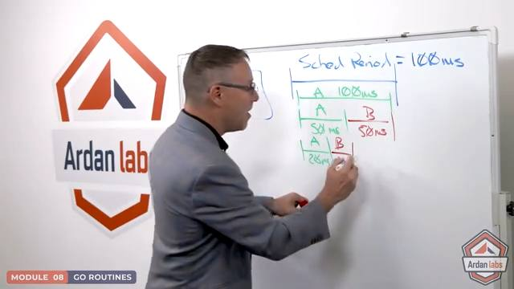

## 1. 这一节做什么

这两节课（P54–P55）不是直接写业务代码，而是进入 Go 多线程软件学习前的“操作系统调度器心智模型”课。P54 是第八课开场，讲师说明接下来要学：操作系统调度器语义、Go 调度器语义、如何创建 goroutine 以及做一些 orchestration；P55 则完整讲了操作系统调度器为什么存在、线程有哪些状态、调度周期和时间片如何互相制约、上下文切换的成本、CPU bound 与 IO bound 两类工作负载的区别，以及线程池为什么出现。

读者学完这一节，应该能复现的不是一个“能启动的 Web 项目”，而是一套可以用于工程判断的推导表：给定硬件线程数、可运行 OS 线程数、调度周期、最小时间片、上下文切换成本，判断应该用多少线程、并发是否能带来吞吐、什么时候并行是必要的、什么时候上下文切换反而是朋友。课里没有给出可运行源码，也没有进入 benchmark 实测；这一点必须说清楚，不能把后面的 Go benchmark 内容提前编进来。

这一节的关键词是：**concurrency = out of order execution**，**parallelism = 同一时间执行两条或更多指令**，**OS thread 三态：running / runnable / waiting**，**scheduler period**，**minimum time slice**，**context switch cost**，**CPU bound workload**，**IO bound workload**。这些词在逐字稿里反复出现，是后面理解 Go scheduler 的前置知识。

---

## 2. 讲师原话（带「—— pNNN [MM:SS]」）

讲师先给 concurrency 下定义：

> “Concurrency, we can start with that right now, means out of order execution.”
>
> —— p055 [00:29]

也就是说，并发不是“同时执行”，而是把一串指令以乱序方式执行，但仍然希望全部执行完并得到相同结果。接着他给 parallelism 下定义：

> “Parallelism, that means that we're executing two or more instructions at the same time.”
>
> —— p055 [00:59]

这两个定义必须分开记：并发强调乱序，执行单元不一定同时；并行强调同一时刻真正有多条指令在执行，依赖硬件线程。

讲师描述 OS thread 的状态：

> “A thread could be in a running state... A thread can be in a runnable state... And then a thread can be in a waiting state.”
>
> —— p055 [03:53]

并且说明 waiting 状态的线程对调度器来说“off the radar”，调度器主要关心 running 和 runnable。随后他引入调度周期：

> “we can define what we'll call a scheduler period... our ability to execute any thread that's in a runnable state at the beginning of this period to get that thread to execute within this time.”
>
> —— p055 [05:45]

调度周期的作用是制造“很多线程同时在跑”的 illusion。讲师用 100ms 作为例子。再往后，他讲上下文切换成本：

> “on average at the operating system level. A context switch like this is going to be anywhere from one millisecond to two milliseconds. In other words, 1,000 nanoseconds to 2,000 nanoseconds.”
>
> —— p055 [11:32]

这里逐字稿本身存在单位混用：1ms 不是 1,000ns。讲师后面又把一次切换的指令损失说成 12,000 到 24,000 条。按照他给的“1 纳秒 = 12 条指令”反推，12,000–24,000 条损失对应的是 1–2 微秒，而不是 1–2 毫秒。文档后面会保留他的结论，但把单位标成“待实测”，不替讲师强行圆回去。

关于最小时间片：

> “we'll define the minimal time slice... maybe what we'll say is 10 milliseconds is that point of diminishing return.”
>
> —— p055 [13:26]

关于 CPU bound：

> “a CPU bound workload is a workload where a thread naturally does not move into a waiting state.”
>
> —— p055 [15:49]

关于 IO bound：

> “IO bound workloads are workloads where the thread never actually uses its full time slice because at some point... it's going to make a call to the operating system over the network... move from a running state into a waiting state.”
>
> —— p055 [17:14]

最后他总结线程数与硬件线程的关系：

> “for any CPU bound workload, the number of threads we use equals the number of hardware threads we use... when it comes to IO bound workloads, we don't need parallelism to see improvement with concurrency.”
>
> —— p055 [30:01]

---

## 3. 从零复现

这一节是纯讲解课，没有可运行的课程项目。所谓“复现”，就是按讲师的推导顺序，把问题、约束、估算、方案和取舍重新走一遍，并产出可检查的表格。不要把它写成“P054 讲了什么，P055 讲了什么”，而要按照“如果我要设计一个 OS 调度器心智模型，我该怎么算”来推进。

### 3.1 需求：制造“很多工作同时发生”的 illusion

讲师提出的第一需求是：机器上可能同时运行多个程序、多个应用，操作系统调度器要让用户感觉它们都在同时运行。但物理上能不能同时执行，取决于硬件线程。一个硬件线程在任意时刻只能执行一条指令；如果有两个硬件线程，才能并行执行两条指令。讲师说自己的机器是 8 个硬件线程，因此理论上可以同时跑 8 条指令，但练习里先假设只有 1 个硬件线程。

复现动作：在文档里先写死一个实验环境：

| 符号 | 含义 | 课程示例值 |
|---|---|---|
| H | 硬件线程数 | 1（先假设），讲师真机为 8 |
| N | 需要调度的 runnable OS 线程数 | 1、2、5、100、1000 等 |
| P | scheduler period | 100ms |
| S | 单个线程分到的时间片 | 由 P 和 N 推导 |
| Smin | 最小时间片 | 10ms |
| C | 一次上下文切换成本 | 讲师给结论：12,000–24,000 条指令损失 |

### 3.2 约束：线程三态和“只关心 running/runnable”

OS 线程被讲师描述为“paths of execution”。程序是一串指令，线程负责逐条执行并记账，最终利用硬件线程完成执行。线程有三态：

| 状态 | 含义 | 调度器是否关心 |
|---|---|---|
| running | 已经放到硬件线程上，正在执行 | 关心 |
| runnable | 想要硬件线程时间，排队等待 | 关心 |
| waiting | 等系统调用、网络等事件，暂时不在雷达上 | 不关心，不产生调度负载 |

复现时要记住：waiting 线程不是“慢”，而是暂时不需要 CPU。它什么时候回来，会影响 runnable 队列长度，但 waiting 本身不占用调度周期。

### 3.3 估算：调度周期、时间片、上下文切换

先按讲师给的 100ms 调度周期算。

**场景 A：只有 1 个 runnable 线程 A。**

A 获得完整 100ms：

S_A = P / N = 100ms / 1 = 100ms

**场景 B：有 2 个 runnable 线程 A、B。**

S_A = 100ms / 2 = 50ms  
S_B = 100ms / 2 = 50ms

讲师强调：A 第一次拿了 100ms，第二次只拿 50ms，吞吐被切半。

**场景 C：有 5 个 runnable 线程 A、B、C、D、E。**

S_A = 100ms / 5 = 20ms  
S_B = 20ms  
剩余 60ms 分给 C、D、E；如果平均分，每个 20ms。逐字稿没有说 C/D/E 一定完全平均，只说剩余 60ms 跨这些线程。

**场景 D：有 100 个 runnable 线程。**

S = 100ms / 100 = 1ms

但讲师提出最小时间片 Smin = 10ms，不希望低于 10ms，否则上下文切换会变成主要工作。因此实际调度周期不能再维持 100ms，而会被拉长：

P_eff ≥ N × Smin = 100 × 10ms = 1000ms = 1s

这里要特别标注：讲师口述说“像 10 秒”，但按 10ms × 100 算是 1 秒。逐字稿在数量级上不一致。复现时以算式为准，同时保留“讲师口述为 10 秒”的原始说法，提醒读者不要把这个数字当成精确结论。

**上下文切换成本。**

讲师给的结论是：一次上下文切换损失 12,000–24,000 条指令。  
如果按 N=100 且每个线程每周期至少切换一次粗算：

100 × 12,000 = 1,200,000 条指令  
100 × 24,000 = 2,400,000 条指令

这是“只看切换损失”的下限式粗算，不包含缓存、调度器本身等额外成本。讲师没有给更细的公式，所以这里只能作为数量级提醒，不能当作精确 benchmark。

### 3.4 方案：调度周期 + 最小时间片 + 按 workload 选线程数

讲师的方案可以落成三条规则：

1. **用调度周期制造 illusion**：让每个 runnable 线程在周期内都得到执行机会。
2. **设置最小时间片**：低于 10ms 时，上下文切换可能压过实际工作。
3. **按 workload 决定线程数**：
   - CPU bound：线程数约等于硬件线程数；需要 parallelism 才能让 concurrency 产生吞吐。
   - IO bound：线程会主动进入 waiting，上下文切换反而帮助硬件线程不空闲；不需要 parallelism 也可能通过 concurrency 提升吞吐；但线程太多也会出现 diminishing return，需要线程池找“magic number”。

### 3.5 取舍：less is more，但 IO bound 不是越少越好

讲师反复说“less is more”：调度周期里要调度的线程越少，每个线程拿到的时间越多，线程也能更早回来。但 IO bound 又有一个反直觉点：线程太少，硬件线程会空闲；线程太多，runnable 队列变长，切换成本上升。所以 IO bound 的目标不是“零线程”或“无限线程”，而是找到让“通常只有一个线程处于 runnable 状态”的池大小。讲师明确说这个“magic number”很难算，课里没有给公式。

CPU bound 则相对简单：线程数等于硬件线程数，优先并行；如果没有并行硬件，拆成多个线程做 CPU bound 反而可能更慢，因为每次切换都在损失本可以用于计算的指令。

---

## 4. 完整代码

**这两 P 是纯讲解课，逐字稿里没有可保存运行的完整源码，也没有 benchmark 代码。** 因此本节不伪造“课程原代码”。按照纯讲解课的复现要求，把讲师的方案落成可直接填写的设计产物：设计决策表、组件职责表、接口/数据模型草案、容量估算表。下面所有表格都是复现产物，不是讲师原代码；如果你要把它写成 Go 或 Node 代码，属于后续自己补的实现，课里没有展开。

### 4.1 设计决策表

| 决策 | 适用条件 | 讲师理由 | 不这样会怎样 |
|---|---|---|---|
| 设置 scheduler period | 需要制造多任务同时运行的 illusion | 让周期开始时处于 runnable 的线程都能获得执行机会 | 线程可能长期得不到调度，用户感知卡顿 |
| 设置 minimum time slice = 10ms | 线程数变多、时间片被切得很碎 | 低于 10ms 时上下文切换成本占比过高 | 调度器花更多时间切换而不是执行 |
| CPU bound 线程数 ≈ 硬件线程数 | 线程不会自然进入 waiting | 并行才能真正提升吞吐；切换会损失指令 | 线程数超过 H 后，切换成本抵消并发收益 |
| IO bound 使用线程池 | 线程会因网络/系统调用进入 waiting | 切换可以让硬件线程去跑别的线程，避免空闲 | 每请求建线程会放大线程数与切换成本 |
| IO bound 找“magic number” | 线程数既不能太少也不能太多 | 目标是通常只有一个线程处于 runnable | 太少会空闲，太多会排队和切换 |
| 代码里放同步/编排点 | 调度不可预测、执行可能乱序 | 保证算法即使乱序也能正确完成 | 结果依赖调度顺序，出现不可复现 bug |

### 4.2 组件职责表

| 组件 | 职责 | 课程里的说法 |
|---|---|---|
| 硬件线程 | 真正执行指令的能力 | 一个硬件线程任意时刻只能执行一条指令；多个硬件线程才能并行 |
| OS 线程 | 一条执行路径，利用硬件线程逐条执行程序指令 | paths of execution |
| OS 调度器 | 在调度周期内安排 runnable 线程上硬件线程 | 制造同时运行的 illusion |
| running 队列/状态 | 正在硬件线程上执行 | running |
| runnable 队列/状态 | 想运行、等待轮到 | runnable |
| waiting 状态 | 等系统调用、网络等事件 | off the radar |
| 上下文切换 | 把一个线程从硬件线程换下，把另一个换上 | 有指令损失，讲师给 12,000–24,000 条 |
| 线程池 | 控制 IO bound 线程数量，避免无限建线程 | 讲师用 Web 服务 50,000 请求举例 |
| 同步/编排 | 在不可预测调度中建立 guarantee points | 讲师说要 guarantees，但这两 P 没展开 API |

### 4.3 接口/数据模型草案

这不是课程代码，只是把讲师的概念落成可填写的字段，方便你后续写 Go/Node 实验时使用。

| 模型 | 字段 | 含义 | 备注 |
|---|---|---|---|
| ThreadState | RUNNING / RUNNABLE / WAITING | 线程三态 | 课里只讲三态，未讲子状态 |
| WorkloadType | CPU_BOUND / IO_BOUND | 工作负载类型 | 课里明确两类 |
| Thread | id、state、remainingSlice、workload | 单个 OS 线程的复现记录 | 不是课程结构体 |
| SchedulerParams | hardwareThreads、schedulerPeriodMs、minSliceMs、contextSwitchCostInstructions | 调度参数 | C 的单位需实测 |
| Observation | runnableCount、sliceMs、effectivePeriodMs、contextSwitchLoss | 每轮估算结果 | 用来验证公式 |

### 4.4 容量估算表

| H | N | P | Smin | 按 P/N 的 S | 是否低于 Smin | 有效周期粗算 | 备注 |
|---|---|---|---|---|---|---|---|
| 1 | 1 | 100ms | 10ms | 100ms | 否 | 100ms | A 拿满周期 |
| 1 | 2 | 100ms | 10ms | 50ms | 否 | 100ms | A 吞吐被切半 |
| 1 | 5 | 100ms | 10ms | 20ms | 否 | 100ms | 剩余 60ms 分给 C/D/E |
| 1 | 100 | 100ms | 10ms | 1ms | 是 | ≥1000ms（1s） | 讲师口述“像 10 秒”，与算式不一致 |
| 1 | 1000 | 100ms | 10ms | 0.1ms | 是 | ≥10s | 仅按 N×Smin 粗算，未计其他开销 |

这张表就是你“照着复现”的核心产物：把 H、N、P、Smin 填进去，按公式算，再标注讲师口述和算式的差异。它不是 benchmark 结果，不能冒充性能测试数据。

---

## 5. 逐行解释

1. **为什么先定义 concurrency 为 out of order execution？**  
   因为后面要判断“这段算法能不能并发”。讲师用“把一百万整数相加”举例：加法顺序不影响最终结果，所以可以乱序执行。如果顺序会影响结果，就不能随意并发，需要额外同步。这个定义是后面所有判断的起点。

2. **为什么 parallelism 要强调“同一时间两条以上指令”？**  
   因为并行需要硬件线程。只有 H≥2 时，才可能真正同时执行。讲师用单硬件线程和双硬件线程对比：单硬件线程下拆四个线程做 CPU bound 加法，反而比顺序执行慢，因为要多次切换并损失指令；双硬件线程下拆两半才有意义。

3. **为什么线程三态里 waiting 不算调度器负载？**  
   因为 waiting 线程在等外部事件，不在 runnable 队列里。调度器只关心谁正在跑、谁排队想跑。IO bound 的关键正是线程会主动进入 waiting，从而把硬件线程让出来。

4. **为什么调度周期能制造 illusion？**  
   因为在一个周期内，调度器让所有 runnable 线程都获得一点执行时间。用户看到多个程序都在推进，就感觉它们在同时运行。物理上仍然受 H 限制。

5. **为什么 N=2 时 A 从 100ms 变 50ms？**  
   因为 P=100ms，两个 runnable 线程要在一个周期内都跑到，平均时间片就是 P/N。讲师强调 A 的吞吐被切半。这是“更多线程不等于更多吞吐”的第一个证据。

6. **为什么 N=5 时不是每个都精确 20ms？**  
   讲师说 A 和 B 各 20ms，剩余 60ms 跨 C/D/E。逐字稿没有给出 C/D/E 的精确分配规则，所以复现时只能写“剩余 60ms 分配给它们”，不能编造更细的调度算法。

7. **为什么 N=100 时不能继续用 1ms？**  
   因为讲师设了 Smin=10ms。低于这个值，上下文切换占比过高。于是有效周期被迫拉长到 N×Smin。这里要标注讲师的“10 秒”口述与 1 秒算式的差异，不能把口误当成精确结论。

8. **为什么上下文切换会造成指令损失？**  
   因为把线程从硬件线程换下、再把另一个换上，需要时间。讲师把这个时间折算成“本来可以执行的指令数”。他给的结论是 12,000–24,000 条。注意：逐字稿里 ms/ns/us 混用，复现时保留结论、标注单位待实测。

9. **为什么 CPU bound 下切换是敌人？**  
   CPU bound 线程不会自然等待，它会用满时间片。每次切换都在打断计算，损失本可以用于计算的指令。所以 CPU bound 线程数超过 H 后，切换成本会吃掉并发收益。

10. **为什么 IO bound 下切换是朋友？**  
    IO bound 线程很快会因为网络/系统调用进入 waiting。如果只有一个线程，硬件线程会空闲；切换可以让另一个线程上来跑，利用原本会空闲的时间。讲师说 IO bound 不需要 parallelism 也能从 concurrency 获得吞吐。

11. **为什么 IO bound 还要线程池？**  
    因为线程不是越多越好。线程太多，runnable 队列变长，切换成本上升；线程太少，又会有空闲。讲师用 Web 服务 50,000 请求举例：不能每个请求建一个 OS 线程，要用池并找“magic number”。

12. **为什么需要同步/编排？**  
    讲师说 OS 调度器是 preemptive、事件驱动的，调度不可预测。多线程代码即使乱序执行，也需要在某些点保证算法正确完成。这两 P 只提出“需要 guarantees”，没有展开具体同步 API。

---

## 6. 复现检查清单

- [ ] 我能用自己的话解释：concurrency 是乱序执行，parallelism 是同一时刻执行两条以上指令。
- [ ] 我能画出 OS thread 三态：running、runnable、waiting，并说明 waiting 为什么不产生调度负载。
- [ ] 我能写出调度周期公式：S = P / N；并算 N=1、2、5、100 的时间片。
- [ ] 我知道讲师设的 Smin=10ms，并能解释低于它会怎样。
- [ ] 我能复述讲师给的上下文切换结论：12,000–24,000 条指令损失。
- [ ] 我能标注逐字稿里的单位矛盾：1ms/1,000ns/1–2µs 混用，不能把 12,000–24,000 条损失直接当成 1–2ms 的精确换算。
- [ ] 我能复述 N=100 时“讲师口述 10 秒”与“10ms×100=1s”的不一致。
- [ ] 我能判断 CPU bound：线程不会自然 waiting；需要 parallelism；线程数约等于硬件线程数。
- [ ] 我能判断 IO bound：线程会因网络/系统调用 waiting；上下文切换帮助硬件线程不空闲；需要线程池找 magic number。
- [ ] 我能解释为什么 Web 服务 50,000 请求不能每请求建一个 OS 线程。
- [ ] 我能说明这两 P 没有 benchmark 代码、没有 Go scheduler 具体实现、没有 goroutine 创建实操。
- [ ] 我能把 Node 对照说清楚：这是类比，不是讲师原话；CPU bound 会卡事件循环，IO bound 更适合异步/池化。

---

## 7. 课里没讲但你会撞上的

第一，**benchmark 在这两 P 没有讲**。课程标题里有“并发+benchmark”，但 P54–P55 的逐字稿只到 OS 调度器心智模型和 workload 分类，没有 `go test -bench`、没有 benchmark 文件、没有测试数据、没有结果对比。你要做 benchmark，需要等后续课或自己补实验；本文不能编造“课程跑出了多少 ns/op”。

第二，**Go scheduler 的具体机制没有展开**。P54 只说接下来会学习 Go scheduler semantics，P55 最后也说下一步要谈 Go scheduler 如何坐在 OS scheduler 之上，但这两 P 没有讲 goroutine 创建、调度器队列、work stealing 等细节。不要把这些后续内容提前写成讲师结论。

第三，**P54 提到的 orchestration 转写为“waycrups”，无法确认具体 API**。逐字稿这里明显是语音转写噪声，课里也没有展开。可以理解为后续会讲某种等待/编排机制，但不能在这份文档里替讲师指定某个具体工具名。

第四，**上下文切换的单位必须实测**。讲师口述里 1–2ms、1,000–2,000ns、1–2µs 混用，12,000–24,000 条指令损失对应的是微秒级反推。真实操作系统、硬件、负载都会影响切换成本。文档里保留讲师的数量级结论，但工程上要以实际测量为准。

第五，**“magic number”没有公式**。IO bound 线程池到底开多少，讲师只说目标是“通常只有一个线程处于 runnable”，没有给计算公式。你实际做 Web 服务或 Node 服务时会遇到连接池、线程池、事件循环阻塞等问题，这些都需要自己压测，课里没给现成答案。

第六，**同步、锁、事务在这两 P 没有讲**。讲师只说调度不可预测，所以代码里需要 guarantee points；但没有讲 mutex、channel、atomic、事务隔离级别等。对前端转 AI 应用工程师来说，可以先建立类比：Node 单线程事件循环里，CPU bound 会阻塞事件循环；IO bound 更适合异步；如果要多核跑 CPU bound，需要 worker/多进程。但这些都是类比，不是讲师原话。

第七，**preemptive scheduler 的事件映射没有展开**。讲师提到 OS 调度器要处理硬件事件、时钟事件，甚至 CPU bound 也可能被时钟中断打断，但他明确说先“忘记这一点”，把模型简化为 CPU bound / IO bound。实际系统里，调度不可预测性会比这个模型更强，所以多线程代码必须自己建立同步和编排保证。

**最终产物一句话**：这两 P 的可复现成果，是一张“调度参数—时间片—切换成本—workload 类型—线程数决策”的推导表。你照着第 3、4 节的公式和表格填一遍，能独立判断“这段工作是 CPU bound 还是 IO bound、该不该并行、线程数大概怎么选、什么时候切换成本会反噬”，就算复现完成；不要声称这两 P 跑了 benchmark，因为课里没有。