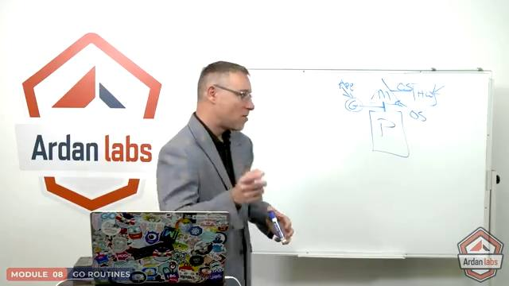
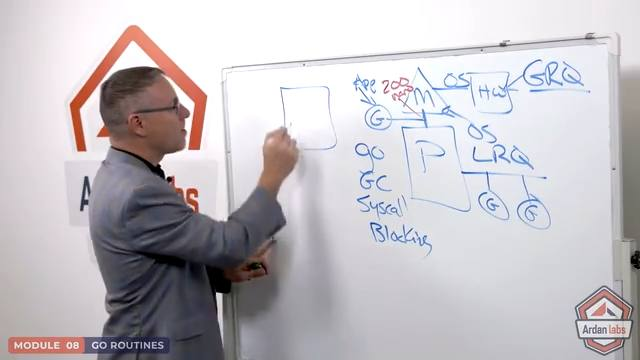
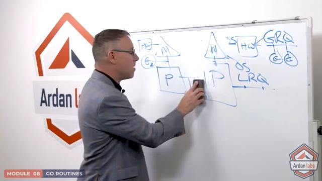
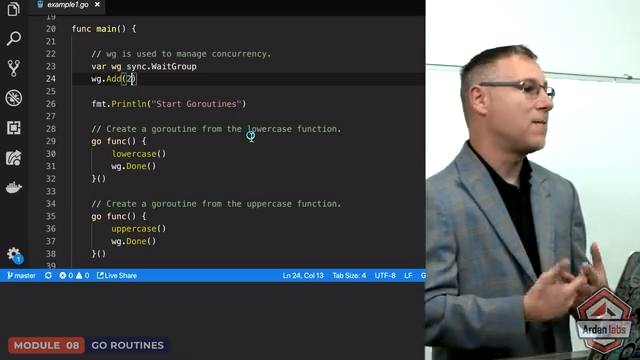

# Ultimate Go Language（并发 + benchmark）· P56–P57 复现文档

> 课程：Ultimate Go Language（BV1XXcozTE1y），覆盖 P56、P57
> 目标读者：前端转 AI 应用工程师，不要求后端并发经验
> 本节产出：一个能跑出「单线程并发 → 时间片轮转 → 真并行」三组可观察实验的 Go 小仓库

---

## 1. 这一节做什么

P56 和 P57 是同一件事的两面。

P56 是**模型**：讲师把 Go 调度器（GoScheduler）拆成三层来讲——硬件线程（hardware thread）→ 操作系统线程（M）→ 应用层线程（goroutine，简称 G），中间还有一个逻辑处理器（P）。他讲清楚了四类会让调度器有机会做上下文切换的应用层事件（`go` 关键字、垃圾回收、系统调用、其它阻塞调用），讲清楚了网络轮询器（network poller）怎么把网络 I/O 从 M 上摘下来、文件 I/O 为什么摘不下来只能新开一个 M，也讲清楚了工作窃取（work stealing）怎么在某个 P 空转时把别的 P 的活偷走一半。

P57 是**动手**：讲师从零写三个 Go 程序，逐个演示
- 用 `runtime.GOMAXPROCS(1)` 把程序压成单 P 单 M，然后用 `sync.WaitGroup` 制造「保证点（guarantee point）」，观察两个 goroutine 的乱序执行；
- 把 `wg.Wait()` 删掉、把 `Add(2)` 写成 `Add(1)`、把 `Done()` 忘掉，分别看程序提前退出、不可预测、死锁三种事故；
- 用两个各打印 5 万行的 goroutine 观察**时间片（time slice）**导致的上下文切换次数，然后用 `cut` + `grep` + `uniq` 数出来；
- 把 `GOMAXPROCS` 改回 `2`，让两个 goroutine 真正**并行**跑在两个硬件线程上。

能复现的成果物是三个完整可运行的 `main.go`，加一组观察命令。跑完之后你能亲眼看到：**并发（concurrency）是乱序的、不可预测的，但可以有保证点；并行（parallelism）是在并发基础上再叠一层硬件级随机。**

关于「为什么要费劲理解底层」——讲师在 [00:28] 说得很直白：Go 运行时启动时先看这台机器有几个硬件线程，有几个就给你几个 P，每个 P 绑一个操作系统线程。所以你在上层写多少 goroutine，最终都要落到这固定的几个 M 上。模型不懂，代码里的行为就是玄学。


---

## 2. 讲师原话

### 2.1 关于 P / M / G 模型

> "当你的 Go 程序启动时，运行时会尝试识别这台主机上有多少个硬件线程。我的机器上有八个硬件线程。这意味着，当我的笔记本电脑上任何程序启动时，都会得到八个这样的逻辑处理器，每个硬件线程对应一个。"
> —— p056 [00:28]

> "我们有应用层线程、操作系统级线程，还有硬件级线程。这三层协同工作，明白吗？而我们实际上与硬件之间隔着一层间接层。"
> —— p056 [01:27]

> "唯一的区别是，Go 协程没有优先级。Go 协程没有优先级的原因之一是，我们不在应用空间里处理事件；操作系统必须处理事件，而我们不需要。"
> —— p056 [01:56]

### 2.2 关于协作式调度（cooperating scheduler）

> "这个调度器的另一点是，我们把它视为协作式调度器，这意味着我们需要应用层发生的事件来执行调度。"
> —— p056 [02:53]

> "我们必须找到代码中的安全点，以便在这些点上让这些 Go 协程在 M 上让出和恢复。……至少在当前 Go 1.11 中，这些安全点发生在函数调用转换期间。"
> —— p056 [03:23]

> "不是让开发者调用让出，而是由 Go 调度器代表这些 Go 协程执行让出。"
> —— p056 [04:18]

### 2.3 关于四类事件与上下文切换成本

> "函数调用转换时确实有四类事件会给调度器提供进行上下文切换的机会：关键字 go、垃圾回收、系统调用，以及其他类型的阻塞调用。"
> —— p056 [04:45] 起

> "操作系统中的上下文切换是一到两微秒，也就是一千到两千纳秒。而在 Go 中，同样的上下文切换大约只要 200 纳秒。"
> —— p056 [06:07]



### 2.4 关于网络轮询器与文件 I/O

> "Go 中有一个叫网络轮询器的机制。网络轮询器一开始只有一个线程。epoll 或 Mac 上的 kqueue，以及 Windows 上的 IOCP，这些线程池技术，就是网络轮询器在这里使用的东西。"
> —— p056 [07:59]

> "我们今天真正使用的唯一异步系统调用是网络调用。……所以每当我们进行文件 I/O 时，都会使用那些同步系统调用。"
> —— p056 [08:28] / [08:54]

> "如果这个 Go 协程发起读取调用去打开文件，而这至少会花费几微秒……我们不想这样。所以调度器会做的是……它会取出这个 M 和这个 G，并把它们从那个 P 上分离。"
> —— p056 [10:43] / [11:12]




### 2.5 关于并行与工作窃取

> "现在我有两个 P、两个线程，每个线程各自运行在一个硬件线程上。……我现在有两个 Go 协程在两个操作系统线程上执行指令，而这两个操作系统线程运行在两个硬件线程上。现在我们就能够让 Go 协程并行运行了。"
> —— p056 [15:29] / [15:58]

> "Go 也是一个工作窃取调度器。……算法的另一部分说，去看看是否有另一个 P 有很多工作；如果有，就窃取它一半的工作。"
> —— p056 [16:27] / [16:54]




### 2.6 关于同步 vs 编排

> "同步意味着你在排队等待……编排是指两个或多个 Go 协程之间将发生交互……这时你就有同步问题。这种情况更常出现。你会使用编排原语，比如通道用于编排；定时器构造和互斥锁用于同步。"
> —— p057 [00:29] / [01:26]

### 2.7 关于 WaitGroup

> "所谓 WaitGroup，就是一个同步计数信号量。它让我们维护一个计数，比如任意时刻存在的 Go 协程数量。它提供 Add、Done、Wait 这套接口。"
> —— p057 [02:24]

> "我总是希望你只调用一次 Add，而不是反复加一、加一、加一。那是一种糟糕的代码异味。……有一条基本经验法则：除非你知道一个 Go 协程何时以及如何终止，否则不要创建它。"
> —— p057 [02:54] / [03:22]

> "当 main 函数返回时，程序就会终止，而且是非常彻底地终止。……可以想象，那一刻就像执行了 kill -9。"
> —— p057 [05:18]

> "如果顺序重要，就不应该使用并发；按事情需要的顺序依次执行。但如果需要保证，那就是 WaitGroup 要解决的问题。"
> —— p057 [07:12]

> "这里为什么用 WaitGroup？你应该用通道。我总会回到复杂性这个想法：WaitGroup 比通道简单得多。"
> —— p057 [12:55]




---

## 3. 从零复现

下面的每一步都可以照抄命令执行。全程不需要 IDE，终端 + 任意编辑器即可。

### 3.1 准备环境与目录

```bash
# 1) 确认 Go 已安装。逐字稿提到的是 Go 1.11 年代，本节代码不依赖任何被移除的 API，
#    用任何后续版本都能编译运行。
go version

# 2) 建仓库
mkdir -p ultimatego-concurrency/example1
mkdir -p ultimatego-concurrency/example2
mkdir -p ultimatego-concurrency/example3
cd ultimatego-concurrency

# 3) 初始化模块（章节 4 里的 import 全是标准库，不需要任何第三方依赖）
go mod init concurrency-demo
```

初始目录结构：

```
ultimatego-concurrency/
├── go.mod
├── example1/
│   └── main.go      ← 4.1 完整代码
├── example2/
│   └── main.go      ← 4.2 完整代码
└── example3/
    └── main.go      ← 4.3 完整代码
```

### 3.2 实验 A：单 P 单 M 上跑两个 goroutine（example1）

把 4.1 的代码存成 `example1/main.go`，然后：

```bash
cd example1
go run main.go
```

**你要观察什么**：输出里 `a b c …` 和 `A B C …` 这两段的**先后顺序是乱的**。讲师在 p057 [06:14] 亲口说过，他那一跑是 `uppercase` 那一路（代码里后创建的那个）先跑完的。你这里跑出任何顺序都算正常，包括大写在前、小写在前、甚至交错。

跑个十次看看：

```bash
for i in $(seq 1 10); do go run main.go | head -3; echo "---"; done
```

### 3.3 实验 B：拆掉保证点（删掉 `wg.Wait()`）

把 `example1/main.go` 里 `wg.Wait()` 这一行注释掉，重新 `go run main.go`。

**你要观察什么**：讲师在 p057 [07:40]–[08:10] 演示的现象——**可能一行 goroutine 的输出都看不到**，因为 `main` 直接返回，程序被「kill -9 式」地终止了。也可能偶尔能看到，因为 `fmt.Println` 本身是一次系统调用、给了调度器一个切换机会。这就是「不可预测」。

观察完记得改回来。

### 3.4 实验 C：`runtime.Gosched()`

在 `wg.Wait()` 前再加一行 `runtime.Gosched()`（需要 import `"runtime"`，本来就已经 import 了）。

讲师在 p057 [09:06] 对它的态度非常明确：

> "我真的不想看到你在代码中使用这个函数调用，测试除外。"

所以这一步**只是做给他看**，做完就删掉——它不是保证，每次跑结果都可能不一样。

### 3.5 实验 D：忘记 `Done()`

把 `example1/main.go` 里第二个 goroutine 的 `wg.Done()` 删掉，重新跑：

```bash
go run main.go
```

**你要观察什么**：你会看到一串类似下面的输出（具体文字以你本机为准），核心是 `fatal error: all goroutines are asleep - deadlock!`。讲师在 p057 [10:05] 说这是 Go 运行时自带的**非常初级**的死锁检测：只有所有 goroutine 都卡在等待状态、完全没机会前进时才会触发。


### 3.6 实验 E：`Add(1)` 而不是 `Add(2)`

把 `wg.Add(2)` 改成 `wg.Add(1)`，重新跑。

**你要观察什么**：讲师在 p057 [11:31] 说得很清楚——这个程序**行为不可预测**。在他机器上是他后创建的那个 goroutine 先跑、把计数器减到 0，然后调度器没让另一个 goroutine 跑，直接回到 main 结束程序。你机器上可能是另一个 goroutine 先跑，也可能跑出来看起来「完整」。

**结论**：`Add` 的数量必须与你实际创建的 goroutine 数量一致，否则保证点就失效了。

### 3.7 实验 F：观察时间片轮转（example2）

存 4.2 的代码，然后：

```bash
cd ../example2
go build -o example2 .
# 用管道数一下 A/B 之间切换了多少次
./example2 | cut -c1 | grep -E 'A|B' | uniq | wc -l
```

**你要观察什么**：每次跑出来的**数字不一样**。讲师在 p057 [15:44]–[16:12] 演示时，一次是 8 次左右，另一次是 11 次左右。这就是时间片 + 协作式调度共同作用的结果：`fmt.Println` 是系统调用，会给调度器机会，但**给不给、什么时候给，不确定**。

想看具体的切换序列（不用数个数）：

```bash
./example2 | cut -c1 | grep -E 'A|B' | uniq | head -30
```

输出会是这样一列 A/B 交替的字母，每一个字母代表一次「连续跑同一路」的时间片：

```
A
B
A
B
B
A
...
```

### 3.8 实验 G：改成真并行（example3）

存 4.3 的代码（唯一的实质差别是 `runtime.GOMAXPROCS(2)`），然后：

```bash
cd ../example3
go build -o example3 .
./example3
```

**你要观察什么**：讲师在 p057 [18:07] 说，这时候干扰源已经从「Go 层随机」升级成「硬件层随机」——两路输出会**穿插混在一起**，而且每次都不一样。这是两个 goroutine 真的跑在两个不同硬件线程上的结果。

想看得更明确，把程序多跑几次，把输出丢到文件里 diff：

```bash
./example3 > run1.txt
./example3 > run2.txt
diff run1.txt run2.txt | head -20
```

两次输出必然不同。

---

## 4. 完整代码

下面三个文件直接保存即可运行，无第三方依赖。

### 4.1 `example1/main.go`（单 P 单 M + WaitGroup 保证点）

```go
package main

import (
	"fmt"
	"runtime"
	"sync"
)

// init 在 main 之前执行：把可用的 P 数量降到 1。
// 这样整个程序跑在 1 个 P / 1 个 M / 1 个硬件线程上，
// 方便观察「协作式调度 + 时间片」在单线程内的行为。
func init() {
	runtime.GOMAXPROCS(1)
}

func main() {
	// WaitGroup 的零值即可用，不需要构造函数。
	var wg sync.WaitGroup

	// 规则：Add 只调用一次，参数 = 接下来要启动的 goroutine 数量。
	// 反例（会出事故）：wg.Add(1); wg.Add(1);
	wg.Add(2)

	fmt.Println("Start Goroutines")

	// 第一个 goroutine：打印小写字母，跑完通知 WaitGroup。
	// 用匿名（字面量）函数，让 Add / Done 保持在同一个视野里。
	go func() {
		lowercase()
		wg.Done()
	}()

	// 第二个 goroutine：打印大写字母，跑完通知 WaitGroup。
	go func() {
		uppercase()
		wg.Done()
	}()

	fmt.Println("Waiting To Finish")

	// 保证点：main 在这里阻塞，直到两个 goroutine 都调用了 Done。
	wg.Wait()

	fmt.Println("Terminating Program")
}

func lowercase() {
	for char := 'a'; char <= 'z'; char++ {
		fmt.Printf("%c ", char)
	}
	fmt.Println()
}

func uppercase() {
	for char := 'A'; char <= 'Z'; char++ {
		fmt.Printf("%c ", char)
	}
	fmt.Println()
}
```

### 4.2 `example2/main.go`（观察时间片与上下文切换次数）

```go
package main

import (
	"fmt"
	"runtime"
	"sync"
)

// 依然是单 P 单 M：把并行因素排除掉，
// 剩下的切换只可能来自 Go 调度器的时间片与协作式让出。
func init() {
	runtime.GOMAXPROCS(1)
}

func main() {
	var wg sync.WaitGroup
	wg.Add(2)

	fmt.Println("Start Goroutines")

	// A 路：连打 5 万行。每一行 fmt.Println 都是一次系统调用，
	// 都可能成为调度器的切换机会（但不保证一定切）。
	go func() {
		for count := 0; count < 50000; count++ {
			fmt.Println("A")
		}
		wg.Done()
	}()

	// B 路：同上。
	go func() {
		for count := 0; count < 50000; count++ {
			fmt.Println("B")
		}
		wg.Done()
	}()

	fmt.Println("Waiting To Finish")
	wg.Wait()
}
```

> 说明：讲师在 p057 [14:50] 说这两个 goroutine 是在「打印哈希」（约 5 万次）。为了下面能用 `cut -c1` 精确切出首字符来数切换次数，这里把每行简化成单个字母 A / B；时间片与切换的观察效果完全一致。

### 4.3 `example3/main.go`（两个 P 真并行）

```go
package main

import (
	"fmt"
	"runtime"
	"sync"
)

// 和 example1 唯一的实质差别：把 P 的数量设成 2。
// 两个 goroutine 现在可以分别跑在两个操作系统线程 / 两个硬件线程上，
// 也就是真正的「并行」。
func init() {
	runtime.GOMAXPROCS(2)
}

func main() {
	var wg sync.WaitGroup
	wg.Add(2)

	fmt.Println("Start Goroutines")

	// 把函数体内联进来，Add / Done 在同一片视野内，减少出错面。
	go func() {
		for char := 'a'; char <= 'z'; char++ {
			fmt.Printf("%c ", char)
		}
		fmt.Println()
		wg.Done()
	}()

	go func() {
		for char := 'A'; char <= 'Z'; char++ {
			fmt.Printf("%c ", char)
		}
		fmt.Println()
		wg.Done()
	}()

	fmt.Println("Waiting To Finish")
	wg.Wait()

	fmt.Println("Terminating Program")
}
```

### 4.4 一键观察脚本（可选）

```bash
#!/usr/bin/env bash
# save as: observe.sh ; chmod +x observe.sh
set -euo pipefail

echo "=== A. example1 三次输出顺序 ==="
for i in 1 2 3; do
  ( cd example1 && go run main.go )
  echo "--- run $i ---"
done

echo "=== B. example3 两次输出对比 ==="
( cd example3 && go build -o example3 . && ./example3 > /tmp/e3a.txt && ./example3 > /tmp/e3b.txt )
diff /tmp/e3a.txt /tmp/e3b.txt | head -10 || echo "(两次输出不同，符合预期)"

echo "=== C. example2 上下文切换次数（每次都会不同） ==="
( cd example2 && go build -o example2 . && ./example2 | cut -c1 | grep -E 'A|B' | uniq | wc -l )
```

---

## 5. 逐行解释

### 5.1 `runtime.GOMAXPROCS(1)` 到底设了什么

`GOMAXPROCS` 的值就是 P 的数量，也就是**同时能有几个 M 在执行 Go 代码**。设为 1 意味着「同一时刻最多只有一个 goroutine 真正在跑」。这就是讲师反复说的「single threaded Go program」。

注意它**不限制**你能创建多少个 goroutine——你可以创建一万个，它们都会排队在 1 个 P 的本地运行队列（local run queue）里等着。它限制的是**同时执行的数量**。

**在 Node 里对应什么**：Node 的主线程天生就是 `GOMAXPROCS=1` 的效果——所有 JS 代码都在一个线程上跑，并发靠事件循环。区别是 Node 的事件循环是**显式**的（`.then()` 回到微任务队列），Go 的调度器是**隐式**的（你写完 `go f()` 就不管了）。`GOMAXPROCS(2)` 有点像开第二个 Node worker 线程，但粒度细得多——那是一万个 goroutine 抢两个 P，不是一个 worker 抢一个 CPU。

### 5.2 为什么 `var wg sync.WaitGroup` 后面能直接 `Add`

`WaitGroup` 是**零值可用**的。它内部维护一个计数器，零值状态下计数器就是 0，可以立即 `Add`。这和很多需要构造函数创建的对象不同。

讲师在 p057 [02:24] 把它叫「synchronous counting semaphore（同步计数信号量）」。三件事要记牢：

| 方法 | 作用 | 常见错误 |
|---|---|---|
| `Add(n)` | 把计数器加 `n` | 拆成多次 `Add(1)`——讲师明确说这是 bad code smell |
| `Done()` | 把计数器减 1 | 忘了调用 → deadlock |
| `Wait()` | 阻塞到计数器归零 | 忘了调用 → 程序提前退出 |

**JS 对比**：`wg.Add(2)` + `wg.Wait()` 的组合最接近 `Promise.all([p1, p2])`——都是「等这几件事全部结束再往下走」。但两者有个关键差别：`Promise.all` 是**确定性**的（每个 promise 一定会 resolve 一次），而 Go 的 goroutine 是**可能根本不跑**的（`main` 一旦 return，所有 in-flight 的 goroutine 被杀掉）。所以要靠 `WaitGroup` 手动保证。

### 5.3 `go func() { ... }()` 里那对括号为什么不能少

```go
go func() { ... }()   // ✅ 声明 + 调用 + 用 go 启动
go func() { ... }     // ❌ 只是求值一个函数字面量，什么都没启动
```

讲师在 p057 [03:52] 特别强调了「你看到的是 function literal（函数字面量），同时也看到了调用——就是那对括号」。

**前端类比**：`go f()` 等价于「把一个 async 函数塞进 `Promise` 里立刻开始跑，但你不 await」。

### 5.4 main 和这两个 goroutine 之间的三方关系

讲师在 p057 [04:20] 把 goroutine 数得很清楚：`main` 本身是一个 goroutine（运行时创建的），加上你启动的两个，一共三个。

所以要 `wg.Add(2)`——不是 3。`main` 自己不需要被等待。

### 5.5 为什么 `Done()` 要写在匿名函数里而不是外面

因为 `Done()` 必须**在这个 goroutine 真正干完活之后**执行。写到外面就是主 goroutine 立刻减 1，保证点形同虚设。

`defer wg.Done()` 也是可以的（也能保证「函数退出前一定执行」），但讲师的原话是「calls lowercase then calls done」，手下顺序写的。`defer` 更安全，只是本例内容简单，两种写法都行。

### 5.6 `wg.Wait()` 为什么叫「保证点」

讲师在 p057 [03:52] 反复用这个词：

> "那个保障点在哪里？因为如果某处没有保障，最终就会陷入混乱。"

它不是「同步点」（不保证执行顺序），它是**存在性保证**——「这两个 goroutine 一定跑完了」这件事是有保证的，但「谁先跑完」没有。这是并发编程里最容易被前端同学忽略的一点：**顺序不需要保证，存在需要保证**。讲师在 [07:12] 说的那句话是这一节的核心：

> "如果顺序很重要，就不应该使用并发。"

如果业务逻辑要求 A 必须在 B 之前执行，那就老老实实顺序写，不要上 `go`。

### 5.7 example2 里为什么能数出「上下文切换次数」

`fmt.Println("A")` 这一句会走系统调用（写 stdout）。讲师在 p057 [08:10] 说：

> "那是一个系统调用。从技术上讲，那里有机会让调度器做出调度决策。"

也就是说每次 `Println` 都是一个候选切换点。但**只是候选**——还有「最小时间片」的门槛，还有协作式调度的安全点限制。所以切换次数不确定，每次跑出来都不一样。

`| cut -c1 | grep -E 'A|B' | uniq | wc -l` 干了什么：

1. `cut -c1`：每行只取第 1 个字符（就是 A 或 B）；
2. `grep -E 'A|B'`：过滤掉 "启动协程" / "Waiting To Finish" 这两行干扰；
3. `uniq`：**相邻去重**——连续 5000 个 A 会被压成一行 A；
4. `wc -l`：数一下还剩几行，就是 A/B 之间的「块数」，块数 ≈ 切换次数 + 1。

`uniq` 前必须先 `sort` 才叫全局去重，这里**故意不 sort**，因为我们要的就是「连续块」的分布。

### 5.8 example3 的 GOMAXPROCS(2) 带来了什么

`GOMAXPROCS(2)` → 两个 P → 两个 M → 两个硬件线程。此时两个 goroutine 如果同时处于 runnable 状态、又分别落在不同的 P 的本地队列里，操作系统可以让它们**真的在同一纳秒同时执行**。

这就是讲师在 p056 [15:29] 讲的「parallelism」。它比 concurrency 多了一层「硬件级随机」——不仅 Go 调度器决定谁跑，操作系统的线程调度器也在决定谁上哪个核。

**代价**：讲师在 p056 [24:01] 强调——

> "对于处理器密集型工作负载来说，Go 协程数量多于 M 的数量并不会让你更快完成工作，因为你仍然只有 200 纳秒。"

一个上下文切换 ~200ns，大约相当于 2400 条指令。如果你的 workload 是纯 CPU（比如加数字），切一次就浪费 2400 次加法；如果是 I/O bound，切出去是划算的，因为你本来也在等。

### 5.9 `Gosched()` 为什么「只许在测试里用」

它相当于你手动喊一声「我要让出时间片」。但：没有顺序保证、没有「一定让」的保证、没有「让多久」的保证。讲师在 p057 [09:36] 的原话是：

> "这完全是谎言。这就是多线程软件会出问题的原因。我们看到这个输出，就以为它能正常工作。"

它唯一正统的用法是测试——制造额外的混乱，来暴露隐藏的 bug。

---

## 6. 复现检查清单

照着打勾，全勾完说明你把这一节跑通了：

- [ ] `go version` 有输出，且版本 ≥ 1.11（更低版本 `go mod` 不可用）
- [ ] `go mod init concurrency-demo` 生成 `go.mod` 文件
- [ ] `example1/main.go` 保存后 `go run main.go` 能编译通过、能看到 `Start Goroutines` / `Waiting To Finish` / 字母输出 / `Terminating Program`
- [ ] `example1` 连续跑 10 次，**至少有两次**字母段的先后顺序不同（证明了乱序执行）
- [ ] 注释掉 `wg.Wait()` 后重新跑，**至少有一次**看不到任何字母输出（证明了保证点缺失的后果）
- [ ] 恢复 `wg.Wait()`，删掉一个 `wg.Done()`，重新跑，能看到 `fatal error: all goroutines are asleep - deadlock!`
- [ ] `wg.Add(2)` 改成 `wg.Add(1)`，多次运行，观察到行为不稳定
- [ ] 加 `runtime.Gosched()` 进 main，跑通后**记得删掉**
- [ ] `example2/main.go` 能编译，`./example2 | cut -c1 | grep -E 'A|B' | uniq | wc -l` 连续跑三次，**数字不完全相同**
- [ ] `example3/main.go` 保存后 `./example3` 能跑通，两次运行输出 `diff` 结果非空
- [ ] 你能用自己的话解释：为什么 `example1` 里 `Add(2)` 是 2 而不是 3
- [ ] 你能用自己的话解释：为什么 `example3` 的输出比 `example1` 更「碎」
- [ ] 你能用自己的话解释：网络 I/O 和文件 I/O 在 P56 的模型里为什么走两条不同的路

---

## 7. 课里没讲但你会撞上的

**1) 现代 Go 已经是「协作 + 抢占」的混合模式了。**
讲师在 p056 [03:49] 说的是「他们正在看 1.12，也许 1.13，至少 1.12 要加一些抢占技术（preemptive techniques）」。**课里没讲**后来具体是怎么落地的，也没讲最终的实现方案。你如果在今天的 Go 上跑 `for {}` 死循环（循环体里没有函数调用），它不一定再像讲师描述的那样「卡死整个 P」。这不是讲师说错了，而是课本写于那个时间点，你只需要知道：**「协作式」这个心智模型今天依然有用，但它不再是 100% 的真相**。

**2) 闭包捕获循环变量——`go vet` 会帮你抓。**
讲师在 p057 [13:24] 提到：

> "我们现在有了这种能力：GoVet 能够发现闭包错误。"

他没展开讲是什么 bug。实际场景是：在 `for i := 0; i < 3; i++ { go func(){ fmt.Println(i) }() }` 里，三个 goroutine 很可能都打印 3（旧版 Go 的循环变量是共享的）。**JS 里 `var` vs `let` 的老问题，一模一样**。习惯性跑一遍：

```bash
go vet ./...
```

**3) 容器里 `GOMAXPROCS` 默认值可能和你想的不一样。**
`runtime.GOMAXPROCS(0)`（传 0 表示查询）返回的是运行时看到的 CPU 数。在 Docker / Kubernetes 里，这个数字**默认可能等于宿主机核数**，而不是容器的 CPU limit。**课里没讲**这一点，但在云上跑 Go 服务会直接撞上——你的 1 核 Pod 上可能开着 64 个 P，上下文切换开销爆表。需要在启动时显式设置，或者依赖新版本 Go 的自动感知（具体行为随版本变化，以你使用的 Go 版本官方文档为准）。

**4) `for { time.Sleep(...) }` 这类定时器循环会屏蔽死锁检测。**
讲师在 p057 [11:03] 提到过一句：

> "如果你使用了 Go 协程和定时器循环……你就会错过这个死锁检测。"

原因是运行时的死锁检测只在这种情况触发：**所有** goroutine 都处于等待状态、且都没有机会前进。定时器循环里的 goroutine 是在「等一个迟早会来的定时器」，不算永久等待。所以它会安静地跑下去，死锁检测永远不触发。这是你写后台任务时的隐藏坑。

**5) 数据竞争（data race）这一节完全没讲，但下一步就是它。**
讲师在 p057 [19:02] 收尾时说：

> "接下来我们真正必须学习的是处理混乱。我们必须把注意力集中在数据竞争这个观念上，因为数据竞争是你将来不得不处理的最难缠的缺陷。"

**课里没讲**具体怎么防。你现在只需要记住：**这一节所有代码都是「每个 goroutine 只写自己的东西」的，所以没有竞争**。一旦两个 goroutine 同时读写同一个变量（比如一个 `counter++`），需要使用 `sync.Mutex` 或 `sync/atomic`，或者干脆用 channel 传递所有权。这在前端心智里最难建立——因为 JS 单线程，你从来不需要考虑这件事。

**6) `defer wg.Done()` 的写法课里没提。**
讲师演示的写法是「先调业务函数，再调 Done」。更稳妥的是在 goroutine 开头就写 `defer wg.Done()`——这样即使业务代码 panic 了，计数也会被减掉，`Wait()` 不会卡死到底。缺点是「Add 和 Done 不在同一视线里了」，讲师在 p057 [13:24] 明确说这是他要避免的。两种风格各有权衡，你可以自己选，但文档里必须写清楚这是**课里没讲的补充**。

**7) `go run` vs `go build` 的区别。**
讲师在 p057 [05:47] 演示时用的是 build + run。区别是：`go run` 每次都会重新编译，`go build` 出二进制后可以反复跑，速度差别在 example2（5 万行 × 2）上很明显。数切换次数时建议用 `go build`。

---

**本节结束。** 你现在有三个可运行的程序、三个可复现的实验（拆保证点 / 数时间片 / 加一个 P 变并行），以及 P56 那套 P-M-G 三层模型的心智地图。下一节开始会进数据竞争——那才是并发真正咬人的地方。