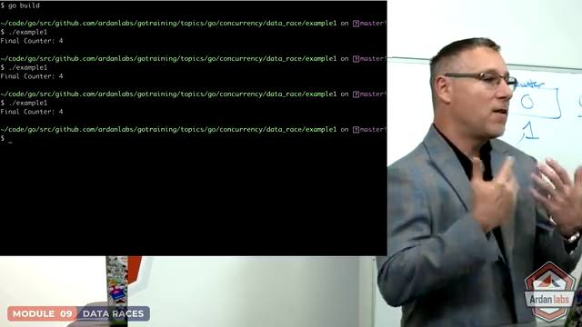
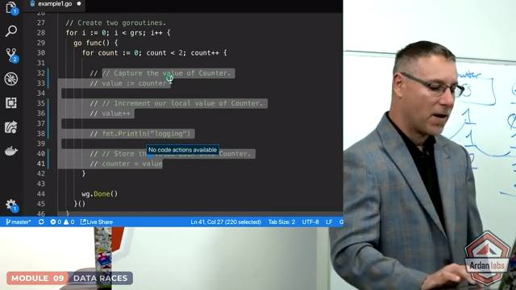
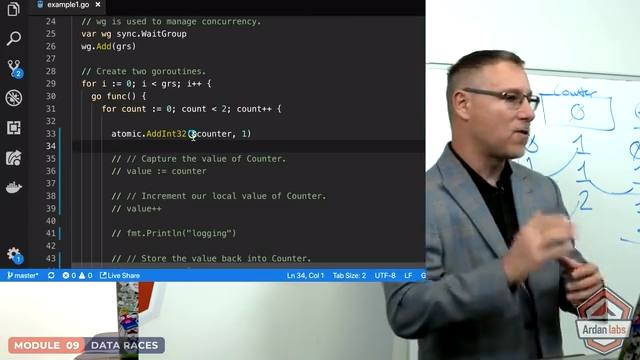
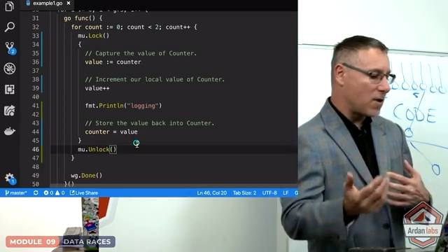

# Ultimate Go Language：数据竞争、atomic/mutex 与 channel 信号语义（P58–P61）复现文档

## 1. 这一节做什么

这一节覆盖 P58–P61，目标不是“背概念”，而是把一个会出数据竞争的 Go 程序从零跑出来，然后分别用两种同步原语修掉它：

1. 先写一个两个 goroutine 同时执行 `read → modify → write` 的计数器程序，观察它“有时候”输出 `4`。
2. 在 read 和 write 之间加一行日志，观察结果变成 `2` 或其他不稳定值，理解数据竞争如何被调度器放大。
3. 用 `go build -race` / `go run -race` 让 Go 的 race detector 把 read/write 冲突指出来。
4. 用 `sync/atomic` 的 `atomic.AddInt32` 修复“单字/半字”计数器场景。
5. 用 `sync.Mutex` 把多行代码包成一个“房间”，让同一时间只有一个 goroutine 进入。
6. 最后进入 P061 的 channel 信号语义：channel 不是队列，而是“一个 goroutine 通知另一个 goroutine 某件事发生了”的机制；先问发送方是否需要“送达保证”，再问是否携带数据。

本节代码全部是 Go 标准库，不需要第三方依赖。逐字稿 P58–P61 没有出现 benchmark 代码，所以本文不编造 benchmark 部分；课程标题里的 benchmark 应在后续视频中，本文只复现逐字稿实际讲到的并发内容。


---

## 2. 讲师原话（带「—— pNNN [MM:SS]」）

> "数据竞争是指多个 Go 协程试图同时访问同一内存位置，并且没有真正协作或轮流执行。"
> —— p058 [00:29]

> "数据竞争发生在至少有两个 Go 协程的情况下：其中一个执行读操作，另一个执行写操作，且至少有一个是写操作。"
> —— p059 [00:25]

> "如果这些操作中至少有一个是写操作，我们就不能允许两个 Go 协程访问同一块共享内存，也就是同一个位置。"
> —— p059 [00:55]  
> 这里的 “right” 是讲师口误，语义是 “write”。

> "原子指令是实现同步最快的方式。"
> —— p059 [10:04]

> "互斥锁让我们能够把多行代码组合在一起，并使这些代码行的执行成为原子操作。"
> —— p059 [13:27]

> "没有哪一行代码本身就是原子的。"
> —— p059 [20:34]

> "通道真正提供的基本语义只有一个……信号通知。"
> —— p061 [00:56]

> "那个 Go 协程是否需要保证发出的信号已经被接收？"
> —— p061 [01:24]

> "接收发生在发送之前。"
> —— p061 [04:47]

---

## 3. 从零复现

### 3.1 环境与目录

课程没有锁定 Go 版本。本文用 Go modules，标准库即可。建议 Go 1.20+；如果你本机版本不同，以 `go version` 为准。

```bash
go version
```

创建目录：

```bash
mkdir ultimate-go-concurrency
cd ultimate-go-concurrency

mkdir data-race
mkdir data-race-log
mkdir atomic-fix
mkdir mutex-fix

go mod init example.com/ultimate-go-concurrency
```

最终目录：

```text
ultimate-go-concurrency/
├── go.mod
├── data-race/
│   └── main.go
├── data-race-log/
│   └── main.go
├── atomic-fix/
│   └── main.go
└── mutex-fix/
    └── main.go
```

没有第三方依赖，不需要环境变量。所有启动命令都在项目根目录执行。

### 3.2 先跑“看起来正常”的版本

```bash
go run ./data-race
```

预期输出：

```text
4
```

讲师在 p059 [03:21] 左右也是先 `go build` 再运行，看到值 `4`。这个结果会让人误以为程序没问题，但它只是“运气好”。




### 3.3 加一行日志，让竞争显形

```bash
go run ./data-race-log
```

输出不稳定，可能是：

```text
2
4
final: 2
```

也可能是别的值。讲师在 p059 [04:46] 左右演示：只在 `read` 和 `write` 之间加了一行 `fmt.Println`，结果就从 `4` 变成了 `2`。原因是打印语句给了调度器一个上下文切换点，两个 goroutine 可能都读到了旧值，然后各自写回。


### 3.4 用 race detector 找数据竞争

按讲师的做法，用 `-race` 构建一个新二进制，然后运行它：

```bash
go build -race -o race-demo ./data-race-log
./race-demo
```

Windows 下：

```bash
go build -race -o race-demo.exe ./data-race-log
.\race-demo.exe
```

终端会打印 `DATA RACE` 警告，并指出一处 read 和一处 write 的源码行，以及 goroutine 创建位置。讲师屏幕上对应的是 line 41 和 line 33，goroutine 创建在 line 29；你本地行号会因注释和空行不同而变化，以实际输出为准。

讲师的关键提醒：  
- race detector 找到 race，就是有 race，不要争辩。  
- 没找到，不代表没有，只代表这次执行还没撞上。  
- 他通常把 race detector 用在测试里，不倾向把带 race detector 的二进制长期放生产；带 race 的二进制大约会慢 25%。


### 3.5 用 atomic 修复计数器

```bash
go run -race ./atomic-fix
```

预期输出：

```text
4
```

不再出现 race 警告。因为 `counter` 是 `int32`，正好是讲师说的“一个字/半个字”范围，可以用硬件级 atomic 指令同步。

### 3.6 用 mutex 修复多行代码

```bash
go run -race ./mutex-fix
```

预期输出：

```text
4
```

不再出现 race 警告。`Lock` 和 `Unlock` 之间的代码变成“房间”，同一时间只允许一个 goroutine 进入。

---

## 4. 完整代码

### 4.1 `go.mod`

```go
module example.com/ultimate-go-concurrency

go 1.20
```

### 4.2 `data-race/main.go`

这个文件是“看起来正常”的版本：没有日志，通常会输出 `4`，但 read/modify/write 三个动作没有被同步。

```go
package main

import (
	"fmt"
	"sync"
)

var counter int

const routines = 2

func main() {
	var wg sync.WaitGroup
	wg.Add(routines)

	for i := 0; i < routines; i++ {
		go func() {
			defer wg.Done()

			for j := 0; j < 2; j++ {
				value := counter // read
				value++          // modify
				counter = value  // write
			}
		}()
	}

	wg.Wait()
	fmt.Println(counter)
}
```

### 4.3 `data-race-log/main.go`

这个文件在 read 和 write 之间加入 `fmt.Println(value)`，用来复现讲师在 p059 [04:46] 演示的现象：一行日志改变调度时机，最终结果可能变成 `2`。

```go
package main

import (
	"fmt"
	"sync"
)

var counter int

const routines = 2

func main() {
	var wg sync.WaitGroup
	wg.Add(routines)

	for i := 0; i < routines; i++ {
		go func() {
			defer wg.Done()

			for j := 0; j < 2; j++ {
				value := counter // read
				value++          // modify

				// 这一行是讲师在 p059 [04:46] 左右演示时保留在
				// read 和 write 之间的日志。它会制造调度点。
				fmt.Println(value)

				counter = value // write
			}
		}()
	}

	wg.Wait()
	fmt.Println("final:", counter)
}
```

### 4.4 `atomic-fix/main.go`

用 `atomic.AddInt32` 把“加一”变成原子操作。注意 `counter` 必须是 `int32`，不能直接用 `int`；讲师在 p059 [11:32] 明确说，`atomic.AddInt32` 要求精确的 32 位类型，传 `int` 会编译报错。

```go
package main

import (
	"fmt"
	"sync"
	"sync/atomic"
)

var counter int32

const routines = 2

func main() {
	var wg sync.WaitGroup
	wg.Add(routines)

	for i := 0; i < routines; i++ {
		go func() {
			defer wg.Done()

			for j := 0; j < 2; j++ {
				atomic.AddInt32(&counter, 1)
			}
		}()
	}

	wg.Wait()
	fmt.Println(atomic.LoadInt32(&counter))
}
```





### 4.5 `mutex-fix/main.go`

用 `sync.Mutex` 把 read/modify/write 包进 `Lock` 和 `Unlock` 之间。讲师在 p059 [16:47] 推荐用一个人为的 `{}` 代码块把“房间”在代码里画出来。

```go
package main

import (
	"fmt"
	"sync"
)

var counter int
var mu sync.Mutex

const routines = 2

func main() {
	var wg sync.WaitGroup
	wg.Add(routines)

	for i := 0; i < routines; i++ {
		go func() {
			defer wg.Done()

			for j := 0; j < 2; j++ {
				mu.Lock()
				{
					value := counter
					value++
					counter = value

					// 讲师在 p059 [17:44] 提醒：日志不要放在锁里。
					// 这里保持 bare minimum，只做必要的共享状态修改。
				}
				mu.Unlock()
			}
		}()
	}

	wg.Wait()
	fmt.Println(counter)
}
```




### 4.6 P061 的产物：channel 信号语义表

P061 没有给完整代码，讲的是设计判断。把讲师的两个问题落成表：

| 问题 | 选择 | 结果 | 代价 | 备注 |
|---|---|---|---|---|
| 发送方是否需要“信号已被接收”的保证？ | 需要 | receive 发生在 send 之前，双方必须碰面 | 未知延迟可能很高 | 讲师用“经理等 Jack 来拿工作”比喻 |
| 发送方是否需要保证？ | 不需要 | send 可以先发生，接收方 later 再来 | 降低/消除等待延迟，但有风险 | 必须确认风险值得 |
| 是否携带数据？ | 带数据 | 一对一信号 | 数据从发送方交给接收方 | 讲师说这是 one-to-one |
| 是否携带数据？ | 不带数据，关闭 channel | 一对多广播 | 没有数据可拿，只是状态变化 | 讲师用“关灯让全场看到”比喻 |
| channel 状态 | open，用 `make` 创建 | 可以 send/receive | 正常使用 | — |
| channel 状态 | nil，零值 | send/receive 都会阻塞 | 可用于短期限流/事件循环 | 讲师说 short-term shortages |
| channel 状态 | closed | 主要用于取消和关闭 | 不是“内存泄漏修复工具” | 讲师明确说不需要为了内存泄漏关闭 |


---

## 5. 逐行解释

### 5.1 `data-race/main.go`

- `package main`：可执行程序入口。
- `import ("fmt"; "sync")`：`fmt` 用来打印最终值，`sync` 提供 `WaitGroup`。
- `var counter int`：共享状态。讲师在 p059 [01:53] 说它在屏幕上大约 line 16，是一个整数，分配 8 字节，两个 goroutine 都会访问它。
- `const routines = 2`：启动两个 goroutine。
- `var wg sync.WaitGroup`：零值可用。`WaitGroup` 用来等两个 goroutine 都结束。
- `wg.Add(routines)`：必须在启动 goroutine 之前加计数，否则主 goroutine 可能在 worker 还没执行时就 `Wait` 结束。
- `for i := 0; i < routines; i++`：创建两个 goroutine。
- `go func() { ... }()`：启动并发执行路径。闭包里没有使用 `i`，所以不存在循环变量捕获问题。
- `defer wg.Done()`：goroutine 结束时把计数减一。
- `for j := 0; j < 2; j++`：每个 goroutine 自增两次，两个 goroutine 一共四次，所以理想结果是 `4`。
- `value := counter`：read。把共享内存读到本地变量。
- `value++`：modify。注意这不是一行原子操作；讲师在 p059 [20:34] 说 `value++` 本质上是 read-modify-write，背后是三条汇编指令。
- `counter = value`：write。把本地值写回共享内存。
- `wg.Wait()`：等两个 goroutine 都完成。`Wait` 本身提供了完成同步，所以最终打印时不会和 goroutine 内部的写并发。
- `fmt.Println(counter)`：输出最终值。没有日志时通常看到 `4`，但这不是同步保证，只是“这次运气好”。

### 5.2 `data-race-log/main.go`

- 前四行和上面一样。
- `fmt.Println(value)`：关键变化。它插在 `value++` 和 `counter = value` 之间。讲师在 p059 [05:15] 解释：打印语句让调度器有机会做上下文切换；另一个 goroutine 可能在这时读到旧值，然后两个 goroutine 各自写回，导致最终值变成 `2`。
- `fmt.Println("final:", counter)`：把最终值打印出来。你可能会看到 `final: 2`、`final: 3`、`final: 4`，这正说明没有同步时结果不可预测。

### 5.3 `atomic-fix/main.go`

- `var counter int32`：必须是精确的 32 位整数。讲师在 p059 [11:32] 演示：如果 `counter` 是 `int`，`atomic.AddInt32(&counter, 1)` 会编译报错，因为 `int` 的宽度依赖架构。
- `atomic.AddInt32(&counter, 1)`：对 `counter` 的地址做原子加一。讲师说，只要多个 goroutine 对同一个地址调用 atomic 指令，它们就会“排队”同步；不同地址之间没有额外同步开销。
- `atomic.LoadInt32(&counter)`：原子读。讲师在 p059 [11:03] 提到 atomic API 里有 load（读）和 store（写），这里用 load 读取最终值。
- 为什么不用 mutex：因为这里只同步一个整数，正好是“一个字/半个字”范围，atomic 更快。
- 为什么不能把 `value := counter; value++; counter = value` 只改成 `counter++`：`counter++` 在 Go 里也不是原子操作；讲师明确说“没有一行代码本身是原子的”。

### 5.4 `mutex-fix/main.go`

- `var mu sync.Mutex`：零值可用。讲师在 p059 [15:48] 说 mutex 和 `WaitGroup` 一样，零值就能用。
- `mu.Lock()`：请求进入“房间”。同一时间只有一个 goroutine 能拿到锁。
- `{ ... }`：人为代码块，把“房间”在源码里可视化。讲师在 p059 [16:47] 说他希望更多开发者这样写。
- `value := counter; value++; counter = value`：这三行现在是一个原子执行区间。讲师说 mutex 能把多行代码变成原子执行。
- `mu.Unlock()`：离开房间。如果拿到锁的 goroutine 不 `Unlock`，其他 goroutine 会永久等待，形成死锁。
- 不要把 `fmt.Println` 放进锁里：讲师在 p059 [17:44] 强调，锁内要做 bare minimum；日志会增加微秒甚至几十微秒的锁内延迟，造成内部 back pressure，拖慢整体吞吐。
- mutex 不是队列：讲师在 p059 [14:52] 说它不是先到先得，而是公平调度；第五个来的 goroutine 也可能先进去。
- 如果结构体里包含 mutex，就不能再随意复制这个结构体；不同副本里的 mutex 是不同锁。讲师在 p059 [16:18] 明确提醒这一点。

### 5.5 P061 的 channel 语义

- channel 不是数据结构，不是队列。讲师在 p061 [00:56] 说，channel 的核心语义是 signaling：一个 goroutine 通知另一个 goroutine 某件事发生了。
- 先看发送方：发送方是否需要“我发出的信号已经被收到”的保证？
  - 需要：接收必须先发生，发送后发送方才能确认“东西被拿走了”。代价是未知延迟。
  - 不需要：发送可以先发生，接收方 later 再来。延迟降低，但承担风险。
- 再看是否带数据：
  - 带数据：一对一，像经理把工作交到 Jack 手里。
  - 不带数据：关闭 channel，像关灯让整个礼堂的人同时看到事件，一对多广播。
- channel 三状态：
  - `make(chan T)`：open，可以 send/receive。
  - `nil`：零值，send/receive 都阻塞；讲师说可用于短期限流、事件循环等。
  - `closed`：关闭状态，主要用于取消和关闭；讲师明确说不要为了“内存泄漏”去关闭 channel，它只是从 open 到 closed 的状态变化。

### 5.6 给前端/Node 读者的对应关系

> 下面只是类比，不是讲师在课里讲的内容。课程没有讲 Node。

- 浏览器主线程的 JS 是单线程事件循环，普通 JS 变量不会出现 Go 这种“两个线程同时读写同一块内存”的数据竞争。
- Node 的 Worker Threads 默认也不共享内存；只有使用 `SharedArrayBuffer` 这类共享内存时，才会遇到类似问题。JS 里的 `Atomics` 和 Go 的 `sync/atomic` 在“原子操作共享内存”这一点上可类比。
- Go 的 `sync.Mutex` 在 Node 里没有完全等价的语言内置原语；通常用串行队列、锁库或把共享状态收敛到单线程来避免并发写。课程没讲 Node 实现，这里只帮助你建立映射。
- Go 的 `WaitGroup` 类似 Node 里等一组 Promise 全部完成；但 Go 的 goroutine 是并发的，Promise 主要是异步编排，语义不完全一样。

---

## 6. 复现检查清单

| 检查项 | 命令 | 预期 |
|---|---|---|
| Go 可用 | `go version` |
| 检查项 | 命令 | 预期 |
|---|---|---|
| Go 可用 | `go version` | 打印版本号，例如 `go version go1.22.x darwin/arm64`；版本号以你本机为准 |
| 模块初始化 | `go mod init example.com/ultimate-go-concurrency` | 生成 `go.mod`，无报错 |
| 目录结构正确 | `ls`（Windows 用 `dir`） | 能看到 `data-race` / `data-race-log` / `atomic-fix` / `mutex-fix` 四个目录 |
| 无日志版本编译 | `go build ./data-race` | 无输出、退出码 0 |
| 无日志版本运行 | `go run ./data-race` | 输出 `4`（多数情况下；不保证，这正是问题） |
| 加日志版本运行 | `go run ./data-race-log` | 输出 `final:` 后面的数字可能是 `2`、`3`、`4` 中的某一个，多次运行可能不同 |
| race detector 可用 | `go run -race ./data-race` | 能正常启动；若报 C 编译器缺失，见 7.1 |
| bad 版本被 race 抓到 | `go run -race ./data-race-log` | 出现 `WARNING: DATA RACE`，并给出 read / write 的源码行号与 goroutine 创建位置 |
| atomic 修复通过 | `go run -race ./atomic-fix` | 输出 `4`，无 `WARNING: DATA RACE` |
| mutex 修复通过 | `go run -race ./mutex-fix` | 输出 `4`，无 `WARNING: DATA RACE` |
| 类型坑验证 | 把 `atomic-fix` 里的 `var counter int32` 临时改成 `var counter int` 再 `go build ./atomic-fix` | 编译失败，报 `atomic.AddInt32` 参数类型不匹配（`*int` 不能当 `*int32`） |

检查清单里最后一条是让你亲手确认讲师在 p059 [11:32] 说的“精度必须显式”：`atomic.AddInt32` 的第一个参数是 `*int32`，`*int` 在 64 位机器上是 8 字节，传进去编译不过。改回来再跑一遍，`go run -race ./atomic-fix` 应该恢复输出 `4`。

---

## 7. 课里没讲但你会撞上的

这一节全部是我在你复现时会踩到的工程问题，逐字稿 P58–P61 没有展开。凡是我没法从逐字稿里找到依据的，都标了“课里没讲”。

### 7.1 `-race` 跑不起来：race detector 需要 C 编译器

课里没讲这一条，但它是最常见的第一个拦路虎。Go 的 race detector 依赖 cgo 与底层 C 编译器，`go run -race` / `go build -race` 报错时通常是：

```text
cgo: C compiler "gcc" not found: exec: "gcc": executable file not found in $PATH
```

或者：

```text
-race requires cgo
```

处理方式按平台分（下面命令课里都没讲，是通用环境排查）：

- macOS：装 Xcode Command Line Tools，`xcode-select --install`。
- Linux：装 `gcc`，例如 `sudo apt install build-essential`。
- Windows：装 MinGW-w64 并把 `gcc` 加进 `PATH`，或者用 WSL 里跑。
- 如果你之前设过 `CGO_ENABLED=0`，`-race` 会直接失败；运行前先 `export CGO_ENABLED=1`（Windows PowerShell 用 `$env:CGO_ENABLED=1`）。

另外，交叉编译（比如在 Mac 上给 Linux 编 `-race` 二进制）通常不行，race 检测需要目标平台的运行支持。课里没讲交叉编译，这里只提醒你别在这上面浪费时间。

### 7.2 race detector 没报，不等于没有 race

这是讲师在 p059 [08:10] 讲过的原则：“如果它没找到 race，不代表你没有 race，只代表你还没找到”。落到实操上：

- 单次 `go run -race` 只是一个样本。程序跑得快、goroutine 调度顺序固定时，可能一次都不触发。
- 想提高暴露概率，就多跑几次，或者在测试里循环跑。讲师说他更常把 race detector 和测试一起用，而不是编一个长期运行的二进制。
- 如果 `-race` 报了，但你看不出因果，讲师在 p059 [09:06] 的建议是：不要打补丁，考虑重新设计。这个判断比修 bug 本身更重要。

### 7.3 把带 race 的二进制带上生产的代价

讲师在 p059 [08:10] 说，带 race detector 的二进制“大约会慢 25%”，并且明确说他本人不倾向这么干，只在测试里用。课里没有给出精确 benchmark 数字，25% 是讲师的口头估计，你自己的项目要重新测。这也解释了为什么课程标题里有 benchmark，但 P58–P61 没讲 benchmark 工具：benchmark 属于后续内容，本节不展开。

### 7.4 Mac 上让 race 更容易现形

讲师在 p059 [08:39] 给了一个具体建议：在 Mac 上跑测试时，把 CPU 值设成“硬件线程数的三倍左右”，人为制造更多调度混乱。课里没有点名具体参数，实操时对应的通常是 `go test` 的 `-cpu` 参数，例如硬件 8 线程时：

```bash
go test -race -cpu 3,6,12,24 ./...
```

或者临时调 `GOMAXPROCS`。这两个具体名字课里没讲，是 Go 工具链的通用参数；照抄前先 `go help testflag` 确认你的版本支持。核心思想是讲师的原话：制造更多 chaos 来帮 race detector 抓到问题。


### 7.5 `int` 与 `int32`：atomic 的类型坑

这是第 5.3 节说过的，但值得单独当坑列出来，因为你在真实项目里不会用全局变量，而是用结构体字段：

```go
type Stats struct {
	requests int32 // 必须显式 32 位，不能写 int
}
```

`int` 在 64 位平台是 8 字节、32 位平台是 4 字节，宽度随架构变化，所以 `atomic.AddInt32` 不接受 `*int`。同理，要用 64 位计数就用 `atomic.AddInt64` 配 `int64`。课里没讲的是：Go 1.19 起还有 `atomic.Int32` / `atomic.Int64` 这种类型化 API（`var n atomic.Int32; n.Add(1)`），它和讲师演示的函数式 API 等价，只是写法不同；你在这门课里跟着讲师用函数式写法即可，别混着写。

还有一个课里没讲、但在 32 位 ARM 上会咬人的点：`int64` 的原子操作要求 8 字节对齐，如果 `int64` 字段在结构体里位置不对，某些老架构上会 panic。Go 编译器一般会帮你排好，但如果你手动做内存布局优化，就要留意。

### 7.6 mutex 复制：`go vet` 会替你抓

讲师在 p059 [16:18] 讲了原理：结构体里放了 `sync.Mutex` 之后就不能再复制这个结构体，因为副本里的锁是另一把锁，同步就失效了。课里没讲怎么自动发现。实操上：

```bash
go vet ./...
```

如果某处按值传递了含 `sync.Mutex` 的结构体，`go vet` 会报类似 `passes lock by value` 的告警（具体措辞以你的 Go 版本输出为准）。养成提交前跑 `go vet` 的习惯，比靠眼睛找强。另外，给含 mutex 的结构体写方法时用指针接收者 `func (s *Stats) Inc()`，不要用值接收者。

### 7.7 忘记 Unlock 与 `defer` 的取舍

讲师在 p059 [14:22] 强调：拿到锁不 `Unlock` 就会死锁，后面所有 goroutine 永远进不来。课里没讲的是工程上怎么防：

- 如果锁内代码可能提前 `return` 或 `panic`，用 `defer mu.Unlock()` 最稳。
- 但 `defer` 在**循环里**会累积到函数返回才执行，如果你在长循环里 `Lock` + `defer Unlock`，锁会被持有到函数结束，等于把整个循环串行化甚至死锁。讲师在 4.5 的写法是显式 `Unlock` 加人为 `{}` 块，正好避开这个坑，跟着他写就行。
- 想更保险，可以把“上锁 → 改状态 → 解锁”抽成一个小函数，在函数内用 `defer mu.Unlock()`，让 defer 的作用域短而清晰。

### 7.8 nil channel 与 closed channel 的 panic 边界

P061 讲师讲了 channel 的三种状态，但没讲具体会 panic 的操作。你自己试的时候会撞上：

| 操作 | nil channel | open channel | closed channel |
|---|---|---|---|
| 发送 `ch <- v` | 永久阻塞 | 成功或被缓冲满阻塞 | **panic** |
| 接收 `<-ch` | 永久阻塞 | 成功或阻塞 | 立即返回零值，第二返回值 `false` |
| 关闭 `close(ch)` | **panic** | 成功 | **panic** |

（这张表是根据 Go 语言规范整理的，课里只讲了“nil 会阻塞”“closed 用于取消和关闭”这两层语义，没有逐格展开。）

两个后果你要提前知道：

1. 如果所有 goroutine 都卡在 nil channel 上，运行时会报 `fatal error: all goroutines are asleep - deadlock!` 并退出。讲师说 nil channel 可以用于“短期限流”，但那只在你还有别的 goroutine 会来唤醒它的前提下成立。
2. “关闭已经关闭的 channel”会 panic，所以“谁来关”必须有唯一负责人。讲师在 p061 只讲了关闭的语义是广播，没讲所有权规则；工程上的惯例是**由发送方关闭，且只关一次**，接收方永远不要关。

### 7.9 map 的并发读写会直接 fatal

讲师在 p059 [19:09] 提到“用 map 做进程内缓存、多个 goroutine 同时读没问题，一旦有人写就要停下来”，并提醒不要写错 `RWMutex`。课里没讲的是：Go 运行时对内置 map 有并发检测，两个 goroutine 同时读写同一个 map 会直接抛：

```text
fatal error: concurrent map read and map write
```

注意这是 `fatal error`，不是 panic，`recover` 抓不住，进程直接挂。所以讲师说的“用 `sync.RWMutex` 保护 map 缓存”不是可选项，是必须项。前端同学可以把 map 想成“没有内建锁的 `Map`，多线程环境下必须自己加锁”。

### 7.10 `RWMutex` 的 read lock + write unlock

讲师在 p059 [19:37] 说他见过太多次“复制粘贴时把 `RLock` 和 `Unlock` 配在一起”。这类错误编译能过、大部分时候也能跑，但要么死锁，要么同步失效，而且很难复现。防范手段：

- 写 `RLock` 就立刻在下一行写 `RUnlock`，写完中间逻辑再回头检查。
- `go vet` 不一定能抓这种配对错误（课里没讲它能抓，我也不会替它保证），所以靠 `-race` 加测试覆盖并发读路径更实际。
- 讲师明确说本节这个计数器**不需要** `RWMutex`，因为每一次操作都包含写；`RWMutex` 只适合“读远多于写”的缓存场景。别为了显得高级而换锁。

### 7.11 channel 不是队列：认知模型错了，代码一定歪

讲师在 p061 [00:56] 反复强调“不要把 channel 当数据结构、当队列”。课里没讲这会具体导致什么，我按你会撞上的顺序列：

- 把 channel 当消息队列做背压：你会开始纠结缓冲区大小 `make(chan T, N)`，然后用 channel 长度当“队列积压量”做监控。这在单进程内小规模能用，但和真正的消息队列（持久化、重投、死信）完全不是一回事。
- 用 channel 做请求-响应：需要额外的 reply channel，代码会迅速变复杂。讲师在 p059 结尾说“两个 goroutine 要互相通信时，不要用 atomic、不要用 mutex，用 channel 做 orchestration”，指的是**编排**，不是让你把 channel 当 RPC。
- 为了“避免内存泄漏”去 `close(ch)`：讲师在 p061 [09:30] 明确否定了这个动机，关闭只是 open → closed 的状态变化。真正决定 channel 能否被回收的是有没有 goroutine 还持有它。

### 7.12 前端视角的最后一句对照

> 课里没讲 Node，以下仅为帮助迁移心智模型。

你在 Node 里写 `await` 时，几乎不会担心两个回调同时改同一个变量，因为事件循环一次只跑一个回调。Go 的 goroutine 是真并行，两个 goroutine 可能真的同时读写同一块内存。所以这门课的三件套要这样记：

- `sync/atomic` ≈ JS 的 `Atomics.add`（只对单个数值，硬件级）。
- `sync.Mutex` ≈ 没有语言内置等价物，通常用单线程 actor 模型或锁库代替。
- `channel` ≈ `postMessage` 加上明确的“发送方是否等确认”语义，不是 `Array` 也不是 `queue`。

把这三条记住，再回头跑一遍第 6 章的检查清单，P58–P61 的内容就闭环了。