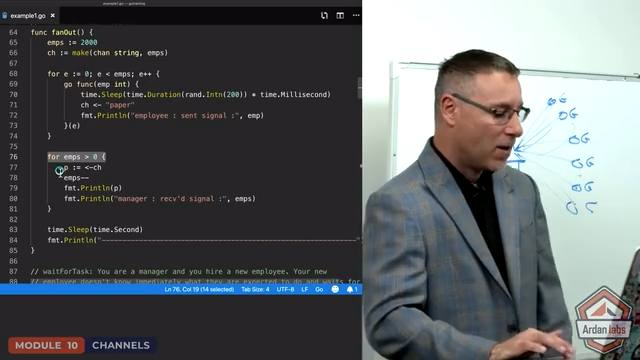
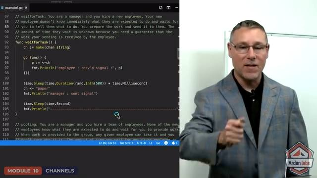
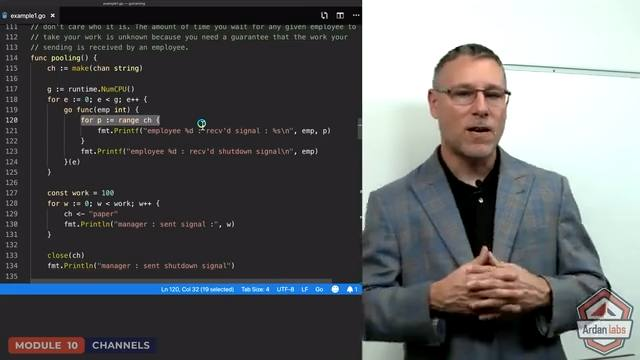
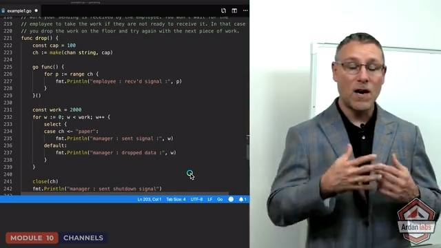

# Ultimate Go Language（P62–P68）并发信令模式复现文档

本文覆盖 P62–P68：`wait for result`、`fan out`、`wait for task`、`pooling`、`fan out semaphore`、`fan out bounded`、`drop`。这七页逐字稿里没有 benchmark 命令或 benchmark 代码；虽然课程标题含 benchmark，但本节实际讲的是 channel / signaling patterns。下面按“能跑起来”的方式重组，不按视频顺序流水账。

> 说明：讲师原文件有固定行号（如 p062 line 41、p063 line 64）。本仓库为了能直接运行，把示例拆成多个独立 `main.go`，所以我们的行号不会与讲师原文件一一对应。代码注释里保留“对应 pNNN 约 line X”的提示。`package main`、`import`、`main()`、部分 `sync.WaitGroup` 收尾属于复现补全，逐字稿没有逐字写全；channel pattern 的主体按逐字稿描述重组。

## 1. 这一节做什么

这一节要做一个可运行的 Go 并发信令模式实验仓。它不是让你背七个名词，而是让你亲手看到：goroutine 如何通过 channel 建立“保证”，缓冲 channel 如何削弱“发送必被接收”的保证，`select + default` 如何做容量检测和丢弃，`runtime.NumCPU()` 如何作为池大小的起点，`close(channel)` 如何触发 `for range` 退出。

最终你会得到这些可独立运行的程序：

- `p062_wait_for_result`：启动一个已经知道任务的 goroutine，主 goroutine 等它的结果。
- `p063_fan_out`：一次放出 2000 个 goroutine，等所有结果回来。
- `p064_wait_for_task`：goroutine 先等着，主 goroutine 之后再把任务发给它。
- `p065_pooling`：固定数量 worker 阻塞在同一个 channel 上，形成池。
- `p066_fan_out_semaphore`：仍然创建 2000 个 goroutine，但用信号量限制同时执行的数量。
- `p067_fan_out_bounded`：不创建 2000 个 goroutine，只创建 `NumCPU` 个 worker，用缓冲 channel 喂 2000 份工作。
- `p068_drop`：容量 100，超过容量就用 `select` 的 `default` 丢弃请求，模拟背压保护。

读者背景是前端转 AI 应用工程师，这里先给一个类比：Go 的 goroutine 不等于 Node 的 Promise。Node 主线程是单线程事件循环，Promise 是异步回调编排；Go 的 goroutine 可以被调度到多个硬件线程上并行执行。channel 也不是 Promise，它更像“带同步语义的队列”。你不要用打印顺序判断谁先谁后，这是本节反复强调的点。

## 2. 讲师原话（带「—— pNNN [MM:SS]」）

> "第一种模式，也是最基础的模式，我们要看的是“等待结果”。"
> —— p062 [00:28]

> "make 在构造一个无缓冲通道……我们是在创建一个能提供保证的通道，随后会用字符串数据发出信号。"
> —— p062 [01:25]

> "这段代码唯一的保证就是信号语义：接收会在发送前几纳秒发生。"
> —— p062 [04:14]

> "扇出模式的核心思路就是：你有一堆工作要做……我们会等所有工作都返回。"
> —— p063 [00:27]

> "扇出模式极其危险，因为我们可能在同时间给系统以及外部系统施加大量负载。"
> —— p063 [04:10]

> "“等待任务”模式……这个 Go 协程还不知道要做什么。它会等待被告知自己的任务是什么。"
> —— p064 [00:27]

> "人们在池化时犯的一个大错误是使用带缓冲的通道……数据一旦进入缓冲区，你就失去了对它的控制。"
> —— p065 [00:27]

> "我会把 NumCPU 作为初始的魔法数字：每个硬件线程一个 Go 协程。"
> —— p066 [02:18]

> "我会用 WaitGroup 来协调所有工作何时完成。"
> —— p067 [01:23]

> "丢弃模式的核心思路……它能帮助你减少并尽量降低软件中的背压之类的问题。"
> —— p068 [00:25]

## 3. 从零复现

### 3.1 环境与依赖

- Go 版本：课里没讲具体版本。复现建议 Go 1.20+。本文代码只用标准库。
- 第三方依赖：无。`go.mod` 里不需要 `require`。
- 环境变量：本示例不需要任何环境变量；课里也没讲环境变量。
- 操作系统：Windows / macOS / Linux 均可。命令以 Unix shell 为例。
- 依赖版本：`go.mod` 中写 `go 1.20`，你本机版本更高也可以。

### 3.2 目录结构

在任意空目录下创建：

```text
ultimate-go-patterns/
├── go.mod
├── p062_wait_for_result/
│   └── main.go
├── p063_fan_out/
│   └── main.go
├── p064_wait_for_task/
│   └── main.go
├── p065_pooling/
│   └── main.go
├── p066_fan_out_semaphore/
│   └── main.go
├── p067_fan_out_bounded/
│   └── main.go
└── p068_drop/
    └── main.go
```

创建命令：

```bash
mkdir -p ultimate-go-patterns
cd ultimate-go-patterns
go mod init ultimate-go-patterns
mkdir -p p062_wait_for_result p063_fan_out p064_wait_for_task p065_pooling p066_fan_out_semaphore p067_fan_out_bounded p068_drop
```

### 3.3 启动命令

把第 4 节所有文件保存好后，在 `ultimate-go-patterns` 根目录执行：

```bash
go mod tidy

go run ./p062_wait_for_result
go run ./p063_fan_out
go run ./p064_wait_for_task
go run ./p065_pooling
go run ./p066_fan_out_semaphore
go run ./p067_fan_out_bounded
go run ./p068_drop
```

观察重点：

- `p062`：多跑几次，`send:` 和 `receive:` 的打印顺序可能变化。这是正常的，因为 channel 只保证接收发生在发送完成前的纳秒级同步点，不保证后续 `Println` 的顺序。
- `p063`：程序最终打印 `fan out done`。2000 个 goroutine 的完成顺序不重要。
- `p064`：worker 收到任务前会阻塞；主 goroutine 准备好任务后才发送。
- `p065`：worker 数量等于 `runtime.NumCPU()`；打印中可以看到固定数量 worker 轮流处理 100 个任务。
- `p066`：创建 2000 个 goroutine，但同一时刻只有 `NumCPU()` 个能进入工作区。
- `p067`：只创建 `NumCPU()` 个 worker，通过小缓冲 channel 喂 2000 份工作。
- `p068`：容量 100；2000 个请求中会有一批被 `default` 丢弃，最后打印 `dropped:` 数量。


上图对应 `wait for result` 的代码讲解位置。复现时先跑 `p062`，把“接收保证”和“打印顺序”分开理解。

## 4. 完整代码

### 4.1 `go.mod`

```go
module ultimate-go-patterns

go 1.20
```

### 4.2 `p062_wait_for_result/main.go`

```go
package main

import (
	"fmt"
	"math/rand"
	"time"
)

// 对应 p062 的 waitForResult。
// 课里没讲 package/import/main，这里是为可运行补全。
func waitForResult() {
	// 对应 p062 约 line 42：无缓冲 channel。
	// 无缓冲意味着发送和接收必须配对，接收发生在发送完成之前。
	ch := make(chan string)

	// 对应 p062 约 line 44：启动一个已经知道要做什么的 goroutine。
	go func() {
		// 对应 p062 约 line 45：用随机 sleep 模拟未知延迟。
		// 讲师明确说生产代码不要用 time.Sleep 模拟延迟。
		time.Sleep(time.Duration(rand.Intn(500)) * time.Millisecond)

		// 对应 p062 约 line 46：发送结果。
		ch <- "result"

		// 对应 p062 约 line 47：发送后的打印。
		fmt.Println("send: result")
	}()

	// 对应 p062 约 line 50：主 goroutine 阻塞等待结果。
	result := <-ch

	// 对应 p062 约 line 51：接收后的打印。
	fmt.Println("receive:", result)
}

func main() {
	waitForResult()
}
```

### 4.3 `p063_fan_out/main.go`

```go
package main

import (
	"fmt"
	"math/rand"
	"time"
)

// 对应 p063 的 fanOut。
func fanOut() {
	// 对应 p063 约 line 65：2000 个员工，也就是 2000 份工作。
	employees := 2000

	// 对应 p063 约 line 66：缓冲通道。
	// 每个 goroutine 一个槽位，发送方通常不需要等接收方腾出位置。
	ch := make(chan string, employees)

	// 对应 p063 约 line 68：一次性放出 2000 个 goroutine。
	for i := 0; i < employees; i++ {
		go func(id int) {
			// 对应 p063 约 line 70：模拟未知工作耗时。
			time.Sleep(time.Duration(rand.Intn(50)) * time.Millisecond)

			// 对应 p063 约 line 71：把结果发回缓冲通道。
			ch <- fmt.Sprintf("employee %d done", id)
		}(i)
	}

	// 对应 p063 约 line 76：等所有结果回来。
	remaining := employees
	for remaining > 0 {
		// 对应 p063 约 line 77：接收一个结果。
		<-ch
		remaining--
	}

	fmt.Println("fan out done")
}

func main() {
	fanOut()
}
```

### 4.4 `p064_wait_for_task/main.go`

```go
package main

import (
	"fmt"
	"math/rand"
	"time"
)

// 对应 p064 的 waitForTask。
func waitForTask() {
	// 对应 p064 约 line 93：无缓冲通道，带发送/接收配对保证。
	ch := make(chan string)

	// 对应 p064 约 line 95：启动 worker。
	go func() {
		// 对应 p064 约 line 96：worker 一开始不知道任务，阻塞等待。
		task := <-ch
		fmt.Println("worker received:", task)
	}()

	// 对应 p064 约 line 100：主 goroutine 花未知时间准备任务。
	time.Sleep(time.Duration(rand.Intn(500)) * time.Millisecond)

	// 对应 p064 约 line 101：发送任务。
	// 这里的发送完成时，可以确定 worker 已经收到了任务。
	ch <- "task"

	fmt.Println("manager sent task")
}

func main() {
	waitForTask()
}
```

### 4.5 `p065_pooling/main.go`

```go
package main

import (
	"fmt"
	"math/rand"
	"runtime"
	"sync"
	"time"
)

// 对应 p065 的 pooling。
func pooling() {
	// 对应 p065 约 line 115：无缓冲通道。
	// 讲师强调 pooling 不要用缓冲通道，否则工作进入 buffer 后就失去控制。
	ch := make(chan string)

	// 对应 p065 约 line 117：用 NumCPU 作为池大小的起点。
	g := runtime.NumCPU()

	// 课里没讲 WaitGroup 收尾；这里补上，避免 main 在 worker 退出前结束。
	var wg sync.WaitGroup
	wg.Add(g)

	// 对应 p065 约 line 118 附近：创建 g 个 worker。
	for i := 0; i < g; i++ {
		go func(id int) {
			defer wg.Done()

			// 对应 p065 约 line 120：所有 worker 阻塞在同一个 channel 的 receive 上。
			// for range 会一直循环，直到 channel 被关闭并且数据被取完。
			for task := range ch {
				fmt.Println("worker", id, "processing", task)
				time.Sleep(time.Duration(rand.Intn(20)) * time.Millisecond)
			}
		}(i)
	}

	// 对应 p065 约 line 127 附近：投递 100 份工作。
	for i := 0; i < 100; i++ {
		// 对应 p065 约 line 129：发送工作。
		// 无缓冲通道下，发送完成意味着某个 worker 已经收到工作。
		ch <- fmt.Sprintf("task %d", i)
	}

	// 对应 p065 约 line 133：关闭通道，worker 会逐步退出。
	close(ch)

	wg.Wait()
	fmt.Println("pooling done, workers:", g)
}

func main() {
	pooling()
}
```

### 4.6 `p066_fan_out_semaphore/main.go`

```go
package main

import (
	"fmt"
	"math/rand"
	"runtime"
	"time"
)

// 对应 p066 的 fan out semaphore，也叫 fan out semi-four。
func fanOutSemaphore() {
	// 对应 p066 约 line 149：2000 份工作。
	employees := 2000

	// 对应 p066 约 line 150 附近：结果通道，缓冲 2000。
	ch := make(chan string, employees)

	// 对应 p066 约 line 152 附近：信号量通道。
	// 缓冲区大小等于 NumCPU，表示同一时刻只允许 NumCPU 个 goroutine 进入工作区。
	sem := make(chan bool, runtime.NumCPU())

	// 对应 p066 约 line 155 附近：仍然创建 2000 个 goroutine。
	for i := 0; i < employees; i++ {
		go func(id int) {
			// 对应 p066 约 line 157：先拿信号量。
			// 如果 sem 已满，这里会阻塞，所以大多数 goroutine 会停在这里。
			sem <- true

			// 对应 p066 约 line 159：模拟未知工作耗时。
			time.Sleep(time.Duration(rand.Intn(20)) * time.Millisecond)

			// 对应 p066 约 line 161 附近：把结果发到结果通道。
			ch <- fmt.Sprintf("employee %d done", id)

			// 对应 p066 约 line 163：释放信号量，让另一个 goroutine 进入。
			<-sem
		}(i)
	}

	// 对应 p066 约 line 167：等待所有结果。
	remaining := employees
	for remaining > 0 {
		<-ch
		remaining--
	}

	fmt.Println("fan out semaphore done")
}

func main() {
	fanOutSemaphore()
}
```

### 4.7 `p067_fan_out_bounded/main.go`

```go
package main

import (
	"fmt"
	"math/rand"
	"runtime"
	"sync"
	"time"
)

// 对应 p067 的 fan out bounded。
func fanOutBounded() {
	// 对应 p067 约 line 186：创建 2000 份工作。
	// 讲师说这里用设置最后索引位置的方式得到长度 2000 的 slice/array；
	// 这里用 make 写出等价可读版本。
	work := make([]string, 2000)
	for i := range work {
		work[i] = fmt.Sprintf("work %d", i)
	}

	// 对应 p067 约 line 188 附近：用 NumCPU 作为池大小。
	g := runtime.NumCPU()

	// 对应 p067 约 line 190 附近：WaitGroup 编排所有 worker 完成。
	var wg sync.WaitGroup
	wg.Add(g)

	// 对应 p067 约 line 192：缓冲 channel。
	// 缓冲大小跟 worker 数量一致即可，不需要做成 2000 或一百万。
	ch := make(chan string, g)

	// 对应 p067 约 line 194：只启动 g 个 goroutine，而不是 2000 个。
	for i := 0; i < g; i++ {
		go func(id int) {
			// 对应 p067 约 line 196：worker 退出时减 WaitGroup。
			defer wg.Done()

			// 对应 p067 约 line 197：worker 阻塞等待工作。
			for w := range ch {
				// 对应 p067 约 line 198 附近：处理工作。
				fmt.Println("worker", id, "processing", w)
				time.Sleep(time.Duration(rand.Intn(5)) * time.Millisecond)
			}
		}(i)
	}

	// 对应 p067 约 line 204：遍历所有工作。
	for _, w := range work {
		// 对应 p067 约 line 205：把工作送进缓冲 channel。
		ch <- w
	}

	// 对应 p067 约 line 207：最后一份工作提交后立即关闭通道。
	// worker 会先 flush 缓冲中的数据，然后 range 退出。
	close(ch)

	// 对应 p067 约 line 208：等待 8 个 worker 全部退出。
	wg.Wait()

	fmt.Println("fan out bounded done")
}

func main() {
	fanOutBounded()
}
```

### 4.8 `p068_drop/main.go`

```go
package main

import (
	"fmt"
	"math/rand"
	"sync"
	"time"
)

// 对应 p068 的 drop pattern。
func drop() {
	// 对应 p068 约 line 222：容量为 100。
	const capacity = 100

	// 对应 p068 约 line 223：缓冲 channel，缓冲大小就是容量。
	ch := make(chan string, capacity)

	// 课里没讲 WaitGroup 收尾；这里补上，保证 worker 处理完再退出。
	var wg sync.WaitGroup
	wg.Add(1)

	// 对应 p068 约 line 225：启动一个 goroutine 处理请求。
	// 讲师说这里也可以是一个 worker pool，为了简单只用一个。
	go func() {
		defer wg.Done()

		// 对应 p068 约 line 226：for range 等请求，channel 关闭后退出。
		for req := range ch {
			fmt.Println("processing", req)
			time.Sleep(time.Duration(rand.Intn(5)) * time.Millisecond)
		}
	}()

	dropped := 0

	// 对应 p068 约 line 231：模拟 2000 个 DNS 请求。
	for i := 0; i < 2000; i++ {
		// 对应 p068 约 line 233 附近：select 同时尝试 channel 操作。
		select {
		// 对应 p068 约 line 234：如果 channel 还有容量，就发送成功。
		case ch <- fmt.Sprintf("dns request %d", i):
			// 接收成功，什么也不做。

		// 对应 p068 约 line 236：如果 channel 满了，发送会阻塞；
		// 因为有 default，select 不阻塞，直接走 default，也就是丢弃。
		default:
			dropped++
		}
	}

	// 关闭 channel，让 worker 处理完缓冲中的请求后退出。
	close(ch)
	wg.Wait()

	fmt.Println("dropped:", dropped)
}

func main() {
	drop()
}
```



上图对应 `fan out` 的讲解位置。`p063` 的重点不是 2000 个 goroutine 本身，而是“缓冲通道移走了接收保证”以及“服务端不要随意 fan out”。

## 5. 逐行解释

### 5.1 `wait for result`：只保证接收发生在发送完成前

`make(chan string)` 创建无缓冲 channel。逐字稿 p062 [01:25] 说，这可以理解为“一个有保证的 channel”：发送和接收必须配对。主 goroutine 执行 `result := <-ch` 时阻塞；子 goroutine 执行 `ch <- "result"` 时，两边在 channel 上会合。逐字稿 p062 [04:14] 强调，唯一的保证是 receive 在 send 完成前的纳秒级发生。

但 `ch <- "result"` 后面的 `fmt.Println("send: result")` 和主 goroutine 的 `fmt.Println("receive:", result)` 没有先后保证。两个 goroutine 可能并行跑在不同的硬件线程上，所以打印顺序可能反过来。你复现时多跑几次 `go run ./p062_wait_for_result`，看到 `send:` 先打印也不要惊讶。这不是 channel 保证失效，而是你把“同步点”和“同步点之后的打印”混为一谈了。

在 JS/Node 里，等待结果很像 `await promise`，但 Go 这里不是 Promise 链，而是两个 goroutine 在一个 channel 上做同步。Node 里你通常不会看到两个回调真的并行改同一块内存；Go 里 goroutine 可以并行，所以顺序问题更明显。



### 5.2 `fan out`：缓冲通道让发送方不用等接收方，但仍有发送侧竞争

`employees := 2000` 表示 2000 份工作。`ch := make(chan string, employees)` 创建缓冲 2000 的 channel。逐字稿 p063 [01:21] 说，缓冲 channel 意味着“发送出去的数据已经被接收”的保证被移走了；发送方只要缓冲区有位置就能完成发送，不需要接收方立刻在另一端等着。

`for i := 0; i < employees; i++ { go func(id int) { ... }(i) }` 一次放出 2000 个 goroutine。每个 goroutine sleep 一段随机时间，然后 `ch <- ...`。主 goroutine 在 `for remaining > 0 { <-ch; remaining-- }` 里收 2000 次。这里的 `remaining` 像一个本地计数器，逐字稿 p063 [03:42] 说它“kind of working like a weight group”，也就是用计数判断还有多少结果没回来。

但缓冲通道不是“没有同步”。如果多个 goroutine 同时执行 `ch <- ...`，channel 内部仍然要协调发送，避免多个发送者同时写同一个位置。逐字稿 p063 [03:13] 说，可能仍会在发送侧看到延迟，但这不是因为等待接收方，而是因为多个发送同时在竞争。更重要的是，逐字稿 p063 [04:10] 警告：fan out 很危险，尤其长驻 Web 服务里，50,000 个请求再各自 fan out 20 个 goroutine，很容易把系统或外部服务打爆。这个模式适合 CLI、CRON、Lambda 这类短生命周期任务；服务端要谨慎。

Node 里类似“批量任务 + Promise.all”，但 Node 通常靠事件循环和并发限制库控制压力；课里没讲 Node 实现，这里只是类比。Go 的 fan out 是真创建大量 goroutine，调度器压力更直接。

### 5.3 `wait for task`：worker 先等，任务后到

`ch := make(chan string)` 又是无缓冲 channel。逐字稿 p064 [00:27] 说，这个模式和前面相反：worker 已经启动，但它不知道要做什么，它要先等着被告诉任务。代码里 worker 第一行就是 `task := <-ch`，所以它立刻阻塞。

主 goroutine 后面执行 `time.Sleep(...)` 模拟“准备任务”的未知延迟。逐字稿 p064 [01:23] 说，这个未知延迟现在发生在主 goroutine 准备工作的阶段。然后 `ch <- "task"` 发送。因为 channel 无缓冲，发送完成时，可以确定 worker 已经收到了任务。逐字稿 p064 [01:51] 说，receive 在 send 前纳秒级发生，发送方拿到“worker 已收到”的保证。

这个模式是 pooling 的基础：池子里的 goroutine 都阻塞在 receive 上，等主 goroutine 把任务发进来。注意，这里不要误以为 worker 收到任务后，主 goroutine 的 `fmt.Println("经理发来了任务")` 一定先于 worker 的打印。channel 只保证 receive 和 send 的同步点，后续打印顺序不保证。

### 5.4 `pooling`：池子里的 worker 阻塞在同一个 channel 上

`pooling()` 里 `ch := make(chan string)` 是无缓冲 channel。逐字稿 p065 [00:27] 明确说，pooling 用缓冲 channel 是很大的错误，因为数据一旦进 buffer，你就失去控制；你希望知道某个 goroutine 已经收到工作并开始处理。无缓冲 channel 的发送完成，意味着某个 worker 已经 receive 到了任务。

`g := runtime.NumCPU()` 取逻辑处理器数量。逐字稿 p065 [00:57] 说，不知道池子该开多大时，NumCPU 是很好的起点，之后可以靠负载测试调整。`for i := 0; i < g; i++` 创建 g 个 worker。每个 worker 用 `for task := range ch` 阻塞接收。逐字稿 p065 [01:26] 说，正是这行 `for range` 让这些 goroutine 都阻塞在同一个 channel 上，形成池。哪个 worker 拿到哪份工作不重要；如果顺序重要，那就不是并发问题而是顺序问题，你要额外控制。

主 goroutine 投递 100 份工作：`ch <- fmt.Sprintf("task %d", i)`。因为无缓冲，发送会阻塞到某个 worker 接收。逐字稿 p065 [03:16] 说，发送到 line 129 时，你可以确定池子里有 goroutine 在干活；在本机最多可以有 8 个 goroutine 并行跑。最后 `close(ch)` 关闭 channel。逐字稿 p065 [03:44] 说，关闭是“不带数据的信号”，通常用于取消和关闭；channel 里已有数据会先被 flush 完，然后 `for range` 退出。

这里我补了 `sync.WaitGroup`。逐字稿只讲了 close 让 worker 终止，没有讲 main 可能先退出。Go 的 `main` 返回时程序直接结束，不会等所有 goroutine 打完最后一行。所以补 `wg.Add(g)`、`defer wg.Done()`、`wg.Wait()` 是复现工程补全，不是讲师原话。Node 里类似 `Promise.all` 等所有 worker 收尾；Go 里用 WaitGroup。



上图对应 `pooling` 的讲解位置。注意讲师在右侧代码里把 `for range` 循环挂在同一行 channel 上，八（本机）个 worker 因此全部阻塞在同一个 receive 上，这才是“池”。

### 5.5 `fan out semaphore`：仍然创建 2000 个 goroutine，但只放 8 个进工作区

这个模式在逐字稿里被念作 “fan out semi-four”，实际就是 fan out + semaphore（信号量）。它的出发点是 p066 [00:26]：我们已经有 2000 个 goroutine 的 fan out，但不想让 2000 个 goroutine 同时去抢硬件线程，想“把大部分 goroutine 移到等待状态，一次放一点出来干活”。

代码里有两个缓冲 channel，作用完全不同，这是最容易搞混的地方：

- `ch := make(chan string, employees)`：结果通道，缓冲 2000。p066 [01:50] 说，一个 slot 对应一个 goroutine，这样发送侧可以不用等接收就完成，从而“走开那个保证（walk away from the guarantee）”。
- `sem := make(chan bool, runtime.NumCPU())`：信号量通道，缓冲大小是“同时允许运行的 goroutine 数量”。p066 [02:18] 说，他用 NumCPU 作为初始魔数，一个硬件线程一个 goroutine。

worker 内部顺序是 `sem <- true` → 干活 → `ch <- 结果` → `<-sem`。第一句是获取令牌：只要 `sem` 缓冲区没满，发送立刻成功；一旦满了（已经有 8 个 goroutine 各占一个令牌），第 9 个 goroutine 就会阻塞在 `sem <- true` 这一行。最后一句 `<-sem` 把令牌取出来，缓冲区腾出一个位置，某个阻塞在 `sem <- true` 的 goroutine 才能进来。p066 [03:12] 说得很直接：缓冲区满的时候，“signaling on the send side will block just like if the buffer is empty”，所以能保证 2000 个里面同一时刻只有 8 个在这个 block 里干活。

有一点必须如实说明：逐字稿只说了“再创建一个缓冲 channel”作为信号量，没有讲元素类型。我这里用 `chan bool`，因为 `bool` 的零值不占额外思路；Go 社区常用 `chan struct{}`，两者在本例里行为一致。这是复现选择，不是讲师原话。

第二个容易踩的点：`sem` 的令牌释放必须放在 `ch <- 结果` 之后、且不能被 `return` 跳过。本例没有 `return`，所以顺序安全。如果你在 worker 里加了错误分支提前 `return`，令牌就永久泄漏，跑到一定数量后整个程序卡死——这在 Node 里对应“finally 里没释放锁”，思路一样。

另外，这个模式和 fan out bounded（5.6）经常被拿来对比。区别只有一句话：fan out semaphore 是“创建 2000 个，限制 8 个跑”，fan out bounded 是“只创建 8 个，让它们轮流跑完 2000 份”。


上图对应 `fan out semaphore` 的讲解位置。看这帧时重点确认两件事：结果 channel 的缓冲是 2000，信号量 channel 的缓冲是 NumCPU。

### 5.6 `fan out bounded`：只创建 8 个 goroutine，用缓冲 channel 喂 2000 份工作

p067 [00:00] 说这是讲师最喜欢的信令模式之一：有确定的 2000 份工作，但不想创建 2000 个 goroutine，想“bind or bound”住真正干活的 goroutine 数量。p067 [00:55] 又把这句话说了一遍：不是创建 2000 个再限制到 8 个（那是 semaphore），而是真的只创建有限数量。

结构上是四步：

1. `work := make([]string, 2000)`：准备 2000 份工作。逐字稿里讲师用了一个“给最后一个索引位置赋值”的写法来得到长度 2000 的 slice/array，p067 [00:55] 说“你可能没见过这种语法”。我这里用 `make` + `for i := range work` 填内容，语义等价、可读性更好，是复现改写，不是讲师原写法。
2. `g := runtime.NumCPU()` + `wg.Add(g)`：池大小和收尾计数。p067 [01:23] 说这里用 WaitGroup 编排“所有工作什么时候做完”。
3. `ch := make(chan string, g)`：缓冲 channel，缓冲大小等于 worker 数量。p067 [01:51] 特别解释了这个设计：如果有一百万份工作，你不该开一个缓冲一百万的 channel；只要数据一直在流动，很小的缓冲就够，而且讲师说做过 benchmark，缓冲开 8 和开 2000 结果一样。
4. 启动 g 个 worker，每个 worker `defer wg.Done()`，然后 `for w := range ch` 阻塞等活。p067 [02:50] 说这是本课第一次出现 `defer`：它的意思是“执行这条语句，但不是现在，推迟到这个函数/goroutine 结束时”。

然后是主 goroutine 的发送循环 `for _, w := range work { ch <- w }`，以及 p067 [04:15] 讲的关键动作：最后一份工作提交进 channel 后，**立刻** `close(ch)`。这时缓冲里可能还有数据没被处理完，但 `close` 只是“不带数据的信号”，worker 的 `for range` 会先把缓冲里的数据 flush 干净，然后因为 channel 已关闭而退出循环，接着执行 `defer wg.Done()`。最后 `wg.Wait()` 是保证点，p067 [04:45] 说我们阻塞在这里，等 8 个 worker 都把计数减到 0。

为什么这个模式“最省内存”：同一时刻内存里只有 `g` 个 goroutine 和一个长度 `g` 的缓冲，工作列表是可以流式喂进去的。对比 5.5 的 semaphore，那里真的会短暂存在 2000 个 goroutine 结构体（虽然大部分阻塞在 `sem <- true`），p066 [02:46] 自己也承认那是“把大部分 goroutine 移进等待状态”。如果你要处理一百万条任务，两者内存差距非常明显。

在 JS/Node 里，这个模式对应的就是“固定并发度的任务队列”（很多人手写一个 `concurrency` 变量配 `Promise` 队列）。课里没讲 Node，这个类比只是帮你迁移理解。


上图对应 `fan out bounded` 的讲解位置。注意这一帧里 worker 是 `for range` 阻塞接收，而不是在 worker 内部获取信号量。

### 5.7 `drop`：用 `select` 的 `default` 检测容量并丢弃

p068 [00:25] 先给场景：假设你在写 DNS 服务器。攻击者用海量请求压你，目的不是要你答对，而是要你“全部接进来然后自己崩掉”。p068 [00:54] 说，防御方式是现实一点：**知道自己容量是多少，能接的接，接不了的直接丢掉**，不是你的错，别为了做完所有事把整个服务拖垮。

代码结构：

- `const capacity = 100` + `ch := make(chan string, capacity)`：缓冲大小就是容量。p068 [01:51] 说得很清楚，“我们用 buffer 来判断什么时候到达容量”。
- 一个 goroutine `for req := range ch` 处理请求。p068 [02:20] 说这里也可以是一个 worker pool 来处理 DNS 请求，为了代码简单只用了 1 个。
- 主循环模拟 2000 个请求，每次用 `select` 尝试发送。

`select` 的行为是本节最值得记的一条：

- 有 `case` 能立刻完成（这里指 `ch <- ...` 因为缓冲区还有空位而能完成），就走那个 `case`。
- **有 `default` 且所有 `case` 都会阻塞时，不阻塞，直接走 `default`。** p068 [03:42] 原话是“如果所有 case 都会 block，就不要走阻塞那条路，跳到 default”。
- 没有 `default` 时，`select` 本身是阻塞调用，会一直等到某个 case 可以完成。p068 [04:10] 说，这就是事件循环式处理多个信令的方式。

所以在我们的循环里，前 100 个左右的请求能进缓冲（准确数量取决于 worker 处理速度），之后 `ch <- req` 会阻塞，而 `default` 把它接住，`dropped++`。这就是“背压”的落点：不是把请求堆在内存里，而是明确拒掉。

两点如实说明：

1. 最终 `dropped` 的具体数值**每次运行都不同**，取决于 worker 在这段时间里处理掉了多少条。逐字稿没有给出任何具体数字，你也不该期待一个固定值。只要能稳定看到“`dropped` 大于 0 且小于 2000”就说明模式生效了。
2. `case ch <- fmt.Sprintf(...):` 后面的注释我写的是“接收成功，什么也不做”，这里的措辞容易误解——它指的是“发送成功”，不是“接收”。这是发送 case，请以代码为准。

另外要区分：`drop` 是**主动设计**的丢弃，不是 channel 出错的兜底。你在 Node 里做限流中间件时“超过阈值返回 429”就是这个思路；Go 里用 `select` + `default` 实现，不需要额外锁。



上图对应 `drop` 的讲解位置。看这帧时确认 `select` 里是否有 `default` 分支——有没有它，程序行为完全不同：有 `default` 是丢弃，没有 `default` 是阻塞等待。

## 6. 复现检查清单

按顺序勾，每一条都能自己验证，不依赖讲师视频。

**环境层**

- [ ] `go version` 能输出版本号；`go.mod` 里写的 `go 1.20` 不高于你的实际版本。
- [ ] 目录结构与 3.2 一致，7 个 `main.go` 都在各自子目录里，根目录有 `go.mod`。
- [ ] `go mod tidy` 不报错，并且 `go.mod` 里没有出现任何 `require`（本文只用标准库）。
- [ ] 你的机器 `runtime.NumCPU()` 是多少，先跑一次确认（后面所有“8 个 worker”的说法都要按你的机器替换）。可以用 `go run ./p065_pooling` 末尾打印的 `workers:` 数字当答案。

**p062 wait for result**

- [ ] 跑一次能看到 `receive: result` 和 `send: result` 两行。
- [ ] 连续跑 20 次以上，出现过至少一次 `send: result` 先打印。如果 20 次都是 `receive` 在前，再多跑几次；这不是 bug。
- [ ] 你能用自己的话说清：保证发生在 `<-ch` 与 `ch <-` 之间，而不是发生在两行 `fmt.Println` 之间。

**p063 fan out**

- [ ] 程序能正常结束并打印 `fan out done`，不出现死锁报错。
- [ ] 你能指出：`ch` 是缓冲 2000 的，所以发送方不依赖接收方在线。
- [ ] 你能说出为什么讲师不让在长驻 Web 服务里随便 fan out（提示：50,000 × 20）。

**p064 wait for task**

- [ ] 能看到 `worker received: task` 与 `manager sent task` 两行。
- [ ] 你能指出 worker 的阻塞点是 `task := <-ch`，主 goroutine 的阻塞点是 `ch <- "task"` 之前那一小段准备时间与实际发送。

**p065 pooling**

- [ ] 100 份工作全部被打印，最后打印 `pooling done, workers: N`。
- [ ] 打印 `worker` 编号时出现过至少两个不同的编号（说明真的在复用池子，而不是一个 goroutine 全干了）。
- [ ] 你能解释：如果把 `ch` 改成 `make(chan string, 100)`，为什么讲师说这是“big mistake”。

**p066 fan out semaphore**

- [ ] 程序能结束并打印 `fan out semaphore done`。
- [ ] 你能指出代码里两个缓冲 channel 的缓冲大小分别是多少、各自作用是什么。
- [ ] 你能说清 `sem <- true` 是获取、`<-sem` 是释放，并且位置上必须在结果发送之后。

**p067 fan out bounded**

- [ ] 程序能结束并打印 `fan out bounded done`。
- [ ] 2000 份工作全部被处理（可以粗略统计 `processing` 行数，或把输出重定向到文件后 `wc -l`）。
- [ ] 你能解释为什么 `close(ch)` 放在发送循环之后、`wg.Wait()` 之前，而不是放在 `wg.Wait()` 之后。

**p068 drop**

- [ ] 能看到 `dropped:` 这一行，数值大于 0 且小于 2000。
- [ ] 再跑一次，`dropped` 的数值变了（说明它依赖调度时序，正常）。
- [ ] 你能说出：把 `default:` 分支删掉后，程序会变成什么行为（提示：不再丢弃，而是阻塞等待缓冲腾出位置）。

**顺手自查（可选但推荐）**

- [ ] 把每个程序都用 `go run` 跑过一次，没有任何一个卡住不退出。如果有程序卡住，先看是不是 `wg.Wait()` 之前忘了 `close(ch)`。

## 7. 课里没讲但你会撞上的

这一节全部是**课里没讲**的补充，目的是让你少卡住。逐字稿 P62–P68 只在讲信令模式的语义，没有涉及工程细节。

**7.1 `main` 不会等你的 goroutine**

Go 里 `main` 函数返回，整个进程立刻结束，所有还没跑完的 goroutine 直接被干掉，不会有任何提示。p065、p068 里我补的 `sync.WaitGroup` 就是为了这个。课里 p065 只讲了 `close(ch)` 让 worker 终止，没讲“谁来等 worker 终止完”。你自己写的时候，凡是“启动 goroutine 后主流程要收尾”的地方，都要有一个等待点（`WaitGroup`、再收一次 channel、或者别的信号）。

**7.2 死锁报错的读法**

如果漏掉 `close(ch)`，worker 的 `for range` 永远等不到“关闭”信号，主 goroutine 又卡在 `wg.Wait()`，Go 运行时会检测到所有 goroutine 都睡着并报死锁错误。这类错误长什么样、具体文案是什么，**以你本机实际输出为准**，逐字稿里没有出现过任何死锁输出。排查顺序固定三步：channel 有没有关、WaitGroup 的 `Add` 和 `Done` 数量是否配对、有没有 goroutine 卡在某个 send/receive 上。

**7.3 `wait group` 是讲师的口语音，代码里是 `WaitGroup`**

p067 [01:23] 讲师说的是 “weight group”，那是口音；Go 标准库里的类型名是 `sync.WaitGroup`。写代码时不要照着音拼。三个方法：`Add(n)`、`Done()`、`Wait()`。和 JS 的对照：它相当于一个可以手动 `resolve` 的计数器版 `Promise.all`。

**7.4 `rand` 的随机种子问题**

我的代码用了 `math/rand` 的 `rand.Intn`。Go 1.20 起，全局随机源会自动播种；如果你用更早的 Go 版本，不调 `rand.Seed(...)` 的话每次运行序列都一样，于是 p062 里“多跑几次看打印顺序变化”可能观察不到，容易被误判成“channel 保证更强”。这不是 channel 的事，是随机数没播种。课里没讲这一点，因为讲师的重点不是随机性。

**7.5 `time.Sleep` 只是模拟，不是你要抄的模式**

p062 [01:55] 讲师明确说：不要在 production 代码里用 `time.Sleep`，他这里只是模拟“未知延迟”（可能是系统调用、数据库、外部服务）。你复现时保留它没问题，但别把这个写法带进真实项目。真实场景里那个位置应该是一个会阻塞的 I/O 调用。

**7.6 `NumCPU()` 不是性能最优解，只是起点**

p065 [00:57]、p066 [02:18]、p067 [00:55] 三处都强调用 `runtime.NumCPU()` 当“initial magic number”，然后靠负载测试调整。注意 `NumCPU()` 返回的是逻辑处理器数量，包含超线程，不等于物理核数；在有 CPU 配额限制的容器里，它读到的是宿主可见的核数，可能远大于你实际被允许使用的核数。这个容器配额问题课里没讲，但在 Kubernetes 或受限 CI 环境里非常容易撞上——你会看到“开了 32 个 worker 却只跑出 4 核的吞吐”。

**7.7 输出量很大，先重定向再观察**

`p063`、`p066`、`p067`、`p068` 都会打印上千行。终端里滚动会看不出重点，建议：

```bash
go run ./p067_fan_out_bounded > /tmp/p067.log 2>&1
wc -l /tmp/p067.log
head -n 5 /tmp/p067.log
tail -n 5 /tmp/p067.log
```

`head`、`tail`、`wc` 这些是复现工具，课里没讲过。

**7.8 本节的“benchmark”在哪**

课程标题含 benchmark，但 P62–P68 的逐字稿里**没有** `go test -bench`、没有 `testing.B`、没有 benchmark 输出。唯一与性能相关的是 p067 [02:21] 讲师提到“如果做过 benchmark，缓冲开 8 还是 2000 结果一样”，但他没有在镜头前跑。所以本文没有写 benchmark 章节，也没有编造 benchmark 数值。如果你要自己验证这一点，需要另写 `_test.go` 文件，那属于课程后续内容，不在 P62–P68 范围内。

**7.9 与前端经验的三个对照**

- goroutine ≈ 可以真并行的“轻量任务”，不是 `setTimeout`；不要用事件循环的单线程直觉去推断打印顺序。
- 无缓冲 channel ≈ 一次“握手”，双方都得到确认；缓冲 channel ≈ 一个有界队列，发送方拿到的是“入队成功”，不是“被处理”。
- `select` + `default` ≈ 非阻塞尝试（Node 里的 `tryLock` / 队列满则拒绝），`select` 不带 `default` ≈ 阻塞等待任一事件（Node 里 `Promise.race` 的阻塞版直觉，但不完全等价）。

**7.10 想继续往下走时，先把这七个程序改一遍**

不需要新知识点，只改数字和结构就能加深理解：把 `p063` 的 2000 改成 10 看打印；把 `p065` 的 `runtime.NumCPU()` 换成固定 `2` 看输出里 worker 编号只剩两个；把 `p067` 的缓冲从 `g` 改成 `1`，观察程序仍然能跑完（只是发送侧阻塞更频繁）；把 `p068` 的 `capacity` 改成 `1`，看 `dropped` 数量明显变大。这四个小改动全部基于本文已给出的代码，不需要课里没讲过的 API。