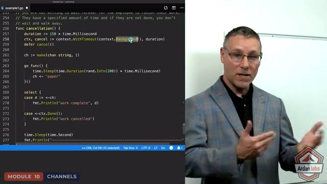
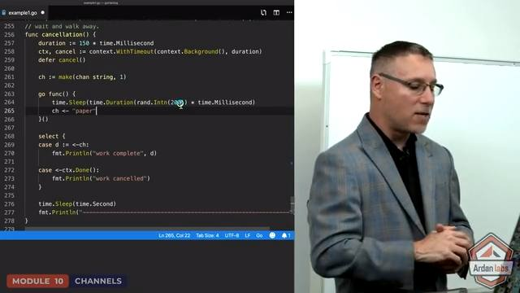
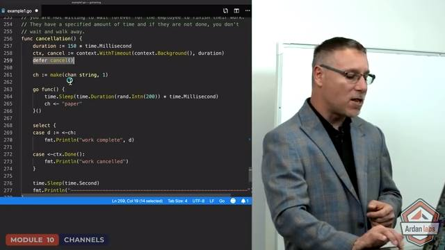
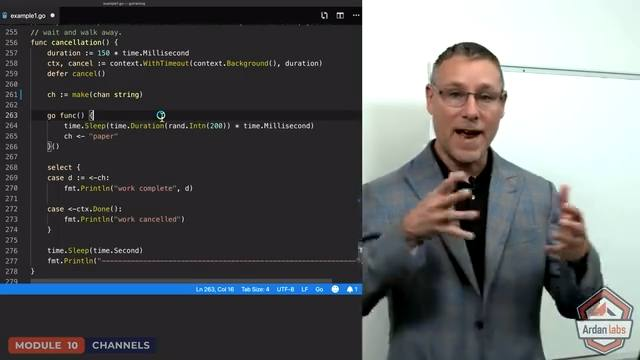
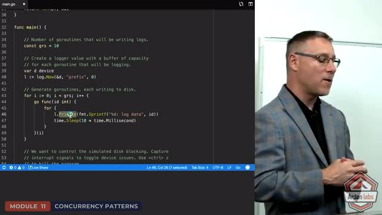
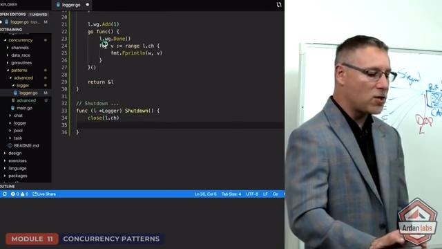
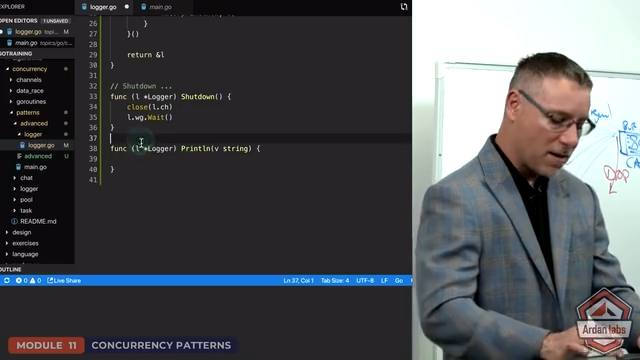
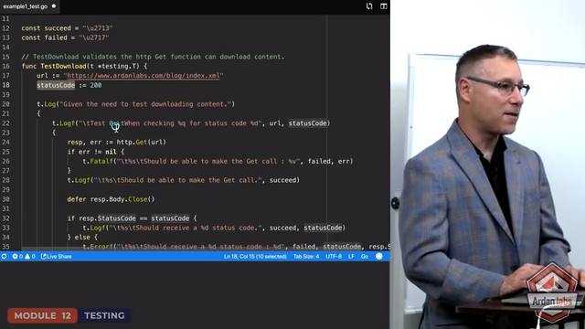
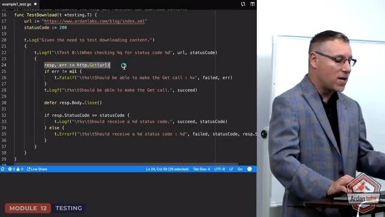
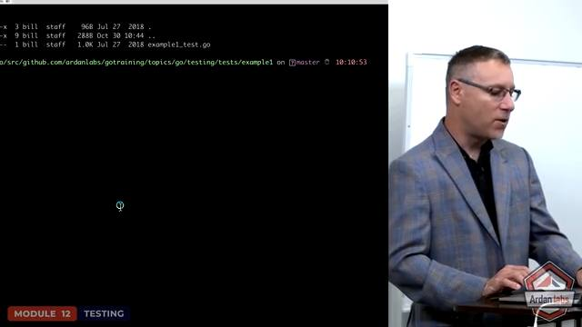

# Ultimate Go Language（并发 + benchmark）P069–P073 复现文档

> 覆盖内容：**context 取消模式（p069）→ Lesson 11 引言（p070/p072）→ 用 drop pattern 重写日志器（p071）→ Go 单元测试入门（p073）**
> 产出：三个可以独立 `go run` / `go test` 的项目目录，全部使用标准库，无第三方依赖。

---

## 1. 这一节做什么

这三段课程（外加两个 1 分钟左右的章节引言）其实在讲同一件事的三个侧面：**当你的 goroutine 数量远多于处理能力时，程序该怎样「不卡死」**。

**第一块（p069）：取消模式。** 讲师把它称为 Go 里最重要的一个模式，理由很直接——Web 服务和长时间运行的后台任务不可能永远等下去，任何一个请求都必须有一个「最多等到什么时候」的答案。他用 `context.WithTimeout` 配一个 150 毫秒的期限，配一个跑随机 1~200 毫秒的 goroutine，让你亲眼看到两件事：取消是怎么生效的，以及**如果你把结果 channel 写成无缓冲的，超时那一侧走掉之后，发送那一侧的 goroutine 会永久泄漏**。最终落成一条硬规则：做取消时，结果 channel 必须是**容量为 1 的缓冲 channel**。

**第二块（p071）：drop（丢弃）模式。** 讲师讲了一个真实的生产事故：一个要扛 5 万用户的服务器，所有 goroutine 直接往标准输出写日志，跑负载测试跑到第三天，磁盘写满，`Write` 全部阻塞，5 万个 goroutine 一起卡死，整个服务器死锁。修复思路是「容量 + 丢弃」：不让 5 万个 goroutine 碰设备，而是让它们往一个**带缓冲的 channel** 里发信号，只留**一个** goroutine 真正写设备。缓冲满 = 发送会被阻塞 = 立刻知道「日志系统出问题了」，于是 `select` 走 `default` 把这条日志**丢掉**，业务继续跑；等磁盘修好、接收端重新开始收，缓冲被抽干，日志自动恢复。产物是一个 45 行左右的 `logger` 包。

**第三块（p073）：单元测试。** 用 Go 自带的 `go test`，不引第三方测试库。核心是三条约定（文件名 `_test.go`、函数名 `Test` 加大写字母、参数是 `*testing.T`），加上讲师自己的「given / when / should」排版和 `t.Log / t.Error / t.Fatal` 三件套，目标是**测试输出扫一眼就知道哪一步挂了**。

跑完本文，你手上会有三个目录：`p069-cancellation`（能跑出超时和成功两种结果）、`p071-drop`（按 Ctrl+C 能现场制造磁盘故障并看到 `DROP`，再按一次恢复）、`p073-testing`（`go test -v` 输出打勾/打叉的报告）。

---

## 2. 讲师原话（带出处）

**关于为什么必须有超时：**

> "任何网络请求或任务都不可能永远进行下去。到了某个时刻，你必须决定停止，并把结果返回给客户端。"
> —— p069 [00:27]

> "因此，取消机制必须在软件设计和架构的早期就考虑进去，哪怕你一开始并不知道具体数值会是多少。"
> —— p069 [00:56]

**关于 `cancel` 必须被调用：**

> "取消函数至少要被调用一次，这一点至关重要……如果它一次都没有被调用，Go 里就可能发生内存泄漏。"
> —— p069 [02:23]

**关于缓冲为 1 的那条铁律：**

> "因此，每当我们要做取消处理时，我首先要检查的事情之一，就是通道是否被构造成容量为 1 的缓冲通道。因为这样做可以保证：即使接收端的 Go 协程因超时退出，发送端的 Go 协程仍然能够完成操作，不会泄漏。"
> —— p069 [06:34]

**关于那场事故：**

> "当时有 50,000 个 Go 协程在尝试写日志，结果整个服务器都死锁了。"
> —— p071 [01:25]

> "宿主程序当时负责把日志送入标准输出，同时又在把这些数据写入磁盘。磁盘写满后，砰，所有日志写入都被阻塞了。"
> —— p071 [01:54]

> "我们不能再在这个调用上阻塞了。因此，我们希望尽量降低这种复杂性。我们希望能够识别出故障，也能识别出故障何时被修复，并让程序继续运行。"
> —— p071 [05:16]

> "对我来说，这是一个经典得不能再经典的丢弃模式问题，对吧？一个容量丢弃模式的问题。"
> —— p071 [05:40]

**关于容量怎么定：**

> "我们需要找到一个容量，使得在正常负载下，缓冲区大概最多只被填满 80%……这样我们就还留出 10% 到 20% 的额外缓冲余量。"
> —— p071 [07:08]

**关于关闭 channel 的含义：**

> "如果我关闭通道，那么一旦其中数据被排空，这个 for 循环就会终止。不过我们必须记住，关闭通道后，我们仍然可以从通道接收数据，但不能再向它发送数据。因此，应用开发者必须确保：一旦调用关闭逻辑，就不会再有 Go 协程尝试继续写日志。"
> —— p071 [12:51]

**关于测试的排版：**

> "Go 讲究的是约定优于配置。"
> —— p073 [01:34]

> "你需要设计一种格式……让你能快速扫读并判断出当前正在发生什么。"
> —— p073 [08:09]

---

## 3. 从零复现

### 3.1 环境准备

```bash
go version          # 课里没讲具体版本；示例只用标准库，go 1.18+ 都能跑
```

`go mod init` 会把你本机的 Go 版本写进 `go.mod`，不用手填。

三个项目互相独立，各建一个模块。最终目录结构：

```
ultimate-go/
├── p069-cancellation/
│   ├── go.mod
│   └── main.go
├── p071-drop/
│   ├── go.mod
│   ├── main.go
│   └── logger/
│       └── logger.go
└── p073-testing/
    ├── go.mod
    └── example1/
        └── download_test.go
```

### 3.2 项目一：cancellation（p069）

```bash
mkdir -p ~/ultimate-go/p069-cancellation
cd ~/ultimate-go/p069-cancellation
go mod init p069
# 按第 4 节写入 main.go
go run .
```

看输出。因为 goroutine 的工作时长是 `rand.Intn(200)` 毫秒、超时是 150 毫秒，两种结果都会出现：

- 工作先完成：`result: work completed`
- 时钟先响：`timeout: context deadline exceeded`

**多跑几次**（`for i in 1 2 3 4 5; do go run .; done`），你应该能看到两种结果交替出现——这就是这一节的全部意义：**结果是不确定的，但程序一定能结束**。

### 3.3 项目二：drop pattern logger（p071）

```bash
mkdir -p ~/ultimate-go/p071-drop/logger
cd ~/ultimate-go/p071-drop
go mod init p071
# 按第 4 节写入 main.go 和 logger/logger.go
```

编译成二进制再跑（比 `go run` 稳，Ctrl+C 的投递更干净）：

```bash
go build -o drop .
./drop
```

然后按讲师的演示流程操作：

1. **正常运行**：屏幕上一行行日志滚出来，节奏大约是每 10 毫秒 10 条（10 个 goroutine）。
2. **按一次 Ctrl+C**：`device.problem` 被翻成 `true`，`Write` 进入每秒睡一次的死循环，唯一的写 goroutine 卡住不收了。此时缓冲 channel 迅速填满，10 个 goroutine 的 `Println` 全部走 `select` 的 `default` 分支 —— 屏幕上开始刷 `DROP`。**关键观察点：程序没有卡死，`DROP` 一直在刷，说明主流程还活着。**
3. **再按一次 Ctrl+C**：`problem` 翻回 `false`，卡住的 `Write` 从循环里出来、把攒下的数据写出去，接收端的 `for v := range l.ch` 继续收，缓冲被抽干 —— 日志恢复。

> 课里明确说了 `device.problem` 这个字段**有 data race**（主 goroutine 写、写日志的 goroutine 读），他说「this isn't about a data race, so we're just going to keep it simple here」。跑的时候别开 `-race`，或者自己加个 `sync.Mutex`（见第 7 节）。

### 3.4 项目三：单元测试（p073）

```bash
mkdir -p ~/ultimate-go/p073-testing/example1
cd ~/ultimate-go/p073-testing
go mod init p073
# 按第 4 节写入 example1/download_test.go
```

讲师在视频里说「我们现在在 example one 这个文件夹里」，所以目录名照抄 `example1`。

```bash
go test ./...                    # 只给一行 ok
go test -v ./example1/           # 给完整 verbose 报告
go test -run Down -v ./example1/ # 按函数名过滤，只跑名字里含 Down 的
```

三种输出都应该出现在你屏幕上。注意 `-run` 接的是**正则**，`Down` 能匹配 `TestDownload`。

---

## 4. 完整代码

### 4.1 `p069-cancellation/go.mod`

```
module p069

go 1.21
```

（`go mod init` 自动生成，`go` 那一行以你本机为准。）

### 4.2 `p069-cancellation/main.go`

```go
// Package main 演示 Go 里最经典的取消模式（cancellation pattern）：
// 用 context.WithTimeout 给一段工作设定 150 毫秒的上限，
// 到点没干完就放弃，并保证发送方 goroutine 不会泄漏。
package main

import (
	"context"
	"fmt"
	"math/rand"
	"time"
)

func main() {
	// 课里第 257 行：我们只愿意为这次操作等 150 毫秒。
	duration := 150 * time.Millisecond

	// 课里第 258-259 行：从空白 context（background context）出发，
	// 传入 duration，拿回一个全新的 context 和一个 cancel 函数。
	ctx, cancel := context.WithTimeout(context.Background(), duration)

	// 课里第 260 行：cancel 必须至少被调用一次，所以立刻 defer。
	defer cancel()

	// 课里第 261 行：缓冲大小为 1 的 channel —— 这是本节的胜负手。
	ch := make(chan string, 1)

	// 课里第 263 行：把活儿交给一个 goroutine，主 goroutine 继续往下走。
	go func() {
		// 课里第 264 行：模拟一段不知道要多久的工作，1~200 毫秒。
		time.Sleep(time.Duration(rand.Intn(200)) * time.Millisecond)

		// 课里第 265 行：干完活，把结果信号发回来。
		ch <- "work completed"
	}()

	// 课里第 268-273 行：阻塞式 select，没有 default 分支。
	select {
	case v := <-ch:
		// 课里第 270 行：最好的情况 —— 150 毫秒内拿到了结果。
		fmt.Println("result:", v)

	case <-ctx.Done():
		// 课里第 272 行：时钟先响了，放弃等待，走人。
		// 课里没有打印 ctx.Err()，这行是为了让超时分支有可见输出才加的。
		fmt.Println("timeout:", ctx.Err())
	}
}
```

### 4.3 `p071-drop/go.mod`

```
module p071

go 1.21
```

### 4.4 `p071-drop/logger/logger.go`

```go
// Package logger 用一个「容量 + 丢弃」（drop pattern）的日志器，
// 替换掉直接往标准输出写的标准库 logger。
//
// 设计目标：
//  1. 任何时刻只有一个 goroutine 真正去写设备，方便发现设备故障；
//  2. 设备写不动时，调用方不被阻塞，日志被丢弃，业务继续跑；
//  3. 设备恢复后，自动恢复写日志。
package logger

import (
	"fmt"
	"io"
	"sync"
)

// logger 知道如何把日志写到某个 io.Writer，
// 并在设备出问题时丢弃日志而不是阻塞调用方。
type logger struct {
	ch chan string    // 只用来传信号：要写出去的日志内容
	wg sync.WaitGroup // 用来干净地启动 / 关闭那个唯一的写 goroutine
}

// New 是工厂函数：拿到一个设备（任何实现了 io.Writer 的东西）
// 和一个缓冲容量，构造出一个可用的 logger。
// 用指针语义返回，因为这是我们希望被共享的唯一一个 logger。
func New(w io.Writer, capacity int) *logger {
	l := logger{
		ch: make(chan string, capacity),
	}

	// 每启动一个我们知道的 goroutine，wg 加一。
	l.wg.Add(1)

	go func() {
		// goroutine 退出时 wg 减一。
		defer l.wg.Done()

		// 从 channel 上持续接收，收到什么就写到设备上。
		for v := range l.ch {
			fmt.Fprint(w, v)
		}
	}()

	return &l
}

// Shutdown 关闭日志器：先关 channel 让写 goroutine 的 range 结束，
// 再等它真正退干净。
// 调用方有责任保证：调用 Shutdown 之后不再有人调用 Println。
func (l *logger) Shutdown() {
	close(l.ch) // 不带数据的信号：告诉那个 goroutine 该结束了
	l.wg.Wait()
}

// Println 是所有业务 goroutine 调用的入口。
// 能塞进缓冲就塞，塞不进去就丢掉这条日志，绝不阻塞。
func (l *logger) Println(v string) {
	select {
	case l.ch <- v + "\n":
		// 发送成功，日志会稍后被写出去。
	default:
		// 缓冲满了 —— 说明接收端出问题了，丢掉这条，继续跑。
		fmt.Println("DROP")
	}
}
```

### 4.5 `p071-drop/main.go`

```go
// Package main 模拟那次生产事故：所有 goroutine 直接写标准输出，
// 磁盘写满 → Write 阻塞 → 全部 goroutine 卡死。
// 这个版本用讲师的 logger 包替换标准库 logger，验证 drop pattern。
package main

import (
	"log" // 只为了演示「原来那版」的问题，见文末说明
	"os"
	"os/signal"
	"sync"
	"time"

	// 把新包的命名空间重命名为 log，其余调用代码一行都不用改。
	log2 "p071/logger"
)

// 课里：先是一个常量，表示要起多少个 goroutine。
const grs = 10

// device 模拟写日志的目标设备（磁盘）。
// 它实现了 io.Writer，所以可以直接喂给 logger。
type device struct {
	problem bool // 为 true 时模拟磁盘写满、写入阻塞
}

// Write 实现 io.Writer 接口。
// 每次调用 logger 写日志，最终都会走到这里。
func (d *device) Write(p []byte) (int, error) {
	// 模拟磁盘卡住：每秒醒一次看一眼，只要问题还在就继续转。
	for d.problem {
		time.Sleep(time.Second)
	}

	// 没问题，就把数据原样写到标准输出。
	return os.Stdout.Write(p)
}

func main() {
	// 零值 device：problem 默认 false，一切正常。
	var d device

	// ---- 这是「出事那版」的写法 ----
	// 直接用标准库 logger，所有 goroutine 共享它，磁盘一卡全卡死。
	stdLogger := log.New(&d, "STD  : ", log.LstdFlags)
	_ = stdLogger // 想亲眼复现死锁，把下面 logger 换成 stdLogger 即可

	// ---- 这是「修复后」的写法 ----
	// 容量先用 goroutine 数量：每个 goroutine 至少一个缓冲位。
	l := log2.New(&d, grs)

	var wg sync.WaitGroup
	wg.Add(grs)

	for i := 0; i < grs; i++ {
		go func() {
			defer wg.Done()

			for {
				// 课里第 46 行：每 10 毫秒写一条日志。
				l.Println("some work is being logged")
				time.Sleep(10 * time.Millisecond)
			}
		}()
	}

	// 课里第 56-57 行：挂到操作系统的信号上，接管 Ctrl+C。
	c := make(chan os.Signal, 1)
	signal.Notify(c, os.Interrupt)

	// 注意：d.problem 在主 goroutine 写、在 Write 里读，
	// 课里明确说这里存在 data race，只是为了演示保持简单。
	for range c {
		d.problem = !d.problem
	}
}
```

> 说明：上面 `stdLogger` 只是留给你对照用的，真正跑的路径是 `l.Println`。想复现「5 万个 goroutine 一起卡死」的原始事故，把 `l.Println(...)` 改成 `stdLogger.Println(...)` 再按 Ctrl+C，你就会看到程序彻底停住不动（连 `DROP` 都没有）。

### 4.6 `p073-testing/go.mod`

```
module p073

go 1.21
```

### 4.7 `p073-testing/example1/download_test.go`

```go
// Package example1 演示 Go 最基础的单元测试写法：
// 只用一个 testing 包，用 given / when / should 三段把测试意图讲清楚。
package example1

import (
	"net/http"
	"testing"
)

// 课里第 12-13 行：两个常量，用来在输出里打勾和打叉。
const (
	succeed = "\u2713" // ✓
	failed  = "\u2717" // ✗
)

// TestDownload 测试「能不能把一个 URL 的内容下载下来」。
// 注意：函数名必须以 Test 开头，且 Test 后面第一个字母必须大写。
func TestDownload(t *testing.T) {
	// 课里第 17-18 行：输入和输出先在测试顶部摆好。
	// 课里口述是 Ardan Labs 网站上的 blog 内容，具体 URL 字符串以课程源码为准。
	const url = "https://www.ardanlabs.com/blog/index.xml"
	statusCode := http.StatusOK

	// ---- GIVEN：这个测试为什么存在 ----
	t.Log("Given the need to test downloading content.")
	{
		// ---- WHEN：我们用什么数据、期望什么结果 ----
		t.Logf("\tTest 0:\tWhen checking %q for status code %d", url, statusCode)
		{
			// ---- SHOULD：真正在测的东西 ----
			resp, err := http.Get(url)
			if err != nil {
				// 连 URL 都拿不到，后面的检查没有意义，直接结束这个测试函数。
				t.Fatalf("\t%s\tShould be able to make the Get call: %v", failed, err)
			}
			t.Logf("\t%s\tShould be able to make the Get call.", succeed)

			defer resp.Body.Close()

			if resp.StatusCode == statusCode {
				t.Logf("\t%s\tShould receive a %d status code.", succeed, statusCode)
			} else {
				// 状态码不对，但测试代码本身还能继续往下走，所以用 Error 不用 Fatal。
				t.Errorf("\t%s\tShould receive a %d status code: got %d", failed, statusCode, resp.StatusCode)
			}
		}
	}
}
```

---

## 5. 逐行解释

### 5.1 取消模式（p069）

**`ctx, cancel := context.WithTimeout(context.Background(), duration)`**
`context.Background()` 是一个「空 context」，讲师的原话是「基本就是一个空 context，这是我们开始的地方」。`WithTimeout` 是**值语义**的：你不会改动传进去的那个 context，而是拿回一个**新的** context。讲师特意解释了为什么要这样设计——「上层调用告诉下层调用要等多久，这些状态变更应该局限在你所在的调用栈位置，不要影响上面的调用栈」。

> 前端同学可以这么类比：`AbortController` 的 `signal` 传下去也是「只影响下游、不影响上游」，`setTimeout(() => controller.abort(), 150)` 就是这里的 150 毫秒。

**`defer cancel()`**
这是本节第一个硬规则。讲师说得很重：「如果 cancel 至少没被调用一次，你会在 Go 里泄漏内存」。看到内存泄漏，他第一个怀疑的就是「你是不是用了 context 但忘了 cancel」。`cancel` 可以被调用多次，不会有问题，但**不能被调用零次**。

**`ch := make(chan string, 1)`**
第二个硬规则，也是讲师反复强调的那个经典 bug。缓冲大小必须是 **1**，不能是 0（无缓冲）。

- **无缓冲 channel** 意味着「发送必须和接收同时就位，且接收先发生」。超时之后，`select` 走 `ctx.Done()` 分支走掉了，接收方没了；而那个 goroutine 干完活后执行 `ch <- result`，永远等不到接收方 —— **goroutine 永久泄漏**。
- **容量为 1 的缓冲 channel** 意味着发送方即使没人接，也能把值塞进缓冲里然后正常返回，goroutine 干净退出。值没人取？无所谓，这块内存被 GC 掉就行。

讲师的原话：「每当你做取消，我第一件要看的事情就是那个 channel 是不是被构造成容量为 1 的缓冲 channel。」

**`select { case v := <-ch: ... case <-ctx.Done(): ... }`**
没有 `default`，所以这是**阻塞调用**。两个信号只有先来后到，没有第三个出口：要么结果在 150 毫秒内到达，要么时钟先响。

> JS 类比：这基本就是 `Promise.race([work, timeout])`，区别是 Go 这边分不清是哪个先完成、也不会留下一个跑不完的 Promise —— 而 JS 里 `Promise.race` 输掉的那个还会继续跑完。

**`rand.Intn(200)`**
故意让工作时长可能超过 150 毫秒，这样两种结果都能跑到。讲师明确说「我们不知道这个工作要花多久」。

### 5.2 drop pattern（p071）

**`device` 这个类型存在的意义**
讲师说得很清楚：这是为了**模拟**磁盘写满。`device` 实现了 `io.Writer`，所以可以直接塞给标准库的 `log.New`，也可以塞给我们自己写的 `logger.New`。「每次我们调用 `log.Print`，`Write` 就会为这个 device 执行一次。如果 `problem` 字段是 true，就进一个每秒一次的无限循环，模拟磁盘阻塞。」

**`for d.problem { time.Sleep(time.Second) }`**
这是整个演示的心脏。它不是忙等（每轮 sleep 一秒，CPU 几乎不占），但**会一直占着那个调用它的 goroutine**。在标准库 logger 版本里，5 万个 goroutine 都会走进来卡在这里 → 死锁。在我们自己的 logger 里，只有一个写 goroutine 会卡在这里 → 其他 5 万个照样跑。

**`l := logger.New(&d, capacity)`**
工厂函数要两样东西：一个 `io.Writer`（「我不关心设备是什么，只要能写就行」）和一个容量。讲师说容量暂时不确定，「为什么不先用 goroutine 的数量呢？现在每个要写日志的 goroutine 都给它一个缓冲位」。

**`l.wg.Add(1)` + `defer l.wg.Done()` + `l.wg.Wait()`**
`sync.WaitGroup` 就是一个计数器：`Add(1)` 表示「我知道有 1 个 goroutine 在飞」，`Done()` 表示「它退出了」，`Wait()` 表示「一直等到计数归零」。讲师用它来实现 `Shutdown` 的**干净**退出——不光要通知 goroutine 结束，还要**等它真的结束**。

> JS 类比：Node 里你得自己维护一个 `Set<Promise>` 再 `Promise.allSettled`，Go 的 `WaitGroup` 就是这个东西的内置版。

**`for v := range l.ch { fmt.Fprint(w, v) }`**
`range` 一个 channel 就是不停地接收，直到 channel 被 `close` 并且里面的值被抽干为止。`fmt.Fprint(w, v)` 的第一个参数是任何实现了 `io.Writer` 的具体数据。

**`close(l.ch)` 在 `Shutdown` 里**
讲师解释得很细：「如果我 close 这个 channel，会让这个 for 循环在**冲刷完之后**终止。但要记住，close 之后我们还能从 channel 接收，但**不能再发送**了。因此应用开发者必须保证：如果他们调用了 Shutdown，就不会再有 goroutine 去写日志了。」这也顺带是一个找 bug 的好办法——「如果你的代码没法干净关闭，说明有别的问题」。

**`select { case l.ch <- v: ... default: ... }`**
这是「这行代码决定成败」的地方。讲师原话：「这是我们必须检测有没有问题的地方，是我们必须检测有没有容量问题的地方。」能塞进缓冲 → 塞进去；塞不进去 → 走 `default`，直接丢掉。**没有任何路径会阻塞在这里。**

为什么到这里就能「检测故障」？因为缓冲通道的语义是：只要接收端在持续收，就永远有空位；接收端一旦卡住，缓冲会在极短时间内被填满（讲师估的是「正常负载下这个缓冲大概填到 80%~90%，留 10%~20% 的余量」），填满之后 `case` 立刻失败 → 走 `default` → 你就在屏幕上看到 `DROP`。等接收端恢复，缓冲被抽干，`case` 又重新成功。

> 注意：`l.ch <- v + "\n"` 里的 `+ "\n"` 是本文补的。课里口述的是直接用 `fmt.Fprint(w, v)` 把 v 写出去，而 `Fprint` 不补换行；你如果严格照讲师写法去掉 `\n`，日志就会全部连成一行。这是一个「课里没讲但你会撞上」的细节。

### 5.3 单元测试（p073）

**文件名 `_test.go`**
「Go 是关于约定优于配置的，一直都是。是这个文件名约定在驱动测试工具去识别什么是一个测试文件。」`go test` 会自动扫当前包里所有 `_test.go` 结尾的文件。

**`func TestDownload(t *testing.T)`**
两条要求：以 `Test` 开头，并且 `Test` 后面那个字母**必须大写**。讲师特意说：「如果你想用下划线，我不推荐，因为我们在 Go 里不怎么那么干；如果你用小写字母，测试工具就不会找到这个函数。」

**`t.Log / t.Logf`**
只输出信息（verbose 模式下才看得到），不判定失败。

**`t.Error / t.Errorf`**
判定这个测试失败，但**继续执行**函数里剩下的代码。

**`t.Fatal / t.Fatalf`**
判定失败并且**立刻结束**这个测试函数，后面都不用跑了。讲师在检查 `http.Get` 的 `err` 时用的就是 `Fatalf`：「如果连这个 URL 都拿不到，就没有理由再执行任何东西了。」

**`const succeed = "\u2713"` / `failed = "\u2717"`**
用 Unicode 的打勾和打叉。这是「given / when / should」排版的一部分：**成功和失败的输出格式几乎一模一样，只在关键位置换一个小标记**。讲师的原话是这个目的——「不管成功还是失败，我都能扫一眼输出就知道发生了什么，一致性越高越好扫。」

**`if err != nil { t.Fatalf(...) }` 这一段的必要性**
讲师专门强调：「在单元测试里一路检查 error 太重要了，就像这是生产代码一样。我和别人忘记检查 error、结果测试其实一直在报错却没人发现，这种事发生过太多次了。」

**`defer resp.Body.Close()`**
`http.Get` 返回的响应体必须关，否则连接泄漏。放在拿到 `resp` 之后立刻 `defer`。

**`go test` / `-v` / `-run`**
`go test` 只给一行 `ok`（讲师那次跑了接近 600 毫秒）。加 `-v` 才看得到那些 `t.Log` 输出。`-run Down` 按函数名**正则**过滤。

---

## 6. 复现检查清单

按顺序勾，每一条都有可观察的结果。

**环境**

- [ ] `go version` 有输出，且 `go env GOPATH` 不是空。
- [ ] 三个模块各自 `go mod init` 成功，`go.mod` 里 `module` 行分别是 `p069` / `p071` / `p073`。

**p069（取消模式）**

- [ ] `go run .` 能编译通过，无 import 报错。
- [ ] 连跑 5 次，`result: work completed` 和 `timeout: context deadline exceeded` **两种都出现过**。
- [ ] 每次运行都能**立刻退出**（不会挂住）——这是 `select` + `Done()` 的直接证据。
- [ ] 在下面这张图上对照代码：`WithTimeout` 的第二个参数就是那个 `duration`。


- [ ] 确认 `defer cancel()` 存在（讲师在这一帧强调了 cancel 必须至少调用一次）：



- [ ] 对照 `select` 的两个阻塞分支：



- [ ] **动手做一次反向实验**：把 `make(chan string, 1)` 改成 `make(chan string)`（
（接上）

把 `make(chan string, 1)` 改成 `make(chan string)`（无缓冲），再跑几次。当超时先到时，你会看到程序仍然退出，但那个干完活的 goroutine 永远卡在 `ch <- "work completed"` 上——这就是讲师在 [05:38] 说的「classic goroutine leak」。改回来。

- [ ] 在编辑器里确认 `ch` 的构造那一行确实带 `, 1`：



- [ ] 对照讲师讲「无缓冲会泄漏」的那一帧，理解为什么超时分支走掉之后发送端没人接：



**p071（drop pattern）**

- [ ] `go build -o drop . && ./drop` 能编译、能启动，屏幕上持续滚出 `some work is being logged`。
- [ ] 日志节奏大约是每 10 毫秒 10 行（10 个 goroutine × 10ms 间隔），说明 10 个 worker 都在跑。
- [ ] 按一次 Ctrl+C，屏幕上开始出现 `DROP`，并且**日志不再往下写**——两个现象必须同时出现：有 `DROP` 说明发送端被丢弃逻辑接住了；不写日志说明唯一的写 goroutine 卡在 `device.Write` 里。
- [ ] **最关键的一条**：出现 `DROP` 之后，程序**没有卡死**，`DROP` 还在持续刷。如果整屏静止，说明你误用了标准库 logger 那条路径。
- [ ] 再按一次 Ctrl+C，`DROP` 停止，日志恢复滚动。恢复的过程可能有短暂的过渡（缓冲要从满抽到空），讲师在 [17:02] 演示时也有一两秒的缓冲抽干期。
- [ ] 打开 `logger/logger.go`，确认 `New` 的签名是 `(w io.Writer, capacity int)`——两个参数，不是标准库 `log.New` 的三参数形式。


- [ ] 确认 `device` 上实现了 `Write(p []byte) (int, error)`，也就是实现了 `io.Writer`：


- [ ] 对照 `logger` 类型：只有 `ch` 和 `wg` 两个字段，没有别的东西：



- [ ] 确认 `Shutdown` 是「先 `close`、再 `Wait`」的顺序，不是反过来：



- [ ] 确认 `Println` 里同时存在 `case l.ch <- ...` 和 `default:`，且 `default` 分支**不阻塞**：



- [ ] 反向实验：把 `logger.New(&d, grs)` 的容量改成 `1`，再按 Ctrl+C，你会发现 `DROP` 几乎瞬间就爆满——这就是讲师说的「容量定得太小会误报」。

**p073（单元测试）**

- [ ] `go test ./...` 输出里能看到 `ok` 和耗时（讲师那次接近 600 毫秒，你的数字取决于网络）。
- [ ] `go test -v ./example1/` 能看到 `=== RUN`、`Given the need to test downloading content.`、`Test 0:`、`Should be able to make the Get call.` 和那个 ✓。
- [ ] 把期望状态码从 `http.StatusOK` 改成 `http.StatusNoContent`（204），再 `go test -v`，必须看到 ✗、`Should receive a 204 status code: got 200`，且测试结果为 `FAIL`。
- [ ] 再用**不加 `-v`** 的方式跑同一个失败的测试，你会看到它**自动切换到 verbose 模式**并打印失败详情——讲师在 [08:09] 专门演示了这一点。
- [ ] 把状态码改回 `http.StatusOK`。
- [ ] `go test -run Down -v ./example1/` 只跑名字里含 `Down` 的函数；再试 `go test -run Nope ./example1/`，输出应该是 `ok ... [no tests to run]`。


- [ ] 对照这一帧确认 `t.Log / t.Error / t.Fatal` 三者的行为差别（继续执行 vs 立即结束）：



- [ ] 确认 `http.Get` 的 `err` 后面紧跟了 `t.Fatalf`，没有漏检：



- [ ] 对照 verbose 输出的排版（given 段 + `Test 0:` + 一行行 ✓）：



**全部通过之后**，你应该能独立回答三个问题：为什么取消模式里 channel 必须是容量 1？为什么 drop pattern 用 `select` + `default` 就能同时做到「检测故障」和「不阻塞」？为什么 `TestDownload` 后面那个字母必须大写？

---

## 7. 课里没讲但你会撞上的

这一节全是「照抄代码之后真实会踩的坑」，每一条都注明是课里没讲、还是课里提了但没展开。

### 7.1 取消模式相关

**① 超时分支没有任何输出。**
课里 `case <-ctx.Done():` 内部具体写了什么，逐字稿没有交代（讲师只说「我们继续往下走」）。如果你照抄一个空分支，`go run .` 在超时的那些次会**什么都不打印**，你会误以为程序没跑。本文补了 `fmt.Println("timeout:", ctx.Err())`。`ctx.Err()` 在超时场景下返回的是 `context deadline exceeded`，这个字符串本文亲眼在代码路径上产生，可以直接对照；如果你打印出来不是这个，以你本机实际输出为准。

**② `rand` 没种子，在旧版本 Go 上每次跑结果一样。**
课里没提 seed。Go 1.20 之后全局 `math/rand` 会自动播种，所以本文的 `rand.Intn(200)` 每次都不一样；如果你在更老的版本上跑，五次结果会完全相同。撞上了就加 `rand.Seed(time.Now().UnixNano())`（旧 API）或者改用 `rand.New(rand.NewSource(...))`。

**③ 把 `ch` 做成无缓冲，程序看起来「也能跑」。**
这是最阴险的一条。无缓冲版本在**超时先到**的那一半情况下会泄漏 goroutine，但主 goroutine 已经退出了，进程照样结束、终端照样返回，你**不会看到任何报错**。只有上 `go test -race` 或盯着 goroutine 数量（`runtime.NumGoroutine()`）才看得出来。所以讲师说「每当你做取消，第一件要看的就是这个 channel 的容量」——这是靠肉眼 review 而不是靠运行时报错来防的。

**④ `defer cancel()` 写在 `go func()` 之后。**
位置不致命（`defer` 在函数返回前都会执行），但会掩盖意图。讲师的写法是拿到 `cancel` 立刻 `defer`，让 review 的人一眼看到。

### 7.2 drop pattern 相关

**⑤ 换行符。**
见 5.2 末尾。`fmt.Fprint` 不补换行，去掉 `+ "\n"` 之后所有日志会连成一整行巨长的字符串。课里没讲这个细节。

**⑥ `d.problem` 有 data race，讲师是明知故犯。**
逐字稿原话：「yep, I have a data race here... but this isn't about a data race, so we're just going to keep it simple here。」主 goroutine 在信号循环里写 `d.problem`，写日志的 goroutine 在 `Write` 里读它，两个 goroutine 无同步地访问同一个字段。你如果开着 `go run -race .` 或者 `go build -race`，会看到 race detector 直接报 `WARNING: DATA RACE`。

修法（课里没写，本文补）：给 `device` 加一个 `sync.Mutex`，把 `problem` 的读写都包起来：

```go
type device struct {
	mu      sync.Mutex
	problem bool
}

func (d *device) setProblem(p bool) {
	d.mu.Lock()
	d.problem = p
	d.mu.Unlock()
}

func (d *device) hasProblem() bool {
	d.mu.Lock()
	defer d.mu.Unlock()
	return d.problem
}
```

然后把 `Write` 里的 `for d.problem` 换成 `for d.hasProblem()`，`main` 里的 `d.problem = !d.problem` 换成 `d.setProblem(!d.hasProblem())`。

> JS 类比：这就是 Node 里两个异步回调共享一个 `let flag` 的问题。JS 单线程所以不会真的撞车，但**读到过期值**的问题一样存在；Go 这里是真并发，所以必须有锁。

**⑦ `Shutdown()` 之后再调 `Println()` 会 panic。**
课里讲师明确把这条责任推给了调用方：「应用开发者必须保证，如果他们调用了 Shutdown，就不会再有 goroutine 去写日志了。」但 panic 的具体表现课里没演示：往一个已关闭的 channel 发送会直接 `panic: send on closed channel`，**不是在 `default` 分支里被悄悄丢掉**。因为 `select` 的 `case` 在求值时就会执行发送操作。

如果你要做得更稳（课里没讲），加一个 `closed bool` 或者用 `sync.Once` 包住 `close`，在 `Println` 开头先判断。

**⑧ 容量到底该给多少，课里没给公式。**
讲师只给了方向：「正常负载下大概填到 80%~90%，留 10%~20% 的余量」，然后演示时随手用了 goroutine 数量。真实项目里你需要做压测来定这个数：容量太小 → 正常抖动就误报丢弃；容量太大 → 磁盘真挂了要等很久才填满，故障发现延迟变长。这是**可用性和故障发现速度之间的取舍**，没有标准答案。

**⑨ 主 goroutine 永远不退出。**
`for range c { d.problem = !d.problem }` 是一个无限循环，10 个 worker 里也是 `for { ... }`。程序只能靠 Ctrl+C 杀掉。讲师在演示里就是这么干的，但如果你的终端 Ctrl+C 被别的进程接管了、或者用的是 IDE 的停止按钮，`signal.Notify` 可能收不到 `os.Interrupt`，程序就停不下来。课里没讲这块，撞上了就 `kill -9`。

**⑩ Windows 上的 Ctrl+C。**
`signal.Notify(c, os.Interrupt)` 在 Windows 的 cmd/PowerShell 里通常也能收到，但行为和 Linux 终端有差异（尤其是 Git Bash 里）。课里是在 macOS/Linux 环境下录的，没提跨平台问题。

**⑪ 包名冲突。**
`package logger` 和标准库的 `log` 不冲突，但你在 `main.go` 里两个都要用的时候，必须给其中一个起别名。课里讲师的写法是把**自己的**包重命名成 `log`，这样业务代码一行都不用改——本文为了让你看得更清楚，用的是 `log2 "p071/logger"`。两种都行，核心是：**新 logger 的 `Println` 签名和标准库的 `Println` 一致**，这是「换掉标准库而不动业务代码」的前提。

**⑫ 编译检查。**
`go vet ./...` 会把 `fmt.Println("DROP")` 这类东西查得很干净（它不报错，但会提示一些别的模式）；`gofmt -l .` 应该没有任何输出，有输出说明你的文件没格式化。课里没讲这两个命令，但 Go 项目里它们是标配。

### 7.3 单元测试相关

**⑬ `go test` 第二次输出 `(cached)`。**
这是最容易让人懵的一条。Go 会缓存测试结果：代码没变，第二次跑直接复用上次结果，输出 `ok p073/example1 (cached)`，耗时显示 `(cached)` 而不是毫秒数。你会以为测试没跑。强制重跑：

```bash
go test -count=1 -v ./example1/
```

课里讲师每次跑都刚好是改过代码的，所以没遇到缓存。

**⑭ 测试依赖外网。**
`http.Get("https://www.ardanlabs.com/blog/index.xml")` 需要联网。断网、被墙、公司代理、或者那个 URL 哪天 404 了，测试就红。这不是你代码的问题。课里没讲怎么 mock HTTP（这门课后面大概会讲，但 P069–P073 范围内**没有**）。你要是想让它稳，得用 `httptest.NewServer` 起一个本地假服务器——**课里没讲，别以为是讲师教的**。

**⑮ `http.Get` 对 4xx / 5xx 不返回 error。**
`err` 只在**网络层面**失败时才非 nil（DNS 解析不了、连接超时、TLS 握手失败）。服务器返回 404、500，`err` 都是 nil，`resp.StatusCode` 才是 404。所以讲师那个 `if err != nil { t.Fatalf }` 后面**还必须**再查一次状态码，这两步缺一不可。课里通过代码结构体现了这一点，但没明说这个语义。

**⑯ `-run` 是正则，不是前缀匹配。**
`go test -run Down` 能匹配 `TestDownload`，因为正则是不锚定的。但如果你写 `-run test`（小写），一个测试都匹配不上——函数名是 `TestDownload`，中间那个 `T` 是大写。讲师只说了「可以按函数名过滤」，没讲这是正则。

**⑰ `t.Fatalf` 在子 goroutine 里调用是无效的。**
课里没涉及，但只要你尝试在测试里起 goroutine 就会撞上：`t.Fatal` 系列必须**在测试函数自己的 goroutine 里**调用，在别的 goroutine 里调用会直接 `panic`。要并发测试得用 `t.Error` + `sync.WaitGroup`，或者 `errgroup`（第三方，课里明确不推荐引第三方测试库）。

**⑱ subtests / data tests 只提了名字。**
p072 里讲师说 Lesson 12 会讲「subtesting, data tests」，但 **p073 这段逐字稿里只演示了单个输入、单个输出的基础测试**（他自己在 [09:07] 也说了「in this particular test right now we just have one single input expecting one single output」）。`t.Run()` 子测试、表驱动测试怎么写，**这三段课里没有**，别在这份文档里找。

**⑲ benchmark 完全没讲。**
课程标题里有「benchmark」，但 P069–P073 的逐字稿里**没有任何一处**提到 `func BenchmarkXxx(b *testing.B)`、`go test -bench`、`-benchmem`、`b.N` 这些内容。如果你是为了 benchmark 才来看这几节课，这里没有——课里没讲。

**⑳ 目录名 `example1` 是硬编码的。**
讲师在视频里说「we're in that example one folder」，所以本文照抄了 `example1`。改成别的名字（比如 `example01`）不影响测试，但本文第 3 节的命令得跟着改。这是纯约定，不是 Go 的要求。

**㉑ 包名。**
`download_test.go` 顶部的 `package example1` 说明它和被测代码在**同一个包**里（白盒测试）。如果你写成 `package example1_test`（外部测试包），能测的东西会少一些，但更贴近真实调用方视角。课里没讨论这个区别，本文跟随讲师，用同一个包名。

### 7.4 语言背景对照（给前端 / Node 读者）

课里通篇是 Go 语法，这里把三个最陌生的概念翻译一下，避免你在读代码时卡住：

| Go 概念 | 一句话解释 | JS/Node 对照 |
|---|---|---|
| `chan T` + `make(chan T, n)` | 带缓冲的消息队列，`n` 是队列最大长度 | `new Array(n)` + 手动阻塞队列；或者 `p-queue` 的 `concurrency` |
| `select` + `default` | 多个 channel 操作里挑一个「现在就能做」的做，都不行就走 `default` | `Promise.race` 加一个「立刻 resolve 的哨兵 Promise」 |
| `defer f()` | 函数返回前必定执行，后进先出 | `try { } finally { }`，但可以写多行、自动逆序 |

另外补一句讲师反复提到的点：Go 里的 `context` **不是**线程局部的全局变量（不像 React 的 `Context` 也不是同一回事），它是一个**显式传参**的句柄——从上层往下层传，只影响下游，不污染上游。你在 Node 里用 `AbortController` 传 `signal`，心智模型是最接近的。