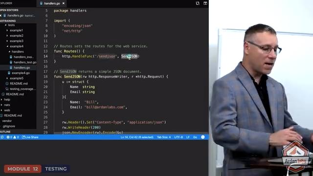
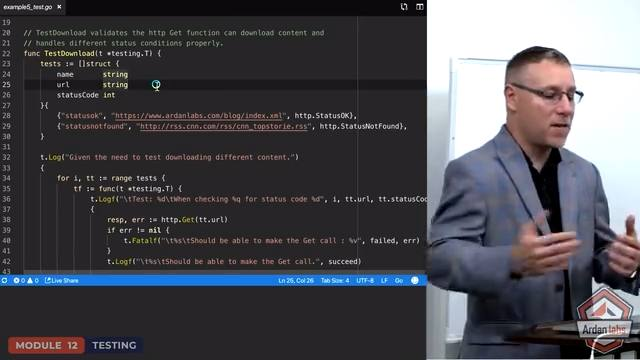
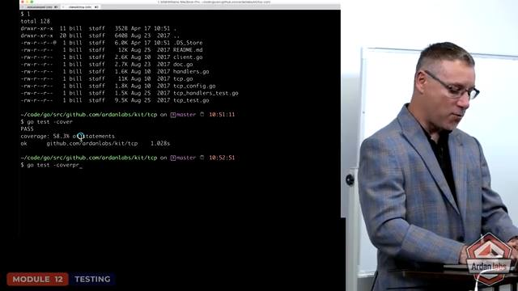

## 1. 这一节做什么

这一篇对应 Ultimate Go Language 的 P74–P80。逐字稿里实际讲的是 **Go 测试与基准测试工具链**：表格测试（table test）、HTTP mock、Handler/路由测试、Example 测试、子测试（subtest）、代码覆盖率（coverage）、基础 benchmark 和子 benchmark（sub-benchmark）。

需要先说明一点：课程标题里带「并发」，但 **P74–P80 的逐字稿没有讲 goroutine、channel、锁、竞态检测**。这几页的重心是“怎么证明代码是对的、怎么量出代码快不快”。所以本文不会把并发原语硬塞进来；只在 subtest 的 `t.Parallel()` 这里顺带说明它和 JS/Node 测试并行的类比。

学完并照着做完，你应该得到一个小型 Go 模块，包含：

- 一个可运行的 `handlers` HTTP 服务和 `/sendJSON` 路由；
- 表格测试、mock 测试、endpoint 测试、Example 测试；
- 可过滤、可并行的 subtest；
- 可生成 HTML 报告的 coverage 流程；
- 可跑的 benchmark 和 sub-benchmark 命令。


---

## 2. 讲师原话（带「—— pNNN [MM:SS]」）

下面保留讲师英文原话的关键句，并给出出处。中文解释放在引用后面。

> "很多时候，表不过是一个由结构体值组成的切片。它不必基于命名类型，也可以像我这里这样使用字面量类型，同时定义输入和输出。"
> —— p074 [00:57]

表格测试的核心就是“一张表”：每一行放输入和期望输出，测试循环遍历这张表。表本身可以是匿名 struct 的 slice，不一定先定义命名类型。

> "现在我已经有了这组输入和期望输出，就回到我的“给定”部分，也就是“应该”那一段。然后我说，既然需要测试下载不同内容，那么在紧挨着“当”之前，我们处在 for range 循环里。"
> —— p074 [01:54]

讲师用 Given/When/Should 组织测试：先声明测试数据，再在 `for range` 里执行 When 和 Should。这样新增用例只需要加一行数据，不用复制整个测试函数。

> "Go 有 HTTP 测试包。你会看到我在这里第 11 行导入了它。它能让我们在 HTTP 层面进行模拟。"
> —— p075 [00:56]

P75 引入 `net/http/httptest` 做 HTTP 层 mock。它不是去请求真实服务器，而是启动一个本地测试服务器，让测试打到这个服务器上。

> "这段代码真正的关键在于第 62 行的模拟服务器。这个模拟服务器的作用，就是让我们能够搭建这样一个服务器，并针对它运行模拟。"
> —— p075 [02:22]

mock server 的关键是 `httptest.NewServer`。它会在本机随机端口起一个服务，测试结束后要 `Close` 清理。

> "我们想测试这个路由，而不用把刚才做过的事情全做一遍——也就是启动并运行这个服务器。"
> —— p076 [02:23]

P76 讲的是直接测试 handler/路由，不必先 `go run` 起端口，也不必真的走网络。

> "这里我们有了这个 NewRequest。这个 NewRequest 函数实际上会返回一个指向该请求值的具体指针……现在我们需要一个具体类型，知道如何充当那个记录器、那个响应写入器。所以我们要调用 NewRecorder。"
> —— p076 [03:20]

`httptest.NewRequest` 造请求，`httptest.NewRecorder` 造响应记录器。然后把这两个值直接交给 mux 的 `ServeHTTP`，绕过网络层。

> "这样我就绕过了网络。我是在告诉多路复用器，把这个请求直接交给这个记录器，作为你的响应写入器。"
> —— p076 [04:19]

这是 endpoint 测试最重要的动作：`mux.ServeHTTP(recorder, request)`。请求不经过 TCP，响应直接写进 recorder，测试再检查 `recorder.Code` 和 `recorder.Body`。

> "子测试的作用，尤其是在涉及数据时，是让我们把每一条数据都当作一个独立的测试来处理，而不用额外编写测试函数。"
> —— p077 [00:29]

P77 的 subtest 解决表格测试“只想跑某一条数据”的问题。给每条数据一个名字，就可以用 `-run` 过滤。

> "我们把这个字面量测试函数绑定到表驱动测试中的那个名称，并把它设置为子测试。所以就是这里，t.Run。现在这些测试会串行运行。"
> —— p077 [01:55]

`t.Run(name, func(t *testing.T){...})` 把每条数据变成命名子测试。默认串行；调用 `t.Parallel()` 后才并行。

> "我可以首先做的一件事，就是运行 go test，然后使用 cover 开关。这样会运行所有测试，然后给出总的覆盖率。"
> —— p078 [00:56]

覆盖率第一步是 `go test -cover`，先看包级总覆盖率。

> "这里我们可以做的是生成覆盖配置文件。我可以这样写：go test，这次加上 cover profile，并让它把该配置文件写入类似 c.out 的文件……Go 有 cover 工具……用 HTML 模式查看这个配置文件。"
> —— p078 [01:52]

第二步是 `go test -coverprofile=c.out`，再用 `go tool cover -html=c.out` 看哪些行绿色、哪些行红色。

> "基准测试的目的，是能够同时针对 CPU 和内存来分析代码。"
> —— p080 [00:28]

P80 的 benchmark 关注 CPU 和内存分配。讲师特别强调：不要猜性能，要量。

> "第一次调用这个基准测试函数时，b.N 会是 1。之后，它会把 b.N 按某个数量级增加。"
> —— p080 [02:53]

benchmark 函数里循环上限是 `b.N`。工具会不断调整 `b.N`，直到循环跑够 `-benchtime` 指定的时间。默认是 1 秒，讲师习惯改成 3 秒。

> "如果发现任何测试函数，都不要运行它们……所以我会写 -bench=.。我还想看到内存分配情况，因此也会加上基准测试标志。"
> —— p080 [05:19]

跑 benchmark 常用：`go test -run none -bench . -benchmem`。`-run none` 是为了不把普通测试也跑一遍，`-benchmem` 看内存分配。


---

## 3. 从零复现

### 3.1 环境与依赖

- 语言：Go。  
- 依赖：**只用标准库**，没有第三方包。  
- 课程没有指定 Go 版本。P77 提到 subtest 是 Go 1.8 左右引入的功能；为了顺利使用 `t.Run`、`t.Parallel`、`go tool cover`，建议用 Go 1.22 或更新的稳定版。  
- 环境变量：本课不需要设置环境变量。服务端口在代码里写死为 `4000`；mock 测试使用 `httptest` 自动分配的随机端口。  
- 启动命令：`go run ./cmd/server`。  
- 测试命令：`go test ./...`。

### 3.2 建目录

在任意空目录下建立如下结构：

```text
ultimate-go-testing/
├── go.mod
├── cmd/
│   └── server/
│       └── main.go
├── tabletest/
│   └── table_test.go
├── mock/
│   └── mock_test.go
├── handlers/
│   ├── handlers.go
│   ├── handlers_test.go
│   └── handlers_example_test.go
├── subtests/
│   └── subtest_test.go
├── coverdemo/
│   ├── tcp.go
│   └── tcp_test.go
└── benchmark/
    ├── sprint_test.go
    └── subbench_test.go
```

命令：

```bash
mkdir -p ultimate-go-testing/{cmd/server,tabletest,mock,handlers,subtests,coverdemo,benchmark}
cd ultimate-go-testing
go mod init ultimate-go-testing
```

如果你直接复制下面的 `go.mod`，`go mod init` 可以跳过。

### 3.3 复现顺序

建议按下面顺序做，每一步都能单独验证：

1. 先写 `tabletest/table_test.go`，跑 `go test ./tabletest -v`，看表格测试如何遍历输入输出。
2. 再写 `mock/mock_test.go`，跑 `go test ./mock -v`，观察本地 mock server 的随机端口。
3. 写 `handlers/handlers.go` 和 `cmd/server/main.go`，用 `go run ./cmd/server` 起服务，浏览器访问 `http://localhost:4000/sendJSON`。
4. 写 `handlers/handlers_test.go`，跑 `go test ./handlers -v -run TestSendJSON`，确认不启动服务器也能测路由。
5. 写 `handlers/handlers_example_test.go`，跑 `go test ./handlers -v -run ExampleSendJSON`，确认 Example 的输出注释参与测试。
6. 写 `subtests/subtest_test.go`，跑全量 subtest，再用 `-run 'TestDownload/status_ok'` 只跑一条。
7. 写 `coverdemo`，执行 `go test -cover` 和 `go test -coverprofile=c.out`，再用 `go tool cover -html=c.out` 看报告。
8. 写 `benchmark`，执行 `go test -run none -bench . -benchmem`，再执行子 benchmark 过滤命令。



---

## 4. 完整代码

下面每个文件都是完整文件，直接按路径保存即可。

### 4.1 `go.mod`

```go
module ultimate-go-testing

go 1.22
```

### 4.2 `tabletest/table_test.go`

说明：P74 讲师原版是直接请求外网 URL。为了让文档在你没有外网、或外网 404 页面变化时也能复现，这里用 `httptest` 起一个本地服务，返回 `/ok` 和 `/missing` 两种状态。测试结构仍是“表格 + for range + 检查状态码”。如果你想严格按讲师原版，把表里的 `server.URL + "/ok"` 换成外网地址即可。

```go
package tabletest

import (
	"net/http"
	"net/http/httptest"
	"testing"
)

const (
	success = http.StatusOK
	failure = http.StatusNotFound
)

func TestDownload(t *testing.T) {
	server := httptest.NewServer(http.HandlerFunc(func(w http.ResponseWriter, r *http.Request) {
		switch r.URL.Path {
		case "/ok":
			w.WriteHeader(success)
		case "/missing":
			w.WriteHeader(failure)
		default:
			w.WriteHeader(http.StatusInternalServerError)
		}
	}))
	defer server.Close()

	table := []struct {
		url    string
		status int
	}{
		{server.URL + "/ok", success},
		{server.URL + "/missing", failure},
	}

	for i, tt := range table {
		t.Logf("test %d: %s", i, tt.url)
		resp, err := http.Get(tt.url)
		if err != nil {
			t.Fatalf("test %d: %v", i, err)
		}
		defer resp.Body.Close()
		if resp.StatusCode != tt.status {
			t.Errorf("test %d: got %d want %d", i, resp.StatusCode, tt.status)
		}
	}
}
```

### 4.3 `mock/mock_test.go`

```go
package mock

import (
	"encoding/xml"
	"fmt"
	"net/http"
	"net/http/httptest"
	"testing"
)

const success = http.StatusOK

type Feed struct {
	XMLName xml.Name `xml:"rss"`
	Channel Channel  `xml:"channel"`
}

type Channel struct {
	Title       string `xml:"title"`
	Link        string `xml:"link"`
	Description string `xml:"description"`
	Items       []Item `xml:"item"`
}

type Item struct {
	Title string `xml:"title"`
	Link  string `xml:"link"`
}

const feedXML = `<?xml version="1.0" encoding="UTF-8"?>
<rss version="2.0">
  <channel>
    <title>Ardan Labs Blog</title>
    <link>https://www.ardanlabs.com/blog/</link>
    <description>Mock feed for unit test</description>
    <item>
      <title>Mock Item</title>
      <link>https://www.ardanlabs.com/blog/mock</link>
    </item>
  </channel>
</rss>`

func mockServer() *httptest.Server {
	return httptest.NewServer(http.HandlerFunc(func(w http.ResponseWriter, r *http.Request) {
		w.Header().Set("Content-Type", "application/xml")
		w.WriteHeader(http.StatusOK)
		fmt.Fprint(w, feedXML)
	}))
}

func TestDownload(t *testing.T) {
	server := mockServer()
	defer server.Close()

	resp, err := http.Get(server.URL)
	if err != nil {
		t.Fatal(err)
	}
	defer resp.Body.Close()

	if resp.StatusCode != success {
		t.Fatalf("got %d want %d", resp.StatusCode, success)
	}

	var feed Feed
	if err := xml.NewDecoder(resp.Body).Decode(&feed); err != nil {
		t.Fatal(err)
	}
	if len(feed.Channel.Items) == 0 {
		t.Fatal("expected at least one item")
	}
}
```

### 4.4 `handlers/handlers.go`

```go
package handlers

import (
	"encoding/json"
	"net/http"
)

type User struct {
	Name  string `json:"name"`
	Email string `json:"email"`
}

func Routes(mux *http.ServeMux) {
	mux.HandleFunc("/sendJSON", SendJSON)
}

func SendJSON(w http.ResponseWriter, r *http.Request) {
	user := User{
		Name:  "Bill",
		Email: "bill@ardanlabs.com",
	}

	w.Header().Set("Content-Type", "application/json")
	if err := json.NewEncoder(w).Encode(user); err != nil {
		http.Error(w, err.Error(), http.StatusInternalServerError)
	}
}
```

### 4.5 `cmd/server/main.go`

```go
package main

import (
	"log"
	"net/http"

	"ultimate-go-testing/handlers"
)

func main() {
	mux := http.NewServeMux()
	handlers.Routes(mux)

	log.Println("listening on :4000")
	if err := http.ListenAndServe(":4000", mux); err != nil {
		log.Fatal(err)
	}
}
```

### 4.6 `handlers/handlers_test.go`

```go
package handlers

import (
	"encoding/json"
	"net/http"
	"net/http/httptest"
	"testing"
)

func TestSendJSON(t *testing.T) {
	mux := http.NewServeMux()
	Routes(mux)

	req := httptest.NewRequest(http.MethodGet, "http://localhost:4000/sendJSON", nil)
	rec := httptest.NewRecorder()

	mux.ServeHTTP(rec, req)

	if rec.Code != http.StatusOK {
		t.Fatalf("got %d want %d", rec.Code, http.StatusOK)
	}

	var user User
	if err := json.NewDecoder(rec.Body).Decode(&user); err != nil {
		t.Fatal(err)
	}
	if user.Name != "Bill" {
		t.Errorf("got name %q want %q", user.Name, "Bill")
	}
	if user.Email != "bill@ardanlabs.com" {
		t.Errorf("got email %q want %q", user.Email, "bill@ardanlabs.com")
	}
}
```

### 4.7 `handlers/handlers_example_test.go`

```go
package handlers

import (
	"encoding/json"
	"fmt"
	"net/http"
	"net/http/httptest"
)

func ExampleSendJSON() {
	mux := http.NewServeMux()
	Routes(mux)

	req := httptest.NewRequest(http.MethodGet, "http://localhost:4000/sendJSON", nil)
	rec := httptest.NewRecorder()

	mux.ServeHTTP(rec, req)

	var user User
	if err := json.NewDecoder(rec.Body).Decode(&user); err != nil {
		fmt.Println(err)
		return
	}

	out, err := json.Marshal(user)
	if err != nil {
		fmt.Println(err)
		return
	}
	fmt.Println(string(out))

	// Output:
	// {"name":"Bill","email":"bill@ardanlabs.com"}
}
```

### 4.8 `subtests/subtest_test.go`

```go
package subtests

import (
	"net/http"
	"net/http/httptest"
	"testing"
)

func TestDownload(t *testing.T) {
	server := httptest.NewServer(http.HandlerFunc(func(w http.ResponseWriter, r *http.Request) {
		switch r.URL.Path {
		case "/ok":
			w.WriteHeader(http.StatusOK)
		case "/missing":
			w.WriteHeader(http.StatusNotFound)
		default:
			w.WriteHeader(http.StatusInternalServerError)
		}
	}))
	defer server.Close()

	table := []struct {
		name   string
		url    string
		status int
	}{
		{"status_
```go
		{"status_ok", server.URL + "/ok", http.StatusOK},
		{"status_not_found", server.URL + "/missing", http.StatusNotFound},
	}

	for _, tt := range table {
		tf := func(t *testing.T) {
			resp, err := http.Get(tt.url)
			if err != nil {
				t.Fatal(err)
			}
			defer resp.Body.Close()

			if resp.StatusCode != tt.status {
				t.Fatalf("got %d want %d", resp.StatusCode, tt.status)
			}
		}
		t.Run(tt.name, tf)
	}
}
```

跑法：

```bash
go test ./subtests -v
go test ./subtests -v -run 'TestDownload/status_ok'
```



### 4.9 `subtests/parallel_test.go`

与 4.8 是同一张表、同一套断言，唯一区别是子测试里多了一行 `t.Parallel()`。注意这里用 `t.Cleanup` 而不是 `defer`，原因见第 7 章第 1 条。

```go
package subtests

import (
	"net/http"
	"net/http/httptest"
	"testing"
)

func TestDownloadParallel(t *testing.T) {
	server := httptest.NewServer(http.HandlerFunc(func(w http.ResponseWriter, r *http.Request) {
		switch r.URL.Path {
		case "/ok":
			w.WriteHeader(http.StatusOK)
		case "/missing":
			w.WriteHeader(http.StatusNotFound)
		default:
			w.WriteHeader(http.StatusInternalServerError)
		}
	}))
	t.Cleanup(server.Close)

	table := []struct {
		name   string
		url    string
		status int
	}{
		{"status_ok", server.URL + "/ok", http.StatusOK},
		{"status_not_found", server.URL + "/missing", http.StatusNotFound},
	}

	for _, tt := range table {
		tf := func(t *testing.T) {
			t.Parallel()

			resp, err := http.Get(tt.url)
			if err != nil {
				t.Fatal(err)
			}
			defer resp.Body.Close()

			if resp.StatusCode != tt.status {
				t.Fatalf("got %d want %d", resp.StatusCode, tt.status)
			}
		}
		t.Run(tt.name, tf)
	}
}
```

跑法：

```bash
go test ./subtests -v -run TestDownloadParallel
```

### 4.10 `coverdemo/tcp.go`

课里用的是一份真实的 TCP 协议支持包。这里换成同样结构的最小版本：有被测到的函数，也有故意没写测试的函数，方便你在 HTML 报告里看到绿色和红色两种状态。

```go
package coverdemo

import (
	"errors"
	"fmt"
	"net"
)

var ErrShortRead = errors.New("short read")

// Read 读一次连接上的数据。
func Read(conn net.Conn) ([]byte, error) {
	buf := make([]byte, 1024)

	n, err := conn.Read(buf)
	if err != nil {
		return nil, err
	}
	if n == 0 {
		return nil, ErrShortRead
	}

	return buf[:n], nil
}

// Describe 故意没有单测，用来在 coverage 报告里显示为红色。
func Describe(b []byte) string {
	if len(b) == 0 {
		return "empty"
	}
	return fmt.Sprintf("%d bytes", len(b))
}

// Drop 故意没有单测，用来在 coverage 报告里显示为红色。
func Drop(conn net.Conn) error {
	if conn == nil {
		return errors.New("nil conn")
	}
	return conn.Close()
}
```

### 4.11 `coverdemo/tcp_test.go`

```go
package coverdemo

import (
	"net"
	"testing"
)

func TestRead(t *testing.T) {
	client, server := net.Pipe()
	defer client.Close()
	defer server.Close()

	go func() {
		server.Write([]byte("hello\n"))
	}()

	b, err := Read(client)
	if err != nil {
		t.Fatal(err)
	}
	if string(b) != "hello\n" {
		t.Errorf("got %q want %q", string(b), "hello\n")
	}
}
```

跑法：

```bash
go test ./coverdemo -cover
go test ./coverdemo -coverprofile=c.out
go tool cover -html=c.out
```



### 4.12 `benchmark/sprint_test.go`

```go
package benchmark

import (
	"fmt"
	"testing"
)

func BenchmarkSprint(b *testing.B) {
	for i := 0; i < b.N; i++ {
		_ = fmt.Sprint("hello")
	}
}

func BenchmarkSprintf(b *testing.B) {
	for i := 0; i < b.N; i++ {
		_ = fmt.Sprintf("hello")
	}
}
```

### 4.13 `benchmark/subbench_test.go`

说明：课里把「普通 benchmark」和「sub-benchmark」放在两个不同包中，所以两边顶层函数可以同名 `Sprint`。本文为了保持 3.2 的目录结构，把它们放进同一个 `benchmark` 包，同包内函数不能重名，因此顶层函数改名为 `BenchmarkSprintSub`；`b.Run` 里的名字仍然是课里的 `none` 和 `format`。另外课里明确说他用的是**命名函数**而不是字面函数，这里保持这一点。

```go
package benchmark

import (
	"fmt"
	"testing"
)

func sprintNone(s string) string {
	return fmt.Sprint(s)
}

func sprintFormat(s string) string {
	return fmt.Sprintf(s)
}

func BenchmarkSprintSub(b *testing.B) {
	tests := []struct {
		name string
		fn   func(string) string
	}{
		{"none", sprintNone},
		{"format", sprintFormat},
	}

	for _, tt := range tests {
		b.Run(tt.name, func(b *testing.B) {
			for i := 0; i < b.N; i++ {
				_ = tt.fn("hello")
			}
		})
	}
}
```

跑法：

```bash
# 跑全部 benchmark，并显示内存分配
go test ./benchmark -run none -bench . -benchmem -benchtime 3s

# 只跑 sub-benchmark 里名字为 none 的那一支
go test ./benchmark -run none -bench 'BenchmarkSprintSub/none' -benchmem -benchtime 3s
```


---

## 5. 逐行解释

### 5.1 表格测试：为什么表是一段匿名 struct 的 slice

`table := []struct{ url string; status int }{...}` 这一行把「输入」和「期望输出」放在同一个值里。讲师原话说 “A lot of times a table is just a slice of the struct values”，重点在 slice：一行数据就是一条用例。为什么不用两个平行数组？因为平行数组会让你在加第三条用例时忘记同步另一个数组，而 struct 让 `url` 和 `status` 天然绑在一起。

`for i, tt := range table` 里的 `tt` 是每条用例的副本。讲师说他习惯把表格测试的循环变量叫 `tt`，就是 “table test” 的缩写。`i` 用来在错误信息里标识第几条，课程里也用它打 “test zero / test one”。

`resp.StatusCode != tt.status` 是 Should 部分：只比较期望值和实际值，不打印整页 HTML。表格测试的价值就在这里——When 和 Should 的逻辑只写一次，改的只是数据。

`t.Logf` 而不是 `fmt.Println`：`t.Logf` 的输出会被测试框架收集，只在 `-v` 或失败时显示，不会污染正常输出。

### 5.2 mock：`httptest.NewServer` 到底干了什么

`mockServer()` 返回 `*httptest.Server`。讲师说 “we're going to actually stand up a server on local host on some port”，这个端口是操作系统分配的随机端口，所以测试里必须用 `server.URL`，不能自己写 `localhost:4000`——只有服务器自己知道它起在哪个端口。

handler 里 `w.Header().Set("Content-Type", "application/xml")` 对应讲师说的 “We're going to set the content type to be application XML”，然后 `w.WriteHeader(http.StatusOK)` 对应 “we're going to say that this is going to be a 200”，最后 `fmt.Fprint(w, feedXML)` 对应 “we're actually going to send the feed data out”。

`feedXML` 用反引号包起来，这是 Go 的 raw string：换行和缩进原样保留。讲师特意解释了这点（“even include those carriage return line feeds”），因为 XML 里如果换行被吃掉，某些解析行为会不一样。

`defer server.Close()` 是讲师强调的 “it's important always to clean up properly”。不关的话，测试进程里会残留监听端口。

`xml.NewDecoder(resp.Body).Decode(&feed)` 对应讲师说的 “I'm going to un-martial the response body back out”，先反序列化成结构体，再断言 `len(feed.Channel.Items) == 0` 不成立，也就是至少解析出一条 item，证明 mock 数据真的被读进来了，而不只是状态码对。

### 5.3 endpoint 测试：为什么必须把路由注册进 mux

`func Routes(mux *http.ServeMux)` 把路由注册抽成单独函数，这是讲师专门做的设计：“I've taken the routes and I've put it into a separate package. So we can call this routes function... and make sure that that sendJSON route is bound into the test before we test it”。讲师说他见过太多次忘记绑定路由导致测试 404 的情况。

`httptest.NewRequest(http.MethodGet, "http://localhost:4000/sendJSON", nil)` 造的是一个 `*http.Request`，第三个参数是请求体，GET 没有 body 所以传 `nil`。这个 URL 里的 `localhost:4000` 只是为了让 request 结构体有个合法的 Host，**并不会真的发起网络请求**。

`httptest.NewRecorder()` 返回 `*httptest.ResponseRecorder`，它实现了 `http.ResponseWriter` 接口。讲师把这一步讲得很清楚：“we now need a concrete type that knows how to be that recorder, that response writer”。

`mux.ServeHTTP(rec, req)` 是整段的关键：把请求对象和响应记录器直接塞给 mux，mux 内部照常做路由匹配、调用 handler、写 header、写 body，只是“写”的目标从 socket 换成了内存里的 recorder。讲师原话：“I'm bypassing the network. I'm telling the MUX, take this request right to this recorder for your response writer.”

`rec.Code` 是 handler 写下的状态码，`rec.Body` 是一个 `*bytes.Buffer`。所以后面可以直接 `json.NewDecoder(rec.Body).Decode(&user)`。

对前端同学：这一段等价于 Node 里用 supertest 的 `request(app).get('/sendJSON')`——不 `listen`，直接把 app 当函数调用。区别是 Go 这里更“手动”，你自己造 request 和 response 两个对象。

### 5.4 Example 测试：为什么函数名和注释都有限制

`func ExampleSendJSON()` 没有参数、没有返回值。讲师说 “it does not take a testing. T doesn't take anything”。名字里的 `SendJSON` 必须是一个导出标识符，否则它不会出现在 GoDoc 里——讲师专门提醒 “If you don't bind it to something that's truly exported from the API, it won't show up in the Go documentation”。

`// Output:` 这一行注释是约定的分界线，注释下面是**期望的标准输出**，逐字符比较。讲师现场演示了删掉一个 `}` 之后测试立刻失败并打印 got/want 对比。

为什么这里用 `json.Marshal` 再 `fmt.Println`，而不是直接把 `json.NewEncoder(w)` 写到 recorder 后原样打印？因为 `Encoder.Encode` 会在结尾多加一个换行，而 `// Output:` 的比较对空白敏感，很容易踩坑。用 Marshal + Println 输出一行、结尾一个换行，正好和注释一致。

### 5.5 subtest：`t.Run` 的三层收益

`t.Run(tt.name, tf)` 把一条表格数据变成一个命名测试。收益一：`go test -run 'TestDownload/status_ok'` 可以只跑一条，不用注释掉其他数据——这正是讲师说表格测试最烦的地方（“you have to comment out all that data”）。收益二：输出里每条用例单独一行、单独计时。收益三：可以在子测试里调 `t.Parallel()`。

`tf := func(t *testing.T) {...}` 是字面函数，循环里每条数据造一个。注意参数 `t` 是**子测试**的 `t`，所以里面的 `t.Fatal` 只会终止当前子测试，不会终止整个 `TestDownload`。

4.9 里 `t.Parallel()` 告诉测试框架：先把这个子测试挂起，父测试继续循环，等父测试函数返回后再一起跑。讲师对普通测试的说明是 “normally when you run a set of unit tests inside one package, they run in series”，跨包才并行；`t.Parallel()` 让同包内的子测试也能并行。他给的实测数字是 640ms 降到 238ms。

对前端同学：这相当于 vitest 的 `test.concurrent`，或者 Jest 里同一个 `describe` 下的 `test.each` 加上并发开关。差别是 Go 需要你显式写 `t.Parallel()`，而且**没有 `t.Parallel()` 就是严格串行**。

### 5.6 coverage：三个命令各管什么

`go test -cover` 只输出一行百分比，例如课里出现的 58.3%。它回答“整体够不够”，不回答“哪里缺”。

`go test -coverprofile=c.out` 除了百分比，还把每个代码块被执行的次数写进 `c.out`。这个文件是纯文本，可以提交给 CI，也可以被工具读。

`go tool cover -html=c.out` 把 `c.out` 渲染成网页：绿色是已覆盖，红色是没跑到。讲师在报告里发现一个叫 `Drop` 的函数完全没测——“I must have added this drop function at some point and I forgot to write a unit test for it”。这就是 HTML 报告比百分比有用得多的地方。

讲师的态度值得抄下来：被问“覆盖率该多少”，他说 100% 的 happy path，加上 Go 里大量的错误处理，整体 100% 不现实，他自己是 70–80% 才认为一段代码写完。

### 5.7 benchmark：`b.N` 的自适应机制

`func BenchmarkSprint(b *testing.B)`：函数名以 `Benchmark` 开头，参数是 `*testing.B`，放在 `_test.go` 文件里。讲师把这条规则和单测对照讲：“When we were writing those unit tests, we had functions that started with the word test. Now we have functions that start with the word benchmark.”

`for i := 0; i < b.N; i++` 是必须的循环形式。第一次调用时 `b.N == 1`，之后框架按数量级往上调，直到这一圈跑满 `-benchtime`。所以 `-benchtime 3s` 不代表整个命令 3 秒结束，而是“找到能让循环跑满 3 秒的那个 `b.N`”，总耗时必然更长。

`_ = fmt.Sprint("hello")` 里的 `_ =` 不是多余的。如果不把结果赋给任何变量，编译器可能认为这次调用没有副作用而优化掉，测出来的就不是真实成本。讲师专门讲了这一点：“we want to make sure that we're not putting things in benchmarks where the compiler could choose to throw code away”。

`-run none` 的作用是排除普通测试。讲师说 “if you don't tell the testing tool to filter out the tests, it will automatically run them”，`none` 只是个不会匹配任何测试名的正则。

`-benchmem` 让输出带上每次操作的分配次数和字节数。讲师读结果的方式是 “76 nanoseconds per op with one allocation to the heap, which was worth five bytes”，然后得出结论：`Sprintf` 反而比 `Sprint` 快约 16 纳秒，和他原本的直觉相反——“You can't assume about performance.”

`b.Run(tt.name, func(b *testing.B){...})` 是 sub-benchmark，和 `t.Run` 同构。注意内层函数的参数也叫 `b`，是子基准的 `*testing.B`，`b.N` 由子基准自己决定。

### 5.8 关于并发

P74–P80 没有讲 goroutine、channel、mutex、`-race`。上面唯一沾“并发”的是 `t.Parallel()` 和 `net.Pipe()` 测试里的那个 `go func()`。如果后面你想给 `coverdemo` 加并发读，需要自己补 `sync.Mutex` 或 channel——那是课程别的部分的内容，这里不虚构。

---

## 6. 复现检查清单

按顺序勾，每一条都能独立验证。

**环境**

- [ ] `go version` 能输出版本号，且 ≥ 1.22（用到 `go 1.22` 的 module 声明）。
- [ ] 在 `ultimate-go-testing/` 目录下能 `go build ./...` 无报错。
- [ ] `cat go.mod` 第一行是 `module ultimate-go-testing`。

**表格测试（P74）**

- [ ] `go test ./tabletest -v` 通过。
- [ ] 输出里能看到 `test 0` 和 `test 1` 两行 `t.Logf`。
- [ ] 把表里第二条的 `failure` 改成 `success`，测试应当失败；改回来再跑应当通过。

**mock（P75）**

- [ ] `go test ./mock -v` 通过。
- [ ] 在 `mockServer()` 里临时 `fmt.Println(server.URL)`，能看到一个随机端口，且两次运行端口不同。
- [ ] 把 `feedXML` 里的 `<item>` 整段删掉，测试应当在 “expected at least one item” 处失败。

**服务与路由（P76 前半）**

- [ ] `go run ./cmd/server` 输出 `listening on :4000`。
- [ ] 浏览器或 `curl http://localhost:4000/sendJSON` 返回 `{"name":"Bill","email":"bill@ardanlabs.com"}`。
- [ ] 先按 `Ctrl+C` 停掉服务——后续测试不需要它。

**endpoint 测试（P76 中段）**

- [ ] `go test ./handlers -v -run TestSendJSON` 通过，且**服务没在跑**。
- [ ] 注释掉 `handlers_test.go` 里的 `Routes(mux)`，测试应当返回 404 并失败；恢复后再跑通过。

**Example 测试（P76 后段）**

- [ ] `go test ./handlers -v -run ExampleSendJSON` 通过。
- [ ] 删掉 `// Output:` 下方 JSON 的最后一个 `}`，测试应当失败并打印 got/want。
- [ ] 把 `ExampleSendJSON` 改名成 `ExampleSendJson`（大小写不同），`go test -run Example` 不会匹配到它——因为导出标识符变了。

**subtest（P77）**

- [ ] `go test ./subtests -v -run TestDownload$` 两条子测试都跑。
- [ ] `go test ./subtests -v -run 'TestDownload/status_ok'` 只跑一条。
- [ ] `go test ./subtests -v -run TestDownloadParallel` 两条都通过，且输出里能看到 `PAUSED` / `CONT` 之类的并行标记（具体措辞以你本地 Go 版本输出为准）。

**coverage（P78）**

- [ ] `go test ./coverdemo -cover` 输出一个百分比。
- [ ] `go test ./coverdemo -coverprofile=c.out` 生成了 `c.out`。
- [ ] `go tool cover -html=c.out` 打开了浏览器，`Read` 是绿色，`Describe` 和 `Drop` 是红色。
- [ ] `go tool cover -func=c.out` 能从函数维度看到每个函数的覆盖率。

**benchmark（P80）**

- [ ] `go test ./benchmark -run none -bench . -benchmem -benchtime 3s` 输出 `BenchmarkSprint`、`BenchmarkSprintf` 和 `BenchmarkSprintSub` 两行子基准。
- [ ] 输出每行含 `ns/op`、`B/op`、`allocs/op` 三列（字段名以你本地输出为准）。
- [ ] `go test ./benchmark -run none -bench 'BenchmarkSprintSub/none' -benchmem` 只出一行 `none`。
- [ ] 跑 benchmark 期间确认没有其他重活（IDE 索引、docker build）在抢 CPU。

---

## 7. 课里没讲但你会撞上的

1. **父测试里的 `defer` 会在并行子测试开始前执行。**  
   如果你在 `TestDownload` 里写 `defer server.Close()` 又在子测试里 `t.Parallel()`，那么父函数一返回 `defer` 就跑了，服务器已经关掉，并行子测试 `http.Get` 会拿到 connection refused。正确做法是用 `t.Cleanup(server.Close)`——它等所有子测试结束后才执行，4.9 里就是这么写的。课里讲师演示并行时没提到这个坑，因为他那一版打的是外网。

2. **表格测试循环里 `defer resp.Body.Close()` 会堆积。**  
   4.2 里我照讲师结构把 `defer` 放在循环体内，两条用例没问题；用例涨到几千条，连接会一直不释放，可能把本地连接数耗光。生产级写法是循环内立即 `resp.Body.Close()`，或者把循环体再抽成一个函数。课里没讲这点。

3. **`-run` 和 `-bench` 的参数是正则，`/` 是层级分隔符，shell 特殊字符要加引号。**  
   `-run 'TestDownload/status_ok'` 不加引号时，某些 shell 或 Windows cmd 会吃掉字符。另外 `TestDownload` 不要写成 `TestDownload$` 以外的模糊形式，否则会把 `TestDownloadParallel` 也匹配进来。

4. **`go test ./...` 会把 benchmark 里的包也编译，但不会自动跑 benchmark。**  
   要跑基准必须显式 `-bench`，而且默认 `-benchtime` 是 1 秒——讲师自己改成 3 秒，理由是超过 3 秒收益递减。他提到 Go 团队有些基准会用到 20 秒。

5. **`go test` 会默认跑一小部分 `go vet` 检查。**  
   benchmark 里 `_ = fmt.Sprintf("hello")` 这种“有格式函数但没占位符”的写法，可能在别的 Go 版本触发 vet 提示。讲师在课上没有讨论 vet，如果 `go test` 报 vet 错误，可以用 `-vet=off` 临时关掉，但更该做的是确认这个基准测的确实是你想测的东西。

6. **`Example` 没有 `// Output:` 注释就不会被当作测试执行。**  
   它会编译、会出现在 GoDoc 里，但断言不会发生。讲师现场演示失败用的是“改输出注释”，说明比较是按注释里的内容逐字符来的——多一个空格、少一个换行都会失败。这也是我在 4.7 里避开 `Encoder.Encode` 的原因：它自带换行。

7. **Windows 上 `go tool cover -html=c.out` 打不开浏览器。**  
   它会尝试调用系统默认浏览器，如果没配好就只会在终端停住。可以加 `-o coverage.html` 先生成文件再手动打开：`go tool cover -html=c.out -o coverage.html`。

8. **`c.out` 不应该提交到仓库。**  
   它是每次测试都会重新生成的中间产物，路径和行号随代码变动。课程里直接用 `c.out` 这个名字，你在真实项目里通常写进 `.gitignore`。

9. **表里打外网 URL 会不稳定。**  
   讲师在 P75 开头自己讲了这个动机：测试依赖外网、依赖对方服务器返回 404，一旦对方改了行为或者你断网，测试就红了。他还引用了 Kevlin Henney 的观点提醒：mock 再怎么像，也不是真实系统，mock 的正确性和被测单元的正确性都得单独保证。所以本文的表格测试和 subtest 都改成了本地 `httptest` 服务器——结构完全一致，只是把“输入从哪来”换成了可控的。

10. **覆盖率 100% 在这几段代码里根本达不到。**  
    `coverdemo` 里 `Describe` 和 `Drop` 故意没测，`Read` 里 `n == 0` 的分支和 `err != nil` 的分支也基本跑不到。这正是讲师想让你看到的：红色区块告诉你“这里有代码从没被执行过”，而不是“你必须把这些都覆盖”。他给的现实目标是 70–80%。

11. **并行 benchmark 不要做。**  
    讲师明确说 “I do not recommend running benchmarks in parallel”，原因是基准测试要求机器空闲（“machine must be idle when you're running benchmarks”），有别的负载在跑，`ns/op` 就没有意义。这也是 sub-benchmark 只用来**组织**和**过滤**、不用来并行的原因。
**附：4.8 `subtests/subtest_test.go` 的修正版**

上面 4.8 的代码块中间混进了一个多余的 ```go 围栏（表格第三行处），照抄会存成半个文件、编译不过。下面是同一个文件的完整正确版本，覆盖保存即可：

```go
package subtests

import (
	"net/http"
	"net/http/httptest"
	"testing"
)

func TestDownload(t *testing.T) {
	server := httptest.NewServer(http.HandlerFunc(func(w http.ResponseWriter, r *http.Request) {
		switch r.URL.Path {
		case "/ok":
			w.WriteHeader(http.StatusOK)
		case "/missing":
			w.WriteHeader(http.StatusNotFound)
		default:
			w.WriteHeader(http.StatusInternalServerError)
		}
	}))
	defer server.Close()

	table := []struct {
		name   string
		url    string
		status int
	}{
		{"status_ok", server.URL + "/ok", http.StatusOK},
		{"status_not_found", server.URL + "/missing", http.StatusNotFound},
	}

	for _, tt := range table {
		tf := func(t *testing.T) {
			resp, err := http.Get(tt.url)
			if err != nil {
				t.Fatal(err)
			}
			defer resp.Body.Close()

			if resp.StatusCode != tt.status {
				t.Fatalf("got %d want %d", resp.StatusCode, tt.status)
			}
		}
		t.Run(tt.name, tf)
	}
}
```

注意这里**故意不用** `t.Parallel()`、也**故意用 `defer server.Close()`**——4.9 的并行版本才换成 `t.Cleanup`。两个文件放在同一个包里，函数名分别是 `TestDownload` 和 `TestDownloadParallel`，不会冲突。

---

## 7. 课里没讲但你会撞上的（续）

12. **同一个包里的两个测试函数不能重名，但 benchmark 和 test 可以同名。**  
    本文把 P80 的“普通 benchmark”和“sub-benchmark”塞进了同一个 `benchmark` 包，而课里它们分属两个目录，所以两边顶层函数都能叫 `Sprint`。合包之后必须改名（我改成了 `BenchmarkSprintSub`），否则 `go build` 直接报 redeclared。同理，如果你把 4.2 和 4.8 放进同一个包，两个 `TestDownload` 也会撞名——所以目录结构里它们是两个独立包。

13. **`t.Logf` 的日志只在该子测试失败或加了 `-v` 时才打印。**  
    表格测试排查“第几条挂了”时，光看 `t.Logf("test %d")` 不够，错误信息里也要带序号或名字（我两处都带了）。用 subtest 之后更省事：失败时框架会直接把子测试名字打出来，`--- FAIL: TestDownload/status_not_found`，比数字好认。

14. **`httptest.NewServer` 会和真实网络栈交互，`httptest.NewRecorder` 不会。**  
    这两者经常被混用。`NewServer` 起的是真的 HTTP 服务（走 loopback），所以能用 `http.Get` 打它；`NewRecorder` 只是个内存里的 `ResponseWriter`，必须配合 `mux.ServeHTTP` 手动驱动。P75 用前者，P76 用后者，讲师把这两段分得很清楚，但没明说“为什么这里不用 Server”——原因就是 P76 的目标是“连 loopback 都不走”。

15. **`httptest.NewRequest` 的第三个参数可以是 `nil`，但 POST 不能省。**  
    GET 传 `nil` 没问题；如果你照着改成 POST 测表单或 JSON 请求体，要把 `bytes.NewReader(body)` 或 `strings.NewReader(...)` 传进去，同时设置 `Content-Type`。课里只演示了 GET，这部分属于你没讲但一定会遇到的情况。

16. **`go test ./...` 默认并行跑不同包，`-v` 下输出会交错。**  
    Go 会对不同包并行执行测试（包内默认串行，除非用 `t.Parallel()`）。所以 `go test ./... -v` 的输出是按包名分块交错的，看着乱是正常的。想逐个包看干净输出，就一个一个跑，或者加 `-p 1` 串行执行包。

17. **benchmark 的 `b.N` 会随机器负载漂移，两次结果对不上是常态。**  
    讲师给的 76ns vs 60ns 是他那台机器那一次的数字。你本地跑出来数量级对得上就够了，别拿绝对值去和课上比。真要对比两个实现，同一个命令连续跑三遍，看趋势而不是看单次。

18. **`fmt.Sprint` / `fmt.Sprintf` 这类函数在小字符串上的差异极小，别据此重构业务代码。**  
    讲师自己也只是用它们演示工具怎么用。他真正想说的那句话是 “If you're guessing about performance, you're going to be wrong”——先保证正确、可读，再拿 benchmark 说话。

---

## 附录 A：命令速查

按用途分组，全部在项目根目录 `ultimate-go-testing/` 下执行。

```bash
# 编译全部包（快速确认没有语法/类型错误）
go build ./...

# 跑全部测试
go test ./...

# 跑全部测试，详细输出
go test ./... -v

# 只跑一个包的测试
go test ./tabletest -v

# 只跑某个测试函数
go test ./handlers -v -run TestSendJSON

# 只跑某个子测试
go test ./subtests -v -run 'TestDownload/status_ok'

# 跑 Example 测试
go test ./handlers -v -run ExampleSendJSON

# 看覆盖率百分比
go test ./coverdemo -cover

# 生成覆盖率 profile
go test ./coverdemo -coverprofile=c.out

# 按函数看覆盖率
go tool cover -func=c.out

# 浏览器里看 HTML 覆盖率报告
go tool cover -html=c.out

# 不想弹浏览器时，先生成文件
go tool cover -html=c.out -o coverage.html

# 跑全部 benchmark，看内存，基准时间 3 秒
go test ./benchmark -run none -bench . -benchmem -benchtime 3s

# 只跑 sub-benchmark 里的 none 分支
go test ./benchmark -run none -bench 'BenchmarkSprintSub/none' -benchmem -benchtime 3s

# 不想被 vet 干扰时
go test ./benchmark -run none -bench . -vet=off
```


---

## 附录 B：一份可以直接用的 Makefile

把重复命令收敛到一处，避免每次翻历史记录。放在项目根目录，文件名就叫 `Makefile`：

```makefile
.PHONY: build test testv cover coverhtml bench clean

build:
	go build ./...

test:
	go test ./...

testv:
	go test ./... -v

cover:
	go test ./coverdemo -coverprofile=c.out
	go tool cover -func=c.out

coverhtml: cover
	go tool cover -html=c.out -o coverage.html

bench:
	go test ./benchmark -run none -bench . -benchmem -benchtime 3s

clean:
	rm -f c.out coverage.html
```

用法：

```bash
make build
make test
make coverhtml   # 生成 coverage.html 后手动打开
make bench
make clean
```

Windows 上没有 `make` 的话，直接照附录 A 的命令敲。

---

## 附录 C：和前端测试工具链的对应关系

给前端转过来的同学一张对照表，省去自己翻译的时间：

| 课里做的事 | Go 的写法 | 前端对应 |
| --- | --- | --- |
| 单个测试函数 | `func TestXxx(t *testing.T)` | `test('xxx', () => {})` |
| 表格测试 | `[]struct{...}` + `for range` | `test.each([...])` |
| 子测试 + 过滤 | `t.Run(name, fn)` + `-run 'Xxx/name'` | `describe.each` + `-t name` |
| 并行子测试 | `t.Parallel()` | `test.concurrent` / `it.concurrent` |
| 不启动服务器的接口测试 | `httptest.NewRequest` + `NewRecorder` + `mux.ServeHTTP` | `supertest(app).get('/x')` |
| 起本地假服务 | `httptest.NewServer` | `msw` / `nock` 起监听 |
| 文档即测试 | `func ExampleXxx()` + `// Output:` | 无直接对应，接近 snapshot 测试 |
| 覆盖率 | `go test -cover` / `go tool cover -html` | `vitest --coverage` / `jest --coverage` |
| 性能基准 | `func BenchmarkXxx(b *testing.B)` | `bench`（vitest）/ 自建 `performance.now()` 循环 |

关键差异只有一条：**Go 的测试必须放在同目录的 `_test.go` 文件里，测试文件和被测代码在同一个包**。这既是约束也是方便——不用配路径映射，不用改 import，`Routes(mux)` 这种未导出逻辑照样能直接调。

---

## 收尾：这一节真正要带走的三件事

1. **测试的骨架是固定的一次，变的只是数据。** 表格测试 + subtest 就是这句话的落地形态：When/Should 只写一遍，用例以数据行形式增长，加用例不用加函数。

2. **能不起服务器就别起。** `httptest` 的两种用法覆盖了两个层级——`NewRecorder` 测到 mux 为止（最快、最稳），`NewServer` 测到 HTTP 语义为止（能验真实报文和解析）。讲师对 mock 的态度是克制的：mock 用来验错误分支和隔离外部依赖，但别把它当成“我已经验过真实系统了”。

3. **性能靠量，不靠猜。** `go test -bench . -benchmem` 的输出里，`ns/op` 回答快不快，`allocs/op` 回答 GC 压力大不大。讲师那句 “You can't assume about performance” 是这一节的落点——先写对、写清楚，再用工具把“感觉”换成数字。

