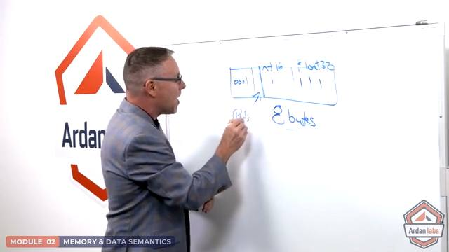
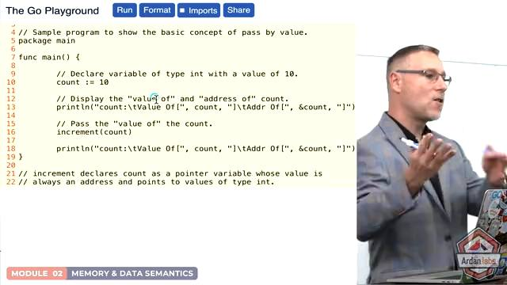
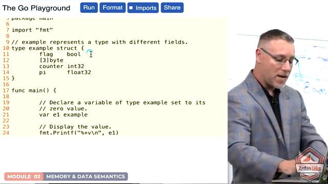
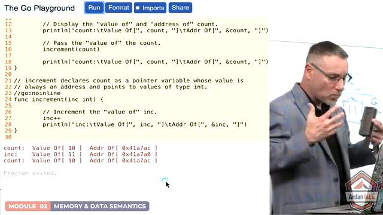

# Ultimate Go Language（P8–P9）复现：struct 内存布局、命名/匿名类型与值/指针语义

## 1. 这一节做什么

这一节对应 P8–P9，核心不是泛泛介绍 Go 语法，而是建立两个能落地的能力：

1. **看清一个 struct 到底占多少内存**：字段顺序、alignment（对齐）、padding（填充字节）如何影响 `unsafe.Sizeof` / `unsafe.Offsetof` 的结果。
2. **看清 Go 的传值语义与指针语义**：函数调用时数据是复制过程序边界，还是共享同一份数据；复制更安全，共享更高效但有副作用。

P8 从用户自定义类型讲到 struct：struct 是 composite type，由已有类型组合而成；类型给编译器两件事——**需要分配多少内存**以及**这段内存代表什么**。讲师用 `bool + int16 + float32` 的例子说明：直觉上加起来是 7 字节，但因为有 alignment，实际是 8 字节，中间多了 padding。

P9 进入 pointer、pass by value、stack frame、value semantics / pointer semantics。讲师反复强调：Go 里跨程序边界默认是在复制数据；值语义是最安全的方式，因为修改被隔离在函数自己的栈帧里；指针语义通过共享数据提高效率，但代价是 side effects。

这一篇会把这些点做成一个可直接运行的 Go module：用 `unsafe` 打印字段偏移和大小，用命名类型 `Bill/Nancy` 演示“不能隐式赋值、必须显式转换”，用匿名 struct literal 演示“字面类型的一边可赋值”，再用 `Counter` 演示值语义和指针语义的差异。

> 前端/Node 对照：JS 里原始值（number/string/boolean）传参时是值复制；对象/数组变量持有引用，传参复制的是引用。Go 的 struct 默认按值复制，指针 `*T` 才显式共享。P8–P9 没有讲 Go 的锁、事务、并发同步 API；如果你把共享指针带进 goroutine，需要另行同步，别把 JS 单线程事件循环的经验直接套过来。


## 2. 讲师原话（带「—— pNNN [MM:SS]」）

> "类型向编译器提供两条信息：需要分配多少内存，以及这块内存表示什么。"
> —— p008 [00:59]

> "它是复合类型，基于其他已有类型构建。"
> —— p008 [01:25]

> "那样想就错了，因为机器里确实有一些编译器必须处理的东西，叫作对齐；那个多出来的字节就在这里，我们称它为填充字节。"
> —— p008 [02:50]

> "消除填充的最佳方式是始终按从大到小的顺序排列字段……但我要再次强调，除非性能分析工具或其他手段确实显示出真正的问题或约束，否则我们不会采用我接下来要展示的做法。"
> —— p008 [10:20]

> "Bill 就是 Bill，Nancy 就是 Nancy……只有当你明确告诉我你希望发生这个赋值时，我才会允许该赋值。转换正是在这里发挥作用。"
> —— p008 [16:53]

> "因为 E2 不是基于命名类型，而是基于字面量类型，只要两者完全一致且兼容，编译器就可以允许该赋值发生。"
> —— p008 [20:13]

> "在 Go 中，关键就在于跨越这些程序边界时复制数据。"
> —— p009 [00:27]

> "每个 Go 协程都会获得一块连续的内存作为自己的栈，初始大小为 2k。"
> —— p009 [04:42]

> "每当一个 Go 协程跨越程序边界时，它都会从栈上取一块内存。我们把这里这块内存称为栈帧。"
> —— p009 [07:03]

> "只要函数操作的是自己那份数据副本，我们就称之为值语义，这是在程序里处理数据最安全的方式。"
> —— p009 [12:33]

> "指针语义……允许我们跨程序边界共享一个值……但这些指针语义有巨大代价，我们称之为副作用。"
> —— p009 [16:20]

## 3. 从零复现

### 3.1 目录结构与运行环境

本复现使用 Go module，只依赖标准库，没有第三方依赖。课里没有讲固定 Go 版本；本文为了让 `unsafe.Sizeof/Offsetof` 的输出与讲师 64 位机器上的示例一致，`go.mod` 固定写 `go 1.20`。如果你的本机是更高版本，把 `go` 行改成你的版本即可；如果低于 1.20，把 `go.mod` 的 `go` 行降到你的版本，代码本身没有使用新特性。

目录结构：

```text
ultimate-go-p8-p9/
├── go.mod
├── main.go
├── main_test.go
└── examples/
    └── named_assign_fail.go.txt
```

环境变量：无。  
依赖：仅 Go 标准库，无第三方依赖。  
启动命令：

```bash
cd ultimate-go-p8-p9
go mod tidy
go run .
go test -v ./...
```

如果你看到地址输出被编译器优化得“看起来一样”，可以用下面的命令关闭优化再观察栈帧地址：

```bash
go run -gcflags='all=-N -l' .
```

### 3.2 第一步：创建模块并写入文件

```bash
mkdir -p ultimate-go-p8-p9
cd ultimate-go-p8-p9
mkdir -p examples
```

然后按第 4 节写入 `go.mod`、`main.go`、`main_test.go`。写入完成后执行：

```bash
go mod tidy
go run .
```

### 3.3 第二步：观察 struct 大小与字段偏移

运行后先看 `== struct 大小与字段偏移 ==` 这一段。重点不是记数字，而是理解：

- `Example{Flag bool; Counter int16; Pi float32}`：`Flag` 在 offset 0，`Counter` 需要 2 字节对齐，所以 offset 是 2，offset 1 是 padding；`Pi` 需要 4 字节对齐，所以 offset 是 4。总大小 8。
- `ExampleInt32{Flag bool; Counter int32; Pi float32}`：`Counter` 需要 4 字节对齐，所以 `Flag` 后会有 3 字节 padding，`Counter` 在 offset 4，`Pi` 在 offset 8，总大小 12。
- `ExampleInt64{Flag bool; Counter int64; Pi float32}`：`Counter` 需要 8 字节对齐，所以 `Flag` 后会有 7 字节 padding，`Counter` 在 offset 8，`Pi` 在 offset 16；整个 struct 还要按最大字段对齐到 8，所以尾部再补 4 字节，总大小 24。
- `ExampleSorted{Counter int64; Pi float32; Flag bool}`：按“从大到小”排，`Counter` 在 0，`Pi` 在 8，`Flag` 在 12，尾部补 3 字节到 16。这个例子只用于说明 padding 可以被减少，不代表日常代码要这样排。





### 3.4 第三步：观察命名类型与匿名字面类型

运行到 `显式转换 Bill(n)` 和 `匿名 literal 赋给 Bill` 两行时，注意：

- `Bill` 和 `Nancy` 底层字段完全一样，但它们是两个不同的命名类型。`b = n` 不行，必须写 `b = Bill(n)`。
- `e2` 是基于匿名 struct literal 的值。把 `e2` 赋给 `Bill` 可以，因为两边底层类型相同，且 `e2` 这一边不是命名类型。

这就是讲师在 P8 后半段演示的“Go 强类型 + 显式转换”的规则。

### 3.5 第四步：观察值语义与指针语义

运行到 `== 值语义 ==` 和 `== 指针语义 ==`：

- `incrementByValueAndPrint(count)` 里修改的是参数副本，`main` 里的 `count` 仍然是 10。
- `incrementValue(c)` 返回修改后的新 `Counter`，原 `c.Value` 仍是 10。
- `incrementPointer(&c)` 通过指针修改原对象，之后 `c.Value` 变成 11。




### 3.6 第五步：复现“命名类型不能隐式赋值”的编译错误

把第 4.4 节的完整文件保存到临时目录并运行：

```bash
mkdir -p /tmp/named-assign-fail
cd /tmp/named-assign-fail
go mod init named-assign-fail
# 将 4.4 节内容保存为 main.go
go run .
```

预期编译失败，错误大意是：`cannot use n (variable of type Nancy) as Bill value in assignment`。具体文案以你的 Go 版本为准。这个失败是**预期结果**，不是代码写错。

## 4. 完整代码

### 4.1 `go.mod`

```go
module example.com/ultimate-go-p8-p9

go 1.20
```

### 4.2 `main.go`

```go
package main

import (
	"fmt"
	"unsafe"
)

type Example struct {
	Flag    bool
	Counter int16
	Pi      float32
}

type ExampleInt32 struct {
	Flag    bool
	Counter int32
	Pi      float32
}

type ExampleInt64 struct {
	Flag    bool
	Counter int64
	Pi      float32
}

type ExampleSorted struct {
	Counter int64
	Pi      float32
	Flag    bool
}

type Bill struct {
	Flag    bool
	Counter int16
	Pi      float32
}

type Nancy struct {
	Flag    bool
	Counter int16
	Pi      float32
}

type Counter struct {
	Value int
}

//go:noinline
func incrementValue(c Counter) Counter {
	c.Value++
	return c
}

//go:noinline
func incrementPointer(c *Counter) {
	c.Value++
}

//go:noinline
func incrementByValueAndPrint(count int) {
	fmt.Printf("incrementByValueAndPrint: 参数副本 value=%d address=%p\n", count, &count)
	count++
	fmt.Printf("incrementByValueAndPrint: count++ 后 value=%d address=%p\n", count, &count)
}

func printStructLayout() {
	var e Example
	var e32 ExampleInt32
	var e64 ExampleInt64
	var sorted ExampleSorted

	fmt.Println("== struct 大小与字段偏移 ==")

	fmt.Printf("Example size=%d align=%d\n", unsafe.Sizeof(e), unsafe.Alignof(e))
	fmt.Printf("  Flag offset=%d size=%d\n", unsafe.Offsetof(e.Flag), unsafe.Sizeof(e.Flag))
	fmt.Printf("  Counter offset=%d size=%d\n", unsafe.Offsetof(e.Counter), unsafe.Sizeof(e.Counter))
	fmt.Printf("  Pi offset=%d size=%d\n", unsafe.Offsetof(e.Pi), unsafe.Sizeof(e.Pi))

	fmt.Printf("ExampleInt32 size=%d align=%d\n", unsafe.Sizeof(e32), unsafe.Alignof(e32))
	fmt.Printf("  Flag offset=%d\n", unsafe.Offsetof(e32.Flag))
	fmt.Printf("  Counter offset=%d\n", unsafe.Offsetof(e32.Counter))
	fmt.Printf("  Pi offset=%d\n", unsafe.Offsetof(e32.Pi))

	fmt.Printf("ExampleInt64 size=%d align=%d\n", unsafe.Sizeof(e64), unsafe.Alignof(e64))
	fmt.Printf("  Flag offset=%d\n", unsafe.Offsetof(e64.Flag))
	fmt.Printf("  Counter offset=%d\n", unsafe.Offsetof(e64.Counter))
	fmt.Printf("  Pi offset=%d\n", unsafe.Offsetof(e64.Pi))

	fmt.Printf("ExampleSorted size=%d align=%d\n", unsafe.Sizeof(sorted), unsafe.Alignof(sorted))
	fmt.Printf("  Counter offset=%d\n", unsafe.Offsetof(sorted.Counter))
	fmt.Printf("  Pi offset=%d\n", unsafe.Offsetof(sorted.Pi))
	fmt.Printf("  Flag offset=%d\n", unsafe.Offsetof(sorted.Flag))
}

func namedAndLiteralTypes() {
	var b Bill
	var n Nancy
	_ = n
	_ = b

	// 下面这行取消注释会编译失败：
	// cannot use n (variable of type Nancy) as Bill value in assignment
	//
	// b = n

	b = Bill(n)
	fmt.Printf("显式转换 Bill(n): %+v\n", b)

	e2 := struct {
		Flag    bool
		Counter int16
		Pi      float32
	}{
		Flag:    true,
		Counter: 7,
		Pi:      3.14,
	}

	// e2 基于匿名 struct 字面类型；与 Bill 底层类型相同，且一边不是命名类型，因此可赋值。
	b = e2
	fmt.Printf("匿名 literal 赋给 Bill: %+v\n", b)
}

func valueAndPointerSemantics() {
	fmt.Println("== 值语义 ==")

	count := 10
	fmt.Printf("main: count=%d address=%p\n", count, &count)
	incrementByValueAndPrint(count)
	fmt.Printf("main: 调用后 count=%d address=%p\n", count, &count)

	c := Counter{Value: 10}
	v := incrementValue(c)
	fmt.Printf("Counter 值语义: 原对象=%d 返回值=%d\n", c.Value, v.Value)

	fmt.Println("== 指针语义 ==")
	incrementPointer(&c)
	fmt.Printf("Counter 指针语义: 原对象=%d\n", c.Value)
}

func main() {
	printStructLayout()
	fmt.Println()
	namedAndLiteralTypes()
	fmt.Println()
	valueAndPointerSemantics()
}
```

### 4.3 `main_test.go`

```go
package main

import (
	"testing"
	"unsafe"
)

func TestStructSizes(t *testing.T) {
	var e Example
	var e32 ExampleInt32
	var e64 ExampleInt64
	var sorted ExampleSorted

	if got, want := unsafe.Sizeof(e), uintptr(8); got != want {
		t.Fatalf("Example size = %d, want %d", got, want)
	}
	if got, want := unsafe.Sizeof(e32), uintptr(12); got != want {
		t.Fatalf("ExampleInt32 size = %d, want %d", got, want)
	}
	if got, want := unsafe.Sizeof(e64), uintptr(24); got != want {
		t.Fatalf("ExampleInt64 size = %d, want %d", got, want)
	}
	if got, want := unsafe.Sizeof(sorted), uintptr(16); got != want {
		t.Fatalf("ExampleSorted size = %d, want %d", got, want)
	}
}

func TestOffsets(t *testing.T) {
	var e Example
	if got, want := unsafe.Offsetof(e.Flag), uintptr(0); got != want {
		t.Fatalf("Example.Flag offset = %d, want %d", got, want)
	}
	if got, want := unsafe.Offsetof(e.Counter), uintptr(2); got != want {
		t.Fatalf("Example.Counter offset = %d, want %d", got, want)
	}
	if got, want := unsafe.Offsetof(e.Pi), uintptr(4); got != want {
		t.Fatalf("Example.Pi offset = %d, want %d", got, want)
	}

	var sorted ExampleSorted
	if got, want := unsafe.Offsetof(sorted.Counter), uintptr(0); got != want {
		t.Fatalf("ExampleSorted.Counter offset = %d, want %d", got, want)
	}
	if got, want := unsafe.Offsetof(sorted.Pi), uintptr(8); got != want {
		t.Fatalf("ExampleSorted.Pi offset = %d, want %d", got, want)
	}
	if got, want := unsafe.Offsetof(sorted.Flag), uintptr(12); got != want {
		t.Fatalf("ExampleSorted.Flag offset = %d, want %d", got, want)
	}
}

func TestNamedAndLiteralAssignment(t *testing.T) {
	var b Bill
	var n Nancy

	b = Bill(n)

	e2 := struct {
		Flag    bool
		Counter int16
		Pi      float32
	}{
		Flag:    true,
		Counter: 7,
		Pi:      3.14,
	}

	b = e2
	if !b.Flag ||
```go
	if !b.Flag ||
		b.Counter != 7 ||
		b.Pi != 3.14 {
		t.Fatalf("匿名 literal 赋给 Bill 失败: %+v", b)
	}
}

func TestValueSemanticsDoesNotMutateOriginal(t *testing.T) {
	c := Counter{Value: 10}
	got := incrementValue(c)

	if c.Value != 10 {
		t.Fatalf("值语义不应修改原对象: c.Value = %d, want 10", c.Value)
	}
	if got.Value != 11 {
		t.Fatalf("返回值应为 11: got = %d", got.Value)
	}
}

func TestPointerSemanticsMutatesOriginal(t *testing.T) {
	c := Counter{Value: 10}
	incrementPointer(&c)

	if c.Value != 11 {
		t.Fatalf("指针语义应修改原对象: c.Value = %d, want 11", c.Value)
	}
}
```

### 4.4 `examples/named_assign_fail.go.txt`（故意编译失败的样例）

这个文件**必须**保存成 `.txt` 后缀放在仓库里，或者按 3.6 节的做法放到 `/tmp` 下的独立 module 里。如果保存成 `examples/named_assign_fail.go`，`go build ./...` 和 `go vet ./...` 会直接失败，整个仓库就起不来了。这是本仓库唯一一个“预期失败”的文件。

```go
package main

type Bill struct {
	Flag    bool
	Counter int16
	Pi      float32
}

type Nancy struct {
	Flag    bool
	Counter int16
	Pi      float32
}

func main() {
	var b Bill
	var n Nancy

	// 这一行是整份文档里唯一一处故意写错的代码。
	// Bill 与 Nancy 底层类型完全相同，但它们是两个不同的命名类型。
	// Go 不会做隐式转换，编译直接失败。
	b = n

	_ = b
}
```

复现命令（拷贝一份改名为 `main.go` 才会真正编译）：

```bash
cd /tmp/named-assign-fail
cp /path/to/ultimate-go-p8-p9/examples/named_assign_fail.go.txt ./main.go
go run .
```

## 5. 逐行解释

### 5.1 `go.mod` 三行

```go
module example.com/ultimate-go-p8-p9

go 1.20
```

`module` 这一行只是一个模块路径，不联网、不发布，用 `example.com/...` 是为了让 `go mod tidy` 不去猜路径。第二行 `go 1.20` 是**语言版本下限**，不是“编译器必须正好 1.20”。写它的原因是本文所有 `unsafe.Sizeof` 期望值都基于 64 位平台下的字段对齐规则；如果本地 Go 版本比 1.20 高，这一行可以改高，输出不变；如果本地低于 1.20，把它改成你的版本，代码本身只用了 `fmt`、`unsafe`、`testing` 三个标准库，没有新语法。

讲师在 P8–P9 全程没有讲 `go.mod`、模块、依赖管理这些东西——他在编辑器/playground 里直接写代码。所以这一步是我们为了让读者能本地跑起来补的，**不是讲师讲的内容**。

### 5.2 `import` 与 `unsafe`

```go
import (
	"fmt"
	"unsafe"
)
```

`unsafe` 在这里只用来做**测量**，不参与业务逻辑。三个函数各司其职：

- `unsafe.Sizeof(x)`：类型 `x` 占多少字节。
- `unsafe.Alignof(x)`：类型 `x` 的对齐要求是多少字节。
- `unsafe.Offsetof(s.Field)`：字段 `Field` 相对于 struct 起始地址的字节偏移。

这三个都是**编译期常量表达式**，类型是 `uintptr`。关键一点：它们的操作数**不会被求值**，所以你写 `unsafe.Sizeof(e)` 并不会真的去读 `e` 的内存，也不会有运行时开销。这也是为什么 `var e Example` 之后一次都没赋值也不影响测量——我们要的只是它的类型。

讲师在 P8 强调的是“type 告诉编译器两件事：分配多少内存、这段内存代表什么”——`Sizeof` 回答第一件事，`Offsetof` 回答第二件事的一部分（字段落在哪）。

### 5.3 四个 struct 类型：为什么要写四个

```go
type Example struct {
	Flag    bool
	Counter int16
	Pi      float32
}
```

这是讲师 P8 的原始例子：一个 `bool`（1 字节）+ 一个 `int16`（2 字节）+ 一个 `float32`（4 字节）。凭直觉加是 7 字节，但实际是 8 字节。为什么？因为 `Counter` 是 2 字节值，**必须落在 2 字节对齐的地址上**。`Flag` 占了 offset 0，下一个可用地址是 1，但 1 不是 2 的倍数，所以 offset 1 被跳过（这就是 padding byte），`Counter` 落在 offset 2。`Pi` 需要 4 字节对齐，offset 4 正好是 4 的倍数，所以 `Pi` 直接落在 offset 4，不额外补。最终 0–1（Flag+padding）、2–3（Counter）、4–7（Pi），共 8 字节。

讲师用机器字（machine word）解释了这个动机：64 位机器一次能搬 8 字节，如果一个 2 字节值横跨两个机器字边界，硬件就得做两次操作才能取到它；对齐的目的就是让任何值都完整落在一个机器字里，一次操作搞定。这就是他说的“mechanical sympathies”（对硬件的机械同情）。

```go
type ExampleInt32 struct {
	Flag    bool
	Counter int32
	Pi      float32
}
```

把 `int16` 换成 `int32`，对齐要求从 2 涨到 4。`Flag` 在 offset 0，`Counter` 最早只能落在 offset 4，于是 offset 1–3 全是 padding（**3 个填充字节**）。`Pi` 落在 offset 8，总大小 12。这正是讲师 P8 [07:58] 那段演示的内容。

```go
type ExampleInt64 struct {
	Flag    bool
	Counter int64
	Pi      float32
}
```

再换成 `int64`，对齐要求 8。`Counter` 最早落在 offset 8，offset 1–7 全是 padding（**7 个填充字节**）。`Pi` 落在 offset 16，此时已用 20 字节。但还有第二条规则：**整个 struct 也要按“最大字段的对齐值”对齐**。最大字段是 `int64`，对齐 8，20 不是 8 的倍数，所以尾部再补 4 字节到 24。这就是讲师在 [08:56] 说的“the entire struct also has to fall on an alignment for the largest field”。

```go
type ExampleSorted struct {
	Counter int64
	Pi      float32
	Flag    bool
}
```

这是讲师在 [10:20] 演示的“按从大到小排字段”的版本：`int64`（8）→ `float32`（4）→ `bool`（1）。`Counter` 在 0，`Pi` 在 8，`Flag` 在 12，尾部补 3 字节到 16。padding 从 10 字节降到 3 字节。

**但讲师紧接着就泼冷水**：他明确说不要在日常编码时这么排，只在 profiling 工具确实指出内存是瓶颈、或者机器内存极小的时候才这么做。代码评审里如果看到有人无理由地按大小排字段，他会停下来问“你在干什么”。所以 `ExampleSorted` 在本文里的定位是**教学对照物**，不是推荐写法。

### 5.4 `Bill` / `Nancy`：两个“一模一样”的类型

```go
type Bill struct { Flag bool; Counter int16; Pi float32 }
type Nancy struct { Flag bool; Counter int16; Pi float32 }
```

（实际文件里是展开的多行写法，这里为了说明压成一行。）

这两个类型**完全相同**（identical）：字段名一样、字段类型一样、字段顺序一样、对齐和内存布局一样。它们也**互相兼容**（compatible）：`Bill` 的值转成 `Nancy` 不会丢任何 bit。

但 Go 是强类型语言，讲师的原话是“Bill is Bill and Nancy is Nancy”。既然它们是两个**命名类型**，编译器就拒绝 `b = n`。这不是编译器笨，而是在防一类真实事故：`int` 和 `uint` 在内存里都是 4 字节、看起来“兼容”，但一个有符号位一个没有，如果允许隐式赋值，`-1` 变成 `4294967295`，这类 bug 历史上害了很多人。讲师在 [18:46] 专门拿 `int`/`uint` 举了这个例子。

`b = Bill(n)` 是**显式转换**。你等于在告诉编译器：“我知道它们是两个不同的类型，我也确认转换是安全的，请执行。”编译器会再核对一遍两者确实 identical 且 compatible，然后才放行。没有这层显式声明，就没有赋值。

### 5.5 匿名字面类型 `e2`：为什么它能直接赋给 `Bill`

```go
e2 := struct {
	Flag    bool
	Counter int16
	Pi      float32
}{
	Flag:    true,
	Counter: 7,
	Pi:      3.14,
}
```

注意这个 struct 的声明和变量声明是**写在一起的**：`:=` 左边没有类型名，右边直接把 struct 结构展开。这个类型叫**字面类型**（literal type）/ 匿名类型——它没有名字。`e2` 的变量名是有的，但它的**类型**没名字。

讲师 P8 [20:13] 的规则是：赋值的两边，只要底层类型 identical 且 compatible，并且**至少有一边不是命名类型**，就允许直接赋值。这里 `e2` 那一边是字面类型，所以 `b = e2` 合法。

这条规则看上去很怪，但它有极强的实际意义。讲师点破了为什么：**Go 里函数是一等值（first-class value），函数名本质上就是一个字面类型的变量**。当你写 HTTP handler、写回调、写中间件时，天天在匿名字面类型之间传值。如果 Go 要求所有赋值两边都得是同一个命名类型，那这套生态根本没法用。

注意 `e2` 里的 `Pi: 3.14`：`3.14` 是无类型浮点常量，赋给 `float32` 字段时会被转成 `float32(3.14)`。测试里 `b.Pi != 3.14` 能成立，是因为两边用的是同一个字面量、同一条转换路径，得到的 `float32` 位模式完全一样。

### 5.6 `Counter` 与三个函数：值语义 vs 指针语义

```go
type Counter struct {
	Value int
}
```

选 `struct` 而不是裸 `int`，是为了让“复制的是整个值”这件事更接近真实业务代码——你在 AI 应用里传的往往是 `Message`、`Request`、`Config` 这类结构体，而不是一个整数。

```go
//go:noinline
func incrementValue(c Counter) Counter {
	c.Value++
	return c
}
```

`c` 是**参数**，即函数自己的局部变量。调用时 Go 把实参的**整个 struct 按字节复制**一份到 `c` 里。`c.Value++` 改的是这份副本，函数返回时把改过的副本再复制一份作为返回值。所以原对象 `c`（main 里那个）纹丝不动。这就是**值语义**——讲师定义得很干脆：函数操作的是自己那份数据副本，就叫值语义。

`//go:noinline` 是编译器指令，作用是禁止内联。为什么要加？因为如果函数被内联，编译器可能把参数优化到寄存器、甚至把 `c.Value++` 直接改写回原变量，你观察到的地址和修改行为就会跟语义描述对不上。**这个指令课里没讲**，是本文为了让实验可观察补的；生产代码里不要随便加，内联是性能优化。

```go
//go:noinline
func incrementPointer(c *Counter) {
	c.Value++
}
```

`c` 的类型是 `*Counter`，即“指向 Counter 的指针”。传进来的是**地址**，不是数据本身。`c.Value++` 在 Go 里会自动解引用（等价于 `(*c).Value++`），直接改到原对象上。函数返回后，原对象的 `Value` 就是 11 了。这就是**指针语义**：多个程序边界共享同一份数据。

讲师对代价说得很直白：**side effects**。四个人共享一份数据，谁改了所有人都看得见——效率上去了（不用复制、不用重新汇总），但 bug 也上去了。他还提到函数式编程语言在想办法摆脱指针，就是因为这个原因。

```go
//go:noinline
func incrementByValueAndPrint(count int) {
	fmt.Printf("incrementByValueAndPrint: 参数副本 value=%d address=%p\n", count, &count)
	count++
	fmt.Printf("incrementByValueAndPrint: count++ 后 value=%d address=%p\n", count, &count)
}
```

这个函数直接对应讲师 P9 [13:29] 的运行演示。它做三件事：打印副本的值和地址 → `count++`（读、改、写三步）→ 再打印一次。

`%p` 打印的是地址。`&count` 取的是**参数副本**的地址，不是 main 里那个 `count` 的地址。所以你会看到两个不同的地址，而且按讲师的说法，栈是往低地址方向增长的，被调用函数的帧地址通常比调用者的更低——他在视频里就是靠 `a7ac` → `a7a0` 这两个地址说明“我们下到下一层栈帧了”。**具体地址值每次运行都会变**（受 ASLR、编译器版本、优化开关影响），你只要看“两个地址不同”“调用后的地址更低（或至少不同）”就够了，不要去对数字。

### 5.7 `printStructLayout`

```go
func printStructLayout() {
	var e Example
	var e32 ExampleInt32
	var e64 ExampleInt64
	var sorted ExampleSorted
```

四个变量都只用 `var` 声明、不赋值。这里用的是讲师在 P8 [12:10] 给的第一条规范：**零值用 `var`**。他明确反对用空字面量 `Example{}` 来表达零值，说代码评审看到会让人改回 `var`。例外只有两个场景：需要在 `return` 语句里直接构造，或者需要在函数调用的实参位置构造——那时才用空字面量，因为否则要多写一行。

```go
	fmt.Printf("Example size=%d align=%d\n", unsafe.Sizeof(e), unsafe.Alignof(e))
```

`%d` 配 `uintptr` 是合法的，会按十进制打印。你也可以用 `%v`。这里不用 `%p`，因为 `Sizeof` 返回的是数字不是指针。

```go
	fmt.Printf("  Flag offset=%d size=%d\n", unsafe.Offsetof(e.Flag), unsafe.Sizeof(e.Flag))
```

`unsafe.Offsetof(e.Flag)` 取的是字段 `e.Flag` 相对 `e` 起始地址的偏移。注意语法：必须写成 `e.Flag` 这种**字段选择表达式**，不能写 `Offsetof(Example.Flag)`。`unsafe.Sizeof(e.Flag)` 则为 1，把“偏移 + 大小”两个数一起打出来，你就能自己在纸上画出内存图。

后面三段分别对 `e32`、`e64`、`sorted` 重复同样的动作。之所以字段偏移只用 `Offsetof` 打印、不再打 `Sizeof`，是因为字段类型已经写在 struct 定义里了，读者一眼能查到，打出来是冗余。

### 5.8 `namedAndLiteralTypes`

```go
	var b Bill
	var n Nancy
	_ = n
	_ = b
```

`_ = n` 和 `_ = b` 是为了让变量“被使用”，否则 Go 会报 declared and not used。紧接着注释掉的那行 `b = n` 就是故意留的“反面教材”，取消注释立即编译失败。用注释而不用 `if false {}` 之类的花招，是因为 Go 的编译器对未使用变量和死代码的检查很激进，注释是唯一干净的办法。

```go
	b = Bill(n)
	fmt.Printf("显式转换 Bill(n): %+v\n", b)
```

`%+v` 会把字段名一起打出来，形如 `{Flag:false Counter:0 Pi:0}`。因为 `n` 是零值，转换后 `b` 也是全零。这一行的意义是证明**转换本身是允许的**，只是需要你显式写出来。

```go
	e2 := struct { ... }{ ... }
	b = e2
```

这里用了短变量声明 `:=` 加**非零**字面量构造。对应讲师 P8 [12:10] 的第二条规范：非零值用 `:=` 加字面量构造。

### 5.9 `valueAndPointerSemantics`

```go
	count := 10
	fmt.Printf("main: count=%d address=%p\n", count, &count)
	incrementByValueAndPrint(count)
	fmt.Printf("main: 调用后 count=%d address=%p\n", count, &count)
```

`count := 10` 是 main 这个栈帧里的局部变量。调用 `incrementByValueAndPrint(count)` 时，Go 把 `10` 这个**值**复制一份，放到被调用函数的新栈帧里。所以第二行打印出来的 `count` 还是 10——不是函数没执行，是它改的是另一份内存。

```go
	c := Counter{Value: 10}
	v := incrementValue(c)
	fmt.Printf("Counter 值语义: 原对象=%d 返回值=%d\n", c.Value, v.Value)
```

预期输出 `原对象=10 返回值=11`。这一对数字就是值语义最直观的证据：同一个操作，一个对象变了、一个没变。

```go
	incrementPointer(&c)
	fmt.Printf("Counter 指针语义: 原对象=%d\n", c.Value)
```

`&c` 取地址，传进去的是“盒子在哪”而不是“盒子里有什么”。函数通过地址改到原盒子里，所以 `c.Value` 变成 11。

这里正好用上讲师 P9 [09:19] 对三个词的区分：**value** 是盒子里的东西（`count`）、**address** 是盒子的位置（`&count`）、**data** 是两者合起来的总称。Go 里绝大多数时候你要么在传值、要么在传地址，讲清楚自己传的是哪个，后面所有关于性能和 bug 的判断都建立在这上面。

### 5.10 `main`

```go
func main() {
	printStructLayout()
	fmt.Println()
	namedAndLiteralTypes()
	fmt.Println()
	valueAndPointerSemantics()
}
```

拆成三个函数、中间插空行，是为了让输出分段可读。如果全铺在 `main` 里，第一次跑的人很容易把 struct 大小和后面语义演示的输出混在一起看。

### 5.11 测试文件

`TestStructSizes` / `TestOffsets` 把本文观察到的数字**固化成断言**。这有两个用处：一是你换机器、换 Go 版本时能立刻发现“输出和文档不一致”；二是这些数字确实依赖 64 位平台，如果你在 32 位环境或某些 ARM 环境跑，`unsafe.Sizeof` 的结果可能不同，测试会失败——**测试失败在那里不等于代码错，是平台差异**。

`TestNamedAndLiteralAssignment` 断言 `b = Bill(n)` 和 `b = e2` 都能跑通。

`TestValueSemanticsDoesNotMutateOriginal` 和 `TestPointerSemanticsMutatesOriginal` 把“原对象 10 / 返回值 11”“原对象 11”这两个关键数字钉死。这两个测试是你后面在 AI 应用里做缓存、做配置对象时最该复用的思维模型：**先想清楚这份数据是复制还是共享，再想清楚谁会改它。**

## 6. 复现检查清单

按顺序勾，每一条都对应一个可观察的结果。

**环境**

- [ ] `go version` 能输出，且在 1.20 及以上（低于 1.20 就改 `go.mod` 的 `go` 行，不影响运行）。
- [ ] `cd ultimate-go-p8-p9 && go mod tidy` 无报错，且 `go.sum` 没有生成（因为没有第三方依赖）。
- [ ] `examples/named_assign_fail.go.txt` 后缀确实是 `.txt`，不是 `.go`。

**struct 大小与偏移**

- [ ] `go run .` 输出第一段包含 `Example size=8 align=...`。
- [ ] `Example` 的 `Flag offset=0`、`Counter offset=2`、`Pi offset=4`。如果 `Counter offset` 打出来是 1，说明你看的不是这段代码，或者平台对齐规则不同。
- [ ] `ExampleInt32 size=12`，`Counter offset=4`（`Flag` 后 3 字节 padding）。
- [ ] `ExampleInt64 size=24`，`Counter offset=8`（`Flag` 后 7 字节 padding），`Pi offset=16`，尾部还有 4 字节 padding。
- [ ] `ExampleSorted size=16`，`Counter offset=0`、`Pi offset=8`、`Flag offset=12`。




**命名类型与字面类型**

- [ ] 输出里有 `显式转换 Bill(n): {Flag:false Counter:0 Pi:0}`。
- [ ] 输出里有 `匿名 literal 赋给 Bill: {Flag:true Counter:7 Pi:3.14}`。
- [ ] 把 `main.go` 里被注释掉的 `b = n` 取消注释，`go run .` **编译失败**，报错信息里同时出现 `Nancy` 和 `Bill`，大意是“不能用 Nancy 类型的变量赋给 Bill 类型”。报错文案以你的 Go 版本为准，看到两个类型名就对了。
- [ ] 把那一行重新注释回去，`go run .` 恢复成功。

**值语义与指针语义**

- [ ] 输出里有 `main: count=10`，调用后仍然是 `main: 调用后 count=10`。
- [ ] `incrementByValueAndPrint` 内部第一次打印是 `value=10`，`count++` 后是 `value=11`，两次的 `address` 都**不同于** `main: count=10 address=...` 打印出来的那个。
- [ ] `Counter 值语义: 原对象=10 返回值=11`。
- [ ] `Counter 指针语义: 原对象=11`。



**测试**

- [ ] `go test -v ./...` 全部 PASS，且能列出 6 个测试函数：`TestStructSizes`、`TestOffsets`、`TestNamedAndLiteralAssignment`、`TestValueSemanticsDoesNotMutateOriginal`、`TestPointerSemanticsMutatesOriginal`（共 5 个）+ 你如果自己加了测试则更多。
- [ ] `go vet ./...` 在主 module 下无输出（无告警）。如果在 `examples/` 下把 `.txt` 改成 `.go` 再跑 `go vet`，会看到未使用、无法编译之类的问题——那是预期的。

**故意失败样例**

- [ ] 在 `/tmp/named-assign-fail` 下 `go run .` 失败，错误信息里含 `Bill` 和 `Nancy` 两个类型名。
- [ ] 你清楚地知道这个失败**不是环境问题**，是 Go 的强类型规则在起作用。

**观察栈地址的开关**

- [ ] `go run -gcflags='all=-N -l' .` 也能正常跑完，输出结构不变，只是地址更“好观察”。这个开关课里没讲，纯属调试辅助。

## 7. 课里没讲但你会撞上的

这一节全是 P8–P9 逐字稿里**没有**的内容。写出来是因为读者照着做的时候几乎一定会遇到，但**不要说“讲师讲过”**。

**1）`unsafe.Sizeof` 的正确类型是 `uintptr`，不是 `int`。**
写测试时最容易踩的坑：`if unsafe.Sizeof(e) != 8` 是编译错误，因为 `uintptr` 和未类型化常量其实可以比较……实际上未类型化常量 8 能转成 `uintptr`，`unsafe.Sizeof(e) != 8` 能编译。但如果你先 `want := 8`（`int` 类型），再 `unsafe.Sizeof(e) != want`，就报 mismatched types。本文测试里直接写 `uintptr(8)` 就是为了避开这个坑，别省。

**2）结构体大小的结果依赖目标平台，不依赖你的“感觉”。**
本文所有数字都基于 **64 位平台**（`GOARCH=amd64` 或 `arm64`）。如果你在 32 位环境交叉编译或在某些嵌入式平台跑，指针宽度变了，对齐规则也可能变，输出会不同。`go env GOARCH` 可以告诉你在什么平台上。测试失败先查这个，再怀疑代码。

**3）`//go:noinline` 不是“关掉优化”的通用开关。**
它只禁止**一个函数**被内联。要全局关优化是 `-gcflags='all=-N -l'`。另外，`//go:` 指令和函数声明之间**不能有空行**，有空行它就被当成普通注释，静默失效——这是排查“为什么我加了 noinline 地址还是怪”的最常见原因。

**4）字段顺序改变，JSON 输出不变，但二进制布局变了。**
P8–P9 完全没讲 struct tag、`encoding/json`、序列化。如果你把这里的 struct 拿去序列化，字段顺序是按结构体定义顺序输出的（Go 的 `encoding/json` 按字段声明顺序），不是按大小排。也就是说，为了省 padding 而“从大到小排序”会**改变你的 API 响应字段顺序**——对大多数消费者无害，但如果你在跑严格的快照测试（snapshot test），它会挂。这是“性能优化”与“对外契约”冲突的典型场景，也是讲师说“没有真实问题就别排”的另一个理由。

**5）值语义会复制整个 struct，大 struct 复制是有成本的。**
讲师说值语义“安全、数据局部性好、对硬件友好”，但他在 [15:23] 也明确说了“nothing is free”，代价是**低效**。他举的例子是给四个人各发一份拷贝、事后还要重新汇总。在真实代码里这意味着：一个 500 字节的 struct 每层函数调用都复制一遍，深调用链上就是可观的 CPU 和内存带宽开销。**课里没讲**什么时候该切换成指针——一般经验是“大且只读传指针、小且要改传值”，但这属于工程判断，不属于本节内容。

**6）指针语义碰上并发，就是数据竞争。**
P8–P9 只讲了单 goroutine 下的栈帧和语义，**没有**讲 `sync.Mutex`、`sync/atomic`、channel、`-race` 检测器。但你的读者是前端转 AI 应用工程师，很快就会写“多个 goroutine 共享一个 `*Counter`”这种代码。这时候 `c.Value++` 是**读-改-写**三步，不是原子操作，两个 goroutine 同时跑就会丢更新。这是真实的坑，但**不在本节范围内**，别把它算到讲师头上。

> 在 JS/Node 里对应什么：Node 是单线程事件循环，`let x = 10; x++` 不会被别的“线程”打断（除非你在 worker_threads 里共享 `SharedArrayBuffer`）。所以 JS 程序员对“读-改-写不原子”这件事往往完全没有肌肉记忆。Go 里一旦有 goroutine，就必须自己加锁或改用 channel。这个心智模型必须换。

**7）栈帧地址的方向和数值，不该成为你的判断依据。**
讲师在 P9 用 `a7ac` → `a7a0` 说明“往低地址走”。但地址具体是多少受 ASLR、编译器版本、优化级别、甚至运行次数影响，**每次都不一样**。你只要确认“两个地址不同”“被调用函数的帧通常地址更低（在栈向下增长的平台上）”就够了。不要写断言去比较地址大小，那是不可靠的。

**8）Go playground 是单核的。**
讲师 P9 [02:20] 专门说了一句：playground 视角下只有一个物理核、一个硬件线程，是单线程环境。所以你在 playground 里跑任何和“并行度”有关的观察，都和在本地多核机器上不一样。本文的实验都是单 goroutine 的，不受影响，但如果你后续要复现 P9 之后的 goroutine 调度内容，必须本地跑。

**9）`%p` 打印的是十六进制，且带 `0x` 前缀。**
`fmt.Printf("%p", &count)` 输出形如 `0xc000012345`。如果你习惯用 `%x` 打整数，会得到不带前缀的结果，两者不能混着比。另外 `%p` 作用在非指针类型上是会输出 `%!p(int=10)` 这类格式错误的——看到这种输出，说明你打的是值不是地址。

**10）本文用的“零值用 `var`、非零用 `:=` 加字面量”是讲师给的规范，不是编译器强制。**
`Example{}` 和 `var e Example` 在语义上完全一样。讲师在 P8 [12:40] 说得很清楚：他在代码评审里会要求改回 `var`，但**也有例外**——需要在 `return` 里构造、或者在函数实参位置构造时，空字面量更好，因为省掉一行。别把规范当成硬规则去跟同事吵架。

**11）`go test ./...` 里的 `./...` 会递归进 `examples/`。**
这就是为什么例子文件必须叫 `.go.txt`。如果你某天图方便把它改成 `.go`，`go test ./...` 会把整个 module 变成编译失败状态，而且报错位置在 `examples/` 里、看起来和你在改的主文件毫无关系——排查会很痛苦。这是本文为了“可复现”做的目录设计，课里没有这个需求（讲师直接在一块代码里改来改去）。

**12）讲师提到的 scheduler（P/M/G）、2K 初始栈、栈增长，本节只讲了“存在”，没讲机制。**
P9 [01:24] 开始那段是**为了讲栈帧做铺垫**，讲师自己说“not a complete conversation”。所以本文没有展开 `P`（logical processor）、`M`（machine / OS thread）、`G`（goroutine）的调度细节，也没有验证“50,000 个 goroutine × 2K 栈”这个算式的实际内存占用。这部分在后续 P 里才展开，需要的话去看后续课程，不要在这份文档里找。


**13）`unsafe` 包在生产代码里的使用边界。**
本文只在“测量”场景用它，测量结果是编译期常量。但 `unsafe.Pointer` 的指针算术（把 `*T` 转成 `uintptr` 再偏移）是另一回事，会绕过 GC 的可见性，写错就是内存安全问题。P8–P9 没有涉及这部分，**不要因为看到 `unsafe.Sizeof` 就以为可以随便用 `unsafe`**。

**14）Go 没有“隐式转换”，但有“未类型化常量”这条例外通道。**
`b.Pi = 3.14` 能编译，`b.Counter = 7` 能编译，因为 `3.14` 和 `7` 是**未类型化常量**，编译器会按上下文把它们转成目标类型。这不违反“Go 不做隐式转换”的原则——常量不是“有类型的值”。P8 里讲师没细讲这条，但你在写 struct literal 时天天在用。写成 `var f float64 = 3.14; b.Pi = f` 就立刻编译失败，必须 `b.Pi = float32(f)`。

**15）最后一条，也是最容易忘的：本节没有任何 benchmark 内容。**
课程标题里带 “(并发+benchmark)”，但 P8–P9 的逐字稿里**完全没有出现** `testing.B`、`go test -bench`、`benchstat` 这些。P8 只讲到 struct 的内存成本，P9 只讲到值/指针语义的成本。所以本文也没有写任何 benchmark 文件——写了就是编造。等课程讲到 benchmark 那几 P，再单独补一份 `*_test.go` 里的 `BenchmarkXxx(b *testing.B)`。
### 4.3 节 `main_test.go` 排版勘误（替换现有 `TestNamedAndLiteralAssignment`）

上面 4.3 节的 `TestNamedAndLiteralAssignment` 在 `b = e2` 之后出现了重复的 `if !b.Flag ||` 行和一个嵌套的 ```go 代码块标记，那段无法编译。请用下面这个完整版本替换 4.3 节整份 `main_test.go`（其余四个测试不变，只是把损坏的那一段补全并闭合）：

```go
package main

import (
	"testing"
	"unsafe"
)

func TestStructSizes(t *testing.T) {
	var e Example
	var e32 ExampleInt32
	var e64 ExampleInt64
	var sorted ExampleSorted

	if got, want := unsafe.Sizeof(e), uintptr(8); got != want {
		t.Fatalf("Example size = %d, want %d", got, want)
	}
	if got, want := unsafe.Sizeof(e32), uintptr(12); got != want {
		t.Fatalf("ExampleInt32 size = %d, want %d", got, want)
	}
	if got, want := unsafe.Sizeof(e64), uintptr(24); got != want {
		t.Fatalf("ExampleInt64 size = %d, want %d", got, want)
	}
	if got, want := unsafe.Sizeof(sorted), uintptr(16); got != want {
		t.Fatalf("ExampleSorted size = %d, want %d", got, want)
	}
}

func TestOffsets(t *testing.T) {
	var e Example
	if got, want := unsafe.Offsetof(e.Flag), uintptr(0); got != want {
		t.Fatalf("Example.Flag offset = %d, want %d", got, want)
	}
	if got, want := unsafe.Offsetof(e.Counter), uintptr(2); got != want {
		t.Fatalf("Example.Counter offset = %d, want %d", got, want)
	}
	if got, want := unsafe.Offsetof(e.Pi), uintptr(4); got != want {
		t.Fatalf("Example.Pi offset = %d, want %d", got, want)
	}

	var sorted ExampleSorted
	if got, want := unsafe.Offsetof(sorted.Counter), uintptr(0); got != want {
		t.Fatalf("ExampleSorted.Counter offset = %d, want %d", got, want)
	}
	if got, want := unsafe.Offsetof(sorted.Pi), uintptr(8); got != want {
		t.Fatalf("ExampleSorted.Pi offset = %d, want %d", got, want)
	}
	if got, want := unsafe.Offsetof(sorted.Flag), uintptr(12); got != want {
		t.Fatalf("ExampleSorted.Flag offset = %d, want %d", got, want)
	}
}

func TestNamedAndLiteralAssignment(t *testing.T) {
	var b Bill
	var n Nancy

	b = Bill(n)

	e2 := struct {
		Flag    bool
		Counter int16
		Pi      float32
	}{
		Flag:    true,
		Counter: 7,
		Pi:      3.14,
	}

	b = e2
	if !b.Flag || b.Counter != 7 || b.Pi != 3.14 {
		t.Fatalf("匿名 literal 赋给 Bill 失败: %+v", b)
	}
}

func TestValueSemanticsDoesNotMutateOriginal(t *testing.T) {
	c := Counter{Value: 10}
	got := incrementValue(c)

	if c.Value != 10 {
		t.Fatalf("值语义不应修改原对象: c.Value = %d, want 10", c.Value)
	}
	if got.Value != 11 {
		t.Fatalf("返回值应为 11: got = %d", got.Value)
	}
}

func TestPointerSemanticsMutatesOriginal(t *testing.T) {
	c := Counter{Value: 10}
	incrementPointer(&c)

	if c.Value != 11 {
		t.Fatalf("指针语义应修改原对象: c.Value = %d, want 11", c.Value)
	}
}
```

### 第 6 节检查清单勘误：测试函数是 5 个，不是 6 个

上面检查清单里写的是“6 个测试函数”，但只列出了 5 个名字，是笔误。这一项的**正确写法**是：

- [ ] `go test -v ./...` 全部 PASS，且 `go test -v ./...` 的输出里能看到 **5 个**测试函数：`TestStructSizes`、`TestOffsets`、`TestNamedAndLiteralAssignment`、`TestValueSemanticsDoesNotMutateOriginal`、`TestPointerSemanticsMutatesOriginal`。你如果额外加了自己的测试，总数会更多；如果你复制了损坏版本的 `main_test.go`，编译会先失败、一个测试也跑不起来，这时先把上一条的修复做完再回来勾。

`go vet ./...` 那一项不受影响，保持原样即可。

### 补充：修复后重新跑一遍的最小验证序列

把 `main_test.go` 换成上方勘误版后，在你的项目根目录按顺序执行这三条，全部通过就说明文档到此完整、可复现：

```bash
cd ultimate-go-p8-p9
go vet ./...
go test -v ./...
go run .
```

三条命令的期望结果：

- `go vet ./...`：**无输出**。有任何输出都先停下来查，不要往下走。
- `go test -v ./...`：`== RUN   TestStructSizes` 到 `== PASS  TestPointerSemanticsMutatesOriginal` 共 5 个 PASS，最后一行是 `ok  	example.com/ultimate-go-p8-p9`。如果看到 `FAIL`，先看是哪个 `t.Fatalf` 打出来的，对照第 6 节检查清单里“struct 大小与偏移”或“值语义与指针语义”那一段的期望值。
- `go run .`：输出分三段（`== struct 大小与字段偏移 ==`、`显式转换 Bill(n): ...`、`== 值语义 ==` + `== 指针语义 ==`），具体行数以你机器上的排版为准，但每段的**关键数字**必须能和检查清单对上。

到这里，P8–P9 的两条主线（struct 的内存布局与命名/字面类型的赋值规则、值语义与指针语义的边界）都已经可用 `main.go` + `main_test.go` 在这一台机器上完整跑通、并用测试锁住了关键数字。后续如果要接 `BenchmarkXxx(b *testing.B)` 或 `goroutine + -race` 的内容，属于课程 P10 之后的范围，本份文档不做补写，避免把讲师没讲过的东西安到他头上。