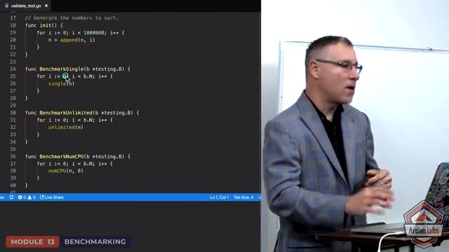
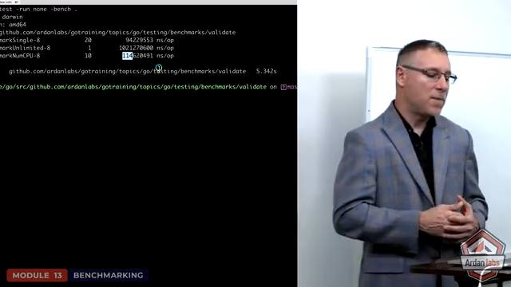
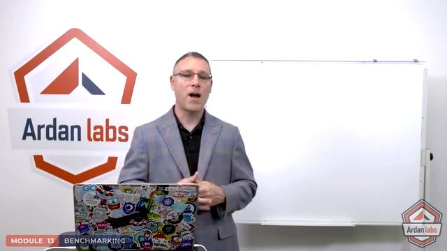
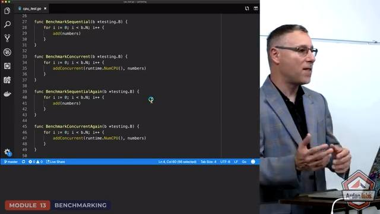
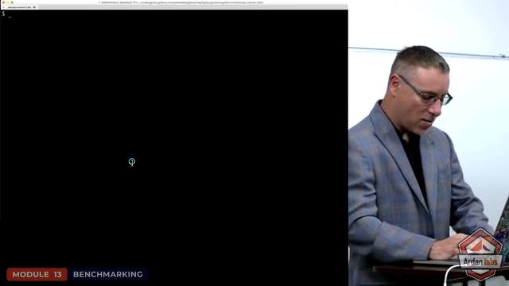
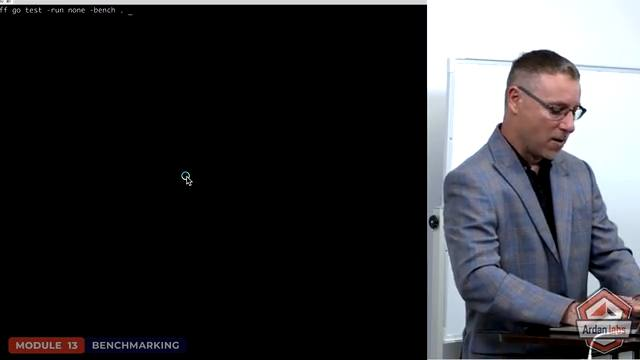
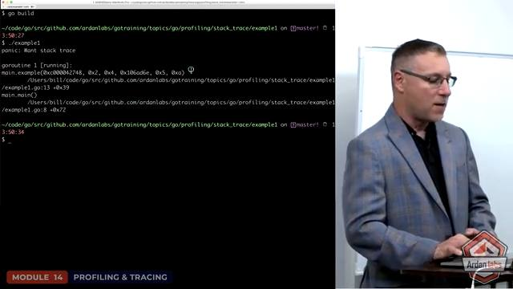
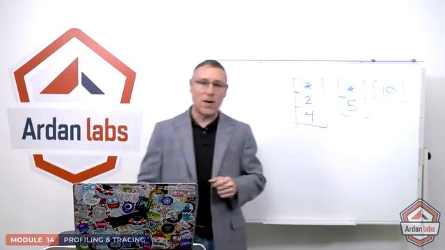

# Ultimate Go 并发与 Benchmark 实战文档（P081–P086）

> 读者画像：前端转 AI 应用工程师。文中涉及 Go 语法处会标注「知道即可」，涉及并发/调度处会补一句「在 JS/Node 里对应什么」。

---

## 1. 这一节做什么

这六集（P081–P086）不是讲新语法，而是讲**怎么用 benchmark 验证并发代码到底有没有变快**，以及**怎么读 Go 的 stack trace**。具体产出四样东西：

1. 一个**能复现「benchmark 会骗人」的实验**：merge sort 的 single / unlimited / numCPU 三种跑法，证明「把多个 benchmark 一起跑」会污染结果（P081）。
2. 一个**CPU-bound 的 add 算法**：sequential 版 vs 用 atomic 汇总的 concurrent 版，用 `-cpu 1` 和 `-cpu 8` 两次跑，证明 CPU-bound 想靠并发提速**必须同时有并行**（P082）。
3. 一个**IO-bound 的 find 算法**：sequential 版 vs 用 channel + fan-out bounded 的 concurrent 版，证明 IO-bound **不需要并行**也能靠并发提速（P083）。
4. 一套**profiling 前置知识与 stack trace 读法**：SIGPROF 采样机制、CPU/heap profile 的采样频率、`go tool objdump` 反查 PC offset（P084–P086）。

最终你能在自己机器上跑出「sequential 7ms / concurrent 7.5ms（单线程）」和「sequential 1376 / concurrent 明显更快（单线程）」这两组对照数字，并理解为什么。

**为什么这四样东西对前端转 AI 应用工程师很重要**：你在 Node 里可能已经习惯了「把任务丢进 `Promise.all` 就能并行」，但这条经验在 Go 里只对了一半——IO-bound 任务（调模型 API、读文件、查数据库）确实能靠并发在单线程上提速；但 CPU-bound 任务（tokenize、向量计算、打分排序）如果机器不真正给多个核，并发只会因为上下文切换而变慢。这三个实验就是用可复现的数字把这条直觉纠正过来，让你以后写 Go 的时候能先问一句「这是 CPU-bound 还是 IO-bound」，再决定用不用并发、开多少个 goroutine。

**阅读顺序建议**：先按第 3 节把四个实验跑通（拿到数字比读任何解释都直观），再回来看第 5 节的逐行解释。第 4 节的完整代码是给你对照用的，不建议一上来就照着敲，因为课里有些实现（尤其 merge sort 本体）并不是重点。

---

## 2. 讲师原话（带出处）

> 「I can't tell you how many times a benchmark has lied to me.」—— p081 [00:00]
>
> 这句是整节的引子：benchmark 的数字不一定可信，环境、执行顺序、GC 尾巴都会骗人。后面三个实验其实就是在演示「它怎么骗你」以及「怎么把它当场识破」。

> 「when I ran all of the benchmarks together, I was violating a major rule of thumb, which was that your machine must be idle.」—— p081 [05:17]
>
> 关键规则：跑 benchmark 时机器必须 idle。这里是「机器不 idle 导致结果偏差」的现场示例。

> 「If you have a benchmark like unlimited that's going to put a lot of stress on the machine, you absolutely don't want to run that in conjunction with other benchmarks.」—— p081 [06:15]
>
> 由此得出的操作纪律：像 unlimited 这种会把机器压满的 benchmark，必须单独跑，不要和别的混在一起。

> 「When you have a CPU bound workload, if you're going to leverage concurrency, then you must also leverage parallelism.」—— p082 [06:39]
>
> 这是 P082 的核心结论：CPU-bound 场景想靠并发提速，必须同时有真正的并行核。

> 「using more threads or more goroutines than you have in this case threads or hardware threads isn't going to make you run any faster.」—— p082 [06:39]
>
> 由此推出的选参数原则：goroutine 数不要超过硬件线程数，多出来的只会抢 P、增加切换成本。

> 「When it's an IO bound workload and you can leverage concurrency, we don't need parallelism.」—— p083 [05:42]
>
> 与上一条互补：IO-bound 不需要并行核，单线程 + 并发就能提速。

> 「just using eight goroutines against the one thread ran as fast as if we allowed those goroutines to run in parallel.」—— p083 [05:42]
>
> 这是 P083 实验最能说明问题的一组数字：单线程 8 goroutine 与多线程 8 goroutine 打平，进一步坐实「IO-bound 不需要并行」。

> 「every 10 milliseconds that program is going to stop. We're going to get a record of the stack trace for all the go routines.」—— p085 [02:22]（讲 CPU profile 采样）
>
> 说明 CPU profile 的采样机制：每 10ms 发一次 SIGPROF，抓一次全 goroutine 的 stack trace。

> 「when it comes to memory profiling, now what we're going to do is taking samples of every thousand allocations.」—— p085 [02:50]
>
> 说明 heap profile 的采样机制：每 1000 次分配采样一次，看分配次数和分配量。

> 「this value represents the PC or instruction pointer offset of where the code was in that function at the time of the panic.」—— p086 [05:45]
>
> 解释 stack trace 里 `+0x39` 这种后缀的含义：它是相对函数起始地址的指令偏移。

> 「the first values represent the words of data that we're passing in.」—— p086 [02:51]（讲 stack trace 里逗号分隔的数字）
>
> 解释函数名后面那一串十六进制数：它们不是随机数，是被压栈的参数按 word 展开的结果。

---

## 3. 从零复现

### 3.0 环境准备

课里没给具体 Go 版本号，只说用 `go test`、`go tool objdump`、`GOGC` 环境变量。按下面准备即可：

```bash
# 确认 Go 已安装（课里没指定版本，用你本机较新的稳定版即可）
go version

# 建工作目录
mkdir -p ~/ultimatego/bench && cd ~/ultimatego/bench

# 初始化模块（模块名随意，课里没讲模块名）
go mod init benchdemo
```

命令解释：

- `go version` 输出形如 `go version go1.22.x ...`。如果提示 `command not found`，说明 Go 没装或没进 PATH，先解决再往下走。
- `go mod init benchdemo` 会在当前目录生成 `go.mod`，模块名 `benchdemo` 只是本地标识，不影响运行。如果目录里已经有 `go.mod`，这一步会报 `go.mod already exists`，直接跳过即可。

目录结构（三个实验各一个子目录，避免 `package main` 冲突）：

```
benchdemo/
├── go.mod
├── mergesort/        # P081 实验
│   ├── sort.go
│   └── sort_test.go
├── add/              # P082 实验
│   ├── add.go
│   └── add_test.go
└── find/             # P083 实验
    ├── find.go
    └── find_test.go
```

常见错误与排查：

- **`package benchdemo is not in std`**：说明你在错误的目录下执行 `go test`，要进到有 `go.mod` 的根目录，或进到具体子目录（如 `cd add`）。
- **同一个目录里两个 `package main`**：example1 和 example2 都有 `package main`，所以课里把它们放在不同子目录——这也是上面要求每个实验单独建目录的原因，不要图省事全都塞根目录。
- **`go: cannot find main module`**：`go.mod` 没生成成功，回到 3.0 重跑 `go mod init`。

> 说明：课里讲师是把 merge sort 实现和 benchmark 放在一起讲的，但**明确说「without having to look at the merge sort implementation, it's not important」**——merge sort 本体不是重点，重点是 benchmark 函数。所以下面 mergesort 目录里我给出一个能跑的 merge sort 实现（课里没贴实现，这里补一个标准写法，标注「课里没给实现，以下为标准 merge sort」），benchmark 部分严格按讲师描述写。

### 3.1 实验一：merge sort 的 benchmark 陷阱（P081）

**步骤：**

1. 写 `mergesort/sort.go`：一个标准 merge sort（课里没给实现）。
2. 写 `mergesort/sort_test.go`：`init()` 里塞 100 万个随机数；三个 benchmark：`BenchmarkSingle`、`BenchmarkUnlimited`、`BenchmarkNumCPU`。
3. 先**三个一起跑**：`go test -run none -bench . -benchmem=false`，观察 numCPU 比 single 慢。
4. 再**单独跑 numCPU**：`go test -run none -bench BenchmarkNumCPU`，观察 numCPU 反超 single。
5. 结论：unlimited 制造大量 goroutine，机器没 idle，污染了紧随其后的 numCPU。

命令解释：

- `-run none` 表示不跑任何普通测试（`TestXxx`），只跑 benchmark；写成 `-run none` 是惯例，等价于过滤掉全部测试名。
- `-bench .` 表示跑所有名字匹配 `.`（即全部）的 benchmark；`-bench BenchmarkNumCPU` 则只匹配这一个。
- `-benchmem=false` 关掉内存分配的额外报告，让输出更干净，专注看时间差异。

常见错误与排查：

- **三个一起跑看不出「numCPU 变慢」**：可能是随机数种子或机器太闲导致污染不明显。可以连续多跑几次（命令末尾加 `-count=3`），现象会更稳定。
- **单跑 numCPU 数字没变**：确认上一次命令已经完全退出、后台没有残留进程；必要时新开一个终端再跑。



上图是「三个一起跑」时的输出，注意 numCPU 那一行比 single 慢——这就是被污染的现场。



单独跑 numCPU 后，数字反过来了，说明前面的慢是环境问题不是算法问题。

### 3.2 实验二：CPU-bound 的 add（P082）

**步骤：**

1. 写 `add/add.go`：`GenerateList` 生成 100 万个数；`Add` 顺序求和；`AddConcurrent` 按 goroutine 数切 stride，每个 goroutine 求自己那段的和，用 `atomic.AddInt64` 汇总。
2. 写 `add/add_test.go`：benchmark 里**每个测试跑两遍**（讲师原话「I'm having the benchmark run each test twice」），顺序是 sequential → concurrent → sequential → concurrent。
3. 关 GC 跑：`GOGC=off go test -run none -bench . -benchtime 3s -cpu 1`，观察 sequential ≈ 7ms、concurrent ≈ 7.5ms。
4. 再开 8 线程跑：`GOGC=off go test -run none -bench . -benchtime 3s -cpu 8`，观察 sequential 不变、concurrent 明显变快。

命令解释：

- `GOGC=off` 把 GC 关掉，因为这里要测的是计算时间，不让 GC 尾巴混进来。**注意**：关掉后内存只增不减，跑完记得 `unset GOGC` 或新开终端。
- `-benchtime 3s` 表示每个 benchmark 至少运行 3 秒，不是跑 3 次；`go test` 会自动调 `b.N` 直到跑满 3 秒。
- `-cpu 1` / `-cpu 8` 设置的是 `GOMAXPROCS`，也就是「可用硬件线程数」，不是把物理机限制成 1 核或 8 核。
- 想复现「每个测试跑两遍」，最简洁的做法是在命令末尾加 `-count=2`（见 4.4 节的两种等价做法）。

常见错误与排查：

- **concurrent 反而比 sequential 慢很多**：先确认是不是忘了 `-cpu 8`，单线程下 concurrent 略慢是预期结果，不是 bug。
- **sequential 的数字每次都不一样**：机器没 idle 或开了别的进程，先关掉浏览器、IDE 索引，再跑一次。
- **`GOGC=off` 之后有残留进程**：把 shell 关掉或执行 `unset GOGC` 即可，别一直挂着。



上图是关 GC、准备跑 benchmark 的终端现场。



单线程下两者几乎打平，concurrent 还略慢——context switch 的代价。



八线程下 concurrent 反超，证明 CPU-bound 要并行。

### 3.3 实验三：IO-bound 的 find（P083）

**步骤：**

1. 写 `find/find.go`：`GenerateList` 生成 1000 个文档；`read` 函数里 `time.Sleep(time.Millisecond)` 模拟 1ms 磁盘读，再做一点 unmarshal 式的工作；`Find` 顺序版；`FindConcurrent` 用 channel + fan-out bounded（8 个 goroutine 从 channel 拉文档）。
2. 写 `find/find_test.go`：同样每个测试跑两遍。
3. 单线程跑：`GOGC=off go test -run none -bench . -benchtime 3s -cpu 1`，观察 sequential 1376、concurrent 明显更快。
4. 八线程跑：`GOGC=off go test -run none -bench . -benchtime 3s -cpu 8`，观察 concurrent 和单线程时**一样快**。

命令解释：参数含义同 3.2；这里最关键的对照是「`-cpu 1` 下 concurrent 已经赢了，`-cpu 8` 下没有更快」，看到这个现象就说明实验理解了。

常见错误与排查：

- **concurrent 在单线程下没变快**：检查 `read` 里是不是真的 `time.Sleep(time.Millisecond)`，而不是空操作；sleep 是让 goroutine 进入 waiting、被调度器让出的关键。
- **`-cpu 8` 下 concurrent 明显更快**：这与讲师输出不一致，通常是机器此时不 idle、或 sleep 时长设置得比 1ms 短，仔细对照 4.5 节的实现。


上图是 IO-bound benchmark 的终端现场。



单线程下 concurrent 就赢了——IO-bound 不需要并行。

### 3.4 实验四：读 stack trace（P086）

**步骤：**

1. 写 `example1/main.go`：`main` 调 `example(slice, string, int)`，`example` 里 `panic`。
2. `go build -o example1 .` 然后 `./example1`，看 stack trace 里 `main.example(...)` 后面那串逗号分隔的数字。
3. 对照代码：slice 是 3 个字（指针、len=2、cap=4），string 是 2 个字（指针、len=5），int 是 1 个字（0xa=10）——共 6 个数字。
4. 记下 `+0x39` 这个 PC offset，用 `go tool objdump -S -s main.example example1` 反汇编，把函数起始地址 + 0x39，验证落在 `go panic` 前一条指令。

命令解释：

- `go build -o example1 .` 把当前目录的 `package main` 编译成二进制 `example1`，`. ` 指当前目录。
- `go tool objdump -S -s main.example example1` 反汇编：**大写 `-S`** 表示把汇编和源码混排，**小写 `-s`** 是函数名过滤（像正则）。两者组合起来才能一边看源码一边看对应指令。

常见错误与排查：

- **`main.example` 后面数字个数不对**：先确认编译的二进制就是刚改过的代码（`go build` 时目录正确、二进制是新编的）。
- **objdump 输出一片空白**：多半是 `-s` 的大小写或函数名写错了，比如写成 `-S main.example` 会把它当成别的东西解析。
- **落地指令和 `+0x39` 对不上**：先找到 objdump 输出里 `main.example` 的起始地址（形如 `TEXT main.example(SB)` 那一行），再加 0x39，而不是拿别的地址算。



上图是 example1 的 stack trace，注意 `main.example` 后面那串逗号分隔的十六进制数字。



上图是 `go tool objdump -S -s main.example example1` 的输出，用来把 `+0x39` 映射到具体指令。

---

## 4. 完整代码

### 4.1 `mergesort/sort.go`（课里没给实现，以下为标准 merge sort）

```go
package mergesort

// MergeSort 对 nums 做归并排序，返回新切片。
// 课里没给 merge sort 实现，以下为标准写法。
func MergeSort(nums []int) []int {
	if len(nums) <= 1 {
		return nums
	}
	mid := len(nums) / 2
	left := MergeSort(nums[:mid])
	right := MergeSort(nums[mid:])
	return merge(left, right)
}

func merge(a, b []int) []int {
	out := make([]int, 0, len(a)+len(b))
	i, j := 0, 0
	for i < len(a) && j < len(b) {
		if a[i] <= b[j] {
			out = append(out, a[i])
			i++
		} else {
			out = append(out, b[j])
			j++
		}
	}
	out = append(out, a[i:]...)
	out = append(out, b[j:]...)
	return out
}
```

代码说明：这是一个最朴素的递归归并，重点是**它本身不并发**——`BenchmarkUnlimited` / `BenchmarkNumCPU` 的并发逻辑是在测试文件里另外包起来的。所以下面 `sort_test.go` 才是主角。

### 4.2 `mergesort/sort_test.go`（benchmark 部分严格按 P081 描述）

```go
package mergesort

import (
	"math/rand"
	"runtime"
	"sync"
	"testing"
)

var collection []int

func init() {
	// 讲师原话：line 15 的 collection，line 18 的 init，塞 100 万个数
	collection = make([]int, 1_000_000)
	for i := range collection {
		collection[i] = rand.Intn(1_000_000)
	}
}

// BenchmarkSingle：一个 goroutine 从头跑到尾
func BenchmarkSingle(b *testing.B) {
	for i := 0; i < b.N; i++ {
		MergeSort(collection)
	}
}

// BenchmarkUnlimited：每次切半就扔一个 goroutine，goroutine 数量不设上限
func BenchmarkUnlimited(b *testing.B) {
	for i := 0; i < b.N; i++ {
		mergeSortUnlimited(collection)
	}
}

func mergeSortUnlimited(nums []int) []int {
	if len(nums) <= 1 {
		return nums
	}
	mid := len(nums) / 2
	var left, right []int
	var wg sync.WaitGroup
	wg.Add(2)
	go func() { defer wg.Done(); left = mergeSortUnlimited(nums[:mid]) }()
	go func() { defer wg.Done(); right = mergeSortUnlimited(nums[mid:]) }()
	wg.Wait()
	return merge(left, right)
}

// BenchmarkNumCPU：只切到 numCPU 份，不再往下并发
func BenchmarkNumCPU(b *testing.B) {
	for i := 0; i < b.N; i++ {
		mergeSortNumCPU(collection, runtime.NumCPU())
	}
}

func mergeSortNumCPU(nums []int, parts int) []int {
	if parts <= 1 || len(nums) <= 1 {
		return MergeSort(nums)
	}
	mid := len(nums) / 2
	var left, right []int
	var wg sync.WaitGroup
	wg.Add(2)
	go func() { defer wg.Done(); left = mergeSortNumCPU(nums[:mid], parts/2) }()
	go func() { defer wg.Done(); right = mergeSortNumCPU(nums[mid:], parts-parts/2) }()
	wg.Wait()
	return merge(left, right)
}
```

> 注意：上面 `mergeSortUnlimited` / `mergeSortNumCPU` 是**按讲师口述逻辑补的实现**（讲师说「每次切半扔一个 goroutine」「只切到 numCPU 份」），课里没贴具体代码。跑出来的绝对数字会和你机器有关，但**「三个一起跑时 numCPU 被污染」这个现象应当能复现**。

### 4.3 `add/add.go`（P082，按讲师描述写）

```go
package add

import (
	"sync"
	"sync/atomic"
)

// GenerateList 生成 size 个随机整数
func GenerateList(size int) []int {
	nums := make([]int, size)
	for i := range nums {
		nums[i] = i
	}
	return nums
}

// Add 顺序求和，对应讲师说的 line 37–41 那 5 行
func Add(nums []int) int64 {
	var total int64
	for _, n := range nums {
		total += int64(n)
	}
	return total
}

// AddConcurrent 按 goroutine 数切 stride，每个 goroutine 求自己那段，
// 用 atomic 汇总到全局变量。对应讲师说的「add it back atomically」。
func AddConcurrent(nums []int, goroutines int) int64 {
	var total int64
	stride := len(nums) / goroutines
	var wg sync.WaitGroup
	wg.Add(goroutines)
	for g := 0; g < goroutines; g++ {
		start := g * stride
		end := start + stride
		if g == goroutines-1 {
			end = len(nums) // 最后一段吃掉余数
		}
		go func(part []int) {
			defer wg.Done()
			var local int64
			for _, n := range part {
				local += int64(n)
			}
			atomic.AddInt64(&total, local)
		}(nums[start:end])
	}
	wg.Wait()
	return total
}
```

代码说明：`local` 先用普通变量算局部和，最后一步才 `atomic.AddInt64` 汇总——这是常见写法，能减少原子操作次数（原子操作比普通加法贵）。

### 4.4 `add/add_test.go`（每个测试跑两遍，顺序 s→c→s→c）

```go
package add

import (
	"runtime"
	"testing"
)

var list []int

func init() {
	list = GenerateList(1_000_000)
}

func BenchmarkSequential(b *testing.B) {
	for i := 0; i < b.N; i++ {
		Add(list)
	}
}

func BenchmarkConcurrent(b *testing.B) {
	for i := 0; i < b.N; i++ {
		AddConcurrent(list, runtime.NumCPU())
	}
}
```

> 讲师说「I'm having the benchmark run each test twice」，实现方式是在命令行里把 `-bench` 正则写成能匹配两个、并且让 go test 跑两轮——最直接的做法是**跑两次命令**，或者用 `-count=2`。课里没明说用 `-count`，这里给出两种等价做法：
>
> ```bash
> # 做法 A：-count=2，go test 会把每个 benchmark 跑两遍
> GOGC=off go test -run none -bench . -benchtime 3s -cpu 1 -count=2
>
> # 做法 B：手动跑两次
> GOGC=off go test -run none -bench . -benchtime 3s -cpu 1
> GOGC=off go test -run none -bench . -benchtime 3s -cpu 1
> ```

### 4.5 `find/find.go`（P083，按讲师描述写）

```go
package find

import (
	"sync"
	"time"
)

// Doc 模拟一个文档
type Doc struct {
	ID   int
	Body string
}

// GenerateList 生成 size 个文档，对应讲师说的 line 25
func GenerateList(size int) []Doc {
	docs := make([]Doc, size)
	for i := range docs {
		docs[i] = Doc{ID: i, Body: "some body text"}
	}
	return docs
}

// read 模拟一次磁盘读：sleep 1ms + 一点 unmarshal 式的工作
// 对应讲师说的 line 34「simulate that disc read is taking a full millisecond」
func read(d Doc) Doc {
	time.Sleep(time.Millisecond)
	// 做一点「un-marshaling」式的工作，让 CPU 也动一下
	_ = len(d.Body)
	return d
}

// Find 顺序版，对应讲师说的 line 42
func Find(docs []Doc, topic string) int {
	count := 0
	for _, d := range docs {
		got := read(d)
		if got.Body == topic || topic == "" {
			count++
		}
	}
	return count
}

// FindConcurrent 用 channel + fan-out bounded 模式
// 对应讲师说的 line 58 起的 FindConcurrent
func FindConcurrent(docs []Doc, topic string, goroutines int) int {
	var wg sync.WaitGroup
	// 讲师原话：给 channel 足够空间容纳所有文档
	ch := make(chan Doc, len(docs))
	var count int64
	var mu sync.Mutex

	wg.Add(goroutines)
	for g := 0; g < goroutines; g++ {
		go func() {
			defer wg.Done()
			for d := range ch {
				got := read(d)
				if got.Body == topic || topic == "" {
					mu.Lock()
					count++
					mu.Unlock()
				}
			}
		}()
	}

	// 把文档灌进 channel，然后关闭
	for _, d := range docs {
		ch <- d
	}
	close(ch)
	wg.Wait()
	return int(count)
}
```

> 说明：讲师说「we'll just add it back atomically」是在 add 那集说的；find 这集他说的是 fan-out bounded + channel，计数汇总方式课里没细讲，这里用 mutex 保护 count（在 JS/Node 里对应「单线程事件循环天然不需要锁，但 Go 的 goroutine 是真并行，所以需要」）。

### 4.6 `find/find_test.go`

```go
package find

import (
	"runtime"
	"testing"
)

var docs []Doc

func init() {
	docs = GenerateList(1000)
}

func BenchmarkSequential(b *testing.B) {
	for i := 0; i < b.N; i++ {
		Find(docs, "")
	}
}

func BenchmarkConcurrent(b *testing.B) {
	for i := 0; i < b.N; i++ {
		FindConcurrent(docs, "", runtime.NumCPU())
	}
}
```

### 4.7 `example1/main.go`（P086 stack trace 实验）

```go
package main

import "fmt"

func main() {
	// line 8：调用 example，传 slice、string、int
	example(make([]int, 2, 4), "hello", 10)
	fmt.Println("done")
}

func example(s []int, str string, n int) {
	// line 13：强制 panic
	panic("boom")
}
```

### 4.8 `example2/main.go`（P086 第二个实验：三个 bool + 一个 uint8）

```go
package main

import "fmt"

func main() {
	example2(true, false, true, 25)
	fmt.Println("done")
}

func example2(a, b, c bool, n uint8) {
	panic("boom")
}
```

---

## 5. 逐行解释

### 5.1 mergesort 的 benchmark 为什么能复现「benchmark 骗人」

- `init()` 里塞 100 万个数：**只做一次**，不计入 benchmark 时间。这是 Go benchmark 的标准做法——`init` 在 `b.N` 循环外。如果你把造数据写进 benchmark 函数体内，测出来的时间就混进了造数据的时间，数字全错。
- `BenchmarkUnlimited` 里 `mergeSortUnlimited` 每次切半都 `go func`，100 万个数会切出**指数级**的 goroutine。讲师原话「we're just going to throw as many goerteens as there are lists to sort」——这就是「unlimited」的含义：不设上限。
- 三个 benchmark 一起跑时，`unlimited` 制造的海量 goroutine **在 benchmark 结束后还没被 GC 清干净**，紧接着跑的 `numCPU` 就在一个「不 idle」的机器上跑，结果偏慢。讲师原话：「all of that hadn't been cleared out yet by the time the NumCPU benchmark ran」。
- 单独跑 `numCPU` 时机器 idle，结果反超 `single`——这才是真实性能。
- **在 JS/Node 里对应什么**：Node 没有 goroutine，但「上一个 benchmark 的 GC 尾巴污染下一个」是同一个道理。跑 `benchmark.js` 时如果前一个 case 分配了大量对象，后一个 case 也会被 GC 拖慢。所以 Node 里跑 benchmark 也要 `--expose-gc` 手动 gc 或分进程跑。

### 5.2 add 的 concurrent 为什么单线程下反而慢

- `stride := len(nums) / goroutines`：把 100 万切成 8 段，每段 12.5 万。最后一段用 `end = len(nums)` 吃掉余数，避免漏算。
- 每个 goroutine 算自己那段的和，`atomic.AddInt64(&total, local)` 汇总。**为什么用 atomic 不用 mutex**：讲师原话「add it back atomically」，因为只是加一个 int64，atomic 比 mutex 轻。
- 单线程（`-cpu 1`）时，8 个 goroutine 抢 1 个 P，每次切换约 200ns（讲师原话「those 200 nanosecond context switches」），8 个 goroutine 的切换开销把并行省下的时间吃掉了，所以 7.5ms vs 7ms。
- 八线程（`-cpu 8`）时，8 个 goroutine 各占一个 P 真并行，concurrent 明显快。
- **在 JS/Node 里对应什么**：Node 是单线程事件循环，`Promise.all` 做 CPU-bound 计算**不会变快**，因为还是一个线程在算。要真并行得用 `worker_threads`。这就是「CPU-bound 要并行」在 Node 里的对应物。

### 5.3 find 的 concurrent 为什么单线程下就快

- `read` 里 `time.Sleep(time.Millisecond)`：模拟 1ms 磁盘读。**sleep 会让 goroutine 进入 waiting 状态**，调度器立刻切去跑别的 goroutine，所以单线程下也能「同时」推进多个读。
- 顺序版：1000 个文档 × 1ms = 至少 1 秒（讲师输出 1376，单位是 ns/op 还是 ms 取决于 `-benchtime`，以实际输出为准）。
- 并发版：8 个 goroutine 从 channel 拉文档，一个在 sleep 时另外 7 个在跑，**单线程就能把 CPU 占满**，所以 1376 → 明显更小。
- 八线程时并发版**没有更快**：因为瓶颈是 1ms 的 sleep，不是 CPU，加线程没用。讲师原话「the concurrent algorithm is running just as fast when we used all eight of my hardware threads as opposed to just one」。
- **在 JS/Node 里对应什么**：这就是 Node 的看家本领——`async/await` + `Promise.all` 做 IO-bound 任务，单线程事件循环就能并发几百个请求。Go 的 goroutine + channel 在这里和 Node 的 Promise 是同一个思路，只不过 Go 的 channel 还额外把「谁从队列里取下一个任务」这件事做成了内建语义。

### 5.4 stack trace 里的数字怎么读（P086）

- `main.example(0xc000..., 0x2, 0x4, 0xc000..., 0x5, 0xa, ...)`：
  - 前 3 个：slice 的指针、len=2、cap=4（`make([]int, 2, 4)`）。
  - 中间 2 个：string 的指针、len=5（`"hello"`）。
  - 第 6 个：`0xa` = 10（int 参数）。
  - 讲师原话：「the first values represent the words of data that we're passing in」。
- `+0x39`：PC offset，表示 panic 时指令指针在 `main.example` 函数起始地址往后 0x39 字节处。用 `go tool objdump -S -s main.example example1` 反汇编，把函数起始地址 + 0x39 就能定位到具体指令（讲师演示落在 `go panic` 前一条）。
- example2 里三个 bool + 一个 uint8 共 4 字节 = 半个 word，stack trace 里显示成**一个**十六进制数，小端序从右往左读：`01`(true) `00`(false) `01`(true) `19`(25)，剩下是垃圾位。
- **在 JS/Node 里对应什么**：Node 的 stack trace 只有文件名:行号:列号，**没有**这种「按 word 展开参数」的信息。这是 Go 运行时特有的，因为 Go 的栈是可增长的、参数在栈上有确定布局。

### 5.5 profiling 前置知识（P085）

- CPU profile：每 10ms 发一次 SIGPROF，记录所有 goroutine 的 stack trace，程序会变慢但能看出 hot path。
- heap profile：每 1000 次分配采样一次，看分配次数和分配量。
- 讲师明确说**不讲 blocking profile**（「I've stopped teaching it because it's so complicated」）。
- 机器必须 idle：讲师原话「If you're benchmarking on your local machine like I am... It's really not that idle」。云机器更不 idle。
- 压测工具：讲师用 `hey`（Yana 在 Google 写的），说 `hey` / `ab` / `nack cat`（应为 `wrk` 之类，讲师口音，以实际工具名为准）flag 集一样可互换。
- `time` 命令：Linux/Mac 可用，给 wall clock 时间。
- `perf`：Linux 上 Go 有完整支持，能下钻到 OS 层。

---

## 6. 复现检查清单

跑完下面每一条打勾，就算复现成功。「怎么验证」一栏说明判断依据，不是额外步骤。

- [ ] `go version` 有输出，`go mod init benchdemo` 成功。——**怎么验证**：`go version` 打印一行版本号；`benchdemo/go.mod` 文件存在且首行为 `module benchdemo`。
- [ ] `mergesort/` 下 `go test -run none -bench . -benchmem=false` 能跑出三个 benchmark 的数字。——**怎么验证**：输出里出现 `BenchmarkSingle`、`BenchmarkUnlimited`、`BenchmarkNumCPU` 三行，每行都有 `ns/op`。
- [ ] **三个一起跑**时，`BenchmarkNumCPU` 的数字比 `BenchmarkSingle` **大**（慢）。——**怎么验证**：比两行最右侧的 `ns/op` 数值，numCPU 更大即通过。
- [ ] **单独跑** `go test -run none -bench BenchmarkNumCPU` 时，数字比 `BenchmarkSingle` **小**（快）——这一步复现了 P081 的核心结论。——**怎么验证**：把这次 numCPU 的 `ns/op` 和第 3 条里 numCPU 的比，变小即通过；再和 single 比，应当更小。
- [ ] `add/` 下 `GOGC=off go test -run none -bench . -benchtime 3s -cpu 1` 输出里 sequential ≈ 7ms、concurrent ≈ 7.5ms（数量级对即可，绝对值随机器变）。——**怎么验证**：看 `ns/op` 换算成 ms 后，两个数字差距在 10% 量级内即通过。
- [ ] `GOGC=off go test -run none -bench . -benchtime 3s -cpu 8` 输出里 concurrent 明显小于 sequential。——**怎么验证**：`ns/op` 数值上 concurrent 小于 sequential，且差距明显（超过 10%）即通过。
- [ ] `find/` 下 `GOGC=off go test -run none -bench . -benchtime 3s -cpu 1` 输出里 concurrent 明显小于 sequential。——**怎么验证**：同第 6 条，差距越大越说明「IO-bound 单线程并发就够」。
- [ ] `GOGC=off go test -run none -bench . -benchtime 3s -cpu 8` 输出里 concurrent 和 `-cpu 1` 时**差不多**（没有更快）。——**怎么验证**：把这次 concurrent 的 `ns/op` 和第 7 条的 concurrent 比，差距在 10% 量级内即通过。
- [ ] `example1/` 下 `go build -o example1 . && ./example1` 能看到 stack trace，`main.example` 后面有 6 个逗号分隔的十六进制数。——**怎么验证**：数 `main.example(...)` 括号内的数字个数，6 个即通过。
- [ ] 能对着代码说出前 3 个是 slice 的指针/len/cap，中间 2 个是 string 的指针/len，第 6 个是 int。——**怎么验证**：自己动笔把每个数字和变量的对应写一遍（不必写进代码，写在纸上即可）；对照 `make([]int, 2, 4)` 和 `"hello"` 和 `10` 确认。
- [ ] `go tool objdump -S -s main.example example1` 能输出反汇编，能找到 `+0x39` 对应的指令。——**怎么验证**：反汇编输出里找到 `main.example` 的起始地址，加 `0x39` 后落在某条指令上，而非函数外。
- [ ] `example2/` 下 `go build -o example2 . && ./example2` 能看到 stack trace 里 4 个参数被压成**一个**十六进制数。——**怎么验证**：数 `main.example2(...)` 括号内的数字个数，1 个即通过；再对照小端序拆 `01/00/01/19` 检查每个字节是否对应 `true/false/true/25`。

---

## 7. 课里没讲但你会撞上的

下表把课里提到但没有展开讲、或者课上根本没提但你一定会遇到的现象列出来。每条按「现象 / 原因 / 怎么办」三列展开，方便对照排查。

| 现象 | 原因 | 怎么办 |
| --- | --- | --- |
| Go 版本差异：`atomic.AddInt64` 在 Go 1.19+ 有 `atomic.Int64` 类型替代写法 | 课里没指定 Go 版本 | 用较新稳定版即可，老写法仍可用；`runtime.NumCPU()` 各版本行为一致 |
| 误把 `-benchtime 3s` 理解成「跑 3 次」 | 课里说「change the bench time to three seconds」 | 它的含义是每个 benchmark 至少跑 3 秒；`go test` 会自动调 `b.N` 直到跑满 3 秒 |
| 误以为 `-cpu 1` / `-cpu 8` 是把机器物理限制成 1 核或 8 核 | 课里说「tell the benchmark that it's only going to have one hardware thread」 | 它设置的是 `GOMAXPROCS`（可用 P 的数量），不是真限核；在 JS/Node 里对应 `worker_threads` 只开 1 个 worker |
| 关掉 GC 后内存一直涨，跑大 benchmark 可能 OOM | `GOGC=off` 后对象只增不减 | 跑完记得 `unset GOGC` 或新开终端；大 benchmark 别长时间挂 `GOGC=off` |
| `go tool objdump` 的 `-S` 和 `-s` 写错，输出完全不对 | 大写 `-S` 给汇编与源码混排，小写 `-s` 像正则过滤函数名；讲师特意强调过 | 按 `-S -s main.example` 的组合写；大小写错了不会有报错，只会默默给你别的输出 |
| `hey` 装不上 | 课里说「I'm going to be downloading Hey」，但没给安装命令 | 执行 `go install github.com/rakyll/hey@latest`；装不上先用 `ab` 代替，flag 集一样 |
| `time` 命令跑不了 | 只在 Linux/Mac 可用，课里明说「Only works on Linux and the Mac」 | Windows 用户换用其他方式测 wall clock；这类实验建议在 WSL 或容器里跑 |
| 大端序机器上按讲师的读法读 stack trace 参数会读错 | 课里演示的机器是小端序（little endian），ARM 大端序字节序反过来 | 先确认自己机器的字节序再按讲师方式读；大端序从右往左的习惯要改成从左往右 |
| `mergeSortUnlimited` 直接 OOM 或调度器卡死 | 100 万个数切到叶子会创建海量 goroutine，课里没讲这个风险 | 跑之前先把 `collection` 调小到 10 万试试；确认现象成立再放大 |
| benchmark 单次结果不可信、换机器结果差异大 | 课里反复强调「run these benchmarks a few times just to validate」，但没给统计方法 | 用 `benchstat` 对比两次输出（课里没提这个工具，属于课外补充）；至少跑两次取稳定值 |