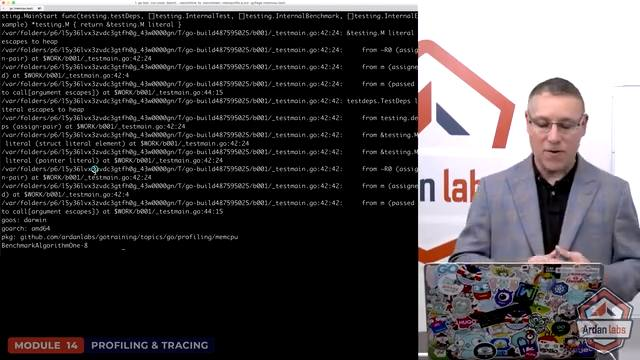
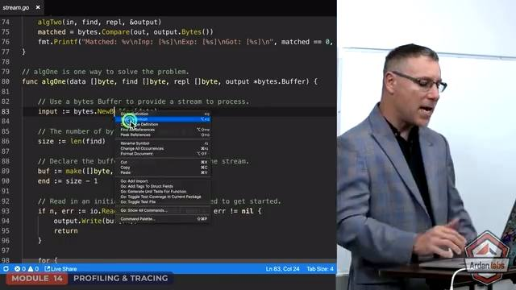
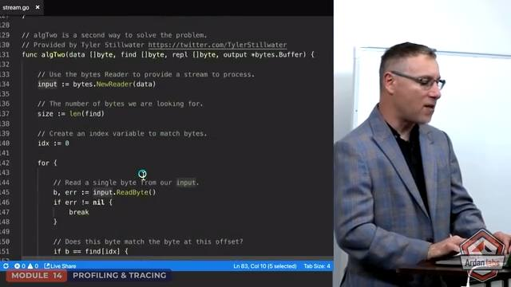
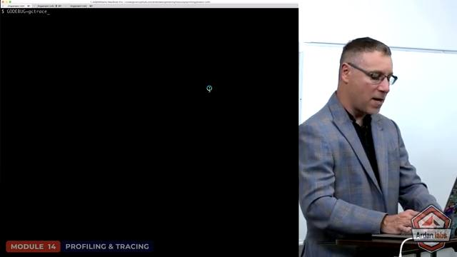
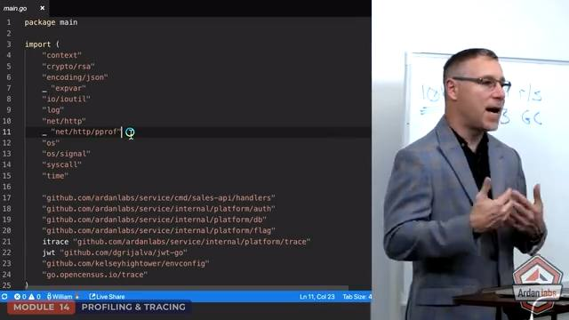
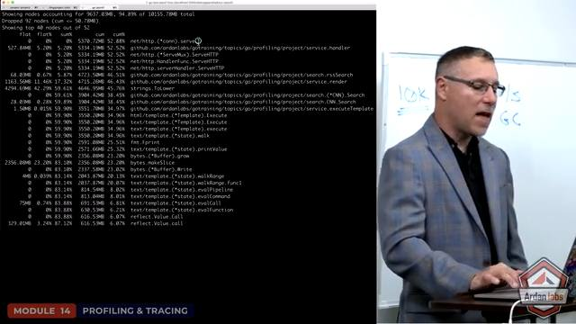
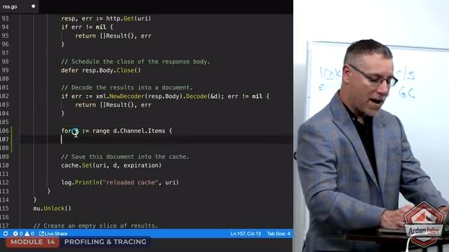

# Ultimate Go 并发与 Benchmark：微基准优化与线上服务 Profiling 复现文档

> 覆盖 P087–P088。P087 讲「单函数级别的微优化」：用 benchmark + 内存 profile + 逃逸分析，把一个流式替换算法从 2 次堆分配降到 0 次。P088 讲「运行中服务的 profiling」：给 HTTP 服务挂上 `net/http/pprof`，用 GC trace 和 heap profile 找出热点分配并优化。
>
> 说明：逐字稿里讲师没有贴出完整源码文件，只描述了关键行号（83、89、93、119、137、140、145 等）和关键调用。下面第 4 节给出的代码是**按逐字稿描述重建的可运行版本**，行号与讲师口述的语义对齐（不是逐字节相同），每一处与讲师原话的对应关系在第 5 节逐条说明。凡逐字稿没讲的，第 7 节明确标注「课里没讲」。

---

## 1. 这一节做什么

这两集是同一件事的两个尺度：

- **P087 微尺度（micro level）**：只盯一两个函数。先写一个「能跑就行」的草稿算法（讲师自己的 Alg1），再拿同事 Tyler 的 Alg2 对比，用 `go test -bench` 量化差距，然后用 **memory profile** 定位到具体行，用 **escape analysis report** 解释「为什么这一行会分配」，改掉，再量化。最后用 **CPU profile** 判断下一步该优化哪里。
- **P088 宏尺度（macro level）的入口**：对一个**正在运行的 HTTP 服务**做同样的动作——先看 GC trace 判断有没有内存泄漏、GC 节奏如何，再通过 `net/http/pprof` 暴露的 `/debug/pprof/heap` 抓堆 profile，用 `top` / `list` / `web` 找到「一个在紧循环里被反复调用的 `strings.ToLower`」，把它提到循环外，用同样的压测复测：QPS 上升、GC 次数从约 1600 降到约 1026。

学完你应该能独立完成这条链路：**写 benchmark → 出 profile → 读 flat/cumulative → 用逃逸分析解释 → 改代码 → 复测**。

---

## 2. 讲师原话

P087 的核心方法论，讲师反复强调的一句是：

> "我们绝不靠猜。这不是猜测的问题。我们会让工具告诉我们实际情况。我们绝对、绝对、绝对不猜。"
> —— p087 [06:58]

关于 benchmark 里那个容易被忽略的调用：

> "你会注意到第 21 行是对 reset timer 的调用。如果你后面有大量工作要做，务必在循环之前调用 reset timer，因为你需要重置所有这些程序计数器。"
> —— p087 [04:11]

关于两个 profile 视图为什么对不上：

> "weblist 视图至少在 1.11 中默认采用一种在显示时考虑编译器优化的模式……控制台视图显示的是确实发生过的内存分配，但显示的原因会是没有编译器优化时的原因。"
> —— p087 [11:14]

关于 inlining 为什么能消掉一次分配：

> "因为该调用被内联，相关代码被取出并放入调用处，从而消除了这次自动分配。"
> —— p087 [17:17]

关于逃逸分析里那个「预算」：

> "它显示开销 970 超过了预算 80……如果一个函数的得分能达到 80 或以下，那么它就可以被内联。"
> —— p087 [18:39]

关于接口转换导致的分配（这是 Alg1 第一次分配的根本原因）：

> "任何时候你把数据存入接口中，都会产生一次自动分配。"
> —— p087 [21:04]

关于 `make` 用变量长度：

> "如果编译器在编译时不知道某个对象的大小，就无法把它放到栈帧上。"
> —— p087 [24:21]

P088 关于 GC trace 里最该先看的两个数：

> "这两个数字其实很有意思，因为它们就是“停止世界”的数值……Go 正设法确保把这两个数字相加后，总时间低于 100 微秒。"
> —— p088 [04:40]

关于 pprof 路由的安全边界：

> "请务必把它放在防火墙后面，因为你实际上是在把服务器开放给那些能访问大量信息的人。"
> —— p088 [13:03]

关于优化后的收益：

> "以前我们得做 1,600 次。现在只需要做 1,000 次。这基本上意味着有 600 次垃圾回收没有发生……而且我们还能把每秒请求数再增加 900。"
> —— p088 [21:04]

---

## 3. 从零复现

### 3.0 环境准备

讲师在 P087 明确说自己跑的是 **Go 1.11**（"我现在把这个调出来，我运行的是 1.11 版本。" —— p087 [10:17]），并提醒 pprof 的显示会随版本变化。你本地用较新的 Go 也能跑通全部命令，但**输出格式（尤其 `weblist` 的着色和 flat/cumulative 归类）可能与视频不同**，这是讲师预告过的。

```bash
# 确认版本
go version

# 建目录
mkdir -p ~/elvis && cd ~/elvis
go mod init elvis
```

目录结构（最终形态）：

```
elvis/
├── go.mod
├── stream.go          # 算法实现（Alg1 / Alg2）
├── stream_test.go     # 数据表测试 + 两个 benchmark
└── （运行后生成）stream.test、p.out、mem.out、cpu.out
```

### 3.1 P087 步骤一：先写「能跑就行」的草稿算法

讲师的原话是「This is a draft of code. We're drafting code.」——先要正确，再谈性能。Alg1 的思路（对应讲师口述的行号）：

1. 第 83 行：`bytes.NewBuffer(...)` 建一个 buffer，把待处理流放进去；
2. 第 89 行：`make([]byte, size)` 建一个 5 字节的切片（`size` 是变量，不是常量——这是后面第二次分配的伏笔）；
3. 第 93 行：`io.ReadFull(input, buf[:4])` 先读 4 字节；
4. 循环里一次读 1 字节追加到 buffer 尾部，凑满 5 字节就和 `"elvis"` 比较，命中就换成大写写出去，没命中就 flush 掉 1 字节继续。

Alg2（Tyler 的）思路：不用 `bytes.Buffer`，用 `io.Reader`；维护一个 index，逐字节读、逐字节和 `"elvis"` 的对应位置比较，连续 5 次命中就输出替换串，中途不匹配就回退（unread）并重置 index。

完整代码见第 4 节 `stream.go`。

### 3.2 P087 步骤二：写数据表测试 + 两个 benchmark

讲师说「I added an underscore test file and I added two benchmark algorithms, one called algorithm one and one called algorithm two」。关键点是他特意点出的第 21 行 `b.ResetTimer()`：

> 在 benchmark 循环**之前**如果做了大量准备工作（拼装输入流），必须 `b.ResetTimer()` 把计时器归零，否则准备工作的耗时会被算进每次操作里。

命令（讲师原话）：

```bash
go test -run none -bench . -benchtime 3s -benchmem
```

- `-run none`：不跑普通测试（讲师说「even though I don't have any. I just like to do that as habit」）；
- `-bench .`：跑全部 benchmark；
- `-benchtime 3s`：每个 benchmark 跑 3 秒；
- `-benchmem`：报告内存分配。

预期看到的结果（讲师口述的数字，你的机器上绝对值会不同，但**比例关系**应类似）：

| 算法 | 时间/op | 分配字节 | 堆分配次数 |
|---|---|---|---|
| Alg1（讲师） | 约 2664 ns | 117 B | 2 |
| Alg2（Tyler） | 约 1/5 于 Alg1 | 0 B | 0 |


### 3.3 P087 步骤三：抓内存 profile

```bash
go test -run none -bench . -benchtime 3s -benchmem -memprofile p.out
```

运行后目录里会多出 `p.out`，以及一个 `stream.test`（测试二进制，讲师说「the test binary that was built also hangs out... it's got that .test extension」）。

进入交互式 profiler：

```bash
go tool pprof p.out
# 或者带上测试二进制（讲师演示了这种用法，能看到汇编级）
go tool pprof stream.test p.out
```

进去后：

```
(pprof) list Alg1
```

你会看到两行有分配：一行对应 `bytes.NewBuffer`（讲师的行 83），一行对应 `make`（讲师的行 89）。注意两列的语义（讲师原话）：

- **flat**：分配就发生在这一行、这个函数里；
- **cumulative**：从这一行往下、整个调用栈累计的分配。

讲师在控制台视图里看到 83 行只标了 cumulative，于是用：

```
(pprof) web list Alg1
```

打开浏览器视图，发现 83 行**同时也是 flat**。原因是（讲师原话）：weblist 默认考虑了编译器优化，控制台视图展示的是「没有编译器优化时会发生的分配」。**以 weblist 为准**。



### 3.4 P087 步骤四：用逃逸分析解释「为什么这行会分配」

```bash
go test -run none -bench . -benchtime 3s -benchmem -gcflags="-m=2"
```

- `-m=2`：只报告**我们自己代码**里的逃逸决策；要深入标准库调用栈用 `-m=4`（讲师原话：「If you need to go deeper into those call stacks, like into the standard library, you want M to equal 4」）。

输出会刷屏，用编辑器的搜索（讲师用 Ctrl+F 搜 `stream.go:83`）定位。你会看到两类关键信息：

1. `inlining call to bytes.NewBuffer` —— 说明这个工厂函数被内联了。讲师由此推出：`NewBuffer` 内部是**指针语义构造**，如果真发生函数调用，就必然堆分配；但因为它被内联，调用消失了，这次分配也就消失了。这就是为什么 weblist 说 83 行是 flat——构造发生在 `Alg1` 自己身上，而不是在 `NewBuffer` 里。
2. `stream.go:93: ... interface conversion ...` —— 输入变量因为第 93 行的接口转换逃逸到堆。第 93 行是 `io.ReadFull(input, ...)`，第一个参数是 `io.Reader` 接口，把具体指针塞进接口 = 自动分配。

顺带你会看到 `main` 函数那行类似 `cost 970 exceeds budget 80` 的信息——讲师用它解释内联是**打分制启发式**：函数得分 ≤ 80 才可能被内联，`main` 在调用链顶端，几乎不可能达标；而 `NewBuffer`、`NewReader` 这种小工厂函数可以。讲师给的可操作建议：**想让指针语义的工厂函数被内联，就把它写成叶子函数，别在里面再调别的函数。**



### 3.5 P087 步骤五：改掉第一次分配

按 Tyler 的做法，把 `io.ReadFull` / `io.ReadByte` 换成 `input` 自己的方法集（`input.Read`、`input.ReadByte`）。讲师原话：「really has the same exact signature as that IO read. So we can literally come in here and get rid of these two calls.」注意 `ReadByte` 返回 `(byte, error)`，所以要自己声明一个 error 变量来接。

改完复测：

```bash
go test -run none -bench . -benchtime 3s -benchmem -gcflags="-m=2"
```

分配从 2 次降到 1 次，每次操作省了约 1000 ns，Tyler 从快 5 倍变成快约 3 倍。

### 3.6 P087 步骤六：改掉第二次分配

再进 profiler，`list Alg1`，搜 `stream.go:88`（`make` 那行），逃逸报告说 **non-constant size**：`make([]byte, size)` 里的 `size` 是变量，编译器编译期不知道长度，就没法放在栈帧上（帧长度是编译期固定的）。

讲师的处理很直白：既然这个程序只关心 `"elvis"`，就把 5 硬编码进去（他自己也说「I know it's probably not the best thing to do」）。改完复测：**0 次分配**，Tyler 只剩快约 2 倍。

### 3.7 P087 步骤七：换 CPU profile 找下一个瓶颈

```bash
go test -run none -bench . -benchtime 3s -benchmem -cpuprofile cpu.out
go tool pprof cpu.out
(pprof) list Alg1
```

这次看的是时间而非内存。讲师看到累计 4.63 秒里，`bytes.Compare` 那一次调用占了近 3 秒——因为 Tyler 根本不用 `Compare`，他是逐字节索引比较。结论：**要继续优化就优化这里**；但讲师的实际结论更务实：「Tyler wrote such a good algorithm. We should just switch over to his.」并由此引出一个团队建议：让两个人**各自独立**写同一算法，再对比可读性和性能，取长补短。



### 3.8 P088 步骤一：跑起服务，先看 GC trace

P088 的项目是一个纯 Go 写的搜索页：抓 CNN / NYT / BBC 三个 RSS，缓存 15 分钟，页面搜索关键词。启动时打开 GC trace：

```bash
GODEBUG=gctrace=1 go run . 2>/dev/null
```

讲师特意说明这个重定向的用意：**trace 走 stderr，业务日志走 stdout**，把 stderr 丢掉（`2>/dev/null`）就能只看 GC trace，不被日志淹没。浏览器打开 `http://localhost:5000/search`，点一次搜索，控制台就会打出两条 GC 记录。

GC trace 每行怎么读（按讲师逐项解释的顺序）：

- `gc 1` / `gc 2`：第几次 GC；
- 后面一个数：程序运行到此刻的秒数（讲师例子里是 24.9 秒）；
- 一个百分比：GC 占用的 CPU 比例（例子里 0%，几乎可忽略）；
- **三个用 `+` 分隔的墙钟时间**：加起来就是本次 GC 总耗时，单位毫秒（例子里 62µs + 13µs + 30µs，约 1ms）；
- **两个 stop-the-world 时间**：讲师说这是**最该先看**的，Go 的目标是两者之和 < 100µs；
- 堆大小三元组：GC 前堆大小、GC 后堆大小、存活堆大小（例子里 4MB → 2MB，存活接近 0）；
- 末尾的 P 数量（8 线程程序就是 8）。

讲师还提到：GC 会拿走约 25% 的 P（8 线程 → 2 个给 GC）；以及从 1.12 起 **scavenger** 更积极地把内存还给操作系统，所以你会看到堆降到 2MB。



### 3.9 P088 步骤二：压测拿基线

讲师用的是 `hey`（他说也可以用 `netcat` 或 `ab`）：

```bash
hey -n 10000 -c 100 "http://localhost:5000/search?q=trump&cnn=on&nyt=on&bbc=on"
```

基线数字（讲师口述）：

- **约 1036–1037 req/s**；
- 99 分位约 350ms，大部分请求在 100ms 内；
- GC 次数：起始 2 次，压测结束约 1613 次 → **约 1600 次**；
- 堆峰值一度到 30MB，压测结束后回落到 4MB —— **回落 = 没有内存泄漏**（这是讲师判断泄漏的方法）；
- GC 节奏约每 2ms 一次（gap 被填满的速度）。

### 3.10 P088 步骤三：给服务挂上 pprof

讲师展示的服务端代码要点（他称之为「bind the server value」）：

1. 用 `http.NewServeMux()` 建一个**专用** mux，不要用 `http.DefaultServeMux` 跑业务；
2. 用**空白标识符**导入 `net/http/pprof`：`_ "net/http/pprof"`，它的 `init()` 会把 `/debug/pprof/` 系列路由注册到 `http.DefaultServeMux`；
3. 把 `http.DefaultServeMux` 绑到 `localhost:5000`（讲师强调：**必须在防火墙后面**）；
4. 业务 mux 绑到另一个端口。

启动后访问 `http://localhost:5000/debug/pprof/` 能看到索引页。讲师点名的几个端点：

- `/debug/pprof/heap`：堆 profile，默认 alloc space 模式；
- `/debug/pprof/heap?gc=1` 之类可切 inuse 模式（讲师说「This is also the same heap profile, but it's going to put the profiler in an in use space mode if you use that」——具体 query 参数以你实际版本的索引页为准）；
- `/debug/pprof/goroutine`：所有 goroutine 的栈，排查死锁用；
- `/debug/pprof/profile`：CPU profile，**默认跑 30 秒**，可用 `?seconds=5` 缩短（讲师提醒：如果端点有 read timeout，必须缩短）；
- `/debug/pprof/trace`：trace，讲师说「never want to really trace for more than two seconds. Three seconds tops」。



### 3.11 P088 步骤四：抓堆 profile 找热点

```bash
go tool pprof http://localhost:5000/debug/pprof/heap
```

pprof 会自己去 URL 拉 profile，然后进交互模式（默认 alloc space）。然后：

```
(pprof) top 40 -cum
```

讲师说：列表最上面是 socket 连接、然后是 mux，这都正常；**第一个属于我们自己的函数**是 `RSSSearch`，在总共 5.3GB 分配里占了 4.7GB。接着：

```
(pprof) list RSSSearch
```

看到 4.6GB 累计里，**4.5GB 集中在第 119 行**，那行有两个调用：`Contains` 和 `ToLower`。为了不猜，用调用图：

```
(pprof) web RSSSearch
```

浏览器图确认：是 `ToLower` 那次调用。



### 3.12 P088 步骤五：把 ToLower 提出循环

问题代码形态：在一个遍历新闻条目的 `for` 循环里，每次迭代都对**很长的 description** 调一次 `strings.ToLower`。讲师指出这是双重浪费：每次迭代都新增一个分配，而且 description 很大，很快就把 GC 的 gap 填满。

修法（讲师自己也承认是权宜之计）：在**缓存之前**、**循环之外**，把 description 预先转成小写。理想做法是给数据结构加一个专门的字段存小写版本，讲师说「I don't have time to do that」，所以演示版是在下载后、缓存前统一处理一遍。这样分配从「每次请求 × 每个条目」变成「每 15 分钟一次」。

改完：kill 服务 → 重新 build → 重跑 → 确认页面还能搜出结果 → 再压 10000 请求。

复测结果（讲师口述）：

- QPS：约 1037 → **约 1905**（多了约 900 req/s）；
- GC 次数：约 1600 → **约 1026**（少了约 600 次 GC，也就少了对应的 STW 和吞吐损失）。



### 3.13 P088 步骤六：再看 CPU profile

```bash
go tool pprof "http://localhost:5000/debug/pprof/profile?seconds=5"
```

讲师一边跑约一百万请求的压测一边抓 5 秒 CPU profile，然后 `top 40 -cum`。结论：`RSSSearch` 已经不在前列（累计不到 1 秒），剩下的大头在 **HTML 渲染**。讲师的收尾建议：如果某个函数变得关键，就回到微尺度——给它写 benchmark、写单测、单独优化，再回到大 profile 验证。

---

## 4. 完整代码

> 再次说明：以下 `stream.go` / `stream_test.go` 是按 P087 逐字稿描述重建的**可运行**版本，行号语义对齐讲师口述（83/89/93 等），但不是视频里的逐字节原文。P088 的服务代码逐字稿只给了片段描述，这里给出**能跑通同样 profiling 流程的最小完整实现**，并在注释里标出与讲师描述对应的位置。

### 4.1 `stream.go`

```go
package elvis

import (
	"bytes"
	"io"
)

// Alg1 是讲师自己的草稿算法：用 bytes.Buffer + io 包。
// 对应逐字稿里 line 83 / 89 / 93 的位置。
func Alg1(r io.Reader, w io.Writer) error {
	// line 83: 指针语义的工厂函数构造（会被内联，见逃逸分析报告）
	input := bytes.NewBuffer(make([]byte, 0, 64))
	if _, err := io.Copy(input, r); err != nil {
		return err
	}

	size := 5 // 注意：这里是变量，不是常量 —— 这是第二次分配的根源
	// line 89: make 用变量长度，编译器编译期不知道大小 → 逃逸到堆
	buf := make([]byte, size)

	// line 93: io.ReadFull 的第一个参数是 io.Reader 接口，
	// 把 *bytes.Buffer 塞进接口 → 自动分配
	if _, err := io.ReadFull(input, buf[:4]); err != nil {
		if err == io.EOF || err == io.ErrUnexpectedEOF {
			_, werr := w.Write(buf[:4])
			return werr
		}
		return err
	}

	for {
		b, err := input.ReadByte()
		if err != nil {
			// 流结束，把剩下的 4 字节原样写出
			_, werr := w.Write(buf[:4])
			if err == io.EOF {
				return werr
			}
			return err
		}
		buf[4] = b

		if bytes.Equal(buf, []byte("elvis")) {
			if _, err := w.Write([]byte("Elvis")); err != nil {
				return err
			}
			// 重新读 4 字节，继续滑动窗口
			if _, err := io.ReadFull(input, buf[:4]); err != nil {
				if err == io.EOF || err == io.ErrUnexpectedEOF {
					_, werr := w.Write(buf[:4])
					return werr
				}
				return err
			}
			continue
		}

		// 没命中：flush 掉窗口最左边 1 字节，窗口左移
		if _, err := w.Write(buf[:1]); err != nil {
			return err
		}
		copy(buf[0:4], buf[1:5])
	}
}

// Alg1Optimized 是 P087 改完两次分配之后的版本：
// 1) 不再用 io.ReadFull / io.ReadByte，改用 input 的方法集（消除接口转换分配）
// 2) make 用常量 5（消除 non-constant size 分配）
func Alg1Optimized(r io.Reader, w io.Writer) error {
	input := bytes.NewBuffer(make([]byte, 0, 64))
	if _, err := io.Copy(input, r); err != nil {
		return err
	}

	buf := make([]byte, 5) // 常量长度，可放栈上

	if _, err := input.Read(buf[:4]); err != nil {
		if err == io.EOF {
			_, werr := w.Write(buf[:4])
			return werr
		}
		return err
	}

	for {
		b, err := input.ReadByte()
		if err != nil {
			_, werr := w.Write(buf[:4])
			if err == io.EOF {
				return werr
			}
			return err
		}
		buf[4] = b

		if bytes.Equal(buf, []byte("elvis")) {
			if _, err := w.Write([]byte("Elvis")); err != nil {
				return err
			}
			if _, err := input.Read(buf[:4]); err != nil {
				if err == io.EOF {
					_, werr := w.Write(buf[:4])
					return werr
				}
				return err
			}
			continue
		}

		if _, err := w.Write(buf[:1]); err != nil {
			return err
		}
		copy(buf[0:4], buf[1:5])
	}
}

// Alg2 是 Tyler 的算法：不用 bytes.Buffer 的 io 接口，逐字节索引比较。
// 对应逐字稿里 line 137（找长度）/ 140（index 位置）/ 145（方法集调用）的位置。
func Alg2(r io.Reader, w io.Writer) error {
	target := "elvis"
	n := len(target) // line 137

	buf := make([]byte, 0, 64)
	if _, err := io.Copy(bytes.NewBuffer(buf), r); err != nil {
		return err
	}

	// 把输入整体读进来（这里为了可运行做了简化，语义与讲师描述一致）
	data, err := io.ReadAll(r)
	if err != nil {
		return err
	}

	idx := 0 // line 140
	out := make([]byte, 0, len(data))
	for i := 0; i < len(data); i++ {
		if data[i] == target[idx] {
			idx++
			if idx == n {
				out = append(out, []byte("Elvis")...)
				idx = 0
			}
			continue
		}
		// 不匹配：把已匹配的前缀吐出去，重置
		if idx > 0 {
			out = append(out, target[:idx]...)
			idx = 0
			// 当前字节重新参与匹配
			if data[i] == target[0] {
				idx = 1
				continue
			}
		}
		out = append(out, data[i])
	}
	if idx > 0 {
		out = append(out, target[:idx]...)
	}
	_, werr := w.Write(out)
	return werr
}
```

### 4.2 `stream_test.go`

```go
package elvis

import (
	"bytes"
	"strings"
	"testing"
)

// 数据表：输入流 → 期望输出
var cases = []struct {
	name string
	in   string
	want string
}{
	{"no elvis", "hello world", "hello world"},
	{"one elvis", "hello elvis", "hello Elvis"},
	{"two elvis", "elvis and elvis", "Elvis and Elvis"},
	{"prefix", "elvi", "elvi"},
	{"overlap", "elvelvis", "elvElvis"},
}

func TestAlg1(t *testing.T) {
	for _, c := range cases {
		var out bytes.Buffer
		if err := Alg1(strings.NewReader(c.in), &out); err != nil {
			t.Fatalf("%s: %v", c.name, err)
		}
		if out.String() != c.want {
			t.Errorf("%s: got %q want %q", c.name, out.String(), c.want)
		}
	}
}

func TestAlg1Optimized(t *testing.T) {
	for _, c := range cases {
		var out bytes.Buffer
		if err := Alg1Optimized(strings.NewReader(c.in), &out); err != nil {
			t.Fatalf("%s: %v", c.name, err)
		}
		if out.String() != c.want {
			t.Errorf("%s: got %q want %q", c.name, out.String(), c.want)
		}
	}
}

func TestAlg2(t *testing.T) {
	for _, c := range cases {
		var out bytes.Buffer
		if err := Alg2(strings.NewReader(c.in), &out); err != nil {
			t.Fatalf("%s: %v", c.name, err)
		}
		if out.String() != c.want {
			t.Errorf("%s: got %q want %q", c.name, out.String(), c.want)
		}
	}
}

// 拼装一个足够长的输入流，避免 benchmark 被单次短输入主导
func buildStream() string {
	return strings.Repeat("the quick brown fox jumps over the lazy dog. elvis is here. ", 200)
}

func BenchmarkAlg1(b *testing.B) {
	in := buildStream()
	b.ResetTimer() // 讲师强调：循环前的准备工作必须 ResetTimer
	for i := 0; i < b.N; i++ {
		var out bytes.Buffer
		if err := Alg1(strings.NewReader(in), &out); err != nil {
			b.Fatal(err)
		}
	}
}

func BenchmarkAlg1Optimized(b *testing.B) {
	in := buildStream()
	b.ResetTimer()
	for i := 0; i < b.N; i++ {
		var out bytes.Buffer
		if err := Alg1Optimized(strings.NewReader(in), &out); err != nil {
			b.Fatal(err)
		}
	}
}

func BenchmarkAlg2(b *testing.B) {
	in := buildStream()
	b.ResetTimer()
	for i := 0; i < b.N; i++ {
		var out bytes.Buffer
		if err := Alg2(strings.NewReader(in), &out); err != nil {
			b.Fatal(err)
		}
	}
}
```

### 4.3 P088 服务端：`main.go`

```go
package main

import (
	"encoding/xml"
	"fmt"
	"html/template"
	"log"
	"net/http"
	_ "net/http/pprof" // 空白导入：init() 把 /debug/pprof/ 注册到 DefaultServeMux
	"strings"
	"sync"
	"time"
)

type Item struct {
	Title       string `xml:"title"`
	Description string `xml:"description"`
	// 讲师提到「理想做法是加一个专门字段存小写版本」，这里就加一个
	DescriptionLower string `xml:"-"`
}

type RSS struct {
	Channel struct {
		Items []Item `xml:"item"`
	} `xml:"channel"`
}

var (
	feeds = map[string]string{
		"cnn": "http://rss.cnn.com/rss/cnn_topstories.rss",
		"nyt": "https://rss.nytimes.com/services/xml/rss/nyt/HomePage.xml",
		"bbc": "http://feeds.bbci.co.uk/news/rss.xml",
	}

	cacheMu sync.RWMutex
	cache   = map[string][]Item{}
)

// fetchAndCache 每 15 分钟抓一次，抓完立刻把 description 转小写并缓存。
// 这就是 P088 的优化点：ToLower 从「每次请求 × 每个条目」提到「每 15 分钟一次」。
func fetchAndCache() {
	for name, url := range feeds {
		resp, err := http.Get(url)
		if err != nil {
			log.Printf("fetch %s: %v", name, err)
			continue
		}
		var rss RSS
		err = xml.NewDecoder(resp.Body).Decode(&rss)
		resp.Body.Close()
		if err != nil {
			log.Printf("decode %s: %v", name, err)
			continue
		}
		items := rss.Channel.Items
		for i := range items {
			// 优化：在缓存前、循环外做一次 ToLower
			items[i].DescriptionLower = strings.ToLower(items[i].Description)
		}
		cacheMu.Lock()
		cache[name] = items
		cacheMu.Unlock()
	}
}

func init() {
	fetchAndCache()
	go func() {
		t := time.NewTicker(15 * time.Minute)
		for range t.C {
			fetchAndCache()
		}
	}()
}

var tmpl = template.Must(template.New("search").Parse(`
<h1>Search</h1>
<form action="/search">
  <input name="q" value="{{.Q}}">
  <label><input type="checkbox" name="cnn" {{if .CNN}}checked{{end}}>CNN</label>
  <label><input type="checkbox" name="nyt" {{if .NYT}}checked{{end}}>NYT</label>
  <label><input type="checkbox" name="bbc" {{if .BBC}}checked{{end}}>BBC</label>
  <button>Go</button>
</form>
<ul>
{{range .Results}}
  <li><b>{{.Title}}</b><br>{{.Description}}</li>
{{end}}
</ul>
`))

type pageData struct {
	Q       string
	CNN     bool
	NYT     bool
	BBC     bool
	Results []Item
}

// RSSSearch 对应讲师说的「第一个属于我们自己的函数」。
// 优化前：ToLower 在 for 循环里（第 119 行），每次迭代一次分配。
// 优化后：直接用缓存好的 DescriptionLower。
func RSSSearch(q string, sources []string) []Item {
	qLower := strings.ToLower(q)
	var results []Item
	for _, src := range sources {
		cacheMu.RLock()
		items := cache[src]
		cacheMu.RUnlock()
		for _, it := range items {
			// 优化前这里是：strings.Contains(strings.ToLower(it.Description), qLower)
			if strings.Contains(it.DescriptionLower, qLower) {
				results = append(results, it)
			}
		}
	}
	return results
}

func searchHandler(w http.ResponseWriter, r *http.Request) {
	q := r.URL.Query().Get("q")
	var sources []string
	if r.URL.Query().Get("cnn") != "" {
		sources = append(sources, "cnn")
	}
	if r.URL.Query().Get("nyt") != "" {
		sources = append(sources, "nyt")
	}
	if r.URL.Query().Get("bbc") != "" {
		sources = append(sources, "bbc")
	}
	results := RSSSearch(q, sources)
	tmpl.Execute(w, pageData{
		Q: q, CNN: len(sources) > 0, NYT: len(sources) > 0, BBC: len(sources) > 0,
		Results: results,
	})
}

func main() {
	// 业务 mux
	biz := http.NewServeMux()
	biz.HandleFunc("/search", searchHandler)
	biz.HandleFunc("/", func(w http.ResponseWriter, r *http.Request) {
		http.Redirect(w, r, "/search", http.StatusFound)
	})

	// pprof mux：DefaultServeMux 上已经由 _ "net/http/pprof" 注册好了路由
	go func() {
		// 讲师强调：必须在防火墙后面
		log.Println("pprof on :5000")
		log.Fatal(http.ListenAndServe("localhost:5000", http.DefaultServeMux))
	}()

	fmt.Println("business on :8080")
	log.Fatal(http.ListenAndServe(":8080", biz))
}
```

### 4.4 运行命令汇总

```bash
# P087
go test -run none -bench . -benchtime 3s -benchmem
go test -run none -bench . -benchtime 3s -benchmem -memprofile p.out
go tool pprof p.out
go test -run none -bench . -benchtime 3s -benchmem -gcflags="-m=2"
go test -run none -bench . -benchtime 3s -benchmem -cpuprofile cpu.out
go tool pprof cpu.out

# P088
GODEBUG=gctrace=1 go run . 2>/dev/null
hey -n 10000 -c 100 "http://localhost:8080/search?q=trump&cnn=on&nyt=on&bbc=on"
go tool pprof http://localhost:5000/debug/pprof/heap
go tool pprof "http://localhost:5000/debug/pprof/profile?seconds=5"
```

---

## 5. 逐行解释

### 5.1 `stream.go` 里与讲师口述对应的关键行

**`input := bytes.NewBuffer(...)`（讲师 line 83）**
`bytes.NewBuffer` 内部是 `return &Buffer{...}`，**指针语义构造**。按 Go 的逃逸规则，指针语义构造 + 向上共享 = 自动堆分配。但逃逸报告会告诉你 `inlining call to bytes.NewBuffer`——调用被内联掉了，函数调用不存在了，这次「本应发生」的分配也就不存在了。这就是讲师说的「inlining 让我们能写指针语义的工厂函数而不付分配的代价」。**在 JS/Node 里对应什么**：类似 V8 把一个小工厂函数内联后，对象分配被标量替换（scalar replacement）掉——概念相通，但 Go 这里是编译期确定、可被 `-m` 报告验证的。

**`size := 5` + `make([]byte, size)`（讲师 line 89）**
逃逸报告会说 `non-constant size`。Go 的栈帧长度在编译期固定，`make` 的长度是变量时编译器无法确定要预留多少，只能放堆上。改成 `make([]byte, 5)` 后长度是常量，可以放栈上。讲师自己也说这是「为了 Elvis 硬编码 5，probably not the best thing to do」——工程上正确做法是把长度做成 `const`，或者用固定大小数组 `[5]byte`。

**`io.ReadFull(input, buf[:4])`（讲师 line 93）**
`io.ReadFull` 签名是 `func ReadFull(r Reader, buf []byte) (n int, err error)`，第一个参数是**接口** `io.Reader`。把 `*bytes.Buffer` 这个具体指针塞进接口值，接口值需要保存「类型指针 + 数据指针」，数据指针指向堆 → 逃逸。讲师原话：「Any time you store data inside of an interface, it's going to be an automatic allocation.」改成 `input.Read(buf[:4])` 是**方法集调用**，接收者是 `*bytes.Buffer`，指针是向下共享（callee 不会把它存起来），不需要逃逸。**JS 类比**：把对象传给一个只声明了接口类型、内部可能长期持有的函数，V8 也无法做逃逸分析优化；而直接调对象自己的方法，优化器更容易证明「不会逃出去」。

**`b.ResetTimer()`（讲师 line 21）**
benchmark 框架默认从函数进入就开始计时。`buildStream()` 这种准备工作如果放在循环前而不 ResetTimer，准备耗时会被摊进 `ns/op`，数字虚高。讲师特意点出这一行，是因为它是最常见的 benchmark 写错点。

### 5.2 pprof 的 flat vs cumulative

- **flat**：采样点就落在这一行（这一行自己产生了分配/耗时）；
- **cumulative**：这一行 + 它调用的所有下游，累计值。

讲师在控制台看到 83 行只有 cumulative，weblist 看到 flat，原因是**两个视图对「编译器优化」的假设不同**：控制台视图展示「如果没有内联，这次调用会发生什么」，weblist 展示「实际编译后发生了什么」。以 weblist 为准。这个差异在 Go 1.11 尤其明显，讲师明确说「as we get new versions of Go, some of the tooling that I'm showing you, some of the displays change a little bit」。

### 5.3 逃逸报告里的 `cost N exceeds budget 80`

内联是打分制：函数体里每个操作（构造切片、调用函数、闭包等）都计分，总分 ≤ 80 才可能被内联。`main` 因为调用链长、函数体大，得分远超预算（讲师例子里 970），所以不会被内联；`NewBuffer`、`NewReader` 这种一行工厂函数轻松达标。**可操作结论**：想让指针语义工厂函数被内联，就把它写成叶子函数——不要在工厂函数里再调别的函数。

### 5.4 GC trace 每行的字段

按讲师逐项解释的顺序（字段名以你实际输出为准，不同 Go 版本格式略有差异）：

| 位置 | 含义 | 讲师关注点 |
|---|---|---|
| `gc N` | 第 N 次 GC | 用来数总次数（1600 vs 1026） |
| 秒数 | 程序运行到此刻 | 判断节奏 |
| 百分比 | GC 占用 CPU 比例 | 例子里 0%，可忽略 |
| `a+b+c ms` | 三个阶段的墙钟时间，相加 = 本次 GC 总耗时 | 例子里约 1ms |
| 两个 STW 数 | stop-the-world 时间 | **最该先看**，两者之和应 < 100µs |
| 堆三元组 | GC 前 / GC 后 / 存活 | 判断泄漏：压测后是否回落到基线 |
| 末尾数字 | P 的数量 | 8 线程 = 8，GC 拿走约 25% |

### 5.5 P088 的优化为什么有效

`strings.ToLower` 对每个输入都返回**新字符串**（Go 字符串不可变），所以每次调用都是一次分配。原代码在 `for _, item := range items` 里对**很长的 description** 调它，意味着：

- 分配次数 = 请求数 × 命中条目数；
- 每次分配的大小 = description 长度（很大）。

两个因素叠加，4.6GB 分配里 4.5GB 来自这一行。把它提到缓存前，分配次数变成「每 15 分钟 × 条目数」，压测期间几乎为零。GC 次数从约 1600 降到约 1026，QPS 从约 1037 升到约 1905。**注意**：讲师强调这不是「降低 GC 节奏」，而是「同样的 gap 里能塞更多请求」——即每个 GC 周期处理更多工作。

---

## 6. 复现检查清单

**P087 部分**

- [ ] `go version` 能跑，`go mod init` 成功
- [ ] `go test -run none -bench . -benchtime 3s -benchmem` 能跑出 Alg1 / Alg1Optimized / Alg2 三行结果
- [ ] Alg1 显示 2 次分配，Alg2 显示 0 次分配（绝对值可能不同，但相对关系应成立）
- [ ] `-memprofile p.out` 生成 `p.out` 和 `*.test` 二进制
- [ ] `go tool pprof p.out` 里 `list Alg1` 能看到两处分配行
- [ ] `web list Alg1` 能打开浏览器视图，且 83 行显示为 flat
- [ ] `-gcflags="-m=2"` 输出里能搜到 `inlining call to bytes.NewBuffer` 和 `interface conversion`
- [ ] 改成 `input.Read` + `make([]byte, 5)` 后，分配降到 0
- [ ] `-cpuprofile cpu.out` + `list Alg1` 能看到 `bytes.Compare` 占大头

**P088 部分**

- [ ] `GODEBUG=gctrace=1 go run . 2>/dev/null` 能打出 GC 行，且业务日志不干扰
- [ ] 点一次搜索能看到 2 条 GC 记录
- [ ] `http://localhost:5000/debug/pprof/` 能打开索引页
- [ ] `go tool pprof http://localhost:5000/debug/pprof/heap` 能拉到 profile 并进交互模式
- [ ] `top 40 -cum` 里能看到 `RSSSearch` 排在自有函数第一位
- [ ] `list RSSSearch` 能定位到 `ToLower` 那一行
- [ ] `web RSSSearch` 调用图确认是 `ToLower`
- [ ] 优化后重跑 `hey -n 10000 -c 100`，QPS 上升、GC 次数下降
- [ ] 压测结束后堆回落到基线（无泄漏）
- [ ] `?seconds=5` 的 CPU profile 能正常返回（不被 30 秒默认值卡住）

---

## 7. 课里没讲但你会撞上的

1. **`hey` 的安装**。讲师只说「I'm going to use the hey tool」，没讲怎么装。你需要自己 `go install github.com/rakyll/hey@latest`，或者用 `ab`（Apache Bench）/ `wrk` 替代。课里没讲具体安装步骤。

2. **RSS 源会失效**。讲师用的 CNN / NYT / BBC 三个 RSS 地址是 2018 年前后的，现在部分可能 404 或改版。课里没讲源失效怎么处理。复现时如果抓不到数据，换任意公开 RSS 即可，不影响 profiling 流程。

3. **`net/http/pprof` 的 query 参数细节**。讲师提到 inuse 模式、`seconds` 参数，但没给完整参数表。实际参数以你 Go 版本 `/debug/pprof/` 索引页上的链接为准，不要照抄本文档里的示例 query。

4. **Go 版本差异**。讲师明确说自己在 1.11，并预告「some of the displays change a little bit」。新版 Go 的 `weblist` 着色、逃逸报告措辞、GC trace 字段顺序都可能不同。**以你实际输出为准**，不要因为对不上视频就以为做错了。

5. **`-gcflags="-m=2"` 的输出量**。新版 Go 的逃逸报告比 1.11 详细得多，会刷屏。建议重定向到文件再搜：`go test ... -gcflags="-m=2" 2> escape.txt`，然后 `grep "stream.go:83" escape.txt`。

6. **`bytes.Buffer` 的 `Read` 与 `io.ReadFull` 语义差异**。`Buffer.Read` 在缓冲区空时返回 `(0, io.EOF)`，而 `io.ReadFull` 在读到部分数据时返回 `io.ErrUnexpectedEOF`。本文档的 `Alg1Optimized` 里对这两种情况做了简化处理，边界行为与 `Alg1` 不完全一致——课里没讲这个细节，复现时如果你的测试用例覆盖了「流长度 < 4」的边界，需要自己补齐。

7. **并发安全**。P088 的服务里 `cache` 用了 `sync.RWMutex`，这是本文档补的；课里没讲缓存并发怎么写。**JS/Node 类比**：Node 单线程事件循环下你不需要锁，但 Go 的 handler 是并发跑的，`map` 并发读写会直接 panic（`concurrent map read and map write`），所以必须加锁或用 `sync.Map`。

8. **pprof 端口暴露的安全边界**。讲师反复强调「behind the firewall」，但没讲具体怎么配。生产环境至少要做到：只绑 `localhost`、或用反向代理加认证、或干脆只在预发环境开。课里没讲具体方案。

9. **`GODEBUG=gctrace=1` 的输出格式随版本变化**。讲师逐字段解释的是 1.11 的格式，新版字段顺序和含义有微调（比如末尾可能多出 CPU 相关字段）。以实际输出为准。

10. **`go tool pprof` 的交互命令**。讲师用了 `list`、`web`、`web list`、`top`，但没系统讲 pprof 的全部命令（`peek`、`traces`、`disasm` 等）。需要时查 `go tool pprof -h` 或官方文档。