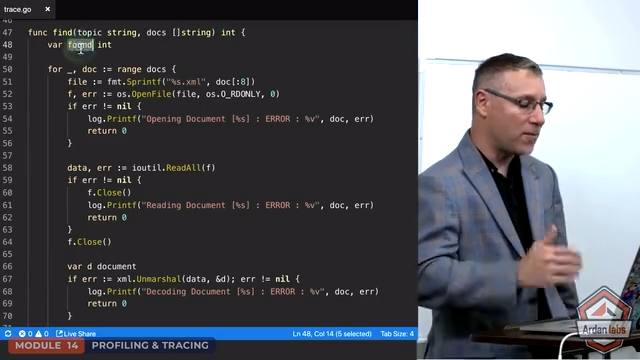
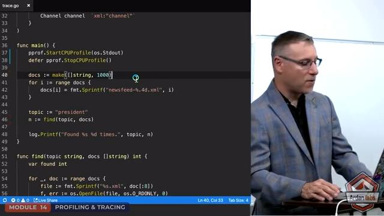
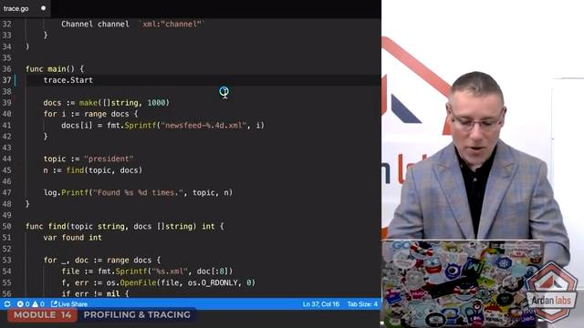
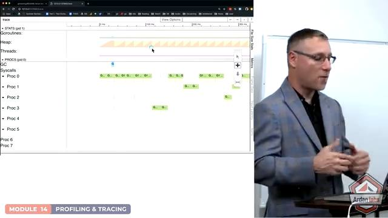
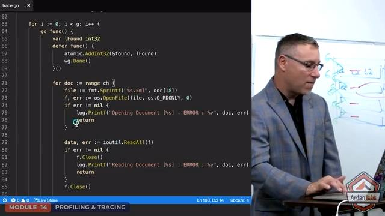

# Ultimate Go 并发与性能剖析实战：从顺序版到有界扇出（P089）

> 本节对应课程 BV1XXcozTE1y 的 P089。讲师 Bill Kennedy 用一个「在 1000 个 RSS 新闻源里统计关键词出现次数」的小程序，完整走了一遍**顺序版 → CPU profile → trace → 无界扇出 → 有界扇出 → 任务级 trace** 的工程化优化路径。下面这份文档把这条路径拆成可以照着敲、照着跑、照着验证的步骤。

---

## 1. 这一节做什么

这一节的目标不是讲并发语法，而是演示一套**用工具驱动决策**的性能优化流程。具体要交付的东西是：

- 一个可运行的 Go 程序 `find`：读入一批 RSS/XML 文档，统计某个关键词（课程里用的是 `president`）在所有文档中出现的总次数。
- 先用**顺序版**跑出基线耗时（讲师机器上约 940ms / 1000 个文件）。
- 用 `runtime/pprof` 采 CPU profile，用 `go tool pprof` 定位热点，发现瓶颈在 `open file` 的系统调用上——profiler 告诉你「什么在发生」，但没法告诉你「什么没在发生」。
- 换成 `runtime/trace`，用 `go tool trace` 打开浏览器 UI，看到**只有 GC 在用满 CPU，业务 goroutine 只占一个 P**——这才是真正的瓶颈：程序没有用满机器的 CPU 容量。
- 因此把 `find` 改成并发：先做**无界扇出**（每个文件一个 goroutine），耗时降到约 370ms，但 trace 显示堆不稳定、GC 变重、启动瞬间大量 goroutine 抢内存。
- 再做**有界扇出**（goroutine 数 = 硬件线程数，用 channel 喂数据），耗时进一步降到约 348ms，堆恢复成一条平稳的绿线，且 cache line 抖动从「每文件一次」级别降到「总共 8 次」。
- 最后用 `runtime/trace` 的 **task / region API** 把 trace 下钻到「每个文件」粒度，找出拖慢整体的离群文件。

对前端转 AI 应用工程师的读者：这一节涉及的「共享变量 + 并发写」在 JS 里因为单线程事件循环基本不会遇到；但一旦你用 Node 的 `worker_threads` 或写 Go 后端服务，本节讲的 **data race** 和 **cache coherency（伪共享）** 就是必须理解的底层机制。文中遇到会补一句对应关系。可以把这一节理解为一次完整的「性能闭环训练」：先有可重复的基线，再有可解释的 profile，再有能暴露盲区的 trace，最后才动手改并发；改完还要用同样的工具回看 heap、GC、goroutine 数量和任务耗时，确认优化不是碰运气。前端同学熟悉的 Chrome DevTools Performance 面板也是类似思路：先录一段，找长任务和瓶颈，再改代码，再录一段对比；差别在于 Go 这里同时关心中断、系统调用、调度器、GC 和 cache line 这些更底层的信号。

---

## 2. 讲师原话（带出处）

> "我们要做的是，这里有一个程序。这个程序的目标是实现这个 find 函数。find 的思路是遍历一组 RSS 订阅源文档、XML 文档，并在其中查找某个特定主题。"
> —— p089 [00:27]

> "在这个程序里，我们会处理大约 1000 个新闻源。但设想是，也许有一天我们想遍历大约一百万份。因此，我通常总是希望先从程序的串行版本开始。"
> —— p089 [00:52]

> "现在可以看到，在我的机器上扫描这一千份文档花了 940 毫秒。而且“总统”这个主题一共找到了 7000 次。"
> —— p089 [02:13]

> "我们可以做的第一件事是获取一份性能分析数据，或许是程序的 CPU 性能分析数据。接下来我们就使用 runtime 里的 pprof 包。"
> —— p089 [02:40]

> "如果看看这些时间累计在哪里，就会发现大部分都花在打开文件的调用上。除了打开文件之外，去优化其他任何地方都是在浪费时间。"
> —— p089 [04:29]

> "那么性能分析器告诉了我们什么？它说明，拖慢这个程序的是机器上的系统调用。"
> —— p089 [05:26]

> "这是因为，有时候问题不在于正在发生什么，而在于没有发生什么。而现在，这差不多正是我们需要看到的。所以，如果我们想了解没有发生什么，就不能使用性能分析器，而必须使用跟踪器。"
> —— p089 [05:53]

> "唯一占用机器全部 CPU 能力的只有垃圾回收器。……所以现在程序慢，并不是因为操作系统慢，对吧？而是因为我们没有用满机器的 CPU 能力。"
> —— p089 [12:57]

> "这里最简单的方案其实就是一个非常基础的扇出模式。只要我们为每个文件创建一个 goroutine，就可以把这些 goroutine 交给调度器，让调度器去安排它们的执行顺序。"
> —— p089 [13:56]

> "注意我们刚才做了什么。耗时从大约 970 毫秒降到了 370 毫秒。借助新的并发扇出模式，我们就这样把算法的运行时间缩短了半秒多。"
> —— p089 [21:55]

> "我认为应该做的是，尝试限制处理文件的 goroutine 数量，而不论有多少文件。因此，我们可以尝试有界扇出模式。"
> —— p089 [27:34]

> "漂亮。看看这个。刚才还是 373 毫秒，现在已经是 348 毫秒了。"
> —— p089 [31:23]

> "我更希望做的是把跟踪细化到文件级别。很酷的是，从 1.11 开始我们就能这样做。"
> —— p089 [33:42]

> "这些调用的妙处在于，它们被设计成可以一直留在代码里。因此，如果你没有在运行跟踪，它们实际上不会带来额外的性能开销。"
> —— p089 [35:35]

---

## 3. 从零复现

### 3.1 环境准备

- Go 版本：**1.11 及以上**（讲师明确说 task/region API 从 1.11 开始有）。建议直接用当前稳定版，`go version` 确认。
- 操作系统：Linux / macOS 均可。`go tool trace` 的浏览器 UI **只支持 Chrome**（讲师原话：「it only works in Chrome」）。
- 目录结构（讲师没有强制规定，这里给出一个能直接跑的最小结构）：

```
ultimate-go-p089/
├── go.mod
├── main.go
└── feeds/
    ├── feed1.xml
    ├── feed2.xml
    └── ...（讲师用同一份文件复制出 1000 个不同名字的文件）
```

**命令解释与排查**：`go version` 用来确认工具链版本，低于 1.11 时 `runtime/trace` 的 task/region API 不可用；`go env GOMOD` 可以确认当前目录是否在 module 内；如果 `go build` 报 `go.mod file not found`，说明你没有在项目根目录执行命令，或者还没有初始化 module。此时在项目根目录执行 `go mod init ultimate-go-p089` 即可生成上面结构中的 `go.mod`。前端同学可以把 `go.mod` 类比成 `package.json`：它记录模块名和 Go 版本，`go build` 类似打包构建，`go run` 类似本地启动脚本。

### 3.2 准备 RSS 数据

讲师的做法是：**用同一份 RSS 文件，复制成 1000 个不同名字的文件**，避免污染仓库。你需要先准备一份真实的 RSS XML 文件（任意新闻站点的 RSS 都可以，比如一份包含 `<item><title>...</title><description>...</description></item>` 结构的文件），然后：

```bash
mkdir -p feeds
# 假设你手头有一份 sample.xml
for i in $(seq 1 1000); do
  cp sample.xml "feeds/feed${i}.xml"
done
```

> 课里没讲 RSS 文件的具体来源和字段结构，只说了「XML documents」「items, title, description」。你实际用的 RSS 只要包含 `<item>` 下的 `<title>` 和 `<description>` 即可，字段名以你手上的 RSS 为准。

**常见错误与排查**：如果 `mkdir -p feeds` 报权限错误，检查当前目录是否可写；如果 `cp sample.xml` 报 `No such file or directory`，说明 `sample.xml` 不在当前目录，用绝对路径或先 `cd` 到文件所在目录；如果生成后 `ls feeds | wc -l` 不是 1000，检查 `seq 1 1000` 是否被 shell 正确展开。前端同学可以把这一步类比为准备 1000 个 mock JSON 文件压测接口：数据本身不是重点，重点是让程序有一批可重复处理的输入，方便比较顺序版和并发版的耗时。

### 3.3 第一步：顺序版基线

先写顺序版，跑出基线耗时。这是讲师反复强调的工程习惯：

> 「what I always want to do is start with a sequential version of my program first.」

```bash
go build -o find .
time ./find
```

预期输出（讲师机器上的数字，你的机器会不同）：

```
Found president 7000 times
real    ~0.94s
```

**命令解释**：`go build -o find .` 表示把当前目录的 main 包编译成名为 `find` 的可执行文件；`time ./find` 中的 `time` 是 shell 内建命令，会输出 `real`、`user`、`sys` 三项，其中 `real` 是墙钟时间，最适合和讲师口中的 940ms 对照。常见错误是直接 `go run .` 测时间，这会把编译时间也算进去；做性能基线时应先 `go build`，再多次运行 `time ./find`，取稳定值。前端对照：这相当于先用最朴素的 `for` 循环处理 1000 个文件，得到一个基准耗时，再考虑 `Promise.all` 或 worker 并发，而不是一上来就写并发。

### 3.4 第二步：加 CPU profile

在 `main` 开头启动 CPU profile，写到文件，`defer` 停止：

```bash
go build -o find .
time ./find > /dev/null 2> p.out
```

> 注意：讲师是把 profile 写到 **stdout**（`pprof.StartCPUProfile(os.Stdout)`），然后用 shell 重定向到 `p.out`。这样程序的正常输出（`Found ...`）和 profile 二进制会混在一起，所以上面用 `> /dev/null` 把正常输出丢掉、`2> p.out` 保留……**但这样其实不对**，因为 profile 是写到 stdout 的。更稳妥的做法是**直接把 profile 写到文件**，见第 4 节完整代码里 `os.Create("p.out")` 的写法。讲师在课上用的是 stdout 重定向，你复现时用文件写法更干净，两者等价。

然后分析：

```bash
go tool pprof p.out
(pprof) list find
(pprof) web        # 需要 graphviz，可选
```

讲师看到的结果：`find` 占 94% 时间，其中大头在 `open file` 调用上。你的输出字段名以实际 `pprof` 输出为准。

**命令解释与常见错误**：`go tool pprof p.out` 会进入交互式提示符，`list find` 按函数名过滤并显示源码级耗时，`top` 可以按累计耗时排序，`web` 会生成调用图但需要系统安装 graphviz。如果 `p.out` 为空或 `go tool pprof` 报 `unrecognized profile format`，通常是因为程序没有正常执行到 `pprof.StopCPUProfile()`，或者 profile 和普通输出混写到了同一个文件。排查时先确认程序退出路径上有 `defer pprof.StopCPUProfile()`，再用文件写法把 profile 单独写到 `p.out`。前端对照：`pprof` 的 `list` 类似 Chrome Performance 里的函数耗时明细，`web` 类似火焰图或调用树，只是 Go 这里更强调系统调用和采样。

### 3.5 第三步：换成 trace

把 CPU profile 换成 trace：

```go
trace.Start(os.Stdout)
defer trace.Stop()
```

跑完得到 `t.out`，然后：

```bash
go tool trace t.out
```

浏览器（Chrome）会打开一个页面，点 **View trace** 进入时间轴视图。你要观察的几件事：

1. **Heap profile**：顺序版应该是一条平稳的绿线（heap size 稳定），橙色 in-use 空间周期性上下波动，对应 GC。
2. **Goroutines**：顺序版只有一条业务 goroutine 在跑。
3. **GC**：每次 GC 会短暂占满多个 P，而业务 goroutine 始终只占一个 P。

这就是讲师说的「只有 GC 在用满 CPU」。

**常见错误与排查**：`go tool trace` 打不开浏览器时，先确认默认浏览器是 Chrome；页面白屏或功能缺失时，换 Chrome 再试。trace 文件过大时 UI 会卡，讲师建议只录一两秒到两三秒。若报 `cannot parse trace`，检查 `trace.Stop()` 是否被调用、程序是否异常退出。前端对照：trace 的时间轴类似 Performance 面板的 main 线程轨道，但 Go 这里还会显示多个 P、goroutine 调度和 GC，信息密度更高。

### 3.6 第四步：无界扇出（每个文件一个 goroutine）

改动点（对照第 4 节代码里的 `findFanOut`）：

- `g := len(docs)`，`var wg sync.WaitGroup`，`wg.Add(g)`。
- 对每个 `doc` 起一个 goroutine，把「open → read → unmarshal → search」四步包进去。
- **闭包变量要作为参数传入**（讲师原话：「my linter is complaining about a closure bug because we're closing over the doc. That's not going to work. We're going to have to pass that in.」）。
- 每个 goroutine 里 `defer wg.Done()`。
- 共享计数器用 `atomic.AddInt32`，且变量必须是 `int32`（讲师原话：「ad wants to use a precision-based integer and we're not a precision-based integer」）。
- 每个 goroutine 内部先用**局部变量** `lFound` 累加，最后 `defer` 里一次性 `atomic.AddInt32(&found, lFound)`——这是缓解 cache coherency 抖动的关键。

跑出来约 370ms。

**常见错误与排查**：如果编译报 `cannot use &found (variable of type *int) as *int32`，说明共享计数器被声明成了 `int`，改成 `int32` 即可。如果没有把 `doc` 作为参数传入，在老版本 Go 里所有 goroutine 可能共享最后一轮循环变量，表现为计数异常或文件重复处理；排查方法是打印每个 goroutine 实际拿到的 `doc`。如果 `wg.Wait()` 提前返回，检查 `wg.Add(g)` 是否在启动 goroutine 之前调用。前端对照：JS 的 `Promise.all` 会一次性发起所有任务，类似这里的无界扇出；但 JS 单线程没有 data race，Node worker 共享内存时则要像这里一样用原子操作或局部累加后合并。

### 3.7 第五步：有界扇出（goroutine 数 = 硬件线程数）

改动点（对照第 4 节代码里的 `findBounded`）：

- `g := runtime.GOMAXPROCS(0)`（讲师说「the same number of go-routines that we have hardware threads」，用 `GOMAXPROCS(0)` 拿到的就是可用 P 数，通常等于硬件线程数）。
- 建一个 `chan string`，缓冲大小设为 `g`。
- `for i := 0; i < g; i++` 起 g 个 goroutine，每个 goroutine 里 `for doc := range ch { ... }`。
- 主 goroutine 把所有 `docs` 塞进 channel，塞完 `close(ch)`。
- `wg.Wait()` 等所有 worker 退出。

跑出来约 348ms，且 trace 里 heap 恢复平稳绿线。

**常见错误与排查**：如果程序卡死，通常是因为主 goroutine 在 `ch <- doc` 上阻塞而 worker 没有启动，或者忘记 `close(ch)` 导致 worker 的 `range` 永不退出。排查顺序是：先确认 `g > 0`，再确认 worker 的 `for doc := range ch` 已启动，最后确认发送完所有文件后调用了 `close(ch)`。如果 `close(ch)` 由 worker 执行会 panic，因为 channel 只能由发送方关闭。前端对照：这类似用固定大小的 worker 池消费任务队列，避免 `Promise.all` 一次性创建过多并发任务把内存和调度压垮。

### 3.8 第六步：任务级 trace

在 worker 拿到一个文件后：

```go
ctx, task := trace.NewTask(context.Background(), doc)
defer task.End()

region := trace.StartRegion(ctx, "open file")
// ... open ...
region.End()

region = trace.StartRegion(ctx, "read all")
// ... read ...
region.End()

region = trace.StartRegion(ctx, "unmarshal")
// ... unmarshal ...
region.End()

region = trace.StartRegion(ctx, "search")
// ... search ...
region.End()
```

跑完 `go tool trace t.out`，在页面底部点 **User-defined tasks**，就能看到每个文件一行、每行显示该文件耗时和其中 GC 耗时，用来找离群文件。

**常见错误与排查**：如果 trace UI 底部没有 User-defined tasks，先确认当前 Go 版本 ≥ 1.11，再确认 `trace.NewTask` 和 `task.End()` 成对出现；region 没有 `End()` 会导致耗时统计不完整。若每个 task 名字都一样，不利于区分文件，所以代码里用 `doc` 作为 task 名。前端对照：task 类似 Performance 里的自定义 measure，region 类似 measure 内部的分段标记，用来把一段异步或复杂逻辑拆成可读的时间片段。

---

## 4. 完整代码

下面是**一份可以直接保存运行的 `main.go`**，把顺序版、无界扇出、有界扇出三个版本都放在里面，用命令行参数切换，方便你对照跑。所有 import 都是标准库。

```go
// main.go
package main

import (
	"context"
	"encoding/xml"
	"flag"
	"fmt"
	"os"
	"path/filepath"
	"runtime"
	"runtime/pprof"
	"runtime/trace"
	"sync"
	"sync/atomic"
)

// RSS 的最小结构。字段名以你实际使用的 RSS 为准。
type RSS struct {
	Channel struct {
		Items []Item `xml:"item"`
	} `xml:"channel"`
}

type Item struct {
	Title       string `xml:"title"`
	Description string `xml:"description"`
}

// 顺序版：一个文件一个文件处理。
func findSequential(topic string, docs []string) int32 {
	var found int32
	for _, doc := range docs {
		f, err := os.Open(doc)
		if err != nil {
			continue
		}
		data, err := os.ReadFile(doc)
		f.Close()
		if err != nil {
			continue
		}
		var rss RSS
		if err := xml.Unmarshal(data, &rss); err != nil {
			continue
		}
		for _, item := range rss.Channel.Items {
			if contains(item.Title, topic) {
				found++
			}
			if contains(item.Description, topic) {
				found++
			}
		}
	}
	return found
}

// 无界扇出：每个文件一个 goroutine。
func findFanOut(topic string, docs []string) int32 {
	var found int32
	g := len(docs)
	var wg sync.WaitGroup
	wg.Add(g)

	for _, doc := range docs {
		go func(doc string) {
			defer wg.Done()
			var lFound int32 // 局部累加，缓解 cache line 抖动
			defer func() {
				atomic.AddInt32(&found, lFound)
			}()

			f, err := os.Open(doc)
			if err != nil {
				return
			}
			data, err := os.ReadFile(doc)
			f.Close()
			if err != nil {
				return
			}
			var rss RSS
			if err := xml.Unmarshal(data, &rss); err != nil {
				return
			}
			for _, item := range rss.Channel.Items {
				if contains(item.Title, topic) {
					lFound++
				}
				if contains(item.Description, topic) {
					lFound++
				}
			}
		}(doc)
	}
	wg.Wait()
	return found
}

// 有界扇出：goroutine 数 = 硬件线程数，用 channel 喂数据。
func findBounded(topic string, docs []string) int32 {
	var found int32
	g := runtime.GOMAXPROCS(0)
	var wg sync.WaitGroup
	wg.Add(g)

	ch := make(chan string, g)

	for i := 0; i < g; i++ {
		go func() {
			defer wg.Done()
			var lFound int32
			defer func() {
				atomic.AddInt32(&found, lFound)
			}()

			for doc := range ch {
				// 任务级 trace：每个文件一个 task
				ctx, task := trace.NewTask(context.Background(), doc)

				region := trace.StartRegion(ctx, "open file")
				f, err := os.Open(doc)
				region.End()
				if err != nil {
					task.End()
					continue
				}

				region = trace.StartRegion(ctx, "read all")
				data, err := os.ReadFile(doc)
				region.End()
				f.Close()
				if err != nil {
					task.End()
					continue
				}

				region = trace.StartRegion(ctx, "unmarshal")
				var rss RSS
				err = xml.Unmarshal(data, &rss)
				region.End()
				if err != nil {
					task.End()
					continue
				}

				region = trace.StartRegion(ctx, "search")
				for _, item := range rss.Channel.Items {
					if contains(item.Title, topic) {
						lFound++
					}
					if contains(item.Description, topic) {
						lFound++
					}
				}
				region.End()

				task.End()
			}
		}()
	}

	for _, doc := range docs {
		ch <- doc
	}
	close(ch)
	wg.Wait()
	return found
}

// 极简子串匹配，避免引入 strings 之外的依赖（strings 也是标准库，这里手写只为演示）。
func contains(s, sub string) bool {
	if len(sub) == 0 {
		return true
	}
	for i := 0; i+len(sub) <= len(s); i++ {
		if s[i:i+len(sub)] == sub {
			return true
		}
	}
	return false
}

func main() {
	mode := flag.String("mode", "seq", "seq | fanout | bounded")
	topic := flag.String("topic", "president", "keyword to search")
	dir := flag.String("dir", "feeds", "directory containing xml files")
	profile := flag.String("profile", "", "write cpu profile to this file")
	traceFile := flag.String("trace", "", "write trace to this file")
	flag.Parse()

	// 收集目录下所有 .xml 文件
	entries, err := os.ReadDir(*dir)
	if err != nil {
		fmt.Fprintln(os.Stderr, "read dir:", err)
		os.Exit(1)
	}
	var docs []string
	for _, e := range entries {
		if !e.IsDir() && filepath.Ext(e.Name()) == ".xml" {
			docs = append(docs, filepath.Join(*dir, e.Name()))
		}
	}

	// 启动 CPU profile（如果指定）
	if *profile != "" {
		f, err := os.Create(*profile)
		if err != nil {
			fmt.Fprintln(os.Stderr, "create profile:", err)
			os.Exit(1)
		}
		defer f.Close()
		if err := pprof.StartCPUProfile(f); err != nil {
			fmt.Fprintln(os.Stderr, "start cpu profile:", err)
			os.Exit(1)
		}
		defer pprof.StopCPUProfile()
	}

	// 启动 trace（如果指定）
	if *traceFile != "" {
		f, err := os.Create(*traceFile)
		if err != nil {
			fmt.Fprintln(os.Stderr, "create trace:", err)
			os.Exit(1)
		}
		defer f.Close()
		if err := trace.Start(f); err != nil {
			fmt.Fprintln(os.Stderr, "start trace:", err)
			os.Exit(1)
		}
		defer trace.Stop()
	}

	var found int32
	switch *mode {
	case "seq":
		found = findSequential(*topic, docs)
	case "fanout":
		found = findFanOut(*topic, docs)
	case "bounded":
		found = findBounded(*topic, docs)
	default:
		fmt.Fprintln(os.Stderr, "unknown mode:", *mode)
		os.Exit(1)
	}

	fmt.Printf("Found %s %d times (mode=%s, files=%d)\n", *topic, found, *mode, len(docs))
}
```

`go.mod`：

```
module ultimate-go-p089

go 1.21
```

> 说明：讲师课上用的是 `ioutil.ReadAll`（1.16 之前）和 `atomic.AddInt32`。上面代码用 `os.ReadFile`（1.16+ 的等价替代），语义一致。`contains` 手写是为了不引入额外 import，你完全可以用 `strings.Contains` 替换。

**运行与排查补充**：第一次运行前建议先 `go mod tidy`，确认依赖状态；如果 `os.ReadDir` 报目录不存在，检查 `-dir` 参数是否指向 `feeds`；如果输出 `files=0`，说明目录里没有 `.xml` 文件或扩展名大小写不一致。`-profile` 和 `-trace` 可以同时开启，但 trace 文件不要录太久。前端同学可以把 `flag` 参数类比成 npm script 的环境变量或 CLI 参数，`-mode` 类似选择不同构建模式；排查时先跑 `seq` 确认数据能被解析，再跑 `fanout` 和 `bounded` 对比，不要一上来就同时开 profile 和 trace 导致变量太多。

---

## 5. 逐行解释

**`findSequential`**
- `os.Open` + `os.ReadFile` + `f.Close()`：讲师原话是「open each file up ... read the entire file there ... close that file」。注意这里其实 `os.ReadFile` 内部已经 open/close 了一次，外面再 `os.Open` 是冗余的——但讲师课上的代码就是这样写的（为了演示「四步」），复现时保留这个结构，方便你对照 pprof 里 `open file` 的热点。
- `xml.Unmarshal`：把 XML 解成 `RSS` 结构。讲师说「we'll do the un-martialing so we can get into something we can work with」。
- 内层 `for _, item := range rss.Channel.Items`：遍历每个 item 的 title 和 description，命中就 `found++`。

**`findFanOut`**
- `g := len(docs)`：goroutine 数 = 文件数。讲师原话「since we're gonna fan out on the length of docks, let's do that」。
- `wg.Add(g)` 在起 goroutine **之前**调用，避免 `wg.Wait` 在 `Add` 之前返回的竞态。
- `go func(doc string)`：**必须把 `doc` 作为参数传入**。如果写成 `go func() { ... doc ... }()`，所有 goroutine 会共享循环变量 `doc`，这是 Go 里经典的闭包 bug（讲师原话「my linter is complaining about a closure bug」）。在 JS 里对应 `for (var i...)` 的闭包陷阱，用 `let` 或 IIFE 解决；Go 里就是显式传参。
- `var lFound int32` + `defer atomic.AddInt32(&found, lFound)`：**这是本节最重要的优化点**。如果每个 goroutine 直接 `atomic.AddInt32(&found, 1)`，那么 7000 次命中就是 7000 次跨核 cache line 失效（讲师说的「thrashing memory」）。改成局部累加、最后一次性写回，抖动次数从「命中次数」降到「文件数」。
- `atomic.AddInt32` 而不是 `found++`：`found++` 是「读-改-写」三步，两个 goroutine 同时做会丢更新，这就是 **data race**。在 JS 单线程里不存在；在 Node `worker_threads` 里对应 `SharedArrayBuffer` + `Atomics.add`。

**`findBounded`**
- `g := runtime.GOMAXPROCS(0)`：拿到当前可用的 P 数，通常等于硬件线程数。讲师说「maybe what we'll do is just use the same number of go-routines that we have hardware threats」。
- `ch := make(chan string, g)`：缓冲大小 = g。讲师说「we don't need a buffer larger than G here」。缓冲的作用是让主 goroutine 塞数据时不必等 worker 立刻接收。
- `for i := 0; i < g; i++ { go func() { for doc := range ch { ... } }() }`：g 个 worker 阻塞在 `range ch` 的接收上。讲师原话「we're going to have eight GoRoutines all blocked on a receive」。
- 主 goroutine `for _, doc := range docs { ch <- doc }` 然后 `close(ch)`：**close 必须由发送方做**，worker 的 `range` 在 channel 关闭且排空后自动退出。
- `wg.Wait()`：等所有 worker 退出。注意 `wg.Add(g)` 在起 worker 前调用，`wg.Done()` 在 worker 的 `defer` 里。
- **为什么有界版更快且更稳**：无界版一次性创建 1000 个 goroutine，每个都要在堆上分配栈和 XML 解析的临时对象，启动瞬间触发一次大 GC（讲师在 trace 里看到「15 full milliseconds」的 GC）；有界版同时只有 8 个 goroutine 在跑，堆压力平稳，GC 节奏均匀。

**task / region**
- `trace.NewTask(ctx, doc)`：给每个文件建一个 task，名字就是文件路径。返回的 `ctx` 用于后续 region 关联。
- `trace.StartRegion(ctx, "open file")` / `region.End()`：把一段代码标记成一个 region，在 trace UI 里能看到这段的耗时。
- 讲师强调：「they're designed to be able to stay in your code ... they really will not add extra performance」。也就是说这些调用在**没有开启 trace 时几乎零开销**，可以留在生产代码里，通过 `net/http/pprof` 的 debug 端点按需开 2 秒 trace。

**补充对照与排查**：逐行看代码时，建议把「顺序版的 `found++`」「无界扇出的局部 `lFound` + 原子写回」「有界扇出的 channel 消费」三处并排对照，这样能直观看到性能优化不是单纯加 goroutine，而是同时处理共享计数、任务数量和堆压力。常见错误是看到并发版更快就把所有循环都改成 goroutine，结果在 I/O 少、计算重的场景反而因为调度和 GC 变慢；正确做法是像本节一样先用基线、profile 和 trace 找到瓶颈，再决定 fan-out 是否有收益。前端对照：`atomic.AddInt32` 类似 `Atomics.add`，`WaitGroup` 类似 `Promise.all` 的等待语义，channel 类似有背压的任务队列；但 Go 的调度器和 GC 需要看 trace，不能只用 `console.time`。

---

## 6. 复现检查清单

按顺序打勾，任何一步不符合预期就停下来查：

- [ ] `go version` ≥ 1.11（建议 1.21+）。**验证方式**：在终端执行 `go version`，输出中的版本号满足要求；若低于要求，升级 Go 或改用支持 task/region 的版本。
- [ ] `feeds/` 下有 1000 个 `.xml` 文件，每个都是合法 RSS。**验证方式**：执行 `ls feeds/*.xml | wc -l` 应输出 1000；随便打开一个文件确认包含 `<item>`、`<title>`、`<description>`。
- [ ] `go build -o find .` 无报错。**验证方式**：命令退出码为 0，当前目录出现 `find` 可执行文件；若有报错，先按报错行号检查 import、类型和函数名。
- [ ] `./find -mode seq` 输出 `Found president N times`，N 与你数据里的实际命中数一致（讲师是 7000，你的会不同）。**验证方式**：先用小样本手工数一遍，或换一个肯定不存在的关键词跑一次，确认输出为 0。
- [ ] `time ./find -mode seq` 记录基线耗时。**验证方式**：至少跑 3 次，记录 `real` 时间；如果波动很大，关闭其他占 CPU 的程序再测。
- [ ] `./find -mode seq -profile p.out` 生成 `p.out`，`go tool pprof p.out` 里 `list find` 能看到 `open` 相关调用占大头。**验证方式**：`ls -lh p.out` 确认文件非空；进入 pprof 后执行 `top` 和 `list find`，观察热点是否集中在文件打开和读取。
- [ ] `./find -mode seq -trace t.out` 生成 `t.out`，`go tool trace t.out` 在 Chrome 打开，View trace 里 heap 是平稳绿线、业务 goroutine 只占一个 P。**验证方式**：确认浏览器是 Chrome；在 View trace 中看 Goroutines 轨道和 Heap 轨道，顺序版应只有一条业务 goroutine 主线。
- [ ] `./find -mode fanout` 耗时明显低于 seq（讲师从 940ms → 370ms）。**验证方式**：同样跑 3 次取稳定值；如果反而更慢，检查是否误把 profile/trace 开着跑，或机器核数太少、文件太小导致并发收益不明显。
- [ ] `./find -mode fanout -trace t.out` 的 trace 里 heap 绿线**不平**、GC 变重、启动瞬间大量 goroutine 进入 waiting。**验证方式**：在 trace UI 中观察启动阶段的 goroutine 数量和 GC 标记；与顺序版对比 heap 曲线是否明显抖动。
- [ ] `./find -mode bounded` 耗时 ≤ fanout（讲师 370ms → 348ms）。**验证方式**：连续对比 seq、fanout、bounded 三次耗时；如果 bounded 更慢，检查 `GOMAXPROCS(0)` 是否过小、channel 缓冲是否被误设为 1、worker 是否在 `range` 外提前退出。
- [ ] `./find -mode bounded -trace t.out` 的 trace 里 heap 恢复平稳绿线、GC 节奏均匀。**验证方式**：观察 heap 轨道是否接近顺序版的平稳形态，同时 goroutine 数量应稳定在 worker 数附近，而不是瞬间暴涨。
- [ ] trace UI 底部出现 **User-defined tasks** 链接，点进去每个文件一行，能看到单文件耗时和其中 GC 耗时。**验证方式**：确认 task 名称是文件路径；如果链接不存在，回查 `trace.NewTask` 和 `task.End()` 是否成对。
- [ ] 用 `go run -race .` 跑 fanout 和 bounded 模式，**没有 race 报告**（这是验证 `atomic` 用得对不对的最快方法）。**验证方式**：分别执行 `go run -race . -mode fanout` 和 `go run -race . -mode bounded`，观察输出中是否出现 `WARNING: DATA RACE`；有报告时按提示定位共享变量。

---

## 7 课里没讲但你会撞上的

| 现象 | 原因 | 怎么办 |
|---|---|---|
| `go tool trace` 打开白屏或功能缺失 | 该 UI 只支持 Chrome，讲师原话「it only works in Chrome」；用 Firefox/Safari 可能不兼容 | 换 Chrome 打开；确认 trace 文件完整生成；trace 录制时间不要过长 |
| `go tool pprof` 的 `web` 子命令报错 | `web` 需要 graphviz 生成调用图，系统未安装时会失败 | macOS 执行 `brew install graphviz`，Ubuntu 执行 `apt install graphviz`；不装则改用 `list` / `top` 子命令 |
| 代码里 `ioutil.ReadAll` 被标记废弃 | 讲师课上是 1.16 之前的写法，现代 Go 已用 `os.ReadFile` 替代 | 用 `os.ReadFile`，语义一致；老项目里看到 `ioutil` 不必惊慌，知道对应关系即可 |
| `runtime.GOMAXPROCS(0)` 与物理核数不一致 | 它返回可同时执行 Go 代码的 OS 线程数上限，默认等于 `NumCPU`，但可被 `GOMAXPROCS` 环境变量或容器 CPU 限制覆盖 | 用 `runtime.NumCPU()` 辅助观察；容器里注意 CPU quota；不要假设它永远等于物理核数 |
| 编译报 `atomic.AddInt32` 类型不匹配 | `atomic.AddInt32` 要求 `*int32`，如果声明成 `var found int` 就会报错；讲师原话「ad wants to use a precision-based integer and we're not a precision-based integer」 | 声明成 `int32`，或使用 Go 1.19+ 的 `atomic.Int32` 类型化原子 |
| 老版本 Go 中 goroutine 拿到同一个循环变量 | Go 1.22 之前 `for _, doc := range docs { go func(){ use(doc) }() }` 会共享循环变量，是经典闭包 bug；讲师也特意把 `doc` 作为参数传入 | 显式传参 `go func(doc string){ ... }(doc)`；Go 1.22+ 虽已修复循环变量语义，但显式传参仍最清晰 |
| 同一进程重复 `trace.Start` 返回 error | trace 只能同时开一个，不能嵌套；CPU profile 与 trace 是不同机制，可以共存 | 确认只调用一次 `trace.Start`；需要多次采样时用 `net/http/pprof` 的 `/debug/pprof/trace?seconds=2` 按需采 |
| trace 文件巨大、UI 卡死 | trace 会记录大量事件，录太久文件会膨胀；讲师原话「no more than one, two, possibly three seconds of trace」 | 只录 1–3 秒；生产环境按需短时采样；不要长时间挂着 trace 跑压测 |
| Node `worker_threads` 写共享内存出现类似抖动 | JS 主线程单线程没有 data race，但多个 worker 共享 `SharedArrayBuffer` 且同时写相邻内存时，会触发和本节类似的 cache line 抖动 | 每个 worker 先写局部缓冲，最后合并；或用 `Atomics.add` 等原子操作，减少跨核写同一 cache line |
| `feeds/` 里 1000 个文件内容相同，trace 看不到明显离群文件 | 讲师用同一份 RSS 复制多份是为了不污染仓库，因此每个文件处理耗时几乎相同 | 想复现「找离群文件」场景，手动塞几个特别大或结构特别复杂的 XML；再用 User-defined tasks 对比单文件耗时 |

---












---

**一句话总结**：这一节真正教的不是「怎么用 goroutine」，而是「**先顺序跑基线 → profiler 看热点 → tracer 看盲区 → 改并发 → 再 trace 验证稳定性 → 下钻到任务级找离群**」这套闭环。数字（940 → 370 → 348ms）只是这套闭环的副产品，换任何语言、任何项目都能套用。