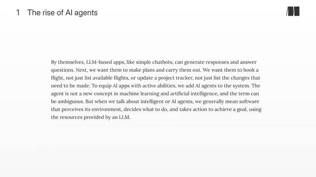
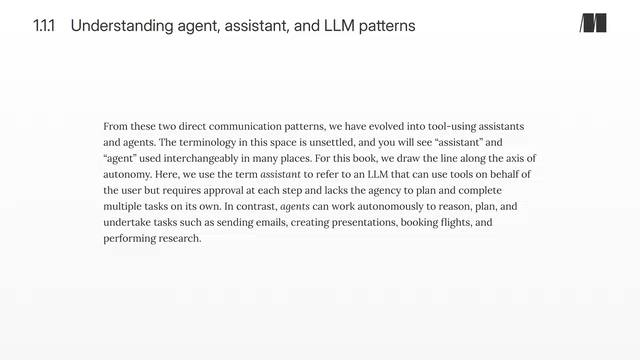
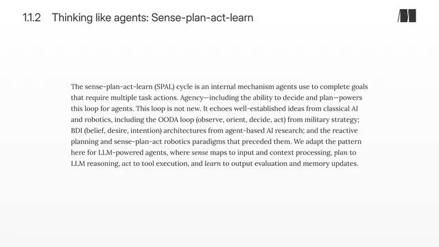
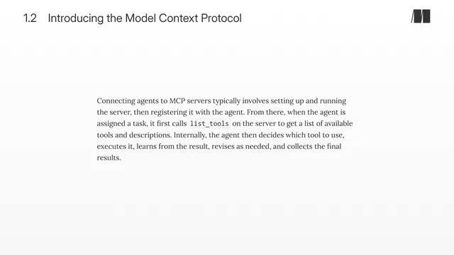
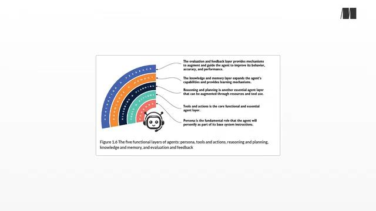
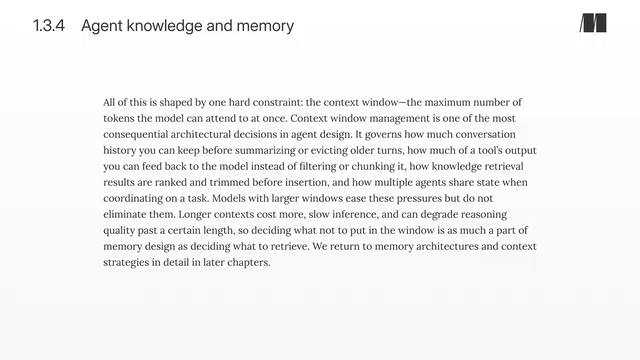
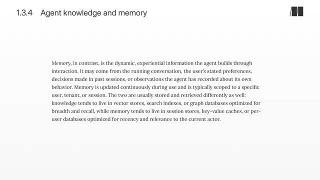
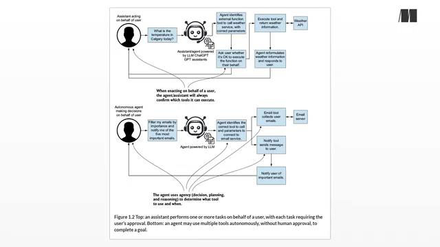
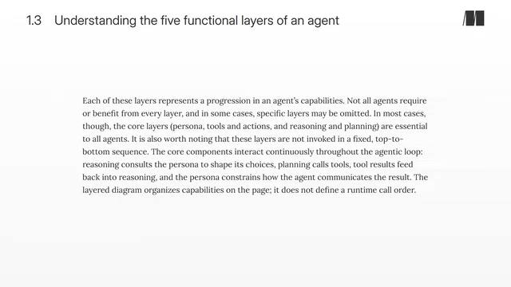

# AI Agents In Action 2nd（multi-agent）—— P001–P003 复现文档

> 覆盖 P001–P003。这三段是**概念课**：逐字稿里没有可执行代码，没有终端命令，也没有配置文件。所以本文按「纯讲解课」的写法组织：第 3 节把讲师的推导过程拆成可逐步复现的决策步骤（含估算算式），第 4 节把结论落成可直接拿去做设计评审的表格、接口草案和一份**可运行的骨架代码**（骨架明确标注「课里没有代码，以下为示意」，只用于承载决策，不冒充课程内容）。凡是逐字稿没讲的地方，文中一律写「课里没讲」。

---

## 1. 这一节做什么

这三节的产物不是"一个跑起来的 demo"，而是**一套能把 agent 项目立起来的设计底盘**。具体交付四件东西：

1. **一条判定线**：你要做的是 assistant 还是 agent？讲师把这条线画在"自主度"上——assistant 每一步都要人批准，agent 拿着一个更高层的目标自己规划、自己选工具、自己决定下一步。这条线直接决定你的产品要不要做逐步骤审批 UI，以及审批粒度做到多细。
2. **一个循环**：Sense → Plan → Act → Learn（讲师缩写 SPAEL）。这是 agent 的内部机制，也是你后面写 while 循环、写最大步数、写重试上限的地方。
3. **一套工具的接入方式**：工具先注册成 JSON 描述，agent 才知道怎么调、什么时候调；而工具应该来自 MCP server 而不是每个 agent 自己写一遍 wrapper。
4. **五层功能模型**：persona、tools and actions、reasoning and planning、knowledge and memory、evaluation and feedback。这五层是课程前半段的组织骨架，也是你排迭代计划的骨架。



（上图为 p001 约 00:37 处的关键页，正对应讲师在 00:56 前后给出的 agent 定义：*"能够感知环境、决定要做什么，并利用 LLM 提供的资源采取行动以达成目标的软件"*。）

**这三节明确不做什么**：不写生产级部署、不做完整可观测性、不做合规清单。讲师原话是这本（课）不是 production operations manual，只把架构和积木讲到"让生产决策变得可处理"的程度。所以你在这里拿不到 K8s 配置、拿不到鉴权中间件，这些属于「课里没讲」。

---

## 2. 讲师原话

> 逐字稿是英文，下面是我按语义翻的关键句，时间码对应英文原文位置。

**关于 agent 的定义与"是不是新东西"**

> "我们把智能体或 AI agent 一般理解为：感知环境、决定做什么、并采取行动达成目标的软件，行动所用的资源由 LLM 提供。" —— p001 [00:56]

> "agent 这个概念在 AI 里并不新。强化学习里，agent 是做出决策并从与环境交互中学习的实体；别的语境里这个词用得更松，指代用户执行任务的软件。但核心想法是一致的：感知、决策、行动。" —— p001 [03:16]

**关于 assistant 与 agent 的分界线**

> "这个领域术语并不统一，很多地方 assistant 和 agent 混着用。本书把线画在自主度这条轴上。我们用 assistant 指能代表用户使用工具、但每一步都需要批准、没有自主规划和完成多任务能力的 LLM；相反，agent 能自主推理、规划并承担任务，比如发邮件、做演示、订机票、做研究。" —— p001 [07:33]

> "实践中 assistant 和 agent 之间是光谱而不是硬边界。生产环境的 agent 几乎总是实现分级的人在环路控制：低风险步骤自主执行，中风险步骤可能需要确认，高风险动作——发邮件、下单、删除记录——无论 agent 整体自主度多高，通常都要显式批准。" —— p001 [07:59]



**关于四步循环**

> "这个过程有四个基本步骤：Sense、Plan、Act、Learn。Sense，接收目标或反馈这类输入；Plan，定义完成目标所需的任务；Act，执行任务定义的那个工具；Learn，观察任务输出，判断目标是完成了还是应该继续。" —— p001 [12:12]

> "这个 SPAEL 循环并不新，它呼应了经典 AI 与机器人学里早已成熟的思路，包括军事战略里的 OODA（Observe Orient Decide Act）、agent 研究里的 BDI（Belief Desire Intention），以及更早的反应式规划与 Sense-Plan-Act 范式。我们在这里把它改造成面向 LLM agent 的版本：Sense 对应输入与上下文处理，Plan 对应 LLM 推理，Act 对应工具执行，Learn 对应输出评估与记忆更新。" —— p001 [12:41]–[13:09]



**关于工具会失败**

> "工具也会失败，agent 怎么处理这些失败，是 demo 和生产系统的分水岭之一。API 会超时、数据库会返回意料之外的 schema、会撞上速率限制、服务会挂、参数会传错。做得好 的 agent 把工具失败当成正常的控制流而不是崩溃：它把错误回传给模型，让 agent 自己决定重试、降级、问用户还是放弃任务，并且限制重试次数以避免跑飞的循环。" —— p001 [16:27]

**关于为什么需要 MCP**

> "一个 agent 要读你的日历、发 Slack 消息、查 Postgres、建 Jira ticket。没有共享协议，开发者就得写并维护四个独立的工具 wrapper，跟四套 API 变更，每次重新实现同样的鉴权、重试、schema 处理逻辑。把这份工作乘以一个团队在做的多个 agent，大部分工程时间就花在工具管道上而不是 agent 行为上。" —— p001 [17:24]

> "MCP 由 Anthropic 开发、2024 年 11 月发布，是一个基于 JSON-RPC 2.0 的开放标准，目的是让 AI 系统以一致、安全、高效的方式连接外部服务。" —— p002 [00:00]

> "当 agent 注册了一个 MCP server，它会在内部调用 list tools 找出该 server 支持的所有工具及其描述。然后跟普通的内部工具使用一样，它根据描述判断每个工具该怎么用。" —— p002 [01:56]



**关于 MCP 的安全面**

> "把 agent 接到一个 MCP server，等于把工具执行端点暴露给 agent 自主调用，这让该 server 成为 agent 运行时里的一个特权面。MCP 在传输层支持认证与授权，协议本身也是按沙箱、限定范围的凭证、以及对高风险动作做人审批准来设计的。把 MCP server 当作受信任的依赖：审查来源、锁定版本、以最小权限运行。" —— p002 [04:38]

**关于五层不是顺序执行**

> "不是所有 agent 都需要或受益于每一层，有些情况下某些层可以省掉。但多数情况下核心层——persona、tools and actions、reasoning and planning——对所有 agent 都是必需的。还有一点值得注意：这些层不是按固定的自上而下顺序调用的。核心组件在整个 agent 循环里持续交互：推理会去查 persona 来塑造选项，规划会调工具，工具结果回流到推理，persona 又约束 agent 怎么表达结果。分层图是在纸面上组织能力，它不定义运行时的调用顺序。" —— p003 [00:57]



**关于什么时候该加"结构化推理"**

> "模型原生推理通常够用的情形：任务短程，一到三步；工具面很小；错误动作代价低且可回滚；模型是前沿推理模型且用在其强项领域内。结构化推理增强在下列任一条件成立时就划算了：任务长程或会分出子目标；agent 能访问很多工具、必须在其中谨慎选择；错误昂贵或不可逆，比如发邮件、动钱、改生产数据；领域在模型训练强项之外；你需要推理轨迹可审计或可复现；或者你用的是原生推理较浅的小模型、旧模型。凡是安全关键或受监管的任务，永远要在模型原生推理之上再叠一层推理。" —— p003 [05:17]–[05:44]



**关于知识 vs 记忆**

> "知识是 agent 用来干活的静态外部信息，比如文档、手册、知识库文章、schema、代码仓库，它们独立于任何一次对话存在。它按底层来源的时间尺度更新，比如新政策发布或手册修订，而且通常对 agent 的每个用户都一样。记忆相反，是 agent 通过交互积累的动态经验信息……记忆在使用过程中持续更新，通常按具体用户、租户或会话隔离。" —— p003 [10:27]



**关于评估与反馈**

> "评估与反馈层是外部机制，帮 agent 给出更稳、更准的回答，常见实现是 LLM as judge 模式：由一个单独的模型按评分标准给 agent 的输出打分或提出批评，然后再返回给用户。在 agent 内部，评估与反馈用在循环里的 learn 阶段……这些机制可以是 agent 能调用的工具、别的 agent 当作工具或 handoff、对输入输出的护栏，或者一个专门跑在主 agent 旁边的 critic，有时叫 evaluator，构成 actor-critic 结构。" —— p003 [13:15]–[14:38]

---

## 3. 从零复现

这一节不是敲命令，是**按讲师的推导顺序把设计一步步定下来**。每一步给出：输入、判断依据、产出、以及必要时写出的估算算式。全部走完，你手里就有一份能直接分工的设计。

### 步骤 0：先判定你要建的是 assistant 还是 agent（沿自主度轴）

**输入**：一句话描述产品要干的事。
**判断依据**：讲师给的轴——是否需要逐步批准、是否有"高层目标"而不是"单次请求"。

| 你的场景 | 判定 | 依据（讲师的原话） |
|---|---|---|
| 用户问天气，模型调一个天气工具，调之前弹确认 | assistant | p001 [09:24] 的例子：assistant 用单个工具调天气服务，但先向用户申请批准 |
| 用户说"找出并列出最重要的 5 封邮件"，agent 自己选工具、自己规划 | agent | p001 [09:24] 的对照例：用户把决策、推理、规划能力交给 agent 去完成更高层目标 |
| 用户让你画图，某个 LLM 拦截请求并重写成更适合生图的格式 | proxy agent | p001 [07:04]：讲师说你在 ChatGPT/Gemini 里用图像生成工具时，体验到的就是 proxy agent 交互 |

**产出**：一句判定 + 一句话说明"人在环路里的位置在哪"。
**注意**：讲师明说这是光谱不是硬边界，别把它当二元开关。判定结果只影响默认审批策略，不影响架构。

### 步骤 1：写 persona（system prompt）

讲师把 persona 定义为"基础描述与角色"，也就是 system prompt，包含 role/background（比如 coder、writer），还可以包含 expertise level、communication style、domain focus、operating constraints 这些上下文属性（p003 [01:26]–[02:23]）。

generation 方式讲师给了三种：手写、让一个模型给另一个模型起草/精修（LLM assisted drafting）、数据驱动的进化算法（研究环境里用性能指标迭代变异和选择 persona）。

**复现动作**：先在纸面上写 6 行——角色、专长水平、沟通风格、领域范围、硬性操作约束、明确不做什么。**约束这一栏必须写**，因为 p001 [10:47] 讲师说"能动性让智能体能够完成复杂目标，但必须小心，不要让它执行未知的动作"，persona 是你手里第一道、也是最便宜的闸门。

### 步骤 2：把目标拆成"目标 → 任务 → 工具"三级

这是讲师 Table 1.2 的方法（p001 [11:14]）：目标可以是"生成一张图"这么简单，也可以是"订行程""买东西"这么复杂；完成任务所需的任务被拆到工具这一级，**每个任务都对应执行一个工具**。工具可以是专用工具（生图），也可以是通用工具（web search，能支撑多个任务）。工具的输出可以成为下一个工具调用的输入，这叫 tool chaining。

**复现动作**：拿你的目标，写成三列：

| 目标 | 任务（按顺序） | 工具 | 是否把上一步输出喂给下一步 |
|---|---|---|---|
| 找出最重要的 5 封邮件 | 拉取收件箱 → 按重要性排序 → 格式化输出 | list_emails / rank_emails / format | 是（链式） |
| 订一张去 Calgary 的机票 | 查航班 → 比价 → 下单 | search_flights / compare / book | 是，且最后一步高风险 |

**估算（文档作者的推演，课里没给数字）**：一个目标平均拆出 3 个任务，每个任务 1 次工具调用，单次工具调用平均 1.4 次尝试（含重试），则单个目标 ≈ 3 × 1.4 ≈ 4.2 次工具执行。这个数决定你要不要做并发、要不要做缓存。

### 步骤 3：决定工具的来源——自建 wrapper 还是接 MCP server

讲师的算式给得非常直白（p001 [17:24]）：一个 agent 要接日历、Slack、Postgres、Jira，没有共享协议 → **4 个 wrapper**，每个都要跟 API 变更、都要重写鉴权/重试/schema 处理。团队在做多个 agent 时"乘以"这个工作量。

**复现动作**：列出你需要的工具，逐个问"有没有现成 MCP server"。

| 需求 | 自建 wrapper 的成本 | 接 MCP server 的成本 | 选哪个 |
|---|---|---|---|
| 读日历 / 发 Slack / 查 Postgres / 建 Jira | 4 个 wrapper，4 套鉴权与重试 | 4 个现成 server，agent 端只做注册 | MCP |
| 公司内部独有的业务接口 | 1 个 wrapper（但有现成 SDK） | 需要自己写一个 MCP server 包装它 | 写一次 server，供所有 agent 复用 |

**估算（文档作者的推演，课里没给数字）**：设团队有 A 个 agent、需要 T 个外部服务。全自建的总实现量 ≈ A × T；全 MCP 化的总实现量 ≈ T（每个服务一个 server）+ A ×（注册配置）。A=3、T=4 时，前者 12 份，后者 4 份 + 3 份配置。这就是讲师说的"从每个 agent 的负担变成共享可复用的层"。

### 步骤 4：决定推理策略——原生推理还是叠加结构化推理

讲师给了一份**可直接当判定函数用**的条件清单（p003 [05:17]–[05:44]）。把它写成布尔判断：

**原生推理够用**，当且仅当以下全部成立：
- 任务短程（1–3 步）
- 工具面小
- 错误动作代价低且可回滚
- 模型是前沿推理模型，且用在其强项领域内

**需要叠结构化推理**，只要以下任一成立：
- 任务长程，或会分出子目标
- 工具多，必须谨慎选
- 错误昂贵/不可逆（发邮件、动钱、改生产数据）
- 领域在模型训练强项之外
- 需要推理轨迹可审计或可复现
- 用的是小模型/旧模型，原生推理浅
- **安全关键或受监管**（讲师说这条是"永远"）

**产出**：一个布尔结论 + 一句理由。如果结论是"要叠"，再往下选 single-path 还是 multi-path。

**single-path vs multi-path**（p003 [06:43]）：
- single-path：认准一个计划，按顺序执行到底，**即使某步失败或结果意外也不回头**。快、便宜，但任务不确定时脆。
- multi-path：并行或串行探索多条候选策略，对着目标评估，选最有希望的分支，还可能把有效路径存下来复用。讲师点名 Tree of Thought 是这种模式的著名例子。代价是 token 和延迟更高，因为"智能体实际上规划了好几次才采取行动"。

**估算（文档作者的推演，课里没给数字）**：multi-path 若探索 k 条分支，规划成本约是 single-path 的 k 倍；但若它能避免一次不可逆的错动作，收益远大于成本。判定式：`k × 单次规划成本 < 一次错动作的期望损失`，否则老老实实 single-path + 审批闸门。

**外部规划器**（p003 [07:42]）：讲师说还有一类做法是把规划逻辑搬到 agent 之外——编排代码、workflow engine、或一个专职规划 agent，执行 agent 只接收"下一步做什么"。这条留给后面章节展开，这三节只给概念。

### 步骤 5：决定知识/记忆的形态与上下文预算

- **知识**：静态、跨用户一致、按来源更新。
- **记忆**：动态、按用户/租户/会话隔离、持续更新。最常见的形式是对话记忆（用户和 agent 说过什么、调过哪些工具），再分短期（当前会话最近几轮，直接放上下文窗口里）和长期（跨会话持久，按相关性选择性检索）。生产 agent 通常两者都用，把长期记忆（用户偏好、既往决策、在进行的项目）叠在短期逐轮历史上。

**上下文窗口是硬约束**（p003 [09:33]）：它是模型一次能关注的最大 token 数，讲师称上下文窗口管理是 agent 设计里**最有后果的架构决策之一**——它决定你保留多少历史才需要摘要或淘汰、能回灌多少工具输出而不是过滤/分块、检索结果怎么排序裁剪、多 agent 协作时怎么共享状态。而且"更大的窗口缓解压力但不消除压力：更长的上下文更贵、推理更慢，超过一定长度还会降低推理质量"，所以"决定不往窗口里放什么"和"决定检索什么"一样重要。

**复现动作——写一张上下文预算表**：

| 预算项 | 假设值（文档作者的假设，课里没给数字） | 说明 |
|---|---|---|
| persona / system prompt | 400 tokens | 步骤 1 的产物 |
| 短期对话历史（保留最近 N 轮） | N=8，每轮 ≈ 150 tokens → 1200 tokens | 超过就摘要 |
| 检索到的知识片段 | 3 段 × 500 tokens = 1500 tokens | 排序后裁剪 |
| 回灌的工具输出 | 单次上限 800 tokens | 超了就过滤/分块 |
| 给输出留的余额 | 1000 tokens | 防止被截断 |
| **合计峰值** | **≈ 4900 tokens** | 远小于窗口上限，说明这个 agent 的瓶颈不是窗口，而是成本 |

这张表的用途是：一旦你换模型或加工具，能立刻看出哪一项在涨。**讲师没有给出任何具体 token 数字，上表全部是我的假设，请按你的真实模型与真实数据替换。**

### 步骤 6：决定评估与反馈机制

讲师给了四类可选形态（p003 [13:15]–[14:38]）：agent 能调用的工具、别的 agent 当工具或 handoff、对输入输出的护栏、一个专职 critic（actor-critic 结构：actor 产出候选回答或计划，critic 打分或修订后才提交）。常见的落地方式是 LLM as judge：单独一个模型按 rubric 给输出打分或提批评。

**复现动作**：先选**最小可用**的一种。判断依据：如果你在步骤 4 判定"错误不可逆"，就先上**输入输出护栏 + 高风险动作人审**，actor-critic 可以后置；如果你需要的是质量提升而不是安全，就先上 LLM as judge + rubric。

### 步骤 7：设计审批闸门（graduated HITL）

讲师给的策略是三档（p001 [07:59]）：低风险自主执行、中风险可能需确认、高风险（发邮件/下单/删记录）显式批准。**这个档位要落在代码里，不能只写在文档里。**

| 风险档 | 例子（来自讲师） | 默认行为 | Node 里怎么写 |
|---|---|---|---|
| low | 只读检索、读文件、调只读 API | 自主执行 | 直接 await，不阻塞 |
| medium | 会写但可回滚的操作 | 记录 + 可配置为需确认 | `if (risk==='medium' && !autoApprove) return false` |
| high | 发邮件、下单、删除记录、改生产数据 | 必须显式批准 | 同上，且**不允许**被全局 autoApprove 静默放行 |

> **给前端/Node 的对照**：这里没有锁和事务，`await` 一个审批 Promise 就是全部。区别只在于"谁来 resolve 这个 Promise"——在 CLI 里是 stdin，在 Web 里是一个等待用户点确认的接口调用。**不要**用同步阻塞去等审批，那会把整个事件循环卡住。

### 步骤 8：写工具失败处理

讲师的原话（p001 [16:27]）已经是一份规格：把失败当正常控制流、把错误回传给模型、让 agent 决定重试/降级/问用户/放弃、**限制重试次数**。

**复现动作**：定三个常量。

| 常量 | 建议值（文档作者的取值，课里没给） | 为什么 |
|---|---|---|
| `MAX_STEPS` | 8 | 讲师反复强调长程任务要防跑飞；8 步覆盖步骤 2 里的三任务链还留余量 |
| `MAX_RETRIES` | 2 | 1 次重试不够区分"瞬时抖动"和"真坏"，3 次以上只是在烧钱 |
| 失败出口 | 固定四选一：retry / fallback / ask_user / abort | 讲师列的就是这四类，别自创第五类 |

---

## 4. 完整代码

> **重要声明：这三节的逐字稿里没有任何代码、命令、配置文件。** 下面 4.1–4.5 是把讲师的口述结论整理成可直接用于设计评审的**产物**（表格、接口草案、估算表）。4.6 是一份**可运行骨架**，用来把这些决策装进一个能跑的东西里——**课里没有代码，以下为示意**，它不调用任何 LLM，只是把 SPAEL 循环、审批闸门、重试上限落成可执行结构，方便你后续替换掉 stub 部分。

### 4.1 交互模式判定表（对应 p001 §1.1.1、Table 1.1、Figure 1.1/1.2）

| 模式 | 谁在做决定 | 是否需要逐步批准 | 典型例子（讲师举的） |
|---|---|---|---|
| 直接与 LLM 交互 | 用户 | 不适用 | 早期 ChatGPT：输入 prompt，模型出文本，循环结束 |
| LLM + 工具（assistant） | LLM 提议，用户批准 | 是，每次调外部工具前暂停并申请批准 | ChatGPT 的 Web Search / Canvas / GPT Assistant |
| proxy agent | 一个 LLM 拦截并重写请求 | 否（用户只看到结果） | 通过 ChatGPT/Gemini 用图像生成工具（讲师提到 Nano Banana Image 2.0） |
| agent | agent 自己 | 否（按风险分级，高风险仍要批准） | 自主规划并执行"发邮件、做演示、订机票、做研究" |

### 4.2 五层职责表（对应 p003 §1.3）

| 层 | 职责（讲师定义） | 是否核心层 | 主要产出物 | 什么时候可以省 |
|---|---|---|---|---|
| persona | 基础描述与角色，即 system prompt；含 role、expertise level、communication style、domain focus、operating constraints | **是** | 一段 system prompt | 几乎不能省（讲师说核心层对所有 agent 必需） |
| tools and actions | 让 agent 完成任务的工具，同时支撑上层 | **是** | 工具注册定义 + server | 不能省（除纯对话 agent） |
| reasoning and planning | 控制 agent 怎么想、按什么顺序想、有哪些护栏 | **是** | 推理策略选择（原生/结构化；single/multi-path） | 短程低风险任务可只依赖模型原生推理 |
| knowledge and memory | 用最相关的信息标注上下文，同时限制 token 数 | 否 | 检索配置 + 短期/长期记忆存储 | 无状态单轮任务可省 |
| evaluation and feedback | 外部机制，提升回答的稳健性与准确度；用在 learn 阶段 | 否 | judge/critic/护栏/审批 | 纯探索型内部工具可后置 |

**工具的五种分类**（p003 [03:50]）：task completion、context retrieval、reasoning and planning、knowledge and memory、feedback and evaluation。讲师特别区分了 **context retrieval**（搜索、查向量库、读文件、调只读 API——**不改变任何外部状态**）与 knowledge/memory 工具（读写 agent 自己的持久存储）、以及 task completion 工具（在世界上真的做事）。

### 4.3 工具清单草案（字段结构由本文设计，课里没给字段规范）

| 名称 | 分类 | 输入 | 输出 | 改外部状态 | 风险档 | 审批 |
|---|---|---|---|---|---|---|
| `list_emails` | context retrieval | `{ limit }` | 邮件数组 | 否 | low | 不需要 |
| `rank_emails` | reasoning and planning | `{ emails, criteria }` | 排序后的邮件 | 否 | low | 不需要 |
| `search_web` | context retrieval | `{ query }` | 摘要列表 | 否 | low | 不需要 |
| `create_jira_ticket` | task completion | `{ project, title, body }` | ticket key | 是 | medium | 可配置 |
| `send_email` | task completion | `{ to, subject, body }` | 发送结果 | 是 | high | 必须 |
| `book_flight` | task completion | `{ from, to, date }` | 订单号 | 是 | high | 必须 |

### 4.4 工具注册定义草案（课里没有代码，以下为示意）

讲师只说"智能体必须先把工具注册成一份 JSON 描述定义"（p001 [15:31]），**没有给字段名**。下面是通用形态，**字段名请以你实际使用的框架为准**：

```json
{
  "name": "send_email",
  "description": "把一封邮件发送给指定收件人。会改变外部状态，属于高风险动作，调用前必须获得用户显式批准。",
  "input_schema": {
    "type": "object",
    "properties": {
      "to":      { "type": "string", "description": "收件人邮箱地址" },
      "subject": { "type": "string", "description": "邮件主题" },
      "body":    { "type": "string", "description": "邮件正文，纯文本" }
    },
    "required": ["to", "subject", "body"]
  }
}
```

### 4.5 容量与成本估算表

> **课里没有给任何数字。** 下表第一列是假设值，第二列是算式，第三列才是结论。你要做的是把第一列换成你自己的真实值。

| 项 | 假设值 | 算式 | 结论 |
|---|---|---|---|
| 单目标工具调用次数 | 3 任务 × 1.4 次尝试 | 3 × 1.4 | ≈ 4.2 次 |
| 单目标上下文峰值 | 见步骤 5 预算表 | 400 + 1200 + 1500 + 800 + 1000 | ≈ 4900 tokens |
| 团队工具实现量（全自建） | A=3 agent，T=4 服务 | 3 × 4 | 12 份 wrapper |
| 团队工具实现量（MCP 化） | 同上 | 4 + 3 | 4 个 server + 3 份注册 |
| multi-path 规划成本 | k=3 条分支 | 3 × 单次规划 | 规划成本 ×3，用来换"避免一次不可逆错误" |

### 4.6 可运行骨架（课里没有代码，以下为示意）

这个骨架**不调用任何 LLM**，目的只有一个：把第 3 节定下来的决策（SPAEL 循环、分级审批、重试上限、失败出口）落成能跑、能打印 trace 的代码，你之后把 stub 换成真实模型调用即可。

**目录结构**

```
agent-skeleton/
├── package.json
├── tsconfig.json
└── agent-loop.ts
```

**`package.json`**（版本号是建议值，以你本地 npm 实际解析结果为准）

```json
{
  "name": "agent-skeleton",
  "private": true,
  "type": "module",
  "scripts": {
    "start": "tsx agent-loop.ts"
  },
  "devDependencies": {
    "tsx": "^4.19.2",
    "typescript": "^5.6.3"
  }
}
```

**`tsconfig.json`**

```json
{
  "compilerOptions": {
    "target": "ES2022",
    "module": "ES2022",
    "moduleResolution": "bundler",
    "strict": true,
    "skipLibCheck": true,
    "noEmit": true
  }
}
```

**`agent-loop.ts`**（完整文件，可直接保存运行）

```ts
// agent-skeleton / agent-loop.ts
// 课里没有代码，以下为示意。
// 目的：把 SPAEL 循环、分级审批、重试上限、失败出口落成可执行结构。
// 说明：不调用任何 LLM，planFor 是规则 stub，handlers 返回假数据。

type RiskLevel = "low" | "medium" | "high";

interface ToolSpec {
  name: string;
  description: string;
  risk: RiskLevel;
  changesExternalState: boolean;
}

interface Task {
  tool: string;
  args: Record<string, unknown>;
}

interface Plan {
  goal: string;
  tasks: Task[];
}

interface ToolResult {
  ok: boolean;
  output?: unknown;
  error?: string;
}

// ---- 步骤 8 定下来的两个上限 ----
const MAX_STEPS = 8;
const MAX_RETRIES = 2;

// ---- 步骤 3 / 4.3 的工具清单 ----
const TOOLS: Record<string, ToolSpec> = {
  list_emails: {
    name: "list_emails",
    description: "按数量上限拉取收件箱邮件，只读，不改变外部状态。",
    risk: "low",
    changesExternalState: false,
  },
  rank_emails: {
    name: "rank_emails",
    description: "按给定准则对邮件排序，只读。",
    risk: "low",
    changesExternalState: false,
  },
  send_email: {
    name: "send_email",
    description: "把邮件发送给指定收件人，会改变外部状态，高风险。",
    risk: "high",
    changesExternalState: true,
  },
};

// ---- 工具实现（全部是 stub，真实项目里换成 API / MCP 调用）----
const HANDLERS: Record<string, (args: Record<string, unknown>) => Promise<ToolResult>> = {
  list_emails: async (args) => ({
    ok: true,
    output: [
      { id: "m1", from: "boss@corp.com", subject: "季度目标确认", unread: true },
      { id: "m2", from: "hr@corp.com", subject: "假期政策更新", unread: true },
      { id: "m3", from: "no-reply@news.com", subject: "本周技术周刊", unread: false },
    ].slice(0, Number(args.limit ?? 10)),
  }),
  rank_emails: async (args) => ({
    ok: true,
    output: `已按「${String(args.criteria)}」排序，Top5 = m1, m2, ...`,
  }),
  send_email: async (args) => {
    if (typeof args.to !== "string" || args.to.trim() === "") {
      return { ok: false, error: "参数 to 缺失或为空，属于 malformed arguments" };
    }
    return { ok: true, output: `已发送至 ${args.to}，主题「${String(args.subject)}」` };
  },
};

// ---- 步骤 7 定下来的审批闸门 ----
// 环境变量名由本文约定，课里没讲具体实现方式。
const AUTO_APPROVE = process.env.AGENT_AUTO_APPROVE === "1";

async function approvalGate(spec: ToolSpec, task: Task): Promise<boolean> {
  if (spec.risk === "low") return true;                       // 低风险：自主执行
  if (spec.risk === "high") return false;                     // 高风险：必须人工批准
  return AUTO_APPROVE;                                        // 中风险：可配置
}

// ---- 步骤 4 定下来的规划器（规则 stub，真实项目换成 LLM 推理）----
function planFor(goal: string): Plan {
  if (goal.includes("邮件") && goal.includes("列出")) {
    return {
      goal,
      tasks: [
        { tool: "list_emails", args: { limit: 20 } },
        { tool: "rank_emails", args: { criteria: "重要性" } },
      ],
    };
  }
  if (goal.includes("发送") || goal.includes("发一封")) {
    return {
      goal,
      tasks: [
        {
          tool: "send_email",
          args: { to: "team@corp.com", subject: "周报", body: "本周进展见附件。" },
        },
      ],
    };
  }
  return { goal, tasks: [] };
}

// ---- SPAEL 主循环 ----
async function runAgent(goal: string): Promise<void> {
  // SENSE
  console.log(`[SENSE] 收到目标：${goal}`);
  console.log(`[SENSE] 上下文预算：persona 400 + 历史 1200 + 检索 1500 + 工具输出 800 + 输出 1000 ≈ 4900 tokens`);

  // PLAN
  const plan = planFor(goal);
  console.log(`[PLAN] 拆出 ${plan.tasks.length} 个任务：${plan.tasks.map((t) => t.tool).join(" -> ")}`);
  if (plan.tasks.length === 0) {
    console.log(`[LEARN] 目标无法拆解，放弃并上报（失败出口：abort）`);
    return;
  }

  const results: ToolResult[] = [];
  let step = 0;

  while (step < plan.tasks.length && step < MAX_STEPS) {
    const task = plan.tasks[step];
    const spec = TOOLS[task.tool];
    if (!spec) {
      console.log(`[PLAN] 未知工具 ${task.tool}，失败出口：abort`);
      return;
    }

    // ACT —— 审批闸门
    const allowed = await approvalGate(spec, task);
    if (!allowed) {
      console.log(`[ACT] ${spec.name} 风险=${spec.risk}，未获批准，跳过该步（失败出口：ask_user）`);
      step += 1;
      continue;
    }

    // ACT —— 执行 + 有限重试
    let attempt = 0;
    let result: ToolResult = { ok: false, error: "not executed" };
    while (attempt <= MAX_RETRIES) {
      console.log(`[ACT] 执行 ${spec.name}（第 ${attempt + 1} 次尝试）`);
      result = await HANDLERS[task.tool](task.args);
      if (result.ok) break;
      console.log(`[ACT] 失败：${result.error}，把错误回传给模型由它决定下一步`);
      attempt += 1;
    }
    results.push(result);

    // LEARN
    if (!result.ok) {
      console.log(`[LEARN] 重试 ${MAX_RETRIES} 次仍失败，失败出口：abort`);
      return;
    }
    console.log(`[LEARN] 第 ${step + 1} 步成功，输出：${JSON.stringify(result.output)}`);
    step += 1;
  }

  console.log(`[LEARN] 目标完成，共 ${results.length} 步，返回结果给用户`);
}

await runAgent("找出最重要的 5 封邮件并列出来");
await runAgent("给团队发一封周报邮件");
```

**运行命令**

```bash
cd agent-skeleton
npm install
npm start
# 想观察中风险动作被自动放行的对照行为：
AGENT_AUTO_APPROVE=1 npm start
```

**预期输出结构**（`list_emails` 与 `rank_emails` 走通，`send_email` 因高风险被闸门拦下）：

```
[SENSE] 收到目标：找出最重要的 5 封邮件并列出来
[SENSE] 上下文预算：...
[PLAN] 拆出 2 个任务：list_emails -> rank_emails
[ACT] 执行 list_emails（第 1 次尝试）
[LEARN] 第 1 步成功，输出：[...]
[ACT] 执行 rank_emails（第 1 次尝试）
[LEARN] 第 2 步成功，输出："已按「重要性」排序，Top5 = ..."
[LEARN] 目标完成，共 2 步，返回结果给用户
[SENSE] 收到目标：给团队发一封周报邮件
[PLAN] 拆出 1 个任务：send_email
[ACT] send_email 风险=high，未获批准，跳过该步（失败出口：ask_user）
[LEARN] 目标完成，共 0 步，返回结果给用户
```

> 实际输出里的字段名以上面代码块为准；如果你换成别的框架或别的工具名，输出格式自然不同，**不要照抄预期输出当作校验标准**。

---

## 5. 逐行解释

**先解释 4.1–4.5 的决策，再解释 4.6 的代码。**

**4.1 交互模式表为什么这样分？**
分栏用的是"谁在做决定 + 要不要逐步批准"，而不是"用了几次工具"。讲师 p001 [07:33] 明确说术语不统一、很多地方混用，所以他把线画在自主度上。如果你按"工具数量"分，proxy agent 和 assistant 就分不开了——两者都可能只调一个工具，区别在于**用户有没有在环路里批准**。讲师在 p001 [06:44] 讲 Figure 1.1 时拆得更细：直连 LLM 时"没有 proxy agent 或其他 assistant 代表你行动"；而 ChatGPT 现在有很多工具帮忙回答（web search、编码），"让当前版本更像 assistant"。

**4.2 五层表为什么要加"是否核心层"这一列？**
因为讲师 p003 [00:57] 说了两件容易被忽略的事：一是"不是所有 agent 都需要或受益于每一层"，二是"核心层——persona、tools and actions、reasoning and planning——对所有 agent 都是必需的"。没有这一列，你排迭代计划时会把五层当等权重，结果在 persona 还没写清楚的时候就去做 memory，顺序反了。

**"什么时候可以省"这一列的依据**
- reasoning：讲师 p003 [04:48] 说当前基础模型常常能自己有效推理并给出推理轨迹，"多数通用应用里，内置推理就够"。
- knowledge/memory：讲师把它定位为"用最相关的信息标注上下文，同时限制 token 数"——如果你的任务是无状态单轮，就没有要标注的历史。
- evaluation/feedback：讲师说机制"因用例和期望的解法而异"，且最常见的实现是 LLM as judge；它不是所有 agent 的必备件。

**4.2 里那句"不是固定顺序"为什么必须写进表里？**
因为它是设计陷阱。讲师 p003 [00:57] 说得很清楚："推理会去查 persona 来塑造选项，规划会调工具，工具结果回流到推理，persona 又约束 agent 怎么表达结果。分层图是在纸面上组织能力，它不定义运行时的调用顺序。"如果你按"先 persona、再工具、再推理"去写串行 pipeline，就会写出一个每步都要重跑一遍的奇怪结构。**在代码里正确的形状是一个 while 循环，五层是循环里随时会被查到的资源，不是五个阶段。**

**4.3 工具清单里为什么单列"改外部状态"这一列？**
因为讲师把工具分了三类并特别强调区别（p003 [03:50]–[04:20]）：context retrieval 工具"**不改变任何外部状态**"，这与 knowledge/memory 工具（读写 agent 自己的持久存储）和 task completion 工具（在世界上真的做事）是分开的。这一列是审批闸门的判据来源——只读工具可以是 low risk，写外部状态的天然要往 medium/high 走。

**4.4 注册 JSON 为什么要把"高风险"写进 description？**
讲师 p001 [15:31] 说得很直白：agent 靠工具**描述**来判断"怎么调、什么时候调"。描述是 agent 唯一的判断依据，所以风险提示必须进描述文本，而不是只写在你的配置文件注释里——注释模型看不见。`required` 字段的作用对应讲师 p001 [16:27] 提到的 "参数到达时格式不正确"，让模型在生成参数时就受约束，而不是等你执行时才发现。

**4.5 估算表为什么把"假设值"和"算式"分两列？**
因为讲师在这三节里**一个数字都没给**。把假设摊开写，你 review 时才有得争；如果只写结论"约 4900 tokens"，别人无法判断该信几分。同理，工具实现量那两行直接复刻了讲师 p001 [17:24] 的论法——他说的是"写并维护四个独立 wrapper，跟四套 API 变更，每次重新实现同样的鉴权、重试、schema 处理逻辑……乘以一个团队在做多个 agent"，我只是把它写成 A×T 的乘法。

**4.6 代码逐段解释**

- `type RiskLevel = "low" | "medium" | "high"`：三档直接对应讲师 p001 [07:59] 说的低/中/高。**在 JS/Node 里**如果不用 TS，就是一个字符串常量集合 + 运行时校验；不用锁、不用枚举类。
- `interface ToolSpec` 里的 `changesExternalState`：这不是讲师给的字段名，是我为了把 p003 的三类工具区分落到类型上而加的。课里没给字段规范。
- `MAX_STEPS = 8` / `MAX_RETRIES = 2`：对应讲师 p001 [16:27] 的"限制重试次数以避免跑飞的循环"。为什么是两个不同的上限？因为**重试上限管单次工具调用，步数上限管整个任务**——只限重试的话，agent 可以换工具无限走下去。
- `TOOLS` 常量：这就是 4.3 清单的代码形态。**注意这里只是内存里的注册表**；真实项目里这份描述要序列化成 4.4 的 JSON 交给模型。
- `HANDLERS` 里的 `send_email` 先校验 `args.to`：对应讲师说的 "arguments arrive mal
...formed"。讲师在 p001 [16:27] 里把"参数传错"列为工具失败的正常来源之一，明确要求把失败当**正常控制流**处理——所以这里不是防御性编程的洁癖，而是把"失败"建模成 `ToolResult.ok === false` 这种一等公民返回值，而不是 throw。**在 JS/Node 里**这个选择很关键：`throw` 会打断循环、需要 try/catch 包裹、容易漏；返回 `{ok:false, error}` 则让"重试还是放弃"这段判断写在同一个 while 里，和讲师说的"把错误回传给模型，让 agent 自己决定"一一对应。
- `approvalGate` 的三行顺序：`low` 直接过、`high` 直接挡、剩下的才看环境变量。**`high` 那一行必须写在环境变量判断之前**，否则全局开关会静默放行高风险动作——这正好违反讲师 p001 [07:59] 那句"高风险动作……无论 agent 整体自主度多高，通常都要显式批准"。三行的顺序本身就是一条安全断言。
- `AUTO_APPROVE` 在模块加载时读一次 `process.env`：这意味着你改环境变量必须重启进程才生效。放在 Web 服务里这是个坑（见第 7 节）。
- `planFor` 是规则 stub，但它刻意保留了讲师的**结构**：返回 `Plan`（goal + tasks 数组），每个 task 恰好对应一个工具（p001 [11:14] "每个任务都涉及执行一个工具"）。真实项目里把这一函数换成 LLM 调用即可，`runAgent` 一行都不用改——这就是先定结构再换实现的收益。
- `runAgent` 里的 4 个 `console.log` 前缀 `[SENSE]` / `[PLAN]` / `[ACT]` / `[LEARN]`：不是装饰，是让讲师那四步在你的运行日志里**可数**。复现是否成功，就看这四类日志有没有出现、顺序对不对。
- `while (step < plan.tasks.length && step < MAX_STEPS)`：两个条件缺一不可。少了后者，计划一长就跑飞；少了前者，正常走完也会空转。
- `await approvalGate(...)` 是这里唯一的"等待"：**在 JS/Node 里**，人审批就等一个 Promise，没有锁、没有事务、没有线程阻塞。区别只在谁来 resolve 它——CLI 是 stdin，Web 是一个等用户点确认的接口回调。
- 未获批准时 `step += 1; continue;`：这是"跳过该步"而不是"中止整个任务"，对应讲师失败出口四选一里的 `ask_user`。注意跳过后 `results` 不增长，所以第二个目标最后打印的是"共 0 步"，这个数字和 `plan.tasks.length` 不相等是**预期行为**，不是 bug。
- `results.push(result)` 放在重试之后：只记录最终状态，不记录每次尝试。真实项目里你要把每次尝试都写进 trace，否则"重试了几次"这种事后追问查不出来。
- `while (attempt <= MAX_RETRIES)`：`<=` 保证首次执行 + 至多 `MAX_RETRIES` 次重试，总尝试次数 = `MAX_RETRIES + 1`。写成 `<` 会少一次重试。
- 文件末尾两个顶层 `await runAgent(...)`：这就是为什么 `package.json` 里必须有 `"type": "module"`——CommonJS 下顶层 await 不合法（见第 7 节第 2 条）。

---

## 6. 复现检查清单

按顺序打勾。每条都给了"怎么验证"，验证不过就回到对应步骤。**这份清单不含任何 LLM 调用**，全部可以在离线状态下通过。

**A. 环境与文件**

- [ ] Node 版本 ≥ 18（`node -v` 自查）。**本文补充，课里没讲版本要求。**
- [ ] 目录是 `agent-skeleton/`，里面恰好三个文件：`package.json`、`tsconfig.json`、`agent-loop.ts`。少一个 `tsconfig.json` 也能跑，但类型检查会失效。
- [ ] `package.json` 里有 `"type": "module"`。**没有它，`npm start` 会在顶层 await 处报错。**
- [ ] `npm install` 后 `node_modules/.bin/tsx` 存在（`ls node_modules/.bin | grep tsx`）。
- [ ] `npm start` 能打印出 `[SENSE] 收到目标：...`。这是最小可跑通信号。

**B. 四个阶段都出现过**

- [ ] 运行日志里 `[SENSE]`、`[PLAN]`、`[ACT]`、`[LEARN]` 四类前缀**各至少出现一次**。
- [ ] 第一个目标打印 `[PLAN] 拆出 2 个任务：list_emails -> rank_emails`，箭头方向与计划顺序一致。
- [ ] 第二个目标打印 `[PLAN] 拆出 1 个任务：send_email`。

**C. 审批闸门（最关键的一条）**

- [ ] 第二个目标出现 `[ACT] send_email 风险=high，未获批准，跳过该步（失败出口：ask_user）`。
- [ ] 用 `AGENT_AUTO_APPROVE=1 npm start` 再跑一次，**第二个目标的行为完全不变**（high 仍然被挡）。这一条如果失败，说明你把 `high` 的判断写到了环境变量判断之后——回去改 `approvalGate` 的行序。
- [ ] 第二个目标最后打印"共 0 步"。这个 0 是对的：跳过的步不进 `results`。



> 图片路径注意：本文所有截图都以 `../../../frames/BV1bvYJ6dEUv/` 开头（三层 `../`）。少一层或写成 `.../` 都无法渲染，复制时别动。

**D. 失败路径**

- [ ] 把 `planFor` 里 `send_email` 的 `to` 改成 `""`，再临时把该工具的 risk 改成 `"low"` 让它能过闸门 → 日志应出现 `失败：参数 to 缺失或为空，属于 malformed arguments`，且**连续出现 3 次**（1 次首执行 + 2 次重试），最后打印"重试 2 次仍失败，失败出口：abort"。
- [ ] 把 `MAX_RETRIES` 改成 `0`，重跑上一条 → 尝试次数应变成 1，日志证明两个常量真的在起作用。
- [ ] 把某个 task 的 `tool` 改成不存在的名字（如 `"带我飞往卡尔加里"`）→ 应出现 `[PLAN] 未知工具 ...，失败出口：abort`，且**不进入 `[ACT]`**。

**E. 结构自检（不进代码也能查）**

- [ ] 4.1 的模式表里，你的产品能明确落在其中**一行**，并写出一句"人在环路的位置"。
- [ ] 4.3 工具清单里每一行都填了"改外部状态"和"风险档"，没有空的。
- [ ] 你的 system prompt（persona）草稿里**有一栏是"明确不做什么"**（对应 p001 [10:47] 的"别让它执行未知动作"）。
- [ ] 你用第 3 节步骤 4 的条件清单对每个目标做过一次布尔判定，并记录了理由。
- [ ] 上下文预算表五项都填了数字（哪怕是假设值），合计值 < 你所用模型的窗口上限。**课里没给任何 token 数字，这些必须是你自己的。**

---

## 7. 课里没讲但你会撞上的

按"撞上的先后顺序"排。凡属本文补充的，都标了「课里没讲」。

**1. 环境变量语法是 shell 相关的，Windows 上会失败**
文档里的 `AGENT_AUTO_APPROVE=1 npm start` 只在 bash/zsh 下成立。PowerShell 里 `$env:AGENT_AUTO_APPROVE=1; npm start`，cmd 里要先 `set AGENT_AUTO_APPROVE=1` 再另起一行。跑不通时先怀疑这里，不要先怀疑代码。**课里没讲任何运行/环境相关内容。**

**2. `"type": "module"` 与顶层 await 是绑定的**
`agent-loop.ts` 末尾直接 `await runAgent(...)`，属于顶层 await。CommonJS 下这是语法错误。所以 `package.json` 里的 `"type": "module"` 不能删；删了要么改成 IIFE（`(async () => { ... })()`），要么换 `.mts`。**课里没讲模块系统。**

**3. 用 `node` 直接跑 `.ts` 会挂**
本骨架用 `tsx agent-loop.ts`（`npm start` 已封好）。如果你手滑写成 `node agent-loop.ts`，在多数 Node 版本上会直接报语法错误。较新版本的 Node 提供了实验性的类型剥离能力，但默认开关与支持范围请以官方文档为准——不要在文档里指望它。**课里没讲工具链。**

**4. 骨架里 tool chaining 是断的（这是最容易被你带进生产的一个坑）**
讲师 p001 [11:44] 明确说工具输出可以成为下一个工具调用的输入，这叫 tool chaining。但骨架里 `rank_emails` 收到的是写死的 `{ criteria: "重要性" }`，**没有拿 `list_emails` 的输出**——为了可读性我把它断了。真实项目里你必须显式把上一步结果塞进下一步的 args 或模型上下文，否则 agent 的"链"只是名义上的。这是**本文骨架的简化**，不是讲师的讲法。

**5. 审批闸门现在不会真的等你**
`approvalGate` 对 high 直接 `return false`，它不是"等用户点拒绝"，而是"永远拒绝"。真实实现要把它换成一个悬着的 Promise：CLI 读 stdin，Web 侧等一个确认接口回调。**课里没讲审批如何实现，只讲了策略（低自主、中可配置、高必批）。**

**6. 重试是零延迟的，撞限流时会变成自杀**
骨架的 `while (attempt <= MAX_RETRIES)` 立即重试。讲师 p001 [16:27] 把"撞上速率限制"列为典型失败，但**没有给退避策略**。真实项目要加指数退避 + 抖动，否则限流场景下你的 3 次尝试在几十毫秒内全部打空。

**7. MCP server 怎么起、用哪种传输、装哪个 SDK——课里全没讲**
p002 给了概念：MCP 基于 JSON-RPC 2.0、agent 注册 server 后调 `list tools` 发现工具与描述、server 可以复用共享。但**启动方式、传输层、SDK 包名、配置文件长什么样，这三节一个字都没有**（讲师把实操推到了 Chapter 3）。所以不要凭本文臆造包名或命令；去查官方文档。p002 [04:38] 讲师唯一给了的落地要求是安全侧的：审查来源、锁定版本、最小权限、高风险动作人审。

**8. 上下文窗口管理在骨架里是假的**
`[SENSE]` 那行预算只是硬编码的 `console.log`，没有任何摘要、淘汰、排序、裁剪逻辑。而讲师 p003 [09:33] 说上下文窗口管理是"最有后果的架构决策之一"。等你把真实对话接进来，第一件崩的事就是历史无限增长。你需要自己补：保留最近 N 轮 + 超限摘要 + 检索结果排序裁剪 + 工具输出分块。

**9. `AUTO_APPROVE` 是进程级常量，Web 场景不适用**
它在模块加载时读一次，改环境变量必须重启。若你要做"每个用户/每个会话可配置审批级别"，这个常量就是错的形状——应该从请求上下文里取。

**10. `console.log` 不是可审计的 trace**
讲师 p003 [05:44] 说，当"你需要推理轨迹可审计或可复现"时，就该叠结构化推理。骨架打印的是人读日志，不是结构化事件；真要审计，你需要把这些阶段转成带时间戳、带工具入参出参、带重试次数的记录，而不是 grep 文本。

**11. 多 agent 在这三节里只有"名字"，没有机制**
p001 [00:29] 提到本书会扩展到 agent flow、orchestration、collaboration patterns、multi-agent systems；p003 [10:02] 只在上下文窗口那条里提到"多 agent 协作时怎么共享状态"。**调度、消息传递、冲突消解、状态归属，这三节都没讲。** 别以为看完 P001–P003 就能设计多 agent 系统——它给的是单 agent 的底盘。

**12. LLM as judge 的成本与 rubric 维护**
讲师 p003 [13:15] 说 LLM as judge 是常见实现：单独一个模型按 rubric 打分或批评。但**课的这三节没说 rubric 怎么写、多花的这次调用怎么计费、judge 自己错了怎么办**。你落地时会撞上：延迟翻倍、成本翻倍、以及 judge 与被评模型同源的偏见。



**13. 一个最小的"下一步"建议（本文补充，不是课程内容）**
把骨架的第 4 条（断掉的 tool chaining）先修好：让 `rank_emails` 真的消费 `list_emails` 的输出；然后把 `approvalGate` 换成真实等待；最后才去接 MCP。顺序反了的话，你会先花两天在 MCP 上，然后发现 agent 连"把上一步结果传给下一步"都做不到。