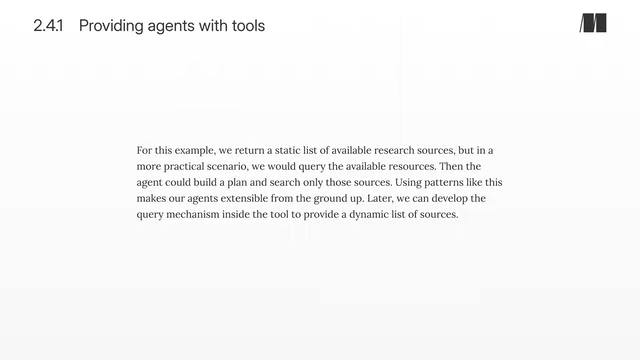
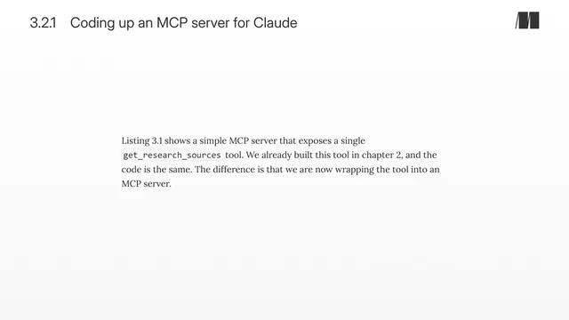
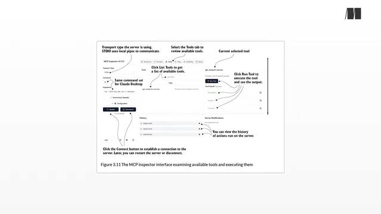
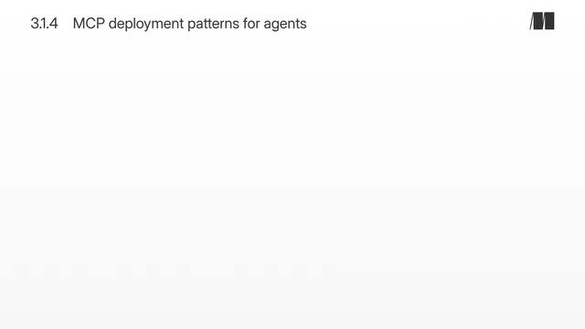
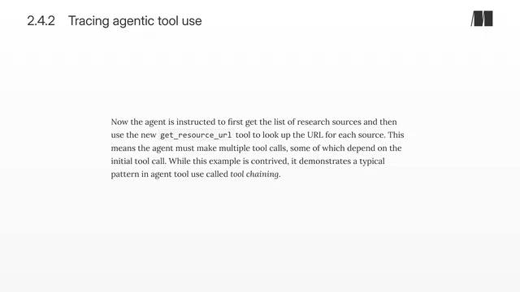
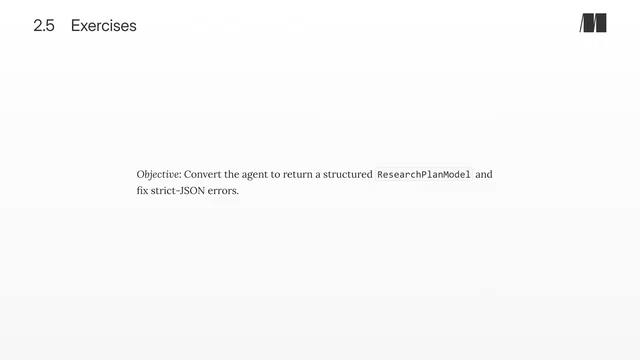
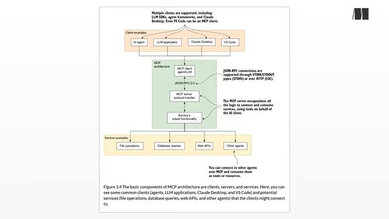
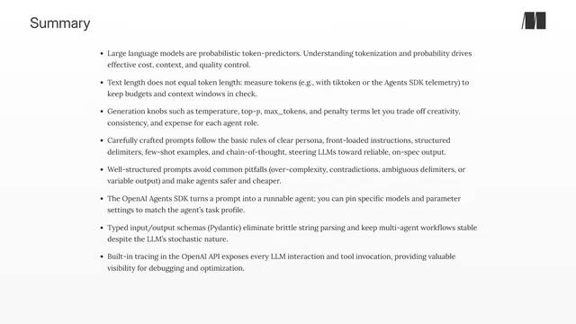
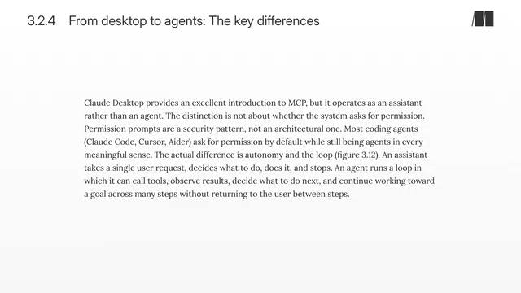

# AI Agents In Action 2nd — 为 Agent 加工具，并把工具包成 MCP Server（P010–P014）

> 覆盖范围：第 2 章收尾（2.4 工具集成 / 2.4.2 追踪 / 2.5 五个练习 / 第 2 章总结）+ 第 3 章开头（3.1 MCP 基础 / 3.2 上手 MCP Server）。
> 读完之后你应该手上有一个：**能调内部工具的 research planner agent**，以及**一个 Claude Desktop 能加载、MCP Inspector 能调试的同功能 MCP Server**。

---

## 1. 这一节做什么

P010–P014 是一条完整的「从 prompt 到工具到协议」的升级路径，不是五个孤立的知识点。把它们按产出物重组，实际只做两件事：

**第一件事（对应 P010 + P011）：把「只会写提示词的脚本」变成「会自己决定调工具的 agent」。** 讲师在 P010 开头把话说得很直白：前面几节做出来的 research planner，本质上只是「一个 prompt step」，这种拼装方式叫 prompt chaining，它有效，但**不是 agent**，因为它没有 agency（自己决定做什么的能力）。给 agent 加工具，是成本最低的 agency 来源。P011 的五个练习就是把这条路径拆成可动手的 5 步：最小 agent → 调温度 → 结构化输出 → 精修 prompt → 加工具并看 trace。

**第二件事（对应 P013 + P014）：把同一个 Python 函数，从「agent 内部工具」升级成「MCP Server 上的标准工具」。** 讲师的说法是 MCP 让 agent 开发「更像组装标准件，而不是从零造每个零件」。P014 里最关键的一句是：Listing 3.1 那个 MCP Server 里的函数，**和第 2 章写的工具是同一段代码**，区别只是外面套了 `@mcp.tool`。

所以本节的最终交付物是两个文件：

| 文件 | 作用 | 谁来消费 |
|---|---|---|
| `exercise5_tool_and_tracing.py` | 带内部工具的 agent，可跑、可在 OpenAI Traces 页看调用链 | 你自己在终端跑 |
| `01_claude_mcp_server.py` | 同一批工具，包成 MCP Server | Claude Desktop / MCP Inspector / 未来的 agent |

P012 是第 2 章的总结页，它把前面所有东西收成一句话：**prompt engineering + 模型调参 + 类型化 schema + tracing + 精选工具集 = 可用于生产的 agent**。这句话可以直接当成本节的验收标准。

P013 大部分是概念（MCP 为什么存在、三个组件、三种部署形态），P014 才开始动手。但 P013 有一个不能跳过的点：**MCP 的三个原语里，只有 tools 是「模型决定何时调用」，resources 和 prompts 是「用户/应用决定」**。这决定了你后面写代码时该往哪个方向使劲。

---

## 2. 讲师原话

下面按主题聚类引用，不按页码顺序。

**关于「为什么原来的东西不算 agent」：**

> "如果把这条规则套用到当前的智能体，也就是研究规划器上，就会发现它并不是智能体。我们目前开发出来的只是一个提示步骤。用提示步骤构建人工智能工作流是可行的，这种做法叫作提示链。"
> —— p010 [00:00]

> "我们希望开发灵活且适应性强的智能体，而这需要自主性。"
> —— p010 [00:00]

**关于工具的来源与形态：**

> "工具可以是智能体可调用的代码函数，可以是经由 MCP、Model Context Protocol 这类协议暴露的外部服务，也可以是移交给另一个智能体。工具可以在内部构建，也可以使用外部工具。"
> —— p010 [00:57]

> "工具是智能体可用的能力。动作是智能体使用这些能力所做的事。"
> —— p010 [00:29]

**关于「注册了就会一直付费」这条最容易踩的坑：**

> "要记住，向智能体注册工具之后，无论该工具是否被使用，它都会被包含在对大语言模型的每次调用中。"
> —— p010 [02:47]

> "你向智能体注册的每个工具的 JSON 描述都会在每次大语言模型调用时发送……每个工具描述都会增加输入词元，而无论工具是否被使用，这些词元都会在每次调用时计费。对于每个任务要进行很多次调用的智能体，成本会不断累积。"
> —— p010 [03:42]

> "虽然你可以给单个智能体提供几十个工具，但工具数量会影响智能体挑对工具的表现……不要死盯某个具体数字，而要围绕导致这一限制的约束来规划。"
> —— p010 [03:14]

**关于工具是「授权」而不只是「能力」：**

> "智能体使用工具时就在做决策，这既可能很强大，也可能带来问题……如果你允许智能体删除文件，就要预料到它会删除自己有权访问的所有文件。"
> —— p010 [05:06]

**关于工具链与并行调用：**

> "当智能体用一个工具的输出驱动另一个工具的输入时，就形成了工具链式调用。"
> —— p010 [06:34]

> "现代前沿模型还能在单次响应回合内并行发起多个工具调用，前提是这些调用彼此独立……与顺序链相比，并行调用能显著降低延迟，但只有当工具不依赖彼此的输出时才有效。"
> —— p010 [06:34]

**关于练习 3 那个「strict JSON 报错」：**

> "运行脚本，并观察用户遇到的严格 JSON 报错。把“将 dict 事件转成字符串”的做法替换为清单 2.9 中的 TypedDict 方案，然后重新运行。确认最终控制台输出是类似 JSON 的列表，包含 5 个对象，每个对象都含有 ID 和描述。"
> —— p011 [01:27]

**关于 MCP 是什么：**

> "MCP 常被形容为智能体和大语言模型的 USB-C，因为它为智能体工具提供了标准协议。"
> —— p013 [00:29]

> "不仅如此，我们还可以把自己的智能体构建成可供使用的 MCP 服务器。这样一来，就能把复杂的智能体工作流作为工具接入其他智能体工作流，从而构建出可像组件一样复用的、面向特定智能体的工作流。"
> —— p013 [00:29]

> "MCP 消除的是过去在工具集成中占主导的、针对每个提供商分别处理模式和调用格式的工作，这足以改变智能体的构建方式。"
> —— p013 [06:10]

**关于 MCP 的三个原语，谁决定用不用：**

> "工具由模型控制。智能体在对话过程中决定是否以及何时调用工具……资源与提示通常由用户控制或应用控制……工具是让智能体主动取用的，资源与提示则是由用户交给智能体的。"
> —— p013 [11:25]

> "OpenAI agents SDK 目前不支持资源和提示，这可以接受，因为工具可以承担它们的作用。"
> —— p013 [12:21]

**关于装饰器和 docstring 的真正作用（这句是本段最重要的一句）：**

> "atmcp.tool 装饰器负责完成包装。把它应用到函数上时，它会把函数的签名、文档字符串和返回类型注解注册到 MCP 服务器的工具模式中。签名会成为智能体看到的参数列表。文档字符串会成为智能体用来判断何时调用该工具的描述。返回类型则告诉智能体应预期什么形态的结果。这就是文档字符串在 MCP 代码中如此重要的原因。它们不是给阅读该文件的人看的文档，而是智能体在选择使用哪个工具时读取的提示。"
> —— p014 [02:25]

**关于为什么必须用绝对路径：**

> "运行该命令时，请使用绝对路径，不要使用相对路径。否则，检查器将无法运行该文件。"
> —— p014 [06:37]

**关于 STDIO 和 UV 的关系（一个高频误解）：**

> "传输方式采用 STDIO，因为这是一个本地 MCP 服务器，它作为子进程启动，并通过标准输入和标准输出与客户端通信。这个选择与是否用 UV 运行服务器无关——UV 是启动服务器进程的 Python 包运行器，但传输方式（STDIO、HTTP 或 SSE）取决于服务器自身如何配置。"
> —— p014 [07:05]

**关于 assistant 和 agent 的真正区别：**

> "区别不在于系统是否会请求许可。许可提示是一种安全模式，而不是架构模式……真正的区别在于自主性和循环。助手接收单个用户请求，决定做什么，执行，然后停止。智能体则运行一个循环，在其中调用工具、观察结果、决定下一步做什么，并在多个步骤中持续朝着目标推进，步骤之间无需回到用户那里。"
> —— p014 [08:52]

> "助手调用错一个工具，只会得到一个错误答案。智能体调用错一个工具，则可能在任何人察觉之前，把这个错误连锁放大成另外 10 个错误。"
> —— p014 [10:16]

**关于 prompt injection 这份「默认风险」：**

> "智能体从工具读取的内容会成为其上下文的一部分，而恶意网页、文档或电子邮件可能包含智能体会遵循的指令。对于任何返回外部内容的工具，都要把这视为默认情况，而不是边缘情况。"
> —— p014 [12:38]

---

## 3. 从零复现

> ⚠️ 先说明一件事，避免你按文档跑不通却不知道怪谁：**逐字稿只念出了 API 名字和文件名，没有逐行念出代码**。下面每个代码块里，凡是逐字稿明确提到的符号（`@function_tool`、`tools=`、`output_type=`、`Runner.run_sync`、`@mcp.tool`、`FastMCP`、文件名）我都原样保留；但 `import` 行、构造参数名这类逐字稿没念的细节，是我按当前 OpenAI Agents SDK 的常规写法补的。如果你装的版本签名不同，以 `pip show openai-agents` 之后 `help(Agent)` 的输出为准 —— 这是「课里没讲」的部分，我不会假装它讲过。

### 步骤 0：建目录、装环境

```bash
mkdir agents-mcp-demo
cd agents-mcp-demo
```

课里用的是 **UV** 作为 Python 包运行器（P014 [07:05] 明确提到 "UV 是 Python 包运行器。"）。如果你不想装 UV，用标准 venv 也完全能跑通，只是后面 `mcp install` 生成配置时启动命令会不一样。

```bash
python -m venv .venv
# macOS / Linux
source .venv/bin/activate
# Windows PowerShell
# .venv\Scripts\Activate.ps1
```

```bash
pip install -U openai-agents "mcp[cli]"
```

`requirements.txt`：

```text
# 课里没讲具体版本号，锁主版本即可；升级前请重跑第 6 节的检查清单
openai-agents>=0.2
mcp[cli]>=1.2
python-dotenv>=1.0
```

根目录建 `.env`（**不要提交到 git**）：

```text
OPENAI_API_KEY=sk-你的真实key
```

目录最终长这样：

```text
agents-mcp-demo/
├── .env
├── requirements.txt
├── 01_first_agent.py
├── exercise5_tool_and_tracing.py
└── 01_claude_mcp_server.py
```

### 步骤 1：跑通最小 agent（对应练习 1，讲师给的预期时长 8 分钟）

逐字稿给的五个动作非常具体：打开 listings 里的 `01_first_agent.py` → 另存为 `exercise1_minimal_agent.py` → 把占位的 `user query here` 换成 `learn about ai agents` → 跑 → **确认控制台里恰好出现 5 个编号任务**。

课里没给这个文件的完整源码。第 4 节我给的 `01_first_agent.py` 是一个满足「恰好 5 个编号任务」这条验收标准的最小实现，你可以直接用它替代 listings 里的文件。

### 步骤 2：调温度，观察一致性（练习 2，10 分钟）

复制一份命名为 `exercise2_model_tuning.py`，在 agent 构造里固定参数，跑两次对比输出；然后把 `temperature` 提到 `1.0` 再跑第三次；最后在文件底部注释记录哪几行变了。

这一步的产出不是代码，是**你对自己模型输出波动的体感**。后面做结构化输出时如果没有这个体感，你会误以为是 schema 写错了。

### 步骤 3：强制结构化输出，并修掉 strict JSON 报错（练习 3，12 分钟）

这条路径逐字稿说得很清楚，照做：

1. 复制成 `exercise3_typed_output.py`
2. 加入 `ResearchPlanModel` 类（逐字稿说"与代码清单 2.7 完全一致。"，并给了验收标准：**5 个对象，每个含 id 和 description**）
3. 在 agent 上设 `output_type=ResearchPlanModel`
4. 跑一次，**故意先看报错** —— 逐字稿原话是 "注意用户关于严格 JSON 的错误。"
5. 把「把 event 转成字符串」那行，换成 Listing 2.9 的 typed dict 写法，重跑
6. 确认最终输出是 5 个带 id / description 的对象

第 5 步那个「有问题的写法」，逐字稿只给了描述没念出正文，所以这里我不复现错误版本（复现一个我没见过的错误代码就是编造）。你直接走第 4 节的正确写法即可。

### 步骤 4：把 prompt 按最佳实践重写（练习 4，12 分钟）

要求是「至少用上 Table 2.2 里的四项技术」。逐字稿点名了四个例子：**清晰的 persona、分隔符、明确长度、正向措辞**，并且额外要求**用 markdown code fence 把任务块包起来当分隔符**。验收标准写得很硬：温度保持 0，跑两次，**每次恰好 5 个任务，每个任务不超过 7 个词**。

### 步骤 5：加内部工具 + 看 trace（练习 5，15 分钟）

这是第 2 章的收口动作，四个子任务：

1. 复制成 `exercise5_tool_and_tracing.py`
2. 按 Listing 2.11 实现 `get_research_sources`，并用 `tools=[get_research_sources]` 注册
3. 改 prompt，让**第一步**就要求 agent 调这个工具
4. 用 trace 把 `Runner.run_sync` 包起来（逐字稿说 "将 runner.run_sync 调用包装进这段代码。" 然后画面切走了，具体代码没念）
5. 跑一次，去 OpenAI 后台的 Traces 页面，**确认 LLM 响应之前恰好出现一次 tool call**



### 步骤 6：把同一个函数包成 MCP Server（P014 Listing 3.1）

这是本段最有价值的动作：**你不用重写业务逻辑**。P014 原话是 "我们已在第 2 章构建过这个工具，代码是一样的。不同之处在于，我们现在正把这个工具封装到一个 MCP 服务器中。"

新建 `01_claude_mcp_server.py`，把 `get_research_sources` 原样搬进去，外面加 `FastMCP` 实例和 `@mcp.tool`。注意逐字稿强调的三件事：**函数签名 → 参数列表**、**docstring → 工具描述**、**返回类型标注 → 结果形状**。这三样就是 agent 眼里的全部信息。



### 步骤 7：用 mcp CLI 装进 Claude Desktop（P014 Listing 3.2）

逐字稿给的顺序是：**先在终端把 server 装进 Claude Desktop → 关掉再重开 Claude → File → Settings → Developer 里确认工具出现**。

关键提醒（原话）："运行 install 命令时，请确保你与 Python 文件处于同一文件夹，或者正确引用它。" Windows 上还可能要多做一步："安装或配置 MCP 服务器后，你可能需要重新安装或重启 Claude。"

### 步骤 8：用 MCP Inspector 验 schema（P014 Listing 3.3）

逐字稿对 Inspector 的定位是："当工具未按预期工作时，首先应该使用 inspector。" 它能看到四样东西：**live tool list（含描述、参数、返回类型，和 agent 看到的完全一致）**、**手动用任意参数直接调工具**、**原始 JSON-RPC 流量**、**初始化错误**。

最常见的用途，原话是：「check that your decorator-generated schema matches what you intended, especially when the agent fails to pick a tool you know is registered」。

**必须用绝对路径**，否则 Inspector 起不来。



### 步骤 9：换 transport（可选，但强烈建议做一次）

同一个文件，改一行启动配置就能从 STDIO 切成 SSE / HTTP。逐字稿把这个点单独拎出来讲，就是为了消除「UV = STDIO」这个误解：

> "这个选择与是否用 UV 运行服务器无关……传输方式（STDIO、HTTP 或 SSE）取决于服务器自身如何配置。清单 3.1 中的同一个 FastMCP 服务器，可以通过更改启动配置来使用 HTTP 或 SSE 传输运行，而在这种情况下 UV 也完全适用。"
> —— p014 [07:05]



---

## 4. 完整代码

### 4.1 `01_first_agent.py`

```python
"""最小 research planner agent。

逐字稿给出的验收标准（p011 [00:07]）：
  控制台里恰好出现 5 个编号任务。

逐字稿里这个文件来自 listings/01_first_agent.py，
正文未念出源码，这里是满足同一验收标准的最小实现。
"""

import os

from dotenv import load_dotenv
from agents import Agent, Runner

load_dotenv()
assert os.getenv("OPENAI_API_KEY"), "缺少 OPENAI_API_KEY，请检查 .env"

INSTRUCTIONS = """\
You are a research planner for a technical analyst.

Given a topic, produce a research plan of exactly five numbered tasks.
Each task must be actionable and no longer than seven words.
Return only the numbered list, no preamble and no closing commentary.
"""

agent = Agent(
    name="Research Planner",
    instructions=INSTRUCTIONS,
    model="gpt-4o-mini",
)

if __name__ == "__main__":
    # 练习 1 第 3 步：把占位文本换成实际查询
    result = Runner.run_sync(agent, "learn about ai agents")

    # 逐字稿未指定读取字段名，这里做兼容处理，
    # 具体字段请以实际 SDK 版本的 RunResult 为准
    print(getattr(result, "final_output", result))
```

### 4.2 `exercise5_tool_and_tracing.py`

```python
"""练习 5：给 agent 加一个内部工具，并用 tracing 观察调用链。

对应逐字稿 p011 [02:50] 的五个任务：
  1. 复制上一份文件为本文件
  2. 按 Listing 2.11 实现 get_research_sources，用 tools= 注册
  3. 改 prompt，让第一步就调这个工具
  4. 用 trace 包住 Runner.run_sync
  5. 跑一次，在 Traces 页确认 LLM 响应前有一次 tool call
"""

import json
import os

from dotenv import load_dotenv
from pydantic import BaseModel
from agents import Agent, Runner, function_tool, trace

load_dotenv()
assert os.getenv("OPENAI_API_KEY"), "缺少 OPENAI_API_KEY，请检查 .env"


# ---------- 数据结构（练习 3 的产物，练习 5 继续复用）----------

class ResearchTask(BaseModel):
    id: int
    description: str


class ResearchPlanModel(BaseModel):
    # 逐字稿只确认了「每个对象含 id 和 description」，
    # 外层是否再包一层 tasks 字段课里没讲，这里沿用书中常见写法
    tasks: list[ResearchTask]


# ---------- 内部工具（Listing 2.11）----------

@function_tool
def get_research_sources() -> list[str]:
    """Return the list of research sources available to the planner.

    Call this FIRST, before writing any plan, so that each task can
    name the specific source it will use.
    """
    # 逐字稿 p010 [02:20]：这里返回静态列表是教学简化，
    # 真实场景应改为查询可用资源
    return [
        "arxiv.org",
        "docs.python.org",
        "openai.com/research",
        "github.com/openai/openai-agents-python",
    ]


# ---------- Prompt：把「先调工具」写死成第一步 ----------

INSTRUCTIONS = """\
You are a research planner for a technical analyst.

Work in this order:
1. Call the get_research_sources tool to fetch the available sources.
2. Build a plan of exactly five numbered tasks.
3. Every task must name at least one source returned by the tool.

Constraints:
- Each task description is seven words or fewer.
- Use sources only from the tool result. Never invent a source.
"""

agent = Agent(
    name="Research Planner",
    instructions=INSTRUCTIONS,
    model="gpt-4o-mini",
    tools=[get_research_sources],
    output_type=ResearchPlanModel,
)


if __name__ == "__main__":
    # 练习 5 第 4 步：把 run 包进 trace
    with trace("exercise5-tool-and-tracing"):
        result = Runner.run_sync(agent, "learn about ai agents")

    plan = getattr(result, "final_output", None)

    # 练习 3 第 5 步的修复写法：走 pydantic 的类型化序列化，
    # 不要手工拼 dict / 手工 str()，那会触发 strict JSON 报错
    if isinstance(plan, BaseModel):
        print(plan.model_dump_json(indent=2))
    else:
        print(json.dumps(plan, indent=2, default=str))
```

### 4.3 `01_claude_mcp_server.py`

```python
"""Listing 3.1：把第 2 章的工具包成一个 MCP Server。

逐字稿 p014 [01:55]：
  "We already built this tool in Chapter 2, and the code is the same.
   The difference is that we are now wrapping the tool into an MCP server."
"""

from mcp.server.fastmcp import FastMCP

# server 名会出现在 Claude Desktop 的工具列表里，取一个能认出来的名字
mcp = FastMCP("research-tools")


@mcp.tool()
def get_research_sources() -> list[str]:
    """Return the list of research sources available to the planner.

    Call this FIRST, before writing any plan, so that each task can
    name the specific source it will use.
    """
    return [
        "arxiv.org",
        "docs.python.org",
        "openai.com/research",
        "github.com/openai/openai-agents-python",
    ]


if __name__ == "__main__":
    # 默认 STDIO：本地子进程，通过标准输入输出与客户端通信
    mcp.run()

    # 远程部署时改为（参数名以安装的 mcp 版本为准，课里没念出具体签名）：
    # mcp.run(transport="sse")
```

### 4.4 安装与调试命令

```bash
# 装进 Claude Desktop —— 必须在 python 文件所在目录执行，或用绝对路径
mcp install 01_claude_mcp_server.py

# 起 MCP Inspector —— 必须用绝对路径，否则起不来
mcp dev /绝对路径/agents-mcp-demo/01_claude_mcp_server.py
```

如果 `mcp install` 报错，Claude Desktop 的 Settings → Developer 面板里会显示实际启动命令，**把那条命令复制到终端手跑一遍**，报错信息比 UI 里的清楚得多。逐字稿点名的三个常见原因：**没装 UV**、**Python 没配到终端 PATH**、**文件路径不对**。



---

## 5. 逐行解释

**`tools=[get_research_sources]` —— 这一行是有持续成本的。**
P010 [02:47] 的原话是「注册之后，无论用不用，每次 LLM 调用都会带上它」。也就是说这行代码不是「增加一个可选功能」，而是「给此后每一次请求的 input token 加一段 JSON」。一个 agent 一个任务调 10 次 LLM，这个工具的描述就被重复计费 10 次。**在 JS/Node 里对应什么**：相当于你在每个 `fetch` 请求体里都塞了一份 OpenAPI schema，哪怕这个请求根本不调那个接口。所以「只注册这次任务真正需要的工具」不是洁癖，是省钱。

**`@function_tool` 和 `@mcp.tool` 做的事，本质上是同一件。**
两者都是把「Python 函数的签名 + docstring + 返回类型标注」翻译成一段机器可读的 schema。P014 [02:25] 把这三者的映射讲得最清楚：签名 → 参数列表，docstring → 工具描述，返回类型 → 结果形状。区别只在输出格式和传输方式，前者给 agent 进程内直接调，后者走 JSON-RPC 2.0。

**docstring 不是给人看的注释，是 prompt。**
这是整段里最容易被前端工程师忽略的一句。你写 `"""Return the list of research sources..."""`，agent 读到的就是这段文字，并据此判断「这个工具该不该在现在调」。所以我在 docstring 里写了 `Call this FIRST, before writing any plan` —— 这等于在工具层面又加了一次指令，比只写在 agent 的 instructions 里更难被忽略。反过来，docstring 写成 `"""Get sources."""`，agent 就不知道它和别的工具的区别在哪，选错率会飙升。

**为什么 `get_research_sources` 要返回 `list[str]` 而不是 `str`。**
返回类型标注会进入 schema，agent 靠它预判「我会拿到一个列表还是一个大字符串」。标成 `list[str]`，模型更倾向于逐项引用；标成 `str`，它可能把整个返回值当一段文本揉进回答。这就是 P014 说的 "返回类型告诉智能体应预期何种形式的结果。"

**`output_type=ResearchPlanModel` 为什么能消灭字符串解析。**
P012 总结里有一句：「Typed input, output schemas, pydantic, eliminate brittle string parsing」。不设 `output_type` 时，你拿到的是一个字符串，得靠正则去抠任务列表；设了之后，SDK 会按 pydantic 模型生成 JSON schema 约束模型输出，你拿到的是对象。**在 JS/Node 里对应什么**：相当于从「手动 `JSON.parse` 一个不保证格式的字符串」升级成「用 Zod 定义 schema 再 parse」。练习 3 里那个 strict JSON 报错，就是因为中间某一环把结构化的东西手动转成了字符串，破坏了 schema 约束。

**`with trace(...)` 包住 `run_sync`。**
P010 [07:02] 说 Traces 页能看到每次工具调用和 LLM 响应的**顺序、输入、输出、耗时**。练习 5 的验收标准是「LLM 响应之前恰好出现一次 tool call」—— 这句话本身就是一道断言：如果 tool call 出现在 LLM 响应之后，说明你的 prompt 没把「先调工具」写清楚；如果出现两次，说明模型在重试，通常意味着工具返回值不符合它的预期。**在 JS/Node 里对应什么**：类似给一次请求链路打一个 trace id，然后把每一步 span 串起来。

**`transport` 和「用不用 UV」完全无关。**
P014 [07:32] 专门澄清了这点。UV 只是「谁来启动这个 Python 进程」，STDIO / SSE / HTTP 是「进程起来之后怎么和客户端说话」。这两个是正交的维度。本地开发用 STDIO（低延迟、无网络开销、进程管理简单），远程共享用 SSE/HTTP（可分布式、可多 agent 共用一个工具服务、可负载均衡）。所谓「混合部署」，P013 [15:13] 说得很准确：**没有哪个 server 是混合的**，是同一个 agent 同时连了好几个 server，每个 server 各跑各的模式。

**为什么 Inspector 必须用绝对路径。**
Inspector 是另起一个进程去加载你的 server 文件，它的工作目录不是你终端的工作目录。相对路径在它那边解析不到，报错还很难看懂。P014 [06:37] 只说了「otherwise the inspector will not be able to run the file」，没解释原因，但结果就是这样。

**`mcp install` 之前为什么要 `cd` 到文件目录。**
同理：它要往 Claude Desktop 的配置文件里写一条启动命令，这条命令里的路径会以你当前的上下文为准。路径写错了，Claude 里工具就加载不出来，而错误信息藏在 Settings → Developer 里，不会弹窗告诉你。



---

## 6. 复现检查清单

按顺序勾，任何一项没过不要往下走。

**环境**
- [ ] `pip show openai-agents` 和 `pip show mcp` 都能返回版本号
- [ ] `.env` 里有 `OPENAI_API_KEY`，且脚本能读到（assert 没触发）
- [ ] `python 01_first_agent.py` 能跑通

**练习 1：最小 agent**
- [ ] 控制台输出**恰好 5 个**编号任务
- [ ] 没有多余的开场白或总结段落

**练习 2：温度**
- [ ] 温度 0 连跑两次，两次输出的差异逐行记在了文件底部注释里
- [ ] 温度 1.0 跑第三次，差异明显变大

**练习 3：结构化输出**
- [ ] 加 `output_type` 之后**先看到了** strict JSON 报错（如果你一次就过了，说明你没照练习顺序做）
- [ ] 改用 `model_dump_json` 之后不再报错
- [ ] 最终输出是 5 个对象，每个都有 `id` 和 `description` 两个字段

**练习 4：prompt 精修**
- [ ] instructions 里至少用上了 4 项技术：persona / 分隔符 / 长度限制 / 正向措辞
- [ ] 任务块被 markdown code fence 包住
- [ ] 温度 0 跑两次，两次都是恰好 5 个任务、每个 ≤7 词

**练习 5：工具 + trace**
- [ ] `tools=[get_research_sources]` 已注册，脚本能跑
- [ ] OpenAI 后台 Traces 页面能看到这次运行
- [ ] **LLM 响应之前恰好有一次 tool call**（不是零次，也不是两次）
- [ ] 展开 tool call 能看到输入和输出（输出是那 4 个域名）

**MCP Server**
- [ ] `01_claude_mcp_server.py` 能作为普通 Python 文件 import 而不报错
- [ ] `mcp dev /绝对路径/01_claude_mcp_server.py` 能起 Inspector
- [ ] Inspector 的 Tools 页能看到 `get_research_sources`，**描述文字和你写的 docstring 一字不差**
- [ ] 在 Inspector 里点 Run tool，能看到那 4 个域名返回
- [ ] Inspector 里显示的 transport 类型是 STDIO

**Claude Desktop**
- [ ] `mcp install 01_claude_mcp_server.py` 没报错
- [ ] 关掉 Claude 再重开（Windows 上可能要重装）
- [ ] File → Settings → Developer 里能看到 research-tools server 处于运行状态
- [ ] 新开对话输入 "获取研究来源"，弹出授权提示
- [ ] 允许执行后，返回的确实是代码里配置的那 4 个源（Claude 会在旁边加它自己的注解，这是正常行为）

**部署模式（可选）**
- [ ] 改 `transport` 起一次 SSE，确认客户端连得上
- [ ] 确认 `mcp install` 生成的启动命令里，UV 和 transport 是两个独立的东西



---

## 7. 课里没讲但你会撞上的

**1. 「工具描述一字不差地出现在 Inspector 里」这件事，值得你手动核对一遍。**
讲师只说了 docstring 会变成描述，没说你要去核对。但你一旦开始调工具选择准确率，**第一件事就是去 Inspector 里读一遍 agent 真正看到的文字**，而不是读你 PyCharm 里那版。中间可能有多余缩进、换行被压平、类型标注被转成 JSON Schema 的 `type` 字段。这是排查「agent 为什么不调我明明注册了的工具」最快的一步。

**2. 工具数量上限，课里明确说「不要盯数字」。**
原话是「Rather than fixing on a number, plan around the constraints that drive the limit」。真正决定上限的是三件事：工具彼此有多像、描述写得多清楚、模型本身多强。所以当你的 agent 开始乱选工具时，**先去看工具之间是不是功能重叠**，而不是急着换更大的模型。

**3. 并行 tool call 和 JS 的 `Promise.all` 是同一类东西。**
P010 [06:34] 说得很清楚：依赖彼此输出的工具必须串行，独立的工具可以并行，能显著降低延迟。**在 JS/Node 里对应什么**：串行就是 `await a(); await b();`，并行就是 `await Promise.all([a(), b()])`。区别在于，这里的「哪个是哪个」不是你写死的，是**由模型在运行时判断**，或者由你写在 prompt 里。这是前端工程师转过来最容易上手的一块，心智模型完全通用。

**4. 锁 / 事务 / 并发：本段没有涉及。**
逐字稿在这五个小节里完全没有讨论数据库、锁、事务。如果你要给工具加写操作（写文件、写数据库），**课里没讲这部分怎么做**，需要自己补。**在 JS/Node 里对应什么**：单进程内靠事件循环天然串行，多实例部署就要靠数据库行锁或分布式锁——但这些是课外内容。

**5. Prompt injection 是默认条件，不是边界情况。**
P014 [12:38] 的原话很重：「Treat this as the default condition for any tool that returns external content, not an edge case.」讲师给了五条纵深防御：**工具白名单、沙箱、输出校验、限流与预算上限、高风险操作的人工确认**。注意这些是讲师列出来的**原则**，课里没有给出对应的代码实现。你要自己决定在哪一层做。

**6. 从 assistant 到 agent，风险是被放大的。**
P014 [10:16] 那个对比很值得记下来：「assistant 调错一个工具，得到一个错误答案；agent 调错一个工具，可能在没人注意之前把这个错误链成十个。」这句话解释了为什么练习 5 要你去 Traces 页面**数清楚 tool call 的次数**——次数异常就是链路跑偏的第一个信号。

**7. `output_type` 和模型选择有耦合。**
课里没说哪些模型支持严格结构化输出。如果你的 strict JSON 报错在换了模型之后就消失了，那不是你的代码问题，是模型能力差异。**排查顺序应该是：先换模型验证，再回来改代码。**

**8. 第 2 章的总结就是本段的验收表。**
P012 总结页列了五行：token 要量、生成参数要按角色调、prompt 要按规则写、schema 要类型化、工具集要精选、tracing 要打开。你如果只能记住一条，记这条：**「Combining prompt engineering, model tuning, typed schemas, tracing and curated tool sets yields production-ready agents.」** 这六个词，就是 PR 前该对着检查的清单。



