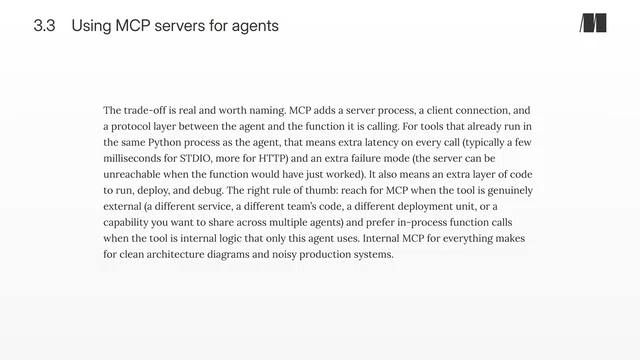
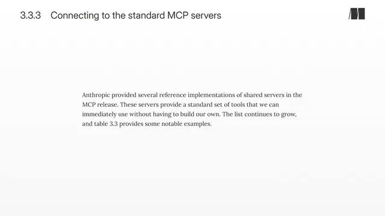
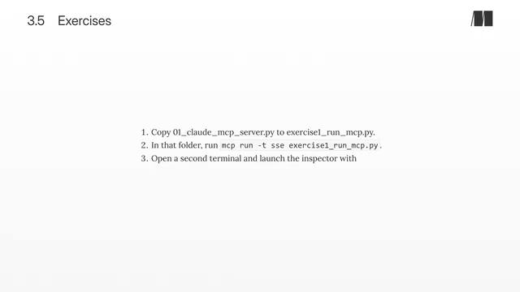
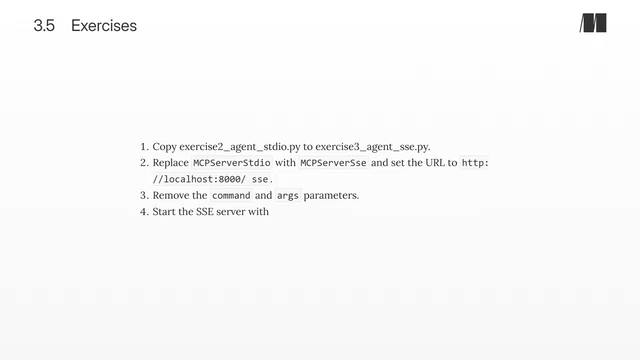
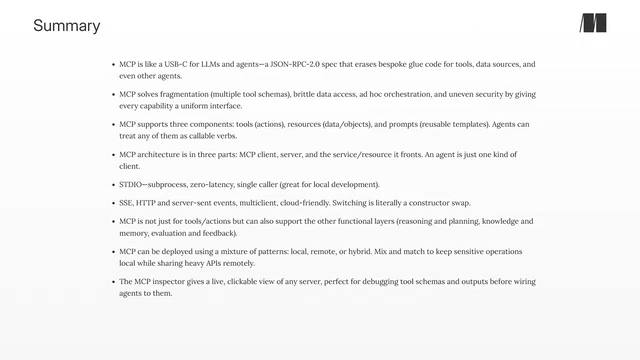
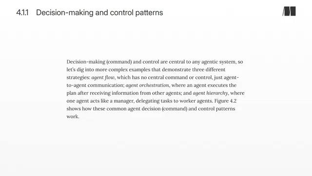
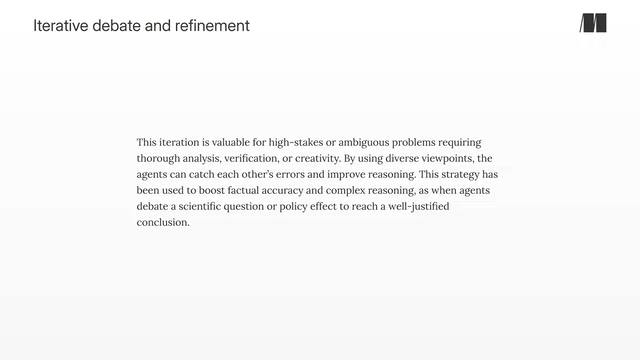

# AI Agents In Action 2nd（multi-agent）· P15–P19 复现文档

覆盖：3.3 用 MCP Server 给 Agent 提供动作 → 3.4 自建 MCP Server → 3.5 练习 → 本章总结 → 第 4 章多 Agent 架构（纯讲解）

---

## 1. 这一节做什么

这一段课程解决的是**一个具体工程问题**：Agent 的工具（tools）该放在哪里、怎么被调用。

前半段（P15–P17）是**可直接跑的代码**：先在 Agent 进程内部用 Python 函数当工具，再把工具搬到独立的 MCP Server 进程里，先用 STDIO（子进程 + 标准输入输出管道）连接，再改成 SSE（HTTP）连接，最后接一个官方现成的 Node.js 文件系统 Server，并做五个小练习把这条链路走通。

后半段（P18–P19）是**讲解**：P18 是 MCP 的收尾总结，P19 是第 4 章开头，讲多 Agent 的三条主轴（决策、控制、通信）加第四条（协调），以及七种常见编排形态（顺序流水线、并行分派、层级协调、迭代批评/辩论、投票 Best-of-N、角色扮演、条件路由、P2P）。

所以本节的最终产物是**一个目录、七个左右的 Python 文件**，以及一张「什么场景用哪种 Agent 编排」的决策表。



---

## 2. 讲师原话

> "MCP 服务器承载了智能体能够执行的操作。智能体操作指智能体为完成目标可以执行的任何行为。"
> —— p015 [00:00]

讲师把「动作」定义得很宽：用工具、找资源、甚至把活交给另一个 Agent，都算 action。

> "这种权衡确实存在，也值得点明。MCP 会在智能体和它调用的功能之间增加一个服务器进程、一个客户端连接和一个协议层。……合适的经验法则是：当工具确实是外部能力，例如属于不同服务、不同团队的代码、不同部署单元，或你希望跨多个智能体共享的能力时，就采用 MCP；当工具只是仅由当前智能体使用的内部逻辑时，则优先使用进程内函数调用。"
> —— p015 [01:55] / p015 [02:24]

这是整段最重要的一句「取舍」。讲师没有把 MCP 说成万能药：进程内函数调用 → 加一层 MCP，换来的是架构图和扩展性，付出的是**每次调用的额外延迟**（他说 STDIO 通常几毫秒，HTTP 更多）、**一个新的失败模式**（Server 连不上，而原本函数调用本来好好的）、以及**多一层要部署和调试的代码**。

> "我们要使用的服务器位于 model context protocol / server file system，是一个用 NPX 启动的 Node.js 实现。我们的智能体是 Python 写的。我们没有编写绑定，没有安装 Node 到 Python 的桥接层，也没有做任何跨语言的管线工作。……在通信层面，该协议与语言无关。"
> —— p015 [03:49] / p015 [04:17]

> "File System Server 是一个用 NPX 启动的 Node.js 包，因此你的机器上需要安装 Node.js 和 npm。"
> —— p015 [07:08]

> "这个示例中的日志被实现为模块级的内存列表。对于单个进程中的单个智能体，这没有问题……当把同样的代码移入 MCP 服务器……同一个模块级列表就会成为所有连接到该服务器的智能体共享的状态。"
> —— p016 [01:55] / p016 [02:21]

> "接口契约是工具的结构定义，具体实现则是服务器的私有事务。……日志背后可以是一个 Python 列表、一张 Postgres 表、一个 Redis 缓存或一个远程 API，而智能体的代码无需改动。"
> —— p016 [05:13] / p016 [05:42]

> "如果你将两个或更多智能体连接到 SSE HTTP 服务器实现，可能会得到一些重复的日志结果。这是因为服务器运行所在的进程并非每次都会新建，而是由各智能体连接到该进程。"
> —— p016 [07:34]

> "MCP 就像面向大语言模型和智能体的 USB-C，它是一种 JSON RPC 2.0 规范，消除了为工具、数据源甚至其他智能体编写定制胶水代码的需要。"
> —— p018 [00:00]

> "智能体系统设计的核心矛盾，是在灵活性与掌控权之间取得平衡。……先从解决问题所需的最少自主性开始，随着你观察到智能体能处理得更好，再逐步增加。在最关键的边界上约束智能体的自主性：工具访问、输出结构定义、操作预算、不可逆工作的人工介入检查点；其余地方则保持宽松。"
> —— p019 [14:05] / p019 [15:01]

> "实践中的判断标准取决于编排器的职责。如果它可以被一个扇出/扇入原语替代，那么这种模式就是并行流程。如果不行，因为规划、角色分配、监督或集成确实在完成实际工作，那么这种模式就是分层协调。"
> —— p019 [21:02]


---

## 3. 从零复现

### 3.1 环境与依赖

你需要两套运行时：

| 组件 | 用途 | 要求 |
|---|---|---|
| Python | Agent + 自建 MCP Server | 3.11+（异步语法与类型注解） |
| Node.js + npm | 只用于 `npx` 拉起官方 File System Server | 装 Node 即可，`npx` 随 Node 一起装（讲师 p015 [07:08] 明确要求这一点） |

Python 依赖（**课里没有逐字给出依赖版本号**，下面只是写作时能装上的基线，装完请以 `pip show` 实际版本为准）：

```text
# requirements.txt
mcp>=1.0.0
openai-agents>=0.1.0
```

```bash
python -m venv .venv
source .venv/bin/activate          # Windows: .venv\Scripts\activate
pip install -r requirements.txt
node --version && npx --version    # 必须两条都有输出
```

环境变量：Agent 调用模型需要 OpenAI 的 Key。**逐字稿没有点名这个环境变量名**，按 SDK 常规用法是：

```bash
export OPENAI_API_KEY=sk-...       # Windows PowerShell: $env:OPENAI_API_KEY="sk-..."
```

> 注意：如果 Key 没配，脚本会在第一次 `Runner.run` 时报鉴权错误，而不是在启动时报——很容易误判成「MCP 没连上」。

### 3.2 目录结构

```text
mcp-course/
├── 01_claude_mcp_server.py              # Listing 3.1  自建最小 MCP Server（一个工具）
├── 02_mcp_agent_stdio_server.py         # Listing 3.4  用 SDK 以 STDIO 消费上一步的 Server
├── 04_mcp_agent_server_files.py         # Listing 3.7  换成官方 File System Server（npx）
├── 05_time_travel_agent.py              # Listing 3.8  工具写在 Agent 自己的代码里（对照组）
├── journal_mcp_server.py                # Listing 3.9  把两个工具搬成独立 MCP Server
├── 06_time_travel_agent_mcpstdio.py     # Listing 3.10 以 STDIO 消费 journal server
├── 07_time_travel_agent_mcpsse.py       # 以 SSE 消费 journal server（同机/远程）
├── scripts/                             # 交给 File System Server 的沙箱目录
│   └── notes.txt
└── exercises/
    ├── Exercise1RunMCP.py
    ├── Exercise2AgentStdio.py
    ├── Exercise3AgentSSE.py
    ├── Exercise4Wrapper.py
    ├── Exercise4TestWrapper.py
    ├── Exercise5TrackerServer.py
    └── Exercise5ConsumerAgent.py
```

> 文件名说明：逐字稿里文件名是口播转写（如「01 Clawed MCP server.py」「04 MCP agent server files.py」），带空格的原名不好在命令行里写。上面统一改成下划线版本，**名字可以自定，但你自己 `args` 里写的路径必须和真实文件名一致**，否则 STDIO 子进程起不来。

### 3.3 复现步骤（按顺序执行，每步都有可验证的输出）

**步骤 1：造沙箱目录**

```bash
mkdir -p scripts
echo "这是 filesystem server 唯一被允许读写的目录" > scripts/notes.txt
```

**步骤 2：写最小 MCP Server（`01_claude_mcp_server.py`）**

这一步对应 Listing 3.1。它只暴露**一个**工具，返回三条「研究资料」。工具名在 P17 的练习里被念成 `Get Research Sources`，代码里是 `get_research_sources`。

**步骤 3：用 SDK 以 STDIO 消费它（`02_mcp_agent_stdio_server.py`）**

这一步对应 Listing 3.4，也是 p015 [02:52] 讲的「local hosting pattern」：Agent 用 `async with` 把一个 Server 作为**子进程**拉起来，块开始 → Server 活着、工具可用；块结束 → Server 关掉。讲师原话：「As long as the block runs, the sub-process remains active and the tool is accessible. When the block exits, the server shuts down.」

**步骤 4：把它改成 SSE 再消费**

两处改动：Server 用 `transport="sse"` 起在 `127.0.0.1:8000`，路径 `/sse`；Agent 侧把「command + args」换成「url」。讲师 p015 [05:40]：「The only significant change to the code is swapping the server implementation to use SSE and providing a URL to connect to rather than a command.」

**步骤 5：换成官方 File System Server（`04_mcp_agent_server_files.py`）**

`npx` 拉起 `@modelcontextprotocol/server-filesystem`，参数里传 `scripts` 目录。**这是唯一一步 Python 不需要写任何绑定代码、却消费了 Node.js 实现的地方**——p015 [03:49] 讲的语言无关性就落在这里。



**步骤 6：对照组——工具还在 Agent 代码里（`05_time_travel_agent.py`）**

Listing 3.8：时间旅行记录员，两个进程内函数工具 `record_event` / `load_journal`，journal 是一个**模块级内存 list**。跑一遍，记住输出长什么样。

**步骤 7：把工具搬进独立 Server（`journal_mcp_server.py`）**

Listing 3.9：同样两个函数，外面套 `@mcp.tool()`，日志实现完全不变。这就是 p016 [04:44] 说的「看起来像复制粘贴，实际是架构位移」。

**步骤 8：用 STDIO 消费新 Server（`06_time_travel_agent_mcpstdio.py`）**

Listing 3.10：Agent 不再收 `tools=[...]`，而是收 `mcp_servers=[server]`，工具由 Server 自己上报（tool discovery）。讲师提醒：「you won't be able to see any reporting from the MCP server」——因为 Server 的 stdout 被协议占用了。

**步骤 9：用 SSE 消费新 Server（`07_time_travel_agent_mcpsse.py`）**

先在**另一个终端**起 Server，再跑 Agent。跑两次（或者同时开两个 Agent），你会看到讲师在 p016 [07:34] 说的重复 journal 现象。

**步骤 10：做 P17 的五个练习**（见第 6 节检查清单），每个练习都是对上面某一步的「改一个点、看结果变不变」。

### 3.4 P19 的架构推导复现（这一段课里没有代码，是按讲师推导顺序复现）

P19 是纯讲解，所以「复现」= 把讲师的推导链一步步走一遍，每步都留下一个可检查的产物。

**① 需求**：单 Agent 在工具使用、推理规划、任务切换上有上限（p019 [01:20]：「single agents have limitations in tool use, reasoning and planning for detailed tasks, and the ability to switch focus」）。所以要能拆。

**② 约束**：多 Agent 不是免费的。讲师列了三条硬代价——更贵、更慢、更不可预测（p019 [02:17]：「more costly, have increased latency, and are more unpredictable」）。另外还有两条通信侧的约束：token 成本按每次 LLM 调用计费（fan-out 会放大），以及上下文一长、模型挑关键信息的能力会下降（讲师称之为 context dilution / lost in the middle，p019 [09:20]）。

**③ 估算（算式示意，课里没给数值）**：

假设做「三家公司的竞品分析」，用 1 个编排 Agent + 3 个并行调研子 Agent + 1 个汇总子 Agent：

- 方案 A（**所有 Agent 共享完整上下文**）：每次调用输入 ≈ 用户请求 + 编排计划 + 另外两家的中间结果。若完整上下文 6k tokens，则 5 次调用 ≈ 5 × 6k = 30k 输入 tokens；子 Agent 还要为「为什么我调研的是这家而不是那家」重新自我解释。
- 方案 B（**只给每个子 Agent 它需要的**：公司名 + 评分标准 + 输出 schema，约 0.8k tokens）：3 × 0.8k + 汇总 Agent（3 份结果 ≈ 3k）= 约 5.4k 输入 tokens。

量级差 5 倍以上，而且这还只是**一轮**。这就是讲师说的「每个通信边界都是关于『哪些上下文配得上出现在这一步』的刻意决定」（p019 [10:16]）。

**④ 方案**：从最简的 Flow（流水线 / 并行分派）开始，只有当编排者真的在做「规划 + 分角色 + 监督 + 整合」时才升级到层级协调；critique 和 debate 要分清（一对一 hierarchical vs 多对多 peer）；投票要有**真多样性**（不同模型 > 不同 prompt）。

**⑤ 取舍**：agency 与 constraint 的滑尺。高风险（生产、受监管、不可逆、面向客户）→ 收紧；低风险（内部研究、探索、草稿）→ 放松。收紧的位置就是讲师点名的那几处边界：工具访问、输出 schema、动作预算、不可逆操作前的人工确认点。

---

## 4. 完整代码

> 说明：逐字稿只给了文件名与行为描述，**没有逐字念出源码**。下面每个文件都按讲师描述的接口与流程写成可直接保存运行的最小完整实现；凡是课里没交代的细节（如三条资料的具体 URL、事件的具体内容），都用占位值并在注释里标了「课里未给」。

### 4.1 `01_claude_mcp_server.py`（Listing 3.1）

```python
"""最小自建 MCP Server：只暴露一个工具 get_research_sources。

对应 Listing 3.1。默认 transport=stdio（被 Agent 当子进程拉起时使用）；
加 --transport sse 时以 HTTP/SSE 方式对外提供服务。
"""

import argparse

from mcp.server.fastmcp import FastMCP

# host/port 只在 sse 模式下生效；练习 3 要求 URL 是 localhost:8000/sse
mcp = FastMCP("research-sources", host="127.0.0.1", port=8000)


@mcp.tool()
def get_research_sources() -> list[str]:
    """返回若干条可供 Agent 使用的研究资料。

    课里只说了「三条资料」，具体内容未给出，下面是占位值。
    """
    return [
        "source-a: 关于 agent 编排的综述（占位）",
        "source-b: 关于工具调用协议的说明（占位）",
        "source-c: 关于多 agent 通信的开源项目（占位）",
    ]


if __name__ == "__main__":
    parser = argparse.ArgumentParser()
    parser.add_argument("--transport", choices=["stdio", "sse"], default="stdio")
    args = parser.parse_args()

    if args.transport == "sse":
        print("SSE endpoint: http://127.0.0.1:8000/sse")
    mcp.run(transport=args.transport)
```

### 4.2 `02_mcp_agent_stdio_server.py`（Listing 3.4）

```python
"""Agent 以 STDIO 方式把 01_claude_mcp_server.py 当子进程拉起并消费。"""

import asyncio
import sys

from agents import Agent, Runner
from agents.mcp import MCPServerStdio

SERVER_SCRIPT = "01_claude_mcp_server.py"


async def main() -> None:
    async with MCPServerStdio(
        params={
            "command": sys.executable,          # 用当前解释器，避免 venv 不一致
            "args": [SERVER_SCRIPT],
        }
    ) as server:
        # 工具是由 server 上报的，Agent 不再显式收 tools=[...]
        agent = Agent(
            name="Research Assistant",
            instructions=(
                "You are a research assistant. "
                "Use the available tool to list the research sources, "
                "then present them as a numbered list."
            ),
            mcp_servers=[server],
        )

        result = await Runner.run(
            agent, "List the available research sources."
        )
        print(result.final_output)


if __name__ == "__main__":
    asyncio.run(main())
```

### 4.3 `04_mcp_agent_server_files.py`（Listing 3.7）

```python
"""换成官方 MCP File System Server（Node.js 实现，npx 启动）。

前提：本机已装 Node.js / npm（npx 随 Node 一起装）。
安全：只把 ./scripts 这个目录交给它——该 server 能列目录、读、写、删、建文件。
"""

import asyncio

from agents import Agent, Runner
from agents.mcp import MCPServerStdio

SANDBOX_DIR = "scripts"   # 相对路径，Agent 与 server 必须在同一工作目录下运行


async def main() -> None:
    async with MCPServerStdio(
        params={
            "command": "npx",
            "args": [
                "-y",                                   # 免交互安装
                "@modelcontextprotocol/server-filesystem",
                SANDBOX_DIR,
            ],
        }
    ) as server:
        agent = Agent(
            name="File Agent",
            instructions=(
                "You can inspect the sandbox folder through the MCP file tools. "
                "Never touch anything outside it."
            ),
            mcp_servers=[server],
        )

        result = await Runner.run(
            agent, f"List the files in the {SANDBOX_DIR} folder and read notes.txt."
        )
        print(result.final_output)


if __name__ == "__main__":
    asyncio.run(main())
```

### 4.4 `05_time_travel_agent.py`（Listing 3.8，对照组：工具在 Agent 代码里）

```python
"""时间旅行记录员：工具与 Agent 同进程、同模块。

现实版：journal 是模块级内存 list，只在「单 Agent、单进程」下成立。
示例事件是讲师自己说「fabricated」的虚构数据。
"""

import asyncio
import json

from agents import Agent, Runner, function_tool

# 模块级内存日志——这正是 p016 [01:55] 提醒「换成 MCP Server 后会变成共享状态」的那个变量
_journal: list[dict] = []


@function_tool
def record_event(when: str, what: str, location: str) -> str:
    """把一个时间旅行事件写进日志。"""
    _journal.append({"when": when, "what": what, "location": location})
    return f"Recorded event #{len(_journal)}"


@function_tool
def load_journal() -> str:
    """把整本日志读出来（JSON 字符串）。"""
    return json.dumps(_journal, ensure_ascii=False, indent=2)


EVENTS = [
    {"when": "2025-03-01", "what": "观察 1969 年登月直播", "location": "休斯顿"},
    {"when": "2025-03-02", "what": "记录 1929 年咖啡馆片段", "location": "巴黎"},
    {"when": "2025-03-03", "what": "采集 2140 年城市噪音样本", "location": "上海"},
]


async def main() -> None:
    agent = Agent(
        name="Time Tracker",
        instructions=(
            "You are a time travel tracker. Use record_event to store each event "
            "you are given. Use load_journal when asked to summarize."
        ),
        tools=[record_event, load_journal],
    )

    # 每一轮都是一次全新的 agent 调用；没有 journal，Agent 看不到上一轮做过什么
    for event in EVENTS:
        await Runner.run(
            agent,
            f"Record this event: {event['when']} / {event['what']} / {event['location']}",
        )

    result = await Runner.run(agent, "Summarize the whole journal.")
    print(result.final_output)


if __name__ == "__main__":
    asyncio.run(main())
```

### 4.5 `journal_mcp_server.py`（Listing 3.9，工具搬进独立 MCP Server）

```python
"""把 record_event / load_journal 两个工具搬到独立 MCP Server。

stdio：被 Agent 当子进程拉起（Listing 3.10 使用）。
sse  ：自己起一个常驻服务，多 Agent 连同一个进程（练习 5 / SSE 版本使用）。
"""

import argparse
import json

from mcp.server.fastmcp import FastMCP

mcp = FastMCP("time-travel-journal", host="127.0.0.1", port=8000)

# 注意：SSE 模式下，这个 list 会被所有连上来的 Agent 共享
_journal: list[dict] = []


@mcp.tool()
def record_event(when: str, what: str, location: str) -> str:
    """Record one time-travel event into the journal."""
    _journal.append({"when": when, "what": what, "location": location})
    return f"Recorded event #{len(_journal)}: {what} @ {when} ({location})"


@mcp.tool()
def load_journal() -> str:
    """Return the entire journal as a JSON string."""
    return json.dumps(_journal, ensure_ascii=False, indent=2)


if __name__ == "__main__":
    parser = argparse.ArgumentParser()
    parser.add_argument("--transport", choices=["stdio", "sse"], default="stdio")
    args = parser.parse_args()

    if args.transport == "sse":
        print("SSE endpoint: http://127.0.0.1:8000/sse")
    mcp.run(transport=args.transport)
```

### 4.6 `06_time_travel_agent_mcpstdio.py`（Listing 3.10）

```python
"""Agent 以 STDIO 消费 journal_mcp_server.py。输出与 Listing 3.8 类似。"""

import asyncio
import sys

from agents import Agent, Runner
from agents.mcp import MCPServerStdio

SERVER_SCRIPT = "journal_mcp_server.py"

EVENTS = [
    {"when": "2025-03-01", "what": "观察 1969 年登月直播", "location": "休斯顿"},
    {"when": "2025-03-02", "what": "记录 1929 年咖啡馆片段", "location": "巴黎"},
    {"when": "2025-03-03", "what": "采集 2140 年城市噪音样本", "location": "上海"},
]


async def main() -> None:
    async with MCPServerStdio(
        params={
            "command": sys.executable,
            "args": [SERVER_SCRIPT],        # 默认 --transport stdio
        }
    ) as server:
        agent = Agent(
            name="Time Tracker",
            instructions=(
                "You are a time travel tracker. Use the journal tools provided "
                "by the MCP server to record events, and to load the journal when "
                "you are asked to summarize."
            ),
            mcp_servers=[server],
        )

        for event in EVENTS:
            await Runner.run(
                agent,
                f"Record this event: {event['when']} / {event['what']} / {event['location']}",
            )

        result = await Runner.run(agent, "Summarize the whole journal.")
        print(result.final_output)


if __name__ == "__main__":
    asyncio.run(main())
```

### 4.7 `07_time_travel_agent_mcpsse.py`（同机 / 远程 SSE 版本）

```python
"""Agent 通过 SSE over HTTP 消费 journal server。

先在另一个终端起服务：
    python journal_mcp_server.py --transport sse
再运行本文件。
"""

import asyncio

from agents import Agent, Runner
from agents.mcp import MCPServerSse

SSE_URL = "http://localhost:8000/sse"

EVENTS = [
    {"when": "2025-03-01", "what": "观察 1969 年登月直播", "location": "休斯顿"},
    {"when": "2025-03-02", "what": "记录 1929 年咖啡馆片段", "location": "巴黎"},
    {"when": "2025-03-03", "what": "采集 2140 年城市噪音样本", "location": "上海"},
]


async def main() -> None:
    async with MCPServerSse(params={"url": SSE_URL}) as server:
        agent = Agent(
            name="Time Tracker (SSE)",
            instructions=(
                "You are a time travel tracker. Use the journal tools provided "
                "by the MCP server to record events, and to load the journal when "
                "you are asked to summarize."
            ),
            mcp_servers=[server],
        )

        for event in EVENTS:
            await Runner.run(
                agent,
                f"Record this event: {event['when']} / {event['what']} / {event['location']}",
            )

        result = await Runner.run(agent, "Summarize the whole journal.")
        print(result.final_output)


if __name__ == "__main__":
    asyncio.run(main())
```

### 4.8 P17 的五个练习（完整文件）

```python
# exercises/Exercise1RunMCP.py —— 练习 1：起服务 + 用 Inspector 看工具
# 内容就是 01_claude_mcp_server.py 的拷贝，改个名即可。
```

```python
# exercises/Exercise2AgentStdio.py —— 练习 2：改 instruction，让 Agent 列出资料
import asyncio, sys
from agents import Agent, Runner
from agents.mcp import MCPServerStdio

async def main() -> None:
    async with MCPServerStdio(
        params={"command": sys.executable, "args": ["01_claude_mcp_server.py"]}
    ) as server:
        agent = Agent(
            name="Research Assistant",
            instructions="List every research source the tool returns, one per line.",
            mcp_servers=[server],
        )
        result = await Runner.run(agent, "What sources do you have?")
        print(result.final_output)

if __name__ == "__main__":
    asyncio.run(main())
```

```python
# exercises/Exercise3AgentSSE.py —— 练习 3：只换 transport，Agent 逻辑不动
import asyncio
from agents import Agent, Runner
from agents.mcp import MCPServerSse

async def main() -> None:
    async with MCPServerSse(params={"url": "http://localhost:8000/sse"}) as server:
        agent = Agent(
            name="Research Assistant",
            instructions="List every research source the tool returns, one per line.",
            mcp_servers=[server],
        )
        result = await Runner.run(agent, "What sources do you have?")
        print(result.final_output)

if __name__ == "__main__":
    asyncio.run(main())
```

```python
# exercises/Exercise4Wrapper.py —— 练习 4：自建 MiniFS，只暴露「列目录」一个工具
import os
from mcp.server.fastmcp import FastMCP

mcp = FastMCP("MiniFS", host="127.0.0.1", port=8000)

@mcp.tool()
def list_directory(path: str = ".") -> list[str]:
    """List file names in the given directory (sandboxed to ./scripts)."""
    root = os.path.abspath("scripts")
    target = os.path.abspath(os.path.join(root, path))
    if not target.startswith(root):
        raise ValueError("path escapes the sandbox")
    return sorted(os.listdir(target))

# 除 list_directory 之外不要再写任何 @mcp.tool()
if __name__ == "__main__":
    mcp.run(transport="stdio")
```

```python
# exercises/Exercise4TestWrapper.py —— 练习 4：测试端，只应看到 1 个工具
import asyncio, sys
from agents import Agent, Runner
from agents.mcp import MCPServerStdio

async def main() -> None:
    async with MCPServerStdio(
        params={"command": sys.executable, "args": ["Exercise4Wrapper.py"]}
    ) as server:
        agent = Agent(
            name="MiniFS Tester",
            instructions="Call list_directory on '.' and print the file names.",
            mcp_servers=[server],
        )
        result = await Runner.run(agent, "List the directory contents.")
        print(result.final_output)

if __name__ == "__main__":
    asyncio.run(main())
```

```python
# exercises/Exercise5TrackerServer.py —— 练习 5 第 1 步：把 tracker 起成 SSE 服务
# 直接复用 journal_mcp_server.py，用 SSE 起在 8000：
#   python exercises/Exercise5TrackerServer.py --transport sse
# 也可以用下面的薄壳：
import argparse, json
from mcp.server.fastmcp import FastMCP

mcp = FastMCP("TimeTracker", host="127.0.0.1", port=8000)
_journal: list[dict] = []

@mcp.tool()
def record_event(when: str, what: str, location: str) -> str:
    """Record one time-travel event into the journal."""
    _journal.append({"when": when, "what": what, "location": location})
    return f"Recorded event #{len(_journal)}"

@mcp.tool()
def load_journal() -> str:
    """Return the entire journal as JSON."""
    return json.dumps(_journal, ensure_ascii=False, indent=2)

if __name__ == "__main__":
    p = argparse.ArgumentParser()
    p.add_argument("--transport", choices=["stdio", "sse"], default="sse")
    a = p.parse_args()
    mcp.run(transport=a.transport)
```

```python
# exercises/Exercise5ConsumerAgent.py —— 练习 5 第 2 步：外层 Agent 消费 tracker（作为工具）
import asyncio
from agents import Agent, Runner
from agents.mcp import MCPServerSse

MY_EVENTS = [
    {"when": "2025-04-01", "what": "记录 1888 年维也纳街景", "location": "维也纳"},
    {"when": "2025-04-02", "what": "采集 2050 年海岸线数据", "location": "鹿特丹"},
    {"when": "2025-04-03", "what": "旁观 1666 年伦敦大火次日清晨", "location": "伦敦"},
]

async def main() -> None:
    async with MCPServerSse(params={"url": "http://localhost:8000/sse"}) as server:
        agent = Agent(
            name="Outer Assistant",
            instructions=(
                "Delegate all journal work to the MCP hosted time tracker: "
                "record each event, then load the journal and summarize it."
            ),
            mcp_servers=[server],
        )
        for e in MY_EVENTS:
            await Runner.run(agent, f"Record: {e['when']} / {e['what']} / {e['location']}")
        result = await Runner.run(agent, "Summarize every recorded event.")
        print(result.final_output)

if __name__ == "__main__":
    asyncio.run(main())
```

### 4.9 P19 的产物：设计决策表（**课里没有代码**）

**表 A —— 三条主轴的对照（对应讲师 Table 4.1 的写法）**

| 模式 | 决策权（谁决定下一步） | 控制权（谁执行） | 通信形态 |
|---|---|---|---|
| Flow（装配线） | 沿链路逐级下传 | 沿链路逐级下传 | 邻接传递，信息逐段收窄 |
| Orchestrator（轮辐） | 集中在 hub | hub 按需把控制权交给 worker | 由 hub 中介，选择性下发 |
| Collaboration（对等） | 在 Agent 之间流动 | 在 Agent 之间流动 | 所有 Agent 走同一个中央通道 |

**表 B —— 七种形态的适用 / 不适用**

| 形态 | 用它 | 别用它 |
|---|---|---|
| 顺序流水线 | 后一步真的依赖前一步（未分析不能总结） | 阶段独立（应该并行）；需要反复修改 |
| 并行分派 | 子任务互相独立、要降延迟、要多方案并发探索 | 子任务强依赖；合并/同步开销大于收益 |
| 层级协调 | 编排者在做真规划、分工、监督、结果调和 | 编排者其实只是 fan-out/fan-in；低延迟要求高 |
| 迭代批评 / 辩论 | 高风险、模糊、需要验证的问题 | 要快答、琐碎任务；Agent 有共同盲区 |
| 投票 Best-of-N | 诊断、评估、需要多意见投票 | 所有 Agent 同模型同 prompt（同错，投票无意义）；生成成本高 |
| 角色扮演 | 需要来回澄清、需要多视角（如客户/开发者） | 角色不带来新信息；角色定义不清会绕圈 |
| 条件路由 | 任务异构、不同问题该给不同专家 | 输入都同一类；分类容易错；跨域问题 |
| P2P 网络 | 分布式决策、要高容错 | 需要严格全局控制或固定顺序；小团队简单任务 |

**表 C —— agency 滑尺（风险越高，约束越紧）**

| 风险档位 | 典型场景 | 该收紧的位置 |
|---|---|---|
| 高 | 生产、受监管、不可逆操作、面向客户 | 工具白名单、输出 schema 校验、动作预算、人工确认点 |
| 中 | 内部工具、半自动流程 | 输出 schema + 预算上限 |
| 低 | 内部研究、探索性分析、草稿 | 基本放开，只留日志与可回滚 |

> 课里没有给出可直接运行的代码，以上为表格式产物。若需要一段「顺序流水线」的示意代码帮助理解，必须标注：**课里没有代码，以下为示意**——本文件不提供该示意代码，以免与讲师原意混淆。

---

## 5. 逐行解释

**`from mcp.server.fastmcp import FastMCP` + `mcp = FastMCP(...)`**
讲师在 p015 [05:14] 说：「the fast MCP class in listing 3.1 supports STDIO and SSE」。也就是说同一个 Server 类，两种传输方式都能跑；「in process 默认 STDIO，从命令行起时可以设成 SSE」。这就是为什么 `02`/`06`（STDIO）和 `07`（SSE）的 Agent 代码几乎一样。

**`@mcp.tool()`**
一个装饰器把普通函数变成「可被协议发现和调用」的工具。关键在于：**Agent 看到的只是工具名、描述、参数 schema、返回类型**（p016 [05:13]），看不到函数体。所以 `_journal` 后面到底是内存 list、Postgres 还是 Redis，Agent 的代码都不变——这就是讲师说的「接口契约是工具 schema，实现是 server 的私事」。

**`async with MCPServerStdio(params={...}) as server:`**
这一行同时干了三件事：起子进程、建立 MCP 客户端连接、注册退出清理。讲师原话「块在跑，子进程就在；块退出，服务就关」。**在 JS/Node 里对应 `await using` 或 try/finally 里 `child.kill()`**——本质是「生命周期绑定作用域」，别指望 GC 帮你收子进程。

**`"command": sys.executable`**
课里写的是普通的 `python`。我改成 `sys.executable`，因为最常见的事故是：你在 venv 里跑 Agent，但子进程用的是系统 Python，结果 `mcp` 包导入失败，报错看起来像「MCP 连不上」。这是个纯工程细节，课里没讲。

**`"args": ["-y", "@modelcontextprotocol/server-filesystem", SANDBOX_DIR]`**
`-y` 让 npx 不交互确认。第二个参数是**允许访问的目录**，这是这个 Server 唯一的权限边界。讲师 p015 [07:37] 明确警告：给了这个 Server 一个文件夹，它就能列、读、写、删、建——「should generally be careful to isolate the folder you provide to this server」。

**`tools=[record_event, load_journal]` vs `mcp_servers=[server]`**
这是 Listing 3.8 和 Listing 3.10 的**唯一实质差别**，也是整段课的核心对比：前者 Agent 直接持有函数对象（同模块、同进程、可互相访问内部状态）；后者只拿到一个「服务器句柄」，工具靠 discovery 上报。讲师称之为「从耦合到协议」的架构位移（p016 [04:44]）。

**`_journal: list[dict] = []`（模块级）**
讲师专门停下来提醒：单 Agent 单进程没问题；一旦这个模块被搬进 SSE Server、多个 Agent 连同一个进程，它就变成**共享状态**。p016 [07:34] 的现象——「You may get some duplicate journal results」——就是这么来的。**在 Node 里对应模块级 `let journal = []`**，同样的问题、同样的解法（每个会话一个 store，或落到数据库）。

**`json.dumps(_journal, ensure_ascii=False, indent=2)`**
`ensure_ascii=False` 是为了让中文事件原样出现，否则你在终端会看到一堆 `\uXXXX`，误以为编码坏了。工具返回给 LLM 的是**字符串**，格式越稳，模型越好解析。

**`mcp.run(transport=args.transport)`**
讲师说「run externally through a command, we can set it to SSE」，但**逐字稿没有逐字记录那条命令**（书中原句是「Run this command」，命令本身没被念出来）。所以我用 `argparse` 在文件内显式实现，保证任何人照文档都能复现：

```bash
python journal_mcp_server.py --transport sse     # 终端 A
python 07_time_travel_agent_mcpsse.py            # 终端 B
```

**`params={"url": "http://localhost:8000/sse"}`**
练习 3 要求把 URL 设成 `localhost:8000/sse`，并「remove the command and args parameters」。这句话点出了 STDIO 与 SSE 的本质差异：**前者由 Agent 拥有服务进程，后者服务先存在、Agent 只是连上去**。所以 SSE 下多开几个 Agent，它们看到的是同一本 journal。

**P19 的 `fan-out / fan-in` 判据**
讲师给的这条判据是纯设计原则，不是代码：如果编排者能被一个「分发—汇总」原语替换掉，那就是并行分派（Parallel Flow）；如果替换不掉，因为它在做规划、按角色下不同指令、监督进度、调和冲突结果，那才是层级协调（Hierarchical Coordination）。这条判据能挡住 90% 的「为了画图好看而上多 Agent」的冲动。

---

## 6. 复现检查清单

按顺序打勾，每一条都有可观察的结果：

-
- [ ] **环境自检**：`python -c "import mcp, agents; print('ok')"` 打印 `ok`，没有 `ModuleNotFoundError`。
- [ ] **Node 侧自检**：`node --version` 与 `npx --version` 都有版本号输出。少任何一个，第 5 步和第 9 步一定失败，且报错信息不会提到 Node。
- [ ] **裸起 Server（STDIO）**：`python 01_claude_mcp_server.py` 前台阻塞不退出，Ctrl+C 才能停。这说明它在等 stdin 上的协议帧——**这是正常现象，不是卡死**。
- [ ] **Inspector 看工具**：按练习 1，把 `01_claude_mcp_server.py` 拷成 `exercises/Exercise1RunMCP.py`，起服务后在第二个终端拉起 Inspector，浏览器打开它打印的 URL（讲师举例 `127.0.0.1:6274`）。Tools 页能看到 `get_research_sources`，点 Run Tool 返回三条。
- [ ] **STDIO 端到端**：`python 02_mcp_agent_stdio_server.py` 控制台出现三条资料的编号列表。
- [ ] **改一处、验一处（练习 2 第 4 步）**：把 `01_claude_mcp_server.py` 的返回值删到只剩两条，重跑上一条命令，输出变成两条。**这一步是整段课最便宜的「闭环证据」**——证明 Agent 真的在调 Server，而不是模型自己编了三条。
- [ ] **SSE 换传输不改逻辑（练习 3）**：终端 A 起 `python 01_claude_mcp_server.py --transport sse`，终端 B 跑 `exercises/Exercise3AgentSSE.py`，输出与上一条一致。**关键观察点**：Agent 进程退出后，终端 A 的服务**仍然活着**；而 STDIO 模式下 Agent 一退，子进程随之消失。这一条能亲眼验证「谁拥有服务进程」。
- [ ] **跨语言消费**：`python 04_mcp_agent_server_files.py` 能列出 `scripts/` 并读出 `notes.txt`。首次运行会明显更慢（npx 在下载包），不要误判为连接超时。
- [ ] **沙箱边界**：让它读 `scripts/` 之外的文件（例如让它打开 `../requirements.txt`），应当被拒绝或报错。讲师要求「isolate the folder you provide to this server」，这条就是验证隔离真的生效。
- [ ] **对照组**：`python 05_time_travel_agent.py` 打印出覆盖三条事件的总结。
- [ ] **搬进 Server 后行为不变**：`python 06_time_travel_agent_mcpstdio.py` 输出形状与上一条相同；同时**Agent 终端里看不到任何来自 Server 的日志**（讲师 p016 [06:36] 明说「you won't be able to see any reporting from the MCP server」）。
- [ ] **共享状态现象**：终端 A 起 `python journal_mcp_server.py --transport sse`，把 `07_time_travel_agent_mcpsse.py` **跑两遍**。第二遍的总结里会出现第一遍的事件——即讲师说的 duplicate journal results。看到它就说明你复现对了。
- [ ] **进程清理**：每个 STDIO 脚本退出后，`pgrep -f journal_mcp_server`（Windows 用 `tasklist | findstr python`）应查不到残留进程。查得到，说明你的 `async with` 没生效或异常路径没走到清理。
- [ ] **持久化验证**：把 SSE Server 停掉再起来，journal 清空。这证明它确实是内存态——也就是第 7 节要处理的问题。
- [ ] **练习 4 只暴露一个工具**：用 Inspector 打开 `exercises/Exercise4Wrapper.py`，Tools 页**只应有 `list_directory` 一项**；再跑 `Exercise4TestWrapper.py`，返回文件名列表。
- [ ] **练习 5 双层结构**：终端 A 起 `exercises/Exercise5TrackerServer.py`（默认 SSE），跑 `exercises/Exercise5ConsumerAgent.py`，控制台打印出你自填三条事件的总结；OpenAI Traces 里能看到两条 run（外层 Assistant + MCP 托管的时间记录器）——**这一步依赖 tracing 已开启，课里没讲怎么开**，见第 7 节。



全部打勾之后，你手上就是一套能自由切换 STDIO / SSE、能自建也能消费第三方 Server 的最小工程。下面这些是课程**没有覆盖、但你一定会撞上**的东西。



---

## 7. 课里没讲但你会撞上的

### 7.1 依赖版本与 SDK 的具体名字

逐字稿通篇只给了文件名和行为，**没有给任何版本号，也没有念出 SDK 的类名**。本文用的 `MCPServerStdio`、`MCPServerSse`、`Agent`、`Runner`、`function_tool`，以及从结果对象上取文本用的 `final_output`，都是按 SDK 常规形态写的——**这些字段名请以你实际安装版本的真实输出/真实 API 为准**。第一次跑通后，建议立刻把 `pip freeze > requirements.lock.txt` 固定下来，否则隔一周重装就可能是另一套 API。

### 7.2 SSE 启动命令与 Inspector 命令，逐字稿都没念全

P15 在讲「run our previous MCP server from the command line」时，书中那句是「Run this command」，**命令本身没被读出来**；P17 练习 1 的「Run MCP Run, TSC Exercise1RunMCP.py」是口播转写，实际形态大概率是 MCP CLI 的 `run` 子命令。同理，Inspector 只给了端口 `6274` 这个线索。所以本文用 `argparse` 把 transport 做成显式参数，是为了让复现不依赖任何未被念出的命令。如果你的 CLI 名称不一样，以 `mcp --help` 的实际输出为准，别照抄。

### 7.3 SSE 下没有会话隔离（最容易踩的坑）

讲师点出了现象——多 Agent 连同一进程会看到重复 journal——但**没有给解法**。根因是服务端只有一个模块级 `_journal`，所有连接共享。生产上至少要做两件事之一：

1. **按会话分桶**：每次连接一个独立的 store；
2. **落到外部存储**：journal 进数据库或缓存，Server 变无状态。

**在 JS/Node 里对应什么**：模块级 `let journal = []` 是同一个坑；Node 单线程不会给你「线程安全」的错觉，但**多个 await 交错仍会打乱写入顺序**，需要一个 Promise 队列串行化。示意（**课里没有代码，以下为示意**）：

```js
// 课里没有代码，以下为示意：把写操作串到一个 Promise 链上，避免交错
let chain = Promise.resolve();
const withLock = (fn) => (chain = chain.then(fn, fn));

const recordEvent = (e) => withLock(async () => {
  journal.push(e);           // 临界区
  return `Recorded #${journal.length}`;
});
```

Python 侧同理：`asyncio.Lock()` 或每次连接一个 store。**顺带一句给前端背景的读者**：这里的「锁」不是数据库表锁那种重量级事务概念，只是「同一时刻只让一个协程/一个 promise 回调进临界区」；`async with lock:` 近似于 JS 里的 `await mutex.acquire()` + `finally release()`。

### 7.4 无鉴权的 HTTP 端点

SSE Server 一旦绑到 `0.0.0.0`，同网段任何人都能连上来读你整本 journal。课里只讲了「隔离目录」和「验证 Server 的能力」，**没有讲传输层鉴权**。本地开发绑 `127.0.0.1` 就够；往外暴露前必须自己加一层（反向代理鉴权或网络隔离），这部分课里完全没讲。

### 7.5 工具返回值会直接进上下文

`load_journal` 返回的是全量 JSON。事件一多，这个字符串会整段塞进模型上下文——正好撞上讲师在 p019 [09:20] 讲的 context dilution：上下文越长，模型挑关键信息的能力越差，而且每次调用都按 token 计费。文件系统的目录列表同理，大目录一次列出来就是灾难。缓解方向是**分页 / 过滤 / 只回摘要**，课里没讲具体做法。

### 7.6 多了一层，就多了一种失败

讲师明确说过 MCP 引入「an extra failure mode. The server can be unreachable when the function would have just worked」。但**超时、重试、退避这些参数课里一个都没给**。实际会撞上的具体形态：npx 首次下载卡住（看着像连不上）、SSE 服务还没起完 Agent 就开连（连接被拒）、子进程把 stderr 写满管道导致阻塞。建议在客户端侧给一个显式的启动等待和超时，而不是靠默认值。

### 7.7 部署形态要混着用

讲师在 p018 [00:59] / p018 [01:26] 给的原则是「mix and match」：敏感操作留在本地，重 API 放远端。这句话翻译成工程决策就是：**哪些工具必须留在本机进程内（因为要碰本地文件、凭证、内网），哪些可以搬到远端共享**。这条原则课里只给了方向，具体划线要按你自己的数据边界来。



### 7.8 多 Agent 的失控循环与停止条件

P19 提到 2023 年那波 AutoGPT 类系统「within weeks」暴露的失败模式是**无约束循环**：一个 Agent 不停给自己生成子目标。讲师给了方向（从最简模式起步、把 agency 当成「挣来的」而不是默认给的），也给了辩论/批评模式的停止条件类型——最大轮数、收敛判定、评审明确放行，并且生产上通常是「硬上限 + 质量判定可提前退出」。但**具体轮数、预算数值课里没有**。你要自己定，并且**把上限写进代码而不是写进 prompt**。



### 7.9 什么时候该从单 Agent 升级

讲师的判据是「先建 flow，再考虑 orchestration / collaboration」（p019 [06:02]），并且强调「start with the least amount of agency needed」。实操上你还需要一个**可观测的前置条件**：先能看见单 Agent 在哪一步失败（工具选错？规划太浅？上下文太长丢了关键信息？），再决定加哪个模式。没有观测就加 Agent，只会把「一个 Agent 出错」变成「五个 Agent 一起出错且更贵」。

### 7.10 成本与延迟，必须自己算一遍

课里没给任何数字，但给了两条会复合的原因：token 按每次调用计费、fan-out 会放大；以及上下文变长会稀释选择精度。这两条叠在一起意味着：**共享上下文的模式在 Agent 数上是超线性变贵的**。上线前把「每个 Agent 每次调用平均输入 token × 调用次数 × 单价」摊开算一遍，比事后优化便宜得多。



### 7.11 工具描述文本是你最容易被忽略的接口

Agent 看不到实现，只看得到**工具名 + 描述 + 参数 schema**（p016 [05:13]）。所以 description 写得含糊，模型就会选错工具或传错参数——而你调试时会以为是模型笨。课里没讲怎么写描述，经验法则是：写清楚「什么时候该用它」而不只是「它做什么」，并把参数约束写进 schema 而不是藏在函数体里。

### 7.12 Tracing 不是自动的

练习 5 要求「Open openAI Traces and verify two runs」，但**怎么开启 tracing、环境变量叫什么，逐字稿完全没提**。跑之前先确认 tracing 已配置，否则你不会看到任何 run 记录，很容易误判成「外层 Agent 没调到 tracker」。

### 7.13 模型与采样参数

全程没指定模型名，也没提温度等参数。这意味着默认值决定输出稳定性：同一份代码在不同时间跑出不同措辞是正常的。做验收时**别比对文字，比对结构**（条数、字段、是否调用了工具），否则你会被随机性反复误导。

### 7.14 Windows / PowerShell 的细节

讲师专门提了「in a new terminal or PowerShell window」，说明演示环境包含 Windows。实际会撞上的：`npx` 有时需要写成 `npx.cmd`；反斜杠路径传进 `args` 会被当转义；SSE 起两次会端口占用（`Address already in use`），换端口时记得同步改客户端 `url`。这些课里都没讲，但每一条都会让你卡十分钟以上。