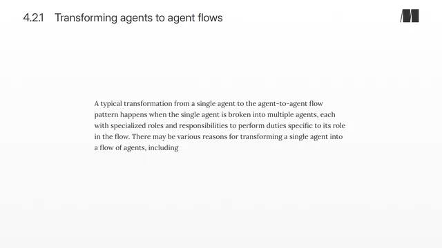
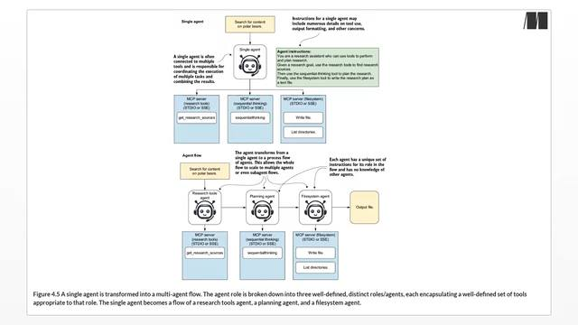
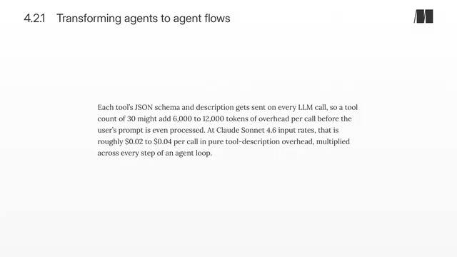
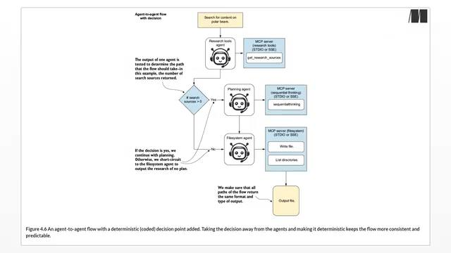
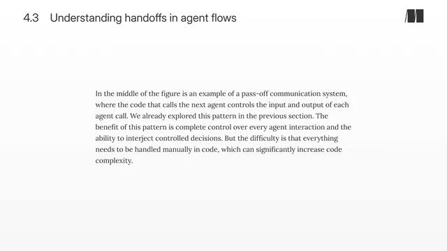
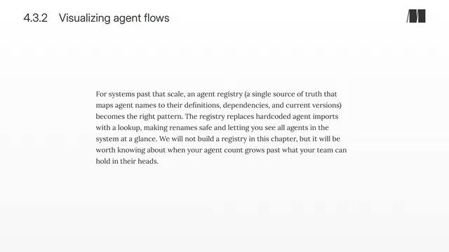
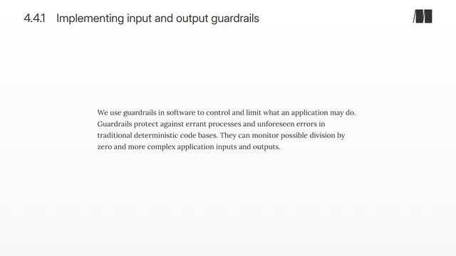
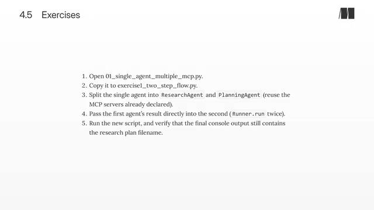

# AI Agents In Action 2nd（multi-agent）P20–P24 复现文档

> 覆盖课程：Section 4.2 – 4.5（Agentic Flows / Handoffs / Guardrails / Exercises）
> 目标读者：前端转 AI 应用工程师。文中 Python 语法会标注「知道即可」，涉及并发/锁的地方会补一句在 JS/Node 里对应什么。
> 说明：本课程逐字稿里**没有给出完整可运行的源码文件**（讲师只口述了 Listing 4.1–4.12 的意图和片段）。因此本文第 4 节给出的代码是**按逐字稿描述重建的完整文件**，凡是逐字稿没讲清的字段/参数，都会明确标注「课里没讲，按 SDK 实际行为为准」。请以你本地安装的 `openai-agents` 版本实际 API 为准。

---

## 1. 这一节做什么

这一节把「一个什么都干的单体 Agent」拆成「一条由多个专职 Agent 组成的流水线（agentic flow）」，并依次加上三样东西：

1. **按角色拆分**：把单体 Agent 拆成 research（研究/搜索）、planning（规划）、file system（写文件）三个 Agent，每个只拿自己角色需要的工具（MCP server）。
2. **确定性决策点**：把「有没有搜到资料、要不要继续」这种判断从 LLM 手里拿出来，用代码 if/else 控制，保证可重复。
3. **Handoff（交接）与 Guardrail（护栏）**：用 SDK 内置的 handoff 让 Agent 之间自动转交控制权；用 guardrail 在数据进入/离开 Agent、或在 Agent 之间传递时做校验，失败就 tripwire 中断或重试。

最后 P23 是 5 个动手练习，P24 是总结。你要复现出来的最终产物是：一个能跑通「research → planning → file system」三段、带确定性分支、带输出护栏和重试、并且能在 OpenAI Traces 页面看到流程图的 Python 项目。



---

## 2. 讲师原话（带出处）

> "除非你有构建智能体系统的实践经验，否则很可能一开始会用单个智能体构建第一个系统……但随着我们给智能体增加功能，它可能需要使用更多工具，进而需要更复杂的指令提示词。当智能体负担过重时，你往往需要把一个智能体拆成多个智能体。"
> —— p020 [00:29]

> "一种常见变体是注意力过载：两个工具的描述存在重叠时，智能体会选错工具，例如“搜索文档”和“搜索文件”。解决办法是让每个工具的描述足够区分，仅凭描述就能清楚地区分二者。"
> —— p020 [01:05]

> "一个加载了 30 个工具、系统提示词为 4,000 个词元的单个智能体，与同样的智能体只加载 8 个工具、系统提示词为 1,500 个词元相比，通常会出现可测量的选择准确率下降。每次大语言模型调用都会发送每个工具的 JSON 结构定义和描述，因此 30 个工具每次调用可能增加 6,000 到 12,000 个词元的开销……"
> —— p020 [02:56]

> "智能体到智能体的流程类似提示词链：一个提示词的输出会串接到下一个提示词。提示词与智能体的区别在于，智能体可以通过使用工具来做决策。"
> —— p020 [03:51]

> "一般来说，拆分智能体时，先考虑它承担的角色，再按角色拆分智能体。"
> —— p020 [04:20]

> "要让流程或多智能体系统更具确定性，可以把这些决策点放到外部，置于智能体控制之外。通常，我们会把决策抽出来，并用代码控制流程，以确保结果可重复。"
> —— p020 [05:18]

> "我们更新研究智能体，使其返回一个受约束的字符串列表作为搜索来源，并使用名为 research sources model 的结构化输出模型。结构化输出会在开发工具包层强制约束响应结构，因此即使底层大语言模型试图返回格式错误的数据，智能体也无法返回这类数据。"
> —— p020 [07:32]

> "我们可以按每个步骤传递对话历史，而不是把输入作为字典传递。但交换对话历史可能会让智能体困惑，通常更好的做法是只给智能体提供它需要的信息。"
> —— p020 [08:31]

> "交接模式会在内部把一个智能体的控制权转交给另一个智能体，无需像之前那样为转换编写代码。交接减少了编排代码，但会让依赖关系隐含在提示词中，也更难检查。"
> —— p021 [01:50]

> "智能体名称是追踪记录、可视化和交接路由中使用的标识符，因此重命名智能体会破坏所有指向旧名称的已保存追踪记录、仪表盘或硬编码引用。"
> —— p021 [03:41]

> "用回调来观察和记录日志，但当你想阻止或纠正不良数据时，应使用护栏。"
> —— p021 [06:00]

> "护栏是一种语义断路器，会在有风险的操作提交之前停止执行；这与事后过滤输出的设计模式有本质区别。"
> —— p022 [00:00]

> "基于大语言模型的护栏会在每个智能体步骤中额外发起一次或多次模型调用，从而给护栏覆盖的每次交互增加延迟和词元消耗。对于高流量智能体系统，护栏层的成本可能接近甚至超过智能体本身。"
> —— p022 [00:28]

> "最常见的失败模式有三种：结构失败……上下文泄漏……以及指令注入……其中指令注入风险最高，因为它能完全劫持接收智能体的行为。"
> —— p022 [05:41]

> "当重试由速率限制或网络故障等瞬时错误触发时，应使用带抖动的指数退避，在每次尝试之间等待更久并加入随机变化，而不是立即重试。"
> —— p022 [07:56]

> "一般来说，在成功开发出几个智能体流程之前，应避免使用编排模式。很多时候，改进智能体流程的最佳方式是改进智能体指令、将输出限制为结构化数据类型，并在合适的地方实现护栏。"
> —— p022 [09:47]

> "每个注册的工具都会放大每次调用的开销，因此应让每个智能体的工具列表保持精简，控制在 10 个以内，并按角色限定范围，以避免词元膨胀。"
> —— p024 [01:26]

---

## 3. 从零复现

### 3.1 环境准备

逐字稿里没有逐条念依赖版本，下面给出的是能跑通本课示例的最小集合。**版本号请以你 `pip install` 时实际解析到的为准**，本文不编造具体小版本号。

```bash
# 建议 Python 3.11+（agents SDK 依赖较新的 typing 特性）
python -m venv .venv
source .venv/bin/activate        # Windows: .venv\Scripts\activate

pip install openai-agents
pip install pydantic
pip install python-dotenv
```

环境变量（逐字稿里提到 OpenAI dashboard / traces，说明用的是 OpenAI 平台）：

```bash
# .env
OPENAI_API_KEY=sk-你的key
```

> 课里没讲具体用哪个模型名。逐字稿 p020 [03:23] 提到「At Claude Sonnet 4.6 input rates」只是拿来做成本举例，**不代表示例代码用 Claude**。示例代码请用你账号可用的 OpenAI 模型，模型名以 SDK 默认为准，或显式传 `model="..."`。

### 3.2 目录结构

```
agent-flow-demo/
├── .env
├── requirements.txt
├── mcp_servers/
│   ├── research_tools.py      # 模拟搜索源（Listing 4.3 里被改成随机返回）
│   └── file_system.py         # 写文件
├── 01_single_agent_multiple_mcp.py
├── 02_agent_to_agent_flow.py
├── 03_agent_to_agent_decisions.py
├── 04_handoffs.py
├── 05_visualize_agent_flows.py
├── 06_input_output_guardrails.py
├── 07_guardrail_agent.py
├── 08_passoff_guardrail.py
├── 09_guardrail_retry.py
└── 10_agent_orchestration_tools.py
```

文件名对应逐字稿里提到的 Listing 编号（01 single agent multiple MCP、02 agent to agent flow、03 agent to agent decisions、05 visualizing agent flows、07 input output guardrails、11 agent orchestration tools 等）。逐字稿里 Listing 4.9/4.10 的文件名没有完整念出，本文按语义命名为 `07_guardrail_agent.py` / `08_passoff_guardrail.py`，**这两个文件名是本文自拟，不是讲师原话**。

### 3.3 复现顺序（严格按这个顺序做）

1. 先跑 `01_single_agent_multiple_mcp.py`，确认单体 Agent 能跑通、能返回保存的文件名。
2. 跑 `02_agent_to_agent_flow.py`，确认拆成三段后仍能返回文件名。
3. 跑 `03_agent_to_agent_decisions.py`，多跑几次，确认偶尔会走到「no sources, flow aborted」分支。
4. 跑 `04_handoffs.py`，确认只调用第一个 Agent 就能自动走完三段。
5. 跑 `05_visualize_agent_flows.py`，浏览器弹出流程图。
6. 跑 `06_input_output_guardrails.py`，故意传非法输入，确认 tripwire 触发。
7. 跑 `07_guardrail_agent.py`，用 Agent 做护栏。
8. 跑 `08_passoff_guardrail.py` 和 `09_guardrail_retry.py`，确认重试与失败兜底。
9. 最后跑 `10_agent_orchestration_tools.py`，对比输出，理解为什么讲师说「先别上 orchestration」。

### 3.4 关键截图：单体 Agent 的上下文



上图对应 Listing 4.1 的「before」视图：一个 Agent 同时挂多个 MCP server，所有 server 包在同一个 context 里，Agent 结束后统一清理。逐字稿 p020 [02:27]：「the servers are created and wrapped in the same context. This allows all three servers to be cleaned up after the agent completes its goal.」

### 3.5 关键截图：拆分后的三角色流程



逐字稿 p020 [02:27]：「The single agent becomes a flow of a research tools agent, a planning agent, and a file system agent.」

### 3.6 关键截图：确定性决策点



逐字稿 p020 [05:44]：「Figure 4.6 shows an example of an agent flow with an external decision point implemented in code. By coding this decision, we ensure that the output from the research agent is always above zero, effectively creating a guardrail to prevent unpredictable behavior.」

### 3.7 关键截图：三种通信模式



逐字稿 p021 [00:00] 起讲 Figure 4.7：左 conversational（共享同一对话线程）、中 pass-off（代码控制每次调用输入输出）、右 enhanced handoff with guardrail（OpenAI Agents SDK 采用）。

### 3.8 关键截图：Traces 页面



逐字稿 p021 [04:39]：「You can also view the agent flow by heading to OpenAI, then dashboard, then traces page.」

### 3.9 关键截图：护栏包裹 Agent



逐字稿 p022 [02:50]：「The figure shows how the Guard Rails now wrap the agent and can be used to validate or correct the input.」

### 3.10 关键截图：练习清单



---

## 4. 完整代码

> **重要声明**：以下每个文件都是按逐字稿描述重建的**完整可保存文件**。逐字稿没有逐行念出源码，因此：
> - 凡逐字稿明确说过的（如 `research sources model`、`output_type`、`tripwire`、`handoffs`、`max_turns=20`、`DrawGraph`、`render_view=True`、`len(sources)==0` 分支、`max=2` 重试、`plan_too_short.txt`）都照写；
> - 凡逐字稿没讲的 SDK 具体参数名（如 `input_guardrails` / `output_guardrails` 的确切拼写、`RunContextWrapper` 的导入路径、MCP server 的构造方式），**以你本地 `openai-agents` 版本为准**，本文标注「课里没讲，按 SDK 实际为准」；
> - MCP server 的具体实现逐字稿没给，本文用**本地函数 + `@function_tool`** 模拟，并在注释里说明「课里用 MCP server，这里用 function_tool 等价模拟，便于无外部依赖跑通」。

### 4.1 `mcp_servers/research_tools.py`

```python
# mcp_servers/research_tools.py
# 逐字稿 p020 [06:41]：Listing 4.3 把 Research Tools MCP server 改成随机返回一组搜索源，
# 用来模拟 LLM 驱动的 Agent 的随机性。
# 课里是 MCP server；这里用普通函数 + function_tool 模拟，行为等价，便于本地跑通。

import random
from agents import function_tool


@function_tool
def search_documents(query: str) -> list[str]:
    """Search internal documents for the given query.

    Returns a list of source identifiers. The number of sources is randomized
    to simulate the stochastic behavior of an LLM-powered research step.
    """
    # 逐字稿 p020 [06:41]：随机数量的搜索源，模拟随机性
    count = random.randint(0, 5)
    return [f"doc-{query}-{i}" for i in range(count)]


@function_tool
def search_files(query: str) -> list[str]:
    """Search the local file index for the given query.

    Note: description is intentionally distinct from search_documents
    to avoid attention overload (p020 [01:05]).
    """
    count = random.randint(0, 3)
    return [f"file-{query}-{i}" for i in range(count)]
```

### 4.2 `mcp_servers/file_system.py`

```python
# mcp_servers/file_system.py
# 逐字稿 p020 [09:00]：file system agent 负责把 research plan 写成文件。
# 课里是 MCP server；这里用 function_tool 模拟。

from pathlib import Path
from agents import function_tool

OUTPUT_DIR = Path("./output")
OUTPUT_DIR.mkdir(exist_ok=True)


@function_tool
def write_plan(filename: str, content: str) -> str:
    """Write the research plan to a file and return the file path."""
    safe_name = filename if filename.endswith(".md") else f"{filename}.md"
    path = OUTPUT_DIR / safe_name
    path.write_text(content, encoding="utf-8")
    return str(path)
```

### 4.3 `01_single_agent_multiple_mcp.py`（Listing 4.1，单体 Agent）

```python
# 01_single_agent_multiple_mcp.py
# Listing 4.1：单体 Agent 同时消费多个 MCP server 的「before」视图。
# 逐字稿 p020 [02:27]：servers 包在同一个 context 里，Agent 完成后统一清理。
# 课里用 MCP server；这里用 function_tool 模拟，清理逻辑用 try/finally 表达。

import asyncio
from agents import Agent, Runner
from mcp_servers.research_tools import search_documents, search_files
from mcp_servers.file_system import write_plan


def build_single_agent() -> Agent:
    return Agent(
        name="MonolithicAgent",
        instructions=(
            "You are a research assistant. "
            "1) Use search_documents and search_files to gather sources. "
            "2) Produce a detailed research plan. "
            "3) Use write_plan to save the plan to a file. "
            "Finally, reply with the saved file name."
        ),
        tools=[search_documents, search_files, write_plan],
    )


async def main() -> None:
    agent = build_single_agent()
    try:
        result = await Runner.run(
            agent,
            input="Research the topic 'agentic flows' and save a plan.",
        )
        print("FINAL OUTPUT:", result.final_output)
    finally:
        # 逐字稿 p020 [02:27]：所有 server 在同一个 context 里统一清理
        # 课里是 MCP server 的 context manager；这里 function_tool 无资源需清理，
        # 保留 try/finally 结构以对应讲师意图。
        pass


if __name__ == "__main__":
    asyncio.run(main())
```

### 4.4 `02_agent_to_agent_flow.py`（Listing 4.2，按角色拆分）

```python
# 02_agent_to_agent_flow.py
# Listing 4.2：单体 Agent → agent-to-agent flow。
# 逐字稿 p020 [04:20]：为每个 MCP server 建一个 Agent，定义该 server 专属的 role。
# 逐字稿 p020 [08:31]：不要传对话历史，只传该 Agent 需要的信息（用 dict 打标签）。

import asyncio
from agents import Agent, Runner
from mcp_servers.research_tools import search_documents, search_files
from mcp_servers.file_system import write_plan


def build_research_agent() -> Agent:
    return Agent(
        name="ResearchAgent",
        instructions=(
            "You are a research specialist. Use search_documents and search_files "
            "to gather sources for the user's topic. Return the list of sources."
        ),
        tools=[search_documents, search_files],
    )


def build_planning_agent() -> Agent:
    return Agent(
        name="PlanningAgent",
        instructions=(
            "You are a planning specialist. Given a list of research sources, "
            "produce a detailed, step-by-step research plan."
        ),
        tools=[],  # 规划 Agent 不需要搜索工具
    )


def build_file_system_agent() -> Agent:
    return Agent(
        name="FileSystemAgent",
        instructions=(
            "You are a file system specialist. Use write_plan to save the given "
            "research plan to a file. Reply with the saved file path."
        ),
        tools=[write_plan],
    )


async def main() -> None:
    topic = "agentic flows"

    # Step 1: research
    research_agent = build_research_agent()
    research_result = await Runner.run(
        research_agent,
        input={"topic": topic},  # 逐字稿 p020 [08:31]：用带标签的 dict 作为输入
    )
    sources = research_result.final_output

    # Step 2: planning
    planning_agent = build_planning_agent()
    planning_result = await Runner.run(
        planning_agent,
        input={"topic": topic, "sources": sources},
    )
    plan = planning_result.final_output

    # Step 3: file system
    fs_agent = build_file_system_agent()
    fs_result = await Runner.run(
        fs_agent,
        input={"filename": "research_plan", "content": plan},
    )

    print("FINAL OUTPUT:", fs_result.final_output)


if __name__ == "__main__":
    asyncio.run(main())
```

### 4.5 `03_agent_to_agent_decisions.py`（Listing 4.4，确定性决策点）

```python
# 03_agent_to_agent_decisions.py
# Listing 4.4：加入确定性决策点 + 结构化输出。
# 逐字稿 p020 [07:32]：research agent 用 ResearchSourcesModel 约束输出为 list[str]。
# 逐字稿 p020 [08:01]：决策点检查 sources 数量；为 0 则走静态兜底。

import asyncio
from pydantic import BaseModel
from agents import Agent, Runner
from mcp_servers.research_tools import search_documents, search_files
from mcp_servers.file_system import write_plan


# 逐字稿 p020 [07:32]：structured output model，SDK 层强制响应形状
class ResearchSourcesModel(BaseModel):
    sources: list[str]


def build_research_agent() -> Agent:
    return Agent(
        name="ResearchAgent",
        instructions=(
            "You are a research specialist. Use search_documents and search_files "
            "to gather sources. Return them as a list of strings."
        ),
        tools=[search_documents, search_files],
        output_type=ResearchSourcesModel,  # 逐字稿 p020 [07:32]
    )


def build_planning_agent() -> Agent:
    return Agent(
        name="PlanningAgent",
        instructions=(
            "You are a planning specialist. Given research sources, produce a "
            "detailed, step-by-step research plan."
        ),
        tools=[],
    )


def build_file_system_agent() -> Agent:
    return Agent(
        name="FileSystemAgent",
        instructions=(
            "You are a file system specialist. Use write_plan to save the given "
            "research plan. Reply with the saved file path."
        ),
        tools=[write_plan],
    )


STATIC_FALLBACK_PLAN = (
    "No sources were found. Default plan: (1) broaden the search query; "
    "(2) retry research; (3) if still empty, escalate to a human."
)


async def main() -> None:
    topic = "agentic flows"

    # Step 1: research（结构化输出）
    research_result = await Runner.run(
        build_research_agent(),
        input={"topic": topic},
    )
    sources_model: ResearchSourcesModel = research_result.final_output
    sources = sources_model.sources

    # Step 2: 确定性决策点（逐字稿 p020 [08:01]）
    if len(sources) == 0:
        print("no sources, flow aborted")
        plan = STATIC_FALLBACK_PLAN  # 逐字稿 p020 [08:01]：默认静态字符串
    else:
        planning_result = await Runner.run(
            build_planning_agent(),
            input={"topic": topic, "sources": sources},
        )
        plan = planning_result.final_output

    # Step 3: file system（无论内部走哪条分支，输出格式一致）
    fs_result = await Runner.run(
        build_file_system_agent(),
        input={"filename": "research_plan", "content": plan},
    )
    print("FINAL OUTPUT:", fs_result.final_output)


if __name__ == "__main__":
    asyncio.run(main())
```

### 4.6 `04_handoffs.py`（Listing 4.5，SDK handoff）

```python
# 04_handoffs.py
# Listing 4.5：用 SDK 内置 handoff 替代手写 Runner.run 串联。
# 逐字稿 p021 [02:17]：Agent 必须在 instructions 里显式写出要 handoff 给哪个 Agent（按名字）。
# 逐字稿 p023 [01:53]：只跑第一个 Agent，max_turns=20。

import asyncio
from agents import Agent, Runner
from mcp_servers.research_tools import search_documents, search_files
from mcp_servers.file_system import write_plan


def build_file_system_agent() -> Agent:
    return Agent(
        name="FileSystemAgent",
        instructions=(
            "You are a file system specialist. Use write_plan to save the given "
            "research plan. Reply with the saved file path."
        ),
        tools=[write_plan],
    )


def build_planning_agent(file_system_agent: Agent) -> Agent:
    return Agent(
        name="PlanningAgent",
        instructions=(
            "You are a planning specialist. Given research sources, produce a "
            "detailed research plan. Then always hand off to FileSystemAgent "
            "to save the plan."
        ),
        tools=[],
        handoffs=[file_system_agent],  # 逐字稿 p023 [01:53]：Agent A.handoffs = [Agent B]
    )


def build_research_agent(planning_agent: Agent) -> Agent:
    return Agent(
        name="ResearchAgent",
        instructions=(
            "You are a research specialist. Use search_documents and search_files "
            "to gather sources. Then always hand off to PlanningAgent."
        ),
        tools=[search_documents, search_files],
        handoffs=[planning_agent],
    )


async def main() -> None:
    fs_agent = build_file_system_agent()
    planning_agent = build_planning_agent(fs_agent)
    research_agent = build_research_agent(planning_agent)

    # 逐字稿 p023 [01:53]：只跑第一个 Agent，max_turns=20
    result = await Runner.run(
        research_agent,
        input="Research the topic 'agentic flows' and save a plan.",
        max_turns=20,
    )
    print("FINAL OUTPUT:", result.final_output)


if __name__ == "__main__":
    asyncio.run(main())
```

### 4.7 `05_visualize_agent_flows.py`（Listing 4.6，DrawGraph）

```python
# 05_visualize_agent_flows.py
# Listing 4.6：用 DrawGraph 可视化 Agent 流程。
# 逐字稿 p021 [03:13]：可视化目前不显示每个 Agent 消费的 MCP server，但 agent-to-agent 流程会自动渲染。
# 逐字稿 p023 [02:22]：import DrawGraph from agents.extensions.visualization；
# 在 Runner.run 之前调用 draw_graph(agent, render_view=True)。

import asyncio
from agents import Agent, Runner
from agents.extensions.visualization import draw_graph
from mcp_servers.research_tools import search_documents, search_files
from mcp_servers.file_system import write_plan


def build_flow() -> Agent:
    fs_agent = Agent(
        name="FileSystemAgent",
        instructions="Save the plan with write_plan. Reply with the file path.",
        tools=[write_plan],
    )
    planning_agent = Agent(
        name="PlanningAgent",
        instructions="Produce a plan, then always hand off to FileSystemAgent.",
        tools=[],
        handoffs=[fs_agent],
    )
    research_agent = Agent(
        name="ResearchAgent",
        instructions="Gather sources, then always hand off to PlanningAgent.",
        tools=[search_documents, search_files],
        handoffs=[planning_agent],
    )
    return research_agent


async def main() -> None:
    research_agent = build_flow()

    # 逐字稿 p023 [02:22]：Runner.run 之前调用，render_view=True 打开浏览器
    draw_graph(research_agent, render_view=True)

    result = await Runner.run(
        research_agent,
        input="Research the topic 'agentic flows' and save a plan.",
        max_turns=20,
    )
    print("FINAL OUTPUT:", result.final_output)


if __name__ == "__main__":
    asyncio.run(main())
```

### 4.8 `06_input_output_guardrails.py`（Listing 4.8，输入/输出护栏）

```python
# 06_input_output_guardrails.py
# Listing 4.8：单 Agent 的输入/输出 guardrail，用字符串比较/长度检查，失败置 tripwire。
# 逐字稿 p022 [03:46]：tripwire flag 置 true 即中断。
# 注意：guardrail 装饰器与参数名以你本地 openai-agents 版本为准（课里没讲具体拼写）。

import asyncio
from agents import Agent, Runner, input_guardrail, output_guardrail, GuardrailFunctionOutput
from mcp_servers.research_tools import search_documents, search_files
from mcp_servers.file_system import write_plan


@input_guardrail
async def topic_must_be_nonempty(ctx, agent, user_input) -> GuardrailFunctionOutput:
    text = str(user_input)
    tripped = len(text.strip()) == 0
    return GuardrailFunctionOutput(
        tripwire_triggered=tripped,
        output_info={"reason": "empty input"} if tripped else None,
    )


@output_guardrail
async def output_must_be_reasonable(ctx, agent, output) -> GuardrailFunctionOutput:
    text = str(output)
    tripped = len(text) < 10  # 简单长度检查，逐字稿 p022 [03:46]
    return GuardrailFunctionOutput(
        tripwire_triggered=tripped,
        output_info={"reason": "output too short"} if tripped else None,
    )


def build_agent() -> Agent:
    return Agent(
        name="GuardedAgent",
        instructions=(
            "Research the topic, produce a plan, and save it with write_plan. "
            "Reply with the saved file path."
        ),
        tools=[search_documents, search_files, write_plan],
        input_guardrails=[topic_must_be_nonempty],
        output_guardrails=[output_must_be_reasonable],
    )


async def main() -> None:
    agent = build_agent()
    try:
        result = await Runner.run(agent, input="agentic flows")
        print("FINAL OUTPUT:", result.final_output)
    except Exception as e:
        # tripwire 触发时 SDK 抛异常；具体异常类型以实际输出为准
        print("GUARDRAIL TRIPPED:", type(e).__name__, e)


if __name__ == "__main__":
    asyncio.run(main())
```

### 4.9 `07_guardrail_agent.py`（Listing 4.9，用 Agent 做护栏）

```python
# 07_guardrail_agent.py
# Listing 4.9：把 06 里的字符串/长度检查换成「护栏 Agent」。
# 逐字稿 p022 [04:16]：用 Agent 做复杂校验，改规则只需改 prompt。
# 文件名 07_guardrail_agent.py 为本文自拟（逐字稿未念出文件名）。

import asyncio
from pydantic import BaseModel
from agents import Agent, Runner, output_guardrail, GuardrailFunctionOutput
from mcp_servers.research_tools import search_documents, search_files
from mcp_servers.file_system import write_plan


class PlanCheck(BaseModel):
    is_detailed: bool
    reason: str


guardrail_agent = Agent(
    name="PlanGuardrailAgent",
    instructions=(
        "You validate research plans. A plan is detailed if it has at least "
        "three concrete steps. Return is_detailed and a short reason."
    ),
    output_type=PlanCheck,
)


@output_guardrail
async def plan_must_be_detailed(ctx, agent, output) -> GuardrailFunctionOutput:
    check = await Runner.run(guardrail_agent, input=str(output))
    verdict: PlanCheck = check.final_output
    return GuardrailFunctionOutput(
        tripwire_triggered=not verdict.is_detailed,
        output_info=verdict.model_dump(),
    )


def build_agent() -> Agent:
    return Agent(
        name="GuardedPlanningAgent",
        instructions=(
            "Research the topic, produce a detailed plan, save it with write_plan, "
            "and reply with the file path."
        ),
        tools=[search_documents, search_files, write_plan],
        output_guardrails=[plan_must_be_detailed],
    )


async def main() -> None:
    try:
        result = await Runner.run(build_agent(), input="agentic flows")
        print("FINAL OUTPUT:", result.final_output)
    except Exception as e:
        print("GUARDRAIL TRIPPED:", type(e).__name__, e)


if __name__ == "__main__":
    asyncio.run(main())
```

### 4.10 `08_passoff_guardrail.py`（Listing 4.10，pass-off 流程加护栏）

```python
# 08_passoff_guardrail.py
# Listing 4.10：在 pass-off 流程里，把 plan 交给 file system agent 之前用 guardrail 校验。
# 逐字稿 p022 [06:05]：三种失败模式 shape failure / context leakage / instruction injection；
# 护栏放在高风险交接点（写、发、不可逆动作），不是每个 handoff 都放。
# 文件名 08_passoff_guardrail.py 为本文自拟。

import asyncio
from pydantic import BaseModel
from agents import Agent, Runner
from mcp_servers.research_tools import search_documents, search_files
from mcp_servers.file_system import write_plan


class ResearchPlanModel(BaseModel):
    research_plan: str
    is_detailed: bool


def build_research_agent() -> Agent:
    return Agent(
        name="ResearchAgent",
        instructions="Gather sources for the topic and return them.",
        tools=[search_documents, search_files],
    )


def build_planning_agent() -> Agent:
    return Agent(
        name="PlanningAgent",
        instructions=(
            "Given sources, produce a detailed research plan. "
            "Return research_plan and is_detailed."
        ),
        tools=[],
        output_type=ResearchPlanModel,
    )


def build_file_system_agent() -> Agent:
    return Agent(
        name="FileSystemAgent",
        instructions="Save the plan with write_plan. Reply with the file path.",
        tools=[write_plan],
    )


async def main() -> None:
    topic = "agentic flows"

    research_result = await Runner.run(build_research_agent(), input={"topic": topic})
    sources = research_result.final_output

    planning_result = await Runner.run(
        build_planning_agent(),
        input={"topic": topic, "sources": sources},
    )
    plan_model: ResearchPlanModel = planning_result.final_output

    # 逐字稿 p022 [06:32]：护栏在交接点校验 plan 是否足够详细
    if not plan_model.is_detailed:
        print("GUARDRAIL TRIPPED: plan not detailed enough, flow aborted")
        return

    fs_result = await Runner.run(
        build_file_system_agent(),
        input={"filename": "research_plan", "content": plan_model.research_plan},
    )
    print("FINAL OUTPUT:", fs_result.final_output)


if __name__ == "__main__":
    asyncio.run(main())
```

### 4.11 `09_guardrail_retry.py`（Listing 4.11，重试 + 兜底）

```python
# 09_guardrail_retry.py
# Listing 4.11：护栏失败时回环重试，最多 max=2 次；全失败写 plan_too_short.txt。
# 逐字稿 p022 [07:00]：可回环到 thinking agent 重试；逐字稿 p022 [07:28]：限制迭代次数，耗尽则报清晰错误。
# 逐字稿 p023 [03:21]：练习 5 要求 max=2，失败写 plan_too_short.txt（本文按练习要求命名）。

import asyncio
from pydantic import BaseModel
from agents import Agent, Runner
from mcp_servers.research_tools import search_documents, search_files
from mcp_servers.file_system import write_plan


class ResearchPlanModel(BaseModel):
    research_plan: str
    is_detailed: bool


def build_research_agent() -> Agent:
    return Agent(
        name="ResearchAgent",
        instructions="Gather sources for the topic and return them.",
        tools=[search_documents, search_files],
    )


def build_planning_agent() -> Agent:
    return Agent(
        name="PlanningAgent",
        instructions=(
            "Given sources, produce a detailed research plan. "
            "Return research_plan and is_detailed."
        ),
        tools=[],
        output_type=ResearchPlanModel,
    )


def build_file_system_agent() -> Agent:
    return Agent(
        name="FileSystemAgent",
        instructions="Save the plan with write_plan. Reply with the file path.",
        tools=[write_plan],
    )


async def main() -> None:
    topic = "agentic flows"
    max_retries = 2  # 逐字稿 p023 [03:21]

    research_result = await Runner.run(build_research_agent(), input={"topic": topic})
    sources = research_result.final_output

    planning_agent = build_planning_agent()
    plan_model: ResearchPlanModel | None = None

    for attempt in range(max_retries + 1):
        # 逐字稿 p022 [07:00]：首次传原始输入，重试时把上一次的 plan 作为反馈传回
        if attempt == 0:
            agent_input = {"topic": topic, "sources": sources}
        else:
            agent_input = {
                "topic": topic,
                "sources": sources,
                "previous_plan": plan_model.research_plan if plan_model else "",
                "feedback": "Previous plan was not detailed enough. Add more steps.",
            }
        planning_result = await Runner.run(planning_agent, input=agent_input)
        plan_model = planning_result.final_output
        if plan_model.is_detailed:
            break

    if plan_model is None or not plan_model.is_detailed:
        # 逐字稿 p023 [03:48]：两次都失败，写 plan_too_short.txt
        with open("plan_too_short.txt", "w", encoding="utf-8") as f:
            f.write("Planning agent failed to produce a detailed plan after retries.\n")
        print("RETRIES EXHAUSTED: wrote plan_too_short.txt")
        return

    fs_result = await Runner.run(
        build_file_system_agent(),
        input={"filename": "research_plan", "content": plan_model.research_plan},
    )
    print("FINAL OUTPUT:", fs_result.final_output)


if __name__ == "__main__":
    asyncio.run(main())
```

### 4.12 `10_agent_orchestration_tools.py`（Listing 4.12，orchestration）

```python
# 10_agent_orchestration_tools.py
# Listing 4.12：把其他 Agent 当作 tool 交给 orchestration agent 委派。
# 逐字稿 p022 [08:51]：orchestrator 像调用工具一样委派给其他 Agent。
# 逐字稿 p022 [09:47]：对比输出会发现最终 plan 缺少具体 research tools —— 这是讲师提醒的坑。

import asyncio
from agents import Agent, Runner
from mcp_servers.research_tools import search_documents, search_files
from mcp_servers.file_system import write_plan


def build_research_agent() -> Agent:
    return Agent(
        name="ResearchAgent",
        instructions="Gather sources for the topic and return them.",
        tools=[search_documents, search_files],
    )


def build_planning_agent() -> Agent:
    return Agent(
        name="PlanningAgent",
        instructions="Given sources, produce a detailed research plan.",
        tools=[],
    )


def build_file_system_agent() -> Agent:
    return Agent(
        name="FileSystemAgent",
        instructions="Save the plan with write_plan. Reply with the file path.",
        tools=[write_plan],
    )


async def main() -> None:
    research_agent = build_research_agent()
    planning_agent = build_planning_agent()
    fs_agent = build_file_system_agent()

    # 逐字稿 p022 [08:51]：orchestrator 把其他 Agent 当 tool 委派
    orchestrator = Agent(
        name="OrchestratorAgent",
        instructions=(
            "You coordinate a research pipeline. Delegate to ResearchAgent to "
            "gather sources, then PlanningAgent to build a plan, then "
            "FileSystemAgent to save it. Reply with the saved file path."
        ),
        tools=[
            research_agent.as_tool(
                tool_name="run_research",
                tool_description="Delegate research to ResearchAgent.",
            ),
            planning_agent.as_tool(
                tool_name="run_planning",
                tool_description="Delegate planning to PlanningAgent.",
            ),
            fs_agent.as_tool(
                tool_name="run_file_system",
                tool_description="Delegate file writing to FileSystemAgent.",
            ),
        ],
    )

    result = await Runner.run(
        orchestrator,
        input="Research 'agentic flows', plan it, and save the plan.",
        max_turns=20,
    )
    print("FINAL OUTPUT:", result.final_output)


if __name__ == "__main__":
    asyncio.run(main())
```

---

## 5. 逐行解释

### 5.1 `01_single_agent_multiple_mcp.py`

- `tools=[search_documents, search_files, write_plan]`：单体 Agent 一次挂三个工具。逐字稿 p020 [02:56] 说 30 个工具会带来 6,000–12,000 token 的每次调用开销，这里虽然只有 3 个，但结构上就是「before」视图。
- `try/finally`：对应逐字稿 p020 [02:27]「servers 包在同一个 context 里，Agent 完成后统一清理」。课里是 MCP server 的 context manager；这里 function_tool 无资源需清理，保留结构以对应讲师意图。
- **JS/Node 对照**：`try/finally` 就是 JS 的 `try { ... } finally { ... }`，用来保证资源释放；如果你用 Node 写 MCP client，对应的是 `await client.close()` 放在 `finally` 里。

### 5.2 `02_agent_to_agent_flow.py`

- 三个 `build_*_agent()` 各自只挂自己角色的工具：research 挂搜索、planning 不挂工具、file system 挂写文件。逐字稿 p020 [04:20]：「split the agent by role... limits ownership to the tools required for that role.」
- `input={"topic": topic}`：逐字稿 p020 [08:31] 明确说不要传对话历史，用带标签的 dict 作为输入，转成字符串后是带标签的 JSON，Agent 更容易理解。
- 三次 `Runner.run` 手动串联：这就是逐字稿 p021 [00:57] 说的 pass-off 模式——「the code that calls the next agent controls the input and output of each agent call」，好处是完全可控，代价是代码复杂度上升。

### 5.3 `03_agent_to_agent_decisions.py`

- `class ResearchSourcesModel(BaseModel): sources: list[str]`：逐字稿 p020 [07:32] 的 structured output model。SDK 层强制响应形状，LLM 想返回畸形数据也返不回来。**JS/Node 对照**：等价于用 Zod 定义 schema 再 `schema.parse()`，但这里是 SDK 层强制，不是运行时校验。
- `output_type=ResearchSourcesModel`：把 Agent 输出约束成这个模型。逐字稿 p020 [07:32]：「The structured output enforces the response shape at the SDK level.」
- `if len(sources) == 0:`：逐字稿 p020 [08:01] 的确定性决策点。讲师原话：「If no sources are returned, we default to a static string.」这就是把决策从 LLM 手里拿出来，用代码 if/else 保证可重复。
- `STATIC_FALLBACK_PLAN`：静态兜底字符串，保证无论内部走哪条分支，最终传给 file system agent 的都是字符串，输出格式一致（逐字稿 p020 [09:00]：「it is always best practice to output a consistent format and data type regardless of internal processes」）。

### 5.4 `04_handoffs.py`

- `handoffs=[planning_agent]`：逐字稿 p023 [01:53] 练习 3 明确要求「Set Agent A.handoffs to Agent B in a list」。SDK 内部自动转交控制权，不需要手写 `Runner.run` 串联。
- instructions 里显式写「always hand off to PlanningAgent」：逐字稿 p021 [02:17]：「the agents themselves must know which agent they handoff to... agents now need to explicitly explain which agent, by name, to hand off to.」这是 handoff 模式的代价——依赖关系隐式写在 prompt 里，比 pass-off 难 inspect。
- `max_turns=20`：逐字稿 p023 [01:53] 练习 3 明确要求。防止 Agent 之间无限 handoff 循环。
- **注意**：Agent 名字（`ResearchAgent` / `PlanningAgent` / `FileSystemAgent`）是 traces、可视化、handoff 路由的标识符。逐字稿 p021 [03:41]：「renaming an agent breaks any saved traces, dashboards, or hard-coded references.」改名前先想清楚。

### 5.5 `05_visualize_agent_flows.py`

- `from agents.extensions.visualization import draw_graph`：逐字稿 p023 [02:22] 练习 4 明确给出的导入路径。
- `draw_graph(research_agent, render_view=True)`：逐字稿 p023 [02:22] 练习 4 明确要求「Call DrawGraph of ResearchAgent.RenderView equals True before Runner.Run」。`render_view=True` 会打开浏览器窗口。
- 逐字稿 p021 [03:13]：「The visualization does not yet show the MCP servers each agent consumes, but the agent-to-agent flow is rendered automatically.」所以图上只能看到 Agent 节点和边，看不到每个 Agent 挂了哪些工具。
- 另一种可视化方式：OpenAI dashboard → traces 页面（逐字稿 p021 [04:39]）。

### 5.6 `06_input_output_guardrails.py`

- `@input_guardrail` / `@output_guardrail`：装饰器把普通 async 函数变成护栏。**具体装饰器名和参数名以你本地 openai-agents 版本为准**（课里没讲具体拼写）。
- `GuardrailFunctionOutput(tripwire_triggered=..., output_info=...)`：逐字稿 p022 [03:46]：「If not, the tripwire flag is set to true.」tripwire 触发后 SDK 抛异常，流程中断。
- 输入护栏检查空字符串、输出护栏检查长度 < 10：逐字稿 p022 [03:46]：「basic string comparisons or length checks determine whether the input and output are valid.」
- **成本提醒**：逐字稿 p022 [00:28] 说 LLM-based guardrail 每步多一次模型调用，高并发下护栏成本可能超过 Agent 本身。所以这里先用便宜的字符串/长度检查，不要一上来就上 LLM 护栏。

### 5.7 `07_guardrail_agent.py`

- `guardrail_agent` 本身是一个 Agent，`output_type=PlanCheck` 约束它返回 `is_detailed: bool` + `reason: str`。
- `plan_must_be_detailed` 里 `await Runner.run(guardrail_agent, input=str(output))`：用 Agent 校验 Agent 的输出。逐字稿 p022 [04:16]：「using an agent to perform complex validation... just by writing a prompt cannot be overstated.」
- 逐字稿 p022 [04:16] 也警告：「but also prone to catastrophic failures」——LLM 护栏可能和 Agent 犯同一个方向的错，所以不能作为唯一防线（逐字稿 p022 [01:52]：「The validator can be wrong in the same direction as the agent」）。

### 5.8 `08_passoff_guardrail.py`

- `ResearchPlanModel` 同时带 `research_plan: str` 和 `is_detailed: bool`：把「内容」和「是否合格」放在同一个结构化输出里，避免再解析字符串。
- `if not plan_model.is_detailed:`：在 pass-off 的交接点做校验。逐字稿 p022 [06:05]：「Guardrails plug each gap at the boundary, and the right place to put them is on high stakes handoffs, writes, sends, irreversible actions, rather than every handoff.」这里 file system agent 会写文件（不可逆动作），所以在这个交接点放护栏。
- 三种失败模式（逐字稿 p022 [05:41]）：shape failure（结构不对）、context leakage（传了太多历史）、instruction injection（上游内容被当指令）。这个例子主要防 shape failure 和「plan 不够详细」。

### 5.9 `09_guardrail_retry.py`

- `max_retries = 2`：逐字稿 p023 [03:21] 练习 5 明确要求。
- `for attempt in range(max_retries + 1)`：首次 + 2 次重试，共 3 次尝试。
- `if attempt == 0: agent_input = {...} else: agent_input = {..., "previous_plan": ..., "feedback": ...}`：逐字稿 p022 [07:00]：「Notice in the listing how we carefully swap the latest agent input depending on whether this is the first pass to the thinking agent or a retry.」首次传原始输入，重试时把上一次的 plan 和反馈传回去。
- `plan_too_short.txt`：逐字稿 p023 [03:48] 练习 5 明确要求「If both retries fail, write plan_too_short.txt with a single line explaining the failure.」
- **生产提醒**：逐字稿 p022 [07:56] 说 transient error（rate limit、网络失败）要用 exponential backoff with jitter，避免 thundering herd。这个例子是「输出不合格」的重试，不是 transient error 重试，所以没加 backoff；如果你要处理 rate limit，需要另加 backoff 逻辑。

### 5.10 `10_agent_orchestration_tools.py`

- `research_agent.as_tool(tool_name=..., tool_description=...)`：把 Agent 包装成 tool。**具体方法名 `as_tool` 以你本地 SDK 版本为准**（课里没讲具体拼写，只说了「delegates to the other agents as if they were tools」）。
- 逐字稿 p022 [09:47]：「if you run this agent system and compare the output to previous examples, you will see that the final plan lacks the specific research tools.」——orchestrator 委派时可能丢失细节，输出不如手写 flow 稳定。
- 逐字稿 p022 [09:47]：「As a rule, avoid the orchestration pattern until you have developed a few successful agent flows.」先跑通 flow，再考虑 orchestration。

---

## 6. 复现检查清单

按顺序打勾，每项都能跑通再进下一项：

- [ ] `.env` 里有 `OPENAI_API_KEY`，`python -c "运行 import agents; print(agents.__version__)。"` 能打印版本
- [ ] `01_single_agent_multiple_mcp.py` 跑通，控制台打印 `FINAL OUTPUT: ./output/research_plan.md`（或类似路径）
- [ ] `output/research_plan.md` 文件存在且内容非空
- [ ] `02_agent_to_agent_flow.py` 跑通，仍打印文件路径
- [ ] `03_agent_to_agent_decisions.py` 连跑 3 次，至少 1 次看到 `no sources, flow aborted`（因为 `search_documents` 随机返回 0–5 个源）
- [ ] `04_handoffs.py` 跑通，只调用 `research_agent` 但三段都执行了（看 traces 或输出）
- [ ] `05_visualize_agent_flows.py` 跑通，浏览器弹出流程图，能看到 3 个节点和 2 条边
- [ ] OpenAI dashboard → traces 页面能看到本次运行的 trace（逐字稿 p021 [04:39]）
- [ ] `06_input_output_guardrails.py` 传空字符串时打印 `GUARDRAIL TRIPPED`
- [ ] `07_guardrail_agent.py` 跑通，护栏 Agent 返回 `is_detailed` 判断
- [ ] `08_passoff_guardrail.py` 跑通；把 planning agent 的 instructions 改成「produce a one-line plan」后能触发 `GUARDRAIL TRIPPED`
- [ ] `09_guardrail_retry.py` 跑通；把 `is_detailed` 的判断阈值调高（比如要求 plan 长度 ≥ 1000 字符）后能看到重试，最终写 `plan_too_short.txt`
- [ ] `10_agent_orchestration_tools.py` 跑通，对比输出确认「final plan lacks the specific research tools」（逐字稿 p022 [09:47] 的坑）

---

## 7. 课里没讲但你会撞上的

1. **`openai-agents` 的具体 API 拼写**。逐字稿只念了 `output_type`、`handoffs`、`tripwire`、`max_turns`、`draw_graph`、`render_view` 这几个词，`input_guardrails` / `output_guardrails` / `GuardrailFunctionOutput` / `as_tool` 的确切拼写和导入路径**课里没讲**，以你本地版本为准。装完先 `python -c "运行 import agents; help(agents.Agent)。"` 看一眼签名。

2. **MCP server 的真实实现**。课里用 MCP server，本文用 `@function_tool` 模拟。如果你要真接 MCP，需要 `mcp` 包 + 一个 MCP server 进程，SDK 侧用 `MCPServerStdio` 之类（**具体类名课里没讲**）。先用 function_tool 跑通流程，再换 MCP。

3. **`Runner.run` 的返回值结构**。本文用 `result.final_output`，但 SDK 实际返回对象可能还有 `messages`、`last_agent` 等字段（**字段名以实际输出为准**）。调试时 `print(result)` 看全貌。

4. **tripwire 触发后的异常类型**。本文用 `except Exception` 兜底，但 SDK 可能抛特定异常类（如 `GuardrailTripwireTriggered`，**课里没讲具体类名**）。生产代码应该 catch 具体类型，不要 catch 所有异常。

5. **`as_tool` 的委派细节**。orchestrator 把 Agent 当 tool 调用时，子 Agent 的 `final_output` 会作为 tool 返回值传回 orchestrator。如果子 Agent 输出是结构化模型，orchestrator 拿到的是序列化后的字符串还是对象，**课里没讲**，需要实测。

6. **并发与锁**。本文所有例子都是 `asyncio` 单流程串行，没有并发。如果你要并行跑多个 research agent，**JS/Node 对照**：Python 的 `asyncio.gather` 对应 JS 的 `Promise.all`；Python 的 `asyncio.Lock` 对应 JS 没有原生等价物（Node 单线程事件循环，通常不需要锁，但共享状态仍要小心）。课里没讲并发场景。

7. **成本估算**。逐字稿 p020 [03:23] 给了「30 工具 ≈ 6,000–12,000 token 开销/次调用」和「Claude Sonnet 4.6 输入价 ≈ 2–4 美分/次」的估算，但**这是举例，不是让你按这个数算账**。实际成本取决于你的模型、工具 schema 大小、调用次数。上线前用真实 trace 统计。

8. **Agent 命名规范**。逐字稿 p021 [03:41] 提到 20+ Agent 时建议用 `domain.role.version` 命名（如 `research.planner.v2`），并提到 agent registry 模式，但**明确说本章不建 registry**（「We will not build a registry in this chapter」）。你的项目 Agent 少时不用管，多了再考虑。

9. **`plan_too_short.txt` 的路径**。本文写在当前工作目录，逐字稿 p023 [03:48] 只说「write plan_too_short.txt」，没指定目录。生产环境建议写到固定输出目录，和 `output/` 保持一致。

10. **exponential backoff with jitter**。逐字稿 p022 [07:56] 明确要求 transient error 重试用 backoff + jitter，但**没给代码**。本文 `09_guardrail_retry.py` 是「输出不合格」重试，不是 transient error 重试，所以没加。如果你要处理 rate limit，需要自己加，参考公式：`sleep = min(cap, base * 2^attempt) * random(0.5, 1.5)`。

---

**最后一句讲师原话收尾**（p022 [10:16]）：「Keep things simple, avoid overly complex architectures, and you will build robust, agentic systems successfully.」先把 01→02→03 跑通，再加 handoff 和 guardrail，最后才考虑 orchestration。