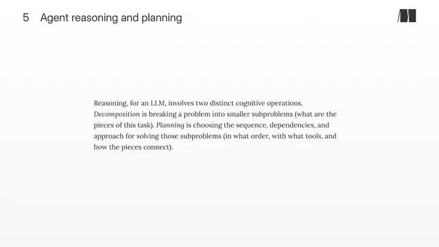
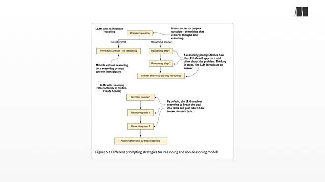
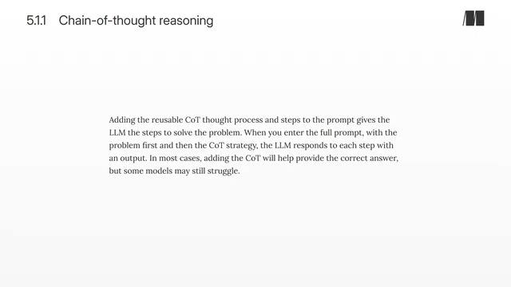
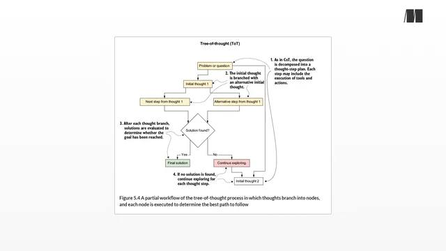
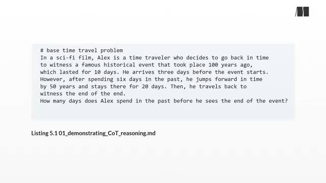
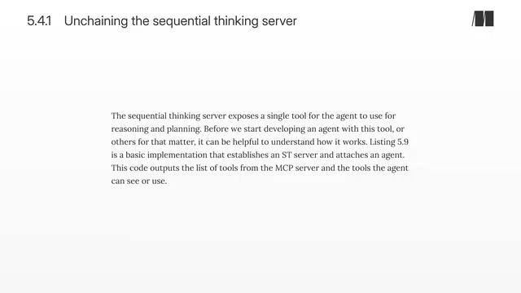
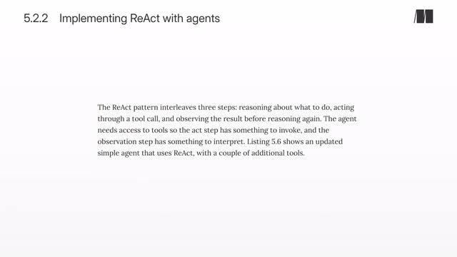
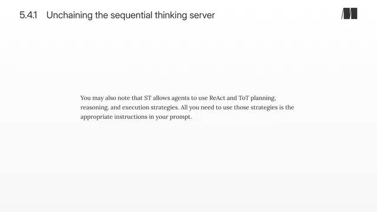
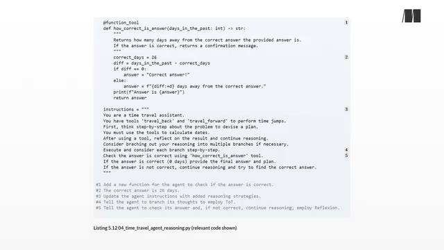

# AI Agents In Action 2nd（multi-agent）P025–P028：Agent 的推理与规划（COT / ReAct / TOT / Reflection / Sequential Thinking MCP）

> 覆盖 P025–P028（第 5 章 Agent Reasoning and Planning）。
> **重要前置说明**：这几页的逐字稿是「讲解 + 指向 Listing 编号」的形式。讲师反复说「Listing 5.6 是……」「Listing 5.9 是……」，但**逐字稿里没有把任何一个 Listing 的源码念出来**，也没有念出运行命令和依赖版本。所以本文第 4 节的所有 `.py` 文件都是**按逐字稿描述的行为重建的等价实现**（文件头统一标注【重建】），能直接跑；凡是逐字稿确实没交代的地方，我在第 3、6、7 节明确写了「课里没讲」，没有替讲师补设定。

---

## 1. 这一节做什么

这四页（P025–P028）要交付的东西不是一堆概念，而是**六个可以逐个跑起来、并且能看到行为差异的 agent 脚本**。讲师把第 5 章拆成了一条递进的实现路线：

1. **P025** 建立地基：LLM 的推理包含两个可以独立失败的操作——**分解（decomposition）** 和 **规划（planning）**；然后讲两种最常用的推理结构 **COT（Chain of Thought，思维链）** 和 **ReAct（Reasoning–Acting–Observing）**。这里有一个贯穿全章的关键判断：**ReAct 的循环不在模型内部，而在 agent 框架里**，所以「谁来执行「调用模型 → 执行动作 → 回填观测 → 再调用模型」这个循环」是工程问题，不是提示词问题。
2. **P026** 把 COT 和 ReAct 从「在 ChatGPT 里打字」搬到代码里：Listing 5.5 是一个只靠 instructions 就实现 COT 的最小 agent；Listing 5.6 给它加上工具，让 agent 走 ReAct。讲师也主动指出了代价：加了 ReAct 之后反而**看不到逐步思考过程**了，要靠后续章节的日志和 trace 补回来。
3. **P027** 上高级模式：**TOT（Tree of Thought）** 和 **Reflection**，以及一张「什么时候该用哪个模式」的最佳实践表。核心结论是 **TOT 没法靠单条 prompt 完整实现**，剪枝和回溯必须由外部编排代码来做。
4. **P028** 接 **Sequential Thinking MCP Server**：它不思考，只做**外部草稿纸 / 思路追踪器**，让 agent 把中间结论存到模型外部，下一步再读回来。最后 Listing 5.12 把 COT + ReAct + TOT + Reflection 全叠上去，讲师同时警告：**很慢、很贵、结果强依赖你用的模型**。

所以本文的「可复现目标」是：你能在自己的机器上跑出六次 agent 调用，并且能指着输出说清「这次是 COT 在起作用」「这次是 ReAct 的工具循环在起作用」「这次的 sequential_thinking 调用其实是草稿纸，不是模型在思考」。

---

## 2. 讲师原话

> "大语言模型的推理包含两类不同的认知操作。分解是把一个问题拆成更小的子问题：这个任务由哪些部分组成？规划则是为求解这些子问题选择顺序、依赖关系和方法，即按什么顺序、用什么工具，以及各部分如何连接。这两类操作都必不可少，而且可能各自独立失败。"
> —— p025 [00:00]

> "限制在于多步推理的质量，而不在于模型会尝试多少任务。"
> —— p025 [01:52]

> "ReAct 是一个闭环：每个观察结果都会输入下一个推理步骤，从而使智能体能够从错误动作中恢复、纳入新信息，并在任务中途调整计划。"
> —— p025 [11:41]

> "运行这个循环的机制——调用模型、执行动作、返回观察结果、再次调用模型——位于智能体框架中，而不在模型本身内部。"
> —— p025 [12:09]

> "这个示例的缺点是，我们不再能看到智能体所经历的逐步思考过程。当然，可以通过增加日志和工具轨迹来解决，我们将在后续章节看到。"
> —— p026 [01:48]

> "TOT 不能像 COT 那样仅通过单个提示词就完整调用。分支和评估部分可以通过提示模型生成若干候选思路并对其评分来近似实现，但定义 TOT 的剪枝和回溯由外部编排代码处理。像 LangGraph 这样的框架和自定义实现，是在生产环境中运行 TOT 的典型方式。"
> —— p027 [01:43] / [02:00]

> "多次尝试之间的改进来自模型基于更丰富上下文进行条件生成，而不是来自任何实际学习，因为模型权重并未更新。"
> —— p027 [04:56]

> "Sequential Thinking 这个名字有点误导性，因为这个服务器本身并不进行思考。它为智能体的思考输出提供外部存储，智能体在每一步都会重新读取这些内容，以在多次调用之间保持连续性。"
> —— p028 [00:00]

> "请注意，这个工具 sequential thinking 本身不会思考或推理。它只是一个草稿板和思维追踪器。"
> —— p028 [02:07]

> "取决于你使用的模型，智能体仍可能输出错误答案。但这并不意味着使用 sequential thinking 无效。"
> —— p028 [04:17]

这几句原话基本决定了第 3 节的复现顺序：**先分离「分解」和「规划」，再用 COT 把步骤显式化，再用 ReAct 加外部反馈环，再用 TOT/Reflection 处理更难的搜索与自我批判，最后用 ST server 把「思路」从模型里搬出来。**





---

## 3. 从零复现

### 3.1 环境与目录

课里没讲依赖版本和 Python 版本要求。为了让下面的文件真的能跑，需要：

- Python **3.10+**（下面的代码用了 `list[str]`、`from __future__ import annotations`、`dataclass`）
- Node.js **18+**（只有第 7 个脚本需要：Sequential Thinking MCP Server 是用 `npx` 拉起的；这条启动命令课里没讲，是 MCP 生态里的通用做法，包名以你本地实际可用的为准）
- 一个可用的 OpenAI API Key，环境变量名 **`OPENAI_API_KEY`**（课里没提到 key 和环境变量名，这是 SDK 的硬性要求）

目录结构（照抄即可）：

```
agents-reasoning/
├── .env.example
├── requirements.txt
├── prompts/
│   └── time_travel.md
├── common/
│   ├── __init__.py
│   └── time_travel.py
├── 01_cot_agent.py
├── 02_react_agent.py
├── 03_tot_agent.py
├── 04_reflection.py
├── 05_sequential_thinking_agent.py
├── 06_st_time_travel.py
└── 07_advanced_combined.py
```

```bash
mkdir -p agents-reasoning/{prompts,common}
cd agents-reasoning
python -m venv .venv
source .venv/bin/activate        # Windows: .venv\Scripts\activate
pip install -r requirements.txt
cp .env.example .env             # 然后填入你的 key
```

`.env` 不会自动被读取——第 3.2 步会说明怎么让它生效。**课里没讲** dotenv 相关操作，下面给出两种都能用的写法。

### 3.2 运行方式（每个脚本统一）

每个脚本顶部都有这一行，作用是按需加载 `.env` 并读取 `OPENAI_API_KEY`：

```python
from dotenv import load_dotenv; load_dotenv()
```

如果你不想装 `python-dotenv`，就直接 `export OPENAI_API_KEY=sk-...`（Windows PowerShell：`$env:OPENAI_API_KEY="sk-..."`），并把脚本里那行删掉。

### 3.3 第一步：跑 COT（对应 Listing 5.5）

```bash
python 01_cot_agent.py
```

预期现象：模型输出里**能看到一条一条的推理步骤**，而不是只给一个答案。讲师对 COT 的定义就是这个——「The model generates a sequence of intermediate reasoning steps, a chain of thought, before producing the final answer」（p025 [07:01]）。而且讲师提醒过：**COT 帮强模型多于救弱模型**（p025 [02:22]），所以第一次跑的结果可能不完美，这是预期内的。



### 3.4 第二步：跑 ReAct（对应 Listing 5.6）

```bash
python 02_react_agent.py
```

预期现象：脚本会打印每一次工具调用后的状态（当前年份、累计在过去的天数），agent 会**多次**调用 `travel_back` / `travel_forward`，而不是一次算完。这就是讲师说的「interleaves thought steps … with action steps … After each action, the model observes the result, updates its reasoning based on that feedback, and continues the cycle」（p025 [11:41]）。

同时你会遇到讲师在 p026 [01:48] 指出的那个缺点：**你看不到模型的逐步思考过程了**，只能看到工具调用和最终答案。这不是 bug。

### 3.5 第三步：跑 TOT（对应 Listing 5.7，部分实现）

```bash
python 03_tot_agent.py
```

预期现象：脚本先让模型产出**若干条候选第一步思路**，再逐条打分，最后打印「被淘汰的」和「被选中的」。讲师明确说过 Listing 5.7 **只评估了初始的 thought step 作为分支**，完整实现要把同样的模式在每个 thought step 上迭代（p027 [03:59]），本文的实现严格对齐这个「部分实现」的定位。



### 3.6 第四步：跑 Reflection（对应 Listing 5.8）

```bash
python 04_reflection.py
```

预期现象：脚本至少跑两轮 —— 第一轮 solver 给一个答案，critic 拿标准答案去批判并给出提示，第二轮 solver 带着提示重答。讲师说得很直白：「The improvement across attempts comes from the model conditioning on a richer context, not from any actual learning」（p027 [04:56]），所以**提示是塞进 instructions / context 里的**，不是模型学会了。这也意味着这个例子的前提是「你手里有正确答案」，讲师自己也承认这是这个模式的一大短板（p027 [07:15]）。



### 3.7 第五步：验证 Sequential Thinking MCP Server 连上了（对应 Listing 5.9）

先确认本机有 node：

```bash
node -v
npx -v
```

然后：

```bash
python 05_sequential_thinking_agent.py
```

预期现象：终端会**列出 MCP server 暴露的工具**。逐字稿说得很清楚：这个 server「exposes a single tool for the agent to use for reasoning and planning」（p028 [00:56]），并且输出里还会出现 agent 的一个内置工具，名字形如 `multi_tool_use.parallel`（逐字稿 p028 [01:25] 提到它「allows them to run multiple tools in parallel」）。**注意：`multi_tool_use.parallel` 是 agent 侧的内置工具，不由 ST server 提供**，所以它不会出现在 `list_tools()` 的返回里。



### 3.8 第六步：用 ST server 重跑时间旅行难题（对应 Listing 5.11）

```bash
python 06_st_time_travel.py
```

预期现象：一次运行里会看到**反复调用 sequential_thinking**，中间穿插 `travel_back` / `travel_forward`。讲师对这段 trace 的解读是：「each call to the sequential thinking tool is a reasoning step, followed by an action step, calling a time travel tool, followed by internal observations, and then another call to the thinking tool to determine whether the goal is complete」（p028 [03:48]）。

而且讲师提前打了预防针：**答案可能还是错的**，这并不说明 ST server 没用（p028 [04:17]）。


### 3.9 第七步：全套组合（对应 Listing 5.12 / 5.13）

```bash
python 07_advanced_combined.py
```

预期现象：慢，token 消耗明显变高。讲师原话：「expect it to take a while and consume a fair number of tokens. This is because we added both TOT and reflection reasoning strategies, which are computationally expensive and token heavy」（p028 [05:13]）。脚本里注入的那段「示例问题 + 已生成计划」对应 Listing 5.13。

---

## 4. 完整代码

> 【重建声明】下面每个 Python 文件都是按逐字稿描述重建的。逐字稿给出的信息包括：Listing 5.5 用 role + step-by-step instructions 实现 COT；Listing 5.6 在此基础上加了工具走 ReAct；Listing 5.7 的 TOT 只评估初始 thought step；Listing 5.8 是 solver–critic 并依赖 dynamic instructions 注入反馈；Listing 5.9 打印 MCP server 工具列表；Listing 5.11 加了 travel back / travel forward 两个工具；Listing 5.12 组合全部策略；Listing 5.13 在 instructions 里注入「示例问题 + 计划」。**逐字稿没有念出任何一行的原始代码、模型名、框架名**，因此本节的模型名、SDK 选型、函数名都是重建产物。

### `requirements.txt`

```
# 课里没给版本号；以下为重建时可用的下界，安装后请 pip freeze 锁版本
openai-agents>=0.2.0
python-dotenv>=1.0.0
```

### `.env.example`

```
OPENAI_API_KEY=sk-your-key-here
```

### `prompts/time_travel.md`

```markdown
# 时间旅行问题（用于 COT / ReAct / TOT / Reflection / ST 五组实验）

Alex 有一台只能按**整年**跳跃的时间机器。今天是 2026 年，Alex 要在这一年
见证一个"事件"。事件的起点在 2026 年之前 100 年零 3 天。

已知行程：

1. 第 1 跳：向过去跳 100 年，到事件的起点附近，Alex 在那里停留 6 天。
2. 第 2 跳：从那里向未来跳 50 年（仍处在 Alex 的过去），停留 20 天。
3. 第 3 跳：向过去跳 50 年，回到事件发生的最后一天，见证事件，
   在这一跳之后**不再停留任何天数**。
4. 第 4 跳：向未来跳回 2026 年（现在）。

问题：**Alex 总共在过去待了多少天？**

要求：只输出一个整数天数，并给出你每一跳的年份和停留天数。
```

### `common/__init__.py`

```python
"""agent 推理实验的公共组件。"""
```

### `common/time_travel.py`

```python
"""时间机器工具集（重建）。

逐字稿只交代了"新增 travel back 和 travel forward 两个工具"
（p028 [02:51]），没有给出工具源码。本文件把时间机器的状态放在
RunContextWrapper 的 context 里，让 agent 每调用一次工具就修改一次状态，
下一次调用再把最新状态读回来 —— 这正是逐字稿所说的 ReAct 闭环在
"agent 框架侧"实现的那部分（p025 [12:09]）。

在 JS/Node 里，这个 context 等价于"显式传进每个工具函数的可变对象"，
或者用 AsyncLocalStorage 挂在一次请求上；不要用模块级全局变量，
否则并发请求会互相踩状态。
"""
from __future__ import annotations

from dataclasses import dataclass, field

from agents import RunContextWrapper, function_tool

PRESENT_YEAR = 2026


@dataclass
class TimeMachineState:
    """一次运行内的时间机器状态。"""

    current_year: int = PRESENT_YEAR
    days_in_past: int = 0
    history: list[str] = field(default_factory=list)

    def record(self, note: str) -> None:
        self.history.append(note)


@function_tool
def travel_back(
    ctx: RunContextWrapper[TimeMachineState],
    years: int,
    days_staying: int = 0,
) -> str:
    """向过去跳跃若干年，可选择在过去停留若干天。

    Args:
        years: 向过去跳跃的年数，必须是正整数。
        days_staying: 到达之后在过去停留的天数，默认 0。
    """
    state = ctx.context
    if years <= 0:
        return "ERROR: years 必须是正整数。"
    if days_staying < 0:
        return "ERROR: days_staying 不能为负。"

    state.current_year -= years
    spent = days_staying if state.current_year < PRESENT_YEAR else 0
    state.days_in_past += spent
    state.record(f"back {years}y -> year={state.current_year}, stay={days_staying}d, counted={spent}d")
    return (
        f"已跳到 {state.current_year} 年。"
        f"本次计入过去的停留天数：{spent}；"
        f"累计在过去的天数：{state.days_in_past}。"
    )


@function_tool
def travel_forward(
    ctx: RunContextWrapper[TimeMachineState],
    years: int,
    days_staying: int = 0,
) -> str:
    """向未来跳跃若干年，只有在仍处于过去时才把停留天数计入总数。

    Args:
        years: 向未来跳跃的年数，必须是正整数。
        days_staying: 到达之后停留的天数，默认 0。
    """
    state = ctx.context
    if years <= 0:
        return "ERROR: years 必须是正整数。"
    if days_staying < 0:
        return "ERROR: days_staying 不能为负。"

    state.current_year += years
    spent = days_staying if state.current_year < PRESENT_YEAR else 0
    state.days_in_past += spent
    state.record(f"forward {years}y -> year={state.current_year}, stay={days_staying}d, counted={spent}d")
    return (
        f"已跳到 {state.current_year} 年。"
        f"本次计入过去的停留天数：{spent}；"
        f"累计在过去的天数：{state.days_in_past}。"
    )


@function_tool
def check_state(ctx: RunContextWrapper[TimeMachineState]) -> str:
    """读取时间机器的当前状态：所在年份、累计在过去的天数、历史操作。"""
    state = ctx.context
    history = " | ".join(state.history) if state.history else "(空)"
    return (
        f"当前年份：{state.current_year}；"
        f"累计在过去的天数：{state.days_in_past}；"
        f"操作历史：{history}"
    )


TIME_TRAVEL_TOOLS = [travel_back, travel_forward, check_state]
```

### `01_cot_agent.py`（对应 Listing 5.5 / 5.5.02）

```python
"""COT 最小 agent：只靠 instructions 就让 agent 一步步思考。

对应 Listing 5.5。逐字稿的描述是："we give the agent a role and simple
step-by-step instructions for thinking through the problem"，并且
"we achieved a COT thought process by prompting the agent to think step
by step"（p026 [00:28]）。所以这个文件**不挂任何工具**。
"""
from __future__ import annotations

import asyncio
from pathlib import Path

from dotenv import load_dotenv

from agents import Agent, Runner

load_dotenv()

MODEL = "gpt-4o-mini"  # 课里没指定模型；换成你账号可用的任意模型
PROBLEM = (Path(__file__).parent / "prompts" / "time_travel.md").read_text(encoding="utf-8")

INSTRUCTIONS = """你是一名擅长逐步推理的解题助手。

在给出最终答案之前，你必须：
1. 先把问题拆成若干子问题，并逐条列出（分解）。
2. 再说明这些子问题该按什么顺序解决、彼此有什么依赖（规划）。
3. 然后按顺序一步步演算，每一步都写出该步的结论。
4. 最后单独一行输出 `最终答案: <整数>`。

不要跳步。不要在第 1、2 步就给结论。
"""

agent = Agent(
    name="COT Agent",
    model=MODEL,
    instructions=INSTRUCTIONS,
)


async def main() -> None:
    result = await Runner.run(agent, PROBLEM)
    print("=== COT agent 输出 ===")
    print(result.final_output)


if __name__ == "__main__":
    asyncio.run(main())
```

### `02_react_agent.py`（对应 Listing 5.6）

```python
"""ReAct agent：给 agent 挂上时间旅行工具，让它自己决定下一步动作。

对应 Listing 5.6。逐字稿说这个版本"uses a ReAct style thinking pattern to
get the agent to use the tools, act, observe the output, and reason again
after each tool call"（p026 [01:23]）。
"""
from __future__ import annotations

import asyncio
from pathlib import Path

from dotenv import load_dotenv

from agents import Agent, Runner

from common.time_travel import TIME_TRAVEL_TOOLS, TimeMachineState

load_dotenv()

MODEL = "gpt-4o-mini"
PROBLEM = (Path(__file__).parent / "prompts" / "time_travel.md").read_text(encoding="utf-8")

INSTRUCTIONS = """你是一名会使用时间机器的助手，必须按 ReAct 的方式工作：

- Reason：先想清楚"我现在在哪一年、还差哪几跳"。
- Act：每次只调用一个工具（travel_back / travel_forward / check_state）。
- Observe：读工具的返回值，确认年份和累计天数是否符合预期。
- 然后再 Reason，决定下一跳。

规则：
1. 不要一次性在心里算完答案，必须真的调用工具。
2. 每次跳跃后都要检查累计在过去的天数有没有变。
3. 走完全部跳跃后，用一行 `最终答案: <整数>` 结束。
"""

agent = Agent(
    name="ReAct Time Travel Agent",
    model=MODEL,
    instructions=INSTRUCTIONS,
    tools=TIME_TRAVEL_TOOLS,
)


async def main() -> None:
    state = TimeMachineState()
    result = await Runner.run(agent, PROBLEM, context=state)
    print("=== ReAct agent 最终输出 ===")
    print(result.final_output)
    print()
    print("=== 框架侧记录到的工具调用轨迹 ===")
    for i, item in enumerate(state.history, start=1):
        print(f"{i:02d}. {item}")
    print()
    print(f"脚本侧核算的累计天数：{state.days_in_past}")


if __name__ == "__main__":
    asyncio.run(main())
```

### `03_tot_agent.py`（对应 Listing 5.7，部分实现）

```python
"""TOT 部分实现：只对"初始 thought step"做分支、评估、剪枝。

逐字稿明确说 Listing 5.7 "evaluates only the initial thought step as a
branch"、"shows only a partial implementation of the TOT reasoning
pattern"（p027 [03:59]）。而且"the pruning and backtracking that define
TOT are handled by external orchestration code"（p027 [02:00]）——
这个外部编排就是你下面读到的 for 循环。
"""
from __future__ import annotations

import asyncio
import json
import re
from pathlib import Path

from dotenv import load_dotenv

from agents import Agent, Runner

load_dotenv()

MODEL = "gpt-4o-mini"
PROBLEM = (Path(__file__).parent / "prompts" / "time_travel.md").read_text(encoding="utf-8")
BRANCHES = 3          # 第一层生成几条候选思路
KEEP = 1              # 剪枝后保留几条

GENERATOR_INSTRUCTIONS = f"""你是解题思路生成器。
针对用户给出的问题，生成 {BRANCHES} 条**互不相同**的"第一步解题思路"。
每条思路用一句话描述"先确定什么、先算什么"。
只输出一个 JSON 数组，形如 ["思路A", "思路B", "思路C"]，不要输出别的任何文字。
"""

SCORER_INSTRUCTIONS = """你是一个严格的评审。
给你一道题和一条候选解题思路，请判断这条思路有多大概率导出一个正确的最终答案。
只输出一个 0-100 的整数，不要输出任何解释和标点。
"""


def extract_json_array(text: str) -> list[str]:
    start, end = text.find("["), text.rfind("]")
    if start == -1 or end == -1:
        raise ValueError(f"生成器没有返回 JSON 数组，实际输出：{text!r}")
    data = json.loads(text[start : end + 1])
    if not isinstance(data, list) or not data:
        raise ValueError(f"JSON 数组为空或格式不对：{data!r}")
    return [str(x) for x in data]


def extract_int(text: str) -> int:
    match = re.search(r"\d+", text)
    if not match:
        raise ValueError(f"评审没有返回数字，实际输出：{text!r}")
    return max(0, min(100, int(match.group())))


async def main() -> None:
    generator = Agent(name="TOT Generator", model=MODEL, instructions=GENERATOR_INSTRUCTIONS)
    scorer = Agent(name="TOT Scorer", model=MODEL, instructions=SCORER_INSTRUCTIONS)

    # 1) 展开第一层：生成候选思路
    gen_result = await Runner.run(generator, PROBLEM)
    branches = extract_json_array(gen_result.final_output)
    print("=== 第一层候选思路 ===")
    for i, branch in enumerate(branches, start=1):
        print(f"{i}. {branch}")

    # 2) 评估每条分支
    scored: list[tuple[int, str]] = []
    for branch in branches:
        score_prompt = f"【题目】\n{PROBLEM}\n\n【候选思路】\n{branch}"
        score_result = await Runner.run(scorer, score_prompt)
        scored.append((extract_int(score_result.final_output), branch))

    # 3) 剪枝：按分数排序，砍掉低分分支
    scored.sort(key=lambda pair: pair[0], reverse=True)
    kept = scored[:KEEP]
    pruned = scored[KEEP:]

    print()
    print("=== 评估结果 ===")
    for score, branch in scored:
        print(f"score={score:3d}  {branch}")

    print()
    print("=== 剪枝结果 ===")
    print(f"保留 {len(kept)} 条，淘汰 {len(pruned)} 条")
    if pruned:
        print("被淘汰：")
        for score, branch in pruned:
            print(f"  - (score={score}) {branch}")

    # 4) 只沿着被保留的分支继续（完整版应在这里对每个 thought step 递归）
    print()
    print("=== 沿保留分支继续求解 ===")
    follow_up = (
        f"【题目】\n{PROBLEM}\n\n"
        f"【已经通过评估的解题思路】\n{kept[0][1]}\n\n"
        "请严格按这条思路把题目解完，最后用一行 `最终答案: <整数>` 结束。"
    )
    solver = Agent(
        name="TOT Solver",
        model=MODEL,
        instructions="你是解题者。严格沿着给定的思路走，不要另起炉灶。",
    )
    final_result = await Runner.run(solver, follow_up)
    print(final_result.final_output)


if __name__ == "__main__":
    asyncio.run(main())
```

### `04_reflection.py`（对应 Listing 5.8）

```python
"""Reflection：solver 答题，critic 用已知正确答案批判，反馈注入下一轮。

逐字稿的两个关键点：
1. "several steps would be implemented by a generative and a critic agent,
   with some deterministic code to check hard limits such as retries"
   （p027 [06:19]）—— 所以重试次数是脚本里的硬限制，不是模型决定。
2. "This feedback is then fed into the solver agent's instructions through
   context that can be populated whenever the agent runs, using dynamic
   instructions"（p027 [06:48]）—— 所以下面用函数式 instructions。
"""
from __future__ import annotations

import asyncio
import json
from dataclasses import dataclass, field
from pathlib import Path

from dotenv import load_dotenv

from agents import Agent, RunContextWrapper, Runner

load_dotenv()

MODEL = "gpt-4o-mini"
PROBLEM = (Path(__file__).parent / "prompts" / "time_travel.md").read_text(encoding="utf-8")
GOLD_ANSWER = 26      # 逐字稿明确给出正确答案是 26 天（p025 [07:53]）
MAX_ATTEMPTS = 3      # 硬限制：外部代码控制，不让模型自己决定要不要再试


@dataclass
class ReflectionState:
    attempt: int = 0
    last_feedback: str = ""
    answers: list[str] = field(default_factory=list)


def solver_instructions(ctx: RunContextWrapper[ReflectionState], agent: Agent) -> str:
    base = """你是解题者。请一步一步演算，最后用一行 `最终答案: <整数>` 结束。"""
    state = ctx.context
    if not state.last_feedback:
        return base
    return (
        base
        + f"\n\n这是你第 {state.attempt} 次作答。上一轮你被评审指出以下问题，"
        + "请先针对这些意见修正，再重新作答：\n"
        + state.last_feedback
    )


CRITIC_INSTRUCTIONS = f"""你是评审，已经知道本题的正确答案是 {GOLD_ANSWER}。
请对照正确答案检查解题者的答案，并只输出一个 JSON 对象：

{{"verdict": "correct" 或 "wrong", "hint": "如果答错，用一句中文指出他在哪一步走偏、下一次该怎么改；如果答对，这里写空字符串"}}

只输出 JSON，不要输出其他任何文字。
"""


def parse_critique(text: str) -> tuple[str, str]:
    start, end = text.find("{"), text.rfind("}")
    if start == -1 or end == -1:
        return "wrong", f"评审输出无法解析，原文：{text!r}"
    data = json.loads(text[start : end + 1])
    return str(data.get("verdict", "wrong")), str(data.get("hint", ""))


async def main() -> None:
    solver = Agent(name="Solver", model=MODEL, instructions=solver_instructions)
    critic = Agent(name="Critic", model=MODEL, instructions=CRITIC_INSTRUCTIONS)

    state = ReflectionState()

    for attempt in range(1, MAX_ATTEMPTS + 1):
        state.attempt = attempt
        print(f"\n===== 第 {attempt} 轮 =====")

        result = await Runner.run(solver, PROBLEM, context=state)
        answer = result.final_output
        state.answers.append(answer)
        print("--- solver 作答 ---")
        print(answer)

        critique_input = f"【题目】\n{PROBLEM}\n\n【解题者的答案】\n{answer}"
        critique_result = await Runner.run(critic, critique_input, context=state)
        verdict, hint = parse_critique(critique_result.final_output)
        print(f"--- critic 判定 --- verdict={verdict}")
        if hint:
            print(f"--- critic 反馈 --- {hint}")

        if verdict == "correct":
            print(f"\n在第 {attempt} 轮通过评审。")
            break

        state.last_feedback = hint
    else:
        print(f"\n达到最大重试次数 {MAX_ATTEMPTS}，最后一轮答案未通过评审。")

    print("\n===== 各轮答案摘要 =====")
    for i, answer in enumerate(state.answers, start=1):
        last_line = answer.strip().splitlines()[-1] if answer.strip() else "(空)"
        print(f"第 {i} 轮：{last_line}")


if __name__ == "__main__":
    asyncio.run(main())
```

### `05_sequential_thinking_agent.py`（对应 Listing 5.9）

```python
"""连上 Sequential Thinking MCP Server，并把它的工具列表打出来。

对应 Listing 5.9。逐字稿："This code outputs the list of tools from the
MCP server and the tools the agent can see or use."（p028 [00:56]）

注意：npx 的包名不是逐字稿给的，课里没讲启动命令；请以你本地实际可用的
Sequential Thinking MCP server 包为准。
"""
from __future__ import annotations

import asyncio
import os

from dotenv import load_dotenv

from agents import Agent, Runner
from agents.mcp import MCPServerStdio

load_dotenv()

MODEL = "gpt-4o-mini"

# Windows 上 npm 的可执行文件名是 npx.cmd，需要时改成 "npx.cmd"
NPX = "npx.cmd" if os.name == "nt" else "npx"

SERVER_PARAMS = {
    "command": NPX,
    "args": ["-y", "@modelcontextprotocol/server-sequential-thinking"],
}


async def main() -> None:
    async with MCPServerStdio(params=SERVER_PARAMS, client_session_timeout_seconds=120) as st_server:
        mcp_tools = await st_server.list_tools()
        print("=== MCP server 暴露的工具 ===")
        for tool in mcp_tools:
            print(f"- name: {tool.name}")
            print(f"  description: {getattr(tool, 'description', '')}")

        agent = Agent(
            name="Sequential Thinking Agent",
            model=MODEL,
            instructions="你是一个会做规划并分步执行的助手。",
            mcp_servers=[st_server],
        )

        print()
        print("=== 本地（非 MCP）工具 ===")
        for tool in agent.tools:
            print(f"- name: {getattr(tool, 'name', tool)}")

        # 跑一次最小调用，确认 server 真的可被 agent 使用
        result = await Runner.run(agent, "用一句话说明你为什么需要外部草稿纸。")
        print()
        print("=== 最小调用输出 ===")
        print(result.final_output)


if __name__ == "__main__":
    asyncio.run(main())
```

### `06_st_time_travel.py`（对应 Listing 5.11）

```python
"""ST server + 时间旅行工具：把 sequential_thinking 当草稿纸用。

对应 Listing 5.11。逐字稿："The code connects the MCP server and the other
tools it provides to an agent. It then tells the agent to solve this
problem"（p028 [03:21]）。
"""
from __future__ import annotations

import asyncio
import os
from pathlib import Path

from dotenv import load_dotenv

from agents import Agent, Runner
from agents.mcp import MCPServerStdio

from common.time_travel import TIME_TRAVEL_TOOLS, TimeMachineState

load_dotenv()

MODEL = "gpt-4o-mini"
PROBLEM = (Path(__file__).parent / "prompts" / "time_travel.md").read_text(encoding="utf-8")
NPX = "npx.cmd" if os.name == "nt" else "npx"

SERVER_PARAMS = {
    "command": NPX,
    "args": ["-y", "@modelcontextprotocol/server-sequential-thinking"],
}

INSTRUCTIONS = """你是一名使用"外部草稿纸"的解题 agent。

工作方式（ReAct 循环）：
1. 每当你需要决定下一步
（续 `06_st_time_travel.py` 的 instructions 与 main）

```python
1. 每当你需要决定下一步（或者发现之前的判断有误），先调用 sequential_thinking 工具，
   把"当前已知信息 / 候选方案 / 是否需要修正"写进去。
2. 然后调用时间旅行工具执行其中一跳。
3. 读到工具返回后，再调用一次 sequential_thinking，记录这次观测到的结果，
   并判断目标是完成了还是要继续。
4. 全部完成后，用一行 `最终答案: <整数>` 结束。

注意：sequential_thinking 只是一个草稿本，它不会替你想。你写进去的内容，
下一步必须自己读回来用上；如果你只写不读，这个工具就白调了。
"""


async def main() -> None:
    state = TimeMachineState()

    async with MCPServerStdio(params=SERVER_PARAMS, client_session_timeout_seconds=180) as st_server:
        agent = Agent(
            name="ST Time Travel Agent",
            model=MODEL,
            instructions=INSTRUCTIONS,
            tools=TIME_TRAVEL_TOOLS,
            mcp_servers=[st_server],
        )

        result = await Runner.run(agent, PROBLEM, context=state)

        print("=== agent 最终输出 ===")
        print(result.final_output)
        print()
        print("=== 时间旅行工具轨迹（框架侧记录） ===")
        for i, item in enumerate(state.history, start=1):
            print(f"{i:02d}. {item}")
        print()
        print(
            f"脚本侧核算的累计天数：{state.days_in_past}"
            f"（逐字稿给出的参考答案是 26 天，p025 [07:53]）"
        )
        print(
            "注：agent 的最终答案可能与脚本核算不一致。"
            "逐字稿 p028 [04:17] 已说明：即使是用了 sequential thinking，"
            "答案也可能仍然错，这不代表 ST server 无效。"
        )


if __name__ == "__main__":
    asyncio.run(main())
```

### `07_advanced_combined.py`（对应 Listing 5.12 / 5.13）

```python
"""全套组合：COT 出计划 → TOT 选计划 → ReAct + ST 执行 → Reflection 反馈重来。

对应 Listing 5.12。逐字稿："combine all the reasoning patterns we have
used in the chapter. COT for planning, ReAct and TOT for plan execution
and evaluation, and reflection for feedback"（p028 [04:43]）。

Listing 5.13 的那一步（把"示例问题 + 已生成计划"注入 instructions）
体现在本文件的 EXAMPLE_BLOCK 和 planner 的 instructions 拼接上。

代价警告（讲师原话，p028 [05:13]）："expect it to take a while and
consume a fair number of tokens"。
"""
from __future__ import annotations

import asyncio
import json
import os
import re
from dataclasses import dataclass, field
from pathlib import Path

from dotenv import load_dotenv

from agents import Agent, Runner
from agents.mcp import MCPServerStdio

from common.time_travel import TIME_TRAVEL_TOOLS, TimeMachineState

load_dotenv()

MODEL = "gpt-4o-mini"
PROBLEM = (Path(__file__).parent / "prompts" / "time_travel.md").read_text(encoding="utf-8")
GOLD_ANSWER = 26
CANDIDATE_PLANS = 3
KEEP_PLANS = 1
MAX_OUTER_ROUNDS = 2          # 外层 Reflection 的硬限制，由代码控制
NPX = "npx.cmd" if os.name == "nt" else "npx"

SERVER_PARAMS = {
    "command": NPX,
    "args": ["-y", "@modelcontextprotocol/server-sequential-thinking"],
}

# Listing 5.13 的做法：把一次成功运行得到的"示例问题 + 计划"当作示范注入
# instructions。课里没讲的点：这段内容只能是"示意"，因为 Listing 5.13 的原文
# 逐字稿没有念出来。
EXAMPLE_BLOCK = """
【示例（仅供参考，不要照抄答案）】
类似问题："向过去跳 A 年、在过去停 X 天，再向未来跳到仍属过去的年份停
Y 天，最后回到现在，总共在过去待多少天？"
一份可行计划：
  1) 先确定"现在"的年份，并把每一次跳跃写成 起点年份 -> 终点年份。
  2) 逐跳判断落点年份是否小于现在年份；只有小于时才把停留天数计入总数。
  3) 把各跳计入的天数累加，得到总数并复核一遍。
  4) 用工具执行每一跳，每跳后核对累计值。
"""


@dataclass
class RunState:
    round_index: int = 0
    feedback: str = ""
    plans: list[str] = field(default_factory=list)
    scores: list[int] = field(default_factory=list)
    answers: list[str] = field(default_factory=list)


def planner_instructions(state: RunState) -> str:
    block = EXAMPLE_BLOCK
    if state.feedback:
        block += f"\n【上一轮执行被指出的问题】\n{state.feedback}\n请针对它修正计划。\n"
    return (
        "你是规划者。请用 COT 的方式，先把问题分解成子问题，再给出一个有顺序、"
        "有依赖关系的执行计划。计划用 1) 2) 3) ... 编号，每条一句话。\n"
        + block
    )


SCORER_INSTRUCTIONS = """你是计划评审。
给你一道题和一份候选执行计划，判断它有多大概率导出一个正确的最终答案。
只输出一个 0-100 的整数，不要任何解释。"""


def extract_json_array(text: str) -> list[str]:
    start, end = text.find("["), text.rfind("]")
    if start == -1 or end == -1:
        raise ValueError(f"没有返回 JSON 数组：{text!r}")
    data = json.loads(text[start : end + 1])
    return [str(x) for x in data]


def extract_int(text: str) -> int:
    match = re.search(r"\d+", text)
    return max(0, min(100, int(match.group()))) if match else 0


def parse_critique(text: str) -> tuple[str, str]:
    start, end = text.find("{"), text.rfind("}")
    if start == -1 or end == -1:
        return "wrong", f"评审输出无法解析：{text!r}"
    data = json.loads(text[start : end + 1])
    return str(data.get("verdict", "wrong")), str(data.get("hint", ""))


EXECUTOR_INSTRUCTIONS = """你是执行者，必须严格按给定计划、用 ReAct 循环执行：

- 每次只调用一个工具（travel_back / travel_forward / check_state）。
- 需要记录"我做到第几步、当前年份、累计天数"时，调用 sequential_thinking 写进草稿本。
- 每跳之后读回工具返回值，核对累计天数，再决定下一跳。
- 全部走完后，用一行 `最终答案: <整数>` 结束。

不要在心里一次算完，必须真的调用工具。
"""

CRITIC_INSTRUCTIONS = f"""你是评审，已知正确答案是 {GOLD_ANSWER}。
对照正确答案检查解题者的答案，只输出一个 JSON：
{{"verdict": "correct" 或 "wrong", "hint": "答错时用一句中文指出计划或执行在哪一步走偏"}}
只输出 JSON。"""


async def main() -> None:
    state = RunState()
    planner = Agent(name="Planner", model=MODEL, instructions=planner_instructions)
    scorer = Agent(name="Plan Scorer", model=MODEL, instructions=SCORER_INSTRUCTIONS)
    critic = Agent(name="Critic", model=MODEL, instructions=CRITIC_INSTRUCTIONS)

    async with MCPServerStdio(params=SERVER_PARAMS, client_session_timeout_seconds=240) as st_server:
        executor = Agent(
            name="Executor",
            model=MODEL,
            instructions=EXECUTOR_INSTRUCTIONS,
            tools=TIME_TRAVEL_TOOLS,
            mcp_servers=[st_server],
        )

        for round_index in range(1, MAX_OUTER_ROUNDS + 1):
            state.round_index = round_index
            print(f"\n########## 外层第 {round_index} 轮 ##########")

            # ---------- 阶段 1：COT 出候选计划 + TOT 式评估剪枝 ----------
            print("\n--- 阶段 1a：生成候选计划 ---")
            gen_prompt = (
                f"【题目】\n{PROBLEM}\n\n"
                f"请生成 {CANDIDATE_PLANS} 份**互不相同**的执行计划，"
                f"只输出 JSON 数组，每项是一个字符串（用 \\n 分隔步骤），不要输出其他文字。"
            )
            gen_result = await Runner.run(planner, gen_prompt, context=state)
            candidates = extract_json_array(gen_result.final_output)
            state.plans = candidates
            for i, plan in enumerate(candidates, start=1):
                print(f"[候选 {i}]\n{plan}\n")

            print("--- 阶段 1b：逐份打分 ---")
            scored: list[tuple[int, str]] = []
            for plan in candidates:
                score_result = await Runner.run(
                    scorer, f"【题目】\n{PROBLEM}\n\n【计划】\n{plan}"
                )
                scored.append((extract_int(score_result.final_output), plan))
            scored.sort(key=lambda p: p[0], reverse=True)
            state.scores = [s for s, _ in scored]
            for score, plan in scored:
                print(f"score={score:3d}  首行：{plan.strip().splitlines()[0][:60]}")

            kept_plan = scored[:KEEP_PLANS][0][1]
            pruned = scored[KEEP_PLANS:]
            print(f"\n剪枝：保留 {KEEP_PLANS} 份，淘汰 {len(pruned)} 份")

            # ---------- 阶段 2：ReAct + ST 执行被保留的计划 ----------
            print("\n--- 阶段 2：ReAct + Sequential Thinking 执行 ---")
            tm_state = TimeMachineState()
            exec_prompt = (
                f"【题目】\n{PROBLEM}\n\n"
                f"【必须遵守的计划】\n{kept_plan}\n\n"
                "请按计划用工具执行，并边走边把进展写进草稿本。"
            )
            exec_result = await Runner.run(executor, exec_prompt, context=tm_state)
            answer = exec_result.final_output
            state.answers.append(answer)
            print(answer)
            print(f"\n工具轨迹条数：{len(tm_state.history)}；脚本核算累计天数：{tm_state.days_in_past}")

            # ---------- 阶段 3：Reflection 反馈 ----------
            print("\n--- 阶段 3：Reflection ---")
            critique_result = await Runner.run(
                critic, f"【题目】\n{PROBLEM}\n\n【解题者的答案】\n{answer}"
            )
            verdict, hint = parse_critique(critique_result.final_output)
            print(f"verdict={verdict}  hint={hint}")
            if verdict == "correct":
                print(f"\n外层第 {round_index} 轮通过，结束。")
                break
            state.feedback = hint
        else:
            print(f"\n达到外层上限 {MAX_OUTER_ROUNDS} 轮仍未通过评审。")

    print("\n########## 汇总 ##########")
    for i, answer in enumerate(state.answers, start=1):
        tail = answer.strip().splitlines()[-1] if answer.strip() else "(空)"
        print(f"第 {i} 轮最终行：{tail}")
    print("参考：逐字稿给的正确答案是 26 天（p025 [07:53]）。")


if __name__ == "__main__":
    asyncio.run(main())
```

---

## 5. 逐行解释

**`common/time_travel.py`——为什么状态放在 `RunContextWrapper` 里，而不是放在 agent 的 instructions 里**

时间机器是一个**会被多次读写的有状态对象**：跳一次改一次年份，读一次累计天数。逐字稿说 ReAct 的循环「sits in the agent framework, not inside the model itself」（p025 [12:09]）——因为模型没有持久状态（p027 [15:03] 讲师原话：「The LLM itself has no persistent state across calls」）。所以「当前年份」必须存在模型外部。

`RunContextWrapper[TimeMachineState]` 就是「外部」的那一层。**在 JS/Node 里对应什么**：相当于你在处理一次请求时，把一个可变对象一路作为参数显式传给每个工具函数；如果你不想穿参，就用 `AsyncLocalStorage` 把它挂在这条异步调用链上。**千万不要用模块级全局变量**——Node 的 HTTP server 是并发处理请求的，全局变量会让两个用户的 time machine 互相污染，Python 的 `asyncio` 同理。

`travel_back` / `travel_forward` 里那句 `spent = days_staying if state.current_year < PRESENT_YEAR else 0` 是这道题唯一的「业务规则」：**只有在落点年份仍属于「过去」时，停留天数才计入总数**。这一条如果写成无条件累加，答案必然错，而且错得很隐蔽——因为工具返回值看起来是正常的，只是数字不对。这就是讲师说的「the fix depends on which operation broke」（p025 [00:27]）：你要能分辨是**分解错了**（漏了某一跳）、还是**规划错了**（顺序搞反，先跳未来再跳过去）。

`check_state` 这个工具课里没提，是重建时加的。理由是：ReAct 的「Observe」需要 agent 有办法**只看不改**。如果你只给 `travel_back` / `travel_forward`，agent 想核对「我现在累计多少天」时会被迫再跳一次，状态就被破坏了。

**`01_cot_agent.py`——为什么这个文件一个工具都不挂**

Listing 5.5 被讲师描述为「we give the agent a role and simple step-by-step instructions for thinking through the problem」（p026 [00:28]）。COT 的定义就是「reasoning 完全在模型内部完成」（对比 ReAct 的「alternates between reasoning and taking actions」p025 [11:11]）。一旦挂了工具，模型就有可能在中间跳出去调工具，这条链就不再是「单条线性 pass」了，你就没法拿它当 COT 的对照组。

`INSTRUCTIONS` 里第 1 步要「列出子问题」、第 2 步要「说明依赖」，是刻意对齐讲师开篇对 decomposition 和 planning 的区分。**不这样写会怎样**：模型会直接给答案，你看到的输出和 02 号脚本没区别，实验就白做了。

`不要在第 1、2 步就给结论` 这句是重建时加的护栏。讲师在 p025 [02:22] 提醒过非推理模型会「short circuit into plausible sounding but shallow answers」——它会在第一步就猜一个数，然后倒推一套看似合理的推理。这句护栏就是用来堵这个的。

**`02_react_agent.py`——为什么最后要打印 `state.history`**

这是整个第 3 节里最重要的一个设计。讲师明确指出 ReAct 版「we no longer see the step-by-step thought process」（p026 [01:48]）。也就是说：**模型内部想了什么，你看不到了**；你能看到的只有「它做了什么动作」。所以 `state.history` 就是你在这一页唯一可观测的东西——它是框架侧记录的工具调用流水，不是模型的思考。讲师说这个缺陷要靠后面章节的 logging 和 trace 补（p026 [01:48]），而 trace 的本质也是同一件事：把框架侧的调用序列摊开给你看。

`for i, item in enumerate(state.history)` 打印完之后，还有一行 `脚本侧核算的累计天数`。这行是**你自己的 ground truth**，跟 agent 的 `final_output` 分开打印。这样当两者不一致时，你能立刻判断是「agent 算错了」还是「agent 算对了但复述错了」。



**`03_tot_agent.py`——为什么剪枝写在 Python 的 `for` 循环里，而不是写在 prompt 里**

讲师说得非常直接：「the pruning and backtracking that define TOT are handled by external orchestration code」（p027 [02:00]）。原因不难理解：模型一次调用只能返回文本，它没有「保留一棵树、回到上一层、换一条分支再走」的执行能力。树存在于你的进程内存里（`scored` 这个 list），剪枝就是 `scored[KEEP:]` 这个切片。

`extract_int` 里的 `max(0, min(100, ...))` 是必要的钳制。**不钳制会怎样**：模型偶尔返回 `95分`（带中文）、`score: 88`（带前缀）或者 `1000`，`int()` 会抛异常或给出一个荒谬的权重，排序结果就乱了。`re.search(r"\d+", ...)` 先把数字抠出来，再钳到 0–100，保证它永远是一个合法分数。

`for else` 之外还有一个细节：`print(f"保留 {len(kept)} 条，淘汰 {len(pruned)} 条")` 之后**立刻**打印被淘汰的分支和它们的分数。这是为了让你复现讲师说的那个体验——「It may help to look at the process as a list of steps that decompose this complex reasoning strategy」（p027 [02:10]）。看不见被剪掉的分支，你就没法判断剪枝是不是剪错了。

`# 4) 只沿着被保留的分支继续（完整版应在这里对每个 thought step 递归）` 这条注释是诚实的边界声明。讲师说 Listing 5.7「shows only a partial implementation」「For a complete solution, we would have to iterate the same pattern over each thought step」（p027 [03:59]）。本文照做，没有替你把它补成完整 TOT——因为补全之后 token 消耗会涨一个量级，而那正是讲师在 p027 [04:28] 警告的「Even for simple problems, this reasoning strategy can consume many tokens」。

**`04_reflection.py`——为什么用函数式 instructions**

`def solver_instructions(ctx, agent) -> str` 这个签名就是逐字稿说的 dynamic instructions（p027 [06:48]）：每次 agent 运行时，框架会调用这个函数，函数从 `ctx.context` 里读出 `last_feedback` 拼进 instructions。所以「上一轮的批评」是**通过 instructions 注入的**，不是靠模型自己记得。

**不这样做会怎样**：如果你把反馈 append 到对话历史里（多轮 message），那也勉强能跑，但会造成上下文不断膨胀，而且你很难控制「哪条反馈现在还生效」。用 instructions 注入，每一轮的 instructions 都是干净的、只含最新一条反馈。

`MAX_ATTEMPTS = 3` 是外部硬限制。讲师原话是「some deterministic code to check hard limits such as retries」（p027 [06:19]）。**关键点：重试次数不能交给模型判断。** 如果你在 instructions 里写「觉得自己答对了就停」，模型会非常自信地在第一轮就停。**在 JS/Node 里对应什么**：这就是一个 `for (let attempt = 1; attempt <= MAX; attempt++)` 加上 `break`，跟你在前端写请求重试（比如 `p-retry`）是同一个结构。

`GOLD_ANSWER = 26` 直接来自逐字稿 p025 [07:53]「The correct answer is 26 days」。这个 26 不是重建出来的，是讲师给的。同时这也暴露了 Reflection 的硬伤：critic 必须知道正确答案。讲师自己承认了这一点（p027 [07:15]），并给了缓解办法——「if you have an extensive collection of similar problems, you can solve a couple using reflection and then populate the feedback hints in memory, storage to solve all the problems」。这正是 Listing 5.13 那个 `EXAMPLE_BLOCK` 的用意。

**`05_sequential_thinking_agent.py` / `06_st_time_travel.py`——为什么先调 `list_tools()` 再建 agent**

Listing 5.9 的定位就是「outputs the list of tools from the MCP server and the tools the agent can see or use」（p028 [00:56]）。先 `list_tools()` 是这个脚本的**唯一目的**：在没花任何 token 之前，先确认「server 起来了、工具暴露出来了、schema 拿到了」。如果这一步就失败，后面所有步骤都不用试了。

`mcp_servers=[st_server]` 和 `tools=TIME_TRAVEL_TOOLS` 是两条不同的通道：前者是 MCP server 提供的工具（`sequential_thinking`），后者是你进程里的本地函数工具（`travel_back` 等）。讲师在 p028 [01:25] 提到的 `multi_tool_use.parallel` 属于**第三类**——agent 侧的内置能力，不由 ST server 提供。所以它不会出现在 `list_tools()` 的返回里；你在本文脚本的「本地工具」那一栏也可能看不到它，具体以你实际装到的 SDK 版本为准。

`client_session_timeout_seconds=120 / 180 / 240`：这个参数课里没提。它是必须的，因为 `npx -y` 第一次运行要下载包，冷启动经常超过很多 SDK 的默认超时。**不调大会怎样**：你会看到一个超时错误，然后误以为「MCP server 连不上」，其实是 npm 在下载。

`INSTRUCTIONS` 里那句「如果你只写不读，这个工具就白调了」是重建时加的。理由是讲师反复强调这个 server「does no thinking」「It is just a scratch pad and a thought tracker」（p028 [02:07]）。草稿本不会自己产生价值，价值来自「下一步把它读回来」。这句话就是提醒模型执行这个读回动作。



**`07_advanced_combined.py`——为什么最外层还要再套一层循环**

阶段 1 是 COT + TOT（出计划、评估计划），阶段 2 是 ReAct + ST（执行计划），阶段 3 是 Reflection（评估结果）。但 TOT 只评估了**计划**，没有评估**执行结果**。讲师在 p028 [05:13] 说这套组合「computationally expensive and token heavy」，如果外层不设 `MAX_OUTER_ROUNDS = 2`，一旦 critic 一直判 wrong，这个脚本会一直烧钱。**在 JS/Node 里对应什么**：就是一个带上限的 `while` 加重试预算，跟你在 Node 里给 `fetch` 加 `maxRetries` 是一回事。

`EXAMPLE_BLOCK` 这个常量就是 Listing 5.13 的落点。讲师描述它时说的是「the instructions with an injected instance as part of the agent's instructions for solving time travel problems using a plan first generated using reflection」（p028 [06:12]）。**注意这里有个坑**：注入示例可以显著提升稳定性，但也会让模型**抄答案**。所以 `EXAMPLE_BLOCK` 里刻意用了 `A 年` `X 天` 这种占位符，而不是写成 `100 年` `6 天`——一旦写具体数字，模型很容易把示例里的 26 直接搬过来，你的实验就失去了意义。

`pruned = scored[KEEP_PLANS:]` 之后没有被使用（只在日志里用）。这是故意的：复用阶段 1 的变量名，让「剪枝」这件事在代码里有一个可见的落点，读代码的人一眼能看到「这里淘汰了分支」。真正跑完整个循环时，被淘汰的分支不会进入阶段 2。

---

## 6. 复现检查清单

按顺序打勾，任一项不对就停在那一项排查，不要往下跑。

**环境**

- [ ] `python --version` 输出 ≥ 3.10
- [ ] `node -v` 输出 ≥ 18（只有 05/06/07 需要）
- [ ] `pip install -r requirements.txt` 无报错
- [ ] `echo $OPENAI_API_KEY`（Windows：`echo $env:OPENAI_API_KEY`）能看到值，且已 `load_dotenv()` 或已 export
- [ ] 目录里有 `prompts/time_travel.md`，且 `common/__init__.py` 存在（缺这个 `__init__.py` 会导致 `from common.time_travel import ...` 报 `ModuleNotFoundError`）
- [ ] 所有脚本都从 `agents-reasoning/` 目录下运行（路径是相对 `__file__` 的，但 `prompts/` 用 `Path(__file__).parent` 定位，所以在别的目录跑也能找到；不过 `common` 包必须能从当前工作目录 import）

**01 COT**

- [ ] 输出里有明显的「1. 2. 3. 」分步结构，不是一句话答案
- [ ] 输出末尾有 `最终答案: <整数>`
- [ ] 能说出这条推理链里哪一段是「分解」、哪一段是「规划」（对应 p025 [00:27] 的两个操作）

**02 ReAct**

- [ ] 控制台打印出了 `=== 框架侧记录到的工具调用轨迹 ===`，且条数 ≥ 3
- [ ] 轨迹里能看到 `travel_back` 和 `travel_forward` 混用，不是只有一个方向
- [ ] `脚本侧核算的累计天数` 是一个整数
- [ ] **确认你真的看不到模型逐步思考过程**——这是讲师预告过的现象（p026 [01:48]），不是你的环境坏了

**03 TOT**

- [ ] 「第一层候选思路」打印了 3 条，内容彼此不同（如果三条一模一样，说明生成器的 prompt 需要加强差异化约束）
- [ ] 「评估结果」里每条都有 `score=`，且分数不全都相同（全相同说明 scorer 没有真的在区分，需要把 scoring prompt 写得更严）
- [ ] 「剪枝结果」明确打印了保留数与被淘汰的分支
- [ ] 你能说清：这段代码为什么不能算完整 TOT（只评估了初始 thought step，对应 p027 [03:59]）

**04 Reflection**

- [ ] 至少跑了 2 轮（第 1 轮几乎必然会判 wrong）
- [ ] 第 2 轮的 solver 输出里能看到它**引用了**第 1 轮被指出的问题（说明 dynamic instructions 生效了）
- [ ] 最终打印了「各轮答案摘要」，能看到每轮答案的变化
- [ ] 能说清：这里所谓的「学习」只是上下文变丰富了，**没有任何权重被更新**（对应 p027 [04:56]）

**05 ST server 连通性**

- [ ] `=== MCP server 暴露的工具 ===` 下面**只有一个** `sequential_thinking`（逐字稿：「exposes a single tool」，p028 [00:56]）
- [ ] 该工具的 description 被打印出来了，内容能说明它接受「描述可用操作的相邻输入」（对应 p028 [01:52]）
- [ ] `=== 本地（非 MCP）工具 ===` 这一栏与上一栏**不重复**（重复说明你把 MCP 工具当成本地工具打印了）
- [ ] 最小调用的输出不是空字符串

**06 ST + 时间旅行**

- [ ] 一次运行里 `sequential_thinking` 被调用了**多次**（只调一次说明 agent 把它当成了走过场）
- [ ] 工具轨迹里 `sequential_thinking` 的调用与 `travel_back` / `travel_forward` 交错出现（这正是讲师从 trace 里读出的 reason→act→observe 节奏，p028 [03:48]）
- [ ] **即使最终答案不是 26，也继续往下**——讲师已经说过这属正常（p028 [04:17]）

**07 全家桶**

- [ ] 运行时间明显比前六个都长（讲师预告「take a while」，p028 [05:13]）
- [ ] 日志能分出三个阶段的边界：`阶段 1a` / `阶段 1b` / `阶段 2` / `阶段 3`
- [ ] 能看到 `score=` 的排序，以及「剪枝：保留 1 份，淘汰 N 份」
- [ ] 外层要么在某轮 `verdict=correct` 时提前结束，要么打到 `MAX_OUTER_ROUNDS` 上限结束——**不应该无限循环**

---

## 7. 课里没讲但你会撞上的

**7.1 依赖、SDK、模型名、包名，全都是空白**

逐字稿里没有出现任何一行 `pip install`、任何版本号、任何模型标识符。本文的 `openai-agents`、`gpt-4o-mini`、`@modelcontextprotocol/server-sequential-thinking` 都是**为了让你能跑起来而做的选型**，不是讲师给的。你完全可能用别的 agent 框架（LangGraph 就是讲师在 p027 [02:00] 点名提到的 TOT 生产方案）重写这七个脚本，结构不变。

**替换顺序建议**：先只改 `MODEL` 这个常量，把七个脚本串一遍；确认行为符合预期后，再考虑换框架。一次性改两样（模型 + 框架），出问题时你分不清是哪一个。

**7.2 Windows 上 `npx` 不是 `npx`**

本文脚本里写了 `NPX = "npx.cmd" if os.name == "nt" else "npx"`。如果你在 Git Bash 里跑而 `os.name` 是 `nt`，用 `npx.cmd` 仍然是对的；但如果你在 WSL 里跑，`os.name` 会是 `posix`，走 `npx` 分支，也对。**唯一会翻车的情况**：你在 Windows 上手动把 `SERVER_PARAMS` 改成 `"npx"` 然后报 `FileNotFoundError`。那就改回来。

**7.3 `client_session_timeout_seconds` 与冷启动**

第一次 `npx -y` 会去 registry 下载包。如果你在受限网络环境里，这一步会挂住直到超时，报错信息通常长得不像「网络问题」，更像「server 没响应」。**排查手法**：先在终端里单独跑一次

```bash
npx -y @modelcontextprotocol/server-sequential-thinking
```

如果能进到「等待 stdin 输入」的状态（不退出、不报错），说明包能拉到，问题就在超时或 SDK 配置；如果直接报 registry 相关错误，那就是网络。

**7.4 `sequential_thinking` 的入参字段名，本文一个都没写**

逐字稿只说这个工具「takes adjacent input describing the available operations it can perform」（p028 [01:52]），**没有念出任何字段名**（比如思路编号、总步数、是否需要下一步、是否是修订、从哪个思路分叉）。所以本文的脚本里，这个工具的参数完全由 SDK 和 server 的 schema 决定，你不需要（也不应该）硬编码。

**怎么拿到真实字段名**：跑 `05_sequential_thinking_agent.py`，看它打印出来的 description；或者在你的 SDK 里把 `mcp_tools[i].inputSchema` 也打出来。**不要凭印象填字段名**——这一条是硬要求，填错会导致 agent 调用工具时被 server 拒绝，报错信息会误导你去改 prompt。

**7.5 模型不吐 JSON，你的解析就炸**

`extract_json_array` / `parse_critique` / `extract_int` 这三个函数都是「乐观解析」：从文本里找 `[` … `]` 或 `{` … `}`，然后 `json.loads`。这在 `gpt-4o-mini` 上大概率能过，但**换模型就可能挂**——有的模型会在 JSON 前面加一句「好的，这是结果：」，有的会输出 ```json 围栏。本文的 `find/rfind` 写法能吃掉围栏（因为围栏在 `[` 之前），但吃不掉「数组里混了单引号」这种情况。

**撞上时的处理**：不要急着改 prompt 求模型「只输出 JSON」（这句话模型经常忽略），而是**在解析层加重试**：解析失败 → 把原文和「请只输出合法 JSON」一起回灌一次 → 再解析。如果还失败，就抛异常。让失败可见，比让它静默返回空列表好得多。

**7.6 讲师已经预告过的那个「COT 不灵」**

p025 [09:45] 那段话值得单独拎出来：「When a model struggles with this, don't assume the COT is broken. Instead, the steps likely need to be adjusted to fit your specific model's grammar and style.」也就是说，你跑 `01_cot_agent.py` 如果拿到 6、13、27（讲师列举过的错误答案），第一反应不该是「COT 没用」，而是**改 `INSTRUCTIONS` 里的步骤措辞**去适配你手上这个模型。本文 `INSTRUCTIONS` 的中文措辞就是一次这样的适配产物。

**7.7 上下文会越来越长，然后你会撞到上限**

`06` 和 `07` 里，`sequential_thinking` 每被调用一次，就往对话上下文里增加一段内容。07 又叠了 TOT 的多份计划 + 多轮评分 + 外层 Reflection，上下文增长是**乘法级**的。在长任务上，你会先撞到模型的上下文窗口，而不是先撞到 token 预算。

**缓解方向**（课里没讲，属于工程实践）：给 `sequential_thinking` 写入的内容设一个长度上限（比如每条思路不超过 200 字），或者只让它在关键节点写「结论」而不写「过程」。讲师在 p028 [06:40] 的总结是这个工具的定位——「an effective reasoning scratch pad」——草稿纸上的字写太多，翻起来也慢。

**7.8 别指望它记得上次运行**

讲师在 p027 [05:25] 说得清楚：「the agent has no memory of past sessions unless we explicitly preserve it」。所以 `04_reflection.py` 里的三轮反馈，全部活在这一次进程的 `ReflectionState` 对象里；进程一退，什么都没了。如果你想让「上次跑通的计划」下次还能用，必须自己序列化到磁盘或数据库——这正是讲师在 p028 [05:42] 提的那条路线：「if the agent provides a correct answer with a plan, we can use that as an example to inject into future prompts」，也就是 `07` 里 `EXAMPLE_BLOCK` 那个位置。



**7.9 结果不稳定，是设计如此，不是你的 bug**

讲师在这四页里至少三次强调模型是概率系统：p025 [04:40]「The behavior is still probabilistic and sensitive to prompting, so the same model may reason carefully on one request and short-circuit on another」；p025 [06:32]「the same agent with the same COT or ReAct setup can produce different reasoning traces on different runs」；p028 [05:42]「The results of this agent will vary significantly based on the underlying model」。所以正确的复现方式不是「跑一次看对不对」，而是**同一个脚本跑 5 次，看通过率**。这也顺带解释了为什么 `04` 和 `07` 都设了硬重试上限——单次结果本来就不该被当作结论。

**7.10 前端背景的人最容易踩的一个思维惯性**

你写 React 的时候，状态是「一份数据 + 一个渲染函数」。这里的状态是「**模型每次被调用时，都从头读一遍你塞给它的全部文本**」。所以：

- 你在 instructions 里写的每一句，每一轮都会被重新读一次——它不是「上一轮的遗留」，而是「这一轮的开场白」；
- 你在 `RunContextWrapper` 里存的对象，模型**看不见**，只有工具函数的返回值能让它看见；
- 因此「让 agent 记住」的唯一手段是：**把要记住的东西变成文本，塞进下一次调用的上下文**（instructions、对话历史、或者工具返回值）。`05`–`07` 里的 `sequential_thinking` 干的就是这件事，只不过它把「塞」这个动作包装成了一个工具，让 agent 自己决定塞什么。

理解了这一条，讲师在 p028 [00:27] 那句略显绕口的话就通了：「It provides external storage for the outputs of the agent's thinking, which the agent rereads on each step to maintain continuity across calls」——**continuity across calls**，跨调用连续性，靠的是外部存储 + 每次重读，而不是模型内部有任何东西被保留下来。
**7.11 工具失败要返回错误字符串，不要抛异常**

本文 `common/time_travel.py` 里，参数不合法时返回的是 `"ERROR: years 必须是正整数。"`，而不是 `raise ValueError`。这不是随手写的，而是 ReAct 的结构要求：讲师说「the agent observes the result, updates its reasoning based on that feedback, and continues the cycle」（p025 [11:41]）。**观测（observation）的前提是这一轮能正常结束**——如果你抛异常，整个 `Runner.run` 就中断了，agent 根本没机会「看到」自己错了、也就没有下一步的自我纠正。

**在 JS/Node 里对应什么**：工具函数的返回值是给模型看的「观测」，不是给你的调用方看的「结果」。所以工具内部的可预期失败（参数不合法、状态不允许）应该 `return { ok: false, error: "..." }`，而不可预期的失败（网络断了、磁盘满了）才 `throw`。这跟你在前端写 API 层时的习惯是反的——前端习惯「失败就抛」，这里要「失败就描述」。

**不这样写会怎样**：agent 会稳定地在同一个地方崩掉，你看到的是一个异常堆栈，而不是一条「它试了、错了、改了」的轨迹。而这条轨迹恰恰是这一章唯一值得观察的东西。

**7.12 「multi-agent」不等于「并行安全」**

课程标题带 multi-agent，P028 [01:25] 也提到 agent 有个内置工具能并行跑多个工具（逐字稿写作 `multi-tool use.parallel`）。但**这四页讲的推理模式全是单 agent 内部的**：COT 是一条链，ReAct 是一个循环，TOT 是一棵树，Reflection 是一条路径上的多轮。所以本文的时间机器状态是「一次运行一份」。

**风险点**：如果你的 agent（或被并行化的工具调用）在同一份 `TimeMachineState` 上同时发两个 `travel_back`，累计天数会被算重。本文没有加锁——**课里没讲锁**。真要做并行版本，最小改法是给状态加一个「只允许顺序执行」的队列：所有跳跃工具把操作推进队列，由一个顺序消费者执行。

**在 JS/Node 里对应什么**：Node 是单线程，但 `await` 之间会交错，所以「单线程」并不等于「无竞态」。对应手段就是一个 promise 串行链（`queue = queue.then(...)`）或者异步互斥锁。**知道即可**：Java 里对应 `synchronized` 或 `ReentrantLock`，思路一样，只是语法不同。

**7.13 先把调用次数算清楚，再决定要不要开跑**

这几个脚本的差别，本质上就是**LLM 调用次数的差别**。开跑前先估算，能避免你误以为「卡住了」：

| 脚本 | 每次运行的 LLM 调用次数 | 算式 |
|---|---|---|
| `01_cot_agent.py` | 1 | 单次前向 pass（这正是 COT 的定义，p025 [05:36]） |
| `02_react_agent.py` | 1 + 工具轮次 | 每一轮「reason → act → observe」都要再调一次模型；轮次由模型自己决定，这才是它慢的原因 |
| `03_tot_agent.py` | 1 + N + 1 | 生成 N 条候选（1 次）+ 逐条评分（N 次）+ 沿保留分支求解（1 次），本文 N=3，即 5 次 |
| `04_reflection.py` | 2 × 轮数 | 每轮 = solver 1 次 + critic 1 次；本文最多 3 轮，即 ≤6 次 |
| `06_st_time_travel.py` | 1 + 工具轮次 × 2 | 每轮里既有时间旅行工具、又有 sequential_thinking 工具，两者都要回灌给模型 |
| `07_advanced_combined.py` | (1 + 3 + 执行轮次 × 2 + 1) × 外层轮数 | 本文外层上限 2，最坏情况大约翻倍 |

**怎么用这张表**：如果你跑 `03` 发现只花了 2 次调用的钱，说明评分环节没真的跑起来（大概率是 `extract_json_array` 只解析出 1 条候选）；如果 `04` 只花了 2 次就结束，说明第 1 轮就被判 correct 了——这时候你要怀疑的是 critic 太宽松，而不是 solver 太强。**用调用次数反推行为，比读日志快。**

这也解释了讲师在 p028 [05:13] 那句警告的分量：「expect it to take a while and consume a fair number of tokens. This is because we added both TOT and reflection reasoning strategies」——TOT 是**分支数乘上去**，Reflection 是**轮数乘上去**，两个一叠就是乘法。

**7.14 没有 Traces 页面时，怎么看到「它在想什么」**

讲师在 p028 [03:21] 提到可以用 traces 工具查看执行细节（Figure 5.6 就是那个页面），但**课里没讲这个页面怎么打开、是哪个产品的功能**。所以本文的替代方案是：`TimeMachineState.history` 这个 list——框架侧每执行一次工具就往里追加一行，跑完一次性打印。

**这个替代方案的局限要认清**：它能告诉你「调了哪个工具、参数是什么、状态变成什么」，但**不能告诉你「模型为什么选这个工具」**。后者只有真正的 trace（记录每次模型输入输出）才有。如果你想补上，最小做法是在 `Runner.run` 前后各打印一次完整的消息列表——代价是日志会非常长，而且里面有大量重复的 instructions。

**7.15 逐字稿里的转写噪声，别被带偏**

这四页有几处明显的语音转写错误，你在搜索或对照原文时会对不上：

- 「Langraph」（p027 [02:00]）→ 实际产品名是 **LangGraph**
- 「TOT cannot be fully invoked through a single prompt the way TOT can」（p027 [01:43]）→ 第二个 TOT 显然是 **COT**，讲师在对比两者
- 「React」在全文都指 **ReAct** 范式，不是前端框架 React
- 「SanfranTrip.md」「listing 5.3.01」这类编号在逐字稿里出现过，但**对应的代码内容没有被念出来**，所以本文没有实现它（它只是一道「让模型做旧金山行程规划」的演示题，与后面的 agent 代码无关）

**7.16 本文七个脚本与 Listing 的对应关系**

| Listing | 逐字稿位置 | 本文文件 | 本文的完成度 |
|---|---|---|---|
| 5.5 / 5.5.02 | p026 [00:28] | `01_cot_agent.py` | 完整（COT 靠 instructions 实现） |
| 5.6 / 5.6.02 | p026 [01:23] | `02_react_agent.py` | 完整（含工具与框架侧轨迹） |
| 5.7 | p027 [03:33] | `03_tot_agent.py` | **部分**（只评估初始 thought step，与讲师声明一致） |
| 5.8 | p027 [06:48] | `04_reflection.py` | 完整（solver–critic + dynamic instructions + 硬重试上限） |
| 5.9 / 5.10 | p028 [00:56] | `05_sequential_thinking_agent.py` | 完整（打印 MCP 工具列表） |
| 5.11 | p028 [02:51] | `06_st_time_travel.py` | 完整（ST server + 两个时间旅行工具） |
| 5.12 / 5.13 | p028 [04:43] / [06:12] | `07_advanced_combined.py` | 完整（四模式叠加 + 示例计划注入） |
| 5.1 / 5.3.01 | p025 [07:27] / [15:33] | `prompts/time_travel.md` | 仅作题目素材；旧金山行程那道演示题未实现 |

**7.17 这四页真正交付的一句话**

如果只能带走一条，是这句：**推理模式决定的是「模型在一次任务里被调用几次、每次看到什么」，而不是「模型有多聪明」。** COT 让它一次看全并写全；ReAct 让它分成很多次看，每次多看一眼工具返回；TOT 让它在外部代码里保留多条候选；Reflection 让它多看一遍自己的错误；Sequential Thinking 让它在很多次调用之间有一块共用的、可读写的文本。**这五种手段全都在调节「调用次数」和「上下文内容」这两个旋钮**，而模型权重一次都没动过。

这也正好接上讲师在 p028 [06:40] 的收尾：推理与规划是构建有效 agent 的**第二条原则**，前一条是「actions and agency」（前面几章），下一条是「memory and knowledge」（第 6 章）。你现在手里这七个脚本，就是把第二条原则从概念变成了可以反复跑、可以数调用次数、可以看轨迹的东西——下一章要做的，是给这个循环接上真正的外部记忆，而不只是 `RunContextWrapper` 里那份进程内的状态。