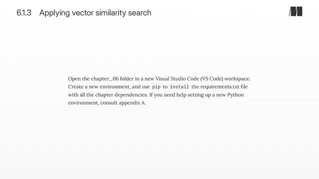
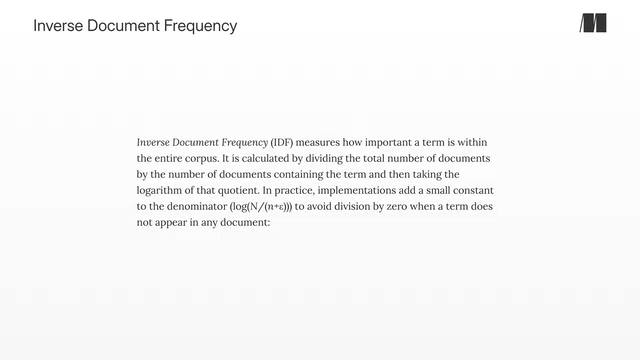
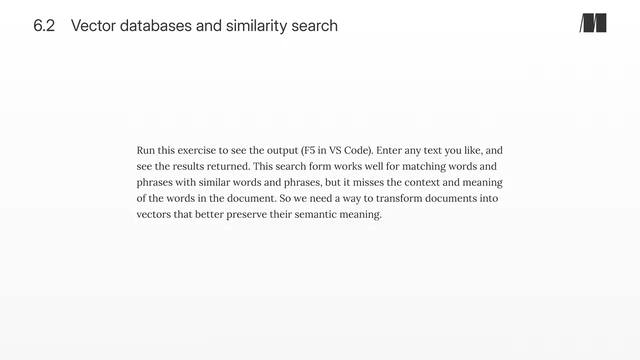
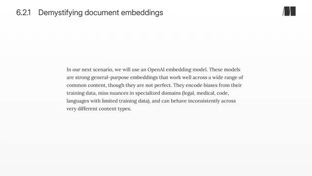
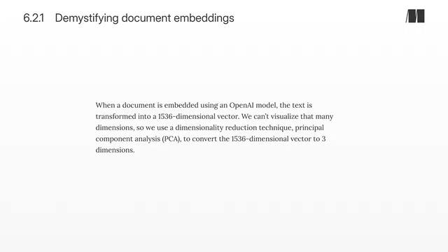
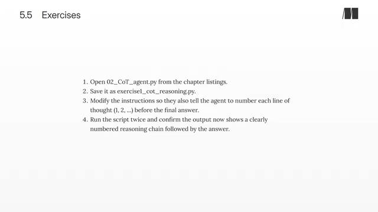

# AI Agents In Action 2nd（multi-agent）P029–P032 复现文档

> 覆盖范围：P029（第 5 章练习题）、P030（第 5 章总结）、P031（第 6 章开篇：检索与 RAG 基础）、P032（向量数据库与嵌入）。
>
> 说明：P029 是练习清单，P030 是纯总结（无代码），P031/P032 是第 6 章正文，包含可运行的 Python 示例（TF-IDF、余弦相似度、内存向量库、OpenAI 嵌入可视化、ChromaDB 查询）。本文按「先跑通第 6 章示例 → 再回头做第 5 章练习」的顺序组织，因为第 6 章示例是独立可运行的，而第 5 章练习依赖第 5 章已有的 agent 文件。

---

## 1. 这一节做什么

这四集横跨两章，目标不同：

- **P029**：第 5 章（推理与规划）的 5 个动手练习，从「给 COT agent 加编号推理链」一路做到「反思循环 + 自动重试」。每个练习都给了明确的任务清单和预期耗时（8/12/15/18/15 分钟）。
- **P030**：第 5 章总结，把 COT / ReAct / 高层规划 / Tree of Thought / Reflection / Sequential Thinking MCP 串成一张选型表。**纯讲解，无代码。**
- **P031**：第 6 章开篇。讲清楚「检索（retrieval）」和「记忆（memory）」为什么是 agent 从「无状态推理器」变成「能记住东西的系统」的关键；拆解 RAG 的**两个阶段（ingestion / retrieval）**；讲 TF-IDF 的完整算式；讲余弦相似度；最后落到一个可运行的 `document_vector_similarity.py`。
- **P032**：把向量存进「向量数据库」，先用纯 Python 在内存里复刻一个，再用 OpenAI 嵌入 + PCA 做 3D 可视化，最后用 ChromaDB 做一次真实的语义查询。

**读者最终能跑出来的东西**：一个装了依赖的 Python 环境 + 5 个可运行的脚本（TF-IDF 相似度矩阵、内存向量库、嵌入可视化、ChromaDB 查询），以及第 5 章 5 个练习的改造方案。

---

## 2. 讲师原话

> "检索是无界的外部存储与有界的单次调用上下文之间的桥梁。智能体在更大的存储中搜索，只把最相关的片段带进当前调用的上下文。"
> —— p031 [02:24]

> "嵌入模型和大语言模型是两个不同的模型，承担两项不同的工作。嵌入模型把文本编码成向量，用于相似度搜索；大语言模型负责生成最终回答。"
> —— p031 [04:45]

> "在数据摄取阶段，文档被加载、转换为上下文分块、嵌入成向量，并存入可搜索的向量数据库。在检索阶段，用户的查询被嵌入到同一个向量空间，最相似的分块从数据库中被取出，这些分块就成为大语言模型生成回答的上下文。"
> —— p031 [05:14]

> "TF-IDF 衡量的是词项的重要性，而不是语义。在 TF-IDF 下，查询“vehicles”不会匹配到关于“cars”的文档，因为两者用词不同，尽管含义相同。"
> —— p031 [12:18]

> "余弦相似度是稀疏向量（TF-IDF）和稠密向量（语义嵌入）的默认选择，因为它忽略量级，只关注方向。"
> —— p031 [17:04]

> "语义相似不等于语义正确，所以一条结果可能非常贴合查询的含义，事实上却是错的。检索看不到真相，只能看到相似性。"
> —— p031 [10:01]

> "TF-IDF 并非不可靠，它是两种值得拥有的信号之一。混合检索……会把 TF-IDF 或 BM25 搜索与语义嵌入搜索并行执行，再合并结果。"
> —— p032 [01:53]

> "注意，结果是按距离打分的，而不是按相似度。A 与 B 的余弦距离等于 1 减去 A 与 B 的余弦相似度。"
> —— p032 [05:37]

> "保持工具列表精简。每多一个工具，都会让 ReAct 循环和顺序思考调用膨胀，因此要把每个智能体的范围控制在 10 个以内高度相关的工具。"
> —— p030 [01:50]

---

## 3. 从零复现

### 3.1 环境准备（P031 [12:46] 明确要求）

讲师的原话是：在 VS Code 里新开一个 Workspace，打开 **Chapter 06** 文件夹，新建 Python 环境，用 pip 安装 `requirements.txt`。逐字稿没有给出 `requirements.txt` 的具体内容，**课里没讲**版本号。下面给出的是按本段代码实际 import 反推的最小依赖集，版本请以你本地 `pip install` 解析结果为准：

```bash
# 1. 建目录（对应书里的 Chapter 06）
mkdir -p chapter06 && cd chapter06

# 2. 建虚拟环境（讲师说「consult Appendix A」，附录内容课里没讲）
python3 -m venv .venv
source .venv/bin/activate        # Windows: .venv\Scripts\activate

# 3. 安装依赖（版本以实际解析为准）
pip install scikit-learn numpy matplotlib openai chromadb python-dotenv
```

> 说明：`scikit-learn` 提供 `TfidfVectorizer` 和 `cosine_similarity`；`numpy` 做矩阵；`matplotlib` 画 3D 图；`openai` 调嵌入模型；`chromadb` 是本地向量库；`python-dotenv` 读 `.env`。逐字稿只点名了 scikit-learn、OpenAI、ChromaDB、PCA（来自 sklearn），其余是运行必需。

### 3.2 环境变量

P032 用 OpenAI 嵌入模型，需要 API Key。逐字稿没有给出变量名，**课里没讲**。按 OpenAI 官方 SDK 的惯例，用 `OPENAI_API_KEY`：

```bash
# chapter06/.env
OPENAI_API_KEY=sk-你的key
```

### 3.3 目录结构

```
chapter06/
├── .env
├── requirements.txt
├── document_vector_similarity.py   # 对应 listing 6.1 + 6.2（TF-IDF + 余弦）
├── document_vector_database.py     # 对应 listing 6.3（内存向量库）
├── document_visualizing_embeddings.py  # 对应 listing 6.4（OpenAI 嵌入 + PCA 3D）
└── document_query_chromadb.py      # 对应 listing 6.5（ChromaDB 查询）
```

### 3.4 运行顺序

1. 先跑 `document_vector_similarity.py`（不花钱、不联网），确认 TF-IDF + 余弦矩阵能出来。
2. 再跑 `document_vector_database.py`（不花钱），确认内存向量库能按相似度返回文档。
3. 然后跑 `document_visualizing_embeddings.py`（**要联网、要花钱**），确认 3D 图能弹出来。
4. 最后跑 `document_query_chromadb.py`（**要联网、要花钱**），确认 ChromaDB 返回带 distance 的结果。

按这个顺序，前两步不依赖 API Key，能先把「检索」的机制跑通，再上真实嵌入。

---

## 4. 完整代码

> 以下 4 个文件都是**完整可保存运行**的。逐字稿只给了 listing 的「相关片段」，没有给完整文件；下面按逐字稿描述的机制补全为可运行版本，凡是逐字稿没明说的部分（如语料内容、打印格式）都在注释里标注「课里没讲，此处为可运行补全」。

### 4.1 `document_vector_similarity.py`（对应 listing 6.1 + 6.2）

```python
"""
TF-IDF 向量化 + 余弦相似度矩阵。
对应 P031 listing 6.1（TF-IDF 计算）与 listing 6.2（余弦相似度）。
运行：python document_vector_similarity.py
"""

from sklearn.feature_extraction.text import TfidfVectorizer
from sklearn.metrics.pairwise import cosine_similarity

# 课里没讲具体语料内容，此处给一组可运行的示例文档
documents = [
    "The sky is blue and beautiful.",
    "Love this blue and beautiful sky!",
    "The quick brown fox jumps over the lazy dog.",
    "A king's breakfast has sausages, ham, bacon, eggs, toast and beans.",
    "I love green eggs, ham, sausages and bacon!",
    "The brown fox is quick and the blue dog is lazy!",
    "The sky is very blue and the sky is very beautiful today.",
    "The dog is lazy but the brown fox is quick!",
]

# 1) TF-IDF 向量化：每个位置对应词表里的一个词，值是 TF-IDF 分数
vectorizer = TfidfVectorizer()
tfidf_matrix = vectorizer.fit_transform(documents)

# 2) 余弦相似度矩阵：row i, col j = 第 i 篇与第 j 篇的相似度
cosine_similarities = cosine_similarity(tfidf_matrix)

# 3) 交互式查看：选一篇文档，看它和其余文档的相似度
while True:
    print("\nDocuments:")
    for i, doc in enumerate(documents):
        print(f"  {i}: {doc}")

    choice = input("\nEnter a document number (or 'q' to quit): ").strip()
    if choice.lower() == "q":
        break
    try:
        idx = int(choice)
        if not 0 <= idx < len(documents):
            print("Number out of range.")
            continue
    except ValueError:
        print("Please enter a number.")
        continue

    print(f"\nSimilarities for document {idx}: {documents[idx]}")
    for j, score in enumerate(cosine_similarities[idx]):
        print(f"  vs {j}: {score:.4f}  ({documents[j]})")
```

### 4.2 `document_vector_database.py`（对应 listing 6.3）

```python
"""
纯 Python 在内存里复刻一个简单向量数据库。
对应 P032 listing 6.3。
运行：python document_vector_database.py
"""

import numpy as np
from sklearn.feature_extraction.text import TfidfVectorizer
from sklearn.metrics.pairwise import cosine_similarity

# 课里没讲具体语料，此处给一组可运行的示例文档
documents = [
    "The sky is blue and beautiful.",
    "Love this blue and beautiful sky!",
    "The quick brown fox jumps over the lazy dog.",
    "A king's breakfast has sausages, ham, bacon, eggs, toast and beans.",
    "I love green eggs, ham, sausages and bacon!",
    "The brown fox is quick and the blue dog is lazy!",
    "The sky is very blue and the sky is very beautiful today.",
    "The dog is lazy but the brown fox is quick!",
]

vectorizer = TfidfVectorizer()
doc_vectors = vectorizer.fit_transform(documents)   # 这就是「向量库」


def search(query: str, top_k: int = 3):
    """把 query 向量化，和库里每篇文档算余弦相似度，返回 top_k。"""
    query_vec = vectorizer.transform([query])
    scores = cosine_similarity(query_vec, doc_vectors)[0]
    # argsort 升序，取最后 top_k 个再反转成降序
    top_idx = np.argsort(scores)[::-1][:top_k]
    return [(documents[i], float(scores[i])) for i in top_idx]


if __name__ == "__main__":
    while True:
        q = input("\nEnter search text (or 'q' to quit): ").strip()
        if q.lower() == "q":
            break
        results = search(q)
        print(f"\nResults for: {q}")
        for text, score in results:
            print(f"  score={score:.4f}  {text}")
```

### 4.3 `document_visualizing_embeddings.py`（对应 listing 6.4）

```python
"""
用 OpenAI 嵌入模型把文档变成 1536 维向量，再用 PCA 降到 3 维画图。
对应 P032 listing 6.4。
运行前：在 .env 里配好 OPENAI_API_KEY。
运行：python document_visualizing_embeddings.py
"""

import os
import numpy as np
import matplotlib.pyplot as plt
from dotenv import load_dotenv
from openai import OpenAI
from sklearn.decomposition import PCA

load_dotenv()
client = OpenAI(api_key=os.environ["OPENAI_API_KEY"])

# 课里没讲具体语料，此处给一组语义上可分的示例文档
documents = [
    "The cat sat on the mat.",
    "A kitten is playing with a ball of yarn.",
    "Dogs are loyal companions.",
    "The puppy wagged its tail happily.",
    "Stock markets fell sharply today.",
    "Investors are worried about inflation.",
    "The central bank raised interest rates.",
    "Quantum computers may change cryptography.",
    "Machine learning models need lots of data.",
    "Neural networks are inspired by the brain.",
]

# 1) 调 OpenAI 嵌入模型，得到 1536 维向量（逐字稿明确说 1536 维）
resp = client.embeddings.create(
    model="text-embedding-3-small",   # 课里没点名具体模型，此处用 OpenAI 常用嵌入模型
    input=documents,
)
embeddings = np.array([d.embedding for d in resp.data])
print("embedding shape:", embeddings.shape)   # 期望 (10, 1536)

# 2) PCA 降到 3 维
pca = PCA(n_components=3)
reduced = pca.fit_transform(embeddings)

# 3) 3D 散点图
fig = plt.figure(figsize=(10, 8))
ax = fig.add_subplot(111, projection="3d")
ax.scatter(reduced[:, 0], reduced[:, 1], reduced[:, 2], c="steelblue", s=60)
for i, doc in enumerate(documents):
    ax.text(reduced[i, 0], reduced[i, 1], reduced[i, 2], f" {i}", fontsize=9)
ax.set_title("Document embeddings reduced to 3D via PCA")
plt.tight_layout()
plt.show()

# 打印编号对照，方便看图
for i, doc in enumerate(documents):
    print(f"{i}: {doc}")
```

### 4.4 `document_query_chromadb.py`（对应 listing 6.5）

```python
"""
用 ChromaDB 做一次真实的语义查询。
对应 P032 listing 6.5。
注意：ChromaDB 返回的是 distance（越小越相似），不是 similarity。
运行前：在 .env 里配好 OPENAI_API_KEY。
运行：python document_query_chromadb.py
"""

import os
import chromadb
from dotenv import load_dotenv
from openai import OpenAI

load_dotenv()
client = OpenAI(api_key=os.environ["OPENAI_API_KEY"])

documents = [
    "The sky is blue and beautiful.",
    "Love this blue and beautiful sky!",
    "The quick brown fox jumps over the lazy dog.",
    "A king's breakfast has sausages, ham, bacon, eggs, toast and beans.",
    "I love green eggs, ham, sausages and bacon!",
    "The brown fox is quick and the blue dog is lazy!",
    "The sky is very blue and the sky is very beautiful today.",
    "The dog is lazy but the brown fox is quick!",
]

# 1) 本地持久化 ChromaDB（课里说 ChromaDB 适合本地开发/小规模）
chroma = chromadb.PersistentClient(path="./chroma_store")
collection = chroma.get_or_create_collection(name="documents")

# 2) 用 OpenAI 嵌入模型生成向量，写入 ChromaDB
resp = client.embeddings.create(model="text-embedding-3-small", input=documents)
embeddings = [d.embedding for d in resp.data]
ids = [f"doc-{i}" for i in range(len(documents))]

collection.add(ids=ids, documents=documents, embeddings=embeddings)

# 3) 查询：把 query 也嵌入，再让 ChromaDB 找最近的
query = "Which document talks about a fast animal?"
q_resp = client.embeddings.create(model="text-embedding-3-small", input=[query])
query_embedding = q_resp.data[0].embedding

results = collection.query(query_embeddings=[query_embedding], n_results=3)

print(f"\nQuery: {query}")
for doc, dist in zip(results["documents"][0], results["distances"][0]):
    # 逐字稿明确：结果是 distance，不是 similarity
    print(f"  distance={dist:.4f}  {doc}")
```

---

## 5. 逐行解释

### 5.1 TF-IDF 的算式（P031 [13:42]–[16:07]）

讲师用「the sky is blue and beautiful」这句话、聚焦 `blue` 这个词，把 TF-IDF 拆成两步：

- **TF（term frequency）** = 该词在文档中出现次数 ÷ 文档总词数 = 1 ÷ 6 ≈ **0.1670**。
- **IDF（inverse document frequency）** = log(总文档数 ÷ 含该词的文档数)。讲师给的语料是 8 篇文档、`blue` 出现在 4 篇里，取 log 底 10：log(8/4) ≈ **0.301**。讲师还补了一句：实现里通常给分母加一个很小的常数 ε，避免「某词在任何文档都不出现」时除零。
- **TF-IDF = TF × IDF ≈ 0.1670 × 0.301 ≈ 0.050**。

> 在 JS/Node 里对应什么：这就是一个「词频 × 逆文档频率」的加权计数，没有并发/锁的问题，纯数组运算。`TfidfVectorizer` 在 sklearn 里做的事，等价于你先 `split()` 再 `reduce` 统计词频，再对每个词算 `Math.log(N / df)`。

**为什么用 TF-IDF 而不是直接词频**：讲师说得很清楚——「TF-IDF measures term importance, not meaning」。它奖励「在这篇文档里出现多、但在整个语料里少见」的词，惩罚「到处都有的停用词」。所以它是**重要性**度量，不是**语义**度量。

### 5.2 余弦相似度（P031 [16:35]–[18:28]）

讲师的原话：余弦相似度衡量两个非零向量夹角的余弦，**忽略向量长度、只看方向**。两个文档即使一长一短，只要「特征比例」相近，就被判为相似——这正是检索想要的。

- 余弦相似度取值 **-1（不相似）到 1（完全相同）**。
- 余弦距离 = 1 − 余弦相似度，取值 **0（相同）到 2（完全相反）**。
- 讲师特别指出：TF-IDF 向量非负，所以实际相似度落在 **0 到 1**，不会出现负值。

**为什么不用欧氏距离/点积**：讲师说这两个对向量长度敏感，文档长短不一会引入噪声。在 JS 里你可以把余弦相似度理解成「两个数组归一化后的点积」，`dot(a,b) / (norm(a)*norm(b))`。

### 5.3 相似度矩阵的结构（P031 [18:57]–[19:22]）

`cosine_similarity(tfidf_matrix)` 返回一个方阵：第 i 行第 j 列 = 第 i 篇与第 j 篇的相似度。讲师点出两个性质：

- **对称**：a 对 b 的相似度 = b 对 a 的相似度。
- **对角线为 1**：每篇文档和自己完全相同。

所以代码里「选一篇文档、打印它那一行」就能看到它和全库的相似度。这也是为什么 `document_vector_similarity.py` 里用 `cosine_similarities[idx]` 取一行。

### 5.4 内存向量库（P032 [00:00]–[00:29]）

`document_vector_database.py` 的核心就三行：`fit_transform` 建库、`transform([query])` 把查询向量化、`cosine_similarity` 算分再 `argsort` 取 top-k。讲师说这个搜索「works well for matching words and phrases with similar words and phrases, but it misses the context and meaning」——这正是下一节要换嵌入模型的原因。

> 在 JS/Node 里对应什么：`argsort(scores)[::-1][:k]` 就是 `scores.map((s,i)=>[s,i]).sort((a,b)=>b[0]-a[0]).slice(0,k)`。没有并发问题，纯内存排序。

### 5.5 嵌入与 PCA（P032 [03:49]–[04:42]）

讲师明确说：OpenAI 嵌入模型把文本变成 **1536 维**向量；人眼看不了 1536 维，所以用 **PCA** 降到 **3 维**再画图。图里语义相近的文档会聚在一起（Figure 6.6）。

讲师还提醒了嵌入的局限：会编码训练数据里的偏见、在专业领域（法律/医疗/代码）和小语种上表现不稳、对不同内容类型行为不一致。所以「生产环境应该拿多个嵌入模型在你的内容上评测，而不是图方便用默认的」。

### 5.6 ChromaDB 的 distance 语义（P032 [05:37]）

这是最容易踩的坑：**ChromaDB 返回的是 distance，不是 similarity**。讲师给了公式：

> cosine distance(A, B) = 1 − cosine similarity(A, B)

所以 distance **越小越相似**：0 = 最相似，2 = 语义相反。代码里 `results["distances"][0]` 拿到的就是这个值，排序时不要当成 similarity 去「取最大」。

### 5.7 第 5 章练习的改造点（P029）

P029 是练习清单，逐字稿只给了任务描述，**没有给练习的完整代码**（它引用的是第 5 章已有的 `02_cot_agent.py`、`03_tot_agent.py`、`03_reflection_agent.py`、`04_sequential_thinking_agent.py`，这些文件课里没贴）。所以这里只能复现「改造要求」，不能复现「改造后的完整文件」：

| 练习 | 起点文件 | 关键改造 | 验收 |
|---|---|---|---|
| 1 COT 编号 | `02_cot_agent.py` → `exercise1_cot_reasoning.py` | 指令里要求每行思考前加 1、2、3… 编号 | 跑两次，输出是「编号推理链 + 答案」 |
| 2 COT→ReAct | 复制练习 1 → `exercise2_react_agent.py` | 加 `travel_back` / `travel_forward` 两个工具；指令改成 think→act→observe 循环；打印 `result.trace` | 至少调用一个工具且年份正确 |
| 3 Sequential Thinking MCP | `04_sequential_thinking_agent.py` → `exercise3_st_server.py` | 保留两个时间旅行工具、删掉所有 print；指令要求每步推理先用 sequential thinking 工具；`max_turns=25` | 在 OpenAI dashboard traces 里数三类调用次数，写进文件底部注释 |
| 4 ToT 分支+剪枝 | `03_tot_agent.py` → `exercise4_tot_branch.py` | 初始候选减到 2 个、每个再扩 2 步；评估器改成 0–10 打分；保留 score ≥ 7 的分支并打印 | 注释里记「总 LLM 调用数 vs 保留分支数」 |
| 5 反思+重试 | `03_reflection_agent.py` → `exercise5_reflection_retry.py` | 把硬编码目标天数换成 `check_answer(days:int)->bool`（days==26 返回 True）；critic 调它，False 就输出以 `hint` 开头的一句话；最多 4 次，全失败打印 `failed after four tries` | 演示成功路径（≤4 次答对 26）和强制失败路径（把工具改成期望 42） |

> 注意：练习 5 的 `check_answer` 是「工具」，不是普通函数——讲师要求 critic 去**调用**它，这和第 5 章 ReAct 的工具调用是同一套机制。

---

## 6. 复现检查清单

跑完下面每一条打勾，就算复现成功：

- [ ] `python3 -m venv .venv && source .venv/bin/activate` 成功，`pip list` 里能看到 `scikit-learn`、`chromadb`、`openai`。
- [ ] `document_vector_similarity.py` 运行后，输入 `0`，能看到第 0 篇和它自己的相似度是 `1.0000`（对角线性质）。
- [ ] 同一脚本里，任意两篇的相似度都落在 `0` 到 `1` 之间，**没有负数**（TF-IDF 非负）。
- [ ] `document_vector_database.py` 输入 `blue sky`，top-1 是含 `sky`/`blue` 的文档，score 明显高于其他。
- [ ] `document_visualizing_embeddings.py` 打印 `embedding shape: (10, 1536)`（1536 是讲师明确说的维度）。
- [ ] 3D 图弹出，语义相近的文档（猫/狗、股票、量子/ML）在空间上聚成簇。
- [ ] `document_query_chromadb.py` 输出里字段是 `distance`，且**数值越小越相关**；top-1 的 distance 最小。
- [ ] `./chroma_store` 目录被创建（`PersistentClient` 的副作用）。
- [ ] 第 5 章练习：至少完成练习 1 和练习 2，能贴出「编号推理链」和「`result.trace` 里至少一次工具调用」的截图。













---

## 7. 课里没讲但你会撞上的

1. **`requirements.txt` 的具体版本**：课里只说「pip install requirements.txt」，没给内容。你按本文第 3.1 节装最小集即可；如果 `chromadb` 和 `numpy` 版本打架，先升 `numpy`。
2. **OpenAI 嵌入模型名**：讲师说「we will use an OpenAI embedding model」「1536 维」，但**没点名** `text-embedding-3-small`。本文用的是它（1536 维，和讲师说的维度一致）；如果你换 `text-embedding-3-large`，维度会变，PCA 那步的 `embedding shape` 就不是 1536 了。
3. **API Key 环境变量名**：课里没讲。本文用 `OPENAI_API_KEY`，这是 OpenAI SDK 的默认读取名。
4. **ChromaDB 的 `PersistentClient` vs `Client`**：课里只说「local vector database」，没讲用哪个构造器。本文用 `PersistentClient(path=...)` 落盘；如果你只想内存跑，换 `chromadb.Client()`。
5. **`collection.query` 返回结构**：课里没贴返回的完整字段。本文只用了 `results["documents"][0]` 和 `results["distances"][0]`；**其他字段名请以实际输出为准**，不要凭印象写 `ids`/`embeddings` 的嵌套层级。
6. **PCA 的随机性**：`PCA(n_components=3)` 默认确定性，但不同 sklearn 版本在符号上可能翻转（图会镜像），不影响「谁和谁聚在一起」的结论。
7. **第 5 章练习的起点文件**：`02_cot_agent.py` 等文件课里没贴内容，你需要在书的配套仓库里找。找不到就先按练习描述自己写一个最小 COT agent，再套练习 1 的改造。
8. **`result.trace` 的字段**：练习 2 要求打印 `result.trace`，但课里没给 trace 的结构。**字段名请以你实际跑出来的对象为准**，不要假设有 `tool_calls` 这种名字。
9. **Sequential Thinking MCP server 的启动方式**：练习 3 要求「integrate the sequential thinking MCP server」，但课里没讲怎么起这个 server（命令、端口、配置）。这块需要你查 MCP 官方文档，**不属于本段逐字稿覆盖范围**。
10. **成本**：`document_visualizing_embeddings.py` 和 `document_query_chromadb.py` 各调一次嵌入 API（10 条文本），量很小；但如果你把语料换成几百条，注意按 token 计费。
11. **在 JS/Node 里对应什么**：本文所有「向量化 + 余弦」的逻辑，在 Node 里可以用 `ml-distance` 或手写 `dot/(norm*norm)`；ChromaDB 有 JS 客户端，但**课里没讲 JS 版本**，接口名以官方文档为准。锁/事务/并发在这几段代码里**完全不涉及**——都是单进程同步计算，没有共享状态。