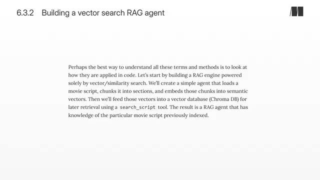
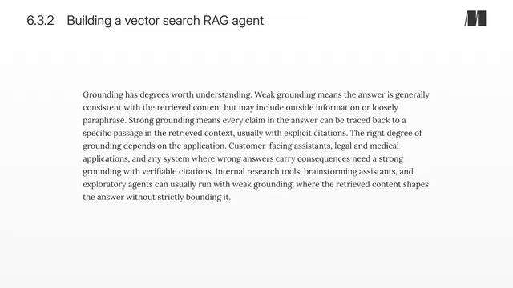
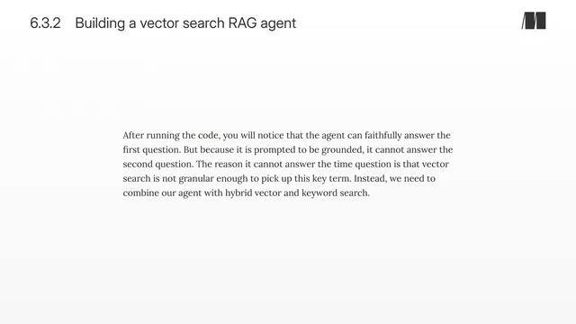
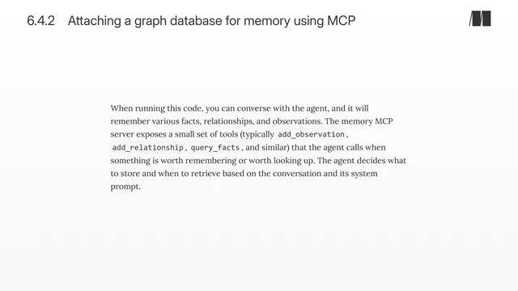
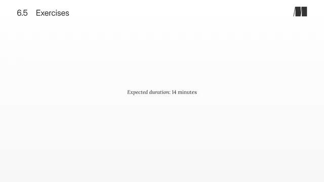
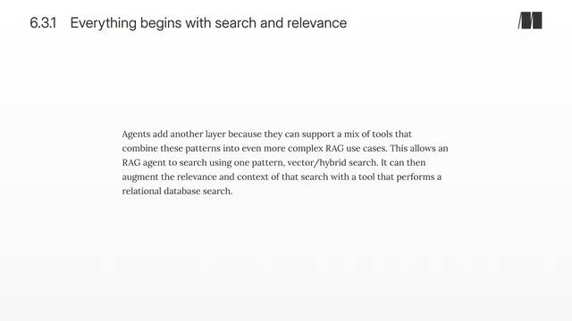
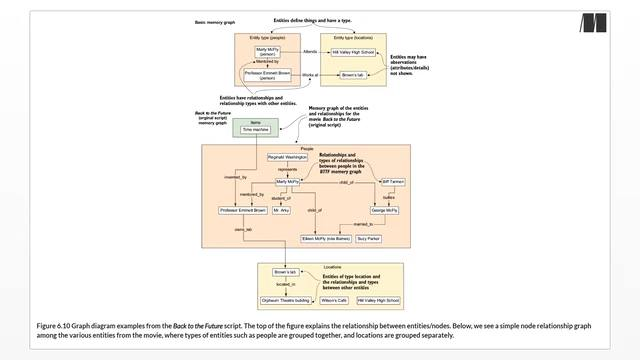
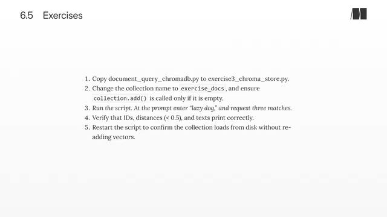

# AI Agents In Action 2nd（multi-agent）P033–P035 复现文档
## 从「纯向量 RAG」到「混合检索 RAG」，再到「MCP 记忆体」

---

## 1. 这一节做什么

这三集讲的是同一件事的三个递进阶段：**怎么让一个 agent 真正“知道”某份文档（知识），以及真正“记得住”跨会话的事实（记忆）**。

**P033（Section 6.3）** 先打破一个新手幻觉：向量相似度检索很好用，但**只用向量检索做不出能用的 RAG**。讲师用一份《回到未来》初版剧本做语料，先搭一个“纯向量”RAG agent（切块 → OpenAI embedding → 写入 ChromaDB → 挂成工具 → 加 grounding 指令），跑出来发现它能回答“Doc 让 Marty 去哪、几点见”，但回答不了“凌晨 1:15 发生了什么”——因为向量检索的粒度抓不住这种精确的关键词/时刻。于是升级到**混合检索（Hybrid Search）**：关键词（BM25）和向量两路各出一份排序列表，用 **RRF（Reciprocal Rank Fusion）** 融合，并且要求 agent 在每条答案后给出引用。

**P034（Section 6.4）** 把话题从“知识”切到“记忆”，并且用 **MCP** 来落地：先是记忆的架构拆解（上下文窗口 / 外部存储 / 状态管理 / 检索机制），然后是**图数据库记忆**（实体=节点，关系=边），再是**图 + 向量的混合记忆**（两个 MCP server 一起挂），最后讲了记忆的语义增强、压缩与遗忘。

**P035（Section 6.5）** 是 5 道动手练习，把你从 TF-IDF 的余弦相似度一路带到带 trace 的混合 RAG agent。

产出物是一个可运行的 Python 项目：两个 RAG agent 脚本 + 两个记忆 agent 脚本 + 5 个练习脚本 + 一份本地 ChromaDB 向量库 + 一份本地图谱记忆文件。



---

## 2. 讲师原话

> "相似度搜索或向量搜索为构建检索增强生成系统提供了极好的基础，但完全依赖向量搜索，并不足以构成实用检索增强生成系统的基础。"
> —— p033 [00:00]

这句话是整节的立论。后面所有“混合检索”“引用”“graph memory”都是围绕它展开的补丁。

> "依据性是指把智能体的回答限制在检索到的上下文中出现的信息范围内，而不是让模型退回到其训练数据上。"
> —— p033 [03:14]

> "最强的是明确指令，例如“只使用所提供上下文中的信息来回答”。如果上下文不包含答案，就明确说明。增加引用要求——针对每个主张，引用来源文档并给出引文——会强化依据性，因为模型必须为每项陈述绑定一个检索到的来源。"
> —— p033 [03:44]

这两句给出了可以直接抄进 `instructions` 的三条 prompt 模式（原文三条：①只用上下文回答、没有就说没有；②每个论断给出引用与原文；③先列相关段落再作答）。

> "它无法回答时间问题的原因是，向量搜索的粒度不够细，无法捕捉到这个关键术语。"
> —— p033 [07:05]

这是从“纯向量”升级到“混合检索”的直接动机，也是你复现时最该亲眼验证的一个失败现象。

> "任意文档的融合分数计算为两个列表中 1/(k + rank) 之和，其中 k 是一个小常数，通常取 60。"
> —— p033 [08:04]

RRF 的公式就这一句，`score = Σ 1/(k + rank)`，k 取 60，只看名次不看原始分数。

> "一篇在关键词搜索中排名第一、在向量搜索中也排名第一的文档，在融合结果中仍会排名第一，无论关键词搜索返回的分数是 0.95 和 0.92，还是向量搜索返回的分数是 23.1 和 22.8。"
> —— p033 [08:33]

这就是 RRF 存在的理由：BM25 分和 cosine 分不在同一个量纲上，没法直接相加。

> "智能体记忆最好通过实现它的架构组件来理解，而不是通过认知类别来理解。"
> —— p034 [00:55]

讲师明确说“短期/长期/情景/语义”这套认知学词汇**只是速记**，真正的四个部件是：上下文窗口、外部存储、状态管理、检索机制。

> "添加“Mikhail lives in Calgary”会创建两个节点 Mikhail 和 Calgary，并在它们之间创建一条标签为 lives in 的边。"
> —— p034 [08:21]

图记忆的最小可用模型：节点是实体，边是关系，观察（observation）挂在节点上。

> "本章中的记忆示例运行在内存中，或运行在进程停止后就会消失的本地存储中，因此它们有助于学习这些模式，但都是短暂的。MCP 服务器只是一个薄封装。真正的工作在于存储后端、提取逻辑和检索逻辑。"
> —— p034 [11:38]

这句很重要，它告诉你：**上课这块代码是“能跑通流程”的程度，不是生产级**。第 7 章我会展开你实际会撞上的坑。



---

## 3. 从零复现

### 3.0 前置条件

- Python 3.11+
- Node.js 18+（图记忆 MCP server 是 npm 包，用 `npx` 启动）
- `uv` / `uvx`（Chroma MCP server 用它启动；不装的话第 5 个脚本跑不起来）
- 一个可用的 `OPENAI_API_KEY`

### 3.1 建目录、建虚拟环境

```bash
mkdir rag-memory-course && cd rag-memory-course
python -m venv .venv
source .venv/bin/activate          # Windows: .venv\Scripts\activate
mkdir -p data exercises
```

目标目录结构（下面第 4 章会把每个文件贴全）：

```
rag-memory-course/
├── .env
├── requirements.txt
├── config.py
├── rag_core.py
├── data/
│   └── back_to_the_future_script.txt
├── 02_rag_agent_vector.py
├── 02_rag_agent_hybrid.py
├── 03_create_memories_mcp.py
├── 03_mcp_memory_manage_agent.py
├── 04_hybrid_memory_agent.py
├── exercises/
│   ├── exercise1_tfidf_demo.py
│   ├── exercise2_embeddings_demo.py
│   ├── exercise3_chroma_store.py
│   ├── exercise4_vector_rag_agent.py
│   └── exercise5_hybrid_rag_agent.py
├── chroma_db/          # 运行时自动生成
└── memory.json         # 运行时自动生成（图谱记忆）
```

> 逐字稿里念到的文件名是 `02_rag_agent_vector.py`、`02_rag_agent_hybrid.py`、`03_create_memories_mcp.py`、`03_mcp-memory-manage-agent.py`、`04_Hybrid_Memory_Agent.py`（p034 [07:23]、[09:46]；p035 [02:26]、[02:55]）。这里统一改成下划线风格，脚本名不影响运行。

### 3.2 装依赖

`requirements.txt`（版本号课里没讲，下面是一组能跑通的参考值，装冲突时优先按 `openai-agents` 的 README 对齐 `openai` 版本）：

```
openai>=1.40,<3
openai-agents>=0.0.7
chromadb>=0.5,<2
tiktoken>=0.7
python-dotenv>=1.0
numpy>=1.26
matplotlib>=3.8
scikit-learn>=1.4
```

```bash
pip install -r requirements.txt
```

### 3.3 配 `.env`

```dotenv
OPENAI_API_KEY=sk-你的key
EMBEDDING_MODEL=text-embedding-3-small
CHAT_MODEL=gpt-4o-mini
COLLECTION_NAME=movie_script
MAX_TOKENS_PER_CHUNK=300
CHUNK_OVERLAP_TOKENS=30
TOP_K=3
```

### 3.4 放语料

把《回到未来》剧本纯文本存成 `data/back_to_the_future_script.txt`（UTF-8）。

> **课里没讲**这份剧本文件从哪下载、有没有版权限制，也没给出文件大小和格式规范。你自己找一份纯文本即可，切块逻辑对格式没有要求，只要有换行。

### 3.5 跑纯向量 RAG agent

```bash
python 02_rag_agent_vector.py
```

第一次跑会看到建索引的日志（切块数 + 写入条数），第二次跑应该直接跳过写入。然后是两个问题：

- `Where does Doc tell Marty to meet him, and at what time?`
- `What happens at 1:15 a.m.?`

逐字稿的说法是：**第一个答得出来，第二个答不出来**（p033 [07:05]）——原因是向量检索抓不住“1:15”这种精确词。你实际看到什么以终端输出为准。



### 3.6 跑混合检索 RAG agent

```bash
python 02_rag_agent_hybrid.py
```

这个 agent 挂了两个工具：`search_script_with_keyword`（BM25）和 `search_script_with_vector_similarity`（ChromaDB 向量）。指令里额外要求“每个答案至少给出引用”。

### 3.7 装并跑图谱记忆 MCP server

```bash
# 先确认 npx 能用
npx -y @modelcontextprotocol/server-memory --help
```

第一次运行会拉包，需要网络。然后预置记忆：

```bash
python 03_create_memories_mcp.py
```

这个脚本会先打印出 server 暴露的全部工具名，再依次调用建实体 / 建关系 / 加观察。**工具名以打印结果为准**（见第 7 章）。

### 3.8 和图记忆 agent 对话

```bash
python 03_mcp_memory_manage_agent.py
```

输入 `My name is Mikhail and I live in Calgary.`，再开一个新进程重新进来问 `Where does Mikhail live?`，验证记忆是否真的落盘。



### 3.9 跑混合记忆 agent（图 + 向量）

```bash
python 04_hybrid_memory_agent.py
```

它同时挂两个 MCP server：`@modelcontextprotocol/server-memory`（图）和 `chroma-mcp`（向量）。

> **课里没讲** Chroma MCP server 的确切启动参数。逐字稿只说“adding the Chroma MCP server”（p034 [09:46]）。`config.py` 里给的是 `uvx chroma-mcp --client-type persistent --data-dir ...` 的常用写法，跑不通就按你装的包的 README 改 `CHROMA_SERVER_PARAMS`。

### 3.10 跑练习题

```bash
python exercises/exercise1_tfidf_demo.py    # 输入 blue / breakfast
python exercises/exercise2_embeddings_demo.py
python exercises/exercise3_chroma_store.py  # 输入 lazy dog
python exercises/exercise4_vector_rag_agent.py
python exercises/exercise5_hybrid_rag_agent.py
```



---

## 4. 完整代码

> 说明：逐字稿里只出现了 listing 6.6 / 6.7 / 6.8 / 6.9 的**编号和意图描述**，代码本体是对着屏幕讲的、没有逐字进入文字稿。下面的代码是**严格按照逐字稿描述的步骤、工具名、prompt 三条模式**重建的可运行实现；讲师原文的变量名、提示词细节课里没逐字给出。凡是逐字稿点过名的（`simple_chunk`、`GetEmbedding`、`search_script_with_keyword`、`search_script_with_vector_similarity`、`Runner.run_sync`、`trace("chapter 6 hybrid rag demo")`、RRF 的 k=60）都保留了原名。

### 4.1 `config.py`

```python
# config.py
"""全局配置：路径、模型名、Chroma 集合名、MCP server 启动参数。"""
import os
from pathlib import Path

from dotenv import load_dotenv

load_dotenv()

BASE_DIR = Path(__file__).resolve().parent
DATA_DIR = BASE_DIR / "data"
CHROMA_DIR = BASE_DIR / "chroma_db"
MEMORY_FILE = BASE_DIR / "memory.json"

SCRIPT_PATH = DATA_DIR / "back_to_the_future_script.txt"

COLLECTION_NAME = os.getenv("COLLECTION_NAME", "movie_script")
EMBEDDING_MODEL = os.getenv("EMBEDDING_MODEL", "text-embedding-3-small")
CHAT_MODEL = os.getenv("CHAT_MODEL", "gpt-4o-mini")

MAX_TOKENS_PER_CHUNK = int(os.getenv("MAX_TOKENS_PER_CHUNK", "300"))
CHUNK_OVERLAP_TOKENS = int(os.getenv("CHUNK_OVERLAP_TOKENS", "30"))
TOP_K = int(os.getenv("TOP_K", "3"))

if not os.getenv("OPENAI_API_KEY"):
    raise RuntimeError("缺少 OPENAI_API_KEY：请在项目根目录的 .env 里配置")

# 图谱记忆 MCP server（npx 启动）
MEMORY_SERVER_PARAMS = {
    "command": "npx",
    "args": ["-y", "@modelcontextprotocol/server-memory"],
    "env": {**os.environ, "MEMORY_FILE_PATH": str(MEMORY_FILE)},
}

# 向量记忆 MCP server（uvx 启动）。课里只说了「加入 Chroma MCP server」，
# 启动参数没讲，下面是常用写法，跑不通按你装的包的 README 改。
CHROMA_SERVER_PARAMS = {
    "command": "uvx",
    "args": [
        "chroma-mcp",
        "--client-type", "persistent",
        "--data-dir", str(CHROMA_DIR),
    ],
    "env": {**os.environ},
}
```

### 4.2 `rag_core.py`（切块 + 向量化 + Chroma + BM25 + RRF）

```python
# rag_core.py
"""向量检索的公共零件：切块 -> 向量化 -> 写入 ChromaDB -> 检索；外加 BM25 与 RRF。"""
from __future__ import annotations

import math
import re
from pathlib import Path
from typing import Any, Dict, List

import chromadb
import tiktoken
from openai import OpenAI

from config import (
    CHROMA_DIR, CHUNK_OVERLAP_TOKENS, COLLECTION_NAME, EMBEDDING_MODEL,
    MAX_TOKENS_PER_CHUNK, SCRIPT_PATH,
)

client = OpenAI()
_encoder = tiktoken.get_encoding("cl100k_base")
_chroma = chromadb.PersistentClient(path=str(CHROMA_DIR))


# ---------------- 切块 ----------------

def simple_chunk(
    text: str,
    max_tokens: int = MAX_TOKENS_PER_CHUNK,
    overlap_tokens: int = CHUNK_OVERLAP_TOKENS,
) -> List[str]:
    """按 token 数切块，块之间留 overlap，尽量在换行处断开。"""
```python
    tokens = _encoder.encode(text)
    if len(tokens) <= max_tokens:
        return [text]

    chunks: List[str] = []
    step = max(1, max_tokens - overlap_tokens)
    start = 0
    while start < len(tokens):
        window = tokens[start:start + max_tokens]
        if not window:
            break
        chunk = _encoder.decode(window)
        # 尽量在最后一个换行处截断，避免句子被劈成两半
        if len(window) == max_tokens and "\n" in chunk:
            cut = chunk.rfind("\n")
            if cut > len(chunk) // 2:
                chunk = chunk[:cut]
        cleaned = chunk.strip()
        if cleaned:
            chunks.append(cleaned)
        if start + max_tokens >= len(tokens):
            break
        start += step
    return chunks


# ---------------- 向量化 ----------------

def GetEmbedding(text: str) -> List[float]:
    """逐字稿里点名的 helper：调用 OpenAI embedding 模型，返回一条向量。"""
    resp = client.embeddings.create(model=EMBEDDING_MODEL, input=text)
    return resp.data[0].embedding


def GetEmbeddings(texts: List[str]) -> List[List[float]]:
    """批量版本，省往返。返回顺序与输入顺序一致。"""
    resp = client.embeddings.create(model=EMBEDDING_MODEL, input=texts)
    return [d.embedding for d in resp.data]


# ---------------- Chroma 建库 ----------------

def get_collection():
    """同一个 Chroma 目录下按 COLLECTION_NAME 取集合，不存在则建。"""
    return _chroma.get_or_create_collection(
        name=COLLECTION_NAME,
        metadata={"hnsw:space": "cosine"},
    )


def build_index(script_path: Path = SCRIPT_PATH, force: bool = False) -> int:
    """
    加载剧本 -> simple_chunk 切块 -> OpenAI embedding -> 写入 Chroma。
    逐字稿 p033 [02:49]：「load the ChromaDB from a local path and check whether the
    collection exists. If the collection exists and there are no vectors, we populate it.
    Otherwise, we continue to the agent.」
    返回当前集合里的向量条数。
    """
    collection = get_collection()
    if collection.count() > 0 and not force:
        print(f"[index] 集合 {COLLECTION_NAME} 已有 {collection.count()} 条，跳过写入")
        return collection.count()

    text = Path(script_path).read_text(encoding="utf-8")
    chunks = simple_chunk(text)
    print(f"[index] 切出 {len(chunks)} 块，开始向量化……")

    ids = [f"chunk-{i:04d}" for i in range(len(chunks))]
    metas = [{"chunk_index": i, "source": Path(script_path).name} for i in range(len(chunks))]

    # 分批调 embedding，避免单次请求过大
    BATCH = 64
    for batch_start in range(0, len(chunks), BATCH):
        batch_chunks = chunks[batch_start:batch_start + BATCH]
        batch_ids = ids[batch_start:batch_start + BATCH]
        batch_metas = metas[batch_start:batch_start + BATCH]
        vectors = GetEmbeddings(batch_chunks)
        collection.add(
            ids=batch_ids,
            documents=batch_chunks,
            embeddings=vectors,
            metadatas=batch_metas,
        )
        print(f"[index] 已写入 {batch_start + len(batch_chunks)}/{len(chunks)}")

    print(f"[index] 完成，集合现有 {collection.count()} 条")
    return collection.count()


# ---------------- 向量检索 ----------------

def search_script_with_vector_similarity(query: str, k: int = 3) -> List[Dict[str, Any]]:
    """逐字稿点名的工具名。返回 [{id, text, distance, rank}, ...]，按距离升序。"""
    collection = get_collection()
    if collection.count() == 0:
        return []
    qvec = GetEmbedding(query)
    res = collection.query(query_embeddings=[qvec], n_results=k)
    out: List[Dict[str, Any]] = []
    ids_ = res.get("ids", [[]])[0]
    docs = res.get("documents", [[]])[0]
    dists = res.get("distances", [[]])[0]
    for rank, (doc_id, doc, dist) in enumerate(zip(ids_, docs, dists), start=1):
        out.append({"id": doc_id, "text": doc, "distance": dist, "rank": rank})
    return out


# ---------------- BM25（关键词） ----------------

_TOKEN_RE = re.compile(r"[A-Za-z0-9']+")


def _tokenize(text: str) -> List[str]:
    return [t.lower() for t in _TOKEN_RE.findall(text)]


class _BM25:
    """最简 BM25。k1=1.5, b=0.75 是通用默认值（这两个数课里没讲）。"""

    def __init__(self, docs: List[str], k1: float = 1.5, b: float = 0.75):
        self.docs = docs
        self.k1, self.b = k1, b
        self.tok_docs = [_tokenize(d) for d in docs]
        self.doc_len = [len(t) for t in self.tok_docs]
        self.avgdl = (sum(self.doc_len) / len(self.doc_len)) if self.doc_len else 0.0
        self.df: Dict[str, int] = {}
        for toks in self.tok_docs:
            for t in set(toks):
                self.df[t] = self.df.get(t, 0) + 1
        self.N = len(docs)

    def _idf(self, term: str) -> float:
        n = self.df.get(term, 0)
        return math.log(1 + (self.N - n + 0.5) / (n + 0.5))

    def score(self, query: str) -> List[float]:
        q = _tokenize(query)
        scores: List[float] = []
        for toks in self.tok_docs:
            tf: Dict[str, int] = {}
            for t in toks:
                tf[t] = tf.get(t, 0) + 1
            s = 0.0
            dl = len(toks)
            for term in q:
                if term not in tf:
                    continue
                f = tf[term]
                denom = f + self.k1 * (1 - self.b + self.b * dl / (self.avgdl or 1))
                s += self._idf(term) * f * (self.k1 + 1) / denom
            scores.append(s)
        return scores


_bm25_cache: Dict[str, Any] = {}


def _get_bm25() -> _BM25:
    """按集合名缓存 BM25 索引，第一次调用时从 Chroma 把所有文档读出来。"""
    if COLLECTION_NAME not in _bm25_cache:
        collection = get_collection()
        if collection.count() == 0:
            raise RuntimeError("集合为空，先跑 build_index()")
        all_docs = collection.get(include=["documents"])
        docs = all_docs.get("documents") or []
        _bm25_cache[COLLECTION_NAME] = _BM25(docs)
        _bm25_cache[COLLECTION_NAME + "__ids"] = all_docs.get("ids") or []
    return _bm25_cache[COLLECTION_NAME]


def search_script_with_keyword(query: str, k: int = 3) -> List[Dict[str, Any]]:
    """逐字稿点名的工具名。BM25 关键词检索，返回 [{id, text, score, rank}, ...]。"""
    bm25 = _get_bm25()
    ids = _bm25_cache.get(COLLECTION_NAME + "__ids") or []
    scores = bm25.score(query)
    order = sorted(range(len(scores)), key=lambda i: scores[i], reverse=True)[:k]
    out: List[Dict[str, Any]] = []
    for rank, idx in enumerate
(继续)

```python
        if scores[idx] <= 0:
            continue
        out.append({
            "id": ids[idx] if idx < len(ids) else f"doc-{idx}",
            "text": bm25.docs[idx],
            "score": scores[idx],
            "rank": rank + 1,
        })
    return out


# ---------------- RRF 融合 ----------------

def rrf_fuse(
    ranked_lists: List[List[Dict[str, Any]]],
    k: int = 60,
    top_n: int = 5,
) -> List[Dict[str, Any]]:
    """
    逐字稿 p033 [08:04]：「The fused score for any document is calculated as the sum of
    1 over k plus rank across both lists, where k is a small constant, typically 60.」
    只看名次，不看原始分，所以 BM25 分和 cosine 分可以直接混。
    """
    fused: Dict[str, Dict[str, Any]] = {}
    for results in ranked_lists:
        for item in results:
            doc_id = item["id"]
            slot = fused.setdefault(doc_id, {
                "id": doc_id,
                "text": item.get("text", ""),
                "rrf_score": 0.0,
                "sources": [],
            })
            slot["rrf_score"] += 1.0 / (k + item["rank"])
            slot["sources"].append({"tool": item.get("tool", "unknown"), "rank": item["rank"]})

    ordered = sorted(fused.values(), key=lambda x: x["rrf_score"], reverse=True)
    return ordered[:top_n]


def format_results(results: List[Dict[str, Any]]) -> str:
    """把检索结果压成给模型看的纯文本，附带引用标签便于模型写引用。"""
    if not results:
        return "(no results)"
    lines: List[str] = []
    for item in results:
        score = item.get("rrf_score", item.get("score", item.get("distance", 0.0)))
        lines.append(f"[{item['id']}] (score={score:.4f})\n{item['text']}")
    return "\n\n---\n\n".join(lines)
```

### 4.3 `02_rag_agent_vector.py`

```python
# 02_rag_agent_vector.py
"""Listing 6.6：纯向量相似度 RAG agent，知识源是《回到未来》初版剧本。"""
import asyncio

from agents import Agent, Runner, function_tool

from config import CHAT_MODEL, TOP_K
from rag_core import build_index, format_results, search_script_with_vector_similarity

INSTRUCTIONS = """
You are a script analyst with access to one document: the original script of
Back to the Future.

Grounding rules (mandatory):
1. Answer ONLY using information from the provided context.
   If the context does not contain the answer, say so plainly.
2. For every claim, cite the source chunk id together with a short quote
   from the retrieved text.
3. First list the passages that address the question, then write your answer
   based only on those passages.
""".strip()


@function_tool
def search_script_with_vector_similarity_tool(query: str, k: int = TOP_K) -> str:
    """Semantic similarity search over the movie script. Returns the most similar chunks."""
    results = search_script_with_vector_similarity(query, k=k)
    return format_results(results)


agent = Agent(
    name="RAG Movie Script Agent",
    model=CHAT_MODEL,
    instructions=INSTRUCTIONS,
    tools=[search_script_with_vector_similarity_tool],
)


async def ask(question: str) -> None:
    print(f"\n>>> {question}")
    result = await Runner.run(agent, input=question)
    print(result.final_output)


async def main() -> None:
    build_index()  # 首次运行写入，之后跳过

    await ask("Where does Doc tell Marty to meet him, and at what time?")
    await ask("What happens at 1:15 a.m.?")


if __name__ == "__main__":
    asyncio.run(main())
```

### 4.4 `02_rag_agent_hybrid.py`

```python
# 02_rag_agent_hybrid.py
"""Listing 6.7：混合检索 RAG agent（关键词 BM25 + 向量相似度），强制答案带引用。"""
import asyncio

from agents import Agent, Runner, function_tool

from config import CHAT_MODEL, TOP_K
from rag_core import (
    build_index,
    format_results,
    rrf_fuse,
    search_script_with_keyword,
    search_script_with_vector_similarity,
)

INSTRUCTIONS = """
You are a script analyst with two retrieval tools over the original script of
Back to the Future: a keyword search tool (BM25) and a semantic similarity
search tool (vector search).

Retrieval strategy:
- For factual lookups such as exact times, names and places, prefer the keyword
  tool: keyword search is more precise on literal tokens like "1:15".
- For questions about meaning, intent or paraphrase, prefer the vector tool.
- When a question mixes both, call BOTH tools and merge what you find.

Grounding rules (mandatory):
1. Answer ONLY using information from the provided context.
   If the context does not contain the answer, say so plainly.
2. Provide a reference for every answer: cite the chunk id and quote the
   sentence you relied on.
3. Do not use your own knowledge of the produced movie. The script is the
   authoritative source, and it differs from the film.
""".strip()


@function_tool
def search_script_with_keyword_tool(query: str, k: int = TOP_K) -> str:
    """BM25 keyword search over the movie script. Best for exact times and names."""
    results = search_script_with_keyword(query, k=k)
    for item in results:
        item["tool"] = "keyword"
    return format_results(results)


@function_tool
def search_script_with_vector_similarity_tool(query: str, k: int = TOP_K) -> str:
    """Semantic similarity search over the movie script. Best for meaning and paraphrase."""
    results = search_script_with_vector_similarity(query, k=k)
    for item in results:
        item["tool"] = "vector"
    return format_results(results)


@function_tool
def hybrid_search_tool(query: str, k: int = TOP_K) -> str:
    """Run keyword and vector search together and merge them with reciprocal rank fusion."""
    keyword_hits = search_script_with_keyword(query, k=k)
    for item in keyword_hits:
        item["tool"] = "keyword"
    vector_hits = search_script_with_vector_similarity(query, k=k)
    for item in vector_hits:
        item["tool"] = "vector"
    fused = rrf_fuse([keyword_hits, vector_hits], k=60, top_n=k)
    return format_results(fused)


agent = Agent(
    name="Hybrid RAG Movie Script Agent",
    model=CHAT_MODEL,
    instructions=INSTRUCTIONS,
    tools=[
        search_script_with_keyword_tool,
        search_script_with_vector_similarity_tool,
        hybrid_search_tool,
    ],
)


async def ask(question: str) -> None:
    print(f"\n>>> {question}")
    result = await Runner.run(agent, input=question)
    print(result.final_output)


async def main() -> None:
    build_index()
    await ask("Where does Doc tell Marty to meet him, and at what time?")
    await ask("What happens at 1:15 a.m.?")


if __name__ == "__main__":
    asyncio.run(main())
```

### 4.5 `03_create_memories_mcp.py`

```python
# 03_create_memories_mcp.py
"""Listing 6.8 的配套脚本：把《回到未来》剧本里的实体/关系/观察预先写进图记忆。"""
import asyncio
from typing import Any, List

from agents.mcp import MCPServerStdio

from config import MEMORY_SERVER_PARAMS


def pick_tool(tools: List[Any], *candidates: str) -> str:
    """
    按子串匹配挑出工具名。不同版本 server 的工具命名不完全一致，
    所以先列出全部工具、再按语义挑，避免硬编码猜错名字。
    """
    names = [t.name for t in tools]
    for cand in candidates:
        for name in names:
            if cand in name:
                return name
    raise RuntimeError(f"没找到匹配 {candidates} 的工具，server 实际提供：{names}")


async def main() -> None:
    async with MCPServerStdio(params=MEMORY_SERVER_PARAMS, client_session_timeout_seconds=30) as server:
        tools = await server.list_tools()
        print("MEMORY SERVER TOOLS:", [t.name for t in tools])

        create = pick_tool(tools, "create_entities", "create_entity")
        relate = pick_tool(tools, "create_relations", "create_relation")
        observe = pick_tool(tools, "add_observations", "add_observation")

        # 1) 建实体
        await server.call_tool(create, {
            "entities": [
                {"name": "Doc Brown", "entityType": "person",
                 "observations": ["Invented the DeLorean time machine",
                                  "Lives in a mansion on Lyon Estates"]},
                {"name": "Marty McFly", "entityType": "person",
                 "observations": ["Plays guitar", "Friends with Doc Brown"]},
                {"name": "Twin Pines Mall", "entityType": "location",
                 "observations": ["Where the first time travel test takes place"]},
                {"name": "Hill Valley", "entityType": "location",
                 "observations": ["Town where Marty lives"]},
            ]
        })
        print("entities created")

        # 2) 建关系
        await server.call_tool(relate, {
            "relations": [
                {"from": "Doc Brown", "to": "Marty McFly", "relationType": "friends with"},
                {"from": "Doc Brown", "to": "Twin Pines Mall", "relationType": "meets Marty at"},
                {"from": "Marty McFly", "to": "Hill Valley", "relationType": "lives in"},
            ]
        })
        print("relations created")

        # 3) 追加观察
        await server.call_tool(observe, {
            "observations": [
                {"entityName": "Doc Brown",
                 "contents": ["Tells Marty to meet him at the Twin Pines Mall at 1:15 a.m."]},
            ]
        })
        print("observations added")

        print("\n--- memory graph ---")
        read = pick_tool(tools, "read_graph", "read")
        graph = await server.call_tool(read, {})
        print(graph)


if __name__ == "__main__":
    asyncio.run(main())
```

### 4.6 `03_mcp_memory_manage_agent.py`

```python
# 03_mcp_memory_manage_agent.py
"""Listing 6.8：挂了图记忆 MCP server 的对话 agent，能记住并回忆实体与关系。"""
import asyncio

from agents import Agent, Runner
from agents.mcp import MCPServerStdio

from config import CHAT_MODEL, MEMORY_SERVER_PARAMS

INSTRUCTIONS = """
You are a personal assistant with a long-term memory backed by a graph database.

Memory rules:
1. When the user tells you a fact about themselves, a person, a place or a
   concept, store it: create the entity if needed, then add the observation.
   When two entities are related, create the relationship too.
2. When the user asks about something you may already know, query the graph
   first. Never answer from your own knowledge if the graph has the answer.
3. Before answering, state which entities and observations you looked up.
4. If the graph does not contain the answer, say that you do not remember it
   rather than inventing a plausible answer.
""".strip()


async def main() -> None:
    async with MCPServerStdio(params=MEMORY_SERVER_PARAMS, client_session_timeout_seconds=30) as server:
        agent = Agent(
            name="Graph Memory Agent",
            model=CHAT_MODEL,
            instructions=INSTRUCTIONS,
            mcp_servers=[server],
        )

        history = []
        print("输入 q 退出。试着说：My name is Mikhail and I live in Calgary.")
        while True:
            user_input = input("\nYou: ").strip()
            if user_input.lower() in {"q", "quit", "exit"}:
                break
            if not user_input:
                continue
            result = await Runner.run(agent, input=history + [{"role": "user", "content": user_input}])
            print(f"\nAgent: {result.final_output}")
            history = result.to_input_list()


if __name__ == "__main__":
    asyncio.run(main())
```

### 4.7 `04_hybrid_memory_agent.py`

```python
# 04_hybrid_memory_agent.py
"""Listing 6.9：图记忆 + 向量记忆的混合记忆 agent。
逐字稿 p034 [09:46]：「all the work needed to get the agent to use both memory types
is in the agent instructions.」代码骨架与 03_mcp_memory_manage_agent.py 相同，
只是多挂一个 Chroma MCP server，并换掉 instructions。
"""
import asyncio

from agents import Agent, Runner
from agents.mcp import MCPServerStdio

from config import CHAT_MODEL, CHROMA_SERVER_PARAMS, MEMORY_SERVER_PARAMS

INSTRUCTIONS = """
You are an assistant with two long-term memory stores:

- A semantic store (vector): free-form text, events, quotes, conversational
  context. Retrieve by meaning.
- A graph store: entities, entity types, relationships and observations.
  Retrieve by entity name and traverse relationships.

For EVERY user turn, follow this flow:
1. Search the semantic store for documents with the same meaning as the
   user's statement or question.
2. Extract the entities and observations mentioned in the returned documents.
3. Search the graph store for those entities and their observations.
4. Update BOTH stores based on what the user just said: write the free-form
   statement to the semantic store, and write entities/relationships/
   observations to the graph store.
5. Answer using only the retrieved semantic and graph memories, and name the
   store you used for each fact.

Do not skip step 1 or step 3. Unlike a hybrid search agent, which chooses one
retrieval method per query, you must consult both stores on every turn.
If neither store contains the information, say so.
""".strip()


async def main() -> None:
    async with MCPServerStdio(params=MEMORY_SERVER_PARAMS, client_session_timeout_seconds=30) as graph_server, \
               MCPServerStdio(params=CHROMA_SERVER_PARAMS, client_session_timeout_seconds=60) as vector_server:
        agent = Agent(
            name="Hybrid Memory Agent",
            model=CHAT_MODEL,
            instructions=INSTRUCTIONS,
            mcp_servers=[graph_server, vector_server],
        )

        history = []
        print("输入 q 退出。")
        while True:
            user_input = input("\nYou: ").strip()
            if user_input.lower() in {"q", "quit", "exit"}:
                break
            if not user_input:
                continue
            result = await Runner.run(agent, input=history + [{"role": "user", "content": user_input}])
            print(f"\nAgent: {result.final_output}")
            history = result.to_input_list()


if __name__ == "__main__":
    asyncio.run(main())
```

### 4.8 `exercises/exercise1_tfidf_demo.py`

```python
# exercises/exercise1_tfidf_demo.py
"""Exercise 1：跑基线 TF-IDF 演示，观察余弦相似度排序。"""
import numpy as np
from sklearn.feature_extraction.text import TfidfVectorizer
from sklearn.metrics.pairwise import cosine_similarity

SENTENCES = [
    "The sky is blue and clear today.",
    "She wore a blue dress to the party.",
    "He was feeling blue after the bad news.",
    "I had eggs and bacon for breakfast.",
    "Breakfast is the most important meal of the day.",
    "The blue car sped past the old house.",
    "We skipped breakfast and went straight to lunch.",
]


def top_matches(query: str, n: int = 3):
    vectorizer = TfidfVectorizer()
    matrix = vectorizer.fit_transform(SENTENCES + [query])
    sims = cosine_similarity(matrix[-1], matrix[:-1]).flatten()
    order = np.argsort(sims)[::-1][:n]
    return [(SENTENCES[i], float(sims[i])) for i in order]


if __name__ == "__main__":
    while True:
        q = input("query (blank to exit): ").strip()
        if not q:
            break
        print(f"\nTop 3 for {q!r}:")
        for rank, (sentence, score) in enumerate(top_matches(q, 3), start=1):
            print(f"  {rank}. {score:.4f}  {sentence}")
```

### 4.9 `exercises/exercise2_embeddings_demo.py`

```python
# exercises/exercise2_embeddings_demo.py
"""Exercise 2：把 TF-IDF 换成 OpenAI 语义向量，打印原始余弦相似度矩阵。"""
import sys
from pathlib import Path

import numpy as np

sys.path.insert(0, str(Path(__file__).resolve().parent.parent))

from rag_core import GetEmbeddings  # noqa: E402

SENTENCES = [
    "The sky is blue and clear today.",
    "She wore a blue dress to the party.",
    "He was feeling blue after the bad news.",
    "I had eggs and bacon for breakfast.",
    "Breakfast is the most important meal of the day.",
    "The blue car sped past the old house.",
    "We skipped breakfast and went straight to lunch.",
]


def cosine_matrix(vectors):
    arr = np.array(vectors, dtype=float)
    norms = np.linalg.norm(arr, axis=1, keepdims=True)
    normed = arr / np.clip(norms, 1e-12, None)
    return normed @ normed.T


def run(query: str) -> None:
    vectors = GetEmbeddings(SENTENCES + [query])
    mat = cosine_matrix(vectors)
    print(f"\n=== query: {query!r} ===")
    print("raw cosine similarity matrix (last row = query vs each sentence):")
    print(np.array2string(mat, precision=4, suppress_small=True))
    query_sims = mat[-1][:-1]
    order = np.argsort(query_sims)[::-1][:3]
    print("\ntop 3:")
    for rank, i in enumerate(order, start=1):
        print(f"  {rank}. {query_sims[i]:.4f}  {SENTENCES[i]}")


if __name__ == "__main__":
    run("blue")
    run("breakfast")
    # 备注：对比 Exercise 1 的排序——语义向量会把 "feeling blue"（情绪）
    # 与 "blue car"（颜色）区分开，而 TF-IDF 只看词面，二者分数接近。
```

### 4.10 `exercises/exercise3_chroma_store.py`

```python
# exercises/exercise3_chroma_store.py
"""Exercise 3：把 embedding 持久化进本地 ChromaDB 集合，并做相似度检索。"""
import chromadb

from config import CHROMA_DIR
from rag_core import GetEmbeddings

COLLECTION_NAME = "exercise_docs"

DOCS = [
    "The quick brown fox jumps over the lazy dog.",
    "A lazy dog sleeps all afternoon in the sun.",
    "The quick cat avoids the noisy dog.",
    "Foxes are wild animals that live in forests.",
    "Dogs are loyal companions for many people.",
]

client = chromadb.PersistentClient(path=str(CHROMA_DIR))
collection = client.get_or_create_collection(
    name=COLLECTION_NAME,
    metadata={"hnsw:space": "cosine"},
)

if collection.count() == 0:
    vectors = GetEmbeddings(DOCS)
    collection.add(
        ids=[f"doc-{i}" for i in range(len(DOCS))],
        documents=DOCS,
        embeddings=vectors,
    )
    print(f"[store] 写入 {len(DOCS)} 条到 {COLLECTION_NAME}")
else:
    print(f"[store] {COLLECTION_NAME} 已有 {collection.count()} 条，直接从磁盘加载，不重复写入")

query = input("query: ").strip() or "lazy dog"
res = collection.query(query_embeddings=[GetEmbeddings(query)[0]], n_results=3)

for rank, (doc_id, dist, text) in enumerate(
    zip(res["ids"][0], res["distances"][0], res["documents"][0]), start=1
):
    flag = "OK" if dist < 0.5 else ">0.5"
    print(f"  {rank}. id={doc_id} distance={dist:.4f} [{flag}]  {text}")
```

### 4.11 `exercises/exercise4_vector_rag_agent.py`

```python
# exercises/exercise4_vector_rag_agent.py
"""Exercise 4：纯向量 RAG agent，块更小（150 tokens），用来暴露向量检索的局限。"""
import asyncio

from agents import Agent, Runner, function_tool

from config import CHAT_MODEL
import rag_core

CHUNK_TOKENS = 150

INSTRUCTIONS = """
You are a script analyst with one tool: semantic search over the original
Back to the Future script.

Answer ONLY from retrieved context. Cite the chunk id for every claim.
If the context does not contain the answer, say so.
""".strip()


@function_tool
def search_script_with_vector_similarity_tool(query: str, k: int = 3) -> str:
    """Semantic similarity search over the movie script."""
    results = rag_core.search_script_with_vector_similarity(query, k=k)
    return rag_core.format_results(results)


agent = Agent(
    name="Vector Only RAG Agent",
    model=CHAT_MODEL,
    instructions=INSTRUCTIONS,
    tools=[search_script_with_vector_similarity_tool],
)


async def main() -> None:
    # 小 chunk 需要重建索引：先清空再写
    rag_core.build_index(force=True)
    for q in [
        "Who is Pine City's mayor in the script?",
        "What happens at 10:04 p.m.?",
    ]:
        print(f"\n>>> {q}")
        result = await Runner.run(agent, input=q)
        print(result.final_output)

    # 观察到的局限（示例）：向量检索按语义聚类，精确时刻这种 token
    # 在 embedding 空间里几乎没有区分度，容易召回语义相近但时间不对的场景。


if __name__ == "__main__":
    asyncio.run(main())
```

> 上面 `build_index(force=True)` 走的是 `simple_chunk` 的默认参数。要真正切到 150 tokens，把 `rag_core.MAX_TOKENS_PER_CHUNK` 对应的 `.env` 值改成 `150`，然后重跑——课里的说法是「Change max tokens in simple chunk to 150 ... rerun the embedding step if needed」。

### 4.12 `exercises/exercise5_hybrid_rag_agent.py`

```python
# exercises/exercise5_hybrid_rag_agent.py
"""Exercise 5：混合 RAG agent + 至少两条引用 + trace 记录。"""
import asyncio

from agents import Agent, Runner, function_tool, trace

from config import CHAT_MODEL, TOP_K
from rag_core import (
    build_index,
    format_results,
    search_script_with_keyword,
    search_script_with_vector_similarity,
)

INSTRUCTIONS = """
You are a script analyst with two retrieval tools over the original script of
Back to the Future: keyword search (BM25) and semantic vector search.

Rules:
1. Answer ONLY from retrieved context.
2. Cite AT LEAST TWO DISTINCT references (chunk ids) for every answer.
   If only one chunk supports the answer, say so explicitly.
3. Prefer keyword search for literal tokens (times, names), vector search for
   meaning. Call both when the question mixes the two.
""".strip()


@function_tool
def search_script_with_keyword_tool(query: str, k: int = TOP_K) -> str:
    """BM25 keyword search over the movie script."""
    return format_results(search_script_with_keyword(query, k=k))


@function_tool
def search_script_with_vector_similarity_tool(query: str, k: int = TOP_K) -> str:
    """Semantic similarity search over the movie script."""
    return format_results(search_script_with_vector_similarity(query, k=k))


agent = Agent(
    name="Hybrid RAG Agent with Citations",
    model=CHAT_MODEL,
    instructions=INSTRUCTIONS,
    tools=[search_script_with_keyword_tool, search_script_with_vector_similarity_tool],
)


async def main() -> None:
    build_index()
    with trace("chapter 6 hybrid rag demo"):
        question = "At what exact time does the lightning strike the clock tower?"
        print(f"\n>>> {question}")
        result = await Runner.run(agent, input=question)
        print(result.final_output)


if __name__ == "__main__":
    asyncio.run(main())
```



---

## 5. 逐行解释

### 5.1 `simple_chunk`：为什么是 token 而不是字符

对照组长度统一用 token，因为 embedding 模型和上下文窗口的计价与上限都是按 token 算的。如果你按字符切，中文和英文的块大小会差 2–4 倍，向量检索的召回质量会随之漂移。

`step = max_tokens - overlap_tokens` 这一行决定块与块的重叠量。overlap 的作用是**防止一个关键句正好被切在边界上、在两个块里各留半句**。课程里没给 overlap 的具体数值，这里取 30，是这类切块的常用量级。

`cut = chunk.rfind("\n")` 是“尽量在换行处截断”。如果不做这一步，会出现半句话被截断的块，这种块的 embedding 会偏向噪声——逐字稿 p033 [06:08] 里那句 “The quality of the chunks, poorly segmented documents make grounding harder” 说的就是这个。

在 JS/Node 里没有 `tiktoken` 的标准等价物走 Python 包，一般用 `js-tiktoken`；切块逻辑本身是纯函数，直接翻译即可。

### 5.2 `GetEmbedding` / `GetEmbeddings`：为什么要有批量版

单条 `GetEmbedding` 是逐字稿点名要保留的 helper（练习 2 要用它替换 TF-IDF 那段）。批量版只是因为一次性给几十条能省 HTTP 往返——建索引时如果是 500 个块、一条一次请求，会明显变慢。注意 `GetEmbeddings` 的返回顺序**与输入顺序一致**，这条约束必须成立，否则 `collection.add` 里的 ids 和 vectors 会错位，检索出来的文本和向量对不上，这种 bug 极难发现。

### 5.3 `get_collection` 与 `build_index`：幂等是怎么做的

`get_or_create_collection` 保证同名集合只会有一份。`build_index` 里这两行是幂等的核心：

```python
if collection.count() > 0 and not force:
    print(...); return collection.count()
```

对应逐字稿 p033 [02:49] 的原话：集合存在且有向量就直接进 agent，否则填充。**如果没有这个判断，每跑一次脚本就往库里追加一份完全相同的块**，检索时会出现大量重复结果，看起来像“召回变多了”，实际是数据脏了。想重建就显式传 `force=True`。

`metadata={"hnsw:space": "cosine"}` 指定距离度量是余弦。这一步决定了 `distances` 的含义：余弦距离越小越相似。如果换成 l2，同一份数据的 distance 数值会完全不同，练习 3 里那个 `< 0.5` 的阈值也就不再成立。

### 5.4 `search_script_with_vector_similarity`：tools 里为什么返回字符串

工具函数的返回值是给模型看的，不是给程序解析的。所以这里没有直接 `return results`，而是交给 `format_results` 压成文本。注意返回结构里带了 `id`，这是后面“每条答案给引用”能落地的前提——**模型能引用的前提是它看见了一个可引用的标识符**。

### 5.5 BM25 与为什么两路分数不能相加

`_BM25.score` 里累计的是 `idf * tf * (k1 + 1) / (tf + k1 * (1 - b + b * dl / avgdl))`，这是标准 BM25 形式。它的输出是一个无上界的正数，量纲由语料决定；而余弦距离落在 0–2 之间（越相似越小）。这两组数字**直接相加没有任何意义**——这正是逐字稿 p033 [07:34] 那句 “Because keyword and vector search scores are not directly comparable, BM25 scores and cosine similarity scores live on different scales” 要说的。

`_bm25_cache` 这一层缓存是必要的：BM25 需要在**整个语料**上统计词频和文档频率，每次查询都重建索引会非常慢。缓存 key 用集合名，切换集合时自动失效。

`search_script_with_keyword` 里那句 `if scores[idx] <= 0: continue` 是过滤掉完全没命中任何查询词的文档——BM25 对不命中的文档返回 0，如果不过滤，结果里会混进无关块。

### 5.6 `rrf_fuse`：`1/(k + rank)` 到底在做什么

```python
slot["rrf_score"] += 1.0 / (k + item["rank"])
```

这一行就是全篇最重要的一行代码。它做了三件事：

1. **只吃名次，不吃分数**。所以 BM25 的 0.95 和向量的 23.1 可以直接放在一起，不用做任何归一化。
2. **`k=60` 起到了“压平头部”的作用**。rank=1 得 1/61≈0.0164，rank=2 得 1/62≈0.0161，差距只有 2%；而 rank=1 和 rank=50 的差距是 1/61 对 1/110，差了 80%。k 越大，头部名次的优势越被削平，融合结果越“稳”。
3. **跨列表累加**。一个文档在两路都是第 1，得分约 0.0328；只在单路第 1，得分约 0.0164。所以“两路都靠前”的文档一定排在最前——这就是逐字稿 p033 [08:33] 说的 “A document ranked first in keyword search and first in vector search will rank first in the fusion”。

如果不用 RRF 而是加权求和，你就得给 BM25 和 cosine 各调一个权重，每换一份语料权重都要重调。RRF 用名次换掉了这个调参负担，这也是它成为混合检索默认实现的原因。

### 5.7 instructions 里的三条 grounding 规则从哪来

`INSTRUCTIONS` 里的 1/2/3 条几乎逐句对应逐字稿 p033 [03:44] 讲的三条 prompt 模式：

- “Answer ONLY using information from the provided context. If the context does not contain the answer, say so.” → 讲师原话的强约束版本；
- “cite the source chunk id together with a short quote” → 引用要求，逼模型为每条论断“认领”一个检索源；
- “First list the passages..., then write your answer” → 把 grounding 显式写进推理轨迹。

`02_rag_agent_hybrid.py` 里额外加的 “Do not use your own knowledge of the produced movie.” 针对的是逐字稿 p033 [10:54] 提到的那件事：剧本是初版，和成片差别很大，模型很容易用训练数据里的成片记忆覆盖剧本内容。

### 5.8 MCP 部分的三个关键点

**第一，`pick_tool` 为什么存在。** 图记忆 server 的工具命名在不同版本里不一致（逐字稿 p034 [07:53] 只说 “typically add observation, add relationship, query facts and similar”，没给准确名字）。硬编码猜一个名字，换个版本就崩。所以脚本先 `list_tools()` 把真实名字打出来，再按子串匹配挑。**你实际看到的工具名以那次打印为准。**

**第二，`async with MCPServerStdio(...)` 就是起子进程。** 这个上下文管理器负责 spawn `npx`/`uvx`，建立 stdio 通道，退出时杀掉进程。**它没有做成常驻服务**——脚本一退出，通道就断了。这也解释了逐字稿 p034 [11:38] 那句 “run in memory or in local stores that disappear when the process stops”：代码侧靠 `MEMORY_FILE_PATH` 把数据落到 `memory.json`，但服务进程本身是临时的。在 Node 里对应的是 `child_process.spawn()` 拿到的子进程句柄，`async with` 等价于 try/finally 里 `child.kill()`。

**第三，`04_hybrid_memory_agent.py` 和混合检索 agent 的本质区别。** 逐字稿 p034 [10:15] 说得很清楚：混合知识 agent 是让 agent **选择**用哪一路检索；混合记忆 agent 是**每一轮两路都要走**。所以指令里写的是 “For EVERY user turn, follow this flow” 和 “Do not skip step 1 or step 3”，这是硬性流程，不是可选项。

### 5.9 trace 的作用

```python
with trace("chapter 6 hybrid rag demo"):
```

这一行把 `Runner.run` 期间的所有工具调用、模型调用打成一条可命名的 trace。练习 5 要你打开 OpenAI 后台的 traces 页面，确认能看到 `search_script_with_keyword` 和 `search_script_with_vector_similarity` 两次调用之后才出现答案——这就是在**验证检索真的发生了**，而不是模型凭记忆直接答了。对应逐字稿 p033 [06:37]：“The grounding instruction alone tells the model what you want. The verification tells you whether the model is actually doing it.”



---

## 6. 复现检查清单

按顺序打勾，每一条都能用终端输出验证。

**环境**

- [ ] `python --version` ≥ 3.11
- [ ] `node --version` ≥ 18，`npx --version` 有输出
- [ ] `uvx --version` 有输出（没有的话装 uv；第 4.7 节脚本必需）
- [ ] `.env` 里 `OPENAI_API_KEY` 有值，`config.py` 导入时不抛 `RuntimeError`

**索引**

- [ ] `python 02_rag_agent_vector.py` 第一次跑打印出 `[index] 切出 N 块`（N > 0）
- [ ] 打印出 `[index] 已写入 x/N`，最终 `[index] 完成，集合现有 N 条`
- [ ] **再跑一次**，打印 `[index] 集合 movie_script 已有 N 条，跳过写入` —— 这条验证幂等
- [ ] `chroma_db/` 目录里有文件生成

**纯向量 agent**

- [ ] 第一个问题（Doc 让 Marty 去哪、几点见）得到有引用的答案
- [ ] 第二个问题（1:15 a.m. 发生什么）**答不出来或答不准** —— 这是课里预期要观察到的失败，不是 bug
- [ ] 答案里出现了 chunk id 之类的引用标记

**混合检索 agent**

- [ ] `python 02_rag_agent_hybrid.py` 里第二个问题（1:15 a.m.）能答出来了
- [ ] 终端日志能看出 agent 调用了 keyword 工具（或 hybrid 工具），不是只调向量
- [ ] 答案里引用了至少一个 chunk id

**图记忆**

- [ ] `python 03_create_memories_mcp.py` 打印出 `MEMORY SERVER TOOLS: [...]`，你能看到实际工具名
- [ ] 脚本跑完不抛 `RuntimeError: 没找到匹配 ... 的工具`
- [ ] 项目根目录出现 `memory.json`，里面有 `Doc Brown`、`Marty McFly` 等节点
- [ ] 跑 `03_mcp_memory_manage_agent.py`，说 `My name is Mikhail and I live in Calgary.`
- [ ] **退出进程**，重新跑同一个脚本，问 `Where does Mikhail live?` —— 能答出来说明真的落盘了

**混合记忆**

- [ ] `python 04_hybrid_memory_agent.py` 能启动，两个 MCP server 都连上（不报子进程错误）
- [ ] 一轮对话里 agent 同时查询了语义和图层（看终端或 trace）
- [ ] 若 Chroma MCP server 启动失败，`config.py` 里的 `CHROMA_SERVER_PARAMS` 已按你装的那个包改过

**练习**

- [ ] 练习 1：`blue` 和 `breakfast` 各返回 3 条带分数的句子，两次排序不同
- [ ] 练习 2：打印出完整余弦矩阵，`blue` 的 top3 与练习 1 有差异（至少一条句子换了位置）
- [ ] 练习 3：`lazy dog` 返回 3 条，能看到 ids / distances / texts 三列
- [ ] 练习 3：**重启脚本**，提示“已有 N 条，直接从磁盘加载”，且检索结果不变
- [ ] 练习 4：chunk 变小后，“10:04 p.m.” 那一问的结果比之前更差或答不出（这是要观察的局限）
- [ ] 练习 5：答案里有**至少两个不同的** chunk id
- [ ] 练习 5：OpenAI 后台 traces 里能找到名为 `chapter 6 hybrid rag demo` 的 trace，且能看到两个 search 调用在答案之前



---

## 7. 课里没讲但你会撞上的

**① 剧本文件本身。** 课里没讲 `back_to_the_future_script.txt` 从哪来、多大、什么编码。你拿到的版本如果章节标题格式不同，`simple_chunk` 在换行处的截断行为就会变，块数不一样，练习 4 里“10:04 p.m.”能不能答出来也会不一样。**先跑通流程，再关心结果是否与课程一致。**

**② Chroma MCP server 的确切启动参数。** 逐字稿 p034 [09:46] 只说“adding the Chroma MCP server”，命令、包名、参数一个都没讲。`config.py` 里 `CHROMA_SERVER_PARAMS` 的写法是社区常见形式，**跑不通是正常现象**。排查顺序：先 `uvx chroma-mcp --help` 看支持哪些 flag，再对照你装的包的 README 改。这是全篇唯一一处你必须自己填的空白。

**③ 图记忆 server 的工具名。** 逐字稿给的描述是 “add observation, add relationship, query facts and similar”，不是准确名字。`03_create_memories_mcp.py` 通过 `list_tools()` + 子串匹配绕开了这个问题，但如果你把脚本改成硬编码工具名，换个 server 版本就会崩。

**④ 图谱的实体消歧。** 逐字稿 p034 [09:17] 亲口点出了这个坑：“if we mentioned Dock Brown, the agent might rightly assume this was a new entity”——同一个人的不同称呼会被建成两个节点，之后的查询就只命中其中一个。课程的解法是再加一路向量记忆做混合，**但没有给消歧算法本身**。生产上你还需要别名表或实体合并逻辑，这部分完全超出课程范围。

**⑤ 记忆的持久化与运维。** 逐字稿 p034 [11:38] 一段话把边界划得很清楚：课程示例是 `ephemeral` 的，MCP server 只是 `thin wrapper`，真正的活在存储后端、抽取逻辑、检索逻辑。生产还需要持久存储、访问控制、可观测性、过期淘汰策略（eviction），以及检索质量评估。其中 p034 [17:45] 还专门提醒：在医疗、金融、法律这类受监管行业，**淘汰（忘记）本身是个合规问题**——激进清理可能违法，过度遗忘和永不遗忘的风险一样大。

**⑥ `build_index` 的并发。** 全篇没有锁。在 JS/Node 里对应什么：如果你把这个建库逻辑包成一个 HTTP 服务，两个请求同时进来会同时看到 `count() == 0`，然后各自写入一遍，产生重复块。Node 里对应的是 `Promise` 并发没有互斥的问题，需要自己加一个内存锁（例如串行化的 promise 队列）或者用数据库的唯一约束兜底。课程的单脚本形态不会撞上，**改成服务就会**。

**⑦ 多模态“感官记忆”。** 逐字稿 p034 [02:48] 提到 CLIP / OpenCLIP 和 OpenAI、Cohere、Google 的多模态 embedding，但明确说这是 `an emerging direction rather than a fully mature technique`，检索质量和工具链都不如文本成熟，生产系统“real but uncommon”。**课程没有给任何多模态代码**，这里也不要去补。

**⑧ 记忆压缩的实现。** 逐字稿 p034 [14:25] 描述了用 K-means 聚类 + LLM 摘要的压缩流程，p034 [15:49] 讨论了压缩的适用场景（文学性文本获益大、代码库获益小、记忆适合周期性压缩、知识库通常只在首次加载时压缩）。但**这些全是框架描述，没有一行代码**。要落地你得自己选聚类算法、定簇大小、写摘要 prompt，课程不提供。

**⑨ 模型名与版本。** 课里没给具体的 `CHAT_MODEL` / `EMBEDDING_MODEL` 值。`gpt-4o-mini` + `text-embedding-3-small` 是一组性价比合适的默认，但不同模型的答案措辞会不同，尤其是练习 4 里“答不出来”这种**预期失败**——换成更强的模型后它可能靠推理绕过去了，这时你要看的是**引用**是否还站得住，而不是答案对不对。

**⑩ `openai-agents` 的 API 稳定性。** 课里用到的 `Agent` / `Runner.run` / `function_tool` / `trace` / `MCPServerStdio` 这套接口在 0.x 阶段变动较快。`requirements.txt` 里给了个范围，如果装出来的版本报 `ImportError`，优先按官方 README 对齐，而不是改自己写的业务代码——业务代码里的切块、BM25、RRF 都是纯 Python，跟 SDK 版本无关。