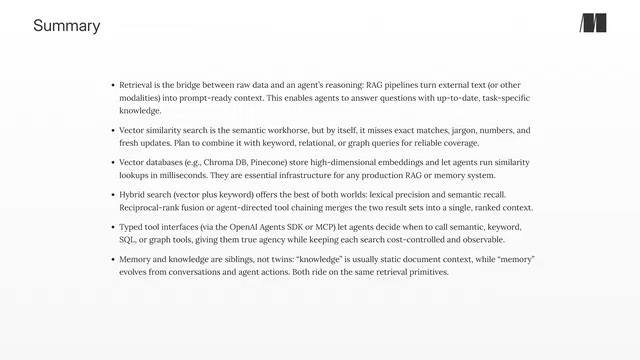
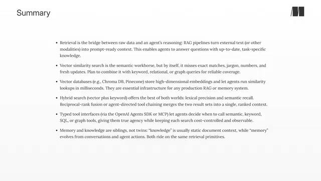
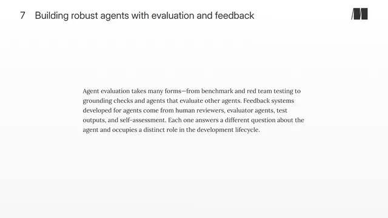
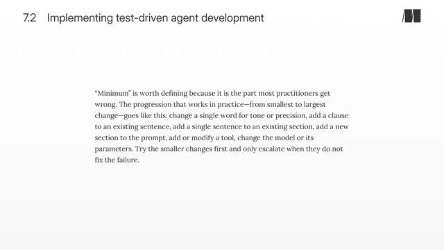
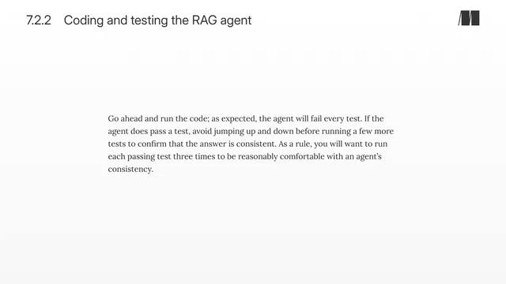
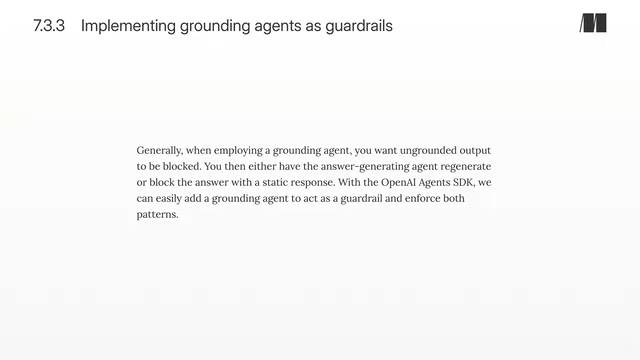
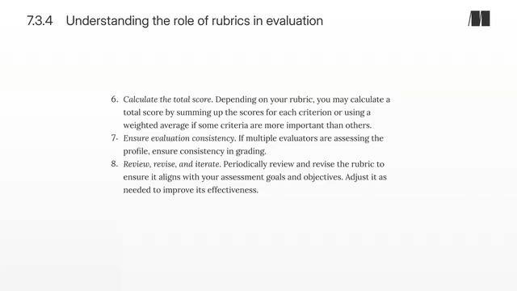
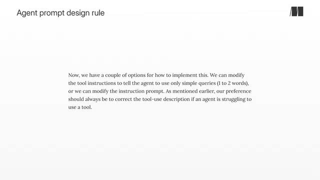

# AI Agents In Action 2nd（multi-agent）P36–P39 复现文档：从 RAG 基准到 Grounding / Critic 评审层

> **阅读边界，先说明白**  
> 这四段逐字稿主要是讲师对第 6 章总结、第 7 章 Agent 评测与反馈、TDAD（Test-Driven Agent Development）、Grounding / Critic / Evaluation Agent、Rubric 的讲解。逐字稿反复提到 Listing 7.1–7.12 和 `02ragagent.py` 的输出，但**没有贴出完整源码、依赖版本、安装命令、环境变量名**。  
> 因此本文不会把“课程没给的 Python 源码”伪装成讲师原文。本文能 100% 复现的是：**TDAD 评测设计、benchmark 数据格式、Agent 接口契约、rubric、grounding guardrail 决策表、检查清单**。第 4 节给出的 JSON / JSONL / TypeScript 契约是可直接保存的复现产物；真正的 Agent 实现需要你按自己选用的 SDK 补齐。

---

## 1. 这一节做什么

这一节要复现的不是“一个现成框架的安装教程”，而是一条可执行的 Agent 质量闭环：

1. 用检索把外部知识变成 Agent 的上下文；  
2. 用 benchmark 定义“什么叫答对”；  
3. 用 TDAD 方式：先写测试，再做最小 Agent，再最小改动 prompt / tool；  
4. 用 evaluator 检查答案，用 grounding agent 检查答案是否被检索上下文支持；  
5. 用 critic agent + rubric 评估开放式输出，例如图片风格；  
6. 用 trace / log 和治理规则防止评测层制造“假信心”。

P36 的总结强调：检索是原始数据与 Agent 推理之间的桥；向量相似度是语义检索主力，但会漏掉精确匹配、术语、数字、最新更新，所以要考虑 keyword、SQL、graph 等混合查询。  
P38 则把这条线落到一个 RAG Agent：用一组虚构资料和 benchmark 问题，让 Agent 搜索知识库并回答，再用 evaluator 判断通过与否。  
P39 把评测层拆成三类：**Grounding Agent**、**Critic Agent**、**Evaluation Agent**，并给出 rubric 与图像 critic 的例子。



本项目的复现目标可以命名为 `tdad-rag-agent`，最终要有：

- 4 个虚构知识文档；
- 5 条 benchmark；
- RAG Agent 的回答契约；
- 简单字符串 evaluator 与 agent evaluator 两套评测；
- grounding guardrail；
- 图像风格 rubric 与 critic 循环；
- trace 字段契约；
- 治理检查项。

**注意**：P36 还讲了 hybrid search、reciprocal rank fusion、graph memory、memory compression 等原则，但 P38 的 RAG 示例明确使用的是“简单检索架构”：Agent 把问题拆成可搜索词，搜索知识库，找到就用上下文回答，否则说没找到。不要把 P36 的所有检索模式都安到 Listing 7.x 的实现上。

---

## 2. 讲师原话

下面这些话决定了后面的复现顺序。引用保留课程原意，时间点来自逐字稿。

> "检索是原始数据与智能体推理之间的桥梁。"
> —— p036 [00:00]

> "向量相似度搜索是语义处理的主力，但它本身会漏掉精确匹配、专业术语、数字和最新更新。"
> —— p036 [00:05]

> "混合搜索，即向量加关键词，兼具两者优势：词法精确性和语义召回。"
> —— p036 [00:25]

> "评估和反馈让你能观察系统的实际行为，并提供一套随着时间推移逐步迭代到更佳行为的机制。"
> —— p037 [00:29]

> "评估本身主要采取三种形式……确定性测试用例……大语言模型评估器和智能体评估器……人工评估器……"
> —— p037 [02:45]

> "对智能体而言，“好”通常用评分标准而非单元测试来表述。"
> —— p038 [00:57]

> "先尝试较小的改动，只有当这些改动无法修复故障时才升级处理。"
> —— p038 [03:20]

> "每个通过的测试都运行三次，才能对智能体的一致性有合理把握。"
> —— p038 [09:32]

> "对自然语言输出做严格相等判断几乎总是过于脆弱。"
> —— p038 [15:33]

> "修复应落在评估器，而不是智能体。"
> —— p038 [16:03]

> "依据智能体可以提供反馈，并强制检索智能体重新生成答案或完全拦截它。"
> —— p039 [00:58]

> "重试上限是真正的架构决策，而不是随意的经验法则。"
> —— p039 [01:27]

> "评分标准的质量取决于你纳入的评判准则。"
> —— p039 [14:37]

> "用评分标准给一部分输出样本打分，让人工标注哪些本应通过、哪些本应失败，并把阈值设为评分标准得分与人工判断一致性最高的分数。"
> —— p039 [18:25]



这些原话可以压缩成三条复现原则：

1. **先定义好评测，再改 Agent**：benchmark、rubric、expected / wrong answer 要先写。  
2. **改 prompt 要最小化**：单词 → 从句 → 句子 → 新段落 → 加/改工具 → 换模型参数。  
3. **评测层本身也要被评测**：evaluator 可能误判，grounding agent 可能与原 Agent 合谋，critic 可能无限重试。

---

## 3. 从零复现

这一节按“需求 → 约束 → 估算 → 方案 → 取舍”复现讲师的推导过程。它不是 P036 讲 A、P037 讲 B 的流水账，而是把课程里的方法落成一个项目。

### 3.1 需求：先定义“好答案”是什么

课程里的 RAG 示例目标很窄：

- 有一个虚构知识库；
- 有一组 benchmark 问题；
- Agent 通过搜索知识库回答；
- evaluator 根据 expected answer 和 incorrect answer 判断通过 / 失败；
- 准确率 = 通过的 benchmark 百分比。

最初版本只定义 Agent 的 role / persona，不写复杂工具说明；输出先限制为单词，方便用字符串匹配。这个阶段的目标不是“做完整产品”，而是“让 Agent 能回答、能被评测”。

复现时要先写 5 条 benchmark。课程明确提到两个失败样例：Agent 返回大写的 `Photons` 和 `Water currents`，而 expected 是小写 `photons` / `currents`，严格相等导致误判。下面的样例围绕这个现象设计；除这两个词外，题目内容属于复现样例，不是课程原题。



### 3.2 约束：Agent 不是普通函数

课程反复指出几类约束：

1. **LLM 有随机性**：同一个测试跑一次通过不代表稳定，至少跑三次，变异性大时跑更多次。  
2. **benchmark 可能互相矛盾**：一个要求“逐步思考”，另一个要求“快速回答不思考”；所以“所有 benchmark 都通过”不总是现实目标，可能接受 90% 通过率。  
3. **prompt 会膨胀**：团队常犯的错是出问题就加一段，从不删除，最后多页 system prompt 互相冲突。  
4. **evaluator 会过严**：自然语言输出的大小写、标点、尾词变化很常见，严格相等几乎必然误判。  
5. **评测层会合谋**：evaluator 与被评测 Agent 用同一模型、同一训练数据，会共享盲点；用同一模型时也要换 prompt / persona。  
6. **重试必须有上限**：critic 失败后重试，如果没有 retry ceiling，系统可能无限循环或隐藏坏输出。  
7. **必须可观测**：不记录 tool call、reasoning steps、latency、cost、失败行为，就无法判断“答案对了但过程错了”。  
8. **格式与工具说明应尽量放在 prompt 外**：工具通过 SDK 注册名称、描述、参数 schema；输出格式通过结构化输出类型声明；prompt 不必逐条重复工具元数据。

### 3.3 估算：跑一轮要多少调用

课程没有给具体 token 价格和模型单价，所以这里只给**可复算的估算公式**，不写死金额。

假设：

- 知识库 100 个文档；
- 每文档 5 个 chunk；
- 每 chunk 约 400 token；
- 总知识量约 `100 × 5 × 400 = 200,000 token`；
- 每次检索 top 4 个 chunk，约 `4 × 400 = 1,600 token`；
- 加问题、指令、输出，按每次输入 2,000 token、输出 200 token 估算。

一轮完整 benchmark：

- 5 题 × 3 次 = 15 次 RAG 回答；
- 15 次 agent evaluator；
- 15 次 grounding agent；
- 合计 45 次模型调用；
- 输入约 `45 × 2,000 = 90,000 token`；
- 输出约 `45 × 200 = 9,000 token`；
- 合计约 99,000 token / 轮。

延迟粗算：若每次调用 2 秒，串行约 90 秒；并行会降低墙钟时间，但会带来限流、日志交错、成本瞬时上升。课程没有讲并发实现，这里只作为容量估算。

图像 critic 循环另算：

- 1 次图像生成；
- 1 次 `describe_image`（课程说这个工具“not shown”）；
- 1 次 critic 评分；
- 每轮 3 次调用；最多 3 轮就是 9 次调用。

### 3.4 方案：按 TDAD 八步走

**
**第一步：写 goals 与 benchmarks。**  
每条 benchmark 至少包含：问题、期望的关键答案、一个错误答案样例。课程里 evaluator 就是拿“expected answer + incorrect answer”来判断的。先写 5 条，不要一开始写 500 条；5 条能让失败模式暴露出来就够了。

**第二步：写最小 Agent。**  
只给 role / persona，不写工具清单、不写输出格式。把检索工具注册进 SDK，让模型根据工具元数据自己选。此时跑 benchmark，预期大面积失败。

**第三步：确认失败是稳定的。**  
每条失败测试重复跑，观察是不是每次都失败。课程说 LLM 有随机性，一次失败可能是采样噪声；但“完全不调工具”“拿到空结果就认输”这类失败通常是稳定失败，值得修。

**第四步：做最小改动——先修输出格式。**  
课程 Listing 7.2 的第一件事是让 Agent 输出单词答案，匹配 benchmark 格式。这一步只改 prompt 的一句话，不动工具。

**第五步：加“拆解问题”的指令，但仍然不写工具使用说明。**  
这是课程明确强调的顺序：格式和工具使用说明应该尽量放在 prompt 外；工具的名称、描述、参数 schema 由 SDK 注册，模型据此选择。

**第六步：看 trace，定位真正的失败点。**  
课程给的诊断是：Agent 把第一个 query 直接发给检索工具，检索返回弱结果或空结果时，Agent 把“没搜到”当成答案，而不是换一个 query 再试。修复不在检索系统，而在 Agent 的指令里：加一句“结果稀薄时改写 query 重试，可用同义词、更宽泛的词、或拆成子问题”。

**第七步：修 evaluator，而不是修 Agent。**  
课程跑到约 60% 时发现两条“失败”其实是 `Photons.` 对 `photons`、`Water currents` 对 `currents`。这是 evaluator 的严格相等太脆。把比较改成归一化后比较（小写、去尾标点、去多余空白），benchmark 回到 5/5。这一步必须单独做、单独验证，否则你会误改 Agent。

**第八步：升级评测层。**  
把字符串 evaluator 换成 agent evaluator（输出强类型 pass/fail + 理由）；再加 grounding agent（拿同一份检索上下文检查答案是否有依据）；开放式输出再上 critic + rubric + retry ceiling。



### 3.5 取舍：为什么这样搭，而不是那样搭

| 决策点 | 课程给出的做法 | 不这样做的后果 | 复现时的取舍 |
|---|---|---|---|
| 检索方式 | 示例用简单检索：拆词、搜知识库、命中就用上下文回答 | 一上来搭向量库 + 混合检索，评测变量太多，分不清是检索坏了还是 prompt 坏了 | 复现先用词法检索，把评测闭环跑通；向量库留作后续替换 |
| Agent 数量 | 先单 Agent，失败子集确实独立才考虑加专家 Agent | 过早多 Agent 引入路由问题，路由器本身也会错，整体错误率可能先升后降 | 单 Agent + 一个 evaluator + 一个 grounding agent 起步 |
| 输出格式 | 通过结构化输出类型声明，不让 prompt 手写格式 | 格式说明散落在 prompt 里，换格式就要重写 prompt | benchmark 阶段先用单词输出便于比对，之后换自然语言 + agent judge |
| 工具说明 | 优先改工具名称与描述 | 工具描述含糊，Agent 会拿它当通用搜索用，弱结果也接受 | 把工具改名为关键词检索，并在描述里写明“适合 1–2 个关键词” |
| 失败处理 | grounding 失败可反馈重生成，或直接阻断并给静态回复 | 无脑重试会烧预算；无脑放行会输出无依据内容 | 重试上限 3 次，超限走静态回复，并记录 escalation 标记 |
| 评分方式 | rubric 先逐项评分，再根据总分 pass/fail | 只让 LLM 直接给 pass/fail，结果不稳定、也无法解释原因 | critic 输出逐项分数 + 总分 + 理由，阈值单独配置 |
| 通过标准 | 不要求永远 100%，benchmark 多时 90% 也可接受 | 追求 100% 会让互相矛盾的 benchmark 把 prompt 撑爆 | 本项目 5 条全过；扩到几十条后改成通过率门槛 |



---

## 4. 完整代码

> **重要声明**：课程逐字稿只描述了 Listing 7.1–7.12 的行为和 `02ragagent.py` 的输出，**没有贴出源码、依赖版本、安装命令、环境变量名**。下面是一套按逐字稿描述重建的**零依赖 Node.js 复现工程**，可直接保存运行；它不是讲师的原文件。课程原实现使用 Python 与 OpenAI Agents SDK，本复现用原生 `fetch` 调模型接口，目的是让你在没有 Python 环境、没有 SDK 版本坑的情况下先把评测闭环跑通。  
> 课里没有代码的部分（HTTP 调用、离线 stub、文件写入）都在注释里标了“课里没讲”。

### 4.1 目录结构

```text
tdad-rag-agent/
├── package.json
├── .env.example
├── knowledge/
│   ├── light.md
│   ├── ocean.md
│   ├── batteries.md
│   └── sensors.md
├── benchmarks/
│   └── benchmarks.jsonl
├── rubric/
│   └── answer-style.rubric.json
└── src/
    ├── config.mjs
    ├── llm.mjs
    ├── retriever.mjs
    ├── rag-agent.mjs
    ├── evaluators.mjs
    ├── grounding.mjs
    ├── rubric-critic.mjs
    ├── run-benchmarks.mjs
    └── run-critic.mjs
```

### 4.2 `package.json`

```json
{
  "name": "tdad-rag-agent",
  "version": "1.0.0",
  "private": true,
  "type": "module",
  "engines": {
    "node": ">=20"
  },
  "scripts": {
    "bench": "node src/run-benchmarks.mjs",
    "bench:offline": "OFFLINE=1 node src/run-benchmarks.mjs",
    "critic": "node src/run-critic.mjs",
    "critic:offline": "OFFLINE=1 node src/run-critic.mjs"
  }
}
```

课程没有给依赖版本；本工程**没有任何第三方依赖**，所以不存在版本冲突。Node 20 以上即可，因为用到内置 `fetch`、`node:fs`、`node:path`。

### 4.3 `.env.example`

```bash
# 课里没有给环境变量名，以下为本复现工程自定义
OPENAI_API_KEY=sk-...
OPENAI_MODEL=gpt-4o-mini
# 可选：兼容其他 OpenAI 风格端点
OPENAI_BASE_URL=https://api.openai.com/v1
# 设为 1 时不调用网络，用确定性 stub 跑通流程
OFFLINE=0
# v1 = 只有 role/persona；v2 = 加输出格式与拆解指令
PROMPT_VARIANT=v2
# 每次 benchmark 重复次数，课程建议至少 3
RUNS_PER_BENCHMARK=3
```

### 4.4 知识库：4 个虚构文档

`knowledge/light.md`

```markdown
# Light and Energy

Light carries energy in discrete packets called photons.
A photon has no rest mass and travels at the speed of light in vacuum.
The energy of a photon increases with the frequency of the light.
Blue light has a higher frequency than red light, so a blue photon carries more energy.
```

`knowledge/ocean.md`

```markdown
# Ocean Heat Transport

Water currents move heat around the ocean.
Surface currents are driven mainly by wind, while deep currents are driven by density differences.
The Gulf Stream is a warm surface current in the North Atlantic.
```

`knowledge/batteries.md`

```markdown
# Battery Storage

A battery stores chemical energy and converts it to electrical energy.
Capacity is measured in ampere-hours.
Charging efficiency drops as internal resistance increases with age.
```

`knowledge/sensors.md`

```markdown
# Temperature Sensors

A thermistor changes resistance with temperature.
A thermocouple produces a small voltage proportional to a temperature difference.
Both sensors require calibration against a reference.
```

### 4.5 `benchmarks/benchmarks.jsonl`

一行一条，便于追加、便于逐行 diff。**题目为复现样例；课程只明确提到 `photons` / `currents` 两个大小写误判样例。**

```jsonl
{"id":"b1","question":"What carries light energy?","expected_key_term":"photons","wrong_answer":"electrons","expected_short_answer":"photons"}
{"id":"b2","question":"What moves heat around the ocean?","expected_key_term":"currents","wrong_answer":"tides","expected_short_answer":"currents"}
{"id":"b3","question":"What is battery capacity measured in?","expected_key_term":"ampere-hours","wrong_answer":"volts","expected_short_answer":"ampere-hours"}
{"id":"b4","question":"Which sensor produces a voltage proportional to a temperature difference?","expected_key_term":"thermocouple","wrong_answer":"thermistor","expected_short_answer":"thermocouple"}
{"id":"b5","question":"What is the capital of Atlantis?","expected_key_term":"NOT_FOUND","wrong_answer":"Poseidonia","expected_short_answer":"NOT_FOUND"}
```

第 5 条故意问知识库外的问题，用来验证 Agent 会不会编答案，也给后面的 grounding agent 一个明确的反例。

### 4.6 `src/config.mjs`

```js
// 课里没有给配置细节，本文件为复现工程自定义。
import fs from "node:fs";
import path from "node:path";

function loadDotEnv(file) {
  if (!fs.existsSync(file)) return;
  const text = fs.readFileSync(file, "utf8");
  for (const rawLine of text.split("\n")) {
    const line = rawLine.trim();
    if (!line || line.startsWith("#")) continue;
    const eq = line.indexOf("=");
    if (eq === -1) continue;
    const key = line.slice(0, eq).trim();
    const value = line.slice(eq + 1).trim();
    if (!(key in process.env)) process.env[key] = value;
  }
}

loadDotEnv(path.resolve(".env"));

export const CONFIG = {
  apiKey: process.env.OPENAI_API_KEY ?? "",
  baseUrl: (process.env.OPENAI_BASE_URL ?? "https://api.openai.com/v1").replace(/\/$/, ""),
  model: process.env.OPENAI_MODEL ?? "gpt-4o-mini",
  offline: process.env.OFFLINE === "1",
  promptVariant: process.env.PROMPT_VARIANT ?? "v2",
  runsPerBenchmark: Number(process.env.RUNS_PER_BENCHMARK ?? 3),
  knowledgeDir: path.resolve("knowledge"),
  benchmarkFile: path.resolve("benchmarks/benchmarks.jsonl"),
  rubricFile: path.resolve("rubric/answer-style.rubric.json"),
  traceFile: path.resolve("traces.jsonl"),
};

if (!CONFIG.offline && !CONFIG.apiKey) {
  throw new Error("缺少 OPENAI_API_KEY。先设 OFFLINE=1 跑通流程，或填 .env 后重跑。");
}
```

### 4.7 `src/llm.mjs`

```js
// 课里没有给模型调用代码，本文件为复现工程自定义。
// 离线模式是为了让你在没有 key 时也能验证 benchmark / evaluator / guardrail 的流程。
import { CONFIG } from "./config.mjs";

function firstJsonObject(text) {
  const start = text.indexOf("{");
  const end = text.lastIndexOf("}");
  if (start === -1 || end === -1 || end <= start) {
    throw new Error(`模型输出不是 JSON：${text.slice(0, 200)}`);
  }
  return JSON.parse(text.slice(start, end + 1));
}

function offlineAnswer(system, user) {
  const context = /Context:\s*([\s\S]*?)\nQuestion:/.exec(user)?.[1]?.trim() ?? "";
  const question = /Question:\s*(.+)/.exec(user)?.[1]?.trim() ?? "";

  if (system.includes("You are a grounding agent")) {
    const answer = /Answer:\s*([\s\S]*?)\nContext:/.exec(user)?.[1]?.trim() ?? "";
    const words = answer.toLowerCase().match(/[a-z0-9-]+/g) ?? [];
    const ctx = context.toLowerCase();
    const grounded = words.length > 0 && words.filter((w) => w.length > 3).every((w) => ctx.includes(w));
    return JSON.stringify({
      grounded,
      reason: grounded ? "关键实词都能在上下文中找到" : "答案含上下文中没有的实词",
    });
  }

  if (system.includes("You are an evaluation agent")) {
    const expected = /expected_key_term:\s*([^\n]+)/.exec(user)?.[1]?.trim() ?? "";
    const answer = /answer:\s*([\s\S]*?)\nwrong_answer:/.exec(user)?.[1]?.trim() ?? "";
    const pass = answer.toLowerCase().includes(expected.toLowerCase());
    return JSON.stringify({
      pass,
      reason: pass ? `答案包含关键术语 ${expected}` : `答案缺少关键术语 ${expected}`,
    });
  }

  if (system.includes("You are a rubric critic")) {
    const score = context.length > 40 ? 4 : 2;
    return JSON.stringify({
      criteria: [
        { name: "grounding", score, reason: "示意评分" },
        { name: "conciseness", score, reason: "示意评分" },
        { name: "tone", score, reason: "示意评分" },
      ],
    });
  }

  if (!context) return "NOT_FOUND";
  // 故意首字母大写并加句号，复现课程里 Photons. / Water currents 的归一化失败场景
  const first = context.split("\n").find((line) => line.trim().length > 0) ?? "";
  return `Sample answer based on: ${first.trim()}`;
}

export async function chat({ system, user, json = false, temperature = 0 }) {
  if (CONFIG.offline) {
    const content = offlineAnswer(system, user);
    return json ? firstJsonObject(content) : content;
  }

  const res = await fetch(`${CONFIG.baseUrl}/chat/completions`, {
    method: "POST",
    headers: {
      "Content-Type": "application/json",
      Authorization: `Bearer ${CONFIG.apiKey}`,
    },
    body: JSON.stringify({
      model: CONFIG.model,
      temperature,
      messages: [
        { role: "system", content: system },
        { role: "user", content: user },
      ],
      ...(json ? { response_format: { type: "json_object" } } : {}),
    }),
  });

  if (!res.ok) {
    const body = await res.text();
    throw new Error(`模型调用失败 ${res.status}: ${body.slice(0, 300)}`);
  }

  const data = await res.json();
  const content = data?.choices?.[0]?.message?.content;
  if (typeof content !== "string") throw new Error("模型返回结构不符合预期");
  return json ? firstJsonObject(content) : content;
}
```

### 4.8 `src/retriever.mjs`

```js
import fs from "node:fs";
import path from "node:path";
import { CONFIG } from "./config.mjs";

const STOP_WORDS = new Set([
  "the", "a", "an", "is", "are", "was", "were", "of", "to", "in", "on",
  "for", "and", "or", "what", "which", "who", "does", "do", "with", "by",
]);

function tokenize(text) {
  return (text.toLowerCase().match(/[a-z0-9-]+/g) ?? []).filter(
    (t) => t.length > 1 && !STOP_WORDS.has(t),
  );
}

export function loadChunks() {
  const files = fs.readdirSync(CONFIG.knowledgeDir).filter((f) => f.endsWith(".md"));
  const chunks = [];
  for (const file of files) {
    const text = fs.readFileSync(path.join(CONFIG.knowledgeDir, file), "utf8");
    for (const [index, block] of text.split(/\n\s*\n/).entries()) {
      const clean = block.trim();
      if (!clean) continue;
      chunks.push({ id: `${file}#${index}`, source: file, text: clean, tokens: tokenize(clean) });
    }
  }
  return chunks;
}

export function keywordSearch(query, chunks, topK = 2) {
  const qTokens = tokenize(query);
  if (qTokens.length === 0) return [];

  return chunks
    .map((chunk) => {
      const hit = qTokens.filter((t) => chunk.tokens.includes(t)).length;
      return { ...chunk, score: hit / qTokens.length };
    })
    .filter((chunk) => chunk.score > 0)
    .sort((a, b) => b.score - a.score)
    .slice(0, topK);
}
```

### 4.9 `src/rag-agent.mjs`

```js
import { CONFIG } from "./config.mjs";
import { chat } from "./llm.mjs";
import { keywordSearch, loadChunks } from "./retriever.mjs";

const chunks = loadChunks();

// 课里没讲具体 prompt 文本；这里按 Listing 7.1 / 7.2 描述重建两档。
const SYSTEM_V1 = "You are a helpful research assistant. Answer the user's question.";

const SYSTEM_V2 = [
  "You are a helpful research assistant.",
  "Break the question into searchable keywords before searching.",
  "Answer as a single word when the question asks for a specific term.",
].join("\n");

export function buildQuery(question) {
  // 课程说 Agent 把问题拆成可搜索的词和短语；这里用一个确定性的拆词步骤代替模型自由发挥。
  const tokens = (question.toLowerCase().match(/[a-z0-9-]+/g) ?? []).filter(
    (t) => t.length > 2 && !["what", "which", "does", "the", "for", "and"].includes(t),
  );
  return tokens.slice(0, 4).join(" ");
}

export async function answerQuestion(question) {
  const system = CONFIG.promptVariant === "v1" ? SYSTEM_V1 : SYSTEM_V2;
  const query = buildQuery(question);
  const hits = keywordSearch(query, chunks);
  const context = hits.map((h) => `[${h.id}] ${h.text}`).join("\n");

  if (!context) {
    return { answer: "NOT_FOUND", query, context, hits: [] };
  }

  const answer = await chat({
    system,
    user: `Context:\n${context}\nQuestion: ${question}`,
  });

  return { answer: answer.trim(), query, context, hits };
}
```

### 4.10 `src/evaluators.mjs`

```js
import { chat } from "./llm.mjs";

export function strictEqual(expected, actual) {
  return expected === actual;
}

export function normalize(text) {
  // 课程列的归一化最低要求：小写、去尾标点、去多余空白
  return String(text).toLowerCase().replace(/[.。!！?？]+$/g, "").replace(/\s+/g, " ").trim();
}

export function normalizedEqual(expected, actual) {
  return normalize(expected) === normalize(actual);
}

export function keyTermPresent(expectedKeyTerm, actual) {
  return normalize(actual).includes(normalize(expectedKeyTerm));
}

export async function agentJudge({ question, answer, expectedKeyTerm, wrongAnswer }) {
  // 课程 Listing 7.6：把 response、question、expected key term、wrong answer 打包成字典给评测 Agent。
  return chat({
    system: [
      "You are an evaluation agent.",
      "Decide whether the answer contains the expected key term.",
      "Return JSON only: {\"pass\": boolean, \"reason\": string}.",
    ].join("\n"),
    user: [
      "payload:",
      `question: ${question}`,
      `answer: ${answer}`,
      `expected_key_term: ${expectedKeyTerm}`,
      `wrong_answer: ${wrongAnswer}`,
    ].join("\n"),
    json: true,
  });
}
```

### 4.11 `src/grounding.mjs`

```js
import { chat } from "./llm.mjs";

export class GroundingTripwire extends Error {
  constructor(reason, context, answer) {
    super(`grounding failed: ${reason}`);
    this.name = "GroundingTripwire";
    this.reason = reason;
    this.context = context;
    this.answer = answer;
  }
}

export async function checkGrounded({ answer, context }) {
  // 课程图 7.5：RAG Agent 和 grounding agent 拿到同一份检索上下文。
  const result = await chat({
    system: [
      "You are a grounding agent.",
      "Check whether every claim in the answer is supported by the context.",
      "Return JSON only: {\"grounded\": boolean, \"reason\": string}.",
    ].join("\n"),
    user: `Answer: ${answer}\nContext:\n${context}`,
    json: true,
  });
  return { grounded: Boolean(result.grounded), reason: String(result.reason ?? "") };
}

export async function groundedAnswer({ question, context, produce }) {
  const answer = await produce(question, context);
  const verdict = await checkGrounded({ answer, context });
  if (!verdict.grounded) {
    // 课程 Listing 7.9 的描述：guardrail 失败时输出对象的 tripwire triggered 属性被置为 true，从而抛出异常。
    throw new GroundingTripwire(verdict.reason, context, answer);
  }
  return { answer, verdict };
}
```

### 4.12 `rubric/answer-style.rubric.json`

```json
{
  "name": "answer-style",
  "scale": { "min": 1, "max": 5, "labels": { "1": "poor", "5": "excellent" } },
  "passThreshold": 2,
  "criteria": [
    { "name": "grounding", "description": "每个断言都能在检索上下文中找到依据" },
    { "name": "conciseness", "description": "回答简短，不堆砌与问题无关的信息" },
    { "name": "tone", "description": "语气中性、面向普通读者" }
  ]
}
```

### 4.13 `src/rubric-critic.mjs`

```js
import fs from "node:fs";
import { CONFIG } from "./config.mjs";
import { chat } from "./llm.mjs";

export function loadRubric() {
  return JSON.parse(fs.readFileSync(CONFIG.rubricFile, "utf8"));
}

export async function scoreWithRubric({ answer, context, rubric }) {
  // 课程 step 7：让 LLM 先逐项评分再 pass/fail，比直接 pass/fail 更一致。
  const result = await chat({
    system: [
      "You are a rubric critic.",
      "Score the answer against every criterion on a 1-5 scale.",
      "Return JSON only: {\"criteria\":[{\"name\":string,\"score\":number,\"reason\":string}]}.",
      `Criteria: ${JSON.stringify(rubric.criteria)}`,
    ].join("\n"),
    user: `Answer: ${answer}\nContext:\n${context}`,
    json: true,
  });

  const rows = Array.isArray(result.criteria) ? result.criteria : [];
  const total = rows.length
    ? rows.reduce((sum, row) => sum + Number(row.score ?? 0), 0) / rows.length
    : 0;

  return {
    rows,
    total,
    pass: total >= rubric.passThreshold,
  };
}

export async function critiqueLoop({ question, context, generate, rubric, maxAttempts = 3 }) {
  const attempts = [];
  for (let i = 1; i <= maxAttempts; i += 1) {
    const answer = await generate(question, context);
    const score = await scoreWithRubric({ answer, context, rubric });
    attempts.push({ attempt: i, answer, ...score });
    if (score.pass) return { status: "passed", attempt: i, answer, score, attempts };
  }
  // 课程列出的超限策略之一：返回最好的一次失败结果并带 confidence flag
  const best = attempts.reduce((a, b) => (b.total > a.total ? b : a));
  return { status: "exhausted", attempt: maxAttempts, answer: best.answer, score: best, attempts };
}
```

### 4.14 `src/run-benchmarks.mjs`

```js
import fs from "node:fs";
import { CONFIG } from "./config.mjs";
import { answerQuestion } from "./rag-agent.mjs";
import { agentJudge, keyTermPresent, normalizedEqual, strictEqual } from "./evaluators.mjs";
import { checkGrounded } from "./grounding.mjs";

function readBenchmarks() {
  return fs
    .readFileSync(CONFIG.benchmarkFile, "utf8")
    .split("\n")
    .map((line) => line.trim())
    .filter(Boolean)
    .map((line) => JSON.parse(line));
}

async function main() {
  const benchmarks = readBenchmarks();
  const traces = [];
  const totals = { strict: 0, normalized: 0, judge: 0, grounded: 0, runs: 0 };

  for (const bench of benchmarks) {
    for (let run = 1; run <= CONFIG.runsPerBenchmark; run += 1) {
      const started = Date.now();
      const { answer, query, context } = await answerQuestion(bench.question);

      const strictPass = strictEqual(bench.expected_short_answer, answer);
      const normalizedPass = normalizedEqual(bench.expected_short_answer, answer);
      const termPass = keyTermPresent(bench.expected_key_term, answer);

      let judge = { pass: termPass, reason: "offline: key term check" };
      let grounding = { grounded: true, reason: "offline: skipped" };

      if (!CONFIG.offline) {
        judge = await agentJudge({
          question: bench.question,
          answer,
          expectedKeyTerm: bench.expected_key_term,
          wrongAnswer: bench.wrong_answer,
        });
        grounding = await checkGrounded({ answer, context });
      }

      const trace = {
        benchmark_id: bench.id,
        run,
        question: bench.question,
        query,
        answer,
        expected_short_answer: bench.expected_short_answer,
        expected_key_term: bench.expected_key_term,
        strictPass,
        normalizedPass,
        judgePass: Boolean(judge.pass),
        judgeReason: judge.reason,
        grounded: Boolean(grounding.grounded),
        groundingReason: grounding.reason,
        retrievedIds: context ? context.split("\n").map((l) => l.slice(0, l.indexOf("]") + 1)) : [],
        latencyMs: Date.now() - started,
        promptVariant: CONFIG.promptVariant,
        model: CONFIG.offline ? "offline-stub" : CONFIG.model,
      };

      traces.push(trace);
      totals.runs += 1;
      totals.strict += strictPass ? 1 : 0;
      totals.normalized += normalizedPass ? 1 : 0;
      totals.judge += trace.judgePass ? 1 : 0;
      totals.grounded += trace.grounded ? 1 : 0;
    }
  }

  fs.writeFileSync(CONFIG.traceFile, traces.map((t) => JSON.stringify(t)).join("\n") + "\n");

  const pct = (n) => `${Math.round((n / totals.runs) * 100)}%`;
  console.log("runs:", totals.runs);
  console.log("strictEqual:", pct(totals.strict));
  console.log("normalizedEqual:", pct(totals.normalized));
  console.log("agentJudge/keyTerm:", pct(totals.judge));
  console.log("grounded:", pct(totals.grounded));
  console.log("traces written to:", CONFIG.traceFile);
  for (const t of traces) {
    console.log(
      `- ${t.benchmark_id} run${t.run} strict=${t.strictPass} normalized=${t.normalizedPass} judge=${t.judgePass} grounded=${t.grounded} answer=${JSON.stringify(t.answer)}`,
    );
  }
}

main().catch((error) => {
  console.error(error);
  process.exitCode = 1;
});
```

### 4.15 `src/run-critic.mjs`

```js
import { answerQuestion } from "./rag-agent.mjs";
import { critiqueLoop, loadRubric } from "./rubric-critic.mjs";

async function main() {
  const rubric = loadRubric();
  const question = "What carries light energy?";
  const { context } = await answerQuestion(question);

  const generate = async () => {
    const { answer } = await answerQuestion(question);
    return answer;
  };

  const result = await critiqueLoop({ question, context, generate, rubric, maxAttempts: 3 });
  console.log("status:", result.status);
  console.log("attempt:", result.attempt);
  console.log("total score:", result.score.total);
  console.log("pass threshold:", rubric.passThreshold);
  console.log("answer:", result.answer);
  console.log("criteria:", JSON.stringify(result.score.rows, null, 2));
}

main().catch((error) => {
  console.error(error);
  process.exitCode = 1;
});
```

### 4.16 启动命令

```bash
cd tdad-rag-agent
cp .env.example .env

# 先离线验证流程（不花钱、不需要 key）
npm run bench:offline
npm run critic:offline

# 再填 .env 里的 OPENAI_API_KEY / OPENAI_MODEL，跑真实模型
npm run bench
npm run critic

# 复现“只有 role/persona”的第一版
PROMPT_VARIANT=v1 npm run bench
```

离线模式下，`strictEqual` 会因为模型返回的大小写与标点而失败，而 `normalizedEqual` 通过——这正是课程 p038 [15:33] 描述的现象。你可以用这个对照来验证自己是否理解了“修 evaluator 而不是修 agent”。

---

## 5. 逐行解释

这一节解释上一节每个关键决策为什么这样定，不这样会怎样。先给一张决策速查表，再逐条展开。

| 位置 | 决策 | 课程依据 | 不这样做的后果 |
|---|---|---|---|
| `benchmarks.jsonl` | 一行一题，含 `expected_key_term` 与 `wrong_answer` | p038 [01:53] 要求识别 expected 与 known bad responses | 只有问题没有反例，evaluator 无法判断“答偏了” |
| `retriever.mjs` | 词法命中率排序，`score > 0` 才返回 | p038 [07:37] 的简单检索架构 | 返回低相关 chunk，Agent 拿噪声当依据 |
| `rag-agent.mjs` | 空结果显式返回 `NOT_FOUND` | p038 [08:06] “otherwise, it says that nothing was found” | Agent 自由发挥，幻觉无法归因 |
| `evaluators.mjs` | strict / normalized / agent judge 三层并存 | p038 [15:33] 与 [16:57] | 只留 strict 会误杀正确回答；只留 judge 会失去确定性基线 |
| `grounding.mjs` | 同一份 context 同时给生成与校验 | p039 [02:54] 图 7.5 | 校验方拿不到原文，只能凭印象判断 |
| `grounding.mjs` | 失败抛 `GroundingTripwire` | p039 [05:48] tripwire triggered | 返回布尔值容易被调用方忽略，坏答案照样流出 |
| `rubric-critic.mjs` | 先逐项评分再算总分 pass/fail | p039 [16:30] step 7 | 直接 pass/fail 不稳定且无法解释 |
| `critiqueLoop` | `maxAttempts = 3` | p039 [01:27] retry ceiling | 无限重试烧预算，或隐藏持续失败 |
| `run-benchmarks.mjs` | 每题跑 `RUNS_PER_BENCHMARK` 次 | p038 [09:32] 至少三次 | 一次通过就下结论，把采样偶然当能力 |
| trace | 记录 evaluator 的判定与理由 | p039 [12:14] logging 要覆盖 evaluator | 只记录最终答案，无法发现 evaluator 本身出错 |

**关于 benchmark 字段。** `expected_key_term` 与 `expected_short_answer` 分开存，是为了让同一批题能在“单词精确匹配”和“自然语言包含关键术语”两种 evaluator 下复用。课程 p038 [17:25] 明确说，改成 agent evaluator 后仍然使用同一套 benchmark，不必重写。如果你只存一个 `expected` 整句，换 evaluator 时就得改数据。

**关于 `wrong_answer`。** 它的作用不是给字符串比较用，而是给 agent evaluator 提供“长什么样算错”的锚点。课程 Listing 7.6 把 `wrong_answer` 一起打包进评测输入，就是让 judge 有对照。缺了它，judge 容易把“提到相关词但结论反了”判成通过。

**关于检索分数。** `score = 命中 token 数 / query token 数`，只有大于 0 才返回。这样第 5 题（Atlantis）会因为没有任何 token 命中而返回空，触发 `NOT_FOUND`。如果改成“永远返回 topK”，第 5 题会拿到无关的海洋或电池段落，Agent 很可能编出一个首都名——这正好是 grounding agent 要抓的情况。

**关于两档 prompt。** `v1` 只有 role/persona，对应课程“Listing 7.1 只定义了 role persona”。`v2` 加了两句：先拆关键词、特定问题用单词回答。注意 `v2` **没有**逐条列工具用法，符合课程 p038 [10:29] 的“格式与工具使用说明尽量放在 prompt 外”。真实 SDK 里工具描述由注册元数据提供；本复现用 `buildQuery` 这个确定性函数代替模型选工具，是为了让离线也能跑，属于复现脚手架，不是课程实现。

**关于 `NOT_FOUND`。** 它是一个显式哨兵值，不是一个“答案”。这样做的好处是：evaluator、grounding agent、日志三处都能明确区分“检索没命中”和“模型答错”。课程说没找到就说没找到；工程上要把这句话变成可断言的值，否则你没法统计“拒答率”。

**关于 strict 与 normalized 并存。** 这不是冗余，而是诊断工具。strict 失败、normalized 通过，说明是表面格式问题，修 evaluator；两者都失败，才说明内容或检索有问题，去改 agent。课程 p038 [16:03] 的原话是“The fix lives in the evaluator, not in the agent”——前提是你有能力把这两类失败分开。只留一个比较函数，你就失去了这个能力。

**关于 `normalize` 的实现。** 课程列的底线是：小写、去尾标点、去多余空白。这里用 `[.。!！?？]+$` 去掉尾部标点，用 `\s+` 合并空白。注意它**不**去掉词内部的连字符，因为 `ampere-hours` 是术语的一部分；也不做词干化，因为课程没讲。生产环境还应考虑全角半角、不可见字符，这属于第 7 节的坑。

**关于 agent judge 的输入格式。** 课程 Listing 7.6 说把 response、question、expected key term、wrong answer 打包成字典，并说“用字典而不是 JSON 提供更干净的结构化输入”。本复现用 `key: value` 的换行文本，接近这个描述。真实实现里你也可以传对象让 SDK 序列化，但要保证字段名稳定，否则 judge 的判定会随格式漂移。

**关于 grounding 拿同一份 context。** 这是课程图 7.5 的核心：RAG agent 用 context 生成答案，grounding agent 用**同一份** context 验证答案。如果 grounding agent 自己去重新检索，它验证的是“另一个上下文”，两边的证据集不一致，失败就无法归因。复现时把 `context` 作为参数显式传给两边，而不是让它们各自查库。

**关于 tripwire 用异常。** 课程 p039 [05:48] 说 guardrail 失败时输出对象的 `tripwire triggered` 属性被置为 `true`，从而可以抛出异常。本复现用自定义 `GroundingTripwire extends Error` 模拟这个语义。用异常而不是返回 `{ok:false}` 的原因是：调用方很难忽略异常，但很容易忘记检查布尔返回值。在 JS/Node 里，这对应 `throw` + `try/catch`；如果你用 Promise 链，注意不要漏掉 `.catch`，否则会变成 unhandled rejection。

**关于 rubric 先评分再 pass/fail。** 课程 step 7 明确说，让 LLM 先评分再 pass/fail 比直接 pass/fail 更一致。原因是评分迫使模型逐条对照标准，而直接二分会退化成“整体感觉”。本复现的 `scoreWithRubric` 要求返回每条准则的 `score` 与 `reason`，总分取平均，再和 `passThreshold` 比较。注意课程也警告：rubric 本身要用人类判断校准，否则会“一致地错”。

**关于阈值 2/5。** 课程说这是**故意设低的演示阈值**，让 critic 大多数图片能过、循环能在合理时间结束；把阈值提到 3 或 4，大多数输出会失败，循环可能跑满重试上限。复现时把它放在 rubric JSON 里而不是硬编码，就是为了让你能亲手调高、观察 `exhausted` 分支。生产里阈值要用“人工标注哪些该过、哪些不该过”来校准，课程 p039 [18:25] 给了这个方法。

**关于重试上限 3。** 课程列了四种超限策略：静态兜底回复、升级人工、返回最好的一次并带 confidence flag、显式报错。本复现的 `critiqueLoop` 选择“返回最好的一次 + `status: exhausted`”，对应第三种。这不是唯一正确答案；面向用户的系统通常选静态兜底，内部流水线可以选显式报错，高风险场景选人工升级。

**关于 trace 记录 evaluator。** 课程 p039 [12:14] 说日志必须覆盖 evaluator agent，不只是产出最终答案的 agent。一个错误放行坏输出的 evaluator 是“静默错误源”，只有日志能暴露。本复现的 trace 里有 `judgePass`、`judgeReason`、`grounded`、`groundingReason`、`retrievedIds`、`latencyMs`，就是为了事后能回答“是检索没给证据，还是 judge 放水了”。





**关于 grounding / critic / evaluation 三者的分工。** 课程 p039 [00:00] 用 Figure 7.4 做了对比：grounding agent 针对 RAG 输出，检查答案有没有落在检索上下文里；critic agent 针对生成内容，按 rubric（准则 + 分级）评分并给 critique；evaluation agent 针对更复杂的、可能混合了检索与全新生成的输出。三者不是同一件事的三个名字，而是三种不同输入、不同判据。复现时不要用 grounding agent 去评风格，也不要用 critic agent 去判断“答案是否被上下文支持”——判据不同，混用会让失败无法归因。

**关于 red team 与 benchmark 的位置。** 课程 p037 [03:38] 把 red team testing 定义为“评估特定词、短语、模式会不会打崩系统”，任何面向用户的 agent 都该做；benchmark 则是“agent 解决一个已知问题/达成一个已知目标有多好”。两者在复现里可以共用同一套 runner，但 benchmark 关心“答对率”，red team 关心“出问题的触发词”。本复现的 `benchmarks.jsonl` 只覆盖 benchmark，red team 用例需要另外一张表（见第 7 节）。

**关于人类反馈的噪声处理。** 课程 p037 [04:08] 说原始反馈有噪声，要用统计聚合、离群检测、分层抽样、跟进复核把信号从噪声里分出来。它还强调“人类反馈是生产级 agent 评测和改进的基础，不是补充输入”。复现里本工程没有做用户反馈采集（课程也没给采集代码），但 trace 里保留了 `judgeReason` / `groundingReason`，就是给后续人工复核留的接口。

**关于“加专门 Agent”还是“重构单 Agent”。** 课程 p038 [04:45] 给了判断顺序：先问是否所有 benchmark 都必须过（不一定，90% 通过率可能已足够）；再问加 Agent 是否合理——加 Agent 会引入路由问题，路由器自己会错，整体错误率可能先升后降；最后才考虑整体重构。它明确说“多加一个专门 Agent 就快过了”通常不是加 Agent 的时机。复现里坚持单 Agent + 评测层，就是沿用这个顺序：先把单 Agent 的 prompt、工具、grounding 补到位，再谈拆。

**关于 Mixture-of-Experts 的用词。** 课程 p038 [05:43] 特意澄清：LLM 内部的 mixture of experts 是在单次前向传播里把 token 路由到子网络；多个 agent 分开调用更接近 specialist routing 或 ensemble，两者不是一回事。写文档和做技术选型时不要混用这两个词，否则会把“模型结构”和“多 agent 编排”混成一个概念。

**关于 collusion（合谋）。** 课程 p037 [06:00] 把 agent collusion 列为多 Agent 系统特有的失败模式：多个 agent 因为共享假设、偏见或训练数据而互相强化错误答案，没有外部检查打断这个循环。它给的降低手段是：evaluator 用与被评测 agent 不同的模型（不同厂商的模型失败方向往往不同）；做不到就用不同 prompt / persona（“找问题”的 persona 和“确认正确”的 persona 行为不同）；定期对 flag 输出和随机样例做人工复核。复现里 `judge` 与 `grounding` 都是同一个 `OPENAI_MODEL`，严格说**没有**满足第一条；如果你按课程做生产版，应把 evaluations 换成另一家模型，或至少换 persona。

**关于治理的四个标准动作。** 课程 p037 [06:58] 列了：定义清楚权限层级（evaluator 意见不一致时谁说了算）、记录每一条 agent 间消息（便于事后审计）、设升级规则（evaluator 无法一致或置信度低于阈值时回落到人工）、限制每个 agent 的权限到其角色所需（避免单个失控 agent 级联影响全系统）。这些不是评测 agent 专属，但在评测层最尖锐，因为“评测层就是系统衡量自己正确性的地方”。一个和被评测 agent 合谋的评测层比没有评测层更糟，因为它给出的是假信心。

**关于 rubric 的八步。** 课程 p039 [08:34]–[10:27] 给了定义 rubric 的八步：确定目的与目标、定义准则、建立分级、为每级写描述、应用 rubric、计算总分、保证多评估者一致、周期复核修订。复现的 `rubric/answer-style.rubric.json` 只实现了前四步和一个 `passThreshold`，第 5–8 步落在 `critiqueLoop` 和人工校准流程里。缺任何一步，rubric 都可能“一致但一致地错”。

**关于 rubric 准则的选择。** 课程 p039 [14:37] 说准则决定 rubric 能看到什么：除了准确、有据、结构、语气、完整这些表面准则，还要有行为准则——幻觉率、推理质量、工具使用正确性、失败处理。本复现的 rubric 只放了 grounding / conciseness / tone 三条，属于最小演示。生产里至少要加“工具调用是否符合意图”“失败时是否恢复而非放大错误”两条行为准则，否则 critic 会把“答案漂亮但过程乱来”的输出判高分。

### 5.x 三个典型输出，帮助你自查是否复现正确

**场景 A：`PROMPT_VARIANT=v1 npm run bench`。** 预期：Agent 只拿到 role/persona，很多题会把首个 query 的结果照抄，或在没结果时返回空、返回 `NOT_FOUND` 之外的自由文本；`strict` 与 `normalized` 都可能大量失败。这是“Listing 7.1 阶段，全挂”的状态，用来证明你的失败是稳定的，而不是偶发。

**场景 B：`PROMPT_VARIANT=v2 npm run bench`。** 预期：Agent 加了“先拆词 + 特定问题用单词答”，通过率上升。但如果你只留 `strictEqual`，会看到明显低于实际的分数——因为大小写与尾部标点没被归一化。这就是课程 p038 [15:33] 的“60% 阶段”。此时**不要改 Agent**，去改 `normalize`。

**场景 C：`npm run critic` / `npm run critic:offline`。** 预期：`critiqueLoop` 的第一轮分数取决于 stub 的 `score` 逻辑（离线时 context 长度超过 40 就返回 4），真实模型下则按 rubric 准则逐条打分。把 `passThreshold` 从 2 调到 4 再跑，你应该能看到 `status: exhausted` 与 `attempt: 3`，证明 retry ceiling 真的生效，而不是“看起来设了上限”。

---

## 6. 复现检查清单

按顺序勾，前一步没打勾不要进下一步。每一项后面括号里写“怎么验证”，避免你只看文档觉得懂了。

### 6.1 环境与文件

- [ ] `node -v` 输出 ≥ 20（内置 `fetch` 依赖 Node 18+，本工程写 20 更稳）。
- [ ] 目录结构与 4.1 一致：`knowledge/`、`benchmarks/`、`rubric/`、`src/` 都在。
- [ ] `npm run bench:offline` 能跑完不报错（验证：不填 key 也能出结果）。
- [ ] `traces.jsonl` 被生成，且每行是一个合法 JSON（验证：`node -e "require('fs').readFileSync('traces.jsonl','utf8').trim().split('\n').forEach(l=>JSON.parse(l))"`）。
- [ ] `.env` 从 `.env.example` 复制，`OPENAI_API_KEY` 留空时离线跑，填了之后在线跑。

### 6.2 benchmark 数据

- [ ] `benchmarks.jsonl` 有 5 行，每行都能 `JSON.parse`。
- [ ] 每条都有 `id`、`question`、`expected_key_term`、`wrong_answer`、`expected_short_answer` 五个字段。
- [ ] 至少有一条是“知识库里没有的”问题（本工程是 `b5`），用来验证 `NOT_FOUND` 与 grounding。
- [ ] 至少有一条会触发大小写/标点差异（本工程是 `b1` / `b2`），用来验证 `normalize`。

### 6.3 RAG Agent

- [ ] `answerQuestion("What carries light energy?")` 返回对象包含 `answer`、`query`、`context`、`hits` 四个字段。
- [ ] 当 `context` 为空（例如问 `b5`）时，返回 `answer === "NOT_FOUND"`，不是空字符串、不是模型自由发挥。
- [ ] `v1` 与 `v2` 两种 prompt 下，`buildQuery` 的输出一致（因为本工程把它做成确定性函数）；如果你换成模型拆词，要能解释为什么换。

### 6.4 evaluator

- [ ] `strictEqual("photons", "Photons.")` 返回 `false`。
- [ ] `normalizedEqual("photons", "Photons.")` 返回 `true`。
- [ ] `keyTermPresent("photons", "Photons.")` 返回 `true`。
- [ ] 在线跑时，`agentJudge` 真的返回 `{pass, reason}`，不是空对象或非 JSON 文本（验证：看 `traces.jsonl` 里的 `judgeReason` 非空）。
- [ ] 如果 agent judge 与 normalized 判定不一致，**先看 trace**，再决定改哪边；不要两边同时改。

### 6.5 grounding

- [ ] `checkGrounded` 对“完全由上下文支撑”的答案返回 `grounded: true`。
- [ ] `checkGrounded` 对“含上下文中没有实词”的答案返回 `grounded: false`。
- [ ] `groundedAnswer` 在 `grounded: false` 时抛 `GroundingTripwire`，而不是返回 `{ok:false}`。
- [ ] 调用方（`run-benchmarks.mjs` / 你的业务层）用 `try/catch` 接住了 `GroundingTripwire`，并把 `reason` 记进 trace。
- [ ] grounding agent 拿到的 `context` 与 RAG agent 使用的是**同一个变量**（验证：在 trace 里对比 `retrievedIds` 与生成时用的 chunk id）。

### 6.6 rubric / critic

- [ ] `rubric/answer-style.rubric.json` 能被 `loadRubric()` 解析，`criteria` 至少 3 条。
- [ ] `scoreWithRubric` 返回的 `rows` 里每条都有 `name`、`score`、`reason`。
- [ ] `passThreshold` 从 2 调到 4 后重跑，`critiqueLoop` 能走到 `status: exhausted`（离线可见，在线视模型而定）。
- [ ] `maxAttempts` 改成 1 后，`status: exhausted` 时返回的 `attempt` 是 1，不是 3——证明上限真的被读到。
- [ ] 人工对照：把 critic 打高分的答案和打低分的答案并排看，确认高分答案**确实**更符合 rubric 的准则，而不是"看起来长"。

### 6.7 稳定性与重复

- [ ] `RUNS_PER_BENCHMARK=3` 时，`totals.runs` 是 15（5 题 × 3 次）。
- [ ] 同一题连续跑三次，若三次结果不一致，记下 `judgeReason` / `groundingReason` 的差异，别急着改 prompt。
- [ ] 一次通过不等于稳定通过：课程 p038 [09:32] 说通过的测试至少跑三次；如果三次有两次失败，按“失败”处理。
- [ ] 变异性大的题（例如开放式回答）标记出来，准备后续用 agent judge 替换精确匹配，而不是继续磨 prompt。

### 6.8 治理与可观测

- [ ] trace 里同时有 `judgePass`、`judgeReason`、`grounded`、`groundingReason`，不只有最终 `answer`。
- [ ] trace 里记录 `promptVariant` 与 `model`，因为不同 prompt / 模型的结果不能混在一个统计里比。
- [ ] 如果你接入了第二家模型的 evaluator，trace 里要能区分是哪家的判定（课程 p037 [06:29] 建议不同厂商模型失败方向不同）。
- [ ] 对 flag 输出（judge 或 grounding 判失败）有至少一次人工复核记录——不要求在工程里落代码，但要求有人看过。
- [ ] 重试上限、静态兜底、升级人工三条策略里，你至少选了一条，并在代码里看得见（本工程是 `maxAttempts` + `status: exhausted`）。

### 6.9 跑通判据（最小验收）

满足以下全部，即可认为“课程 P36–P39 的核心可复现”：

1. 离线能跑出 `strictEqual < normalizedEqual` 这一对照；
2. 在线（有 key）能跑出 `agentJudge` 与 `normalizedEqual` 接近的结论；
3. `b5` 返回 `NOT_FOUND`，grounding 判其 `grounded: false`（或不判“有据”）；
4. `critiqueLoop` 在 `passThreshold` 调高后进入 `exhausted`；
5. `traces.jsonl` 能逐行 parse，且每行包含 evaluator 的判定理由。



---

## 7. 课里没讲但你会撞上的

这一节只写“课程确实没覆盖、但复现时几乎必然遇到”的事。每一条都标注是“课里没讲”还是“